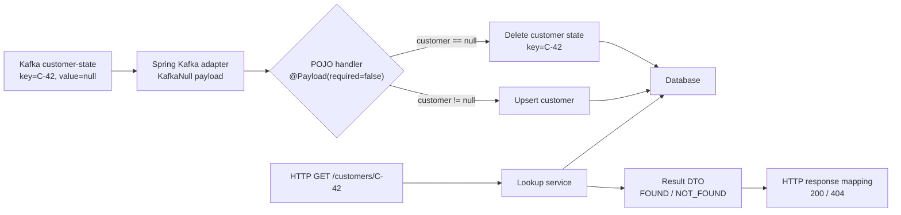

# Mapping null payload

## 1. Bài toán: “không có dữ liệu” mang nhiều ý nghĩa khác nhau

Trong module **SPRING_INTEGRATION_ADAPTERS**, các hệ thống ngoài được nối với Spring Integration qua inbound/outbound adapter, gateway, poller và `MessageChannel`. Khi dữ liệu đến từ HTTP, JMS, AMQP, Kafka, file/SFTP hoặc cơ sở dữ liệu, không phải đầu vào nào cũng có một đối tượng nghiệp vụ có giá trị.

Các tình huống thực tế:

- Một HTTP request không có body; một HTTP response trả `204 No Content`.
- Một JSON body chứa đúng literal `null`, hoặc object JSON có field `"address": null`.
- Một câu truy vấn database không tìm thấy dòng nào, hoặc tìm được dòng mà một cột mang SQL `NULL`.
- Một SFTP poller chưa thấy tệp mới, hoặc tìm thấy một tệp có kích thước `0` byte.
- Một service activator xử lý command thành công nhưng **không cần reply**.
- Một Kafka topic compacted nhận **tombstone record**: key có giá trị, Kafka value bằng `null` để biểu thị xóa trạng thái theo key.

Những trường hợp trên không cùng ngữ nghĩa. Nếu biến tất cả thành Java `null` rồi chuyển vào `MessageChannel`, flow có thể gặp exception, mất tín hiệu xóa, không trả HTTP response, hoặc im lặng chờ đến timeout.

**Điểm cốt lõi:** Spring Messaging yêu cầu `Message<?>` có **payload khác `null`**. Để diễn đạt “không có kết quả”, phải quyết định điều đó là *không phát message*, *một message mang trạng thái vắng dữ liệu*, *một response không có body*, hay *một biểu diễn đặc biệt theo giao thức*.

### Mục tiêu học tập

Sau bài học, bạn có thể:

1. Phân biệt Java `null`, `Optional.empty()`, empty payload, JSON `null` và “không có message”.
2. Hiểu hành vi của `MessageBuilder`, service activator, transformer, filter, gateway và poller khi gặp `null`.
3. Chọn chính sách mapping cho HTTP, JMS, AMQP, Kafka, file/SFTP và database mà không làm mất thông tin nghiệp vụ.
4. Sử dụng `KafkaNull` và `@Payload(required = false)` đúng ngữ cảnh tombstone.
5. Thiết kế hợp đồng result rõ ràng, xử lý lỗi và kiểm thử cho cả trường hợp có dữ liệu, vắng dữ liệu, timeout và dữ liệu rỗng.

## 2. Phân loại “null” trước khi viết mapper

| Tình huống | Ý nghĩa | Biểu diễn hợp lý |
|---|---|---|
| Không có message mới ở poller | Chưa có sự kiện để phát | `MessageSource.receive()` có thể trả `null`, poller không gửi gì |
| Payload Java `null` | Không có object payload | **Không tạo `Message<?>` như vậy** |
| `Optional.empty()` | Kết quả tính toán không có giá trị | Ở tầng Java; cần quyết định có chuyển thành kết quả nghiệp vụ hay không |
| Chuỗi rỗng `""` | Có chuỗi nhưng dài 0 | `Message<String>` hợp lệ |
| Mảng `new byte[0]` | Có payload byte với độ dài 0 | `Message<byte[]>` hợp lệ |
| JSON `null` | Có biểu diễn JSON hợp lệ của null | Payload có thể là chuỗi `"null"`, bytes `[0x6e,0x75,0x6c,0x6c]` hoặc cây JSON `NullNode` |
| JSON field vắng mặt | Không có key trong object | Phân biệt với key có giá trị JSON null |
| SQL `NULL` ở một cột | Một giá trị cột không xác định/vắng | Row object/map vẫn có thể là payload khác null |
| HTTP `204 No Content` | Request đã được xử lý, response không có body | Response status và body rỗng theo HTTP |
| Kafka tombstone | Value Kafka bằng null, key chỉ mục bản ghi bị xóa | Native Kafka record `value=null`; trong Spring dùng `KafkaNull` |

**Quy tắc:** trước khi map, hãy trả lời “dữ liệu vắng mặt có phải là một sự kiện nghiệp vụ không?”. Nếu câu trả lời là *có* (ví dụ xóa customer), phải **giữ lại tín hiệu** bằng payload/metadata phù hợp. Nếu câu trả lời là *không* (ví dụ poller chưa thấy file), không cần phát một message giả.

## 3. Vì sao Spring Message không cho phép payload null?

### 3.1. Hợp đồng của Spring Messaging

`Message<T>` là một envelope chứa payload và `MessageHeaders`. Các cài đặt chuẩn như `GenericMessage` và `MessageBuilder` yêu cầu payload **khác `null`**.

```java
import org.springframework.messaging.Message;
import org.springframework.messaging.support.MessageBuilder;

// Hợp lệ: chuỗi rỗng vẫn là một đối tượng String.
Message<String> emptyText = MessageBuilder
        .withPayload("")
        .build();

// Hợp lệ: mảng byte có độ dài 0 vẫn là một đối tượng.
Message<byte[]> emptyBytes = MessageBuilder
        .withPayload(new byte[0])
        .build();

// Sai: một Spring Message không chấp nhận payload Java null.
// Runtime ném IllegalArgumentException khi xây dựng.
Message<String> invalid = MessageBuilder
        .withPayload((String) null)
        .build();
```

Không dùng các workaround như `new GenericMessage<>(null)` hoặc ép kiểu generic để “lách” quy tắc này. Khi downstream nhận một `Message<?>`, các endpoint và converter cần một object payload thật để xử lý.

### 3.2. Header null cũng có ngữ nghĩa riêng

Khi dùng `MessageBuilder.setHeader(name, null)`, Spring **xóa header** đó (nếu có); đây không phải cách gửi một header chứa một giá trị null có ý nghĩa:

```java
import org.springframework.messaging.Message;
import org.springframework.messaging.support.MessageBuilder;

Message<String> message = MessageBuilder.withPayload("ok")
        .setHeader("sourceId", "abc")
        .setHeader("sourceId", null)
        .build();

System.out.println(message.getHeaders().containsKey("sourceId"));
// false
```

Nếu “có trường nhưng giá trị chưa biết” khác với “không có trường”, hãy khai báo hợp đồng rõ, ví dụ cờ trạng thái, JSON field null, hoặc DTO có thuộc tính `present`/`status`. Đừng giả định Java null sẽ tự được giữ qua mọi header mapper.

### 3.3. “Không có message” khác “message có payload rỗng”

`MessageChannel.send(message)` gửi một `Message<?>` hiện hữu; nó không diễn đạt “không có message” bằng cách gọi `send(null)`. Ở nguồn lấy dữ liệu theo poller, `MessageSource.receive()` trả `null` có thể biểu thị **hiện chưa có dữ liệu để tạo message**. Poller khi đó không phát một envelope giả vào flow.

```text
Poller
  |
  +-- receive() trả null ------> không phát message trong lần poll này
  |
  +-- receive() trả Message --> channel.send(message)
                                  |
                                  +-- payload=""         hợp lệ
                                  +-- payload=byte[0]    hợp lệ
                                  +-- payload=OrderEvent hợp lệ
```

Không nên thay `null` trong `receive()` bằng chuỗi `""` để cố báo “không có dữ liệu”: điều đó tạo ra **một sự kiện có payload chuỗi rỗng** và có thể khiến consumer xử lý sai.

## 4. Null trong endpoint: transformer, service activator, filter và gateway

### 4.1. Transformer: trả null là lỗi

Mục đích của transformer là chuyển một message đầu vào thành một message/kết quả hợp lệ khác. Trong Spring Integration, transformer không được dùng làm filter: nếu phương thức transform trả `null`, framework phát sinh `MessageTransformationException`.

```java
// Ví dụ để minh họa hành vi SAI khi dùng transformer.
public String transform(String input) {
    if (input.isBlank()) {
        return null; // Framework xem là lỗi transformation.
    }
    return input.trim();
}
```

Nếu cần loại bỏ input không hợp lệ, dùng **filter trước transformer**. Nếu input bắt buộc phải chuyển đổi thành kết quả, ném một exception có ý nghĩa và chuyển vào error flow.

### 4.2. Service activator: null thường có nghĩa là không phát reply

Một service activator có thể xử lý tác vụ một chiều. Nếu phương thức trả `null` hoặc `void`, endpoint thông thường kết thúc mà **không tạo reply**:

```java
import org.springframework.integration.annotation.ServiceActivator;

public class AuditHandler {

    @ServiceActivator(inputChannel = "audit.in")
    public void recordAudit(AuditEvent event) {
        writeAudit(event);
        // Không trả reply, nhưng request đã được xử lý.
    }
}
```

Nếu method trả giá trị `null` mà endpoint có `requiresReply=false` (mặc định với service activator thông thường), cũng không phát reply. Đối với một **gateway có method cần return value**, việc thiếu reply có thể khiến caller hết thời gian chờ.

Muốn hợp đồng *phải có reply*, bật `requires-reply` tại endpoint. Ví dụ XML:

```xml
<int:service-activator
        input-channel="orders.requests"
        ref="orderService"
        method="lookup"
        requires-reply="true"/>
```

Khi `lookup(...)` trả `null`, endpoint phát sinh `ReplyRequiredException` thay vì âm thầm bỏ qua. Đây là một tín hiệu lỗi hợp đồng, không phải “giá trị null trong reply”.

### 4.3. Filter: loại bỏ message theo điều kiện tường minh

Filter dành cho việc chấp nhận/loại bỏ các **message đã tồn tại**:

```java
import org.springframework.integration.annotation.Filter;

public class OrderFilter {

    @Filter(
            inputChannel = "orders.in",
            outputChannel = "orders.valid",
            discardChannel = "orders.rejected")
    public boolean accept(OrderCommand order) {
        return order.orderId() != null
                && !order.orderId().isBlank();
    }
}
```

Filter không nhận payload null theo kiểu `Message<?>` thông thường; ở đây `order` khác null nhưng **field trong object** có thể null. Khi predicate trả `false`, message được gửi sang `orders.rejected`. Nếu không cấu hình discard channel, message có thể bị drop; các phiên bản mới có cảnh báo log để giảm hiện tượng im lặng bỏ dữ liệu.

Nếu muốn từ chối bằng exception, cấu hình `throwExceptionOnRejection` tương ứng. Một filter làm rơi request của gateway đang chờ reply có thể gây timeout; vì vậy, với request/reply, thường tốt hơn khi tạo **reply nghiệp vụ thể hiện bị từ chối** hoặc một nhánh lỗi rõ ràng.

### 4.4. nullChannel: chỗ tiêu thụ message, không phải null payload

Spring Integration cung cấp kênh đặc biệt `nullChannel` để **loại bỏ message được gửi đến nó**. Nó không làm cho payload Java null trở nên hợp lệ:

```text
Message(payload = "processed")
             |
             v
         nullChannel
             |
             +--> message bị bỏ đi
```

Ứng dụng dùng `nullChannel` khi thực sự muốn kết thúc nhánh message một cách có chủ đích. Gửi một kết quả đến `nullChannel` trong flow đang yêu cầu reply mà không thiết kế phản hồi cho caller có thể dẫn tới gateway chờ/timeout.

### 4.5. Gateway: null không đồng nghĩa với một reply thành công có body null

Ví dụ:

```text
Gateway.lookup("C-42")
   |
   v
service activator.lookup(...) -> null
   |
   +--> không phát Spring reply
   |
Gateway chờ reply -> timeout / kết quả theo cấu hình
```

Nếu nghiệp vụ cần trả lời “không tìm thấy khách hàng”, hãy trả **một object kết quả khác null**:

```java
public record LookupReply(
        String customerId,
        LookupStatus status,
        String displayName) {

    public enum LookupStatus { FOUND, NOT_FOUND }
}

public LookupReply lookup(String customerId) {
    Customer customer = repository.find(customerId);

    if (customer == null) {
        return new LookupReply(
                customerId, LookupReply.LookupStatus.NOT_FOUND, null);
    }

    return new LookupReply(
            customerId,
            LookupReply.LookupStatus.FOUND,
            customer.displayName());
}
```

`LookupReply` luôn là một object khác null; field `displayName` có thể null theo hợp đồng. Gateway có thể trả kết quả này cho caller mà không cần “reply có null payload”.

**Lựa chọn khác:** dùng loại kết quả tổng quát kiểu `sealed interface`, ví dụ `Found(Customer)` và `NotFound(customerId)`, để biểu diễn trạng thái bằng type thay vì một field nullable. Dù cách nào, cần thiết kế serialization phù hợp nếu reply đi qua HTTP/JMS/AMQP/Kafka.

## 5. Phân biệt Optional.empty, empty body, JSON null và field null

### 5.1. Optional.empty thuộc tầng Java

`Optional.empty()` là **một object Java khác null**. Nó có thể được dùng làm return type từ repository/service, nhưng việc đưa `Optional` vào payload hoặc gửi xuyên adapter **không tự bảo đảm** các converter hiểu đúng.

Ví dụ map một Optional sang result DTO rõ nghĩa:

```java
import java.util.Optional;

Optional<Customer> result = repository.findById(customerId);

LookupReply reply = result
        .map(customer -> new LookupReply(
                customerId,
                LookupReply.LookupStatus.FOUND,
                customer.displayName()))
        .orElseGet(() -> new LookupReply(
                customerId,
                LookupReply.LookupStatus.NOT_FOUND,
                null));
```

Lựa chọn này giúp tránh phụ thuộc vào việc một converter sẽ serialize `Optional.empty()` thành gì. Nếu trả một `Optional<LookupReply>` từ method gateway, phải kiểm tra cách gateway và converter của phiên bản hiện dùng giải quyết `Optional`; không dùng nó như giao thức wire mặc định.

### 5.2. JSON null thực sự là dữ liệu

Hai body dưới đây khác nhau:

```http
POST /customer HTTP/1.1
Content-Type: application/json
Content-Length: 4

null
```

và một HTTP request **không có body**. Trường hợp đầu có bốn byte ASCII/UTF-8 của chữ `null`, là một literal JSON hợp lệ. Trường hợp sau không có payload trên dây.

Ở mức Spring message, nếu giữ JSON raw:

```java
import java.nio.charset.StandardCharsets;
import org.springframework.messaging.Message;
import org.springframework.messaging.MessageHeaders;
import org.springframework.messaging.support.MessageBuilder;
import org.springframework.util.MimeTypeUtils;

Message<byte[]> jsonNull = MessageBuilder
        .withPayload("null".getBytes(StandardCharsets.UTF_8))
        .setHeader(MessageHeaders.CONTENT_TYPE,
                MimeTypeUtils.APPLICATION_JSON)
        .build();

// jsonNull.getPayload() là byte[4], không phải Java null.
```

Nếu dùng Jackson để parse JSON `null` thành một Java object bất kỳ, kết quả có thể là `null` và không thể gói thẳng vào `MessageBuilder.withPayload(...)`. Một lựa chọn khi cần giữ ngữ nghĩa JSON của literal đó là sử dụng Jackson tree `NullNode`, một object khác null:

```java
import com.fasterxml.jackson.databind.JsonNode;
import com.fasterxml.jackson.databind.ObjectMapper;

ObjectMapper mapper = new ObjectMapper();
JsonNode node = mapper.readTree("null");

System.out.println(node != null); // true
System.out.println(node.isNull()); // true
```

Tuy nhiên, không tự động coi mọi `NullNode` là một tín hiệu “xóa bản ghi”: nó chỉ đại diện cho **JSON null**, còn semantics xóa phải do API/schema quy định.

### 5.3. Missing field và explicit null field

Xét ba JSON object:

```json
{"customerId":"C-42"}
```

```json
{"customerId":"C-42","phone":null}
```

```json
{"customerId":"C-42","phone":""}
```

Ba body có thể mang ba ý nghĩa trong một PATCH API:

- **Thiếu `phone`**: giữ nguyên số hiện tại.
- **`phone: null`**: xóa số điện thoại theo hợp đồng.
- **`phone: ""`**: cập nhật thành chuỗi rỗng hoặc từ chối validation.

Với Jackson tree:

```java
JsonNode request = mapper.readTree(
        "{\"customerId\":\"C-42\",\"phone\":null}");

JsonNode phone = request.path("phone");
System.out.println(phone.isNull());    // true
System.out.println(phone.isMissingNode()); // false

JsonNode missing = request.path("unknownField");
System.out.println(missing.isMissingNode()); // true
```

Nếu deserialize vào một DTO Java chỉ có field `String phone`, tùy cách binding có thể **mất khác biệt** giữa missing và null. Khi yêu cầu PATCH có ba trạng thái, dùng tree, cấu trúc `present + value` hoặc một nullable-field wrapper được thỏa thuận.

### 5.4. Empty string và empty bytes là payload hợp lệ

```java
Message<String> text = MessageBuilder
        .withPayload("")
        .build();

Message<byte[]> binary = MessageBuilder
        .withPayload(new byte[0])
        .build();

System.out.println(text.getPayload().length());    // 0
System.out.println(binary.getPayload().length);    // 0
```

Tuy cả hai hợp lệ, **meaning** phụ thuộc giao thức. Empty UTF-8 text, file 0 byte, request không body và JSON null không được gộp thành một trạng thái nếu nghiệp vụ cần phân biệt.

## 6. Mapping null ở ranh giới HTTP

### 6.1. Không có request body và JSON null

HTTP có thể mang request body rỗng hoặc body chứa JSON `null`. Cần kiểm tra:

- `Content-Type` có phù hợp không?
- Có byte body thực sự không?
- Một body rỗng có hợp lệ đối với endpoint này không?
- Nếu JSON literal `null` xuất hiện, API cho phép hay trả lỗi?
- Nếu body là object có nullable field, field nào được cho phép null?

Ví dụ hợp đồng:

| HTTP đầu vào | Ý nghĩa hợp đồng | Xử lý gợi ý |
|---|---|---|
| `POST /orders` không body | Không có order để tạo | Trả `400` hoặc lỗi validation |
| `POST /orders` body `null` | JSON literal null, không có Order object | Trả lỗi validation theo API |
| `PATCH /customers/C-42` với `{"phone":null}` | Chủ động xóa phone | Tạo command `ClearPhone` |
| `PATCH` thiếu `phone` | Không cập nhật field đó | Giữ nguyên dữ liệu |
| `GET /health` không body | Request hợp lệ | Xử lý action không cần payload nghiệp vụ |

Một inbound HTTP gateway có thể sử dụng loại request payload, message converter và cấu hình `request-payload-type` để đọc body. Khi payload vắng hoặc converter sinh Java null, **không nên mặc định toàn bộ endpoint vẫn phát Spring message với null payload**. Hành vi thiếu body phụ thuộc adapter, HTTP message converter và hợp đồng endpoint. Nếu cần một action không có body, hãy thiết kế một **command object khác null** hoặc endpoint chuyên biệt.

### 6.2. HTTP response 204 No Content không phải Spring message null

`204 No Content` là một **HTTP response thành công không có body**. Nó không yêu cầu tạo `Message<?>` với payload null. Endpoint HTTP có thể tạo response status 204 theo cấu hình riêng của gateway/HTTP framework, hoặc nhận một result object và ánh xạ ra HTTP status/body ở ranh giới.

```text
Command nội bộ: DeleteCustomer(customerId="C-42")
    |
    v
Service trả DeleteResult(status=DELETED)
    |
    v
HTTP response mapper
    |
    +--> HTTP 204 No Content (không body)
```

Phần **xây HTTP response** là trách nhiệm HTTP gateway/controller/handler và status mapping. Nếu service activator chỉ trả `null`, gateway có thể không có Spring reply để tạo response kịp hạn; điều này **không tự động** đồng nghĩa HTTP 204.

### 6.3. Phân biệt với kết quả “không tìm thấy”

`404 Not Found`, `204 No Content` và `200 OK` kèm `{"status":"NOT_FOUND"}` đều có thể hợp lý trong các API khác nhau, nhưng semantics khác nhau. Thống nhất hợp đồng API trước khi mapping kết quả từ Spring flow.

Đặc biệt với inbound gateway có return path, nếu cần trả response hợp lệ ngay cả khi không có dữ liệu, nên đảm bảo flow phát một **reply khác null** để HTTP layer có đủ thông tin xác định status.

## 7. Kafka: tombstone record là trường hợp đặc biệt quan trọng

### 7.1. Tombstone là một record có key và value null

Trong Kafka, một record có `value=null` có thể được sử dụng làm **tombstone** trong topic được cấu hình log compaction. Tombstone đánh dấu rằng trạng thái của key đó cần được xóa khi compacted log được xử lý. Nó không giống một record không tồn tại.

```text
topic: customer-state
key:   C-42
value: {"name":"An"}  --> ghi/cập nhật trạng thái

topic: customer-state
key:   C-42
value: null          --> tombstone cho key C-42
```

Điều kiện quan trọng:

- **Key phải có ý nghĩa ổn định** để xác định bản ghi bị xóa.
- Topic phải có chính sách compaction phù hợp thì việc xóa phiên bản cũ khỏi compacted log mới có ý nghĩa.
- Kafka có thể trả `null` từ deserializer vì những lý do khác; cần hiểu hợp đồng nguồn trước khi coi mọi null là “delete”.
- Tombstone không tự cập nhật database nghiệp vụ; consumer phải hiện thực logic xóa/idempotency phù hợp.

### 7.2. KafkaNull là sentinel của Spring Kafka

Spring Messaging không cho phép payload Java null. Để biểu diễn tombstone trong một `Message<?>`, Spring Kafka cung cấp `org.springframework.kafka.support.KafkaNull`; payload chứa `KafkaNull.INSTANCE` sẽ được framework xử lý thành **native Kafka record value null** khi dùng converter thích hợp.

Ví dụ gửi tombstone trực tiếp bằng KafkaTemplate:

```java
import org.springframework.kafka.core.KafkaTemplate;

// Giả sử trong một bean đã inject KafkaTemplate<String, String> kafkaTemplate
// và producer có serializer key/value phù hợp.
String customerId = "C-42";

// Value null trên Kafka wire: tombstone cho key C-42.
kafkaTemplate.send("customer-state", customerId, null);
```

Với `Message<?>` API:

```java
import org.springframework.kafka.support.KafkaHeaders;
import org.springframework.kafka.support.KafkaNull;
import org.springframework.messaging.Message;
import org.springframework.messaging.support.MessageBuilder;

Message<KafkaNull> delete = MessageBuilder
        .withPayload(KafkaNull.INSTANCE)
        .setHeader(KafkaHeaders.TOPIC, "customer-state")
        .setHeader(KafkaHeaders.KEY, "C-42")
        .build();

// Gửi qua KafkaTemplate.send(Message<?>) hoặc endpoint tương thích.
// Converter nhận KafkaNull và tạo native Kafka value=null.
```

**Không dùng `MessageBuilder.withPayload(null)` để tạo tombstone.** `KafkaNull` là một sentinel **riêng của Spring Kafka**, không phải quy ước dùng chung cho HTTP/JMS/AMQP.

### 7.3. Nhận tombstone trong Spring Integration

Khi Kafka inbound adapter đưa tombstone vào Spring Integration, payload ở tầng message có thể là `KafkaNull`. Spring Integration hỗ trợ đưa một **tham số Java null** cho POJO handler nếu dùng `@Payload(required = false)`.

Ví dụ được hỗ trợ bởi Spring Integration Kafka:

```java
import org.springframework.integration.annotation.ServiceActivator;
import org.springframework.kafka.support.KafkaHeaders;
import org.springframework.messaging.handler.annotation.Header;
import org.springframework.messaging.handler.annotation.Payload;

public class CustomerStateHandler {

    @ServiceActivator(inputChannel = "fromKafka")
    public void handle(
            @Header(KafkaHeaders.RECEIVED_KEY) String key,
            @Payload(required = false) Customer customer) {

        if (customer == null) {
            deleteCustomerState(key);
            return;
        }
        upsertCustomerState(key, customer);
    }
}
```

Chú ý sự phân biệt: Spring `Message<?>` **vẫn có payload khác null** (`KafkaNull`), nhưng bộ phân giải tham số của handler có thể truyền **Java null** vào tham số `customer`. Nếu cấu hình custom `MessageHandlerMethodFactory` hoặc converter, phải kiểm tra hỗ trợ `KafkaNullAwarePayloadArgumentResolver`/adapter phù hợp.

Đọc Kafka key qua `KafkaHeaders.RECEIVED_KEY` để xác định bản ghi cần xóa. Không dựa vào một field trong value vì lúc tombstone **value không tồn tại**.

### 7.4. Không “làm mất tombstone” khi chuyển đổi

Một lỗi thường gặp:

```text
Kafka record (key=C-42, value=null)
  |
  v
Spring inbound (payload=KafkaNull)
  |
  v
Transformer đổi KafkaNull thành null   <-- SAI: lỗi transformer
  |
  v
Không còn message để worker xóa trạng thái
```

Nếu muốn chuẩn hóa sang giao thức khác, tạo một **sự kiện xóa rõ ràng**:

```java
public record CustomerDeleted(
        String customerId,
        String eventId) {}

// Một Java object khác null, có nghĩa nghiệp vụ rõ.
CustomerDeleted deleted = new CustomerDeleted("C-42", "evt-delete-42");
```

Khi gửi HTTP, JMS, AMQP hoặc file manifest, serialize `CustomerDeleted` theo schema đã thỏa thuận. Đừng xuất `KafkaNull.INSTANCE` qua adapter khác rồi giả định mọi hệ thống đều biết nó là “delete”.

## 8. JMS và AMQP: không tự chuyển null thành native message

### 8.1. JMS

JMS message có các loại body như `TextMessage`, `BytesMessage`, `ObjectMessage` và metadata/property. JMS provider và converter có thể có quy tắc cho body rỗng, nullable text hoặc body không tồn tại. Tuy nhiên, đó là **hợp đồng JMS**, không làm thay đổi quy tắc payload của Spring `Message<?>`.

Ví dụ:

```text
JMS request:
  JMSCorrelationID = "request-42"
  body: empty text/bytes theo converter

Spring service:
  không tìm thấy customer

Hai lựa chọn rõ nghĩa:
  1. Reply = CustomerLookupResult(found=false)
  2. Không reply nếu hợp đồng thật sự one-way
```

Nếu đang dùng **JMS outbound gateway** cần request/reply, lựa chọn thứ nhất thường phù hợp hơn. Responder trả `null` với kỳ vọng “reply body null” có thể dẫn đến **không tạo reply**, khiến gateway timeout. Nếu remote contract cần body không có dữ liệu nhưng reply vẫn phải tồn tại, cấu hình JMS message/converter và reply metadata theo đúng API provider; nên dùng explicit result DTO khi có thể.

### 8.2. AMQP/RabbitMQ

Spring AMQP `Message` ở tầng broker thường chứa body `byte[]` cùng `MessageProperties`; một body có độ dài 0 vẫn là dữ liệu khác với Spring Messaging payload Java null.

Ví dụ hợp đồng RPC:

```text
Request AMQP:
  correlationId = req-42
  replyTo = reply-queue
  body = {"customerId":"C-42"}

Reply AMQP:
  correlationId = req-42
  contentType = application/json
  body = {"found":false}
```

Response `{"found":false}` cho biết **đã nhận và xử lý request nhưng không tìm thấy customer**. Nếu handler chỉ trả `null`, gateway phía gọi có thể không nhận được reply và timeout. Đừng biến không tìm thấy dữ liệu thành “không nhận được phản hồi” khi nghiệp vụ cần phân biệt hai trạng thái.

### 8.3. Vì sao không dùng KafkaNull trên JMS/AMQP?

`KafkaNull` tồn tại để Spring Kafka map tới **Kafka native value null**. Nếu đưa `KafkaNull.INSTANCE` qua converter AMQP/JMS mà không định nghĩa hợp đồng riêng, phía nhận có thể nhìn thấy class Java lạ, lỗi serialization hoặc dữ liệu không có ý nghĩa.

Với JMS/AMQP, dùng một command/event DTO như `DeleteCustomer`, hoặc wire schema có trường `operation=DELETE` và `customerId`. Mapper chỉ chuyển headers và payload theo giao thức; không có một quy ước “null của mọi broker” tự động nhất quán.

## 9. File/SFTP và database: “không có item” khác dữ liệu null

### 9.1. File/SFTP polling

Một file inbound/SFTP inbound adapter thường chỉ phát message khi tìm thấy tệp phù hợp. Nếu một lần poll không có file mới, nguồn có thể không tạo message. Nếu có file rỗng:

```text
Poll #1:
  no new file
  -> no Spring message

Poll #2:
  /incoming/orders-001.csv exists, size=0
  -> có một file hợp lệ theo filesystem
  -> Spring message có thể chứa File/byte[0]/resource khác null
```

File rỗng có thể là **lỗi validation**, **dấu hiệu file hoàn tất**, hoặc **một dữ liệu hợp lệ**, tùy hợp đồng producer/consumer. Không coi 0 byte là không có file và không để adapter tự bịa sự kiện “null”.

Với file chứa CSV:

```csv
customerId,phone
C-42,
```

Ô `phone` rỗng cần quy định riêng (empty string, SQL NULL hay “không cập nhật”); không có ánh xạ universal từ dấu phẩy cuối sang Java null.

### 9.2. Database polling và SQL NULL

Ví dụ:

```sql
SELECT id, note
FROM orders
WHERE status = 'READY';
```

Nếu không có row phù hợp, đây là **không có item để phát**. Nếu có row `(id=42, note=NULL)`, vẫn có một bản ghi tồn tại; cột `note` mới là SQL NULL. Khi chuyển thành Java DTO, `note` có thể null, nhưng **payload DTO** là object khác null.

```java
public record OrderRow(long id, String note) {}

// SQL row có id=42, note=NULL:
OrderRow row = new OrderRow(42L, null);

// Spring Message payload = row (khác null).
Message<OrderRow> message = MessageBuilder
        .withPayload(row)
        .build();
```

Nếu query không trả row, không nên giả lập một `OrderRow(0,null)` vì nó có thể bị hiểu là đơn hàng hợp lệ. Cần định nghĩa kết quả “not found” tại query service hoặc để poller tiếp tục chu kỳ mà không phát message.

### 9.3. JDBC NULL khi update khác với bỏ qua field

Một lệnh:

```sql
UPDATE customers SET phone = NULL WHERE id = ?;
```

có ý nghĩa **chủ động xóa giá trị**. Nó khác việc không chạy câu lệnh update hay bỏ qua `phone` trong PATCH. Khi thiết kế mapper từ HTTP JSON sang database, cần giữ được ba trạng thái **missing**, **explicit null**, **actual value** nếu nghiệp vụ cho phép partial update.

## 10. Chọn một hợp đồng rõ ràng cho dữ liệu nullable

### 10.1. Ma trận quyết định

| Nhu cầu | Cách biểu diễn phù hợp | Lỗi nên tránh |
|---|---|---|
| Không có dữ liệu để poll | Không phát message trong lần poll | Tạo message payload null |
| Bỏ qua message không hợp lệ | Filter, discard channel hoặc explicit error | Transformer trả null để lọc |
| Không tìm thấy trong RPC | Result DTO `NOT_FOUND` hoặc reply lỗi theo hợp đồng | Service activator trả null làm caller timeout |
| Command one-way | `void` handler, không cần reply | Dùng gateway có return value rồi không trả lời |
| Trả HTTP thành công không body | HTTP 204 qua response mapping | Đồng nhất null service return với HTTP 204 |
| JSON literal null | JSON bytes/String/`NullNode` theo schema | Dùng Java null làm payload |
| PATCH field null | Field presence + explicit null | Đánh đồng missing với null |
| Kafka tombstone | Kafka native value null / Spring `KafkaNull` | Gửi message Spring với payload null |
| Xóa entity qua JMS/AMQP | `DeleteEntity` command/event rõ ràng | Gửi sentinel chỉ Spring Kafka hiểu |
| SQL NULL ở một field | DTO/map có field null và payload object khác null | Bỏ toàn bộ row |
| Empty file hoặc empty body | Empty String/`byte[0]`/resource hợp lệ | Hiểu “0 byte” là “không có message” |

### 10.2. Tạo một result envelope rõ nghĩa

Ví dụ quy ước không tìm thấy customer:

```java
public enum LookupState {
    FOUND,
    NOT_FOUND,
    ERROR
}

public record CustomerLookupResult(
        String requestId,
        LookupState state,
        Customer data,
        String errorCode) {

    public static CustomerLookupResult notFound(String requestId) {
        return new CustomerLookupResult(
                requestId, LookupState.NOT_FOUND, null, null);
    }
}
```

Đây là một **payload object khác null** dù field `data` có thể null. Trong JSON có thể biểu diễn `data:null` hoặc bỏ field theo cấu hình serializer; nếu wire format cần phân biệt, hãy chỉ rõ field presence và kiểm thử output thực tế.

Một RPC nên phân biệt:

- `NOT_FOUND`: hệ thống đã trả lời, không có thực thể cần tìm.
- `ERROR`: hệ thống có lỗi, có `errorCode` hoặc lỗi channel/exception thích hợp.
- `TIMEOUT`: chưa nhận phản hồi trong thời hạn.
- `CANCELLED`: công việc bị hủy có chủ đích.
- `SUCCESS_WITH_EMPTY_RESULT`: thao tác thành công, kết quả là danh sách rỗng/byte rỗng.

Những trạng thái này không thể an toàn quy về Java `null` duy nhất.

### 10.3. Lựa chọn sentinel: chỉ dùng khi có quy tắc chuyển đổi

Có thể thiết kế một `NoValue` hoặc `Deleted` sentinel để mang qua `MessageChannel`. Khi đó nó là một object Java **khác null**, và mỗi endpoint phải biết biến sentinel thành representation native phù hợp.

```java
public enum NoValue {
    INSTANCE
}

// Object hợp lệ làm payload bên trong một flow đã thống nhất.
Message<NoValue> noValue = MessageBuilder
        .withPayload(NoValue.INSTANCE)
        .build();
```

Ví dụ này minh họa ý tưởng, **không phải sentinel chuẩn của Spring Integration**. Đừng tự đưa `NoValue.INSTANCE` vào JSON/JMS/AMQP/Kafka mà chưa có converter/hợp đồng; với Kafka tombstone, ưu tiên sentinel `KafkaNull` đã được Spring Kafka hỗ trợ.

## 11. Ví dụ xuyên giao thức: cập nhật/xóa trạng thái customer

Một service quản lý trạng thái customer nhận Kafka compacted topic, cập nhật database và cho phép client tra cứu qua HTTP.



Ở đây có **hai loại vắng dữ liệu khác nhau**:

- Kafka value null với key `C-42` là **một sự kiện xóa**. Consumer phải xử lý việc xóa; không được drop message.
- HTTP lookup sau xóa trả `NOT_FOUND`. HTTP caller cần response theo hợp đồng; handler không nên trả null để làm HTTP gateway chờ.

### 11.1. Một ví dụ sai

```java
// Ví dụ sai: định dùng null để xóa rồi đẩy qua IntegrationFlow.
Customer customer = null;
Message<Customer> wrong = MessageBuilder
        .withPayload(customer)
        .build(); // IllegalArgumentException
```

Đổi thành:

```java
// Khi đi đến Kafka compacted topic:
Message<KafkaNull> tombstone = MessageBuilder
        .withPayload(KafkaNull.INSTANCE)
        .setHeader(KafkaHeaders.TOPIC, "customer-state")
        .setHeader(KafkaHeaders.KEY, "C-42")
        .build();

// Khi đi đến JMS/AMQP hoặc HTTP domain API:
DeleteCustomer command = new DeleteCustomer("C-42");
Message<DeleteCustomer> deletion = MessageBuilder
        .withPayload(command)
        .build();
```

`DeleteCustomer` là domain record do ứng dụng định nghĩa:

```java
public record DeleteCustomer(String customerId) {}
```

Hai message có **payload khác nhau theo giao thức**, nhưng đều mô tả cùng hành động nghiệp vụ. Gateway, header mapper và converter chịu trách nhiệm đưa chúng tới đúng native endpoint.

### 11.2. Giữ correlation ID và lỗi khi không có kết quả

Nếu HTTP client gọi lệnh xóa qua JMS gateway, vẫn cần một reply có tương quan đúng khi nghiệp vụ kết thúc:

```text
HTTP DELETE request id=req-42
    |
Spring command DeleteCustomer("C-42")
    |
JMS outbound gateway (JMSCorrelationID/JMSReplyTo)
    |
Remote worker deletes customer
    |
JMS reply: DeleteResult(status=DELETED, requestId=req-42)
    |
Spring reply -> HTTP 204 No Content
```

Cả `DeleteCustomer` và `DeleteResult` là payload objects khác null trong Spring. HTTP 204 là **cách thể hiện ở ranh giới HTTP**, không cần “null reply Spring” ở giữa flow.

## 12. Xử lý lỗi và retry cho null mapping

### 12.1. Phân biệt lỗi dữ liệu với thiếu kết quả hợp lệ

| Tình huống | Nên xử lý |
|---|---|
| Dữ liệu JSON sai cú pháp | Lỗi deserialization/validation, không coi như null hợp lệ |
| JSON literal `null` tại API bắt buộc object | Từ chối theo hợp đồng, ví dụ 400 |
| Kafka tombstone đúng key | Xử lý delete/idempotency |
| Kafka tombstone không có key theo nghiệp vụ | Từ chối/đưa vào error flow; không xóa ngẫu nhiên |
| Transformer trả null vì bug | `MessageTransformationException`, lỗi code cần sửa |
| Service activator trả null trong RPC cần reply | `ReplyRequiredException` nếu cấu hình requires-reply |
| Poller không có dữ liệu | Không phát message, không phải lỗi |
| File trống khi schema yêu cầu dữ liệu | Validation error, quarantine/retry theo chính sách |
| SQL NULL ở cột tùy chọn | Ánh xạ field nullable trong DTO |
| SQL NULL ở cột bắt buộc | Lỗi dữ liệu/schema, không tạo event giả |

### 12.2. Retry không sửa được dữ liệu cố định sai

Nếu parser không hiểu một JSON literal null hoặc transformer trả null do logic sai, retry lặp lại cùng đầu vào có thể tiếp tục thất bại. Nên phân loại **permanent failure** (không hợp lệ theo schema) và **transient failure** (mất kết nối DB, broker tạm lỗi).

Với Kafka tombstone, retry cần **idempotent delete**: xóa cùng key hai lần không nên gây lỗi không thể phục hồi chỉ vì bản ghi đã bị xóa ở lần trước. Với JMS/AMQP và gateway, nếu handler không trả reply, caller timeout có thể retry dù worker đã hoàn tất; cần idempotency key và monitoring để tránh tạo hiệu ứng trùng.

### 12.3. Đừng để null làm mất thông tin trong observability

Khi log hãy ghi trạng thái rõ:

```text
eventType=CustomerDeleted
customerId=C-42
kafkaValueIsNull=true
messagePayloadType=KafkaNull
action=DELETE
result=SUCCESS
```

Không chỉ log `payload=null`, bởi cùng dòng log có thể xuất hiện khi một converter lỗi hoặc response chưa được tạo. Với dữ liệu nhạy cảm, không in toàn bộ message payload vào log; dùng ID, trạng thái và error code đã chuẩn hóa.

## 13. Kiểm thử các trường hợp null, empty và tombstone

### 13.1. Unit test MessageBuilder và header null

Ví dụ JUnit 5:

```java
import static org.junit.jupiter.api.Assertions.*;

import org.junit.jupiter.api.Test;
import org.springframework.messaging.Message;
import org.springframework.messaging.support.MessageBuilder;

class NullPayloadMappingTest {

    @Test
    void springMessageRejectsJavaNullPayload() {
        assertThrows(IllegalArgumentException.class,
                () -> MessageBuilder
                        .withPayload((String) null)
                        .build());
    }

    @Test
    void emptyStringAndEmptyByteArrayAreValidPayloads() {
        Message<String> text = MessageBuilder
                .withPayload("")
                .build();
        Message<byte[]> bytes = MessageBuilder
                .withPayload(new byte[0])
                .build();

        assertEquals("", text.getPayload());
        assertEquals(0, bytes.getPayload().length);
    }

    @Test
    void settingNullHeaderRemovesIt() {
        Message<String> message = MessageBuilder.withPayload("ok")
                .setHeader("reference", "old")
                .setHeader("reference", null)
                .build();

        assertFalse(message.getHeaders().containsKey("reference"));
    }
}
```

### 13.2. Unit test JSON null khác missing field

```java
import static org.junit.jupiter.api.Assertions.*;

import com.fasterxml.jackson.databind.JsonNode;
import com.fasterxml.jackson.databind.ObjectMapper;
import org.junit.jupiter.api.Test;

class JsonNullTest {

    private final ObjectMapper mapper = new ObjectMapper();

    @Test
    void literalNullIsAJsonNode() throws Exception {
        JsonNode literal = mapper.readTree("null");

        assertNotNull(literal);
        assertTrue(literal.isNull());
    }

    @Test
    void missingAndExplicitNullFieldsDiffer() throws Exception {
        JsonNode body = mapper.readTree("{\"phone\":null}");

        assertTrue(body.path("phone").isNull());
        assertTrue(body.path("other").isMissingNode());
        assertFalse(body.path("other").isNull());
    }
}
```

### 13.3. Unit test KafkaNull là payload khác null

```java
import static org.junit.jupiter.api.Assertions.*;

import org.junit.jupiter.api.Test;
import org.springframework.kafka.support.KafkaNull;
import org.springframework.messaging.Message;
import org.springframework.messaging.support.MessageBuilder;

class KafkaTombstoneMessageTest {

    @Test
    void kafkaNullSentinelCanBeSpringPayload() {
        Message<KafkaNull> message = MessageBuilder
                .withPayload(KafkaNull.INSTANCE)
                .build();

        assertNotNull(message.getPayload());
        assertSame(KafkaNull.INSTANCE, message.getPayload());
    }
}
```

**Giới hạn của test này:** mới chứng minh `KafkaNull` là object khác null. Để chắc chắn broker nhận `value=null`, cần test thực tế `KafkaTemplate`/outbound Kafka adapter và converter/serializer.

### 13.4. Ma trận integration test tại biên adapter

| Ca kiểm thử | Đầu vào | Kỳ vọng |
|---|---|---|
| Spring message null | `MessageBuilder.withPayload(null)` | Exception rõ ràng |
| Spring message empty | `""`, `byte[0]` | Message hợp lệ |
| Header set null | `setHeader("x", null)` | Header bị xóa |
| Transformer null | Transformer trả `null` | `MessageTransformationException` |
| Service activator one-way | Handler `void`/null | Không phát reply |
| Service activator requires reply | Handler trả `null` | `ReplyRequiredException` |
| Filter reject | Predicate trả `false` | Drop/route discard/throw theo config |
| Gateway request/reply | Result `NOT_FOUND` object khác null | Caller nhận kết quả nghiệp vụ, không timeout |
| HTTP empty body | Body vắng tại API JSON bắt buộc | Validation/error response |
| HTTP JSON null | Body `null` | Chính sách API rõ, không tự coi là empty |
| HTTP 204 | Xóa thành công | Response không body, status 204 |
| JMS/AMQP no match | Không tìm thấy row | Reply DTO `NOT_FOUND`, correlation giữ nguyên |
| Kafka tombstone outbound | Key `C-42`, `KafkaNull` | Native Kafka value null |
| Kafka tombstone inbound | Native record value null | Handler nhận null qua `@Payload(required=false)` hoặc sentinel, xử lý delete |
| Kafka normal event | Value không null | Handler upsert |
| SFTP không có file | Poll không tìm file mới | Không phát message |
| SFTP file rỗng | Có file 0 byte | Một item cụ thể, validate theo schema |
| DB không có row | Query trả 0 row | Không tạo bản ghi nghiệp vụ giả |
| DB nullable column | Row có field SQL NULL | DTO payload hợp lệ với field null |
| Retry/duplicate tombstone | Cùng key bị xóa nhiều lần | Delete idempotent |

Kiểm thử HTTP bằng mock server hoặc HTTP test client; Kafka bằng embedded broker/Testcontainers để quan sát **native record key/value**; JMS/AMQP với broker test thực tế để xác minh converter, routing, correlation và error flow. Kết quả của bài test đơn vị không chứng minh tất cả adapter hiểu cùng một sentinel.

## 14. Bài thực hành: chuẩn hóa “không có dữ liệu” ở ba biên

**Bối cảnh:** Hệ thống nhận sự kiện customer từ Kafka compacted topic, lưu trạng thái trong database và cung cấp HTTP lookup. Bên cạnh update thông thường, hệ thống phải xử lý tombstone và các kết quả không tìm thấy.

**Yêu cầu triển khai:**

1. Viết bảng hợp đồng cho các trạng thái: Kafka value có dữ liệu, Kafka tombstone, database không có row, database nullable field, HTTP lookup không tìm thấy và HTTP xóa thành công.
2. Dựng ba Spring messages: payload `String ""`, `byte[0]` và `KafkaNull.INSTANCE`. Chứng minh chúng hợp lệ; kiểm tra `withPayload(null)` gây exception.
3. Tạo Kafka producer gửi customer state bình thường và tombstone cho cùng key. Kiểm tra native Kafka value ở consumer thực.
4. Trong Spring Integration, viết `@ServiceActivator` nhận `@Header(KafkaHeaders.RECEIVED_KEY)` và `@Payload(required = false)`; thực hiện upsert khi value có dữ liệu, delete idempotent khi value null.
5. Tạo HTTP lookup trả `CustomerLookupResult` khác null. Map `FOUND` sang response thành công và `NOT_FOUND` sang 404 (hoặc hợp đồng API đã chọn), không dùng service activator trả null để biểu thị 404.
6. Thêm transformer cố ý trả null và xác nhận có `MessageTransformationException`. Sửa bằng filter hoặc result object.
7. Thử một JSON PATCH có `phone` thiếu, `phone:null` và `phone:""`; xác nhận ứng dụng phân biệt được các trạng thái.
8. Thử lại cùng tombstone hoặc retry request, kiểm chứng xóa lặp không làm hỏng tính nhất quán.

**Tiêu chí đạt:** không tạo Spring message payload null; không làm mất Kafka tombstone; có phân biệt missing/null/empty; gateway trả reply đúng hợp đồng; test có cả native Kafka value null và đường HTTP không body khi cần.

## 15. Ghi nhớ

- Spring `Message<?>` **không chấp nhận Java null payload**; một chuỗi rỗng, mảng byte rỗng, `NullNode` hoặc sentinel khác null vẫn là payload hợp lệ.
- **Không phát message**, **không có reply**, **JSON null**, **HTTP 204**, **SQL NULL**, **file rỗng** và **Kafka tombstone** là các ngữ nghĩa khác nhau.
- Transformer trả `null` là lỗi; filter dành cho loại bỏ message; service activator có thể trả `null`/`void` khi không cần reply. `requiresReply` phát hiện lỗi thiếu reply trong hợp đồng request/reply.
- `nullChannel` là một **sink** nhận và loại bỏ message, không phải payload thay thế cho Java null.
- Với Kafka compacted topic, tombstone có native `value=null`; dùng `KafkaNull.INSTANCE` khi cần gửi qua Spring `Message<?>` và `@Payload(required = false)` để nhận null trong POJO handler khi endpoint hỗ trợ.
- `KafkaNull` không là quy ước chung cho JMS/AMQP/HTTP. Khi chuyển sang giao thức khác, dùng một event/command có schema rõ, như `DeleteCustomer`.
- Khi API cần trả “không tìm thấy”, gửi result DTO hoặc lỗi nghiệp vụ có nghĩa; không biến thành một gateway không nhận reply.
- Kiểm thử phải bao gồm **wire representation** và end-to-end behavior, không chỉ kiểm tra nội dung của `MessageHeaders`.

## Tài liệu tham khảo

1. [Spring Framework — MessageBuilder Javadoc](https://docs.spring.io/spring-framework/docs/current/javadoc-api/org/springframework/messaging/support/MessageBuilder.html): tạo message, ý nghĩa `setHeader(name, null)`.
2. [Spring Integration — Transformer](https://docs.spring.io/spring-integration/reference/transformer.html): transformer không được trả null.
3. [Spring Integration — Service Activator](https://docs.spring.io/spring-integration/reference/service-activator.html): hành vi null/void và `requiresReply`.
4. [Spring Integration — Filter](https://docs.spring.io/spring-integration/reference/filter.html): discard, rejection và error policy.
5. [Spring Integration — Special Channels](https://docs.spring.io/spring-integration/reference/channel.html): `nullChannel` và các loại channel.
6. [Spring Integration — Apache Kafka Support](https://docs.spring.io/spring-integration/reference/kafka.html): biểu diễn tombstone bằng `KafkaNull` và `@Payload(required=false)`.
7. [Spring Kafka — Null Payloads and Log Compaction](https://docs.spring.io/spring-kafka/reference/kafka/tombstones.html): Kafka tombstone, `KafkaNull`, `KafkaTemplate`.
8. [Spring Integration — HTTP Support](https://docs.spring.io/spring-integration/reference/http.html): gateway, converter, status và request/reply.
9. [Spring Integration — JMS Support](https://docs.spring.io/spring-integration/reference/jms.html): JMS adapters/gateways và reply semantics.
10. [Spring Integration — AMQP Support](https://docs.spring.io/spring-integration/reference/amqp.html): AMQP adapters/gateways và converter.

*Cấu hình endpoint, converter và hỗ trợ nullable parameter có thể khác theo phiên bản Spring Integration/Spring Kafka. Khi áp dụng vào dự án, đối chiếu dependency đang dùng và kiểm thử chính adapter/broker của hệ thống. Bài này tập trung vào thiết kế nội dung và thực hành mapping null payload; vòng rà soát chuyên môn chuyên sâu thuộc bước Content QA sau khi hoàn thành các học liệu liên quan.*
