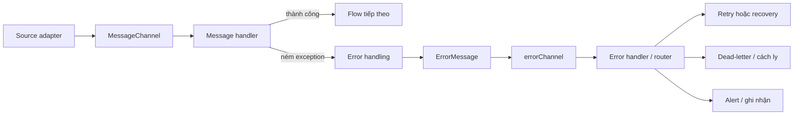

# Mapping lỗi thành ErrorMessage

## Mục tiêu

Trong một flow Spring Integration, lỗi có thể phát sinh khi nhận dữ liệu từ hệ thống ngoài, chuyển đổi payload, gọi service nghiệp vụ hoặc gửi message tới endpoint tiếp theo. Để xử lý lỗi nhất quán, Spring Messaging biểu diễn lỗi dưới dạng `ErrorMessage`: một message có payload là `Throwable`, kèm thông tin giúp xác định message và bước xử lý đã thất bại.

Bài này giải thích cấu trúc `ErrorMessage`, cách lỗi đi vào error channel, cách đọc exception và message gốc, cách chuyển lỗi thủ công thành `ErrorMessage`, và cách phân loại lỗi để retry, cách ly hoặc cảnh báo. Đây là một phần của việc xây dựng adapter và gateway kết nối hệ thống ngoài vào Spring Integration: ngoài hợp đồng message thành công, flow cũng cần hợp đồng rõ ràng cho lỗi.

## Vì sao cần ánh xạ lỗi thành message?

Trong xử lý đồng bộ, exception có thể được ném ngược về caller. Nhưng với luồng bất đồng bộ như `ExecutorChannel`, poller hoặc tác vụ nền, caller ban đầu có thể đã kết thúc trước khi lỗi xảy ra. Không còn một stack call phù hợp để trả exception về. Error channel đưa lỗi trở lại mô hình message để một endpoint khác có thể ghi log, phân loại, gửi cảnh báo, lưu message lỗi hoặc điều phối retry.

`ErrorMessage` không làm cho thao tác thất bại trở thành thành công và cũng không tự retry. Nó chuẩn hóa cách biểu diễn lỗi để flow có thể xử lý lỗi bằng cùng cơ chế channel, endpoint và router đã dùng cho message thông thường.



## Cấu trúc của ErrorMessage

`ErrorMessage` thuộc Spring Messaging (`org.springframework.messaging.support.ErrorMessage`) và là một loại `Message<Throwable>`. Payload của nó là exception hoặc lỗi được ánh xạ. Tùy cách tạo, message còn có thể mang theo message gốc đã gây ra lỗi.

| Thành phần | Ý nghĩa |
|---|---|
| `getPayload()` | `Throwable` mô tả lỗi; có thể là exception nghiệp vụ hoặc exception do framework bọc lại |
| `getOriginalMessage()` | Message ban đầu liên quan tới lỗi nếu thông tin này được cung cấp khi tạo `ErrorMessage` |
| Message headers | Metadata phục vụ định tuyến, tương quan và quan sát; không nên giả định mọi header của message gốc đều tự động được sao chép |

Một lỗi trong endpoint Spring Integration thường được bọc trong các lớp con của `MessagingException`. Ví dụ, `MessageHandlingException` biểu thị lỗi trong lúc xử lý message; `MessageDeliveryException` liên quan tới việc gửi hoặc chuyển message; `MessageTimeoutException` biểu thị timeout ở một số đường xử lý. `MessagingException` có thể cung cấp `getFailedMessage()` để truy xuất message mà framework gắn với lỗi.

Vì exception có thể được bọc nhiều lớp, cần phân biệt exception đang nằm trong payload với exception gốc ở sâu hơn trong chuỗi `cause`. Không nên chỉ kiểm tra một class duy nhất rồi bỏ qua `cause`, `failedMessage` hoặc `originalMessage`.

## Khi nào Spring Integration tạo ErrorMessage?

Việc lỗi được đưa vào error channel phụ thuộc vào cách endpoint thực thi và cấu hình error handling.

- Với đường xử lý đồng bộ, chẳng hạn `DirectChannel`, exception thường truyền ngược qua lời gọi gửi message. Nếu caller là gateway, gateway có thể truyền exception về phía gọi hoặc ánh xạ thành kết quả lỗi theo cấu hình của gateway.
- Với đường xử lý bất đồng bộ, chẳng hạn `ExecutorChannel`, lỗi xảy ra sau khi message đã được bàn giao cho executor không thể ném ngược về thread gửi ban đầu. Cơ chế error handling của executor có thể chuyển lỗi thành `ErrorMessage` và gửi tới error channel.
- Với poller và các tác vụ nền, lỗi được xử lý trong ngữ cảnh task/polling. Error handler có thể publish `ErrorMessage` tới error channel được cấu hình hoặc error channel mặc định.
- Với một adapter tự viết hoặc đoạn code gọi thư viện ngoài, nếu exception bị bắt và xử lý hoàn toàn bên trong code thì Spring Integration không thể tự biết rằng cần phát một `ErrorMessage`. Adapter phải ném lỗi ra hạ tầng phù hợp hoặc chủ động publish lỗi.

Ứng dụng Spring Integration thường có error channel mặc định tên `errorChannel`. Có thể đăng ký subscriber để xử lý lỗi chung. Trong hệ thống lớn, nên cân nhắc error channel riêng theo flow hoặc theo loại tác vụ để tránh một handler lỗi trở thành điểm nghẽn chung.

## Đọc ErrorMessage từ errorChannel

Ví dụ sau đăng ký một service activator nhận lỗi từ error channel. Handler ghi nhận loại exception và event ID để điều tra; trong hệ thống thực tế, phần ghi nhận cần dùng logger hoặc hệ thống quan sát thay vì chỉ in ra console.

```java
import org.springframework.integration.annotation.ServiceActivator;
import org.springframework.messaging.Message;
import org.springframework.messaging.MessagingException;
import org.springframework.messaging.support.ErrorMessage;
import org.springframework.stereotype.Component;

@Component
class IntegrationErrorHandler {

    @ServiceActivator(inputChannel = "errorChannel")
    public void handle(ErrorMessage errorMessage) {
        Throwable failure = errorMessage.getPayload();
        Message<?> original = errorMessage.getOriginalMessage();

        String eventId = "unknown";
        if (original != null) {
            Object value = original.getHeaders().get("eventId");
            if (value != null) {
                eventId = value.toString();
            }
        }

        if (failure instanceof MessagingException messagingException) {
            Message<?> failed = messagingException.getFailedMessage();
            // Có thể dùng failed để bổ sung metadata khi original chưa có.
        }

        // Ghi nhận failure và eventId bằng logger/monitoring của ứng dụng.
    }
}
```

Đoạn code minh họa cách đọc hai nguồn thông tin. `getOriginalMessage()` có thể trả về `null`, và `getFailedMessage()` cũng không phải lúc nào cũng có dữ liệu. Handler phải chịu được trường hợp thiếu message gốc, thiếu header hoặc payload lỗi không phải `MessagingException`.

Không nên ép kiểu mọi message nhận từ một channel thành `ErrorMessage` nếu channel đó còn nhận message thường. Với error channel chuyên dụng, hợp đồng đầu vào có thể được quy định là `ErrorMessage`; nếu dùng chung channel, hãy kiểm tra kiểu payload và kiểu message trước khi truy cập.

## Chủ động chuyển exception thành ErrorMessage

Trong adapter tùy chỉnh, có thể bắt lỗi ở ranh giới gọi hệ thống ngoài rồi tạo `ErrorMessage` với message đã thất bại. Ví dụ dưới đây minh họa một adapter nhận message, gọi một client bên ngoài và publish lỗi vào channel riêng.

```java
import org.springframework.context.annotation.Bean;
import org.springframework.context.annotation.Configuration;
import org.springframework.messaging.Message;
import org.springframework.messaging.MessageChannel;
import org.springframework.messaging.support.ErrorMessage;

@Configuration
class ExternalAdapterConfiguration {

    @Bean
    MessageChannel externalErrors() {
        return new org.springframework.integration.channel.DirectChannel();
    }

    void invokeExternalSystem(
            Message<?> request,
            MessageChannel externalErrors,
            ExternalClient client) {
        try {
            client.send(request.getPayload());
        }
        catch (Exception ex) {
            ErrorMessage error = new ErrorMessage(ex, request);
            externalErrors.send(error);
        }
    }
}
```

`new ErrorMessage(Throwable, Message<?>)` giữ tham chiếu message gốc để error handler có thể lấy correlation ID, event ID hoặc thông tin định tuyến. Ví dụ chỉ minh họa ranh giới chuyển đổi; một adapter thực tế cần quyết định lỗi nào được publish, lỗi nào được ném tiếp, và liệu việc gửi `ErrorMessage` thất bại có cần được xử lý riêng hay không.

Nếu exception được bắt chỉ để publish rồi tiếp tục như thể xử lý thành công, trạng thái của message có thể bị hiểu sai. Hãy xác định rõ một trong các kết quả: lỗi được xử lý tại chỗ; lỗi được chuyển tới error flow; hoặc lỗi được ném tiếp để caller/gateway nhận biết. Không thực hiện đồng thời nhiều nhánh recovery cho cùng một lỗi nếu chưa có cơ chế chống xử lý lặp.

## Ánh xạ exception và phân loại lỗi

Một error handler nên phân loại theo nguyên nhân và khả năng phục hồi, không chỉ theo tên endpoint. Ví dụ:

| Nhóm lỗi | Ví dụ | Hướng xử lý thường dùng |
|---|---|---|
| Dữ liệu không hợp lệ | JSON sai cú pháp, thiếu field bắt buộc, schema version không hỗ trợ | Cách ly hoặc DLQ; không retry vô hạn |
| Lỗi nghiệp vụ | Đơn hàng đã đóng, trạng thái không cho phép chuyển tiếp | Ghi nhận kết quả nghiệp vụ hoặc chuyển quy trình xử lý thủ công |
| Lỗi tạm thời | HTTP 503, timeout dịch vụ, Redis hoặc database tạm mất kết nối | Retry có giới hạn, backoff và jitter |
| Lỗi cấu hình/quyền | Sai credential, thiếu quyền truy cập, endpoint sai | Cảnh báo vận hành và sửa cấu hình; retry liên tục thường không có ích |
| Lỗi lập trình | Null ngoài dự kiến, invariant bị vi phạm | Ghi nhận đầy đủ stack trace, cảnh báo và điều tra nguyên nhân |

Ví dụ handler phân loại đơn giản:

```java
import java.net.SocketTimeoutException;
import org.springframework.messaging.MessagingException;
import org.springframework.messaging.support.ErrorMessage;

class FailureClassifier {

    FailureAction classify(ErrorMessage errorMessage) {
        Throwable failure = errorMessage.getPayload();
        Throwable cause = failure;

        while (cause.getCause() != null && cause.getCause() != cause) {
            cause = cause.getCause();
        }

        if (cause instanceof SocketTimeoutException) {
            return FailureAction.RETRY;
        }
        if (failure instanceof MessagingException) {
            return FailureAction.INSPECT_MESSAGE_FAILURE;
        }
        return FailureAction.QUARANTINE_OR_ALERT;
    }
}

enum FailureAction {
    RETRY,
    INSPECT_MESSAGE_FAILURE,
    QUARANTINE_OR_ALERT
}
```

Đây là ví dụ minh họa nguyên tắc phân loại, không phải chính sách hoàn chỉnh cho mọi loại exception. Trong ứng dụng thật, cần nhận diện exception của HTTP client, database driver, broker client và domain service đang sử dụng. Cũng cần đặt giới hạn khi duyệt chuỗi `cause` trong trường hợp thư viện tạo exception bất thường.

Với topology phức tạp, có thể dùng router chuyên xử lý `ErrorMessage`, chẳng hạn `ErrorMessageExceptionTypeRouter`, để ánh xạ loại exception tới các channel xử lý riêng. Router nên được cấu hình theo tên class exception và channel đích có subscriber rõ ràng. Dù dùng router hay một service activator, quyết định retry, DLQ và alert vẫn phải dựa trên chính sách nghiệp vụ.

## Retry, recovery và dead-letter

`ErrorMessage` là dữ liệu đầu vào cho recovery flow; nó không tự đưa message trở lại queue. Nếu muốn retry, cần có cơ chế retry rõ ràng như retry advice ở endpoint, retry template phù hợp, hoặc một flow gửi message sang queue retry. Chính sách cần quy định số lần thử tối đa, khoảng chờ, backoff, jitter và loại lỗi được phép retry.

Sau khi hết số lần thử, có thể gửi message sang dead-letter queue (DLQ) hoặc vùng cách ly. Một bản ghi lỗi hữu ích nên giữ event ID, correlation ID, thời điểm lỗi, loại exception, số lần thử và payload đã được bảo vệ theo chính sách dữ liệu. Cần có quy trình phát lại sau khi sửa nguyên nhân, cùng idempotency để việc phát lại không tạo tác động nghiệp vụ trùng.

Với queue inbound, hãy kiểm tra ngữ nghĩa nhận message của adapter. Một số cấu trúc queue loại message khỏi hàng đợi ngay khi nhận; nếu xử lý thất bại sau đó, error flow phải tự bảo đảm việc lưu hoặc phát lại. Không giả định việc publish `ErrorMessage` đồng nghĩa message gốc vẫn còn trong queue.

## Giữ ngữ cảnh và bảo vệ dữ liệu

Error flow cần đủ metadata để nối lỗi với message gốc và request xuyên suốt nhiều adapter. Nên dùng các trường ổn định như `eventId`, `correlationId`, `sourceSystem`, `messageType` và `schemaVersion`. Nếu framework đã có `originalMessage` hoặc `failedMessage`, hãy tận dụng chúng thay vì tạo một bản sao payload không cần thiết.

Không ghi toàn bộ payload vào log theo mặc định. Message có thể chứa thông tin cá nhân, access token, thông tin thanh toán hoặc bí mật tích hợp. Hãy log ID tương quan, loại exception, endpoint và trạng thái xử lý; chỉ lưu payload trong vùng cách ly đã kiểm soát quyền truy cập, thời gian lưu và mã hóa.

Tránh tạo vòng lặp lỗi: nếu error handler tự ném exception lên chính error channel mà nó đang xử lý, ứng dụng có thể tạo chuỗi `ErrorMessage` liên tục. Cần có đường xử lý cuối cùng độc lập, ví dụ logging/monitoring tối thiểu, và giám sát cả lỗi trong error handler.

## Kiểm thử error mapping

Kiểm thử cần xác minh cả nội dung `ErrorMessage` và hành vi của flow:

1. Gửi message hợp lệ và xác nhận flow xử lý thành công, không phát error message.
2. Làm handler ném exception có chủ đích và xác nhận error channel nhận được `ErrorMessage`.
3. Kiểm tra payload là exception mong đợi hoặc exception framework bọc quanh lỗi đó.
4. Kiểm tra `originalMessage` hoặc `failedMessage` có thể truy xuất message và correlation ID khi topology hỗ trợ.
5. Gửi lỗi dữ liệu và lỗi tạm thời để xác minh chúng đi tới nhánh DLQ hoặc retry tương ứng.
6. Làm error handler thất bại để xác minh lỗi thứ cấp được quan sát và không tạo vòng lặp vô hạn.
7. Kiểm tra đường đồng bộ và bất đồng bộ riêng vì exception propagation khác nhau.

Với asynchronous flow, cần chờ có giới hạn cho tới khi error handler nhận được message; không dùng sleep cố định dài khiến test chậm và thiếu ổn định. Dùng latch, polling có timeout hoặc công cụ kiểm thử Spring Integration phù hợp.

## Checklist thiết kế

- [ ] Xác định lỗi nào được ném về caller và lỗi nào được publish tới error channel.
- [ ] Error handler chấp nhận trường hợp thiếu `originalMessage` hoặc `failedMessage`.
- [ ] Giữ event ID và correlation ID để truy vết message lỗi.
- [ ] Phân loại lỗi dữ liệu, nghiệp vụ, tạm thời, cấu hình và lập trình.
- [ ] Retry có giới hạn và chỉ áp dụng cho lỗi có khả năng phục hồi.
- [ ] Có DLQ hoặc vùng cách ly cho message không thể xử lý.
- [ ] Bảo vệ payload và thông tin xác thực trong log, monitoring và DLQ.
- [ ] Có đường xử lý lỗi thứ cấp nếu chính error handler thất bại.
- [ ] Kiểm thử riêng đường đồng bộ, bất đồng bộ và hành vi recovery.

## Kết luận

Ánh xạ exception thành `ErrorMessage` đưa lỗi vào mô hình message của Spring Integration. Payload giữ thông tin exception; `originalMessage` và `failedMessage` có thể giúp xác định message gây lỗi. Error channel cho phép một flow riêng phân loại, ghi nhận, retry hoặc cách ly lỗi, đặc biệt hữu ích với xử lý bất đồng bộ. Để cơ chế đáng tin cậy, cần phân biệt lỗi đồng bộ và bất đồng bộ, xác định rõ chính sách recovery, giữ metadata tương quan và kiểm thử cả trường hợp error handler gặp lỗi.
