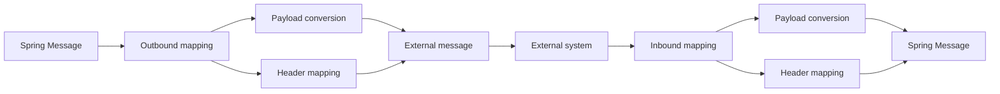
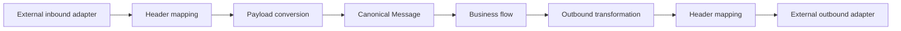
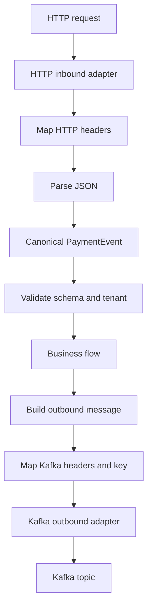

# Giữ ngữ nghĩa message khi qua adapter

Trong module `SPRING_INTEGRATION_ADAPTERS`, adapter kết nối message nội bộ của Spring Integration với định dạng và quy tắc của hệ thống bên ngoài. Khi message đi qua HTTP, JMS, AMQP, Kafka, file, SFTP hoặc một hệ thống khác, payload có thể được serialize, chuyển kiểu hay đóng gói lại; header nội bộ có thể được ánh xạ thành metadata của giao thức, bị loại bỏ hoặc đổi tên.

Giữ ngữ nghĩa message có nghĩa là bảo toàn ý nghĩa nghiệp vụ và các thông tin điều khiển cần thiết qua ranh giới đó. Một message JSON vẫn có thể parse thành công nhưng sai ngữ nghĩa nếu mất correlation ID, đổi đơn vị tiền, làm sai múi giờ, bỏ tenant ID hoặc nhầm message key với header thông thường. Vì vậy, mapping cần được thiết kế như một hợp đồng dữ liệu có chủ đích giữa hai hệ thống.

## Mục tiêu

Sau bài học, bạn có thể:

- Phân biệt payload, header nội bộ và metadata của giao thức bên ngoài.
- Giải thích chiều inbound và outbound của message mapping.
- Chọn thông tin cần chuyển đổi, giữ lại, đổi tên hoặc loại bỏ.
- Thiết kế quy tắc mapping cho content type, encoding, correlation ID, tenant, trace context và khóa định tuyến.
- Tránh làm mất kiểu dữ liệu, ý nghĩa thời gian, thông tin bảo mật và metadata điều khiển.
- Sử dụng MessageBuilder, transformer và header mapper đúng vai trò trong Spring Integration.
- Kiểm thử hợp đồng mapping và xử lý trường hợp không thể ánh xạ một-một.

## 1. Message nội bộ và message bên ngoài

Spring Messaging biểu diễn message bằng hai thành phần chính:

- **Payload:** dữ liệu mà flow xử lý, chẳng hạn một đối tượng `Order`, chuỗi JSON hoặc mảng byte.
- **Headers:** metadata đi kèm payload, chẳng hạn correlation ID, content type, nguồn gửi, thời điểm nhận hoặc thông tin phục vụ định tuyến.

Có thể hình dung một message nội bộ như sau:

```text
Message
├── payload: Order
│   ├── orderId
│   ├── amount
│   └── status
└── headers
    ├── correlationId
    ├── tenantId
    ├── contentType
    ├── sourceSystem
    └── receivedAt
```

Khi đi qua adapter, message phải được biểu diễn bằng cấu trúc mà hệ thống ngoài hiểu được. Ví dụ, một HTTP request có body và HTTP headers; một bản ghi Kafka có key, value, headers, topic và partition; một JMS message có body và properties; một file có nội dung cùng tên file và thuộc tính filesystem.

Các cấu trúc này không giống hệt Spring Message. Không phải header nội bộ nào cũng có trường tương ứng ở giao thức ngoài. Cũng có metadata của giao thức như HTTP method, Kafka key, AMQP routing key hoặc JMS delivery mode không nên bị gộp tùy tiện vào payload nghiệp vụ.

Mapping vì vậy gồm hai chiều:

- **Outbound mapping:** chuyển Spring Message thành request, record, broker message hoặc file để gửi ra ngoài.
- **Inbound mapping:** đọc dữ liệu bên ngoài và tạo Spring Message để flow xử lý.



Mapping tốt giữ được những ý nghĩa cần thiết cho nghiệp vụ, đồng thời biểu diễn đúng các giới hạn của giao thức đích.

## 2. Payload và header có trách nhiệm khác nhau

Payload thường chứa dữ liệu nghiệp vụ. Header mang ngữ cảnh để định tuyến, tương quan, quan sát hoặc điều khiển xử lý. Ranh giới này không tuyệt đối: một giao thức có thể buộc một số thông tin nghiệp vụ nằm trong header hoặc metadata riêng. Tuy nhiên, thiết kế nên giữ payload là hợp đồng dữ liệu chính, còn header chứa thông tin mô tả cách message được vận chuyển hoặc xử lý.

Ví dụ, sự kiện thanh toán có thể có payload:

```json
{
  "eventType": "OrderPaid",
  "schemaVersion": 2,
  "orderId": "ORD-1001",
  "amount": {
    "value": "1250000.00",
    "currency": "VND"
  },
  "paidAt": "2026-11-23T07:30:00Z"
}
```

Header nội bộ có thể chứa:

| Header | Ý nghĩa |
|---|---|
| `correlationId` | Liên kết message với một quy trình hoặc yêu cầu lớn hơn |
| `tenantId` | Xác định tenant sở hữu dữ liệu |
| `sourceSystem` | Hệ thống phát sinh message |
| `contentType` | Định dạng payload, ví dụ JSON |
| `schemaVersion` | Phiên bản hợp đồng payload nếu không đặt trong body |
| `traceparent` | Ngữ cảnh distributed tracing khi được phép truyền |
| `receivedAt` | Thời điểm ứng dụng tiếp nhận message |

Một số thông tin có thể đặt trong payload hoặc header tùy hợp đồng. Điều quan trọng là mọi bên thống nhất một vị trí chính thức. Nếu `schemaVersion` xuất hiện cả trong body lẫn header, phải định nghĩa quy tắc ưu tiên và cách xử lý khi hai giá trị khác nhau.

Không nên đưa toàn bộ headers nội bộ vào payload JSON chỉ để tránh mất metadata. Cách làm đó trộn lẫn dữ liệu nghiệp vụ với thông tin vận chuyển, khiến hệ thống tiêu thụ phải hiểu cấu trúc nội bộ của Spring Integration.

## 3. Xác định hợp đồng mapping trước khi cấu hình adapter

Với mỗi trường dữ liệu hoặc header, hãy trả lời bốn câu hỏi:

1. Thông tin này có cần qua ranh giới hệ thống không?
2. Bên nhận mong đợi nó ở payload, header hay metadata riêng của giao thức?
3. Kiểu dữ liệu, tên trường và quy tắc chuyển đổi là gì?
4. Nếu không thể ánh xạ hoặc giá trị không hợp lệ thì phải làm gì?

Một bảng mapping là tài liệu ngắn gọn để các bên thống nhất:

| Ý nghĩa | Spring Message | HTTP | Kafka | Quy tắc |
|---|---|---|---|---|
| Nội dung nghiệp vụ | `payload` | Request body | Record value | Serialize theo schema đã thống nhất |
| Loại nội dung | `contentType` | `Content-Type` | Có thể là header theo quy ước | Không đoán định dạng từ nội dung |
| Tương quan | `correlationId` | Header `X-Correlation-Id` | Record header | Giữ nguyên giá trị xuyên suốt flow |
| Tenant | `tenantId` | Header hoặc trường body | Header hoặc trường value | Kiểm tra quyền truy cập ở phía nhận |
| Khóa phân vùng | Header/metadata nội bộ | Không có tương đương mặc định | Record key | Ánh xạ tường minh, xác định partitioning |
| Trace context | `traceparent` | Trace header | Record header theo cấu hình | Chỉ truyền theo chính sách tracing |
| Thời điểm nhận | `receivedAt` | Có thể tạo ở inbound | Có thể tạo ở consumer | Không nhầm với thời điểm sự kiện xảy ra |

Bảng này chỉ là ví dụ. Tên header HTTP, tên Kafka header và vị trí dữ liệu thực tế phải được hai hệ thống thống nhất. Không nên mặc định một header nội bộ sẽ tự động xuất hiện ở mọi giao thức.

## 4. Quy tắc quan trọng khi chuyển đổi payload

### Kiểu dữ liệu và độ chính xác

JSON không biểu diễn mọi kiểu Java một cách nguyên trạng. Ví dụ, `BigDecimal` có thể bị chuyển thành số dấu phẩy động ở một số client, gây sai lệch tiền tệ. Có thể biểu diễn số tiền bằng chuỗi decimal kèm currency hoặc quy định rõ độ chính xác và cách parse ở hai phía.

Tương tự:

- Enum cần thống nhất tên wire value; không phụ thuộc thứ tự khai báo enum.
- UUID cần thống nhất cách viết và chữ hoa/thường nếu hệ thống so sánh dạng chuỗi.
- Binary cần quy định raw bytes hay Base64.
- Null, trường vắng mặt và chuỗi rỗng cần có ý nghĩa riêng nếu nghiệp vụ phân biệt chúng.
- Collection cần quy định thứ tự nếu thứ tự phần tử mang ý nghĩa.

### Thời gian và múi giờ

Nên dùng định dạng thời gian có offset hoặc UTC, ví dụ ISO-8601 `2026-11-23T07:30:00Z`. Cần phân biệt:

- Thời điểm sự kiện xảy ra (`occurredAt`).
- Thời điểm hệ thống tiếp nhận (`receivedAt`).
- Thời điểm ghi message vào broker (`publishedAt`).

Không ghi một giá trị thời gian không có múi giờ rồi giả định mọi hệ thống hiểu nó giống nhau. Khi chuyển sang epoch milliseconds, cần thống nhất đơn vị và cách làm tròn.

### Charset và content type

Một mảng byte không tự cho biết nội dung là JSON, XML hay văn bản theo charset nào. Hợp đồng cần quy định `Content-Type`, charset và schema version. Nếu adapter chuyển byte thành String, charset phải được xác định rõ. Không dùng charset mặc định của máy chạy làm quy tắc trao đổi dữ liệu.

### Phiên bản schema

Khi payload thay đổi, cần quy định khả năng tương thích:

- Thêm trường tùy chọn thường dễ tương thích với consumer cũ nếu consumer bỏ qua trường chưa biết.
- Đổi kiểu hoặc đổi ý nghĩa trường là thay đổi có nguy cơ phá vỡ hợp đồng.
- Xóa trường có thể làm consumer cũ thất bại.
- Đổi đơn vị đo lường cần thay đổi schema hoặc tên trường rõ ràng.

Có thể đưa `schemaVersion` vào payload hoặc metadata đã được thống nhất. Consumer cần từ chối hoặc đưa vào luồng lỗi những phiên bản không hỗ trợ thay vì âm thầm parse theo giả định cũ.

## 5. Header mapping và các giới hạn của giao thức

Header mapping chuyển metadata giữa `MessageHeaders` và cấu trúc header/property của giao thức. Spring Integration cung cấp cơ chế header mapper cho nhiều adapter. Header mapper có nhiệm vụ ánh xạ hai chiều; adapter hoặc message converter có thể đảm nhiệm những phần chuyển đổi khác.

Không nên giả định mọi giao thức có cùng khả năng lưu header:

| Giao thức | Đặc điểm metadata |
|---|---|
| HTTP | Header là các giá trị văn bản, có quy tắc tên và một số header có thể lặp; tên header không phân biệt hoa/thường |
| JMS | Properties có giới hạn về tên và kiểu giá trị; một số tên hoặc thuộc tính do provider quản lý |
| AMQP | Message properties và headers có kiểu dữ liệu; broker còn có exchange, routing key, delivery mode |
| Kafka | Record có key, value và headers; header có thể lặp tên và giá trị thường được biểu diễn dạng byte |
| File/SFTP | Tên file, đường dẫn, timestamp và thuộc tính file là metadata riêng; không phải tất cả đều đi cùng nội dung file |

Ví dụ, một Spring header `correlationId` có thể được ánh xạ sang HTTP header `X-Correlation-Id`, JMS correlation ID hoặc Kafka header theo hợp đồng. Nhưng không có nghĩa là adapter tự động ánh xạ mọi tên giống nhau. Cần kiểm tra cấu hình header mapper, danh sách header được phép và quy tắc chuyển kiểu.

Một số header chỉ có ý nghĩa trong ứng dụng. Ví dụ, `replyChannel`, `errorChannel` hoặc đối tượng callback nội bộ không thể serialize thành header mạng theo cách có ý nghĩa. Những header điều khiển nội bộ như vậy thường cần được giữ trong flow hoặc loại khỏi biên truyền tải.

Các trường như Kafka record key, AMQP routing key, HTTP method hay HTTP status không phải lúc nào cũng là header thông thường. Chúng có vai trò riêng trong giao thức và cần được cấu hình qua thuộc tính tương ứng của adapter hoặc endpoint.

## 6. Dùng MessageBuilder để tạo message có hợp đồng rõ ràng

Trong Spring Messaging, `MessageBuilder` giúp tạo message mới với payload và các header được chọn:

```java
import java.math.BigDecimal;
import java.time.Instant;
import org.springframework.messaging.Message;
import org.springframework.messaging.MessageHeaders;
import org.springframework.messaging.support.MessageBuilder;
import org.springframework.util.MimeTypeUtils;

record PaymentEvent(
    String orderId,
    BigDecimal amount,
    String currency,
    Instant occurredAt
) {}

PaymentEvent event = new PaymentEvent(
    "ORD-1001",
    new BigDecimal("1250000.00"),
    "VND",
    Instant.parse("2026-11-23T07:30:00Z")
);

Message<PaymentEvent> message = MessageBuilder
    .withPayload(event)
    .setHeader(MessageHeaders.CONTENT_TYPE, MimeTypeUtils.APPLICATION_JSON)
    .setHeader("correlationId", "checkout-8f2a")
    .setHeader("tenantId", "tenant-01")
    .setHeader("sourceSystem", "checkout-service")
    .build();
```

Ví dụ này tạo message nội bộ. Khi gửi ra HTTP, AMQP hoặc Kafka, adapter cần chuyển payload và các header được chọn sang biểu diễn bên ngoài. Việc đặt một header trong message không tự bảo đảm adapter sẽ gửi header đó.

`MessageHeaders.ID` và `MessageHeaders.TIMESTAMP` là metadata do Spring quản lý. Khi tạo message mới, ID có thể được tạo lại. Nếu cần nhận diện cùng một sự kiện qua nhiều hệ thống, hãy dùng một header nghiệp vụ ổn định như `eventId` hoặc `correlationId`, không dựa vào message ID nội bộ của Spring để làm định danh xuyên hệ thống.

Khi cần thay payload nhưng giữ một số header, có thể dùng `MessageBuilder.fromMessage(existingMessage)` rồi đặt payload mới hoặc cập nhật header. Tuy nhiên, chỉ giữ những header còn đúng ngữ nghĩa sau phép biến đổi. Ví dụ, sau khi tạo một sự kiện nghiệp vụ mới, không nên giữ nguyên một header mô tả định dạng hoặc nguồn của payload cũ nếu thông tin đó không còn đúng.

## 7. Transformer và header mapper đảm nhiệm phần việc khác nhau

Transformer thay đổi payload hoặc cấu trúc message. Header mapper chuyển metadata giữa Spring Message và giao thức. Hai thành phần này có thể phối hợp nhưng không thay thế nhau.

Ví dụ flow khái niệm:



Một transformer có thể:

- Parse JSON thành đối tượng domain.
- Đổi tên trường theo canonical model.
- Chuẩn hóa timestamp và currency.
- Tạo event envelope có schema version.
- Loại trường chỉ thuộc hệ thống nguồn.

Header mapper có thể:

- Chuyển correlation ID sang metadata của giao thức.
- Ánh xạ content type.
- Chuyển trace context theo chính sách.
- Lọc header được phép gửi ra ngoài.
- Chuyển kiểu header nếu giao thức yêu cầu.

Trong Spring Integration, các endpoint transformer và header enricher có thể dùng để chuẩn hóa message trước khi gửi ra adapter. Đối với các adapter hỗ trợ header mapper, cấu hình mapper ở ranh giới giao thức giúp tập trung chính sách metadata. Tên builder và thuộc tính cụ thể phụ thuộc adapter cùng phiên bản thư viện.

### Ví dụ chuyển đổi payload

Giả sử hệ thống nguồn gửi:

```json
{
  "order_id": "ORD-1001",
  "paid_amount": "1250000.00",
  "paid_currency": "VND",
  "paid_at": "2026-11-23T07:30:00Z"
}
```

Canonical model trong ứng dụng có thể dùng tên trường:

```json
{
  "orderId": "ORD-1001",
  "amount": {
    "value": "1250000.00",
    "currency": "VND"
  },
  "occurredAt": "2026-11-23T07:30:00Z"
}
```

Transformer chịu trách nhiệm chuyển tên trường và cấu trúc. Header mapper giữ hoặc ánh xạ `correlationId`, `tenantId` và trace context. Không nên thực hiện cả việc đổi cấu trúc nghiệp vụ lẫn lọc header trong một đoạn code không có ranh giới rõ ràng, vì sẽ khó kiểm thử và khó xác định lỗi mapping.

## 8. Ánh xạ metadata theo từng adapter

### HTTP

HTTP request/response có body, headers, method, URI, status và có thể có query parameters. Cần phân biệt metadata của request với dữ liệu nghiệp vụ.

Ví dụ:

| Thông tin nội bộ | HTTP |
|---|---|
| Payload | Request body |
| `contentType` | `Content-Type` |
| `correlationId` | Header theo hợp đồng, ví dụ `X-Correlation-Id` |
| `tenantId` | Header hoặc trường body theo chính sách |
| Đích gọi | URI/path/query và cấu hình endpoint |
| Kết quả | Response body và HTTP status |

Không đưa mọi Spring header thành HTTP header. Một số tên không hợp lệ, một số có thể bị proxy hoặc server thay đổi, và một số chứa dữ liệu nhạy cảm. Header xác thực cần được quản lý qua cơ chế credential chuyên dụng. Nếu nhận header từ client bên ngoài, phải xem chúng là dữ liệu không đáng tin cậy cho đến khi xác thực và kiểm tra quyền.

HTTP header có thể chứa nhiều giá trị. Không nối các giá trị tùy tiện nếu ý nghĩa của header yêu cầu giữ danh sách. Với inbound response, cần phân biệt HTTP status thành công ở tầng vận chuyển với kết quả nghiệp vụ trong body.

### JMS

JMS message có body và properties. Correlation ID có thể được biểu diễn bằng trường correlation ID của JMS; reply-to và message ID có quy tắc riêng của provider hoặc API. Properties chỉ hỗ trợ một số kiểu dữ liệu và tên property chịu ràng buộc của JMS. Đừng gửi một object tùy ý hoặc một tên header không hợp lệ rồi giả định provider sẽ lưu giữ nguyên trạng.

Khi dùng request/reply, cần phân biệt correlation ID dùng để ghép response với request và message ID do provider cấp. Nếu ứng dụng tự tạo correlation ID, hai bên cần thống nhất ai tạo, ai sao chép sang reply và hành vi khi giá trị bị thiếu.

### AMQP

AMQP có message properties, headers và thông tin định tuyến như exchange, routing key. `contentType`, `contentEncoding`, `correlationId`, `replyTo` và delivery mode có ý nghĩa riêng. Header mapper của adapter quyết định những Spring headers nào được chuyển thành AMQP headers hoặc properties.

Không nhầm routing key với correlation ID: routing key điều khiển đường đi của message qua broker; correlation ID liên kết message với một quy trình. Cũng cần xác định liệu message có persistent hay không và broker có xác nhận publish theo cấu hình hay không. Header mapping thành công không đồng nghĩa message đã được broker lưu bền vững.

### Kafka

Kafka record gồm topic, key, value, headers, partition và offset. Key có ảnh hưởng đến partitioning và thứ tự trong partition; nó không đơn thuần là một header tùy chọn. Offset do broker gán và là vị trí của record trong partition, không phải event ID do producer tự đặt.

Ví dụ hợp đồng có thể quy định:

- Key là `orderId` để các sự kiện của cùng một đơn hàng thường đi cùng partition.
- Value là event JSON theo schema version.
- Header `correlationId` dùng để truy vết quy trình.
- Header `eventType` mô tả loại sự kiện.
- Offset và partition được giữ như metadata nhận vào để hỗ trợ vận hành.

Kafka headers có thể lặp tên và giá trị dạng byte. Nếu chuyển sang một Map header đơn trị, adapter có thể làm mất các giá trị trùng tên. Cần xác định rõ chính sách nếu hợp đồng cho phép header lặp. Khi retry hoặc gửi lại record, không coi offset cũ là định danh của record mới.

### File và SFTP

Với file adapter, payload thường là nội dung file hoặc đối tượng biểu diễn file; tên file, thư mục, timestamp và thuộc tính file có thể được đưa vào header. Với SFTP, còn có thông tin remote path và metadata từ máy chủ từ xa.

Tên file có thể mang ý nghĩa nghiệp vụ, ví dụ mã lô hoặc ngày xuất dữ liệu. Nếu đổi tên khi di chuyển qua flow, cần giữ original filename trong metadata riêng. Không nên dùng tên file làm định danh duy nhất nếu file có thể được gửi lại hoặc trùng tên ở thư mục khác. Một checksum hoặc batch ID có thể phù hợp hơn để chống xử lý trùng.

File path và remote path là dữ liệu cần kiểm tra. Không nối trực tiếp giá trị do bên ngoài cung cấp vào đường dẫn cục bộ nếu chưa chuẩn hóa và kiểm soát vùng lưu trữ. Mapping metadata file cũng không thay thế xác minh nội dung file, chữ ký hoặc quyền truy cập.

## 9. Giữ correlation, tracing và ngữ cảnh bảo mật

### Correlation ID và event ID

Correlation ID trả lời câu hỏi: message này thuộc quy trình nào? Event ID trả lời câu hỏi: đây là sự kiện cụ thể nào? Hai giá trị có thể khác nhau và nên có mục đích riêng.

Ví dụ, một quy trình checkout có correlation ID `checkout-8f2a`, nhưng phát ra nhiều event có event ID riêng. Khi một event được chuyển qua HTTP rồi vào Kafka, correlation ID giúp truy vết cả quy trình; event ID giúp phát hiện cùng một sự kiện bị gửi lặp.

Không dùng message ID nội bộ của adapter hoặc broker làm event ID xuyên suốt. ID có thể được tạo lại ở từng ranh giới.

### Trace context

Distributed tracing thường truyền trace context qua các hệ thống để liên kết span. Chỉ truyền các trường trace theo chuẩn và chính sách đã chọn. Nếu hệ thống nhận được trace context từ nguồn không tin cậy, không được dùng nó làm bằng chứng xác thực danh tính hoặc quyền truy cập.

### Tenant và dữ liệu nhạy cảm

Tenant ID có thể ảnh hưởng đến phạm vi dữ liệu mà handler được phép truy cập. Không chỉ tin vào header `tenantId` do producer cung cấp. Consumer cần xác thực nguồn và kiểm tra tenant có quyền phát message đó hay không.

Không chuyển toàn bộ headers sang hệ thống ngoài. Header nội bộ có thể chứa token, cookie, thông tin định tuyến nội bộ, tên queue hoặc dữ liệu cá nhân. Dùng allowlist các header được phép truyền; loại bỏ credential và metadata không cần thiết. Nếu một header không hợp lệ hoặc không được hỗ trợ, chọn chính sách rõ ràng: bỏ qua có log, chuyển sang error flow hoặc từ chối message. Tránh âm thầm chuyển đổi theo cách làm thay đổi ý nghĩa.

## 10. Xử lý trường hợp mapping không thể đảo ngược

Không phải mọi mapping đều có thể round-trip. Ví dụ:

- HTTP header chỉ có giá trị văn bản, trong khi Spring header là object phức tạp.
- Kafka headers có thể lặp tên, nhưng cấu trúc Map đơn giản không giữ được nhiều giá trị.
- Một trường timestamp có offset được chuyển thành epoch milliseconds có thể mất độ chính xác dưới mili giây.
- Tên file được chuẩn hóa có thể không còn giữ nguyên tên gốc.
- Header nội bộ như reply channel không có biểu diễn tương đương bên ngoài.

Vì vậy, mục tiêu không nhất thiết là chuyển đi rồi chuyển ngược lại nhận được object giống hệt. Mục tiêu là giữ được các ý nghĩa đã cam kết trong hợp đồng. Với thông tin không thể biểu diễn, hãy quyết định một trong các cách:

1. Giữ trong payload hoặc envelope theo schema.
2. Ánh xạ sang trường metadata khác đã thống nhất.
3. Lưu vào context nội bộ nếu không cần đi qua biên.
4. Bỏ có chủ đích và ghi rõ trong tài liệu mapping.
5. Từ chối message nếu mất thông tin đó sẽ làm sai nghiệp vụ.

Không nên âm thầm bỏ một header bắt buộc. Khi inbound message thiếu trường bắt buộc, có thể đưa vào error channel hoặc dead-letter flow cùng thông tin nguyên nhân để người vận hành điều tra.

## 11. Kiểm thử hợp đồng message mapping

Kiểm thử mapping nên tập trung vào hợp đồng và các trường hợp biên, không chỉ kiểm tra một JSON mẫu parse được.

Một bộ kiểm thử hữu ích gồm:

| Trường hợp | Điều cần xác minh |
|---|---|
| Payload hợp lệ | Tên trường, kiểu dữ liệu và cấu trúc được chuyển đúng |
| Header bắt buộc | Correlation ID, tenant hoặc event type không bị mất |
| Header không được phép | Credential và header nội bộ bị loại bỏ |
| Header không hỗ trợ | Có chính sách bỏ qua, cảnh báo hoặc từ chối rõ ràng |
| Content type/charset | Byte được giải mã theo đúng encoding |
| Null và trường vắng mặt | Phân biệt đúng theo schema |
| Decimal và timestamp | Không mất độ chính xác, đơn vị hoặc múi giờ |
| Header lặp | Không mất giá trị nếu giao thức cho phép lặp |
| Payload phiên bản cũ/mới | Áp dụng quy tắc tương thích đã công bố |
| Message sai schema | Được chuyển vào error flow hoặc DLQ theo chính sách |
| Message được giao lại | Event ID và idempotency key vẫn có ý nghĩa ổn định |

Có thể kiểm tra outbound và inbound riêng. Với mapping có thể đảo ngược, thêm round-trip test để xác minh các trường được cam kết giữ nguyên. Với mapping không thể đảo ngược, kiểm tra các thuộc tính nghiệp vụ quan trọng thay vì so sánh toàn bộ object.

Nên có contract test giữa producer và consumer, sử dụng mẫu payload được quản lý theo phiên bản. Khi thay đổi tên header, kiểu dữ liệu hoặc schema, kiểm tra ảnh hưởng tới các consumer đang hoạt động trước khi triển khai.

## 12. Ví dụ end-to-end: nhận HTTP, xử lý và phát Kafka

Giả sử một hệ thống thanh toán gọi HTTP endpoint của ứng dụng. Request chứa event JSON và header `X-Correlation-Id`. Ứng dụng chuyển request thành Spring Message, chuẩn hóa payload rồi phát record sang Kafka.



Hợp đồng mapping có thể quy định:

- HTTP body là JSON theo schema PaymentEvent version 2.
- `X-Correlation-Id` được ánh xạ thành header nội bộ `correlationId`.
- `tenantId` được lấy từ thông tin đã xác thực và kiểm tra quyền, không tin cậy chỉ vì request gửi lên.
- Payload được parse thành canonical model với decimal và timestamp đã chuẩn hóa.
- Kafka record key là `orderId`, value là event JSON theo schema đích.
- `correlationId`, `eventType` và trace context được ánh xạ sang Kafka headers theo allowlist.

Nếu parse JSON thất bại, ứng dụng không được tạo một PaymentEvent giả định với giá trị mặc định rồi tiếp tục. Message phải đi vào error flow với nguồn, correlation ID nếu có và nguyên nhân parse. Nếu Kafka publish thất bại, flow cần áp dụng retry và xác định rõ việc gửi lại có thể tạo record trùng hay không. Consumer phía sau vẫn cần idempotency theo event ID vì retry ở producer có thể dẫn đến nhiều lần giao.

## 13. Các lỗi mapping thường gặp

| Hiện tượng | Nguyên nhân | Cách xử lý |
|---|---|---|
| Consumer không tìm thấy correlation ID | Header không được ánh xạ hoặc tên khác nhau | Định nghĩa tên wire header và cấu hình mapper hai chiều |
| Payload parse được nhưng số tiền sai | Decimal bị chuyển thành floating point hoặc sai đơn vị | Quy định decimal representation, currency và phép chuyển đổi |
| Thời gian lệch nhiều giờ | Thiếu timezone hoặc nhầm local time với UTC | Dùng định dạng có offset và phân biệt occurredAt/receivedAt |
| Consumer không hiểu payload mới | Schema thay đổi không tương thích | Quản lý schema version và kiểm thử contract |
| Header nội bộ bị lộ ra ngoài | Ánh xạ tất cả headers mà không lọc | Dùng allowlist và loại credential |
| Kafka record vào partition khác dự kiến | Không ánh xạ đúng record key | Xem key là metadata riêng và quy định partitioning |
| Header lặp bị mất | Chuyển danh sách header thành Map đơn trị | Giữ cấu trúc lặp hoặc định nghĩa chính sách hợp nhất |
| Reply không ghép được request | Nhầm message ID với correlation ID | Dùng correlation ID ổn định theo hợp đồng request/reply |
| File bị xử lý hai lần | Dùng tên file làm định danh duy nhất hoặc không lưu trạng thái | Dùng batch ID/checksum và cơ chế idempotency |
| Message sai schema vẫn đi tiếp | Lỗi mapping bị nuốt hoặc dùng giá trị mặc định | Validate sớm, error channel và dead-letter policy |

## 14. Checklist thiết kế trước khi đưa vào production

- [ ] Đã mô tả payload và headers của message nội bộ.
- [ ] Đã có bảng mapping inbound và outbound cho từng adapter.
- [ ] Đã xác định kiểu dữ liệu, charset, content type và schema version.
- [ ] Đã phân biệt event ID, correlation ID, message ID và broker offset.
- [ ] Đã quy định rõ timezone, decimal precision, null và trường vắng mặt.
- [ ] Đã xác định metadata giao thức riêng như Kafka key, AMQP routing key hoặc HTTP status.
- [ ] Đã dùng allowlist cho header được phép truyền qua biên.
- [ ] Đã loại reply channel, error channel và object nội bộ không thể serialize.
- [ ] Đã xác thực tenant và nguồn phát trước khi dùng metadata để định tuyến hoặc cấp quyền.
- [ ] Đã xác định chính sách cho header không hỗ trợ và mapping không thể đảo ngược.
- [ ] Đã kiểm thử payload hợp lệ, sai schema, header thiếu, header lặp và trường hợp giao lại.
- [ ] Đã xác minh retry, acknowledgment và idempotency ở ranh giới adapter.

## Kết luận

Giữ ngữ nghĩa message khi qua adapter đòi hỏi hợp đồng rõ ràng cho payload, headers và metadata riêng của giao thức. Transformer chuẩn hóa dữ liệu nghiệp vụ; header mapper chuyển metadata theo allowlist; adapter đảm nhiệm giao tiếp với hệ thống bên ngoài. Khi phân biệt đúng event ID, correlation ID, key, offset và các header điều khiển nội bộ, flow Spring Integration sẽ ít mất ngữ cảnh hơn, dễ kiểm thử hơn và an toàn hơn khi retry hoặc thay đổi schema.

