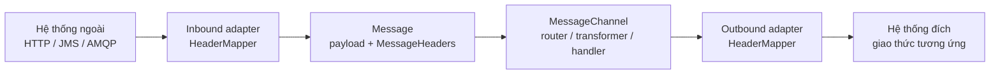

# StandardHeaders và protocol headers trong Spring Integration

## Mục tiêu học tập

Trong Spring Integration, một `Message<?>` gồm **payload** (dữ liệu nghiệp vụ) và **headers** (metadata giúp xử lý, định tuyến, tương quan và giao tiếp với hệ thống ngoài). Khi xây dựng inbound/outbound adapter, gateway, poller và `MessageChannel` cho HTTP, JMS, AMQP, Kafka, file hay SFTP, lập trình viên cần biết header nào có ý nghĩa trong luồng xử lý và header nào thuộc giao thức vận chuyển.

Sau bài học, bạn có thể:

- Phân biệt **standard headers**, **Spring Integration headers**, **protocol-specific headers** và header tự định nghĩa.
- Đọc, tạo và thay đổi header đúng cách bằng `MessageHeaders`, `MessageBuilder` và `IntegrationMessageHeaderAccessor`.
- Giải thích cách header được ánh xạ qua `HeaderMapper` khi dữ liệu đi qua adapter/gateway.
- Tránh các lỗi thường gặp: dùng nhầm tên header, sao chép metadata nội bộ ra mạng, giả định header tự động đi xuyên qua các giao thức hoặc mất thông tin tương quan khi tạo message mới.

## 1. StandardHeaders là gì?

**Standard headers** là cách gọi các header chuẩn được framework quy ước và các thành phần xử lý message có thể hiểu chung. Trong ngữ cảnh Spring Integration, `StandardHeaders` nên được hiểu như **nhóm khái niệm**; API thông dụng để lấy hằng số thực tế là `org.springframework.messaging.MessageHeaders` và `org.springframework.integration.IntegrationMessageHeaderAccessor`, không nên tự giả định có một lớp `StandardHeaders` duy nhất chứa mọi header.

Ví dụ, một yêu cầu đặt hàng được đưa vào `MessageChannel` có thể mang:

```text
Payload: {"orderId":"O-1042","amount":125000}
Headers:
  id: <UUID được tạo bởi framework>
  timestamp: <thời điểm tạo message>
  contentType: application/json
  correlationId: batch-2026-11-23
  tenantId: shop-a
```

Các trường không cùng một tầng:

| Tầng | Ví dụ | Ai diễn giải? | Chức năng |
|---|---|---|---|
| Spring Messaging chuẩn | `id`, `timestamp`, `replyChannel`, `errorChannel`, `contentType` | Framework messaging | Định danh, phản hồi, lỗi, kiểu nội dung |
| Spring Integration | `correlationId`, `sequenceNumber`, `sequenceSize`, `priority` | Splitter, aggregator, resequencer, priority channel và endpoint liên quan | Điều phối luồng tích hợp |
| Theo giao thức | HTTP `Content-Type`, JMS `JMSCorrelationID`, AMQP routing key, Kafka topic/key | Adapter và thư viện giao thức | Tương tác với giao thức/broker bên ngoài |
| Nghiệp vụ tự định nghĩa | `tenantId`, `sourceSystem`, `businessTraceId` | Mã ứng dụng đã thống nhất hợp đồng | Phân luồng theo yêu cầu riêng |

**Quy tắc cốt lõi:** header tồn tại trong `MessageHeaders` không đồng nghĩa với việc nó sẽ được gửi thành HTTP header, JMS property, Kafka record header hoặc thông tin trong file. **Adapter/gateway cùng cấu hình mapper/converter** quyết định quá trình chuyển đổi đó.

## 2. Những standard headers cần nắm

### 2.1. Header của Spring Messaging

Các hằng số sau nằm trong `org.springframework.messaging.MessageHeaders`:

| Hằng số | Giá trị header | Kiểu dữ liệu phổ biến | Ý nghĩa và lưu ý |
|---|---|---|---|
| `MessageHeaders.ID` | `id` | `UUID` | Định danh một **message instance**. Framework tạo tự động; không dùng làm mã đơn hàng hay định danh giao dịch xuyên hệ thống. |
| `MessageHeaders.TIMESTAMP` | `timestamp` | `Long` | Thời điểm tạo message, tính bằng mili giây từ Unix epoch. Không phải thời điểm sự kiện nghiệp vụ xảy ra. |
| `MessageHeaders.REPLY_CHANNEL` | `replyChannel` | `MessageChannel` hoặc tên channel dạng `String` | Đích nhận reply trong mô hình request–reply khi endpoint cần phản hồi. |
| `MessageHeaders.ERROR_CHANNEL` | `errorChannel` | `MessageChannel` hoặc tên channel dạng `String` | Đích nhận `ErrorMessage` khi lỗi được xử lý theo cơ chế gửi bất đồng bộ phù hợp. |
| `MessageHeaders.CONTENT_TYPE` | `contentType` | Thường là `MimeType` hoặc giá trị do converter/mapper hỗ trợ | Gợi ý định dạng payload cho bước chuyển đổi; không tự bảo đảm một header HTTP đã được tạo. |

Các header `id` và `timestamp` mặc định được framework quản lý và chỉ đọc. Khi tạo message mới bằng builder, framework sẽ cấp metadata cho message mới; không cố `setHeader("id", ...)` hay `setHeader("timestamp", ...)` để ép giữ giá trị cũ. Cần một mã bền vững qua nhiều message hoặc nhiều hệ thống thì tạo header nghiệp vụ riêng, ví dụ `businessTraceId`.

`replyChannel`, `errorChannel` có thể chứa tham chiếu tới đối tượng Java trong cùng ứng dụng. Đó là **địa chỉ điều phối nội bộ**, không phải tên HTTP `Reply-To` hay JMS `JMSReplyTo`. Bỏ hoặc biến đổi nhầm những header này có thể làm hỏng luồng request–reply/error; gửi nguyên đối tượng `MessageChannel` ra broker cũng không hợp lệ.

### 2.2. Header đặc thù của Spring Integration

Các hằng số dưới đây nằm trong `org.springframework.integration.IntegrationMessageHeaderAccessor`:

| Hằng số | Mục đích | Tình huống |
|---|---|---|
| `CORRELATION_ID` | Gắn các message liên quan vào cùng một nhóm xử lý | Splitter → aggregator; thu thập nhiều phần của cùng đơn hàng |
| `SEQUENCE_NUMBER` | Vị trí message trong nhóm | Xử lý các phần dữ liệu theo thứ tự |
| `SEQUENCE_SIZE` | Tổng số message của một nhóm khi biết trước | Aggregator chờ đủ số phần |
| `PRIORITY` | Độ ưu tiên của message | `PriorityChannel` |
| `EXPIRATION_DATE` | Metadata thời điểm hết hạn cho các thành phần có dùng nó | Filter theo chính sách hết hạn; bản thân header không tự hủy message |
| `DUPLICATE_MESSAGE` | Dấu hiệu message bị phát hiện trùng | Idempotent receiver interceptor |
| `ACKNOWLEDGMENT_CALLBACK` | Callback xác nhận/từ chối/requeue khi nguồn hỗ trợ | Một số message source và adapter |

Một số header như `SEQUENCE_DETAILS` và `ROUTING_SLIP` phục vụ cơ chế nội bộ phức tạp. Không nên tự sửa cấu trúc của chúng nếu chưa hiểu hợp đồng của component tương ứng.

**Phân biệt ba loại định danh thường bị nhầm:**

- `MessageHeaders.ID` xác định **một message instance** trong ứng dụng.
- `IntegrationMessageHeaderAccessor.CORRELATION_ID` gom **những message có quan hệ** trong logic tích hợp.
- `JMSCorrelationID` hoặc `KafkaHeaders.CORRELATION_ID` thuộc **hợp đồng của giao thức/thư viện cụ thể**; không mặc nhiên được chuyển thành correlation ID của Spring Integration.

Đối với luồng cần `Aggregator`, thiết kế correlation key và điều kiện hoàn tất nhóm là trách nhiệm của ứng dụng hoặc các component chuyên dụng như splitter/aggregator.

## 3. Protocol headers: metadata theo hệ thống kết nối

Protocol headers là metadata gắn với **cách hệ thống ngoài gửi, nhận hoặc lưu trữ dữ liệu**. Mỗi protocol có tên, kiểu dữ liệu, hướng sử dụng và giới hạn khác nhau. Adapter thường gắn metadata nhận được vào `MessageHeaders` khi inbound và chọn/biến đổi metadata khi outbound.

| Adapter/gateway | API hoặc hằng số thường gặp | Ví dụ metadata | Lưu ý thực hành |
|---|---|---|---|
| HTTP | `org.springframework.http.HttpHeaders`; `DefaultHttpHeaderMapper` | `Content-Type`, `Accept`, `Authorization`, `X-Correlation-Id` | HTTP header có quy tắc riêng, thường là chuỗi/giá trị nhiều phần; tên `contentType` nội bộ khác tên `Content-Type` trên wire. |
| JMS | `org.springframework.integration.jms.JmsHeaders`; `DefaultJmsHeaderMapper` | `JMSCorrelationID`, `JMSReplyTo`, `JMSMessageID` | Một số thuộc tính JMS do broker/provider cấp; JMS property có hạn chế về tên và kiểu. |
| AMQP/RabbitMQ | `org.springframework.amqp.support.AmqpHeaders`; `DefaultAmqpHeaderMapper` | `amqp_correlationId`, `amqp_receivedRoutingKey`, `amqp_deliveryTag` | Header đã nhận từ broker khác với header dùng khi gửi; routing key/ack có ngữ cảnh riêng. |
| Kafka | `org.springframework.kafka.support.KafkaHeaders` | `TOPIC`, `KEY`, `RECEIVED_TOPIC`, `RECEIVED_PARTITION`, `OFFSET` | Topic/key/partition/offset là thuộc tính record hoặc metadata consumer; không phải mọi giá trị đều là Kafka record header do ứng dụng gửi. |
| File | `org.springframework.integration.file.FileHeaders` | `FILENAME`, `ORIGINAL_FILE` | Dùng để đặt tên hoặc biết nguồn file; không có “HTTP/JMS headers” trong nội dung file thông thường. |
| SFTP/FTP | Header file/remote metadata do adapter cung cấp | Tên file, đường dẫn/thư mục từ xa tùy adapter | Metadata ở phía ứng dụng có thể quyết định tên đích hoặc lưu vết nguồn; không phải mọi header được ghi vào file từ xa. |

### 3.1. HTTP: tên header nội bộ và tên trên wire

Ví dụ, một outbound HTTP gateway nhận message có header ứng dụng `X-Correlation-Id`. Để bên nhận thực sự thấy header HTTP đó, cấu hình header mapping cần cho phép nó. Với XML namespace của Spring Integration:

```xml
<int-http:outbound-gateway
    id="ordersHttpGateway"
    channel="httpOutbound"
    url="https://api.example.org/orders"
    mapped-request-headers="HTTP_REQUEST_HEADERS,X-Correlation-Id"
    mapped-response-headers="HTTP_RESPONSE_HEADERS,X-Trace-Id" />
```

Đây là đoạn cấu hình **minh họa thuộc tính mapping** trong một dự án đã thiết lập namespace `int-http`. `HTTP_REQUEST_HEADERS` và `HTTP_RESPONSE_HEADERS` là pattern đặc biệt để giữ nhóm header HTTP chuẩn khi bổ sung header tùy chỉnh. Nếu ghi đè danh sách mapping chỉ bằng `X-Correlation-Id`, có thể bỏ sót những HTTP header chuẩn bạn còn cần.

`DefaultHttpHeaderMapper` hỗ trợ cấu hình danh sách header và wildcard. Không nên suy luận rằng mọi header nội bộ sẽ tự động xuất hiện trên request HTTP. HTTP header `Authorization` chứa dữ liệu nhạy cảm, cần được đặt và chuyển tiếp theo chính sách của từng đích, tránh sao chép không kiểm soát.

### 3.2. JMS, AMQP: correlation và metadata broker

Trong JMS, `JMSCorrelationID` là trường của JMS message. Trong Spring Integration, `JmsHeaders` định nghĩa các khóa dùng khi mapper chuyển nó vào/ra `MessageHeaders`. `DefaultJmsHeaderMapper` xử lý các trường JMS API theo setter/getter thích hợp và có thể ánh xạ thêm user properties. Một số giá trị, chẳng hạn JMS message ID và redelivery flag, được nhận từ broker/provider và không phải thuộc tính ứng dụng có thể tự quyết định khi gửi.

Trong AMQP, `AmqpHeaders.RECEIVED_ROUTING_KEY` là thông tin **đã nhận**; nó hữu ích khi phân nhánh xử lý inbound nhưng không có nghĩa sẽ tự điều khiển routing key của lần gửi outbound kế tiếp. Chỉ header/cấu hình mà outbound AMQP adapter hỗ trợ mới được dùng để điều khiển lần publish. Tương tự, delivery tag và acknowledgment liên quan tới consumer/channel cụ thể: không dùng chúng làm định danh nghiệp vụ lâu dài.

**Điểm chung:** `CORRELATION_ID` trong `IntegrationMessageHeaderAccessor` và correlation ID của JMS/AMQP/Kafka là các **khóa khác nhau với mục tiêu có thể giống nhau**. Muốn duy trì cùng business trace xuyên giao thức, hãy xác định quy tắc chuyển đổi rõ ràng ở biên hệ thống.

### 3.3. Kafka: phân biệt outbound và inbound headers

`KafkaHeaders.TOPIC` và `KafkaHeaders.KEY` được dùng khi tạo record gửi đi (tùy cấu hình adapter/producer). Trên message nhận vào, `KafkaHeaders.RECEIVED_TOPIC`, `KafkaHeaders.RECEIVED_PARTITION` và `KafkaHeaders.OFFSET` mô tả record vừa tiêu thụ.

Không dùng `RECEIVED_TOPIC` thay `TOPIC` để chỉ định đích gửi mới. Offset nhận từ Kafka không phải số thứ tự tổng quát của `IntegrationMessageHeaderAccessor.SEQUENCE_NUMBER`; hai giá trị có ngữ nghĩa và phạm vi khác nhau. API header Kafka có thể thay đổi theo phiên bản Spring Kafka, nên dùng hằng số của đúng dependency đang chạy.

### 3.4. File và SFTP: header hỗ trợ vận hành

Với file outbound adapter, `FileHeaders.FILENAME` có thể được `FileNameGenerator` dùng để chọn tên file đầu ra. Inbound file adapter thường bổ sung thông tin về tên file gốc. Ví dụ một message mang payload CSV và `FileHeaders.FILENAME = "orders-2026-11-23.csv"` có thể được ghi theo tên đó nếu handler dùng generator mặc định và không có cấu hình ưu tiên khác.

Đối với SFTP/FTP, header về file/remote path là metadata của **adapter và luồng xử lý**. Khi lấy file từ máy chủ rồi gửi tiếp qua HTTP, ứng dụng cần chủ động quyết định có giữ tên file, ánh xạ thành request field hay chỉ dùng để ghi log.

## 4. HeaderMapper hoạt động ở ranh giới nào?

`MessageHeaders` là map metadata của Spring Messaging, còn HTTP request, JMS message, AMQP message hoặc Kafka record có mô hình metadata riêng. `HeaderMapper` kết nối hai thế giới:



**Inbound:** giao thức nguồn → mapper/converter → `MessageHeaders`. Ví dụ header HTTP `X-Correlation-Id` được nhận thành một khóa trong map nếu được cấu hình mapping.

**Xử lý trong flow:** router, service activator, transformer hoặc header enricher đọc và có thể tạo message mới. Framework thường lan truyền header khi endpoint tạo message mới, nhưng hành vi phụ thuộc component và cách bạn trả về payload/message. Nếu transformer trả về một `Message<?>` hoàn chỉnh, người viết phải bảo đảm những header cần thiết có trong kết quả; nếu trả về payload, framework thường giữ header inbound.

**Outbound:** `MessageHeaders` → mapper/converter → metadata giao thức đích. Mapper có thể bỏ header, đổi tên, đổi kiểu, hoặc từ chối giá trị không hợp lệ. `id`/`timestamp` mặc định không được ánh xạ như dữ liệu vận chuyển; các đối tượng Java nội bộ như `MessageChannel` cũng không phải wire headers.

Một số mapper hỗ trợ các pattern `STANDARD_REQUEST_HEADERS`, `STANDARD_REPLY_HEADERS` và `NON_STANDARD_HEADERS`. Đây là **tên pattern cấu hình của nhóm mapper**, không phải tên header sẽ xuất hiện trong message. Với HTTP, các pattern đặc thù là `HTTP_REQUEST_HEADERS` và `HTTP_RESPONSE_HEADERS`. Hãy dùng pattern theo đúng mapper/protocol thay vì trộn lẫn.

## 5. Ví dụ Java: đọc standard headers và tạo message mới

Ví dụ dưới đây chỉ cần các module Spring Messaging và Spring Integration Core phù hợp với phiên bản dự án:

```java
import org.springframework.integration.IntegrationMessageHeaderAccessor;
import org.springframework.messaging.Message;
import org.springframework.messaging.MessageHeaders;
import org.springframework.messaging.support.MessageBuilder;
import org.springframework.util.MimeTypeUtils;

public final class HeaderBasics {

    public static void main(String[] args) {
        Message<String> input = MessageBuilder
                .withPayload("{\"orderId\":\"O-1042\"}")
                .setHeader(MessageHeaders.CONTENT_TYPE, MimeTypeUtils.APPLICATION_JSON)
                .setHeader(IntegrationMessageHeaderAccessor.CORRELATION_ID, "batch-42")
                .setHeader("tenantId", "shop-a")
                .build();

        // Header chuẩn do framework tạo.
        System.out.println("Message ID: " + input.getHeaders().getId());
        System.out.println("Created at: " + input.getHeaders().getTimestamp());

        // Đọc theo key, có thể kiểm tra kiểu dữ liệu mong đợi.
        String tenant = input.getHeaders().get("tenantId", String.class);
        Object correlationId =
                new IntegrationMessageHeaderAccessor(input).getCorrelationId();
        System.out.println(tenant + " / " + correlationId);

        // MessageHeaders là read-only; builder tạo message thay thế.
        Message<String> next = MessageBuilder.fromMessage(input)
                .removeHeader("tenantId")
                .setHeader("processingStage", "validated")
                .build();

        System.out.println("New ID: " + next.getHeaders().getId());
        System.out.println("Correlation kept: " +
                next.getHeaders().get(IntegrationMessageHeaderAccessor.CORRELATION_ID));
    }
}
```

Điểm cần quan sát:

1. Header `tenantId` là metadata ứng dụng; framework không tự gán ý nghĩa cho nó.
2. `correlationId` vẫn có ý nghĩa nghiệp vụ trong chuỗi xử lý dù message instance đã thay đổi.
3. `input.getHeaders().put(...)` không được dùng để sửa header vì `MessageHeaders` là read-only. Việc gọi `MessageBuilder.fromMessage(input)` tạo message mới và copy các header được phép, trong khi `id`/`timestamp` được framework quản lý.
4. `contentType` gợi ý cách diễn giải payload JSON; JSON converter, HTTP mapper và cấu hình endpoint vẫn quyết định cách mã hóa và phát ra giao thức.

## 6. Ví dụ: gắn header dành riêng cho adapter

### 6.1. Định tuyến outbound Kafka

Khi dự án có dependency Spring Kafka tương ứng, message gửi qua Kafka outbound adapter có thể mang:

```java
import org.springframework.kafka.support.KafkaHeaders;
import org.springframework.messaging.Message;
import org.springframework.messaging.support.MessageBuilder;

Message<String> event = MessageBuilder.withPayload("{\"orderId\":\"O-1042\"}")
        .setHeader(KafkaHeaders.TOPIC, "orders.events")
        .setHeader(KafkaHeaders.KEY, "O-1042")
        .setHeader("businessTraceId", "trace-42")
        .build();
```

Với adapter được cấu hình để lấy topic/key từ message, `TOPIC` và `KEY` cung cấp metadata cho record **outbound**. Nếu adapter đã cấu hình cố định topic hoặc dùng expression ưu tiên khác, giá trị header có thể không quyết định đích gửi. `businessTraceId` chỉ trở thành Kafka native header nếu cơ chế converter/header mapper cho phép và kiểu giá trị được hỗ trợ.

### 6.2. Đặt tên file đầu ra

```java
import org.springframework.integration.file.FileHeaders;
import org.springframework.messaging.Message;
import org.springframework.messaging.support.MessageBuilder;

Message<String> csv = MessageBuilder
        .withPayload("orderId,status\nO-1042,PAID\n")
        .setHeader(FileHeaders.FILENAME, "orders-2026-11-23.csv")
        .build();
```

Header `FileHeaders.FILENAME` hỗ trợ file outbound handler chọn tên file theo cấu hình của handler. Tên file nhận từ nguồn không tin cậy cần được kiểm tra trước khi dùng tạo đường dẫn trên đĩa hoặc máy chủ SFTP.

### 6.3. Ánh xạ correlation ID từ HTTP vào luồng nội bộ

Giả sử HTTP inbound gateway đã được cấu hình để đưa `X-Correlation-Id` vào `MessageHeaders`. Service trong flow có thể chuyển khóa từ giao thức nguồn thành correlation ID của luồng:

```java
import org.springframework.integration.IntegrationMessageHeaderAccessor;
import org.springframework.messaging.Message;
import org.springframework.messaging.support.MessageBuilder;

public static Message<?> attachCorrelation(Message<?> inbound) {
    Object raw = inbound.getHeaders().get("X-Correlation-Id");
    if (!(raw instanceof String externalId) || externalId.isBlank()) {
        return inbound; // Hoặc áp dụng chính sách tự cấp ID/từ chối request.
    }

    String acceptedId = externalId.trim();
    if (acceptedId.length() > 128) {
        throw new IllegalArgumentException("Correlation ID too long");
    }

    return MessageBuilder.fromMessage(inbound)
            .setHeader(IntegrationMessageHeaderAccessor.CORRELATION_ID, acceptedId)
            .setHeader("businessTraceId", acceptedId)
            .build();
}
```

Hai key được gán **có chủ đích** vì ứng dụng cần cả điều phối nội bộ và theo dõi nghiệp vụ. Để gọi HTTP outbound, bạn còn phải cấu hình mapping cho `X-Correlation-Id` ở phía gửi hoặc đặt header đó khi đi ra ngoài. Không nên mặc định `correlationId` sẽ tự đổi tên thành `X-Correlation-Id`.

## 7. Quy tắc thiết kế hợp đồng header

Để tích hợp qua nhiều giao thức ổn định, nên lập hợp đồng rõ ràng cho từng header:

| Câu hỏi | Quyết định cần ghi rõ | Ví dụ |
|---|---|---|
| Header đến từ đâu? | Framework tự tạo, giao thức inbound hay ứng dụng? | `RECEIVED_TOPIC` đến từ record Kafka đã nhận |
| Ai sở hữu và ai được sửa? | Read-only, nội bộ framework hay nghiệp vụ? | Không sửa `MessageHeaders.ID` |
| Giá trị có kiểu gì? | `String`, `UUID`, `Integer`, `MimeType`, đối tượng Java...? | `sequenceNumber` cần kiểu số nguyên |
| Dùng cho hướng nào? | Inbound, outbound hay chỉ trong cùng flow? | `KafkaHeaders.TOPIC` dùng điều khiển gửi |
| Có đi qua biên hệ thống? | Cho phép ánh xạ, đổi tên, bỏ hay chuyển mã? | HTTP `X-Correlation-Id` ↔ `businessTraceId` |
| Cần sống bao lâu? | Theo message instance, một request hay toàn bộ business transaction? | Mã đơn hàng bền hơn `MessageHeaders.ID` |
| Có được log/chuyển tiếp? | Chỉ header đã được phép và có giá trị hợp lệ | Tránh log `Authorization` hoặc thông tin bí mật |

Các nguyên tắc áp dụng trực tiếp:

- **Dùng hằng số chính thức** thay cho tự gõ tên header chuẩn: `MessageHeaders.CONTENT_TYPE`, `IntegrationMessageHeaderAccessor.CORRELATION_ID`, `KafkaHeaders.RECEIVED_TOPIC`, `FileHeaders.FILENAME`.
- **Không coi tất cả metadata là dữ liệu truyền qua mạng.** Có header chỉ giúp quản lý retry, acknowledgment, channel hoặc session trong tiến trình.
- **Tách transport correlation khỏi business correlation.** Nếu muốn giữ cùng một ID xuyên HTTP → JMS → Kafka, định nghĩa một header nghiệp vụ và quy tắc map tương ứng cho mỗi adapter.
- **Giới hạn header được map ra ngoài.** Kiểm tra hướng inbound/outbound, pattern chuẩn, custom headers và các header nội bộ cần loại bỏ.
- **Kiểm tra kiểu dữ liệu và tính hợp lệ.** Kafka native headers thường cần chuyển mã phù hợp; JMS property bị giới hạn về kiểu; HTTP values không tùy ý mang đối tượng Java.
- **Quan sát header theo từng chặng.** Log các trường an toàn ở sau inbound mapper, sau transformer và trước outbound mapper để xác định chặng làm mất/thay đổi metadata.

## 8. Các lỗi điển hình và cách xác minh

| Triệu chứng | Nguyên nhân có thể | Cách kiểm tra/sửa |
|---|---|---|
| Bên nhận HTTP không thấy `X-Correlation-Id` | Outbound mapper không đưa custom header vào request | Kiểm tra `mapped-request-headers`, giữ `HTTP_REQUEST_HEADERS` nếu vẫn cần header chuẩn |
| Aggregator không ghép đúng các phần | Thiếu/sai `correlationId`, `sequenceNumber` hoặc `sequenceSize` | Kiểm tra header đầu ra splitter và điều kiện release của aggregator |
| Gửi Kafka sang topic không mong đợi | Dùng `RECEIVED_TOPIC` thay `TOPIC` hoặc cấu hình adapter ưu tiên topic cố định | Xem metadata outbound và cấu hình topic/topic-expression |
| Tạo message mới làm mất reply/error context | Handler trả `Message<?>` hoàn chỉnh nhưng không copy các header cần thiết | Kiểm tra logic `MessageBuilder.fromMessage(...)` và hợp đồng đầu ra |
| Message gửi JMS không mang một custom property | Tên/kiểu property không hợp lệ hoặc mapper bỏ qua | Kiểm tra giới hạn JMS property và mapper |
| File ghi ra với tên khác header mong muốn | Handler dùng file-name expression/generator khác hoặc header vắng mặt | Kiểm tra `FileHeaders.FILENAME` và thứ tự ưu tiên của `FileNameGenerator` |
| Correlation ID bị đổi khi qua protocol | Không có quy tắc map giữa các nhóm header | Dùng business trace key và mapping tường minh ở biên |
| Log vô tình lộ token hoặc dữ liệu nhạy cảm | In toàn bộ `MessageHeaders` khi debug | Chỉ ghi log allowlist các header được phép |

### Bài thực hành đề xuất

Thiết kế một luồng **HTTP inbound → xử lý đơn hàng → Kafka outbound**, với yêu cầu:

1. Nhận `X-Correlation-Id` ở HTTP; nếu hợp lệ, chuyển thành `businessTraceId`. Nếu thiếu, cấp một mã trace mới theo quy định ứng dụng.
2. Tạo payload sự kiện đơn hàng, gửi đến topic `orders.events` với `KafkaHeaders.KEY` là `orderId`.
3. Ghi log `orderId`, `businessTraceId`, tên topic đích và `MessageHeaders.ID` tại từng chặng; giải thích vì sao message ID có thể thay đổi.
4. Chỉ gửi những header nghiệp vụ đã cho phép qua Kafka; giữ `replyChannel`, `errorChannel` và callback/consumer metadata trong phạm vi thích hợp.
5. Khi tiêu thụ lại sự kiện, đọc `KafkaHeaders.RECEIVED_TOPIC` và `KafkaHeaders.OFFSET` để chẩn đoán, **không** dùng offset làm business correlation ID.

Kiểm thử tối thiểu nên bao gồm trường hợp có/không có HTTP correlation ID, header bị mapper loại bỏ, transformer trả payload so với trả `Message<?>`, và adapter Kafka có topic cố định so với topic lấy từ header.

## Tài liệu tham khảo

- [Spring Integration – Message, Message Headers, MessageBuilder và Header Propagation](https://docs.spring.io/spring-integration/reference/message.html)
- [Spring Integration – HTTP Header Mappings](https://docs.spring.io/spring-integration/reference/http/header-mapping.html)
- [Spring Integration – AMQP Message Headers](https://docs.spring.io/spring-integration/reference/amqp/message-headers.html)
- [Spring Integration – Kafka Support](https://docs.spring.io/spring-integration/reference/kafka.html)
- [Spring Integration – Writing files](https://docs.spring.io/spring-integration/reference/file/writing.html)
- [Spring Kafka – Sending Messages](https://docs.spring.io/spring-kafka/reference/kafka/sending-messages.html)
