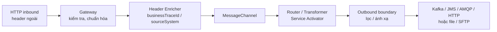
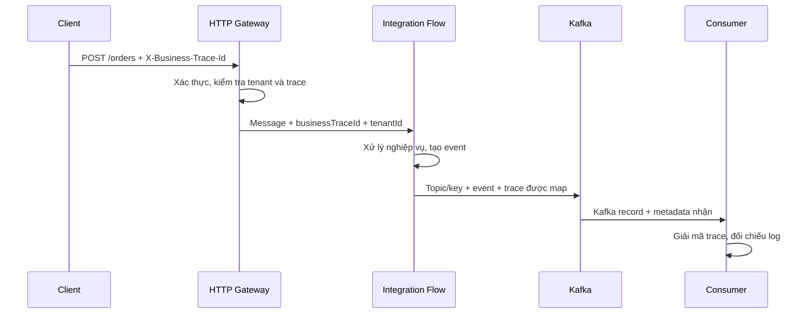

# User-defined headers trong Spring Integration

## Mục tiêu học tập

Trong module **SPRING_INTEGRATION_ADAPTERS**, chúng ta xây dựng các luồng kết nối hệ thống ngoài bằng inbound/outbound adapter, gateway, poller và `MessageChannel`; dữ liệu có thể đi qua file, SFTP, HTTP, JMS, AMQP, Kafka hoặc cơ sở dữ liệu. Payload cho biết **điều gì đang được xử lý**; message headers cung cấp **ngữ cảnh để xử lý và chuyển tiếp payload**. Ngoài các header chuẩn của Spring, nhiều luồng cần thêm metadata riêng theo hợp đồng ứng dụng.

**User-defined headers** (header do ứng dụng tự định nghĩa) cho phép mang những thông tin như `businessTraceId`, `tenantId`, `sourceSystem`, `schemaVersion` hoặc `retryCategory` xuyên qua các bước tích hợp mà không cần sửa cấu trúc payload nghiệp vụ. Tuy nhiên, chúng chỉ có ý nghĩa khi các bên thống nhất tên, kiểu, phạm vi sử dụng và cách chuyển đổi ở biên giao thức.

Học xong bài này, bạn có thể:

1. Quyết định thông tin nào nên là payload, header chuẩn hay user-defined header.
2. Tạo, đọc, bổ sung, cập nhật hoặc xóa custom header qua `MessageBuilder` và header enricher.
3. Xác định lúc nào header được truyền tiếp, bị thay đổi hoặc không thể xuất qua một adapter.
4. Thiết kế hợp đồng và kiểm tra an toàn khi chuyển HTTP → xử lý nội bộ → JMS/AMQP/Kafka/file/SFTP.
5. Chẩn đoán lỗi thiếu header, sai kiểu, ghi đè metadata và tin tưởng nhầm header từ nguồn bên ngoài.

## 1. User-defined header là gì?

Spring Messaging mô hình hóa một message gồm payload và `MessageHeaders`:

```text
Message
├── payload
│   └── {"orderId":"O-1042","total":125000}
└── headers
    ├── id                  → UUID do framework quản lý
    ├── timestamp           → thời điểm tạo message
    ├── contentType         → metadata chuẩn về định dạng
    ├── businessTraceId     → user-defined: theo dõi nghiệp vụ
    ├── tenantId            → user-defined: ngữ cảnh tenant đã xác minh
    └── sourceSystem        → user-defined: hệ thống nguồn
```

Một user-defined header là **một cặp khóa–giá trị được ứng dụng đưa vào `MessageHeaders`**, không thuộc tập các header mà framework bắt buộc phải hiểu. Ví dụ:

- `businessTraceId = "trace-8f3c"`: đối chiếu các bước của cùng một giao dịch nghiệp vụ.
- `sourceSystem = "crm"`: cho router hoặc logger biết sự kiện đến từ đâu.
- `tenantId = "tenant-a"`: mang ngữ cảnh tenant **đã được hệ thống xác minh**.
- `schemaVersion = 2`: giúp thành phần downstream chọn bộ chuyển đổi phiên bản.
- `processingMode = "async"`: biểu thị cách xử lý do ứng dụng quy định.

Spring Integration không tự hiểu `tenantId` có nghĩa gì và cũng không tự truyền `businessTraceId` thành một HTTP/Kafka/JMS header tương ứng. Router, transformer, filter, handler, gateway hoặc mapper phải được lập trình/cấu hình để đọc và sử dụng chúng.

### 1.1. Phân biệt các nhóm header

| Nhóm | Ví dụ | Chủ thể sở hữu ý nghĩa | Cách dùng đúng |
|---|---|---|---|
| **Spring Messaging chuẩn** | `id`, `timestamp`, `contentType`, `replyChannel`, `errorChannel` | Framework | Định danh message, chuyển đổi nội dung, trả lời và xử lý lỗi |
| **Spring Integration** | `correlationId`, `sequenceNumber`, `sequenceSize` | Các integration component | Nhóm message, đánh số phần, tổng hợp |
| **Protocol-specific** | HTTP `Content-Type`; JMS `JMSCorrelationID`; Kafka topic/key; AMQP routing key | Giao thức và adapter | Chuyển metadata đến/đi khỏi hệ thống ngoài |
| **User-defined** | `businessTraceId`, `tenantId`, `sourceSystem` | Ứng dụng và các đối tác tích hợp | Diễn đạt metadata nghiệp vụ/vận hành theo hợp đồng riêng |

**Lưu ý:** đừng dùng một khóa tự tạo có cùng tên với header framework hoặc protocol, rồi kỳ vọng nó có một ý nghĩa khác. Khi cần giá trị tương quan độc lập với `IntegrationMessageHeaderAccessor.CORRELATION_ID` hoặc JMS correlation ID, hãy dùng tên như `businessTraceId` và ánh xạ có chủ đích tại nơi cần thiết.

### 1.2. Khi nào nên dùng header, khi nào dùng payload?

| Thông tin | Đặt ở đâu? | Lý do |
|---|---|---|
| `orderId`, danh sách sản phẩm, số tiền, trạng thái đơn hàng | **Payload** | Là nội dung nghiệp vụ cần được tiêu thụ, lưu trữ và phát lại như một phần của sự kiện |
| `businessTraceId`, `sourceSystem`, `processingMode` | **Header** | Phục vụ định tuyến, theo dõi, vận hành hoặc chính sách của flow |
| `contentType`, `replyChannel` | **Header chuẩn** | Framework đã có hợp đồng và hằng số chính thức |
| `JMSCorrelationID` hoặc `KafkaHeaders.KEY` | **Metadata giao thức** | Được adapter/mapper hiểu theo quy tắc của giao thức |

Đừng chỉ dựa vào một header tạm thời để lưu thông tin mà downstream **bắt buộc phải có để hiểu sự kiện được lưu trữ hoặc phát lại**. Ví dụ `orderId` có thể đồng thời dùng làm Kafka record key, nhưng vẫn nên nằm trong payload sự kiện đơn hàng khi đó là một phần hợp đồng dữ liệu.

## 2. Thiết kế hợp đồng user-defined headers

Trước khi đặt header, xác định những điều sau:

| Thuộc tính hợp đồng | Câu hỏi cần trả lời | Ví dụ cho `businessTraceId` |
|---|---|---|
| Tên và quy ước | Có thống nhất ký tự và kiểu viết hoa/thường không? | `businessTraceId` trong `MessageHeaders` |
| Kiểu dữ liệu | Bên nhận mong đợi kiểu Java nào? | `String` |
| Nguồn tạo | Đến từ inbound request hay được cấp ở gateway? | Gateway tạo ID nếu request chưa có ID hợp lệ |
| Bắt buộc/tùy chọn | Thiếu header thì mặc định, từ chối hay tạo mới? | Tạo UUID khi thiếu |
| Ai được phép đổi? | Thành phần nào sở hữu giá trị? | Chỉ entry gateway cấp hoặc chuẩn hóa |
| Hướng lan truyền | Trong flow, qua HTTP/JMS/Kafka hay không? | Chuyển qua HTTP và Kafka theo mapping |
| Tuổi thọ | Một message, một request hay toàn giao dịch? | Một giao dịch nghiệp vụ |
| An toàn | Có được ghi log hay chuyển sang đối tác không? | Cho phép ghi log ID đã kiểm tra, giới hạn độ dài |

**Quy ước đặt tên đề xuất:**

- Chọn tên rõ nghĩa, nhất quán trong ứng dụng: `businessTraceId`, `sourceSystem`, `schemaVersion`. `MessageHeaders` là map dùng tên khóa bằng chuỗi; hãy coi tên là **phân biệt chữ hoa–chữ thường**.
- Định nghĩa khóa ở một nơi dùng chung để tránh lỗi đánh máy. Nếu module có nhiều adapter, quy ước tên cần được chia sẻ giữa các endpoint.
- Tránh các tên `id`, `timestamp`, `replyChannel`, `errorChannel`, `contentType` và những khóa do Spring Integration/protocol adapter đã dành cho mục đích riêng.
- Nếu phải giao tiếp HTTP, phân biệt tên nội bộ `businessTraceId` với tên HTTP trên đường truyền như `X-Business-Trace-Id`. Việc đổi tên thuộc trách nhiệm của adapter/mapping hoặc bước chuyển đổi tại biên.
- Không gắn những dữ liệu lớn, nhị phân tùy ý, kết nối DB, bean Spring, `MessageChannel` hoặc đối tượng Java không thể tuần tự hóa vào custom header muốn truyền qua broker.

### 2.1. Tập trung tên khóa trong mã nguồn

```java
public final class ApplicationHeaders {

    private ApplicationHeaders() {}

    public static final String BUSINESS_TRACE_ID = "businessTraceId";
    public static final String TENANT_ID = "tenantId";
    public static final String SOURCE_SYSTEM = "sourceSystem";
    public static final String SCHEMA_VERSION = "schemaVersion";
}
```

Đây là **hằng số do ứng dụng tạo**, khác với `MessageHeaders`, `IntegrationMessageHeaderAccessor` hay `KafkaHeaders` của framework. Có thể dùng thêm lớp mô tả chính sách/kiểu dữ liệu để không phải rải quy tắc kiểm tra ở từng adapter.

## 3. Tạo và đọc custom header bằng MessageBuilder

`MessageHeaders` biểu diễn metadata dưới dạng map chỉ đọc. Để thay đổi header, hãy tạo **message mới** bằng `MessageBuilder` thay vì cố sửa `input.getHeaders()`.

### 3.1. Tạo message với user-defined headers

```java
import java.util.UUID;
import org.springframework.messaging.Message;
import org.springframework.messaging.support.MessageBuilder;

public final class CustomHeadersExample {

    public static Message<String> createOrderMessage() {
        String traceId = UUID.randomUUID().toString();

        return MessageBuilder.withPayload(
                    "{\"orderId\":\"O-1042\",\"total\":125000}")
                .setHeader(ApplicationHeaders.BUSINESS_TRACE_ID, traceId)
                .setHeader(ApplicationHeaders.SOURCE_SYSTEM, "orders-api")
                .setHeader(ApplicationHeaders.SCHEMA_VERSION, 2)
                .build();
    }

    public static String getTraceId(Message<?> message) {
        return message.getHeaders().get(
                ApplicationHeaders.BUSINESS_TRACE_ID, String.class);
    }
}
```

`setHeader(name, value)` đặt hoặc thay thế giá trị header trên builder. `get(name, String.class)` đọc với kiểu mong đợi; ứng dụng cần xử lý trường hợp vắng mặt hoặc sai kiểu phù hợp với hợp đồng.

### 3.2. Copy headers, thêm nếu thiếu và loại bỏ header

```java
import org.springframework.messaging.Message;
import org.springframework.messaging.support.MessageBuilder;

public static Message<String> prepareForProcessing(Message<String> incoming) {
    return MessageBuilder.fromMessage(incoming)
            .setHeaderIfAbsent(ApplicationHeaders.SOURCE_SYSTEM, "unknown")
            .setHeader("processingStage", "validated")
            .removeHeader("internalDebug")
            .build();
}
```

Ý nghĩa:

- `fromMessage(incoming)` khởi tạo builder từ payload và các header hiện có để tạo message kết quả.
- `setHeaderIfAbsent(...)` chỉ đặt giá trị khi chưa có khóa, phù hợp với chính sách dùng giá trị mặc định.
- `setHeader(...)` có thể ghi đè. Trước khi ghi đè metadata nhận từ một hệ thống khác, cần biết giá trị nào được tin cậy và thành phần nào sở hữu header.
- `removeHeader(...)` bỏ một khóa; `removeHeaders(...)` hỗ trợ loại bỏ nhiều tên/pattern theo API builder.

Việc tạo message mới có thể ảnh hưởng đến metadata do framework quản lý, đặc biệt `id` và `timestamp`; **không dùng chúng làm định danh nghiệp vụ bền vững**. Các header phục vụ request–reply hoặc error flow cũng cần được giữ nếu endpoint tiếp theo phụ thuộc vào chúng.

### 3.3. Xử lý header vắng mặt hoặc không hợp lệ

```java
import java.util.UUID;
import org.springframework.messaging.Message;
import org.springframework.messaging.support.MessageBuilder;

public static Message<?> ensureTraceId(Message<?> input) {
    Object supplied = input.getHeaders().get(
            ApplicationHeaders.BUSINESS_TRACE_ID);

    String traceId;
    if (supplied instanceof String text
            && text.matches("[A-Za-z0-9._:-]{1,128}")) {
        traceId = text;
    } else {
        traceId = UUID.randomUUID().toString();
    }

    return MessageBuilder.fromMessage(input)
            .setHeader(ApplicationHeaders.BUSINESS_TRACE_ID, traceId)
            .build();
}
```

Đoạn trên minh họa chính sách **cấp trace ID mới nếu thiếu/không hợp lệ**. Trong hệ thống có yêu cầu bắt buộc đối tác cung cấp ID, có thể chọn từ chối message thay vì cấp mới. Hãy xác định rõ chính sách này trong hợp đồng, nhất là khi cần liên kết log giữa các hệ thống.

## 4. Header Enricher và Header Filter trong Spring Integration

Trong flow Spring Integration, việc bổ sung metadata thường nên thực hiện ở **ranh giới hoặc một bước xử lý xác định** thay vì lặp lại ở mọi service activator.

### 4.1. Header Enricher: bổ sung hoặc tính header

Spring Integration cung cấp `HeaderEnricher`, có thể cấu hình bằng Java DSL hoặc XML. Ví dụ Java DSL:

```java
import java.time.Instant;
import org.springframework.context.annotation.Bean;
import org.springframework.integration.dsl.IntegrationFlow;

@Bean
IntegrationFlow addOrderHeaders() {
    return IntegrationFlow.from("ordersInbound")
            .enrichHeaders(headers -> headers
                    .header("sourceSystem", "orders-api")
                    .headerFunction("processingStartedAt",
                            message -> Instant.now().toString()))
            .channel("ordersWithHeaders")
            .get();
}
```

Trong ví dụ này, mọi message đi qua bước enrichment được gắn tên hệ thống nguồn và thời điểm bắt đầu xử lý. `processingStartedAt` có kiểu `String` theo định dạng ISO-8601; nếu downstream yêu cầu `Instant`, hai bên phải thống nhất kiểu trong phạm vi JVM và cách tuần tự hóa khi đi ra giao thức khác.

Các dạng enrichment khác có thể lấy giá trị từ biểu thức SpEL, method hoặc function; việc chọn phụ thuộc nguồn metadata và API Spring Integration của phiên bản đang dùng.

Cấu hình XML tương đương cho header tĩnh:

```xml
<int:header-enricher input-channel="ordersInbound"
                     output-channel="ordersWithHeaders">
    <int:header name="sourceSystem" value="orders-api"/>
</int:header-enricher>
```

Ví dụ XML giả định dự án đã khai báo namespace `int` và các channel tương ứng. Khi cấu hình nhiều enricher, cần quyết định chính sách **giữ giá trị cũ hoặc cho phép ghi đè** để tránh thay đổi bất ngờ thông tin đã được xác minh.

### 4.2. Header Filter: loại bỏ metadata không nên đi tiếp

Khi chuyển sang nhánh xuất dữ liệu, có thể bỏ header chỉ dùng để debug hoặc chứa dữ liệu nhạy cảm:

```xml
<int:header-filter input-channel="ordersProcessed"
                   output-channel="ordersReadyForOutbound"
                   header-names="internalDebug,rawAuthorization"/>
```

Ở ví dụ trên, filter loại bỏ hai custom header khi message đi qua. Đây là một bước **làm sạch ngữ cảnh nội bộ**, nhưng chưa thay thế chính sách cho phép những header nào được mapper đưa lên mạng. Để xuất ra HTTP/JMS/Kafka an toàn, vẫn cần kiểm soát mapping tại adapter.

Không được lọc bừa `replyChannel`, `errorChannel` hoặc header correlation/sequence nếu một endpoint phía sau vẫn cần chúng.

### 4.3. Vì sao enrichment khác transformation?

- **Header enrichment:** bổ sung/điều chỉnh metadata, thường giữ nguyên payload.
- **Payload transformation:** biến đổi dữ liệu nghiệp vụ; thông thường component có hỗ trợ truyền tiếp header, nhưng hành vi cụ thể phụ thuộc loại transformer và giá trị trả về.
- **Header filtering:** loại bỏ các khóa được chỉ định khỏi message.
- **Routing:** dùng payload/header để chọn nhánh xử lý; một custom header chỉ có tác dụng nếu router được cấu hình đọc nó.

Ví dụ, `tenantId` có thể điều khiển cách định tuyến đến các nguồn dữ liệu, còn `schemaVersion` giúp chọn transformer thích hợp. Quy tắc phân quyền tenant phải dựa vào danh tính đã xác minh, **không** dựa vào một header do client tùy ý khai báo.

## 5. Header đi qua IntegrationFlow như thế nào?



Một số điểm quan trọng:

1. **Trong cùng tiến trình:** custom header có thể đi cùng `Message<?>` qua channel và các endpoint. Tuy nhiên, một endpoint có quyền tạo message hoàn toàn mới, bỏ header hoặc đổi giá trị. Đừng mặc định mọi handler giữ tất cả header.
2. **Qua queue/broker hoặc process boundary:** metadata phải được mapper/converter hỗ trợ và có kiểu phù hợp với transport. Đối tượng Java tùy ý trong header có thể không thể xuất qua mạng hoặc không thể khôi phục khi nhận.
3. **Qua splitter/aggregator:** framework có thể sử dụng hoặc thay đổi header điều phối như correlation/sequence. Custom header mang trace hoặc source thường vẫn hữu ích, nhưng cách gộp header khi nhiều message được aggregate phải được xác định theo component và chiến lược cấu hình.
4. **Qua HTTP gateway:** reply message là một message khác, nên không thể suy luận toàn bộ request headers luôn xuất hiện trong response. Cần xác định hợp đồng header của mỗi hướng.
5. **Qua error flow:** `ErrorMessage` chứa lỗi và có thể có message gốc trong ngữ cảnh exception; muốn log trace ID an toàn cần đọc từ đúng message, không giả định mọi error message có cùng tập custom header.

Để xác định chính xác chặng làm mất header, quan sát `MessageHeaders` (với allowlist các khóa an toàn) tại ba điểm: **ngay sau inbound**, **sau transformer/aggregator**, và **trước outbound mapping**.

## 6. Ánh xạ custom headers sang protocol headers

Không tồn tại quy tắc tự động toàn cục rằng `headers["businessTraceId"]` sẽ xuất hiện dưới cùng tên trong mọi giao thức. Các adapter cùng mapper/converter quyết định hướng và kiểu dữ liệu được hỗ trợ.

| Kết nối | Mô hình metadata bên ngoài | Ví dụ mapping custom header | Rủi ro phổ biến |
|---|---|---|---|
| HTTP | HTTP request/response headers | `businessTraceId` → `X-Business-Trace-Id` | Tên key nội bộ khác tên HTTP; mapping không cho phép custom header |
| JMS | JMS headers và user properties | `sourceSystem` → property kiểu `String` | Tên/kiểu property không hợp lệ, nhầm user property với `JMSCorrelationID` |
| AMQP | Message properties và application headers | `businessTraceId` → application header nếu mapper cho phép | Chuyển nhầm header nhận từ broker hoặc metadata ack nội bộ |
| Kafka | Record topic/key/partition và record headers kiểu byte array | `businessTraceId` → native Kafka header qua converter/mapper | Nhầm record key với native header; thiếu hoặc sai bộ mã hóa |
| File | Tên, đường dẫn, nội dung file | `outputFilename` → `FileHeaders.FILENAME` nếu handler dùng nó | Tên header tự tạo không được file handler tự hiểu |
| SFTP | Tên/đường dẫn remote file và metadata adapter | Chuyển `outputFilename` thành cấu hình tên file của remote handler | Custom header không tự biến thành remote metadata hay nội dung file |
| JDBC/DB | Cột SQL, tham số query, transaction context | Lấy `tenantId` đã xác minh để chọn truy vấn/đường đi | Không có cơ chế tự lưu mọi header thành cột DB |

### 6.1. HTTP: chuyển tên và allowlist header

Giả sử message nội bộ có `businessTraceId = "trace-8f3c"`; đối tác HTTP yêu cầu `X-Business-Trace-Id`:

```java
import org.springframework.messaging.Message;
import org.springframework.messaging.support.MessageBuilder;

public static Message<?> adaptForHttp(Message<?> input) {
    String traceId = input.getHeaders().get(
            ApplicationHeaders.BUSINESS_TRACE_ID, String.class);

    if (traceId == null || !traceId.matches("[A-Za-z0-9._:-]{1,128}")) {
        throw new IllegalArgumentException("Invalid business trace ID");
    }

    return MessageBuilder.fromMessage(input)
            .removeHeader("rawAuthorization")
            .setHeader("X-Business-Trace-Id", traceId)
            .build();
}
```

Đoạn này mới chuẩn bị **header trong Spring message**. Outbound HTTP adapter còn phải cấu hình `HeaderMapper` hoặc danh sách mapped request headers để thực sự phát `X-Business-Trace-Id` ra HTTP. Ví dụ dùng XML namespace `int-http` ở một gateway đã có cấu hình endpoint hợp lệ:

```xml
<int-http:outbound-gateway
    id="partnerHttpGateway"
    request-channel="partnerRequests"
    url="https://partner.example.org/orders"
    mapped-request-headers="HTTP_REQUEST_HEADERS,X-Business-Trace-Id"/>
```

`HTTP_REQUEST_HEADERS` là pattern mapping dành cho nhóm HTTP request headers chuẩn. Việc thêm custom header cần xem xét ở cả **bước đổi tên** và **danh sách header được phép map**. HTTP header không phân biệt chữ hoa–thường về mặt giao thức, nhưng key trong `MessageHeaders` phải dùng nhất quán trong mã ứng dụng.

### 6.2. JMS: user properties khác JMS standard headers

Với JMS, một header nghiệp vụ có thể được chuyển thành **message property** nếu mapper cho phép. Giá trị property phải thuộc tập kiểu JMS hỗ trợ, ví dụ `String`, `boolean`, `int`, `long` hoặc một số kiểu số khác; tên property phải đáp ứng quy tắc JMS, thường theo dạng identifier và không tùy ý chứa dấu gạch ngang.

Ví dụ `businessTraceId` có thể phù hợp làm property, còn `X-Business-Trace-Id` là một tên kiểu HTTP không phù hợp để dùng nguyên trạng như JMS property. `JMSCorrelationID` là trường JMS chuẩn; muốn gán correlation ID theo hợp đồng JMS, phải dùng API/mapper tương ứng thay vì mong custom header tự động đổi tên.

### 6.3. Kafka: phân biệt record metadata và record headers

Kafka record có **topic**, **partition**, **key**, **value**, **timestamp** và **record headers**. Các trường đó không đồng nhất:

```java
import org.springframework.kafka.support.KafkaHeaders;
import org.springframework.messaging.Message;
import org.springframework.messaging.support.MessageBuilder;

public static Message<String> kafkaEvent(
        String payload, String orderId, String traceId) {
    return MessageBuilder.withPayload(payload)
            .setHeader(KafkaHeaders.TOPIC, "orders.events")
            .setHeader(KafkaHeaders.KEY, orderId)
            .setHeader(ApplicationHeaders.BUSINESS_TRACE_ID, traceId)
            .build();
}
```

`KafkaHeaders.TOPIC` và `KafkaHeaders.KEY` dành cho các thành phần xuất Kafka hiểu được chúng (tùy cấu hình adapter/producer). `businessTraceId` là custom header nội bộ và chỉ có thể đi thành **Kafka native record header** khi converter/header mapper được cấu hình phù hợp. Kafka native header mang giá trị byte array, nên việc biểu diễn `String` hoặc đối tượng Java cần quy tắc mã hóa và giải mã thống nhất.

Không nhầm `KafkaHeaders.RECEIVED_TOPIC` hoặc `KafkaHeaders.OFFSET` ở phía consumer với header chỉ định đích gửi hoặc business trace ID. Cũng không giả định mọi header nhận được từ Kafka đều có thể xuất ngược qua một giao thức khác.

### 6.4. AMQP và file/SFTP: metadata khác nhau

AMQP có properties và application headers, và các hằng số như `AmqpHeaders.RECEIVED_ROUTING_KEY` dùng để mô tả message **đã nhận**. Custom header được đưa ra AMQP tùy header mapper/converter; routing key publish và delivery/acknowledgment metadata cần cơ chế của adapter, không tự suy từ một key bất kỳ.

Đối với file và SFTP, custom header `outputFilename` có thể chứa quyết định nghiệp vụ nhưng file handler không có nghĩa vụ hiểu nó. Hãy chuyển nó thành `FileHeaders.FILENAME` hoặc sử dụng `FileNameGenerator`/expression theo hợp đồng adapter:

```java
import org.springframework.integration.file.FileHeaders;
import org.springframework.messaging.Message;
import org.springframework.messaging.support.MessageBuilder;

public static Message<?> prepareFileName(Message<?> input) {
    String requestedName =
            input.getHeaders().get("outputFilename", String.class);
    String safeName = validateFileName(requestedName);

    return MessageBuilder.fromMessage(input)
            .setHeader(FileHeaders.FILENAME, safeName)
            .build();
}

// validateFileName(String): hàm do ứng dụng triển khai; chỉ chấp nhận
// tên file hợp lệ theo chính sách, không cho phép traversal như "../".
```

Đây là ví dụ minh họa bước ánh xạ. Lựa chọn tên file thực tế phụ thuộc cấu hình file/SFTP handler. Không chấp nhận nguyên giá trị tên file do người dùng bên ngoài cung cấp nếu chưa kiểm tra.

## 7. Ranh giới tin cậy và bảo mật

Header từ external client hoặc broker là **dữ liệu đầu vào**, không phải bằng chứng quyền truy cập. Đây là điểm đặc biệt quan trọng với multi-tenant, gateway và luồng kết nối nhiều hệ thống.

### 7.1. Không dùng client-supplied tenantId làm căn cứ phân quyền

Giả sử inbound HTTP nhận:

```http
POST /orders HTTP/1.1
Content-Type: application/json
X-Tenant-Id: tenant-admin
X-Business-Trace-Id: trace-8f3c
```

Nếu router đọc thẳng `X-Tenant-Id` để quyết định cơ sở dữ liệu hoặc tenant mà không xác minh principal/token và quyền truy cập, client có thể thử truy cập dữ liệu tenant khác. Hướng xử lý an toàn:

1. Gateway xác thực danh tính và kiểm tra quyền của request.
2. Gateway xác định **tenant đã được cấp phép** từ nguồn đáng tin cậy hoặc đối chiếu header với quyền thực tế.
3. Chỉ sau đó tạo/ghi đè custom header nội bộ `tenantId` bằng giá trị đã xác minh.
4. Downstream dùng `tenantId` nội bộ theo hợp đồng và không xem header external là căn cứ độc lập cho authorization.

Tương tự, `sourceSystem` và `processingMode` do client tự gửi không được tự nâng thành quyền ưu tiên hoặc bỏ qua validation.

### 7.2. Chỉ truyền những header cần thiết

- **Allowlist outbound:** xác định chính xác những khóa nào được chuyển sang đối tác. Đừng map toàn bộ `MessageHeaders` ra mạng nếu không có lý do.
- **Giới hạn kích thước và kiểu:** header quá lớn có thể làm request/broker record bị từ chối. Ưu tiên chuỗi ngắn, số, boolean hoặc byte array có schema rõ ràng.
- **Không đặt bí mật vào header chung:** token truy cập, cookie, mật khẩu, khóa API và thông tin cá nhân không nên bị lan truyền hoặc in log chỉ vì chúng nằm trong `MessageHeaders`.
- **Ngăn chèn ký tự điều khiển:** giá trị dùng làm HTTP header hoặc file name cần kiểm tra ký tự xuống dòng, ký tự không hợp lệ, độ dài và cú pháp.
- **Dùng trace chuẩn khi cần:** nếu hệ thống đã triển khai W3C Trace Context/observability, tránh tự tạo quy tắc mâu thuẫn với `traceparent`/`tracestate`. `businessTraceId` có thể bổ sung góc nhìn nghiệp vụ, nhưng không phải header thay thế distributed tracing chuẩn.
- **Xem lại chính sách khi retry/replay:** message được gửi lại hoặc phát lại có thể mang metadata cũ. Cần quyết định header nào được giữ để đối chiếu giao dịch và header nào phải tạo lại cho một lần xử lý mới.

## 8. Tình huống thực tế: HTTP → xử lý đơn hàng → Kafka

Yêu cầu nghiệp vụ: một HTTP inbound gateway nhận đơn hàng; service kiểm tra đơn, bổ sung trace ID, xuất sự kiện Kafka và ghi log theo trace ID.

**Hợp đồng đề xuất:**

| Bước | Header có ý nghĩa | Quy tắc |
|---|---|---|
| HTTP inbound | `X-Business-Trace-Id`, thông tin xác thực và context HTTP | Mapper đưa header trace vào flow; xác thực/kiểm tra dữ liệu đầu vào |
| Bước chuẩn hóa | `businessTraceId`, `tenantId`, `sourceSystem` | Tạo trace ID khi thiếu; tenant lấy từ ngữ cảnh đã xác minh; source xác định bằng gateway |
| Xử lý nghiệp vụ | `businessTraceId`, `schemaVersion` | Luôn giữ trace ID; gán schemaVersion phù hợp với sự kiện |
| Kafka outbound | `KafkaHeaders.TOPIC`, `KafkaHeaders.KEY`, custom trace header được phép | Topic/key theo cấu hình; custom trace được converter/mapper mã hóa và gửi nếu cần |
| Kafka inbound tại consumer | Custom trace sau khi decode; metadata `RECEIVED_*` | Log theo trace ID; dùng offset/partition để chẩn đoán, không làm định danh nghiệp vụ |



Nếu message đi qua JMS hoặc AMQP trước khi tới Kafka, cần thêm bước chuyển đổi tương ứng: kiểu value, tên property/header, giới hạn kích thước, quyền được gửi và cách khôi phục ở phía nhận.

## 9. Kiểm tra và gỡ lỗi user-defined headers

### 9.1. Những lỗi thường gặp

| Triệu chứng | Nguyên nhân khả dĩ | Cách kiểm tra |
|---|---|---|
| `tenantId` biến mất sau transformer | Handler trả message hoàn chỉnh nhưng không mang header cần thiết | Kiểm tra output thực tế của transformer, chính sách copy/propagation |
| Header không đến HTTP server | Chưa đổi tên nội bộ hoặc outbound mapper không cho phép header | Kiểm tra message trước gateway và HTTP request thực tế |
| JMS từ chối custom property | Tên hoặc kiểu không đáp ứng quy tắc JMS | Kiểm tra tên property, class của giá trị và mapping |
| Consumer Kafka không đọc được trace ID | Mapper/converter không xuất header hoặc hai bên mã hóa khác nhau | Kiểm tra record headers dạng byte array và cấu hình deserialize |
| Router dùng sai tenant | Header lấy trực tiếp từ client không được xác thực | Đối chiếu tenant với principal/quyền trong gateway |
| Thông tin nhạy cảm xuất hiện trong log | Log toàn bộ `MessageHeaders` | Chuyển sang allowlist log, che hoặc loại bỏ secret |
| File/SFTP dùng sai tên | Adapter không đọc `outputFilename` hoặc tên không hợp lệ | Map sang `FileHeaders.FILENAME`/generator, kiểm tra path |
| Trace bị đổi khi retry | Bước retry tạo lại business trace ID | Phân biệt ID giao dịch với ID lần thử, giữ đúng header theo hợp đồng |

### 9.2. Ví dụ kiểm tra với JUnit 5

Test sau chỉ kiểm tra chính sách chuẩn hóa nội bộ; không giả lập việc HTTP/Kafka/JMS đã map header thành công.

```java
import static org.junit.jupiter.api.Assertions.*;

import org.junit.jupiter.api.Test;
import org.springframework.messaging.Message;
import org.springframework.messaging.support.MessageBuilder;

class CustomHeaderPolicyTest {

    @Test
    void keepsValidBusinessTraceIdWhenPreparingMessage() {
        Message<String> incoming = MessageBuilder
                .withPayload("{\"orderId\":\"O-1042\"}")
                .setHeader(ApplicationHeaders.BUSINESS_TRACE_ID, "trace-8f3c")
                .build();

        Message<?> normalized = ensureTraceId(incoming);

        assertEquals("trace-8f3c", normalized.getHeaders().get(
                ApplicationHeaders.BUSINESS_TRACE_ID));
    }

    @Test
    void generatesBusinessTraceIdWhenAbsent() {
        Message<String> incoming =
                MessageBuilder.withPayload("order-created").build();

        Message<?> normalized = ensureTraceId(incoming);

        String trace = normalized.getHeaders().get(
                ApplicationHeaders.BUSINESS_TRACE_ID, String.class);
        assertNotNull(trace);
        assertFalse(trace.isBlank());
    }
}
```

Để chạy ví dụ, `ensureTraceId` là method ở phần 3.3 (đặt trong class utility/được import thích hợp), `ApplicationHeaders` là lớp hằng số ở phần 2.1. Với kiểm thử end-to-end, cần thêm kiểm tra HTTP header trên request thực, JMS/AMQP message properties hoặc Kafka record headers sau converter, vì unit test của `MessageBuilder` không chứng minh mapping ngoài biên đã đúng.

### 9.3. Checklist review một custom header mới

1. Mục đích rõ ràng: điều phối flow, vận hành, quan sát hay metadata giao thức?
2. Tên, kiểu, nguồn tạo, chính sách thiếu giá trị/ghi đè và phạm vi sử dụng đã thống nhất?
3. Có va chạm với header chuẩn của Spring Messaging, Spring Integration hay adapter không?
4. Header nhận từ hệ thống ngoài đã được kiểm tra và xác minh đủ cho mục đích sử dụng chưa?
5. Transformer, splitter, aggregator, retry/error flow có giữ các giá trị bắt buộc không?
6. Mỗi outbound mapper có allowlist và chuyển đổi tên/kiểu theo đúng giao thức không?
7. Có kiểm thử cả message nội bộ **và** metadata thật tại endpoint bên ngoài không?

## 10. Bài thực hành

Hãy tự xây dựng flow **HTTP inbound → service activator → Kafka outbound** xử lý đơn hàng với yêu cầu:

1. Nhận `X-Business-Trace-Id` (tùy chọn); nếu thiếu hoặc không hợp lệ, tạo UUID và đưa vào `businessTraceId`.
2. Xác định `tenantId` từ nguồn danh tính đáng tin cậy; không dùng trực tiếp giá trị tenant do client tự khai báo.
3. Dùng header enricher thêm `sourceSystem = "orders-api"` và `schemaVersion = 2`.
4. Trong service activator, giữ `businessTraceId` khi tạo message sự kiện mới; đưa `orderId` và dữ liệu nghiệp vụ vào payload.
5. Xuất sang Kafka topic `orders.events` với record key bằng `orderId`. Cấu hình header mapper/converter để chuyển `businessTraceId` khi hợp đồng consumer yêu cầu.
6. Không cho phép `rawAuthorization`, `internalDebug` hoặc đối tượng nội bộ trong message được truyền ra Kafka.
7. Xây dựng kiểm thử trường hợp trace thiếu, trace bị sửa, custom header mất sau transformer và Kafka record header không được mapper đưa ra ngoài.

**Câu hỏi tự đánh giá:** Vì sao việc đặt `.setHeader("businessTraceId", "trace-8f3c")` chưa đủ để bảo đảm Kafka consumer đọc được trace? Câu trả lời cần nêu rõ ba lớp: `MessageHeaders` nội bộ, cấu hình converter/mapper và biểu diễn record headers ở phía Kafka consumer.

## Tài liệu tham khảo

- [Spring Integration Reference – Messaging](https://docs.spring.io/spring-integration/reference/message.html)
- [Spring Integration Reference – Header Enricher](https://docs.spring.io/spring-integration/reference/content-enrichment.html)
- [Spring Integration Reference – HTTP Header Mapping](https://docs.spring.io/spring-integration/reference/http/header-mapping.html)
- [Spring Integration Reference – Kafka Support](https://docs.spring.io/spring-integration/reference/kafka.html)
- [Spring Integration Reference – File Writing](https://docs.spring.io/spring-integration/reference/file/writing.html)
- [Spring Framework – MessageHeaders API](https://docs.spring.io/spring-framework/docs/current/javadoc-api/org/springframework/messaging/MessageHeaders.html)
