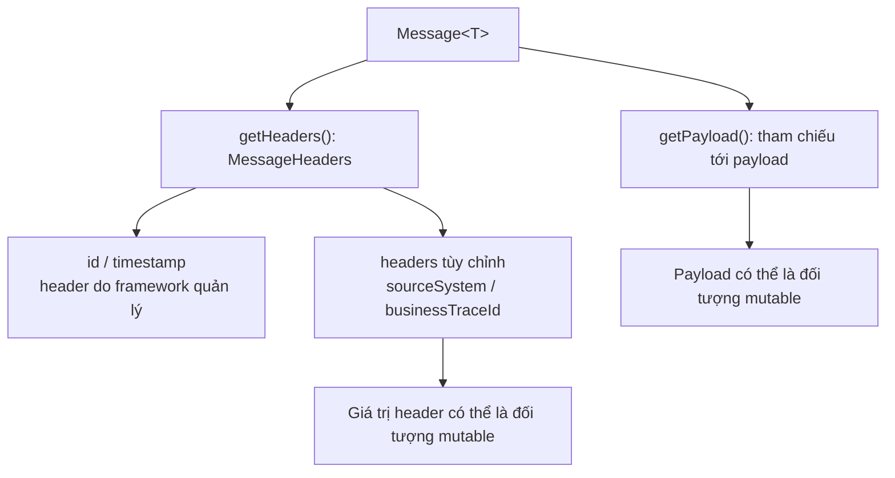
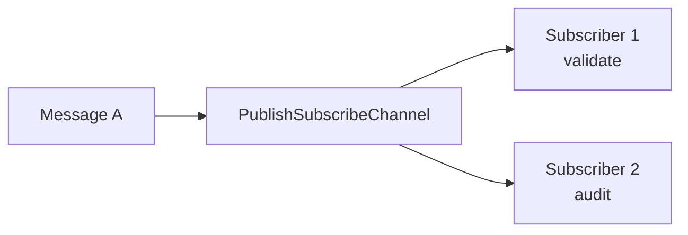
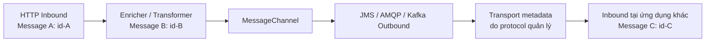

# MessageHeaders.ID và tính bất biến trong Spring Integration

## Mục tiêu bài học

Trong Spring Integration, luồng dữ liệu có thể đi từ HTTP gateway qua `MessageChannel`, transformer, service activator, rồi ra Kafka, JMS, AMQP, file hoặc SFTP. Mỗi bước nhận và gửi một `Message<?>` gồm **payload** và **headers**. Hai thuộc tính rất dễ hiểu nhầm là `MessageHeaders.ID` và tính bất biến (*immutability*) của message.

Sau khi học, bạn có thể:

- Giải thích `MessageHeaders.ID` định danh cái gì, ai tạo ID và vì sao ID có thể đổi khi message được biến đổi.
- Đọc ID/timestamp chuẩn qua `MessageHeaders`, phân biệt chúng với `correlationId`, message ID của broker và mã nghiệp vụ.
- Nêu chính xác phần nào của `Message<?>` / `MessageHeaders` bất biến, phần nào vẫn có thể thay đổi thông qua tham chiếu tới đối tượng mutable.
- Tạo message mới một cách an toàn bằng `MessageBuilder` và truyền tiếp các header cần thiết khi qua adapter/gateway.
- Thiết kế cách theo dõi và chống xử lý trùng mà không phụ thuộc sai vào ID của message instance.

## 1. `MessageHeaders.ID` là gì?

`org.springframework.messaging.MessageHeaders` định nghĩa hằng số:

```java
public static final String ID = "id";
```

Giá trị nằm ở khóa `id` của `MessageHeaders` và thông thường có kiểu `java.util.UUID`. Framework cung cấp API đọc thuận tiện:

```java
UUID id = message.getHeaders().getId();
// Tương đương về ý nghĩa với:
UUID sameId = message.getHeaders().get(MessageHeaders.ID, UUID.class);
```

**ID này xác định một message instance trong mô hình messaging của Spring.** Nó hữu ích cho quan sát luồng, phân biệt các message trung gian và chẩn đoán trong nội bộ ứng dụng. Nó **không mặc định là** mã đơn hàng, correlation ID của một nhóm message, HTTP request ID của đối tác, Kafka record key hoặc JMS message ID.

Ví dụ cùng một đơn hàng có thể đi qua ba message:

```text
HTTP inbound gateway                Service activator / transformer             Kafka outbound
       │                                            │                                  │
       ▼                                            ▼                                  ▼
Message A (id = UUID-A)  ────── xử lý ──────>  Message B (id = UUID-B)  ──>  ProducerRecord
    payload: order O-1042                      payload: order event                topic: orders.events
    businessTraceId: trace-42                  businessTraceId: trace-42           key: O-1042
```

`UUID-A` và `UUID-B` biểu diễn hai message instance. `trace-42` có thể được ứng dụng **chủ động giữ lại** để theo dõi một nghiệp vụ dài hơn. Kafka producer record có cơ chế định danh và metadata riêng; không có quy tắc mặc định rằng Kafka record key sẽ bằng `MessageHeaders.ID`.

### 1.1. Các header chuẩn liên quan

| Hằng số | Khóa thực tế | Kiểu phổ biến | Ý nghĩa |
|---|---|---|---|
| `MessageHeaders.ID` | `id` | `UUID` | Định danh một message instance của Spring |
| `MessageHeaders.TIMESTAMP` | `timestamp` | `Long` | Thời điểm tạo message tính bằng mili giây từ Unix epoch |
| `MessageHeaders.CONTENT_TYPE` | `contentType` | Thường là `MimeType` | Gợi ý cách hiểu/chuyển đổi payload |
| `MessageHeaders.REPLY_CHANNEL` | `replyChannel` | `MessageChannel` hoặc tên channel | Địa chỉ phản hồi trong flow request–reply |
| `MessageHeaders.ERROR_CHANNEL` | `errorChannel` | `MessageChannel` hoặc tên channel | Điểm nhận `ErrorMessage` khi endpoint hỗ trợ |

`id` và `timestamp` là **header chỉ đọc** theo chính sách mặc định của Spring Integration. Không đưa chúng vào danh sách header ứng dụng được tùy ý đổi bằng enricher/filter. `timestamp` là thời gian tạo message, **không phải** thời gian sự kiện phát sinh tại hệ thống nguồn; khi cần thông tin đó, nên dùng một trường payload hoặc header nghiệp vụ như `sourceEventTime`.

### 1.2. ID được sinh khi nào?

Khi Spring tạo một message mới theo cơ chế thông thường (ví dụ `MessageBuilder.withPayload(...).build()`), một ID được cấp bởi `IdGenerator`. Spring Integration mặc định dùng chiến lược sinh UUID tối ưu cho việc tạo ID; không nên suy luận rằng mọi ID nhất thiết được tạo bằng lời gọi trực tiếp `UUID.randomUUID()`.

Khi một endpoint **biến đổi** message tạo thành message mới, Spring Integration thông thường cấp **ID mới** cho message đó. Vì vậy:

- Một message đi qua bridge hoặc router mà **không bị thay thế** có thể tiếp tục mang cùng ID.
- Một transformer hoặc header enricher tạo **message mới** sau khi thay payload/header sẽ có thể mang ID khác.
- Một lời gọi `MessageBuilder.fromMessage(message).build()` không thực hiện thay đổi có thể giữ lại chính message gốc tùy cách builder xử lý; không dựa vào nó để buộc sinh một ID khác.
- Việc tạo thủ công một `Message<?>` với cùng đối tượng `MessageHeaders` cũng có thể khiến nhiều tham chiếu message dùng cùng metadata; các API nâng cao này không phải cách tạo “ID mới cho mỗi lần gửi”.

**Ý chính:** hãy dựa vào hợp đồng của message đang xử lý và việc tạo message thực tế, không dựa vào số lần một message được chuyển qua channel để suy ra ID mới.

## 2. Tính bất biến của `Message<?>` và `MessageHeaders`

Spring Integration ưu tiên biểu diễn message theo cách tránh sửa đồng thời các thuộc tính khi message được chuyển qua nhiều thành phần.



### 2.1. Bất biến của cấu trúc message

`org.springframework.messaging.support.GenericMessage<T>` là implementation cơ bản của `Message<T>`. API `Message` chỉ cho phép đọc payload và headers; không có setter để thay payload trên message đã tạo.

`MessageHeaders` implement `Map<String, Object>` nhưng được trình bày dưới dạng **read-only map**: các thao tác thay đổi map như `put`, `remove`, `putAll`, `clear` đều không được phép khi làm việc với `MessageHeaders` thông thường.

```java
import org.springframework.messaging.Message;
import org.springframework.messaging.support.MessageBuilder;

Message<String> input = MessageBuilder.withPayload("order-created")
        .setHeader("sourceSystem", "web")
        .build();

// Đọc được:
String source = input.getHeaders().get("sourceSystem", String.class);

// Không hợp lệ: thao tác sửa map sẽ ném UnsupportedOperationException.
input.getHeaders().put("sourceSystem", "batch");
```

Để thay đổi một header hoặc payload, cách thông dụng là **xây dựng message kết quả** bằng `MessageBuilder` và để framework quản lý các header dành riêng cho nó.

### 2.2. Vì sao bất biến hữu ích trong IntegrationFlow?

Giả sử cùng một message được đưa vào `PublishSubscribeChannel` có hai subscriber:



Nếu subscriber thứ nhất có thể sửa trực tiếp map headers hoặc gán payload mới trên cùng message instance, subscriber thứ hai có thể đọc trạng thái phụ thuộc thời điểm, gây lỗi khó tái hiện. Việc tạo message mới giúp thay đổi hiển thị rõ ràng trên từng nhánh và giảm sai lệch do chia sẻ cấu trúc.

Tuy nhiên **bất biến của cấu trúc không có nghĩa là mọi dữ liệu bên trong bất biến**. Đó là một giới hạn quan trọng khi xử lý đồng thời.

### 2.3. Giới hạn: đối tượng payload hoặc giá trị header vẫn có thể mutable

Xem ví dụ:

```java
import java.util.ArrayList;
import java.util.List;
import org.springframework.messaging.Message;
import org.springframework.messaging.support.MessageBuilder;

List<String> tags = new ArrayList<>();
tags.add("created");

Message<String> message = MessageBuilder.withPayload("O-1042")
        .setHeader("tags", tags)
        .build();

// Map headers không cho phép put/remove...
// Nhưng tags là đối tượng mutable do ứng dụng tự tạo.
tags.add("validated");

System.out.println(message.getHeaders().get("tags"));
// Có thể in [created, validated].
```

Lý do: header lưu **tham chiếu đến một đối tượng**; Spring không tự deep-copy mọi object tùy ý. Tương tự, nếu payload là `ArrayList`, `HashMap` hoặc DTO có setter thì có thể thay đổi trạng thái bên trong payload dù không thể gọi `message.setPayload(...)`.

Khuyến nghị:

- Dùng giá trị bất biến cho header khi có thể: `String`, `UUID`, primitive wrapper, enum, record immutable.
- Với collection, tạo bản sao bất biến: `List.copyOf(...)`, `Map.copyOf(...)` sau khi xác nhận không chứa đối tượng con mutable ngoài dự tính.
- Tránh đặt bean có trạng thái, transaction/session, kết nối DB hoặc đối tượng Java lớn vào header để truyền qua channel.
- Nếu flow cần song song hoặc phân nhánh, chọn cấu trúc payload/metadata immutable hoặc deep-copy dữ liệu mutable ở biên thích hợp.

**Ngoại lệ nâng cao:** `MessageHeaderAccessor` hỗ trợ vòng đời khởi tạo với `setLeaveMutable(true)` để giữ header tạm thời có thể thay đổi qua accessor; sau đó có thể gọi `setImmutable()`. Cơ chế này phục vụ trường hợp cụ thể trong một giai đoạn khởi tạo, thường chỉ một luồng. Nó không làm thay đổi quy tắc sử dụng `MessageHeaders` như một map đọc-only trong code nghiệp vụ.

## 3. Thao tác đúng với ID và header bằng MessageBuilder

### 3.1. Đọc metadata của message

```java
import java.time.Instant;
import java.util.UUID;
import org.springframework.messaging.Message;
import org.springframework.messaging.MessageHeaders;
import org.springframework.messaging.support.MessageBuilder;

public final class MessageIdExample {

    public static void main(String[] args) {
        Message<String> first = MessageBuilder.withPayload(
                    "{\"orderId\":\"O-1042\"}")
                .setHeader("businessTraceId", "trace-42")
                .setHeader("sourceSystem", "orders-api")
                .build();

        UUID firstId = first.getHeaders().getId();
        Long createdAt = first.getHeaders().getTimestamp();

        System.out.println("id = " + firstId);
        System.out.println("same id = "
                + first.getHeaders().get(MessageHeaders.ID, UUID.class));
        if (createdAt != null) {
            System.out.println("createdAt = " + Instant.ofEpochMilli(createdAt));
        }

        Message<String> validated = MessageBuilder.fromMessage(first)
                .setHeader("processingStage", "validated")
                .build();

        System.out.println("before = " + first.getHeaders().getId());
        System.out.println("after  = " + validated.getHeaders().getId());
        System.out.println("trace  = "
                + validated.getHeaders().get("businessTraceId"));
    }
}
```

Trong cấu hình thông thường, khi header thay đổi và một message mới được tạo, `validated` nhận ID khác `first`, còn `businessTraceId` được copy theo quy tắc của builder. Nếu một flow dùng custom message builder hoặc cấu hình đặc thù, hãy quan sát output thực tế để xác minh chính sách ID.

### 3.2. Không ghi đè `id` hoặc `timestamp`

Các dòng sau là **ý định không hợp lệ** trong Spring Integration khi dùng builder/enricher mặc định:

```java
// KHÔNG làm như sau:
Message<String> wrong = MessageBuilder.withPayload("payload")
        .setHeader(MessageHeaders.ID, java.util.UUID.randomUUID())
        .setHeader(MessageHeaders.TIMESTAMP, 1L)
        .build();
```

Spring Integration xem `id` và `timestamp` là **read-only headers**, không cho dùng như những header tùy chỉnh cần ghi đè. Với cơ chế tạo message của framework, các khóa này được xử lý theo chính sách read-only; một số component cấu hình dùng tên `id`/`timestamp` trong header enricher, gateway, header filter có thể bị từ chối ngay khi khởi tạo. Vì vậy **không dựa vào đoạn `wrong` để kiểm soát ID/timestamp của message**.

Nếu ứng dụng cần ID do đối tác cung cấp, hãy lưu dưới tên riêng:

```java
Message<String> correct = MessageBuilder.withPayload("payload")
        .setHeader("externalRequestId", "partner-req-812")
        .setHeader("businessTraceId", "trace-42")
        .build();
```

`externalRequestId` và `businessTraceId` được ứng dụng sở hữu, không va chạm với `MessageHeaders.ID`.

### 3.3. Đổi payload có giữ ID cũ không?

Một biến đổi payload thông thường tạo message mới:

```java
Message<String> source = MessageBuilder.withPayload("raw")
        .setHeader("businessTraceId", "trace-42")
        .build();

Message<String> transformed = MessageBuilder.withPayload("normalized")
        .copyHeaders(source.getHeaders())
        .build();
```

Ở đây, payload đã khác và builder tạo message mới. Với cách tạo message thường dùng của Spring Integration, `MessageHeaders.ID` và `MessageHeaders.TIMESTAMP` không được copy như header thường; message mới được framework cấp metadata mới. `businessTraceId` là metadata nghiệp vụ và được giữ nếu không bị chính sách read-only/suppress propagation tùy chỉnh loại bỏ.

Không dùng kỹ thuật “ép copy ID cũ” để ngụy trang hai message thành một. Nếu muốn biết message mới xuất phát từ message nào, thiết kế **lineage** rõ ràng:

```java
Message<String> derived = MessageBuilder.withPayload("normalized")
        .copyHeaders(source.getHeaders())
        .setHeader("parentMessageId",
                source.getHeaders().getId().toString())
        .build();
```

`parentMessageId` là header **do ứng dụng tự định nghĩa**, chỉ mang ý nghĩa truy vết nội bộ. Nếu flow tạo nhiều mức message hoặc qua nhiều hệ thống, hãy cân nhắc có cần lưu lineage bền vững hay chỉ đủ dùng distributed tracing.

### 3.4. Một lưu ý về API nâng cao

`MessageBuilder.createMessage(payload, messageHeaders)` có thể sử dụng trực tiếp đối tượng `MessageHeaders` đã được cung cấp, không tạo bản sao. Vì vậy, **không nên giả định chỉ cần gọi constructor/factory là chắc chắn có ID mới**. Khi cần message độc lập với metadata mới, hãy dùng đường tạo mới phù hợp và kiểm tra ID output. Khi chỉ chuyển nguyên message qua channel, việc giữ cùng message instance và ID là hành vi có ích.

## 4. Phân biệt message ID, correlation ID và ID của các adapter

### 4.1. Các định danh phục vụ mục đích khác nhau

| Định danh | Phạm vi | Ai tạo/quản lý | Có nên dùng làm khóa nghiệp vụ lâu dài? |
|---|---|---|---|
| Spring `MessageHeaders.ID` | Một message instance | Spring Messaging | **Không** |
| Spring Integration `correlationId` | Một nhóm message trong flow | Splitter/aggregator hoặc ứng dụng | Chỉ khi được thiết kế như hợp đồng correlation cụ thể |
| HTTP request ID / `X-Request-Id` | Một HTTP request theo hợp đồng | Gateway/proxy/client | Không tự đồng nhất với ID đơn hàng |
| JMS `JMSMessageID` | Một JMS message do provider/broker cấp | JMS provider | Không; đặc thù transport |
| JMS `JMSCorrelationID` | Tương quan request–reply theo JMS | Ứng dụng/JMS | Không mặc định bằng Spring `correlationId` |
| AMQP delivery tag | Lượt delivery trong ngữ cảnh channel/consumer | Broker và client | Không; phục vụ acknowledgment |
| Kafka topic/partition/offset | Vị trí record trên log của topic partition | Kafka broker | Không; dùng để định vị record |
| `businessTraceId` / `orderId` | Giao dịch hoặc thực thể nghiệp vụ | Ứng dụng | Có thể, theo hợp đồng riêng |

Ví dụ một đơn hàng `O-1042` đi qua HTTP → JMS → Kafka:

```text
Nghiệp vụ: orderId = O-1042
Quan sát: businessTraceId = trace-42

Spring Message A: id = UUID-A
        │
        ▼ transformer
Spring Message B: id = UUID-B
        │
        ▼ JMS outbound
JMSMessageID: do provider JMS cấp
        │
        ▼ JMS inbound tạo message Spring
Spring Message C: id = UUID-C
        │
        ▼ Kafka outbound
Record: topic = orders.events, key = O-1042
       offset: do Kafka cấp khi append vào partition
```

Không nên áp dụng điều kiện như `outboundMessage.getHeaders().getId().equals(inboundMessage.getHeaders().getId())` để quyết định message là cùng nghiệp vụ.

### 4.2. Header correlation trong Splitter/Aggregator

`org.springframework.integration.IntegrationMessageHeaderAccessor` có hằng số `CORRELATION_ID` (khóa thường gặp `correlationId`), cùng với `SEQUENCE_NUMBER` và `SEQUENCE_SIZE`. Các thành phần splitter/aggregator dùng chúng để liên kết các phần của một nhóm.

**Một group correlation ID có thể liên kết nhiều message có ID khác nhau**. Khi một payload tách thành nhiều phần, mỗi phần nên có message instance/ID riêng, còn correlation và sequence metadata giúp aggregator biết cách nhóm và khi nào hoàn tất.

Trong trường hợp cần theo dõi giao dịch xuyên các adapter và broker, nên dùng `businessTraceId` hoặc chuẩn tracing có thỏa thuận; tại biên protocol, chuyển đổi có chủ đích sang JMS correlation ID, AMQP correlation ID, HTTP trace header hoặc Kafka native header khi cần.

## 5. Header propagation và vòng đời ID trong IntegrationFlow

### 5.1. Từ inbound adapter đến outbound adapter



Khi inbound adapter tạo một Spring message từ request/record/file, message có metadata theo quy tắc của Spring. Nếu một endpoint tạo một message mới sau khi biến đổi dữ liệu, ID có thể được cấp lại. Các adapter/gateway xuất ra ngoài sẽ chuyển metadata thông qua mapper/converter/handler, và hệ thống đích có mô hình định danh riêng.

**Quan trọng:** ID của Spring không phải giá trị mà các adapter phải tự động mang nguyên vẹn qua mạng. Ngay cả khi một mapper có thể gửi một số header tùy chỉnh, điều đó không làm JMSMessageID, Kafka offset hoặc HTTP request ID đồng nhất với `MessageHeaders.ID`.

### 5.2. Khi nào header khác được giữ lại?

Trong các message-producing endpoint thông thường, Spring Integration hỗ trợ **header propagation** từ message đầu vào sang message đầu ra. Có các ngoại lệ:

- Nếu transformer trả về **chỉ payload**, framework thường truyền tiếp các header inbound theo quy tắc của endpoint.
- Nếu transformer trả về một **`Message<?>` hoàn chỉnh**, code của ứng dụng chịu trách nhiệm cung cấp các header cần thiết; framework không tự ép nó mang toàn bộ header gốc.
- Một số endpoint có tùy chọn `notPropagatedHeaders` hoặc thiết lập global read-only headers để loại bớt header khi tạo message mới.
- Header ở outbound transport chỉ được gửi nếu mapper/converter hỗ trợ và chính sách cho phép.

Do đó, muốn giữ cùng trace ID giữa HTTP, JMS, Kafka và SFTP, ứng dụng phải kiểm tra **custom business trace** ở từng chặng, không “kiểm tra Spring message ID phải bất biến”.

### 5.3. Khi nào `id` đổi và khi nào không?

| Hoạt động | Điều cần dự kiến |
|---|---|
| Đọc message từ `DirectChannel`, bridge/route không tạo message mới | Có thể tiếp tục dùng cùng instance và ID |
| Header enricher thêm metadata, transformer tạo message mới | Message mới thường nhận ID mới |
| Transformer trả về một object payload | Framework tạo output message theo cơ chế endpoint; ID có thể đổi |
| Transformer trả về `Message<?>` đã tự tạo | ID phụ thuộc cách code xây dựng output; phải kiểm tra hợp đồng và metadata |
| Message được gửi ra HTTP/JMS/AMQP/Kafka, sau đó nhận lại | Phải xem là ranh giới định danh giữa hệ thống; không giả định Spring ID được bảo toàn |
| Retry gửi lại cùng object `Message<?>` | Có thể giữ cùng ID trong lần thử đó; không dùng ID làm bộ đếm lần thử |
| Retry tạo message mới từ payload/header | Có thể có ID mới, trong khi nghiệp vụ vẫn là một giao dịch |

## 6. Bất biến và xử lý trùng: không dùng sai `MessageHeaders.ID`

Một lỗi thiết kế thường gặp là sử dụng `MessageHeaders.ID` làm khóa chống xử lý trùng (*idempotency key*) cho nghiệp vụ.

**Vấn đề:** cùng một order event có thể được broker redeliver, consumer khởi tạo lại Spring message, hoặc ứng dụng tạo một message mới để retry. Các message instance có ID khác nhau dù cùng một sự kiện nghiệp vụ. Nếu dùng `id` của Spring làm idempotency key, hệ thống có thể xử lý lại đơn hàng.

Ví dụ:

```text
Lần 1: orderId=O-1042, eventId=evt-381, Spring id=UUID-A
Lần 2 (redelivery): orderId=O-1042, eventId=evt-381, Spring id=UUID-B

Chống trùng nghiệp vụ: dùng eventId=evt-381 theo hợp đồng.
Chẩn đoán nội bộ: ghi lại Spring id (UUID-A / UUID-B).
```

Tùy mô hình nghiệp vụ, idempotency key phù hợp có thể là `eventId` được producer tạo một lần, `paymentRequestId`, `commandId` hoặc tổ hợp khóa domain. Với cập nhật trạng thái có phiên bản, có thể cần thêm version/transaction checks ở database. `orderId` một mình không phải lúc nào cũng đủ, vì một đơn có thể phát sinh nhiều sự kiện hợp lệ.

### 6.1. Mẫu bảo toàn eventId trong message

```java
import org.springframework.messaging.Message;
import org.springframework.messaging.support.MessageBuilder;

public static Message<String> toPaymentEvent(
        Message<String> request, String paymentPayload) {
    String eventId = request.getHeaders().get("eventId", String.class);
    if (eventId == null || eventId.isBlank()) {
        throw new IllegalArgumentException("eventId is required");
    }

    return MessageBuilder.withPayload(paymentPayload)
            .setHeader("eventId", eventId)
            .setHeader("businessTraceId",
                    request.getHeaders().get("businessTraceId"))
            .build();
}
```

`eventId` là hợp đồng do ứng dụng sở hữu. Khi đẩy sự kiện qua Kafka hoặc JMS, hãy chọn cách ghi nó vào payload hoặc metadata được mapper hỗ trợ để consumer còn đọc được khi phát lại.

### 6.2. Một phép đo observability nên ghi những trường nào?

Khi quan sát message (và tránh log dữ liệu nhạy cảm), một bản ghi có thể gồm:

```text
component=orderTransformer
springMessageId=8dc7...       // MessageHeaders.ID
businessTraceId=trace-42       // do ứng dụng quy định
eventId=evt-381               // idempotency key nghiệp vụ
orderId=O-1042
stage=validated
```

Khi truy vết lỗi, `springMessageId` giúp nhận diện message ở một chặng; `businessTraceId` liên kết các chặng; `eventId` hỗ trợ kiểm tra xử lý lặp. Có thể bổ sung trace/span ID từ OpenTelemetry/W3C Trace Context; không nên thay chúng bằng Spring message ID.

## 7. Test có ý nghĩa cho ID và tính bất biến

### 7.1. Kiểm tra một message có ID và header map không cho sửa

```java
import static org.junit.jupiter.api.Assertions.*;

import java.util.UUID;
import org.junit.jupiter.api.Test;
import org.springframework.messaging.Message;
import org.springframework.messaging.support.MessageBuilder;

class MessageIdImmutabilityTest {

    @Test
    void ordinaryMessageHasIdAndReadOnlyHeaderMap() {
        Message<String> message = MessageBuilder.withPayload("created")
                .setHeader("businessTraceId", "trace-42")
                .build();

        UUID id = message.getHeaders().getId();
        assertNotNull(id);
        assertEquals(id, message.getHeaders().get("id", UUID.class));

        assertThrows(UnsupportedOperationException.class,
                () -> message.getHeaders().put("sourceSystem", "web"));
    }

    @Test
    void changingAHeaderCreatesMessageWithNewId() {
        Message<String> first = MessageBuilder.withPayload("created")
                .setHeader("businessTraceId", "trace-42")
                .build();

        Message<String> second = MessageBuilder.fromMessage(first)
                .setHeader("processingStage", "validated")
                .build();

        assertNotEquals(first.getHeaders().getId(), second.getHeaders().getId());
        assertEquals("trace-42",
                second.getHeaders().get("businessTraceId"));
        assertNull(first.getHeaders().get("processingStage"));
    }
}
```

Test này mô tả **cách xây dựng message thông thường của Spring**. Nó không chứng minh được hệ thống đã cấu hình mapping/serialization đúng khi đi qua broker hay HTTP. Với ứng dụng sử dụng custom `MessageBuilderFactory` hoặc cấu hình ID generator riêng, cần kiểm thử hành vi của cấu hình đó.

### 7.2. Kiểm tra tính bất biến của đối tượng bên trong

```java
import static org.junit.jupiter.api.Assertions.*;

import java.util.ArrayList;
import java.util.List;
import org.junit.jupiter.api.Test;
import org.springframework.messaging.Message;
import org.springframework.messaging.support.MessageBuilder;

class HeaderValueReferenceTest {

    @Test
    void immutableCollectionSnapshotAvoidsAccidentalMutation() {
        List<String> source = new ArrayList<>(List.of("created"));
        Message<String> message = MessageBuilder.withPayload("O-1042")
                .setHeader("tags", List.copyOf(source))
                .build();

        source.add("validated");

        @SuppressWarnings("unchecked")
        List<String> stored = (List<String>) message.getHeaders().get("tags");
        assertEquals(List.of("created"), stored);
        assertThrows(UnsupportedOperationException.class,
                () -> stored.add("unexpected"));
    }
}
```

`List.copyOf(...)` tạo collection snapshot bất biến ở mức danh sách; nếu phần tử bên trong là một DTO mutable, cần thêm chiến lược sao chép hoặc dùng value object immutable. Với DTO payload cũng áp dụng nguyên tắc tương tự.

### 7.3. Kiểm thử tích hợp

Unit test về builder cần được bổ sung bởi kiểm thử với endpoint thật:

1. Message từ HTTP inbound nhận `id` do Spring tạo; header HTTP request ID (nếu có) được tách thành tên riêng.
2. Transformer tạo output message mới giữ `businessTraceId` hoặc `eventId` theo hợp đồng.
3. Outbound JMS/AMQP/Kafka không bị ép dùng `MessageHeaders.ID` như transport ID.
4. Khi consumer nhận lại cùng event (ví dụ redelivery), cơ chế idempotent dựa trên `eventId` vẫn phát hiện trùng dù Spring ID có thể khác.
5. Publish–subscribe hoặc concurrent flow không chia sẻ collection/DTO mutable ngoài ý muốn.

## 8. Các lỗi hay gặp và cách xử lý

| Hiện tượng | Nguyên nhân | Hướng xử lý |
|---|---|---|
| Gọi `put` lên `message.getHeaders()` bị `UnsupportedOperationException` | Map headers chỉ đọc | Tạo message mới qua `MessageBuilder` |
| Cố gán `id` trong header enricher và startup lỗi | `id` là read-only header; component từ chối cấu hình | Dùng custom header `externalRequestId` hoặc `businessTraceId` |
| Message ID đổi sau transformer, log “mất trace” | Dùng Spring ID để theo dõi giao dịch dài | Tách business trace ID và truyền theo hợp đồng |
| Dùng `id` để chống trùng nhưng vẫn xử lý lại cùng sự kiện | Re-delivery/retry tạo message mới | Dùng eventId/commandId bền vững và kho idempotency |
| Hai subscriber thấy dữ liệu header đổi bất ngờ | Giá trị header là đối tượng mutable chia sẻ | Dùng immutable value hoặc defensive copy |
| JMSMessageID hoặc Kafka offset khác Spring ID | Các giao thức sở hữu metadata khác nhau | Duy trì mapping/correlation nghiệp vụ rõ ràng |
| HTTP/Kafka không nhận được `businessTraceId` | Mapper/converter không cho xuất custom header | Kiểm tra chiều mapping, kiểu dữ liệu, allowlist |
| Mất `replyChannel` sau khi xây message thủ công | Message output không mang header điều phối cần thiết | Copy có chọn lọc và giữ các header cần cho flow request–reply |
| Timestamp “không khớp thời gian sự kiện” | `MessageHeaders.TIMESTAMP` là thời gian tạo message | Dùng `sourceEventTime` hoặc event timestamp của nguồn |

## 9. Bài thực hành: HTTP → xử lý → Kafka với hai loại ID

Xây dựng flow mô phỏng nhận đơn hàng từ HTTP gateway, xử lý thành sự kiện và xuất Kafka:

1. HTTP inbound nhận `X-Request-Id` (nếu có). Đặt nó thành `externalRequestId` sau khi kiểm tra định dạng, độ dài; framework cấp `MessageHeaders.ID` cho message inbound.
2. Gateway tạo hoặc nhận `businessTraceId` hợp lệ; đảm bảo giá trị này xuất hiện trên các message trung gian.
3. Service activator biến đổi payload từ order command sang `OrderCreated` event với `eventId` riêng và bền vững để chống xử lý trùng.
4. Ghi log `springMessageId` và `businessTraceId` trước/sau transformer. Giải thích vì sao ID instance có thể khác, nhưng trace ID phải giữ theo hợp đồng.
5. Kafka outbound tạo record key từ `orderId`. Header mapper/converter chỉ chuyển custom headers cần thiết như `businessTraceId` hoặc `eventId`, nếu contract consumer yêu cầu.
6. Viết test cho hai lượt delivery có cùng `eventId` nhưng khác Spring `MessageHeaders.ID` và xác minh chỉ xử lý nghiệp vụ một lần.
7. Tạo một custom header có giá trị `ArrayList`, quan sát thay đổi do dùng chung tham chiếu, sau đó sửa bằng `List.copyOf(...)` hoặc immutable DTO.

**Câu hỏi tự đánh giá:**

- Vì sao Spring ID có thể thay đổi nhưng vẫn giúp debug từng chặng tích hợp?
- Vì sao `MessageHeaders` read-only không có nghĩa payload và mọi header value đều deep-immutable?
- Vì sao `JMSMessageID`, Kafka offset và `MessageHeaders.ID` không thể tự thay nhau làm khóa idempotency?
- Khi transformer trả về message hoàn chỉnh, ai chịu trách nhiệm giữ `businessTraceId`?

## Tài liệu tham khảo

- [Spring Integration Reference – Message (Message Headers, Message ID Generation, Read-only Headers, Header Propagation)](https://docs.spring.io/spring-integration/reference/message.html)
- [Spring Framework – MessageHeaders API](https://docs.spring.io/spring-framework/docs/current/javadoc-api/org/springframework/messaging/MessageHeaders.html)
- [Spring Framework – MessageBuilder API](https://docs.spring.io/spring-framework/docs/current/javadoc-api/org/springframework/messaging/support/MessageBuilder.html)
- [Spring Framework – MessageHeaderAccessor API](https://docs.spring.io/spring-framework/docs/current/javadoc-api/org/springframework/messaging/support/MessageHeaderAccessor.html)
- [Spring Integration Reference – HTTP Header Mapping](https://docs.spring.io/spring-integration/reference/http/header-mapping.html)
- [Spring Integration Reference – Kafka Support](https://docs.spring.io/spring-integration/reference/kafka.html)
