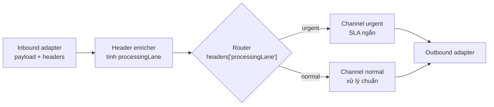
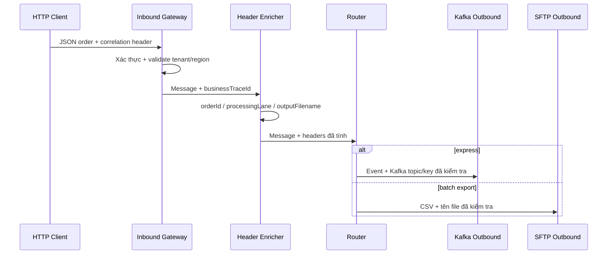

# Header expression trong Spring Integration

## Mục tiêu bài học

Trong module **SPRING_INTEGRATION_ADAPTERS**, một `Message<?>` có thể đi từ inbound adapter hoặc gateway, qua `MessageChannel`, router, transformer, service activator, rồi ra HTTP, JMS, AMQP, Kafka, file, SFTP hoặc cơ sở dữ liệu. Để tính metadata theo từng message thay vì gán một giá trị cố định, Spring Integration hỗ trợ **header expression**: biểu thức được đánh giá dựa trên nội dung message và ngữ cảnh xử lý.

Sau bài học, bạn có thể:

- Phân biệt **tên header**, **giá trị header tĩnh** và **biểu thức tính giá trị header**.
- Viết biểu thức SpEL đọc `payload` và `headers`, xử lý trường hợp thiếu dữ liệu và bảo toàn kiểu giá trị.
- Dùng header expression với `header-enricher` bằng XML hoặc Java DSL.
- Kết hợp metadata động với router, adapter/gateway, tên file, Kafka topic/key và HTTP request headers.
- Hiểu vòng đời đánh giá biểu thức, các ranh giới ánh xạ protocol, lỗi thường gặp và yêu cầu bảo mật.

## 1. Header expression là gì?

**Header expression** thường là một biểu thức **Spring Expression Language (SpEL)** được cấu hình để tính giá trị cho một header trong lúc message được xử lý. Ví dụ, thay vì luôn đặt `priority = 5`, ta có thể tính `priority` từ loại đơn hàng hoặc gán `outputFilename` từ mã đơn hàng.

```text
Message vào
  payload: { "orderId": "O-1042", "type": "express" }
  headers:
    sourceSystem: "orders-api"
    tenantId: "tenant-a"

Header Enricher:
  header "orderId"       <- expression: payload['orderId']
  header "processingLane"<- expression:
       payload['type'] == 'express' ? 'urgent' : 'normal'

Message ra
  payload: giữ nguyên
  headers:
    sourceSystem: "orders-api"
    tenantId: "tenant-a"
    orderId: "O-1042"
    processingLane: "urgent"
```

Trong ví dụ này, biểu thức được tính dựa trên **message hiện tại**. Giá trị `processingLane` có thể khác nhau giữa các message, cho dù chúng cùng đi qua một cấu hình enricher.

### 1.1. Ba khái niệm dễ nhầm

| Cấu hình | Kết quả | Ý nghĩa |
|---|---|---|
| `header("sourceSystem", "orders-api")` | Chuỗi `orders-api` | Giá trị tĩnh |
| `headerExpression("orderId", "payload['orderId']")` | Giá trị `orderId` trong payload mỗi message | Biểu thức SpEL |
| `setHeader("orderId", "payload['orderId']")` trong `MessageBuilder` | Chuỗi chữ `payload['orderId']` | `MessageBuilder.setHeader` không tự thực thi SpEL |

**Kết luận thực hành:** tên header là một key, còn expression là một công thức lấy dữ liệu. Việc đặt một chuỗi giống cú pháp SpEL vào `MessageHeaders` **không** khiến Spring tự đánh giá công thức đó.

### 1.2. Chọn biểu thức hay viết Java?

- Dùng SpEL khi giá trị có thể tính từ metadata/payload bằng công thức ngắn, rõ ràng: `headers['tenantId']`, `payload['orderId']` hoặc biểu thức chọn nhánh.
- Dùng `headerFunction(...)` hoặc một method Java khi cần nhiều bước kiểm tra, parse định dạng phức tạp, logic liên quan tới quyền truy cập, chính sách fallback hoặc cần test đơn vị chi tiết.
- Dùng transformer/service riêng nếu việc xử lý đã thay đổi dữ liệu nghiệp vụ chính, có thao tác I/O hoặc cần giao dịch. Header enrichment phù hợp với **metadata**, không nên biến thành một service chứa toàn bộ nghiệp vụ.

## 2. Ngữ cảnh đánh giá SpEL

Trong các component của Spring Integration hỗ trợ message-based SpEL, **root object** thường là một `Message<?>`. Vì vậy, các thuộc tính truy cập phổ biến là:

| Biểu thức | Kiểu giá trị dự kiến | Diễn giải |
|---|---|---|
| `payload` | Kiểu payload thực tế | Toàn bộ dữ liệu nghiệp vụ |
| `payload['orderId']` | Phụ thuộc payload | Lấy `orderId` khi payload là `Map` |
| `payload.orderId` | Phụ thuộc bean/record và SpEL accessor | Lấy property `orderId` trên đối tượng phù hợp |
| `headers` | `MessageHeaders` | Map header của message |
| `headers['tenantId']` | Phụ thuộc giá trị header | Lấy custom header `tenantId` |
| `headers['contentType']` | Thường là `MimeType` hoặc kiểu phù hợp | Đọc kiểu nội dung theo metadata |
| `headers['X-Correlation-Id']` | Thường là `String` nếu HTTP mapper đã chuyển vào | Đọc header có ký tự đặc biệt bằng `['...']` |
| `headers['retryCount'] ?: 0` | `Integer` hoặc kiểu số tùy giá trị | Dùng giá trị mặc định khi biểu thức phía trái được xem là rỗng/null theo SpEL |
| `payload['type'] == 'express' ? 'urgent' : 'normal'` | `String` | Chọn giá trị theo điều kiện |

Với payload là `Map<String, Object>`, cú pháp `payload['orderId']` rõ ràng hơn `payload.orderId`. Với DTO Java, `payload.orderId` phụ thuộc JavaBean property/getter hoặc accessor mà Spring cung cấp. Cú pháp truy cập khác nhau có thể cho kết quả khác nhau khi thay kiểu payload.

### 2.1. Ví dụ đánh giá SpEL trực tiếp

Đây là ví dụ Java đơn giản để quan sát cơ chế expression. Cách đánh giá này dùng API SpEL trong cùng JVM; khi sử dụng `header-enricher`, Spring Integration sẽ quản lý việc tạo parser và evaluation context cho endpoint.

```java
import java.util.Map;
import org.springframework.expression.Expression;
import org.springframework.expression.spel.standard.SpelExpressionParser;
import org.springframework.messaging.Message;
import org.springframework.messaging.support.MessageBuilder;

public class HeaderExpressionBasics {
    public static void main(String[] args) {
        Message<Map<String, Object>> message = MessageBuilder
                .withPayload(Map.of("orderId", "O-1042", "type", "express"))
                .setHeader("tenantId", "tenant-a")
                .build();

        SpelExpressionParser parser = new SpelExpressionParser();

        Expression orderIdExpr =
                parser.parseExpression("payload['orderId']");
        Expression laneExpr = parser.parseExpression(
                "payload['type'] == 'express' ? 'urgent' : 'normal'");
        Expression tenantExpr =
                parser.parseExpression("headers['tenantId']");

        System.out.println(orderIdExpr.getValue(message, String.class)); // O-1042
        System.out.println(laneExpr.getValue(message, String.class));    // urgent
        System.out.println(tenantExpr.getValue(message, String.class));  // tenant-a
    }
}
```

Đọc `headers['tenantId']` không tự xác thực header này. Nếu header bắt nguồn từ request hoặc broker không tin cậy, nó vẫn là **dữ liệu bên ngoài** cho đến khi gateway/service kiểm tra tính hợp lệ và quyền sử dụng.

### 2.2. Cú pháp hữu dụng

```spel
headers['sourceSystem']
headers['tenantId'] ?: 'unknown'
payload['orderId']
payload['type'] == 'express' ? 'urgent' : 'normal'
payload?.customer?.email
'order-' + payload['orderId'] + '.json'
```

Các ví dụ trên dùng cú pháp minh họa; `payload?.customer?.email` phù hợp khi payload có property `customer` và `email`. Nếu payload là `Map`, hãy truy cập bằng key và dùng cấu trúc kiểm tra null phù hợp với dữ liệu thực tế. Toán tử `?.` giúp tránh một số lỗi truy cập trên `null` nhưng không thay thế kiểm tra kiểu hoặc xác thực dữ liệu.

Các biểu thức gửi vào cấu hình endpoint thường được parser chuẩn bị khi khởi tạo. **Giá trị biểu thức được tính lại theo từng message** được xử lý bởi endpoint đó. Không nên hiểu chuỗi expression là một giá trị được tính đúng một lần cho toàn bộ ứng dụng, trừ khi API/cấu hình cụ thể có quy định khác.

## 3. Header Enricher: tạo header từ expression

`Header Enricher` nhận một message, đánh giá các header value processor đã cấu hình, rồi tạo message đầu ra với metadata đã bổ sung hoặc thay đổi theo chính sách của enricher. Payload thường được giữ nguyên.

### 3.1. Java DSL

Ví dụ dùng `IntegrationFlow`. Payload được kỳ vọng là một `Map` chứa `orderId` và `type`:

```java
import org.springframework.context.annotation.Bean;
import org.springframework.integration.dsl.IntegrationFlow;

@Bean
IntegrationFlow prepareOrderHeaders() {
    return IntegrationFlow.from("ordersInbound")
            .enrichHeaders(h -> h
                    .header("sourceSystem", "orders-api")
                    .headerExpression(
                            "orderId", "payload['orderId']")
                    .headerExpression(
                            "processingLane",
                            "payload['type'] == 'express' ? 'urgent' : 'normal'"))
            .channel("ordersPrepared")
            .get();
}
```

Kết quả mong đợi cho hai message:

| Payload vào | `orderId` | `processingLane` |
|---|---|---|
| `{"orderId":"O-1042","type":"express"}` | `O-1042` | `urgent` |
| `{"orderId":"O-1043","type":"standard"}` | `O-1043` | `normal` |

Trong cùng cấu hình:

- `header("sourceSystem", "orders-api")` đặt giá trị **tĩnh**.
- `headerExpression("orderId", "payload['orderId']")` tính giá trị dựa trên payload của **message đang xử lý**.
- `headerExpression("processingLane", "...")` sử dụng toán tử ba ngôi của SpEL để phân nhánh.

Lưu ý về ghi đè: nếu message đến đã có `processingLane`, kết quả cuối phụ thuộc cấu hình **overwrite** của `HeaderEnricher`. Muốn bảo đảm tuân thủ một chính sách, hãy cấu hình tường minh quy tắc giữ/ghi đè hoặc chuẩn hóa header tại ranh giới đầu vào; đừng để hành vi mặc định quyết định vấn đề quan trọng về quyền hay định tuyến.

### 3.2. XML configuration

Với ứng dụng Spring Integration dùng XML namespace `int`:

```xml
<int:header-enricher
        input-channel="ordersInbound"
        output-channel="ordersPrepared">
    <int:header name="sourceSystem" value="orders-api"/>
    <int:header name="orderId" expression="payload['orderId']"/>
    <int:header
            name="processingLane"
            expression="payload['type'] == 'express' ? 'urgent' : 'normal'"/>
</int:header-enricher>
```

Đây là **lựa chọn cấu hình thay thế** cho đoạn Java DSL, không cấu hình đồng thời hai enricher có cùng chức năng trên cùng channel trong ví dụ thực hành. Cần tạo các bean channel tương ứng hoặc để namespace/Java DSL quản lý theo cách dự án đã cấu hình.

### 3.3. Khi logic dài hơn một expression

Thay vì đặt chuỗi SpEL nhiều dòng với hàng loạt điều kiện, có thể sử dụng `headerFunction` để khai báo logic Java test được và có kiểm tra kiểu rõ ràng:

```java
import java.util.Map;
import org.springframework.context.annotation.Bean;
import org.springframework.integration.dsl.IntegrationFlow;
import org.springframework.messaging.Message;

@Bean
IntegrationFlow enrichOrderLane() {
    return IntegrationFlow.from("ordersInput")
            .enrichHeaders(h -> h.headerFunction(
                    "processingLane", this::determineLane))
            .channel("ordersWithLane")
            .get();
}

private String determineLane(Message<?> message) {
    if (!(message.getPayload() instanceof Map<?, ?> body)) {
        throw new IllegalArgumentException("Expected order Map payload");
    }
    Object type = body.get("type");
    return "express".equals(type) ? "urgent" : "normal";
}
```

Trong thực tế, nên dùng DTO/record thay `Map<?, ?>` khi payload đã có schema rõ ràng. Hàm Java phù hợp hơn khi cần kiểm tra tenant, truy cập một service chuyên dụng hoặc xử lý nhiều nhánh lỗi. Tránh làm I/O chậm trong từng lần tính header nếu có thể giải quyết qua một service activator rõ ràng.

## 4. Header expression và router/transformer

Header expression thường xuất hiện cùng các component khác. **Enricher tạo giá trị header**; router, filter, transformer, gateway hoặc adapter **tiêu thụ** giá trị đó.



Ví dụ XML router đọc một header đã được enricher tính trước:

```xml
<int:router input-channel="ordersPrepared"
            expression="headers['processingLane']">
    <int:mapping value="urgent" channel="ordersUrgent"/>
    <int:mapping value="normal" channel="ordersNormal"/>
</int:router>
```

Lưu ý:

1. Biểu thức `headers['processingLane']` **đọc** metadata; nó không tạo header.
2. Nếu header vắng mặt, router có thể không tìm thấy channel tương ứng; định nghĩa cách xử lý fallback/default output channel hoặc từ chối message theo hợp đồng.
3. Nếu header đến từ bên ngoài, không dùng nó để vượt qua kiểm tra quyền, phân loại SLA hoặc truy cập tài nguyên mà không xác minh.
4. Nếu transformer tự tạo `Message<?>` mới và không truyền tiếp `processingLane`, router phía sau có thể không còn dữ liệu để định tuyến.

### 4.1. Đừng nhầm expression tính header với expression tính payload

`transform("payload['orderId']")` ở transformer tạo giá trị **payload kết quả** theo biểu thức; `headerExpression("orderId", "payload['orderId']")` tạo **header**. Dù cùng cú pháp SpEL, nơi lưu kết quả và hợp đồng với downstream khác nhau.

Đối với thông tin nghiệp vụ cốt lõi như `orderId`, tiếp tục giữ nó trong payload nếu consumer sự kiện cần đọc lại; việc copy ra header chỉ nhằm phục vụ định tuyến, đối chiếu log hoặc adapter protocol.

## 5. Dùng expression khi đi qua adapter/gateway

Header expression có thể tính metadata cho adapter, nhưng kết quả chỉ thành metadata thật của hệ thống đích **khi adapter hiểu tên header hoặc có cấu hình ánh xạ phù hợp**.

| Biên tích hợp | Header/giá trị cần tạo | Cơ chế tiếp theo |
|---|---|---|
| HTTP outbound | `X-Business-Trace-Id` từ `businessTraceId` | HTTP outbound gateway + header mapper cho phép custom HTTP header |
| Kafka outbound | `KafkaHeaders.TOPIC` / `KafkaHeaders.KEY` từ dữ liệu đã kiểm tra | Kafka producer adapter dùng các header hỗ trợ, tùy cấu hình topic/key |
| JMS outbound | Custom header `businessTraceId` | JMS header mapper chuyển thành user property hợp lệ nếu được cho phép |
| AMQP outbound | Application header tùy chỉnh | AMQP header mapper/converter và message properties |
| File outbound | `FileHeaders.FILENAME` từ orderId | `FileNameGenerator` hoặc file handler dùng tên đã cấu hình |
| SFTP outbound | Tên file/đường dẫn remote đã kiểm tra | Remote file name generator/expression do adapter hỗ trợ |
| JDBC/database | Tham số xử lý từ payload/header | Handler/query/expression phù hợp; header không tự trở thành cột DB |

### 5.1. Kafka: tính topic/key theo từng message

Giả sử đơn hàng đã có trường `region` và `orderId` trong payload. Ứng dụng chỉ cho phép hai vùng `vn` và `sg`, sau khi kiểm tra dữ liệu ở gateway/service, enricher có thể tạo metadata xuất Kafka:

```java
import org.springframework.context.annotation.Bean;
import org.springframework.integration.dsl.IntegrationFlow;
import org.springframework.kafka.support.KafkaHeaders;

@Bean
IntegrationFlow prepareKafkaMetadata() {
    return IntegrationFlow.from("validatedOrderEvents")
            .enrichHeaders(h -> h
                    .headerExpression(
                            KafkaHeaders.TOPIC,
                            "payload['region'] == 'vn' ? 'orders.vn' : 'orders.sg'")
                    .headerExpression(
                            KafkaHeaders.KEY, "payload['orderId']"))
            .channel("kafkaOutbound")
            .get();
}
```

Đoạn code minh họa giả định bước trước đã kiểm tra `region` thuộc `vn` hoặc `sg`. Nếu chưa kiểm tra, mọi giá trị khác `vn` đều bị phân vào topic `orders.sg`, gây sai hợp đồng. Vì thế, **validate tập giá trị trước khi dùng một expression để chọn tài nguyên đích**.

`KafkaHeaders.TOPIC` và `KafkaHeaders.KEY` là tên header có ý nghĩa với Spring Kafka. Adapter Kafka outbound cần được cấu hình để lấy topic/key theo metadata đó; nếu có topic cố định hoặc topic expression khác trong adapter, hãy kiểm tra quy tắc ưu tiên của cấu hình thật. Ngoài ra, `KafkaHeaders.RECEIVED_TOPIC` và `KafkaHeaders.OFFSET` ở phía consumer mô tả bản ghi đã nhận; chúng không thay thế `TOPIC`/`KEY` khi gửi.

### 5.2. File/SFTP: tính tên file an toàn

`FileHeaders.FILENAME` là một header mà file outbound handler có thể sử dụng để xác định tên file đích, tùy cấu hình `FileNameGenerator`:

```java
import org.springframework.context.annotation.Bean;
import org.springframework.integration.dsl.IntegrationFlow;
import org.springframework.integration.file.FileHeaders;

@Bean
IntegrationFlow prepareFileMetadata() {
    return IntegrationFlow.from("validatedCsvExports")
            .enrichHeaders(h -> h.headerExpression(
                    FileHeaders.FILENAME,
                    "'orders-' + payload['batchId'] + '.csv'"))
            .channel("fileOutbound")
            .get();
}
```

Đây là biểu thức ghép chuỗi, chỉ phù hợp sau khi `batchId` được validate theo một tập ký tự/độ dài cho phép. Nếu `batchId` đến từ HTTP hoặc dữ liệu DB không tin cậy, **không** ghép trực tiếp thành đường dẫn. Kiểm tra path traversal (`../`), ký tự phân tách đường dẫn, tên dự phòng và chính sách trùng file.

Đối với SFTP, tên file và thư mục remote cũng phụ thuộc cấu hình remote file template, filename generator/expression và adapter cụ thể. Một header tùy chỉnh như `outputFilename` không tự điều khiển tên file nếu handler không đọc nó; hãy chuyển đổi sang header/biểu thức mà adapter thực sự hỗ trợ.

### 5.3. HTTP: đặt header nội bộ và ánh xạ ra wire

Giả sử inbound message đã có `businessTraceId` hợp lệ do gateway chuẩn hóa. Ta có thể tạo header HTTP đích:

```java
.enrichHeaders(h -> h.headerExpression(
        "X-Business-Trace-Id",
        "headers['businessTraceId']"))
```

Đây là **một đoạn trong Java DSL flow**, không phải chương trình Java hoàn chỉnh. Outbound HTTP gateway cần map header này vào HTTP request; ví dụ cấu hình XML tương ứng:

```xml
<int-http:outbound-gateway
        id="partnerGateway"
        request-channel="partnerRequests"
        url="https://partner.example.org/orders"
        mapped-request-headers="HTTP_REQUEST_HEADERS,X-Business-Trace-Id"/>
```

`HTTP_REQUEST_HEADERS` là pattern mapping của nhóm HTTP request headers tiêu chuẩn. Các header tùy chỉnh cần được khai báo cho phép hoặc xử lý bằng `HeaderMapper` tương ứng. `headers['businessTraceId']` của Spring **không tự xuất thành** HTTP `X-Business-Trace-Id` nếu thiếu bước đặt tên/ánh xạ.

### 5.4. JMS, AMQP và JDBC

Với JMS và AMQP, kết quả header expression trong `MessageHeaders` vẫn là một **giá trị Java nội bộ**. JMS property chỉ hỗ trợ tập tên/kiểu dữ liệu nhất định; AMQP có application headers và properties với hợp đồng ánh xạ riêng. Nếu expression trả về DTO, collection lớn hoặc đối tượng không thể biểu diễn trên giao thức, mapper có thể bỏ qua hoặc lỗi. Nên giữ các kiểu đơn giản và áp dụng converter khi cần.

Với outbound JDBC/database, biểu thức có thể giúp chọn tham số từ payload/header trong một handler có hỗ trợ expression, nhưng **không có quy tắc chung** rằng custom header sẽ tự thành cột SQL. Truy vấn và tên bảng phải cố định/có allowlist phù hợp; không ghép tùy ý giá trị header client gửi thành cú pháp SQL.

## 6. Kiểu dữ liệu, null và lỗi đánh giá

### 6.1. SpEL trả về giá trị có kiểu

`headerExpression("priority", "10")` tạo giá trị số theo ngữ nghĩa literal của SpEL, trong khi `header("priority", "10")` tạo **chuỗi**. Nếu downstream dùng `PriorityChannel` hoặc API kỳ vọng kiểu số, khác biệt này có thể ảnh hưởng cách xử lý.

```java
// Giá trị header nội bộ có thể có kiểu Integer:
.headerExpression("retryCount", "0")

// Giá trị là chuỗi "0":
.header("retryCount", "0")
```

Khi đi qua HTTP/JMS/AMQP/Kafka, giá trị được mapper/converter biến đổi theo cơ chế protocol; Kafka native headers chẳng hạn lưu dạng byte array. Tránh tạo giả định rằng một `Integer` nội bộ tự động xuất ra bên nhận như kiểu `Integer`.

### 6.2. Header thiếu hoặc giá trị null

Biểu thức `headers['tenantId']` trả về `null` khi key vắng mặt (với việc truy cập map thông thường). Tùy processor và chính sách tạo message, kết quả null có thể khiến header không được đặt hoặc bị xử lý khác. **Không dựa vào null như cách xóa header có tính di động giữa mọi endpoint.**

Nên đặt ra quy tắc rõ ràng:

- Nếu thiếu header được phép: dùng fallback có chủ đích, ví dụ `headers['sourceSystem'] ?: 'unknown'`.
- Nếu thiếu header bắt buộc: phát hiện và từ chối message tại bước validation, thay vì gán một giá trị mặc định có thể che mất lỗi hợp đồng.
- Nếu header phải bị xóa: dùng `HeaderFilter` hoặc `MessageBuilder.removeHeader(...)`, không cố suy luận rằng expression trả null sẽ luôn xóa được.
- Nếu payload có nhiều cấp dữ liệu: kiểm tra null cho từng cấp hoặc dùng DTO được validate trước khi enrich.

**Ví dụ nghiệp vụ:** `tenantId` không nên mặc định thành `public` khi thiếu nếu header này quyết định tenant database. Gateway phải xác minh tenant dựa trên danh tính và quyền, rồi cung cấp giá trị đáng tin cậy.

### 6.3. Lỗi SpEL trong luồng tích hợp

Một expression có thể thất bại khi:

1. Sai cú pháp ngay lúc khởi tạo context, chẳng hạn thiếu dấu ngoặc hoặc dấu nháy.
2. Runtime payload/header có kiểu khác dự kiến, dẫn đến lỗi truy cập property hoặc convert type.
3. Gọi method trên giá trị null mà không kiểm tra.
4. Tham chiếu bean/property không tồn tại trong evaluation context hiện tại.
5. Kết quả có kiểu mà mapper/adapter phía sau không chấp nhận.

Lỗi phát sinh khi xử lý message sẽ theo cơ chế xử lý lỗi của endpoint/channel đang dùng. Với `DirectChannel` đồng bộ, exception có thể lan tới caller. Với các endpoint bất đồng bộ/poller và cấu hình error flow phù hợp, lỗi có thể được gửi tới `errorChannel`. **Không giả định mọi lỗi expression tự động được gửi vào một error channel**.

## 7. Bảo mật, hiệu năng và khả năng bảo trì

### 7.1. Expression là cấu hình do ứng dụng kiểm soát

SpEL có khả năng truy cập property, gọi method và trong một số evaluation context còn có thể truy cập bean hoặc kiểu Java. Vì thế:

- **Không lấy chuỗi expression từ HTTP header, Kafka payload, database hoặc người dùng ngoài rồi đưa thẳng vào SpEL parser.** Một expression không tin cậy có thể truy cập tài nguyên ngoài phạm vi dự tính.
- Giữ expression dưới dạng cấu hình/code do nhóm phát triển kiểm soát, được review và triển khai qua quy trình thông thường.
- Nếu có yêu cầu cho người dùng tự tạo điều kiện, dùng cú pháp giới hạn hoặc danh sách thao tác được cho phép; dùng restricted evaluation context phù hợp, tránh cho phép SpEL tùy ý.
- Dù expression là cố định, dữ liệu từ `payload`/`headers` vẫn cần validate nếu quyết định route, quyền, tên file, topic, SQL hoặc địa chỉ HTTP.

### 7.2. Không để metadata điều khiển tùy ý hệ thống đích

Một expression như `headers['targetUrl']` hoặc `headers['targetTopic']` có thể biến dữ liệu đầu vào thành quyết định gửi đi. Nếu cho phép client tùy ý đặt header đó, ứng dụng có thể gửi request tới đích không hợp lệ hoặc định tuyến sang tenant khác.

Thay vì tin tên đích từ client:

1. Đọc thông tin nghiệp vụ từ payload/header.
2. Kiểm tra với quyền truy cập và allowlist của hệ thống.
3. Tính một giá trị đích trong tập đã xác định.
4. Dùng giá trị đã chuẩn hóa để cấu hình adapter.

### 7.3. Hiệu năng và quản lý expression

Các expression ngắn, thuần tính toán trên message phù hợp với throughput cao. Tuy nhiên expression có logic nặng, lookup bean hoặc gọi method phức tạp có thể tạo chi phí lớn mỗi message; với poller hoặc consumer Kafka có tần suất cao, tác động tăng theo số lần xử lý.

Đề xuất:

- Giữ expression ngắn, dùng một hàm Java đặt tên rõ nếu vượt quá vài điều kiện.
- Tránh gọi network/DB hoặc thao tác chặn thread ngay trong header enrichment.
- Cache/chia sẻ phần tính toán tốn chi phí tại service thích hợp nếu chúng được lặp lại.
- Kiểm tra kiểu payload/header và xử lý giá trị thiếu trước bước định tuyến hoặc xuất protocol.
- Log các header đã qua kiểm tra theo allowlist, không in toàn bộ `MessageHeaders` nếu chứa token hoặc PII.

## 8. Tình huống đầy đủ: HTTP → enrichment → routing → Kafka/SFTP

Một đơn hàng đến từ HTTP gateway chứa payload:

```json
{
  "orderId": "O-1042",
  "region": "vn",
  "type": "express",
  "batchId": "B-20261123"
}
```

Gateway xác thực request, kiểm tra `region` thuộc tập hỗ trợ, xác minh quyền tenant và đặt `businessTraceId`. Flow bổ sung:



| Bước | Header expression | Hợp đồng |
|---|---|---|
| Enrich | `payload['orderId']` → `orderId` | Có giá trị, dùng theo schema đơn hàng |
| Enrich | `payload['type'] == 'express' ? 'urgent' : 'normal'` → `processingLane` | Tập giá trị gồm `urgent`, `normal` |
| Enrich | `'orders-' + payload['batchId'] + '.csv'` → `outputFilename` | `batchId` đã được validate để tránh path traversal |
| Router | `headers['processingLane']` | Có mapping channel cho cả hai trường hợp |
| Kafka outbound | `payload['orderId']` → `KafkaHeaders.KEY` | Kafka record key là mã đơn hàng |
| File/SFTP outbound | `headers['outputFilename']` → tên file do handler hỗ trợ | Chỉ tên file hợp lệ, không dùng path tự do từ client |

**Những kiểm tra quan trọng khi triển khai:**

- Một message `express` không nên bị gửi sang nhánh batch chỉ vì header `processingLane` thiếu sau transformer.
- `orderId` phải tiếp tục nằm trong payload nếu contract của Kafka consumer yêu cầu trường này.
- `businessTraceId` phải được copy hoặc mã hóa qua outbound mapper đúng theo hợp đồng trace; SpEL chỉ tính giá trị nội bộ.
- Nếu Spring tạo message mới, `MessageHeaders.ID` có thể thay đổi. Điều đó không làm mất business trace nếu metadata được truyền tiếp đúng.
- Bất kỳ quyết định route/topic/file path nào cũng phải xuất phát từ dữ liệu được chuẩn hóa và kiểm tra quyền.

## 9. Kiểm thử header expression

### 9.1. Unit test giá trị expression

Test sau minh họa kiểm tra expression đọc từ một `Message<Map<String, Object>>`. Nó không thay thế integration test dành cho `HeaderEnricher` hoặc adapter.

```java
import static org.junit.jupiter.api.Assertions.assertEquals;

import java.util.Map;
import org.junit.jupiter.api.Test;
import org.springframework.expression.spel.standard.SpelExpressionParser;
import org.springframework.messaging.Message;
import org.springframework.messaging.support.MessageBuilder;

class HeaderExpressionTest {

    @Test
    void derivesLaneFromPayload() {
        Message<Map<String, Object>> input = MessageBuilder
                .withPayload(Map.of(
                        "orderId", "O-1042",
                        "type", "express"))
                .build();

        var expr = new SpelExpressionParser().parseExpression(
                "payload['type'] == 'express' ? 'urgent' : 'normal'");

        assertEquals("urgent", expr.getValue(input, String.class));
    }

    @Test
    void readsHeaderWithoutChangingMessage() {
        Message<String> input = MessageBuilder.withPayload("event")
                .setHeader("sourceSystem", "orders-api")
                .build();

        var expr = new SpelExpressionParser()
                .parseExpression("headers['sourceSystem']");

        assertEquals("orders-api", expr.getValue(input, String.class));
    }
}
```

### 9.2. Integration test cần quan sát gì?

| Test case | Kết quả mong đợi |
|---|---|
| `type=express` và `type=standard` | `processingLane` lần lượt là `urgent`, `normal` |
| Thiếu `orderId` bắt buộc | Bước validation báo lỗi theo hợp đồng; không xuất Kafka record key rỗng |
| `payload` khác kiểu dự kiến | Xử lý lỗi rõ ràng thay vì route nhầm |
| `tenantId` giả mạo từ request | Không vượt qua xác minh principal/tenant |
| `batchId` chứa `../` hoặc ký tự đường dẫn | Bị từ chối trước bước tạo filename |
| Sau transformer không còn `processingLane` | Phát hiện mất header/không route được và sửa propagation |
| Kafka/JMS/AMQP/HTTP outbound | Header động chỉ xuất ngoài khi mapper/converter hỗ trợ |
| Error flow của endpoint sync và async | Lỗi expression đi đúng kênh/thành phần được cấu hình |

## 10. Lỗi thường gặp và cách xử lý

| Dấu hiệu | Nguyên nhân có thể | Hướng khắc phục |
|---|---|---|
| Header mang nguyên văn `payload['orderId']` | Dùng `setHeader` hoặc header tĩnh với chuỗi trông giống expression | Dùng API `headerExpression` / thuộc tính `expression` của enricher |
| Expression trả null | Header hoặc field payload thiếu | Validate input, thêm fallback hợp lệ hoặc từ chối theo hợp đồng |
| `SpelEvaluationException` khi xử lý | Sai kiểu payload/property, null hoặc gọi method không hợp lệ | Xác định kiểu payload thật, dùng key/map accessor thích hợp |
| Router không tìm thấy channel | Expression trả giá trị ngoài tập mapping | Có tập giá trị rõ ràng và quy tắc lỗi/default route |
| HTTP server không nhận custom header | Chỉ tạo header nội bộ, chưa map ra HTTP | Kiểm tra HTTP outbound header mapper/mapped-request-headers |
| Kafka đi nhầm topic | Expression chọn topic từ dữ liệu chưa validate hoặc adapter ưu tiên cấu hình khác | Validate region, kiểm tra topic policy và cấu hình producer |
| JMS property bị bỏ qua/lỗi | Kết quả expression có tên hoặc kiểu không hỗ trợ | Chuyển sang property hợp lệ, dùng converter/mapper |
| SFTP ghi file sai tên | `outputFilename` là custom key chưa được handler sử dụng | Map sang `FileHeaders.FILENAME`/file name generator phù hợp |
| Header bị ghi đè ngoài ý muốn | Chính sách overwrite của enricher chưa được xác định | Cấu hình tường minh; chuẩn hóa metadata ở biên |
| Biểu thức cho phép route theo tenant client tự gửi | Dữ liệu không tin cậy bị dùng làm quyết định có quyền | Xác thực và phân quyền trước enrichment/routing |

## 11. Bài thực hành

Xây dựng flow **HTTP inbound → Header Enricher → Router → Kafka/SFTP** xử lý đơn hàng theo yêu cầu:

1. Payload gồm `orderId`, `region`, `type`, `batchId`. Kiểm tra field bắt buộc và tính hợp lệ ở gateway/service trước khi enrich.
2. Viết Java DSL `HeaderEnricher` dùng ít nhất ba expression: `orderId`, `processingLane` và `outputFilename`.
3. Thêm một header tĩnh `sourceSystem = "orders-api"`. Giải thích khác biệt giữa `header(...)` và `headerExpression(...)`.
4. Viết router đọc `headers['processingLane']`. Cho message `express` qua Kafka, message còn lại qua nhánh xuất CSV/SFTP.
5. Ánh xạ Kafka record key từ `orderId`; cấu hình topic chỉ trong allowlist `orders.vn`/`orders.sg`. Với file/SFTP, dùng tên file được kiểm tra và cơ chế filename generator phù hợp.
6. Kiểm thử trường hợp thiếu `orderId`, `region` ngoài allowlist, `batchId` chứa path traversal và custom HTTP header không được outbound mapper cho phép.
7. Dùng log theo `businessTraceId` đã xác minh để quan sát message đi qua từng chặng; phân biệt giá trị này với `MessageHeaders.ID`.

**Câu hỏi tự đánh giá:** Vì sao một `headerExpression` trả về đúng `"orders.vn"` chưa bảo đảm Kafka producer gửi record vào topic đó? Cần kiểm tra tên header mà adapter hỗ trợ, cấu hình topic/topic-expression và thứ tự ưu tiên của adapter; biểu thức chỉ tính ra giá trị trong bối cảnh được cấu hình.

## Tài liệu tham khảo

- [Spring Integration Reference — Content Enrichment](https://docs.spring.io/spring-integration/reference/content-enrichment.html)
- [Spring Integration Reference — Message Routing](https://docs.spring.io/spring-integration/reference/router.html)
- [Spring Integration Reference — Messaging](https://docs.spring.io/spring-integration/reference/message.html)
- [Spring Integration Reference — HTTP Header Mapping](https://docs.spring.io/spring-integration/reference/http/header-mapping.html)
- [Spring Integration Reference — Kafka Support](https://docs.spring.io/spring-integration/reference/kafka.html)
- [Spring Framework Reference — Spring Expression Language (SpEL)](https://docs.spring.io/spring-framework/reference/core/expressions.html)
