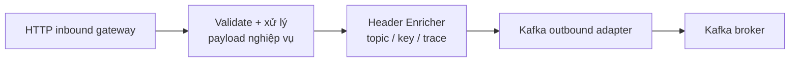
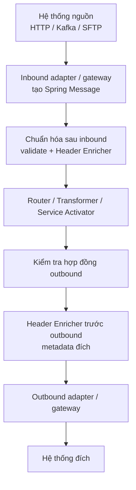
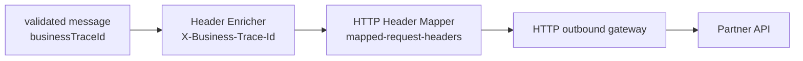
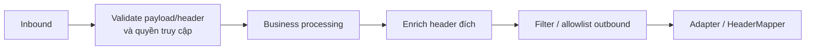

# Header enricher trước adapter trong Spring Integration

## Mục tiêu bài học

Trong module **SPRING_INTEGRATION_ADAPTERS**, dữ liệu được trao đổi qua inbound/outbound adapter, gateway, poller và `MessageChannel` với các hệ thống như HTTP, JMS, AMQP, Kafka, file, SFTP và cơ sở dữ liệu. Một vấn đề thường gặp là: **payload đã đúng nhưng adapter nhận thiếu metadata**, chẳng hạn tên file cần ghi, Kafka record key, HTTP correlation header hoặc thông tin phân loại lỗi.

**Header enricher** là thành phần của Spring Integration giúp thêm hoặc tính lại header **trước khi message đến một endpoint khác**. Khi đặt ngay trước outbound adapter, nó tạo một bước chuẩn bị metadata rõ ràng ở ranh giới gửi dữ liệu. Với inbound adapter, vì message chưa tồn tại ở phía Spring trước khi adapter nhận dữ liệu, bước chuẩn hóa header thông thường được đặt **ngay sau inbound adapter**.

Sau bài này, bạn có thể:

1. Đặt `HeaderEnricher` đúng vị trí trong flow, đặc biệt trước outbound adapter/gateway.
2. Dùng header tĩnh, SpEL expression và Java function để chuẩn bị metadata cho mỗi message.
3. Phân biệt việc **tạo header nội bộ** với việc **ánh xạ metadata ra giao thức thực tế**.
4. Thiết kế đường truyền header cho HTTP, JMS, AMQP, Kafka, file/SFTP và database.
5. Xử lý xung đột giá trị, thiếu header, dữ liệu đầu vào không tin cậy, retry và error flow.
6. Kiểm tra đúng chặng xử lý khi adapter không nhận được header như kỳ vọng.

## 1. Vì sao đặt Header Enricher trước adapter?

Giả sử ứng dụng nhận đơn hàng từ HTTP gateway và xuất sự kiện lên Kafka. Service xử lý nghiệp vụ có thể tạo payload:

```json
{
  "eventId": "evt-1042",
  "orderId": "O-1042",
  "region": "vn",
  "status": "PAID"
}
```

Kafka outbound adapter cần biết **topic** và **record key**. Đồng thời, hệ thống quan sát cần một `businessTraceId` đi cùng dữ liệu. Nếu mọi service tự đặt header theo cách khác nhau, flow có thể hoạt động ở bước xử lý nghiệp vụ nhưng lỗi khi gửi ra broker. Một `HeaderEnricher` ngay trước outbound tạo ra một **điểm chuẩn bị metadata**:



Trường hợp tương tự:

- **HTTP outbound:** tạo header `X-Business-Trace-Id` hoặc metadata bắt buộc trong hợp đồng của đối tác.
- **File/SFTP outbound:** đặt tên file đầu ra, nhóm batch, mã tenant đã xác minh.
- **JMS/AMQP outbound:** chuẩn bị custom header để mapper chuyển thành property hoặc application header.
- **Database outbound:** chuẩn bị khóa nghiệp vụ, metadata truy vấn hoặc tham số mà handler được cấu hình đọc.

**Giới hạn:** Header Enricher chỉ thao tác với metadata của **Spring `Message<?>`**. Adapter, converter và `HeaderMapper` quyết định metadata nào thực sự được gửi qua HTTP/JMS/AMQP/Kafka hoặc được dùng để ghi file, không có cơ chế chung tự chuyển mọi header ra bên ngoài.

### 1.1. Vị trí với inbound và outbound



| Giai đoạn | Có thể đặt header enricher ở đâu? | Mục đích |
|---|---|---|
| Trước inbound adapter | Chưa có Spring `Message<?>` đầu vào để enrich theo kiểu thông thường | Muốn ảnh hưởng việc nhận dữ liệu, cấu hình chính inbound adapter/poller/request converter |
| **Ngay sau inbound adapter** | Sau khi adapter đã tạo message | Chuẩn hóa header nguồn, xác thực hoặc gắn trace nội bộ |
| Trước router/aggregator | Sau validation, trước xử lý theo header | Tạo route key, correlation hoặc group metadata cần thiết |
| **Ngay trước outbound adapter** | Sau transform và validation nghiệp vụ | Chuyển metadata trung lập thành header/thuộc tính mà adapter đích hiểu |
| Sau outbound gateway có reply | Trên nhánh phản hồi nếu gateway tạo message reply | Chuẩn hóa metadata phản hồi theo hợp đồng nội bộ |

Với **inbound polling adapter**, poller quyết định *khi nào* đọc dữ liệu, inbound adapter tạo message, sau đó mới tới Header Enricher. Header Enricher không thay thế `PollerMetadata`, lịch polling hay cấu hình message source. Với **outbound gateway**, reply có thể được trả lại theo `replyChannel` hoặc luồng request–reply; bảo toàn các header phục vụ reply/error quan trọng khi thiết kế flow.

## 2. Header Enricher hoạt động ra sao?

Spring Integration cung cấp `HeaderEnricher`, một message processor làm giàu các header theo tập giá trị được cấu hình. Payload thường được giữ nguyên; kết quả được chuyển sang message tiếp theo. Có ba cách tạo giá trị tiêu biểu:

| Cách | Ví dụ | Khi nào dùng |
|---|---|---|
| Giá trị cố định | `sourceSystem = "orders-service"` | Gắn định danh service, phiên bản hợp đồng tĩnh |
| SpEL expression | `payload['orderId']` | Lấy giá trị động từ payload hoặc header |
| Java function/bean method | `safeFilename(message)` | Kiểm tra kiểu, định dạng, quyền hoặc fallback phức tạp |

Đầu vào và đầu ra minh họa:

```text
Message trước enricher:
  payload = {"orderId":"O-1042","region":"vn"}
  headers = {businessTraceId="trace-42"}

Enricher trước Kafka:
  sourceSystem   <- "orders-service" (static)
  kafka_topic    <- "orders.vn" (expression từ region)
  kafka_messageKey <- "O-1042" (expression từ orderId)

Message sau enricher:
  payload = giữ nguyên
  headers = {businessTraceId="trace-42",
             sourceSystem="orders-service",
             ... các header Kafka vừa được tính}
```

Các tên khóa protocol ở đây được diễn đạt theo ý nghĩa; trong Java nên dùng hằng số `KafkaHeaders.TOPIC` và `KafkaHeaders.KEY` của dependency Spring Kafka thực tế, tránh tự viết khóa.

### 2.1. Header tùy chỉnh khác header dành riêng cho framework

| Nhóm | Ví dụ | Có nên đặt bằng enricher? |
|---|---|---|
| Custom header | `businessTraceId`, `sourceSystem`, `schemaVersion` | Có, khi flow cần metadata đó |
| Header Spring Messaging | `MessageHeaders.CONTENT_TYPE` | Có thể, nếu hợp đồng converter cần và kiểu phù hợp |
| Header read-only | `MessageHeaders.ID`, `MessageHeaders.TIMESTAMP` | Không; framework quản lý |
| Header điều phối nội bộ | `replyChannel`, `errorChannel`, `correlationId`, sequence | Chỉ thay khi hiểu rõ hợp đồng request–reply/aggregator |
| Header giao thức outbound | `KafkaHeaders.TOPIC`, `KafkaHeaders.KEY`, `FileHeaders.FILENAME` | Có, nếu adapter đích được cấu hình đọc chúng |
| Metadata phía consumer | Kafka `RECEIVED_TOPIC`, `OFFSET`; AMQP delivery tag | Không dùng như metadata điều khiển lần gửi mới |

Thông thường, một message mới do enricher tạo sẽ có metadata instance do framework quản lý; không dựa vào `MessageHeaders.ID` để theo dõi nghiệp vụ xuyên nhiều adapter. Dùng `businessTraceId` hoặc `eventId` có hợp đồng rõ ràng.

## 3. Cấu hình Header Enricher bằng Java DSL

Đoạn cấu hình dưới đây giả định đã có channel `validatedOrders` và `ordersPreparedForKafka`. Payload đầu vào là `Map<String, Object>` chứa `orderId` và `region`; dữ liệu đã được kiểm tra trước bước enrich:

```java
import org.springframework.context.annotation.Bean;
import org.springframework.integration.dsl.IntegrationFlow;
import org.springframework.kafka.support.KafkaHeaders;

@Bean
IntegrationFlow prepareKafkaHeaders() {
    return IntegrationFlow.from("validatedOrders")
            .enrichHeaders(h -> h
                    .header("sourceSystem", "orders-service")
                    .headerExpression(KafkaHeaders.KEY,
                            "payload['orderId']")
                    .headerExpression(KafkaHeaders.TOPIC,
                            "payload['region'] == 'vn' ? 'orders.vn' : 'orders.sg'"))
            .channel("ordersPreparedForKafka")
            .get();
}
```

Ý nghĩa:

1. `IntegrationFlow.from("validatedOrders")` nhận những message đã có payload và header nội bộ.
2. `header("sourceSystem", "orders-service")` gắn giá trị tĩnh.
3. `headerExpression(KafkaHeaders.KEY, "payload['orderId']")` lấy key từ payload của **mỗi message**.
4. `headerExpression(KafkaHeaders.TOPIC, ...)` tính topic từ `region`.
5. `channel("ordersPreparedForKafka")` chuyển message đã enrich đến channel mà Kafka outbound adapter tiêu thụ.

**Giả định bắt buộc:** `region` đã được giới hạn trong tập `vn` và `sg`. Nếu chưa validate, biểu thức ba ngôi trên sẽ coi mọi giá trị không phải `vn` là `sg`, gây gửi nhầm topic. Trong hệ thống thực tế, nên đặt việc kiểm tra region trong validator/service trước enricher, hoặc dùng Java function để từ chối giá trị ngoài allowlist.

**Lưu ý về cách gửi Kafka:** Hằng số `KafkaHeaders.TOPIC`/`KEY` mang ý nghĩa với Spring Kafka producer, nhưng adapter có thể có cấu hình topic/key expression riêng hoặc topic cố định. Phải kiểm tra cấu hình handler để biết nguồn nào được ưu tiên. Việc có header trong message chỉ chứng minh **bước chuẩn bị metadata**, chưa chứng minh record đã đến đúng topic/partition.

### 3.1. Header expression khác chuỗi tĩnh

```java
// Gán nguyên chuỗi chữ "payload['orderId']".
.header("orderId", "payload['orderId']")

// Đánh giá biểu thức và lấy giá trị từ message.
.headerExpression("orderId", "payload['orderId']")
```

Với SpEL trong header enricher, root context là `Message<?>` và có thể truy cập `payload`, `headers`. Ví dụ:

```spel
headers['businessTraceId']
payload['region']
payload['status'] == 'PAID' ? 'ready' : 'hold'
headers['businessTraceId'] ?: 'unknown'
```

Toán tử fallback giúp xử lý dữ liệu tùy chọn. Với header bắt buộc như tenant đã xác minh, **không** mặc định tùy tiện thành một tenant khác; xử lý lỗi rõ ràng ở bước validation.

### 3.2. Java function khi cần validate trước khi gán header

Nếu mục đích là đặt tên file an toàn, một function Java rõ ràng hơn expression ghép chuỗi trực tiếp từ dữ liệu không tin cậy:

```java
import org.springframework.integration.file.FileHeaders;
import org.springframework.messaging.Message;

// Trong cùng class @Configuration chứa IntegrationFlow:
private String safeCsvFilename(Message<?> message) {
    Object raw = message.getHeaders().get("validatedBatchId");
    if (!(raw instanceof String batchId)
            || !batchId.matches("[A-Za-z0-9_-]{1,48}")) {
        throw new IllegalArgumentException("Invalid batch id");
    }
    return "orders-" + batchId + ".csv";
}

@Bean
IntegrationFlow prepareFileHeaders() {
    return IntegrationFlow.from("validatedCsvExports")
            .enrichHeaders(h -> h
                    .headerFunction(FileHeaders.FILENAME,
                            this::safeCsvFilename))
            .channel("fileOutbound")
            .get();
}
```

Ví dụ trên cần import `org.springframework.context.annotation.Bean` và `org.springframework.integration.dsl.IntegrationFlow` như đoạn cấu hình trước. `validatedBatchId` phải do bước kiểm tra đầu vào cung cấp. Regex chỉ cho phép ký tự chữ/số, dấu gạch nối hoặc gạch dưới; không nhận dấu `/`, `\`, `..` từ một path tự do. Với ứng dụng hỗ trợ tên file Unicode hoặc đường dẫn con, cần thiết kế chính sách kiểm tra phù hợp thay vì dùng regex minh họa này.

### 3.3. Ghi đè header đã tồn tại

Một inbound message có thể đã mang `sourceSystem` hoặc `businessTraceId`. Trước khi enricher thay đổi một giá trị, phải quyết định **bên nào sở hữu sự thật**:

- `sourceSystem` từ gateway đáng tin cậy: thường nên đặt sau khi xác định chính xác nguồn, không nhận mù quáng từ client.
- `businessTraceId` hợp lệ: nên giữ qua những chặng xử lý liên quan; chỉ cấp mới nếu không có hoặc không hợp lệ theo hợp đồng.
- `tenantId`: bắt buộc lấy từ ngữ cảnh đã được xác thực hoặc đối chiếu với quyền truy cập trước khi ghi vào message.
- `KafkaHeaders.TOPIC`: nếu adapter có quyền chọn topic, kiểm tra topic đang có và ghi đè theo chính sách định tuyến đã kiểm tra.

Trong XML, phần tử `<int:header>` của `header-enricher` hỗ trợ thuộc tính `overwrite`. Đặt giá trị tường minh ở nơi có khả năng xung đột thay vì giả định mọi cấu hình hoặc bản Spring đều áp dụng cùng chính sách. Khi viết Java DSL, kiểm tra overload/cấu hình của phiên bản dependency để chọn chính sách ghi đè tương ứng.

## 4. Cấu hình tương đương bằng XML

Khi dự án sử dụng Spring Integration namespace `int`:

```xml
<int:header-enricher input-channel="validatedOrders"
                     output-channel="ordersPreparedForKafka">
    <int:header name="sourceSystem" value="orders-service"/>
    <int:header name="businessTraceId"
                expression="headers['businessTraceId']"/>
</int:header-enricher>
```

Đây là cấu hình minh họa cho **header tùy chỉnh**. Muốn tạo header Kafka topic/key trong XML, nên dùng hằng số tên khóa được cấu hình phù hợp hoặc Java DSL khi cần truy cập `KafkaHeaders` trực tiếp. Không tự gán tên khóa đoán từ chữ “topic” hoặc “key” rồi cho rằng adapter chắc chắn nhận biết.

Một cấu hình có xử lý xung đột:

```xml
<int:header-enricher input-channel="normalizedInbound"
                     output-channel="readyForOutbound">
    <int:header name="sourceSystem"
                value="orders-service"
                overwrite="true"/>
    <int:header name="schemaVersion"
                value="2"
                type="java.lang.Integer"
                overwrite="true"/>
</int:header-enricher>
```

`schemaVersion` được yêu cầu là `Integer` để downstream không nhầm chuỗi `"2"` với số `2`. Các thuộc tính `type` và `overwrite` giúp mô tả chính sách của từng header. Dù có thể đặt một số header framework qua phần tử tiện ích riêng, không tự ý thay `id`, `timestamp` hoặc metadata consumer/acknowledgment.

**Header Enricher và Payload Enricher khác nhau:** `<int:header-enricher>` tập trung vào metadata; `<int:enricher>` (payload enricher) có thể bổ sung thuộc tính payload và có vòng đời request–reply riêng. Khi mục tiêu là chuẩn bị header trước adapter, chọn loại đúng để tránh đổi dữ liệu nghiệp vụ không cần thiết.

## 5. Trước HTTP outbound gateway: chuẩn bị header cho đối tác

Giả sử sau bước xác thực và xử lý nghiệp vụ, message có `businessTraceId = "trace-42"`. Đối tác HTTP yêu cầu header `X-Business-Trace-Id`:



Java DSL chỉ chuẩn bị tên header:

```java
@Bean
IntegrationFlow preparePartnerHttpRequest() {
    return IntegrationFlow.from("partnerValidatedRequests")
            .enrichHeaders(h -> h
                    .headerExpression("X-Business-Trace-Id",
                            "headers['businessTraceId']")
                    .header("X-Source-System", "orders-service"))
            .channel("partnerHttpRequests")
            .get();
}
```

Một cách cấu hình HTTP outbound gateway bằng XML, khi đã có các namespace tương ứng:

```xml
<int-http:outbound-gateway id="partnerGateway"
        channel="partnerHttpRequests"
        url="https://partner.example.org/orders"
        mapped-request-headers="HTTP_REQUEST_HEADERS,X-Business-Trace-Id,X-Source-System"/>
```

Ở đây có **hai việc khác nhau**:

1. Header Enricher tạo các khóa `X-Business-Trace-Id` và `X-Source-System` trong `MessageHeaders`.
2. HTTP `DefaultHttpHeaderMapper`/cấu hình gateway chuyển những khóa được phép thành HTTP request headers trên đường truyền.

Theo tài liệu Spring Integration, việc chỉ định `mapped-request-headers` **thay thế tập mapping mặc định**; pattern `HTTP_REQUEST_HEADERS` dùng để tiếp tục bao gồm các HTTP request headers chuẩn nếu cần. Header `Authorization`, cookie hoặc token cần có quy tắc riêng, tránh sao chép từ request đến nhiều đối tác mà không kiểm soát.

Header ở response là một hợp đồng khác, và outbound **gateway** có thể trả message phản hồi; outbound **channel adapter** thường là gửi một chiều. Chọn endpoint đúng theo yêu cầu nhận reply, timeout, retry và cách xử lý lỗi.

## 6. Trước Kafka outbound adapter: chuẩn bị topic, key và trace

Kafka message có các trường topic, partition, key, value, timestamp và native record headers. Trong Spring Kafka, những thuộc tính này không đồng nhất với mọi khóa trong `MessageHeaders`.

| Metadata trước adapter | Ý nghĩa | Điều phải kiểm tra tại outbound |
|---|---|---|
| `KafkaHeaders.TOPIC` | Topic đích của record | Adapter dùng header hay cấu hình topic/expression khác? |
| `KafkaHeaders.KEY` | Record key | Converter/producer có lấy đúng kiểu key và serializer? |
| `businessTraceId` | Custom trace của nghiệp vụ | Mapper có xuất thành Kafka native header không? |
| `eventId` | Định danh sự kiện để idempotency | Có trong payload hoặc header được truyền/giải mã khi replay? |
| `KafkaHeaders.RECEIVED_TOPIC` / `OFFSET` | Metadata **đã nhận** từ Kafka | Không dùng như header chọn topic gửi mới |

Ví dụ, một sự kiện `OrderPaid` có thể đi qua:

```text
Validated event payload + businessTraceId
    ↓
HeaderEnricher:
    KafkaHeaders.TOPIC = orders.vn
    KafkaHeaders.KEY   = O-1042
    sourceSystem       = orders-service
    ↓
Kafka outbound adapter:
    ProducerRecord(topic, key, value, headers...)
    ↓
Kafka broker
```

Với record headers, giá trị lưu trên Kafka về bản chất là byte array; converter/header mapper cần quyết định mã hóa các custom value. Việc gắn `businessTraceId` vào Spring message **chưa đủ** để chứng minh consumer Kafka nhận được một record header cùng tên với đúng kiểu. Tích hợp phải kiểm tra record thực ở producer/consumer.

Nếu cùng một message được retry, giữ `eventId` ổn định để hỗ trợ cơ chế chống xử lý trùng. `MessageHeaders.ID` có thể thay đổi theo số message instance được tạo và không nên dùng làm Kafka record key hay idempotency key mặc định.

## 7. Trước file và SFTP outbound: chuẩn bị tên file

Đối với **file outbound**, `FileWritingMessageHandler` dùng `FileNameGenerator` để xác định tên file. `DefaultFileNameGenerator` thường đọc `FileHeaders.FILENAME`; nếu không có tên hợp lệ, nó có cơ chế fallback phụ thuộc payload và ID message. Việc đặt header trước adapter giúp tên file dễ dự đoán và kiểm soát.

Ví dụ:

```text
Payload CSV:
  orderId,status
  O-1042,PAID

Header đã được validate:
  validatedBatchId = B20261123

Header Enricher:
  FileHeaders.FILENAME = orders-B20261123.csv

File outbound handler:
  Ghi file theo FileNameGenerator được cấu hình
```

Có thể dùng expression với payload đã xác minh:

```java
@Bean
IntegrationFlow beforeFileOutbound() {
    return IntegrationFlow.from("validatedFileMessages")
            .enrichHeaders(h -> h.headerExpression(
                    FileHeaders.FILENAME,
                    "'orders-' + headers['validatedBatchId'] + '.csv'"))
            .channel("fileOutbound")
            .get();
}
```

Hãy bảo đảm `validatedBatchId` đã qua validation trước bước này. Nếu handler dùng custom `FileNameGenerator` hoặc `filename-generator-expression`, chính cấu hình đó có thể quyết định tên cuối; đừng giả định `FileHeaders.FILENAME` luôn có ưu tiên cao nhất.

Với **SFTP/FTP**, outbound handler có thể sử dụng tên file, thư mục từ xa hoặc các expression riêng. File name và remote directory phải tuân thủ chính sách đường dẫn của máy chủ; không đưa chuỗi path do client tùy ý cung cấp vào tên thư mục remote. Đặc biệt với adapter hỗ trợ ghi subdirectory, kiểm tra chống path traversal và giới hạn phạm vi thư mục xuất dữ liệu.

## 8. Trước JMS, AMQP và database adapter

### 8.1. JMS: header nội bộ và JMS properties

Giả sử ứng dụng có custom header `businessTraceId` và `sourceSystem`:

```text
Spring MessageHeaders
  businessTraceId = "trace-42"
  sourceSystem = "orders-service"
             ↓
JMS DefaultJmsHeaderMapper (cấu hình)
             ↓
JMS user properties hoặc JMS standard fields được hỗ trợ
```

JMS user properties giới hạn tên và kiểu dữ liệu hợp lệ; ví dụ chuỗi, boolean và các kiểu số cơ bản. Một custom header chứa `MessageChannel`, DTO Java phức tạp hoặc tên property không hợp lệ có thể bị bỏ qua hoặc gây lỗi. `JMSMessageID` do JMS provider cấp, không phải bản sao của `MessageHeaders.ID`. Nếu cần `JMSCorrelationID`, phải dùng cơ chế mapping JMS chính thức theo hợp đồng request–reply.

### 8.2. AMQP: application headers khác routing key

AMQP/RabbitMQ có message properties, application headers và các metadata consumer như delivery tag. Header Enricher có thể chuẩn bị `businessTraceId` hoặc phân loại nghiệp vụ, nhưng routing key được quyết định bởi outbound adapter/template và cấu hình expression/header hỗ trợ. Đừng nhầm `AmqpHeaders.RECEIVED_ROUTING_KEY` (routing key của message đã nhận) với routing key cho publish tiếp theo.

Mọi giá trị header từ HTTP/JMS/AMQP/Kafka inbound được coi là dữ liệu đầu vào cho đến khi xác minh. Ví dụ `tenantId` không được phép tự đổi quyền truy cập chỉ vì enricher sao chép nó vào message outgoing.

### 8.3. Database/JDBC: chuẩn bị tham số và ngữ cảnh

Với JDBC outbound gateway/adapter hoặc poller, custom header có thể biểu diễn `tenantId` đã xác minh, `batchId` hoặc thời điểm xử lý; tuy nhiên **JDBC handler không tự biến mọi header thành cột SQL**. Muốn dùng header trong truy vấn, cần chỉ định parameter source, expression hoặc cấu hình handler thích hợp.

Không xây dựng tên bảng, lệnh SQL hoặc connection string tùy ý từ header không tin cậy. Nếu logic phụ thuộc tenant, gateway phải xác minh tenant và chọn datasource/query trong tập đã cho phép. Transaction và kết nối DB thuộc vòng đời xử lý, không được nhét đối tượng connection vào custom header để truyền qua channel.

## 9. Hợp đồng header, thứ tự xử lý và lỗi thường gặp

### 9.1. Thiết kế ba tầng metadata

Một flow bền vững nên làm rõ ba tầng:

1. **Inbound metadata:** giá trị từ HTTP request, Kafka record, JMS property, AMQP header, file name hoặc SFTP remote path. Chúng có thể có tên/kiểu khác nhau và không mặc nhiên được tin cậy.
2. **Metadata nội bộ đã chuẩn hóa:** `businessTraceId`, `sourceSystem`, `validatedTenantId`, `eventId`. Tạo và kiểm tra gần ranh giới inbound; dùng xuyên flow theo hợp đồng.
3. **Outbound metadata:** `KafkaHeaders.TOPIC`/`KEY`, `FileHeaders.FILENAME`, HTTP `X-Business-Trace-Id` hoặc property do JMS/AMQP mapper cho phép. Header Enricher trước adapter chuyển tầng 2 sang yêu cầu riêng của đích.

Ví dụ thiết kế:

| Thông tin | Inbound | Nội bộ đã chuẩn hóa | Outbound Kafka / HTTP / File |
|---|---|---|---|
| Trace nghiệp vụ | HTTP `X-Business-Trace-Id` | `businessTraceId` | Kafka record header / HTTP `X-Business-Trace-Id` nếu mapper cho phép |
| Tenant | HTTP identity/context đã xác thực | `validatedTenantId` | Chỉ đưa ra khi hợp đồng đích cho phép |
| Định danh sự kiện | Producer tạo khi xuất event | `eventId` | Trong payload hoặc metadata bền vững |
| Đích Kafka | Region đã kiểm tra | `validatedRegion` | `KafkaHeaders.TOPIC` |
| Tên file | Batch ID đã kiểm tra | `validatedBatchId` | `FileHeaders.FILENAME` hoặc FileNameGenerator |

### 9.2. Thứ tự giữa validation, enrichment và adapter

Đặt `HeaderEnricher` sai chỗ có thể làm metadata chưa được kiểm tra điều khiển adapter:



Hãy kiểm tra thêm:

- **Validation trước enrichment:** tránh dùng `tenantId`, topic, URL, file path hoặc routing key chưa xác minh.
- **Enrichment trước outbound adapter:** tên header, kiểu giá trị và chính sách ghi đè đã được quyết định.
- **Header filtering/allowlist:** tránh phát token, cookie, debug metadata, `replyChannel`/`errorChannel` hoặc callback xác nhận consumer ra hệ thống ngoài.
- **Mapping thực tế:** adapter nào đọc header nào; custom header có được ánh xạ không.
- **Request–reply và error flow:** giữ metadata cần cho gateway và kênh lỗi; lỗi đồng bộ có thể lan tới caller, lỗi bất đồng bộ có thể được xử lý qua error channel theo cấu hình.

### 9.3. Những lỗi cần nhận diện

| Triệu chứng | Nguyên nhân có thể | Cách sửa |
|---|---|---|
| Bên HTTP không thấy `X-Business-Trace-Id` | Đã enrich nhưng mapper không cho phép custom header | Kiểm tra `mapped-request-headers` và HTTP request thật |
| Kafka gửi sai topic | Region chưa validate hoặc adapter dùng topic expression ưu tiên khác | Validate region; xem cấu hình topic/key và producer record |
| SFTP/file ghi tên mặc định | File handler không dùng header hoặc custom generator ghi đè | Kiểm tra `FileHeaders.FILENAME` và `FileNameGenerator` |
| JMS property không xuất hiện | Mapper bỏ qua header hoặc kiểu/tên property không hợp lệ | Chuyển sang kiểu JMS hỗ trợ và cấu hình mapper |
| Message route nhầm tenant | Header client tự gửi được đưa thẳng vào enricher | Xác minh identity/authorization, cấp nội bộ `validatedTenantId` |
| Header có giá trị chữ `payload['orderId']` | Dùng header static thay vì expression | Dùng `headerExpression(...)` hoặc Java function |
| Enricher không thay header đã có | Chính sách `overwrite` không phù hợp | Đặt chính sách ghi đè tường minh cho header mục tiêu |
| Header biến mất sau transformer | Transformer trả message mới nhưng không truyền header | Kiểm tra output và hợp đồng header propagation |
| Runtime SpEL exception | Payload/header thiếu hoặc kiểu bất ngờ | Validate input; ưu tiên Java function khi logic phức tạp |
| Log vô tình chứa secret | In nguyên toàn bộ `MessageHeaders` | Log bằng allowlist các khóa an toàn |
| Lỗi khi xử lý reply/error | Mất `replyChannel` hoặc `errorChannel` cần thiết | Giữ header điều phối theo hợp đồng gateway/endpoint |

## 10. Kiểm thử trước khi nối adapter thực

### 10.1. Kiểm thử đơn vị phần chuẩn hóa header

Đặt policy vào một hàm Java để kiểm tra được riêng biệt. Ví dụ này tập trung **kết quả header của một message**, không giả lập Kafka producer:

```java
import java.util.Set;
import org.springframework.kafka.support.KafkaHeaders;
import org.springframework.messaging.Message;
import org.springframework.messaging.support.MessageBuilder;

public final class OutboundHeaderPolicy {

    public static Message<String> prepare(
            Message<String> inbound, String orderId, String region) {
        if (orderId == null || !orderId.matches("[A-Za-z0-9_-]{1,64}")) {
            throw new IllegalArgumentException("Invalid orderId");
        }
        if (!Set.of("vn", "sg").contains(region)) {
            throw new IllegalArgumentException("Unsupported region");
        }
        return MessageBuilder.fromMessage(inbound)
                .setHeader(KafkaHeaders.TOPIC, "orders." + region)
                .setHeader(KafkaHeaders.KEY, orderId)
                .removeHeader("rawAuthorization")
                .build();
    }
}
```

Kiểm thử JUnit 5:

```java
import static org.junit.jupiter.api.Assertions.*;

import org.junit.jupiter.api.Test;
import org.springframework.kafka.support.KafkaHeaders;
import org.springframework.messaging.Message;
import org.springframework.messaging.support.MessageBuilder;

class OutboundHeaderPolicyTest {

    @Test
    void buildsHeadersForValidatedOrder() {
        Message<String> input = MessageBuilder.withPayload("order-event")
                .setHeader("businessTraceId", "trace-42")
                .setHeader("rawAuthorization", "do-not-export")
                .build();

        Message<String> output =
                OutboundHeaderPolicy.prepare(input, "O-1042", "vn");

        assertEquals("orders.vn", output.getHeaders().get(KafkaHeaders.TOPIC));
        assertEquals("O-1042", output.getHeaders().get(KafkaHeaders.KEY));
        assertEquals("trace-42", output.getHeaders().get("businessTraceId"));
        assertNull(output.getHeaders().get("rawAuthorization"));
    }

    @Test
    void rejectsUnexpectedRegion() {
        Message<String> input = MessageBuilder.withPayload("event").build();
        assertThrows(IllegalArgumentException.class,
                () -> OutboundHeaderPolicy.prepare(input, "O-1042", "unknown"));
    }
}
```

Ví dụ trên dùng `MessageBuilder` để kiểm tra chính sách Java. Nếu flow thực tế dùng `HeaderEnricher`, phải có **integration test chạy flow** để xác nhận các expression và overwrite option được cấu hình đúng, thay vì suy từ unit test helper.

### 10.2. Ma trận kiểm thử end-to-end

| Đầu vào / tình huống | Xác minh sau enricher | Xác minh tại adapter/đích |
|---|---|---|
| Region `vn` / `sg` hợp lệ | Topic `orders.vn` / `orders.sg` tương ứng | Producer record thực đến topic mong muốn |
| Region không hợp lệ | Validation từ chối, không chuyển sang adapter | Không có record nào được publish |
| HTTP business trace hợp lệ | Header nội bộ được chuẩn hóa, HTTP outgoing header được đặt | Server đối tác thực sự nhận `X-Business-Trace-Id` |
| Header secret có trong inbound | Header bị lọc tại ranh giới phù hợp | Không xuất secret ra protocol/log |
| Batch ID hợp lệ | `FileHeaders.FILENAME` là tên được kiểm tra | File/SFTP ghi đúng tên và đúng thư mục |
| JMS custom property | Giá trị có tên/kiểu hợp lệ | JMS receiver đọc được property |
| Transformer tạo message mới | Business trace ID còn tồn tại | Trace tiếp tục được map theo hợp đồng |
| Retry/redelivery | `eventId` giữ ổn định | Consumer idempotent không xử lý lại nghiệp vụ |
| Adapter timeout/error | Error có context phù hợp | Retry, error channel và quan sát hoạt động như cấu hình |

**Ba điểm nên quan sát khi debug:** (1) ngay sau validation, (2) ngay sau Header Enricher, (3) tại bản ghi HTTP/JMS/AMQP/Kafka/file thật. Bước thứ ba đặc biệt quan trọng vì in ra `MessageHeaders` sau enricher **không chứng minh** việc mapping outbound đã đúng.

## 11. Bài thực hành tổng hợp

Thiết kế một flow **HTTP inbound → xử lý đơn hàng → Header Enricher → Kafka outbound**, đồng thời có nhánh xuất báo cáo ra file hoặc SFTP:

1. HTTP gateway nhận payload gồm `orderId`, `region`, `batchId`, `status` và header trace tùy chọn. Xác thực request, kiểm tra dữ liệu và xác định tenant đã được cấp quyền.
2. Tạo các custom header nội bộ `businessTraceId`, `validatedTenantId`, `validatedRegion` và `validatedBatchId`. Không cho phép client tự quyết định tenant hay topic.
3. Viết `HeaderEnricher` trước Kafka adapter: `KafkaHeaders.TOPIC` từ vùng đã kiểm tra, `KafkaHeaders.KEY` từ `orderId`, `sourceSystem` là giá trị tĩnh.
4. Viết một `HeaderEnricher` riêng trước file/SFTP adapter để tạo `FileHeaders.FILENAME` từ batch ID đã kiểm tra; chọn `FileNameGenerator` tương ứng.
5. Với nhánh HTTP outbound đến đối tác, đặt `X-Business-Trace-Id` và cấu hình mapped request headers để thực sự truyền sang HTTP.
6. Kiểm thử thiếu trace ID, region ngoài allowlist, batch ID chứa path traversal, header bị xung đột giá trị, lỗi biểu thức và mất trace ID sau transformer.
7. Kiểm tra message ngay sau enricher và **record/request/file thực tế**; ghi lại nguyên nhân của bất kỳ chênh lệch nào.

**Câu hỏi tự đánh giá:** Tại sao `headerExpression(KafkaHeaders.TOPIC, "...")` tính ra `"orders.vn"` chưa đủ để khẳng định message chắc chắn đã được gửi vào topic đó? Hãy giải thích cả ba tầng: kết quả enrichment, cấu hình adapter/producer và việc quan sát bản ghi trên Kafka.

## Tài liệu tham khảo

- [Spring Integration Reference — Content Enricher / Header Enricher](https://docs.spring.io/spring-integration/reference/content-enrichment.html)
- [Spring Integration Reference — HTTP Header Mapping](https://docs.spring.io/spring-integration/reference/http/header-mapping.html)
- [Spring Integration Reference — Writing Files / FileNameGenerator](https://docs.spring.io/spring-integration/reference/file/writing.html)
- [Spring Integration Reference — Kafka Support](https://docs.spring.io/spring-integration/reference/kafka.html)
- [Spring Integration Reference — AMQP Support](https://docs.spring.io/spring-integration/reference/amqp.html)
- [Spring Integration Reference — JMS Support](https://docs.spring.io/spring-integration/reference/jms.html)
- [Spring Integration Reference — SFTP Support](https://docs.spring.io/spring-integration/reference/sftp.html)
