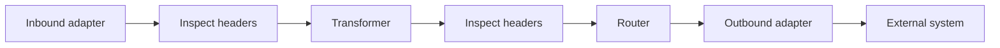

# Kiểm tra header khi debug flow

Khi một message đi qua nhiều endpoint của Spring Integration, payload có thể vẫn đúng nhưng flow vẫn định tuyến sai, mất correlation, chọn nhầm reply channel hoặc gửi thiếu metadata sang hệ thống đích. Những thông tin điều khiển và mô tả message nằm trong **headers**. Biết cách đọc, theo dõi và ghi log header giúp xác định message đã đi qua đâu, endpoint nào đã thay đổi metadata và vì sao một nhánh xử lý được chọn.

Trong module Spring Integration Adapters, message có thể đi vào từ file, SFTP, HTTP, JMS, AMQP, Kafka hoặc cơ sở dữ liệu, rồi được chuyển qua `MessageChannel`, transformer, router và outbound adapter. Mỗi adapter có thể ánh xạ metadata của giao thức ngoài thành message header hoặc ngược lại. Vì vậy, debug cần kiểm tra hợp đồng header ở cả ranh giới adapter và các bước bên trong flow, đồng thời tránh để thông tin nhạy cảm lọt vào log.

## 1. Header nằm ở đâu trong một Message?

Spring Integration sử dụng mô hình `Message<T>` gồm payload và một tập header:

```text
Message<T>
  ├── payload: T
  └── headers: MessageHeaders
        ├── id
        ├── timestamp
        ├── contentType
        ├── replyChannel / errorChannel
        ├── correlationId / sequenceNumber / sequenceSize
        └── application-specific headers
```

Payload chứa dữ liệu chính cần xử lý. Header chứa thông tin định tuyến, tương quan, thời gian, định dạng và metadata nghiệp vụ. `MessageHeaders` là cấu trúc bất biến: sau khi tạo message, không sửa trực tiếp map header. Muốn thay đổi header, hãy tạo message mới bằng `MessageBuilder` hoặc dùng một endpoint như header enricher.

Một số header thường gặp:

| Header | Ý nghĩa khi debug |
| --- | --- |
| `MessageHeaders.ID` | Định danh của message hiện tại; hữu ích để phân biệt từng lần tạo message |
| `MessageHeaders.TIMESTAMP` | Thời điểm tạo message, tính bằng epoch milliseconds |
| `MessageHeaders.CONTENT_TYPE` | Gợi ý kiểu nội dung của payload, nếu được thiết lập |
| `replyChannel` | Nơi gửi kết quả trả về trong các flow request/reply |
| `errorChannel` | Nơi nhận thông tin lỗi theo cơ chế xử lý lỗi của Integration |
| `correlationId` | Liên kết các message thuộc cùng một nhóm hoặc một yêu cầu |
| `sequenceNumber`, `sequenceSize` | Vị trí và kích thước nhóm message khi dùng splitter/aggregator |
| Header tùy chỉnh | Metadata như `tenantId`, `eventType`, `traceId`, `sourceSystem` |

Không phải message nào cũng có tất cả các header trên. Một header có thể vắng mặt, có giá trị `null`, hoặc mang một đối tượng thay vì chuỗi. Khi debug, cần kiểm tra cả sự hiện diện, kiểu dữ liệu và giá trị thực tế của header.

## 2. Đọc header tại một điểm trong flow

Ở một handler, nhận `Message<?>` để xem đồng thời payload và headers:

```java
@Component
class OrderMessageInspector {

    private static final Logger log =
            LoggerFactory.getLogger(OrderMessageInspector.class);

    @ServiceActivator(inputChannel = "orders.inspect")
    public void inspect(Message<?> message) {
        MessageHeaders headers = message.getHeaders();

        log.debug(
                "order message id={}, timestamp={}, correlationId={}, tenantId={}",
                headers.getId(),
                headers.getTimestamp(),
                headers.get("correlationId"),
                headers.get("tenantId"));
    }
}
```

Đây là một điểm quan sát trong flow. Có thể đặt handler tương tự sau inbound adapter, sau transformer, trước router và trước outbound adapter để so sánh header ở từng ranh giới. Khi chỉ cần kiểm tra một header, đọc trực tiếp qua `message.getHeaders().get("headerName")`; nếu cần kiểu cụ thể, dùng overload có `Class<T>` hoặc chuyển đổi có kiểm soát.

Với mã cần truy cập các header đặc thù của Spring Integration, `IntegrationMessageHeaderAccessor` cung cấp tên header và accessor có kiểu cho một số metadata như correlation và sequence. Dùng hằng số/accessor của framework giúp tránh gõ sai tên header. Header tùy chỉnh nên có tên thống nhất, tránh trùng với tên header chuẩn hoặc tên do adapter quản lý.

Không nên log toàn bộ `message` hoặc `headers` ở môi trường production một cách mặc định. Header có thể chứa token, authorization, cookie, thông tin định danh cá nhân, đối tượng channel hoặc dữ liệu nội bộ. Hãy chọn danh sách trường được phép ghi log, che giá trị nhạy cảm và chỉ bật log chi tiết trong thời gian cần điều tra.

## 3. Theo dõi message qua nhiều endpoint

Một cách hiệu quả để tìm nơi header bị thay đổi là quan sát cùng một message ở nhiều điểm:



Ví dụ, `tenantId` có ở message ngay sau HTTP inbound adapter nhưng biến mất sau transformer. Điều đó thu hẹp vùng cần kiểm tra vào transformer hoặc logic tạo message mới tại bước đó. Nếu header còn nguyên trước outbound adapter nhưng không xuất hiện ở hệ thống đích, cần xem cấu hình header mapper của adapter và giới hạn của giao thức đích.

Để bật log framework khi phát triển, có thể cấu hình Spring Boot:

```yaml
logging:
  level:
    org.springframework.integration: DEBUG
```

Nếu log quá nhiều, giới hạn logger theo package hoặc component cụ thể và bật trong một khoảng thời gian ngắn. Mức `TRACE` có thể tạo lượng log lớn, đặc biệt khi có nhiều message hoặc poller chạy liên tục. Hãy dùng message ID, correlation ID và tên flow để lọc log; tránh tăng mức log toàn hệ thống khi chỉ một adapter đang có vấn đề.

Với flow cần một điểm quan sát mà không thay đổi xử lý nghiệp vụ, có thể dùng channel interceptor hoặc `WireTap` để sao chép message sang một kênh chẩn đoán. Kênh chẩn đoán nên có consumer độc lập, giới hạn dung lượng và chính sách xử lý lỗi riêng. Không để một consumer log chậm làm nghẽn luồng chính. Nếu dùng `QueueChannel` cho chẩn đoán, cần theo dõi queue và xác định cách xử lý khi queue đầy.

## 4. Dùng MessageHistory để xem đường đi

`MessageHistory` ghi lại các component mà message đã đi qua. Tính năng này hữu ích khi flow có nhiều channel, transformer, router hoặc subflow và cần biết message đã đi qua endpoint nào.

Có thể bật message history bằng annotation trong cấu hình Java:

```java
@Configuration
@EnableIntegration
@EnableMessageHistory
class IntegrationConfiguration {
    // Các channel, adapter và IntegrationFlow của ứng dụng
}
```

Khi history được bật, thông tin lịch sử được gắn vào header message và có thể đọc tại điểm quan sát:

```java
MessageHistory history = MessageHistory.read(message);

if (history != null) {
    history.forEach(entry -> log.debug(
            "message visited component={}, timestamp={}",
            entry.getName(),
            entry.getTimestamp()));
}
```

History giúp trả lời message đã đi qua component nào và thời điểm ghi nhận từng bước. Nó không thay thế log nghiệp vụ, distributed tracing hay metric. Với flow có nhiều message, history làm tăng metadata đi kèm message; chỉ bật khi có nhu cầu và cân nhắc chi phí bộ nhớ, kích thước message cũng như việc truyền header sang adapter ngoài.

Nếu không dùng message history, có thể bổ sung một header correlation hoặc trace ID từ đầu flow rồi ghi ID đó tại các điểm quan sát. Cách này thường phù hợp hơn khi cần nối log giữa nhiều service hoặc nhiều giao thức. Trace ID phải được tạo hoặc tiếp nhận theo quy tắc rõ ràng; không dùng message ID làm trace ID cho toàn bộ một nghiệp vụ gồm nhiều message.

## 5. Kiểm tra header khi định tuyến và request/reply

Một header sai có thể làm flow đi vào nhánh không mong muốn. Với router dựa trên header, kiểm tra tên, kiểu và giá trị header trước khi kết luận router lỗi:

```java
@Bean
IntegrationFlow routeOrders() {
    return IntegrationFlow.from("orders.route")
            .<Message<?>>route(
                    message -> message.getHeaders().get("eventType"),
                    mapping -> mapping
                            .channelMapping("ORDER_CREATED", "orders.created")
                            .channelMapping("ORDER_CANCELLED", "orders.cancelled"))
            .get();
}
```

Trong lúc debug, ghi log giá trị `eventType` đã được chuẩn hóa trước router và xác nhận nó khớp chính xác với mapping. Cần kiểm tra cả trường hợp header vắng mặt, sai chữ hoa/thường, sai kiểu hoặc giá trị ngoài danh sách. Flow production nên có nhánh mặc định hoặc chính sách xử lý message không định tuyến được, thay vì để message biến mất mà không có dấu vết.

Trong request/reply, `replyChannel` có thể được mang trong header để xác định nơi trả kết quả. Không nên ghi log hoặc chuyển đổi tùy tiện đối tượng channel trong header. Nếu message đi qua ranh giới process hoặc giao thức, một tham chiếu channel nội bộ không thể mặc nhiên dùng được ở hệ thống khác. Kiểm tra cấu hình gateway, timeout, reply timeout và cơ chế đăng ký channel phù hợp với loại flow.

`errorChannel` cũng là thông tin điều khiển. Khi một handler lỗi, cần xác định lỗi được chuyển vào error channel nào, có `ErrorMessage` hay không và consumer của error channel có hoạt động. Đừng giả định mọi exception đều được đặt vào một header thông thường của message gốc; Spring Integration sử dụng cơ chế thông điệp lỗi riêng.

## 6. Header qua ranh giới adapter và giao thức

Header trong `Message<?>` không tự động tương đương với header của mọi giao thức ngoài. Adapter và header mapper quyết định trường nào được chuyển đổi, giữ lại, đổi tên hoặc bỏ qua.

| Ranh giới | Điều cần kiểm tra |
| --- | --- |
| HTTP | Tên header HTTP, quy tắc chữ hoa/thường, kiểu giá trị dạng chuỗi, header bị proxy hoặc server loại bỏ |
| JMS | Chỉ những property hợp lệ theo quy tắc JMS được ánh xạ; kiểm tra kiểu dữ liệu và tên property |
| AMQP | Header broker có thể mang kiểu dữ liệu đa dạng; kiểm tra mapping, content type và các header do broker thêm |
| Kafka | Record header thường là byte array; xác nhận serializer/deserializer và quy tắc mã hóa chuỗi |
| File/SFTP | Metadata file và tên file có thể được biểu diễn bằng header; kiểm tra đường dẫn, tên file, thời gian và thông tin remote directory |
| Cơ sở dữ liệu | Metadata của bản ghi cần được ánh xạ rõ vào header hoặc payload; tránh giả định cột tự xuất hiện thành header |

Ví dụ, `traceId` có thể là một chuỗi trong message header nhưng trở thành byte array ở Kafka record header. Khi đọc ở consumer, cần dùng đúng charset để giải mã. Với HTTP, tên header có thể không phân biệt chữ hoa/thường theo chuẩn giao thức, trong khi code Java truy cập map header có thể cần đúng tên mà ứng dụng đã chuẩn hóa. Kiểm tra giá trị ở cả hai phía adapter sẽ xác định lỗi nằm ở mapping hay ở hệ thống đích.

Chỉ ánh xạ những header thực sự cần thiết. Dùng allowlist cho header đi ra ngoài, đặt giới hạn kích thước và kiểm tra giá trị trước khi gửi. Không chuyển tiếp nguyên trạng `replyChannel`, `errorChannel`, thông tin nội bộ của framework hoặc credential sang broker hay HTTP service.

## 7. Thay đổi header đúng cách khi debug và sửa flow

Vì headers bất biến, tạo message mới khi cần thêm hoặc thay đổi metadata:

```java
Message<?> enriched = MessageBuilder.fromMessage(message)
        .setHeader("diagnosticStage", "after-validation")
        .setHeader("traceId", traceId)
        .build();
```

`fromMessage` giữ lại payload và các header hiện có, sau đó builder tạo message mới với header được cập nhật. Dùng cách này trong transformer hoặc header enricher khi việc bổ sung metadata là một phần của hợp đồng flow. Không chỉnh sửa map nội bộ hoặc tái sử dụng tên header cho nhiều ý nghĩa khác nhau.

Khi điều tra lỗi, tránh thêm header debug vĩnh viễn vào message chỉ để log. Một header chẩn đoán có thể vô tình được gửi ra hệ thống ngoài nếu adapter ánh xạ tất cả header. Nếu phải thêm, hãy đặt tên riêng, giới hạn phạm vi sử dụng và loại bỏ trước outbound adapter. Với log tạm thời, handler quan sát hoặc wire tap thường dễ kiểm soát hơn.

## 8. Quy trình debug theo dấu hiệu

| Dấu hiệu | Header/điểm cần kiểm tra | Hướng xử lý |
| --- | --- | --- |
| Router không chọn được nhánh | Header điều kiện như `eventType`, kiểu và giá trị thực tế | Chuẩn hóa header, thêm nhánh mặc định và log giá trị allowlist |
| Aggregator không phát kết quả | `correlationId`, `sequenceNumber`, `sequenceSize` và release strategy | Xác nhận các message cùng nhóm có chung correlation ID và đủ sequence |
| Reply không quay về caller | `replyChannel`, timeout và gateway configuration | Kiểm tra reply channel có thể phân giải và reply có đến trước timeout |
| Error flow không nhận lỗi | `errorChannel`, cấu hình endpoint và `ErrorMessage` | Kiểm tra cơ chế phát lỗi và consumer của error channel |
| Header biến mất sau transformer | Message trước/sau transformer | Kiểm tra transformer có tạo message mới và có giữ header cần thiết |
| Hệ thống đích không nhận metadata | Header trước outbound adapter và header mapper | Kiểm tra allowlist, kiểu dữ liệu, serializer và giới hạn giao thức |
| Log không nối được nhiều service | `traceId`/correlation ID | Tạo hoặc truyền trace ID theo hợp đồng xuyên service |

Một quy trình thực tế có thể thực hiện như sau:

1. Ghi lại message ID, trace ID, thời điểm và tên flow khi message vào hệ thống.
2. Đặt điểm quan sát ngay sau inbound adapter để xác nhận payload và header ban đầu.
3. So sánh header trước/sau transformer, enricher, splitter hoặc aggregator đang bị nghi ngờ.
4. Kiểm tra giá trị header ngay trước router hoặc outbound adapter, nơi quyết định định tuyến và mapping giao thức.
5. Đối chiếu log của hệ thống đích bằng cùng trace ID hoặc business ID.
6. Sau khi xác định nguyên nhân, bỏ log tạm thời, wire tap hoặc cấu hình TRACE và giữ lại metric/log an toàn cần thiết.

## 9. Kiểm thử để giữ hợp đồng header ổn định

Debug giúp tìm lỗi đang xảy ra; test giúp ngăn lỗi header quay lại. Với một flow quan trọng, nên có các kiểm tra sau:

- Header tùy chỉnh bắt buộc có mặt và đúng kiểu sau inbound adapter.
- Transformer giữ lại các header nghiệp vụ cần thiết hoặc chủ động thay thế theo hợp đồng.
- Router xử lý đúng giá trị hợp lệ, giá trị thiếu và giá trị không được hỗ trợ.
- Splitter/aggregator tạo và sử dụng đúng correlation/sequence metadata.
- Outbound header mapper chỉ gửi các trường được phép và mã hóa đúng kiểu theo giao thức.
- Log và error flow có thể liên kết bằng trace ID nhưng không chứa credential hoặc payload nhạy cảm.
- Message history, wire tap và logger không làm thay đổi kết quả xử lý hoặc gây nghẽn flow.

Khi kiểm tra một message cụ thể, ưu tiên assertion vào các header nghiệp vụ mà ứng dụng cam kết. Tránh khóa test vào các header sinh tự động như ID hoặc timestamp nếu test không có mục tiêu kiểm tra chúng; các giá trị này thường thay đổi giữa các lần chạy.

## 10. Checklist an toàn khi bật log header

Trước khi bật log chi tiết trong môi trường đang chạy, xác định rõ trường nào được phép ghi, ai có thể truy cập log và thời gian lưu log. Che hoặc loại bỏ access token, authorization, cookie, mật khẩu, dữ liệu cá nhân và payload nhạy cảm. Đặt mức log về bình thường sau khi điều tra, đồng thời kiểm tra dung lượng log và tác động hiệu năng.

Header là một phần của hợp đồng message và cũng là công cụ quan sát luồng xử lý. Khi theo dõi header tại đúng ranh giới, dùng correlation/trace ID nhất quán, hiểu mapping của từng adapter và giới hạn dữ liệu được ghi log, bạn có thể xác định chính xác nơi metadata bị thay đổi mà vẫn giữ flow Spring Integration an toàn và dễ vận hành.
