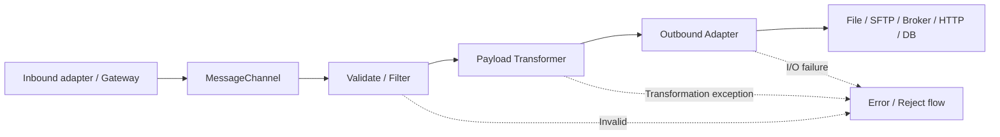
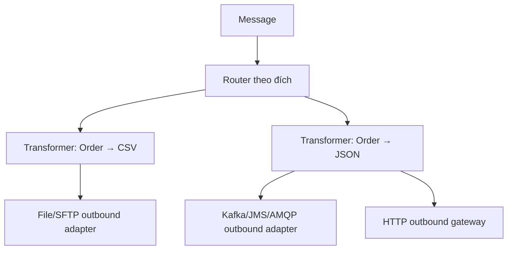
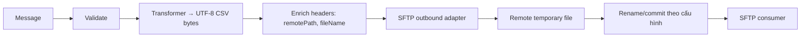
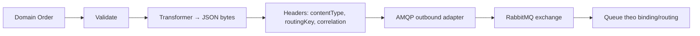
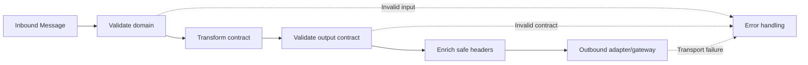

# Payload transformer trước outbound adapter

## 1. Bài toán: Vì sao phải đổi payload trước khi gửi ra hệ thống ngoài?

Một ứng dụng Spring Boot nhận đơn hàng từ REST API dưới dạng đối tượng Java `Order`. Đơn hàng cần được:

- ghi thành tệp CSV trong thư mục xuất dữ liệu;
- đưa lên máy chủ SFTP dưới dạng UTF-8;
- gửi JSON tới dịch vụ HTTP;
- xuất lên hàng đợi JMS/AMQP hoặc topic Kafka;
- lưu vào cơ sở dữ liệu theo những cột đã định nghĩa.

Nếu đưa nguyên đối tượng Java `Order` tới mọi outbound adapter, ta sẽ gặp những khác biệt:

- File adapter cần nội dung có thể ghi thành file và quy tắc đặt tên tệp.
- HTTP endpoint có hợp đồng JSON/XML, media type và schema riêng.
- JMS/AMQP cần chọn cách ánh xạ payload thành thông điệp mà consumer hiểu.
- Kafka producer cần payload phù hợp với serializer và có thể cần message key.
- JDBC outbound adapter cần các giá trị tham số phù hợp với câu lệnh SQL, không phải object bất kỳ.
- Hệ thống bên ngoài có thể yêu cầu format ngày giờ, số tiền, tên trường và encoding khác mô hình domain.

**Payload transformer trước outbound adapter** là bước **chuyển đổi dữ liệu từ hình thức nội bộ sang hợp đồng mà hệ thống đích yêu cầu**, đặt trong luồng Spring Integration **trước thành phần thực hiện I/O**.

Bài thuộc chương **Chuyển đổi dữ liệu** của module `SPRING_INTEGRATION_ADAPTERS`, tập trung kết nối hệ thống ngoài bằng **inbound/outbound adapter, gateway, poller và MessageChannel**; các ví dụ trải qua file, SFTP, HTTP, JMS, AMQP, Kafka và database, cùng cách quản lý hợp đồng message, lỗi và vòng đời kết nối.

> **Ý chính:** Transformer chịu trách nhiệm **định dạng và ngữ nghĩa dữ liệu**, outbound adapter/gateway chịu trách nhiệm **giao tiếp với hệ thống đích**. Tách hai việc giúp dễ kiểm thử, thay giao thức và xử lý lỗi có chủ đích.

## 2. Message của Spring Integration gồm gì?

Spring Integration xây trên mô hình **message-driven**: một thông điệp có **payload** và **headers**.

```text
Message<T>
├── payload: T
└── headers: MessageHeaders
    ├── id
    ├── timestamp
    ├── contentType
    ├── correlationId
    ├── fileName / targetTopic / routingKey ... (theo tích hợp)
    └── các metadata bổ sung
```

- **Payload** là dữ liệu nghiệp vụ: DTO, JSON string, `byte[]`, `File`, `Map` hoặc kiểu mà endpoint hỗ trợ.
- **Headers** chứa metadata điều khiển: correlation ID, content type, định danh nguồn, tên file, topic, key, v.v.
- **MessageChannel** kết nối các endpoint. Kênh có thể chuyển thông điệp đồng bộ hoặc qua cơ chế bất đồng bộ/hàng đợi.
- **Endpoint** là thành phần tiêu thụ/tạo message, ví dụ transformer, filter, router, service activator, adapter hoặc gateway.

### Payload và header có phải lúc nào cũng giữ nguyên?

Không. Một transformer có thể trả về **payload mới** hoặc **Message mới**. Khi chỉ trả payload trong một luồng thông thường, cơ chế transformation của Spring Integration thường xây dựng message kết quả và kế thừa các header phù hợp; nhưng mã tùy biến tạo `Message` mới, các component hoặc cơ chế mapping protocol có thể thay đổi metadata.

Do đó, không được giả định **mọi header nội bộ sẽ tự đi qua mọi adapter**. Cần xác định header nào phải được giữ, đổi tên, làm sạch hoặc chuyển thành metadata giao thức ở biên hệ thống.

### Ví dụ hai thông điệp khác hợp đồng

**Thông điệp bên trong:**

```json
{
  "orderId": "ORD-1001",
  "customerCode": "C-17",
  "totalCents": 125000,
  "currency": "VND"
}
```

**Tệp CSV đích:**

```csv
order_id,customer_code,total_cents,currency
ORD-1001,C-17,125000,VND
```

Trong ví dụ này, transformer quyết định **thứ tự cột, cách escape, ký tự xuống dòng và representation**. File outbound adapter nhận nội dung để ghi ra file, không cần biết domain object `Order` có những trường gì.

## 3. Transformer nằm ở vị trí nào trong luồng?

Một luồng đơn giản:



Có thể diễn đạt:

```text
Nguồn → Message<Order> → Transformer → Message<String | byte[] | DTO | Map>
                                               ↓
                                        Outbound adapter
                                               ↓
                                          Hệ thống đích
```

### Vì sao không chuyển đổi trực tiếp trong outbound adapter?

Đặt logic nghiệp vụ/phân dạng vào adapter thường tạo các vấn đề:

1. **Khó kiểm thử:** kiểm thử định dạng cần đồng thời tạo kết nối tới file server hoặc broker.
2. **Khó tái sử dụng:** khi đổi File sang SFTP, phải viết lại logic chuyển DTO sang CSV.
3. **Khó xác định lỗi:** lỗi dữ liệu và lỗi mạng bị gộp thành “gửi thất bại”.
4. **Khó mở rộng hợp đồng:** logic tạo JSON, schema version, charset và file name bị trộn với transport.
5. **Khó thay thế đích:** cùng dữ liệu có thể phải gửi tới nhiều adapter với format khác nhau.

**Ranh giới hợp lý:** transformer nên là phép biến đổi có đầu vào–đầu ra rõ ràng và ít side effect; adapter/gateway sở hữu kết nối, gửi và các quy tắc transport.

## 4. Transformer, converter, enricher, filter và router khác nhau thế nào?

| Thành phần | Vai trò chính | Ví dụ |
| --- | --- | --- |
| **Transformer** | Thay đổi payload hoặc cấu trúc message | `Order` → CSV `String` |
| **MessageConverter** | Chuyển representation khi tích hợp với framework/protocol | Đổi object thành JMS TextMessage/AMQP body theo converter được cấu hình |
| **Header Enricher** | Thêm/sửa metadata header | Gắn tên file, correlation ID hoặc partition key |
| **Filter** | Cho message đi tiếp hoặc loại theo điều kiện | Bỏ qua đơn hàng không đủ điều kiện xuất |
| **Router** | Chọn channel/nhánh đích | Tách dữ liệu cần CSV và dữ liệu cần JSON |
| **Service Activator** | Thực thi hàm/logic nghiệp vụ khi nhận message | Gọi dịch vụ domain để xác nhận trạng thái đơn |
| **Splitter** | Chia message chứa tập dữ liệu thành nhiều message | Danh sách 100 đơn → 100 đơn riêng |
| **Aggregator** | Gom các message theo nhóm/điều kiện kết thúc | Ghép nhiều dòng thành một file batch |
| **Outbound adapter** | Gửi message một chiều tới hệ thống ngoài | Ghi file, publish event, cập nhật qua handler |
| **Outbound gateway** | Gửi request tới hệ thống ngoài và chờ/nhận reply | HTTP request–response hoặc truy vấn có kết quả |

**Transformer không phải nơi lý tưởng để kết nối mạng hoặc commit database.** Nếu một phép chuyển đổi vừa gọi API bên ngoài vừa ghi dữ liệu, kiểm soát retry và idempotency sẽ khó hơn nhiều.

### “Trước adapter” không có nghĩa “cùng format cho mọi protocol”

Ví dụ một mô hình domain có thể đi tới hai nhánh:



Nếu downstream cần hợp đồng khác, tách transformer tương ứng, thay vì ép mọi adapter dùng một representation.

## 5. Khái niệm inbound adapter, outbound adapter và gateway

### Inbound adapter

**Inbound adapter** đưa sự kiện/dữ liệu bên ngoài vào `MessageChannel`, ví dụ đọc file trong thư mục, nhận JMS message hoặc poll database. Inbound adapter có thể thuộc kiểu **polling consumer** (được poller kích hoạt) hoặc **message-driven producer**.

### Outbound adapter

**Outbound adapter** nhận message từ channel và thực hiện một hành động gửi/ghi **một chiều** vào hệ thống khác. Ví dụ FileWritingMessageHandler ghi payload thành file; adapter xuất event vào broker.

### Gateway

**Gateway** phù hợp với trao đổi **request–reply**: gửi yêu cầu và có phản hồi cần xử lý. Ví dụ **HTTP outbound gateway** gửi HTTP request và biến response thành message tiếp theo. Không nên giả định các thao tác có reply cần được xử lý như một outbound adapter một chiều.

### Poller

**Poller** định kỳ kích hoạt nguồn hoặc endpoint polling như file inbound adapter/database polling và điều phối việc lấy message. Poller **không phải transformer**: nó quyết định nhịp lấy dữ liệu, trong khi transformer quyết định hình dạng payload sau khi đã có message.

| Thành phần | Đầu vào | Đầu ra/hiệu ứng |
| --- | --- | --- |
| File inbound adapter | File ngoài thư mục | Message có payload file hoặc dữ liệu theo cấu hình |
| Poller | Lịch, giới hạn message và policy | Kích hoạt nguồn được polling |
| Transformer | Message/payload Java | Payload/Message đã chuyển đổi |
| File outbound adapter | Message chứa dữ liệu tương thích | Tệp trên filesystem |
| HTTP outbound gateway | Message yêu cầu HTTP | HTTP response thành reply message |
| JMS/AMQP/Kafka outbound adapter | Message có payload phù hợp converter/serializer | Thông điệp gửi tới broker |

## 6. Thiết kế hợp đồng payload: Bắt đầu từ hệ thống đích

**Message contract** phải mô tả nội dung mà consumer thực sự chấp nhận, không chỉ class Java nội bộ.

Một hợp đồng tối thiểu nên trả lời:

1. **Loại dữ liệu:** JSON, XML, CSV, text, `byte[]`, Avro/Protobuf hoặc tham số SQL?
2. **Schema:** trường bắt buộc, tên trường, thứ tự cột, kiểu số, format ngày và version.
3. **Encoding:** UTF-8 hay charset cụ thể? Có BOM hoặc delimiter yêu cầu không?
4. **Quy tắc null:** bỏ trường, ghi `null`, dùng chuỗi rỗng hay từ chối message?
5. **Header/protocol metadata:** `contentType`, tên file, topic/key/routing key, correlation ID.
6. **Kích thước:** kích thước tối đa của body, file, batch hoặc record.
7. **Idempotency:** hệ thống đích nhận message trùng bằng khóa nào?
8. **An toàn dữ liệu:** trường nào là dữ liệu nhạy cảm cần bỏ, mask hoặc mã hóa?
9. **Tính tương thích:** consumer có chấp nhận version cũ/mới không? Thay đổi schema được phát hành ra sao?
10. **Phản hồi lỗi:** dữ liệu không hợp lệ bị loại, đưa vào error flow hay thử lại?

### Ma trận payload theo adapter

| Đích | Payload sau transform thường dùng | Metadata/kiểm soát đáng chú ý |
| --- | --- | --- |
| **File** | `String`, `byte[]` hoặc `File` theo handler | Tên file, encoding, cách ghi đè/append, thư mục |
| **SFTP** | `File`, `byte[]` hoặc `String` theo handler/adapter | Remote path, filename, temporary name/rename, charset |
| **HTTP** | DTO đã serialize, JSON string hoặc bytes theo cấu hình converter | Media type, HTTP method, headers, status, response |
| **JMS** | Dữ liệu phù hợp JMS message converter | Destination, correlation, delivery mode, xử lý trùng |
| **AMQP/RabbitMQ** | `byte[]`, text hoặc object được converter hỗ trợ | Exchange, routing key, content type, confirms/returns |
| **Kafka** | Key/value phù hợp producer serializer | Topic, key, partition, schema version, producer acknowledgment |
| **Database/JDBC** | Map tham số hoặc object có property phù hợp SQL | Kiểu dữ liệu SQL, transaction, constraint, unique key |

Đây là các hình thức **thường gặp**, không có nghĩa tất cả adapter chỉ chấp nhận một kiểu cố định. Cần kiểm tra hợp đồng của adapter, cấu hình converter/serializer và phiên bản thư viện cụ thể.

## 7. Ví dụ thực hành: Order → CSV → File outbound adapter

Mục tiêu: ứng dụng nhận `Order`, biến thành một dòng CSV chuẩn và ghi một file riêng cho từng đơn hàng.

### 7.1. DTO và hợp đồng

Giả sử payload Java:

```java
public record Order(
    String orderId,
    String customerCode,
    long totalCents
) {}
```

Hệ thống đích yêu cầu:

```csv
"ORD-1001","C-17",125000
```

Các giả định trong ví dụ:

- Mỗi message chứa một `Order`.
- `orderId` là định danh duy nhất đã được xác minh.
- Dữ liệu đơn hàng được mã hóa thành CSV theo format cố định.
- Tên file có dạng `order-<orderId>.csv`.
- Môi trường chạy có quyền ghi thư mục xuất; việc vận hành bảo vệ thư mục được xử lý riêng.

### 7.2. Tách hàm chuyển đổi thành hàm thuần

```java
public final class OrderCsvFormatter {

    private OrderCsvFormatter() {
    }

    public static String format(Order order) {
        if (order == null || order.orderId() == null
                || order.customerCode() == null
                || order.totalCents() < 0) {
            throw new IllegalArgumentException("Invalid order for CSV export");
        }

        return csvField(order.orderId()) + ","
                + csvField(order.customerCode()) + ","
                + order.totalCents() + "\n";
    }

    private static String csvField(String raw) {
        // Escape dấu ngoặc kép theo quy tắc CSV.
        // Nếu CSV được mở bằng spreadsheet, cần thêm chính sách
        // chống CSV formula injection phù hợp consumer.
        return "\"" + raw.replace("\"", "\"\"") + "\"";
    }
}
```

Vì hàm không gọi network hoặc filesystem, kiểm thử mapping/escaping đơn giản hơn. Trong sản xuất, cần làm rõ chính sách null, xuống dòng, delimiter, độ dài trường, locale và khả năng dữ liệu được mở bằng spreadsheet.

### 7.3. Tạo IntegrationFlow

Ví dụ với Java DSL của Spring Integration, các API và import cụ thể cần được đối chiếu với phiên bản Spring Integration được dùng trong project:

```java
import java.io.File;

import org.springframework.context.annotation.Bean;
import org.springframework.context.annotation.Configuration;
import org.springframework.integration.channel.DirectChannel;
import org.springframework.integration.dsl.IntegrationFlow;
import org.springframework.integration.file.dsl.Files;
import org.springframework.messaging.MessageChannel;

@Configuration
public class OrderFileIntegrationConfig {

    @Bean
    MessageChannel orderExportRequests() {
        return new DirectChannel();
    }

    @Bean
    IntegrationFlow orderExportFlow(MessageChannel orderExportRequests) {
        return IntegrationFlow.from(orderExportRequests)
            // Header được tính khi payload còn là Order.
            .enrichHeaders(headers -> headers.headerFunction(
                "outputFileName",
                message -> {
                    Order order = (Order) message.getPayload();
                    String id = order.orderId();
                    if (id == null || !id.matches("[A-Za-z0-9_-]{1,64}")) {
                        throw new IllegalArgumentException("Unsafe orderId");
                    }
                    return "order-" + id + ".csv";
                }
            ))
            // Chuyển Order -> String; gửi String cho file writer.
            .transform(Order.class, OrderCsvFormatter::format)
            .handle(Files.outboundAdapter(new File("./data/outbox"))
                .autoCreateDirectory(true)
                .fileNameGenerator(message ->
                    (String) message.getHeaders().get("outputFileName")))
            .get();
    }
}
```

**Giải thích các bước:**

1. `orderExportRequests` là kênh nhận dữ liệu domain.
2. `enrichHeaders` tạo tên file từ payload trước khi chuyển sang `String`.
3. `transform(Order.class, ...)` trả payload CSV.
4. `Files.outboundAdapter(...)` ghi nội dung ra filesystem.
5. File name generator lấy header đã tính, tránh phải parse ngược CSV để lấy order ID.

Mẫu này giả định header đã được giữ đúng qua transformer trong flow; với transformer tùy biến trả `Message` mới, cần kiểm tra cách giữ header. Trước khi triển khai thật, bổ sung chính sách file đã tồn tại, chống ghi trùng, ghi atomic/temporary file nếu consumer cần, giới hạn kích thước và xác minh charset.

### 7.4. Điều gì xảy ra khi message đi vào?

Input:

```text
payload: Order(
  orderId="ORD-1001",
  customerCode="C-17",
  totalCents=125000
)
```

Sau header enricher:

```text
payload: Order(...)
headers["outputFileName"]: "order-ORD-1001.csv"
```

Sau transformer:

```text
payload type: java.lang.String
payload: "\"ORD-1001\",\"C-17\",125000\n"
headers["outputFileName"]: "order-ORD-1001.csv"
```

Đầu ra mong đợi: file `./data/outbox/order-ORD-1001.csv` với nội dung CSV đã chuyển đổi.

**Chú ý an toàn:** đường dẫn/tên file không bao giờ nên được ghép trực tiếp từ giá trị thiếu kiểm soát như `../../other-dir/secret.txt`. Ví dụ kiểm tra `orderId` bằng whitelist ký tự trước khi dùng làm filename.

## 8. Thay cách triển khai: Transformer Java, bean hoặc DSL

Spring Integration cho phép tổ chức logic biến đổi theo nhiều dạng.

### 8.1. Hàm Java thuần

Phù hợp khi chuyển kiểu đơn giản, không phụ thuộc framework:

```java
public String transform(Order order) {
    return OrderCsvFormatter.format(order);
}
```

Ưu điểm: unit test nhanh, không cần broker/file server, có thể dùng lại trong service khác.

### 8.2. Transformer là bean

Khi chuyển đổi có nhiều quy tắc, tách thành bean với hợp đồng đầu vào–đầu ra rõ ràng:

```java
@Component
public class OrderExportTransformer {

    public byte[] transform(Order order) {
        String csv = OrderCsvFormatter.format(order);
        return csv.getBytes(StandardCharsets.UTF_8);
    }
}
```

Cách chọn `byte[]` giúp xác định encoding trước khi gửi. Thêm kiểm soát kích thước nếu payload lớn; không nhất thiết phù hợp khi cần stream dữ liệu hàng GB.

### 8.3. Transformer trong Java DSL

Phù hợp khi mapping gọn và dễ đọc:

```java
@Bean
IntegrationFlow jsonFlow() {
    return IntegrationFlow.from("jsonRequests")
        .transform(Order.class, order -> Map.of(
            "order_id", order.orderId(),
            "total_cents", order.totalCents()
        ))
        // Outbound handler phía sau phải được cấu hình theo đích.
        .channel("jsonReadyChannel")
        .get();
}
```

Flow minh họa trên tạo `Map`, **chưa tự serialize Map thành JSON bytes**. Nếu HTTP/Kafka/JMS yêu cầu JSON, cần một bước chuyển sang JSON với message converter/serializer hoặc transformer phù hợp trước biên I/O.

### 8.4. Chuyển đổi với Message

Một transformer cần kiểm soát header có thể xử lý cả message thay vì chỉ payload. Tuy nhiên nên tránh dựng message mới mà làm mất `correlationId`, metadata routing hoặc thông tin cho tracing.

Nguyên tắc tốt:

- Chỉ sửa header thật sự cần.
- Không tin header do nguồn không đáng tin tự khai.
- Hạn chế đưa credential hoặc PII vào headers.
- Kiểm thử các header sống qua từng endpoint và adapter.
- Không tự sửa các header framework quản lý như `id`/`timestamp` theo cách phá vỡ semantics.

## 9. Chuyển đổi sang JSON trước HTTP outbound gateway

HTTP thường có luồng request–response, vì vậy **HTTP outbound gateway** hay được dùng khi ứng dụng cần nhận response. Nếu chỉ phát một chiều, hãy chọn mô hình tương ứng với yêu cầu và khả năng của endpoint.

### Hợp đồng mẫu

Payload nội bộ:

```text
Order(orderId="ORD-1001", customerCode="C-17", totalCents=125000)
```

HTTP endpoint yêu cầu:

```json
{
  "order_id": "ORD-1001",
  "customer_code": "C-17",
  "total_cents": 125000
}
```

### Ví dụ tách DTO đích và serialize

```java
public record OrderHttpRequest(
    String order_id,
    String customer_code,
    long total_cents
) {}

public static OrderHttpRequest toRequest(Order order) {
    return new OrderHttpRequest(
        order.orderId(),
        order.customerCode(),
        order.totalCents()
    );
}
```

Một flow có thể chuyển `Order` → `OrderHttpRequest` trước khi đưa vào HTTP outbound gateway. Việc serialize DTO thành JSON có thể do **HTTP message converter** phù hợp đảm nhiệm; nếu endpoint nhận raw JSON string/bytes, cần chỉ định content type và representation rõ.

**Không serialize hai lần:** nếu transformer trả JSON string nhưng HTTP converter lại coi đó là đối tượng cần JSON-encode, phía đích có thể nhận một chuỗi JSON bị quote thay vì object JSON.

### Các tình huống lỗi cần phân biệt

| Lỗi | Thuộc lớp nào? | Hướng xử lý |
| --- | --- | --- |
| Thiếu `orderId` | Validation/transformation | Reject, error flow hoặc quarantine |
| DTO không map đúng schema | Transformer/serializer | Sửa hợp đồng, version và test contract |
| HTTP 400/422 | Đích từ chối nội dung | Thường cần sửa dữ liệu, không retry vô hạn |
| HTTP 401/403 | AuthN/AuthZ hoặc credential tích hợp | Kiểm tra cấu hình và quyền kết nối |
| HTTP 429/503 | Rate limit/lỗi tạm thời | Backoff, retry có giới hạn và idempotency |
| HTTP timeout sau khi server đã xử lý | Trạng thái gửi không chắc chắn | Idempotency key, kiểm tra trạng thái và xử lý trùng |

Mã HTTP có thể có cách diễn giải nghiệp vụ riêng theo API đích; cần dựa vào hợp đồng của endpoint, không tự gộp mọi lỗi thành một kiểu.

## 10. File và SFTP: Payload, file name và atomic delivery

File và SFTP là trường hợp rõ nhất để thấy ranh giới giữa **định dạng dữ liệu** và **vận chuyển dữ liệu**.

### 10.1. File outbound

Transformer xử lý:

- Object → CSV/XML/text/binary.
- Charset và quy tắc xuống dòng.
- Trường dữ liệu, schema và escaping.
- Metadata dùng làm file name nếu cần.

File outbound adapter xử lý:

- Thư mục đích và việc tạo thư mục.
- Ghi file, chế độ đối với file đã tồn tại.
- Tên file, quyền truy cập filesystem.
- Hành vi ghi hoàn chỉnh hoặc tạm thời theo cấu hình/kiến trúc.

### 10.2. SFTP outbound

SFTP outbound adapter chuyển file/dữ liệu qua kết nối SSH đến server. Ngoài payload, cần thiết kế:

- Remote directory và file name.
- Cơ chế quản lý session/kết nối, xác thực máy chủ/host key và credential.
- Quyền ghi, timeout, retry và reconnect.
- Đổi tên file tạm khi ghi xong nếu cần để consumer tránh đọc file chưa hoàn chỉnh.
- Đồng bộ thời điểm nhận và dọn file, tránh gửi trùng.



**Cảnh báo:** không lấy remote path chưa kiểm chứng trực tiếp từ message nguồn. Có thể bị path traversal hoặc ghi vào vị trí ngoài phạm vi được cấp. Dùng thư mục đích đã cấu hình và whitelist filename.

### 10.3. Nếu một file chứa nhiều bản ghi

Transformer cho **một Order → một dòng CSV** không tự tạo được một batch đầy đủ. Khi cần mỗi ngày một file chứa nhiều đơn:

- Poller hoặc inbound adapter lấy các bản ghi.
- Có thể dùng **splitter** để tạo message từng đơn.
- Dùng **aggregator** hoặc cơ chế batch để gom dữ liệu theo correlation và điều kiện hoàn thành.
- Transform danh sách → một file CSV có header và nhiều dòng.
- Outbound adapter chỉ ghi sau khi batch được xác định hoàn chỉnh.

Không dùng aggregator vô thời hạn mà không có điều kiện kết thúc/time-out; có nguy cơ giữ message trong memory/message store quá lâu.

## 11. JMS: Chuyển payload trước khi đưa vào broker

JMS phân biệt representation của message (như `TextMessage`, `BytesMessage` và các kiểu khác) với đối tượng Java nghiệp vụ.

Ví dụ luồng:

```text
Message<Order>
   -> validate / transform to JSON text
   -> JMS outbound adapter + MessageConverter
   -> JMS TextMessage
   -> Consumer nhận JSON theo hợp đồng
```

### Điều cần thiết kế

1. **Kiểu dữ liệu:** consumer chấp nhận JSON text, binary hay object được serialize theo hợp đồng?
2. **Converter:** cấu hình đúng quy tắc chuyển Spring `Message<?>` sang JMS message.
3. **Headers/properties:** những header nào chuyển thành JMS properties? Header nào chỉ dùng nội bộ?
4. **Correlation:** `JMSCorrelationID`/message ID phục vụ tracing hoặc request–reply theo thiết kế.
5. **Delivery:** acknowledgment, transaction, redelivery và dead-letter xử lý ra sao?
6. **Version:** consumer cũ có đọc được schema mới không?

**Tránh Java object serialization tùy tiện giữa các dịch vụ.** Nó có thể tạo phụ thuộc classpath, version và rủi ro bảo mật khi deserialize dữ liệu không đáng tin. Hợp đồng text/binary có schema rõ thường dễ kiểm soát hơn.

Một cách làm tốt là transformer trả DTO/JSON đã chuẩn hóa, rồi converter được cấu hình rõ ràng chuyển thành loại JMS message mong muốn. Không để việc serialization là “tình cờ” do cấu hình mặc định.

## 12. AMQP/RabbitMQ: Body, content type và routing

Với AMQP, outbound adapter gửi message đến exchange với routing key và body được chuyển đổi theo converter.

### Luồng minh họa



Điểm cần lưu ý:

- **Content type:** nếu body là JSON, gắn metadata tương ứng, ví dụ `application/json` theo giao thức và converter.
- **Routing key:** cần xuất phát từ policy/metadata đáng tin; dữ liệu không kiểm chứng có thể gửi sai hàng đợi.
- **Converter:** nếu đã tạo `byte[]` JSON, không được để converter hiểu sai thành Java object tùy ý.
- **Publisher confirms/returns:** xác nhận gửi đến broker/bị trả lại khác với **consumer đã xử lý nghiệp vụ thành công**.
- **Dead-letter và retry:** phân biệt dữ liệu sai hợp đồng với broker tạm lỗi.
- **Header mapping:** xác nhận header nào đi qua AMQP properties và format/giới hạn được hỗ trợ.

Ví dụ: sự kiện có `eventType=order.created` có thể được biến thành JSON bytes, trong khi routing key được thiết lập rõ `orders.created`. Đừng để cùng một trường dùng cho cả nội dung và điều khiển routing mà không có quy ước.

## 13. Kafka: Serializer, message key và schema version

Kafka producer sử dụng **serializer của key và value**. Transformer phải bảo đảm kiểu payload sau chuyển đổi phù hợp với serializer được cấu hình.

### Những lựa chọn thường gặp

| Transformer trả về | Serializer value phù hợp theo cấu hình | Rủi ro |
| --- | --- | --- |
| `String` JSON | String serializer | Chuyển encoding/JSON không như consumer mong đợi |
| `byte[]` | Byte array serializer | Thiếu content/schema metadata |
| DTO Java | JSON/Avro/Protobuf serializer phù hợp | Schema/class và tương thích version |
| `Map<String,Object>` | Serializer chấp nhận Map theo hợp đồng | Type mapping, số/ngày và field names không ổn định |

### Message key có ý nghĩa gì?

Key thường giúp xác định cách phân vùng bản ghi và là tín hiệu cho chiến lược ordering của consumer trong một partition. Ví dụ cùng `orderId` dùng làm Kafka key để các sự kiện của một đơn được đưa vào cùng partition theo cấu hình partitioner.

**Không có nghĩa Kafka bảo đảm thứ tự toàn bộ các partition.** Thứ tự phụ thuộc key, partitioning, producer và cách consumer xử lý.

### Hợp đồng sự kiện mẫu

```json
{
  "eventId": "evt-84a7",
  "schemaVersion": 2,
  "eventType": "order.created",
  "occurredAt": "2026-11-23T08:00:00Z",
  "order": {
    "orderId": "ORD-1001",
    "totalCents": 125000,
    "currency": "VND"
  }
}
```

Nên xác định riêng:

- **Key:** `ORD-1001` (theo thiết kế).
- **Topic:** tên đã quản trị, ví dụ `orders.events`.
- **Value:** JSON bytes hoặc DTO theo serializer.
- **Schema version:** phục vụ tương thích producer–consumer.
- **eventId/idempotency key:** xử lý duplicate khi retry/redelivery.
- **Trace metadata:** correlation ID được truyền qua header theo cấu hình.

Một producer acknowledgment **không đồng nghĩa downstream consumer đã xử lý**; cần quan sát từ các lớp liên quan.

## 14. Database outbound: DTO → tham số SQL, không phải tự dựng SQL

Với JDBC/database outbound adapter, bài toán không phải serialize thành file hay message broker. Transformer có thể tạo **tập tham số hoặc dữ liệu có property** phù hợp với SQL.

### Hợp đồng ví dụ

```sql
INSERT INTO exported_orders (
    order_id,
    customer_code,
    total_cents
) VALUES (
    :orderId,
    :customerCode,
    :totalCents
);
```

Payload sau bước mapping:

```json
{
  "orderId": "ORD-1001",
  "customerCode": "C-17",
  "totalCents": 125000
}
```

Cần kiểm tra kiểu dữ liệu và cách bind theo JDBC adapter đang dùng. Transformer có thể trả `Map` tham số, DTO hoặc cấu trúc khác mà handler hỗ trợ.

### Các điều cần tránh

- **Không nối chuỗi SQL từ payload người dùng.** Dùng prepared statement hoặc named parameters do driver/framework hỗ trợ để giảm nguy cơ SQL injection.
- Không tin giá trị ngày/giờ, decimal, enum từ nguồn ngoài nếu chưa validate.
- Không giả định payload đã ghi DB thành công chỉ vì transformer chạy xong.
- Ghi ra DB và publish broker là **hai giao dịch**; không mặc nhiên có tính nguyên tử xuyên database và broker.
- Khi cần tin cậy cao, cân nhắc transactional outbox, idempotent upsert hoặc quy trình tương ứng với kiến trúc.

### Một trường hợp khác: Poll DB → transform → Kafka

```text
Database inbound polling adapter
   -> Row/Map
   -> Validate + map to OrderCreatedEvent
   -> Serialize JSON/Avro
   -> Kafka outbound adapter
```

Poller quyết định nhịp lấy dữ liệu; transformer đổi schema; Kafka adapter chịu trách nhiệm publish. Nếu query poll không quản lý checkpoint/trạng thái đã xử lý, có thể đọc lại bản ghi và phát sinh duplicate, dù transformer đúng.

## 15. Header contract: Tên file, Content-Type, key và correlation

Một phép biến đổi chỉ đúng payload nhưng **đánh mất metadata cần thiết** cũng có thể làm gửi sai.

| Header/metadata | Đích thường dùng | Quy tắc |
| --- | --- | --- |
| `contentType` | HTTP, AMQP, một số converter | Đặt phù hợp bytes thực tế |
| `fileName` / filename header | File, SFTP | Chỉ định đúng naming contract và sanitize |
| `topic`, `messageKey` | Kafka | Theo cấu hình adapter/version, không tự đoán tên header |
| `routingKey` | AMQP | Đúng exchange/binding theo policy |
| `correlationId` | Tracing, request–reply, batch | Duy trì xuyên các bước khi cần |
| `replyChannel` | Gateway/request–reply nội bộ | Không tùy tiện biến thành dữ liệu outbound |
| `errorChannel` | Error flow bất đồng bộ/được cấu hình | Hiểu cách channel xử lý exception theo topology |
| `eventId` / `schemaVersion` | Consumer và dedup/version | Có hợp đồng rõ, kiểm tra trước gửi |
| `traceId` | Observability | Không đưa thông tin nhạy cảm vào trace |

### Content type và nội dung phải khớp

Ví dụ:

- Payload `String` chứa JSON → content type có thể là `application/json` nếu đích và converter được cấu hình phù hợp.
- Payload `byte[]` chứa CSV UTF-8 → dùng media type CSV/text theo hợp đồng, không gắn `application/json`.
- DTO `Order` có thể được HTTP converter serialize thành JSON; đừng vừa serialize thủ công vừa để converter serialize thêm một lần.

### Header đã tin cậy chưa?

Không nên cho client bên ngoài tự quyết định remote path, Kafka topic nội bộ, routing key quản trị hoặc database table qua header không kiểm chứng. Tách **metadata nghiệp vụ do nguồn gửi** khỏi **metadata định tuyến do ứng dụng kiểm soát**.

## 16. Encoding, null, thời gian và độ chính xác số

Một transformer thường gây lỗi không phải vì code crash mà vì **dữ liệu bị diễn giải khác** ở consumer.

### 16.1. Charset

- Chỉ rõ khi chuyển `String` ↔ `byte[]`, thường dùng `StandardCharsets.UTF_8` nếu hợp đồng cho phép.
- Với CSV/text qua File hoặc SFTP, xác định BOM, dấu xuống dòng `\n` hay `\r\n`.
- Đảm bảo hệ thống nhận giải mã cùng charset; không dựa vào default encoding của máy chạy.

### 16.2. Thời gian

- Chốt múi giờ và format, ưu tiên timestamp có offset hoặc UTC khi truyền xuyên hệ thống.
- `LocalDateTime` không kèm timezone có thể bị hiểu khác ở producer và consumer.
- Ngày nghiệp vụ và timestamp sự kiện không phải lúc nào cũng cùng ý nghĩa.

Ví dụ:

```json
{
  "eventTime": "2026-11-23T08:00:00Z",
  "businessDate": "2026-11-23",
  "sourceTimeZone": "Asia/Ho_Chi_Minh"
}
```

### 16.3. Tiền và số

- `double` có thể tạo sai số cho dữ liệu tiền tệ. Cân nhắc `BigDecimal` hoặc đơn vị nhỏ nhất như `long totalCents` theo domain.
- Quy ước dấu phân cách thập phân và dấu nhóm không nên phụ thuộc locale máy chủ.
- Consumer cần biết ý nghĩa đơn vị, ví dụ `125000` là số tiền đơn vị nhỏ hay đồng tiền.

### 16.4. Null và trường bắt buộc

- Quy định missing field khác null hay empty string ra sao.
- Validate giá trị trước khi serialize, tránh tạo message hợp lệ cú pháp nhưng sai nghiệp vụ.
- Với `Map.of(...)` Java, các phần tử null không được chấp nhận; cần xử lý null một cách rõ ràng.

### 16.5. CSV và dữ liệu không tin cậy

CSV escaping (dấu phẩy, dấu kép, xuống dòng) là **một vấn đề**, CSV/spreadsheet formula injection là **một vấn đề khác**. Nếu dữ liệu đến từ người dùng và người nhận mở bằng spreadsheet, phải có chính sách xử lý các chuỗi có thể bị hiểu là công thức; chỉ quote CSV không bảo đảm loại rủi ro này trong mọi phần mềm.

## 17. Validation và transformation nên đặt ở đâu?

Có ba dạng kiểm tra khác nhau:

1. **Input validation:** nguồn cung cấp dữ liệu đủ điều kiện? Ví dụ `orderId` không rỗng, số tiền không âm.
2. **Contract validation:** representation sau transform có đúng JSON schema, số trường CSV, encoding, version?
3. **Transport/result validation:** hệ thống đích có nhận hay ghi thành công, đúng tài nguyên và có thể kiểm tra kết quả không?

Một pipeline hợp lý:



Trong ví dụ file ở phần trên, tên file được tính **trước** transform, vì header cần lấy từ `Order`. Thứ tự enrich header trước hay sau transformation nên chọn theo dữ liệu có sẵn và hợp đồng. Điều cốt lõi là **đầu ra tới adapter đúng cả payload lẫn metadata**.

### Nên dùng exception hay filter?

- Dữ liệu sai cấu trúc hoặc thiếu trường bắt buộc → thường là **lỗi** cần ghi nhận/quarantine.
- Message hợp lệ nhưng không thuộc phạm vi xử lý → có thể dùng **filter**, ghi số lượng bỏ qua theo yêu cầu.
- Destination sai hoặc dữ liệu hợp lệ nhưng không thể route → dùng error handling hoặc route dự phòng rõ ràng.
- Không dùng filter im lặng để che dữ liệu bị lỗi; consumer sẽ không biết có message bị mất.

## 18. Xử lý lỗi: Transformation error khác transport error

Khi ứng dụng lỗi, cần biết nó xảy ra trước hay sau adapter.

### 18.1. Lỗi transformation

Ví dụ:

- ClassCastException vì payload từ inbound adapter là `File` thay vì `Order`.
- JSON/CSV sai schema.
- Dữ liệu không hợp lệ, vượt giới hạn, thiếu charset, lỗi mapping ngày giờ.
- Payload quá lớn gây áp lực memory.

Lỗi này thường **không được sửa bằng retry vô hạn**. Cần bổ sung dữ liệu đúng, sửa hợp đồng, quarantine, alert hoặc đưa vào dead-letter phù hợp.

### 18.2. Lỗi transport

Ví dụ:

- SFTP timeout, permission denied, host key thay đổi.
- HTTP 503 hoặc 429.
- Broker tạm mất kết nối, producer timeout.
- Database deadlock, connection unavailable hoặc constraint violation.

Một số lỗi tạm thời có thể retry; một số là lỗi cố định hoặc rủi ro bảo mật cần dừng và xử lý cấu hình.

### 18.3. Trách nhiệm của ErrorChannel và exception propagation

Với luồng đồng bộ qua `DirectChannel`, exception có thể **truyền ngược đến caller**, thường được bọc trong ngoại lệ messaging. Với luồng bất đồng bộ hoặc endpoint được polling, lỗi có thể được gửi tới **error channel** theo cấu hình, thay vì trực tiếp trả cho người gửi ban đầu.

Không mặc định việc thêm một `errorChannel` header sẽ xử lý được mọi exception trong mọi topology; cần kiểm tra endpoint, executor, poller và advice được cấu hình.

### 18.4. Chính sách xử lý đề xuất

| Lỗi | Retry? | Xử lý phù hợp |
| --- | --- | --- |
| Thiếu trường bắt buộc | Thường không nếu dữ liệu không đổi | Reject/quarantine, alert chủ dữ liệu |
| Schema version không tương thích | Không retry mù | Sửa contract/rollout |
| File name chứa path traversal | Không | Từ chối, log sự kiện bảo mật an toàn |
| HTTP 429/503 | Có thể | Backoff, giới hạn số lần, idempotency key |
| SFTP timeout | Có thể | Xác minh file đã ghi một phần/hoàn chỉnh trước retry |
| Broker gửi timeout không rõ trạng thái | Có điều kiện | Dedup key, xác minh hoặc chiến lược at-least-once |
| DB unique constraint | Tùy nghiệp vụ | Idempotent upsert hoặc phân loại duplicate |
| Authentication/authorization failure | Không retry vô hạn | Kiểm tra credential, permission và cấu hình kết nối |

**Tránh log payload nhạy cảm nguyên vẹn.** Khi báo lỗi transformation, ghi định danh message, loại dữ liệu, schema version và mã lỗi thay vì dump toàn bộ thông tin người dùng hoặc secret.

## 19. Retry, idempotency và delivery semantics

Khi outbound adapter gửi dữ liệu ra ngoài, có thể xảy ra trường hợp **đích đã xử lý nhưng phía gửi không nhận được xác nhận**. Retry lúc này có thể tạo dữ liệu trùng.

### Ví dụ với file

- Adapter ghi file thành công nhưng ứng dụng crash trước khi đánh dấu tiến độ.
- Khi chạy lại, cùng message được gửi lần nữa.
- Nếu chế độ ghi đè/append không được thiết kế, có thể mất dữ liệu hoặc nhân đôi nội dung.

Cần có file name/ID ổn định, chính sách file tồn tại và tùy trường hợp là cơ chế ghi tạm–rename hoặc idempotency marker.

### Ví dụ với Kafka/JMS/AMQP

- Producer có thể thấy timeout sau khi broker nhận message.
- Redelivery có thể khiến consumer xử lý trùng.
- Transformer nên tạo **eventId** hoặc business ID ổn định từ nguồn đáng tin; không sinh ID mới mỗi lần retry nếu consumer dùng ID đó để dedup.

### Ví dụ với database

- Ghi thành công nhưng caller timeout; retry cùng INSERT gây duplicate.
- Unique key, upsert có điều kiện, transaction và outbox có thể giúp kiểm soát tùy yêu cầu.

| Khái niệm | Cách hiểu |
| --- | --- |
| **At-most-once** | Có thể mất message, tránh gửi lặp trong phạm vi cơ chế |
| **At-least-once** | Cố gắng không mất message bằng retry, nên có thể trùng |
| **Exactly-once** | Chỉ có ý nghĩa theo phạm vi và điều kiện của cơ chế cụ thể; không tự mở rộng xuyên mọi hệ thống |
| **Idempotency** | Xử lý lại cùng yêu cầu nhưng kết quả nghiệp vụ không bị nhân đôi |
| **Deduplication** | Nhận diện và bỏ/điều tiết các message trùng theo khóa đã xác định |

Không có một transformer đơn lẻ nào bảo đảm exactly-once xuyên file, SFTP, broker và database. Đây là vấn đề **thiết kế toàn hệ thống**.

## 20. Poller, channel và vấn đề hiệu năng

Transformer nằm trong một flow có nhịp vận hành nhất định.

### DirectChannel

- Thường xử lý đồng bộ trên thread người gửi.
- Nếu file/SFTP/HTTP outbound chậm, caller có thể bị block.
- Exception thường quay lại caller, dễ quan sát nhưng cần quản lý timeout.

### QueueChannel hoặc executor-based channel

- Có thể tách producer và consumer, hỗ trợ buffer/bất đồng bộ theo cấu hình.
- Cần quản lý dung lượng queue, thread pool, retry và backpressure.
- Message trong queue không tự đảm bảo persistence nếu dùng queue in-memory.

### Poller

- Điều khiển tần suất, số lượng message mỗi lượt và có thể kết hợp transaction/advice.
- Nếu transformer tốn CPU hoặc adapter chậm, backlog có thể tăng.
- Cấu hình `maxMessagesPerPoll`, lịch poll và concurrent consumers phải cân đối với khả năng đích.

### Một số điểm tối ưu thực tế

1. Không tải cả file lớn vào memory chỉ để đổi vài trường; cân nhắc streaming/chunking/batch theo adapter.
2. Với JSON lớn, hạn chế serialize/deserialze liên tiếp nếu không cần.
3. Đo thời gian transformation **riêng** với thời gian I/O của adapter.
4. Có giới hạn message size, queue capacity và retry backlog.
5. Nếu cần giữ thứ tự đơn hàng, chọn key/partition hoặc channel phù hợp; không giả định bất đồng bộ giữ thứ tự tuyệt đối.
6. Ghi rõ chính sách commit/ack khi source là poller hoặc broker; transformation xong không đồng nghĩa outbound thành công.

## 21. Kiểm thử transformer và flow trước outbound

Tách kiểm thử thành nhiều lớp để tìm lỗi chính xác.

### 21.1. Unit test cho hàm transform

```java
import static org.junit.jupiter.api.Assertions.assertEquals;
import org.junit.jupiter.api.Test;

class OrderCsvFormatterTest {

    @Test
    void mapsOrderToCsv() {
        Order order = new Order("ORD-1001", "C-17", 125000);
        assertEquals(
            "\"ORD-1001\",\"C-17\",125000\n",
            OrderCsvFormatter.format(order)
        );
    }

    @Test
    void escapesQuotes() {
        Order order = new Order("ORD-1002", "C\"17", 99);
        assertEquals(
            "\"ORD-1002\",\"C\"\"17\",99\n",
            OrderCsvFormatter.format(order)
        );
    }
}
```

Với input không hợp lệ, thêm test khẳng định exception và mã/lý do xử lý. Test này **không cần mở kết nối ra ngoài**.

### 21.2. Contract test

Kiểm tra dữ liệu sau transform có đúng:

- Schema JSON hoặc số/thứ tự cột CSV.
- Content type/charset.
- Format ngày giờ, số tiền, null/optional.
- Header protocol và version.
- Backward/forward compatibility theo chính sách consumer.

### 21.3. Integration test

Tạo môi trường kiểm thử phù hợp:

- File: thư mục tạm, kiểm tra tên file, bytes, khi file đã tồn tại và path traversal.
- SFTP: SFTP server test/ephemeral container, kiểm tra remote path, temp file, reconnect.
- HTTP: mock server, kiểm tra request body/content type/headers, lỗi 400/429/503.
- JMS/AMQP: broker test, converter và routing.
- Kafka: broker test hoặc môi trường test phù hợp, xác minh serializer/key/topic và duplicate.
- Database: database test, transaction, constraint và idempotency.

### 21.4. Test âm tính bắt buộc

| Case | Kết quả mong đợi |
| --- | --- |
| Payload sai type | Flow báo lỗi rõ, không gửi dữ liệu sai ra adapter |
| Thiếu trường bắt buộc | Reject/quarantine theo chính sách |
| CSV chứa dấu phẩy, quote, xuống dòng | Escaping đúng định dạng |
| Input dùng file name `../../bad` | Bị chặn, không ghi ngoài thư mục |
| JSON schema version lạ | Bị từ chối hoặc route theo version được hỗ trợ |
| Header content type không khớp | Được phát hiện trước gửi |
| Adapter timeout | Retry/alert có giới hạn, không tạo trùng ngoài ý muốn |
| Gửi lại cùng event ID | Idempotency/dedup theo hợp đồng |
| Consumer hoặc đích chưa sẵn sàng | Backpressure và error handling theo thiết kế |
| Dữ liệu nhạy cảm trong payload | Không bị log lộ nguyên vẹn |

### 21.5. Quan sát message tại ranh giới transformer–adapter

Một cách debug hiệu quả là tạm thay outbound handler bằng channel kiểm thử hoặc mock endpoint để kiểm tra:

```text
input Message<Order>
   -> transform
   -> output Message<String/byte[]>
   -> test channel / mock handler
```

Sau đó mới kiểm tra lớp adapter thật. Điều này tách lỗi mapping khỏi lỗi kết nối.

## 22. Quan sát vận hành: Cần đo gì?

| Chỉ số | Ý nghĩa |
| --- | --- |
| **Transformation success/failure count** | Số message map thành công và bị từ chối do dữ liệu |
| **Transformation latency** | Độ trễ xử lý format/schema, tách khỏi network I/O |
| **Outbound send/commit latency** | Độ trễ gửi file/SFTP/HTTP/broker/DB |
| **Payload size distribution** | Phát hiện message/file quá lớn, tăng nguy cơ memory |
| **Retry attempts and age** | Số lần thử lại và thời gian lỗi chưa được giải quyết |
| **Dead-letter/quarantine volume** | Message chưa thể xử lý, phân loại theo mã lỗi |
| **Queue depth / poll lag** | Backlog khi nguồn nhanh hơn hệ thống đích |
| **Duplicate/idempotency collisions** | Sự kiện trùng hoặc khóa trùng cần xem xét |
| **Schema version failures** | Producer/consumer chưa tương thích |
| **Adapter connection health** | SFTP/broker/HTTP/DB có hoạt động và đủ quyền không |

Khi ghi log, ưu tiên `messageId`, `eventId`, `correlationId`, adapter name, schema version, thời gian và loại lỗi. Tránh log toàn bộ payload chứa thông tin cá nhân, thông tin thanh toán hoặc credential.

Một trace mẫu:

```text
received:       eventId=evt-84a7 payloadType=Order
validated:      eventId=evt-84a7 result=OK
transformed:    eventId=evt-84a7 outputType=byte[] schema=orders-v2
outboundSent:   eventId=evt-84a7 adapter=kafka latencyMs=18
acknowledged:   eventId=evt-84a7 brokerAck=true
```

**Broker acknowledgment không xác nhận consumer xử lý thành công.** Nếu nghiệp vụ cần end-to-end confirmation, phải có cơ chế theo dõi đến consumer hoặc phản hồi nghiệp vụ tương ứng.

## 23. Các anti-pattern thường gặp

| Anti-pattern | Hậu quả | Cách làm phù hợp |
| --- | --- | --- |
| Gửi DTO nội bộ thẳng tới mọi adapter | Sai converter/schema khi đổi protocol | Định nghĩa hợp đồng output riêng cho từng đích |
| Viết CSV/JSON trong outbound handler | Trộn format và I/O, khó test | Transformer thuần trước handler |
| Luôn chuyển mọi object bằng `toString()` | Payload không đúng hợp đồng, format không ổn định | Serializer/formatter có schema |
| Không chuẩn hóa charset | Chữ tiếng Việt bị lỗi, bytes khác nhau giữa môi trường | Chốt UTF-8 hoặc charset theo hợp đồng |
| Dùng double cho tiền | Sai số, mất ý nghĩa đơn vị | `BigDecimal`/minor units và quy tắc format |
| Dùng header đầu vào làm đường dẫn | Path traversal, gửi sai đích | Whitelist và metadata do hệ thống kiểm soát |
| Serialize JSON hai lần | Consumer nhận JSON string thay vì object | Xác định ranh giới transformer và converter |
| Mất correlation ID sau transform | Khó debug, khó ghép reply/error | Chỉ tạo message mới khi biết cách giữ header |
| Retry mọi exception vô hạn | Poison message gây nghẽn, duplicate | Phân loại lỗi dữ liệu và lỗi tạm thời |
| Chỉ test transformation | Không phát hiện lỗi converter/adapter | Unit + contract + integration tests |
| Tạo event ID mới mỗi lần retry | Consumer không dedup được | Event ID ổn định từ nguồn/hợp đồng |
| Gửi broker thành công = nghiệp vụ hoàn tất | Không biết consumer đã xử lý hay chưa | Theo dõi delivery và business processing riêng |
| Không có giới hạn payload | OOM và nghẽn channel/poller | Size limits, streaming/batch và backpressure |
| Chuyển dữ liệu ngay trong poller | Khó phân định polling và format | Poller lấy message; transformer chuyển dữ liệu |
| Đưa secret vào log/error payload | Lộ credential | Sanitized logging và error handling có kiểm soát |

## 24. Bài tập thiết kế và câu hỏi tự kiểm tra

### Bài tập A: File inbound → CSV outbound

Một file JSON chứa danh sách 1.000 đơn hàng được lấy từ file inbound adapter theo poller. Hệ thống đích yêu cầu **một CSV duy nhất với header**.

**Câu hỏi:** Có nên transform từng đơn riêng rồi gửi thẳng tới file outbound adapter không?

**Hướng giải:** Cần thiết kế khâu tách/gom phù hợp: đọc/parse JSON, validate, biến danh sách thành một nội dung CSV hoặc split–aggregate có điều kiện hoàn thành, rồi file outbound adapter ghi một file duy nhất. Tránh để nhiều message ghi đè/append không kiểm soát cùng tệp.

### Bài tập B: SFTP path do khách hàng gửi

Input có header `remotePath=../../sensitive`. Consumer muốn dùng header này để xác định nơi ghi file.

**Hướng giải:** Không dùng trực tiếp path từ nguồn. Áp dụng policy map mã khách hàng đã xác minh sang thư mục cho phép và tạo filename an toàn; kiểm thử path traversal và quyền SFTP.

### Bài tập C: HTTP nhận JSON bị double-encoded

Transformer tạo chuỗi `"{\"id\":\"ORD-1\"}"`, nhưng HTTP endpoint nhận một JSON string chứa dấu quote thay vì JSON object.

**Hướng giải:** Xác định converter nào đang serialize. Chọn truyền DTO để HTTP converter serialize, hoặc truyền raw JSON bytes/string với cấu hình phù hợp; kiểm tra body thực tế và Content-Type qua mock server.

### Bài tập D: Kafka timeout, đơn hàng bị tạo hai lần

Producer không nhận acknowledgment, retry phát một `eventId` mới; consumer xử lý cả hai.

**Hướng giải:** Dùng `eventId` ổn định, key theo nghiệp vụ nếu phù hợp, và idempotent consumer/transactional design trong phạm vi được hỗ trợ. Retry là vấn đề delivery, không nên biến đổi ngẫu nhiên identity của sự kiện.

### Bài tập E: Database poller đọc lại record

Poller query mỗi phút trả cùng record vì không có trạng thái đã xử lý. Transformer tạo JSON chính xác nhưng Kafka nhận message trùng.

**Hướng giải:** Thiết kế checkpoint, trạng thái xử lý/claim records hoặc outbox; thêm idempotency key. **Transformer đúng không đủ** để ngăn duplicate do polling.

### Bài tập F: Header biến mất sau custom transform

Một developer tạo `new GenericMessage<>(json)` bên trong custom transformer. Adapter phía sau cần `correlationId` nhưng không còn header này.

**Hướng giải:** Xác định hợp đồng transformer trả payload hay Message. Nếu chủ đích tạo Message mới, sao chép có chọn lọc các header cần thiết từ input, tránh làm rò metadata nội bộ và kiểm thử propagation.

## 25. Checklist triển khai transformer trước outbound adapter

Trước khi đưa flow vào môi trường production, hãy kiểm tra:

1. **Source payload** có kiểu rõ và đã được validate chưa?
2. **Target contract** có schema, version, charset, null rules và giới hạn kích thước chưa?
3. Transformer có tách khỏi network/file/database side effect không?
4. Đầu ra transformer có đúng **kiểu mà adapter/converter/serializer chấp nhận** không?
5. Có cần phân biệt **outbound adapter một chiều** với **outbound gateway request–reply** không?
6. Header như file name, content type, topic/key, routing key và correlation có được giữ/đổi đúng không?
7. Tên file, remote path, topic và destination có được kiểm soát, không dùng giá trị tự khai nguy hiểm không?
8. Số tiền, timestamp, timezone, CSV escaping và dữ liệu nhạy cảm có được xử lý theo hợp đồng không?
9. Có nguy cơ **double serialization** giữa transformer và converter không?
10. File/SFTP có chính sách **ghi trùng, file tạm, rename và kết nối** không?
11. JMS/AMQP có converter, routing, acknowledgment, retry và dead-letter phù hợp không?
12. Kafka serializer, key, topic, schema version và idempotency có được xác minh không?
13. Database handler có dùng **parameter binding**, transaction và quy tắc unique key không?
14. Poller/channel có giới hạn nhịp, capacity, concurrency và backpressure phù hợp không?
15. Lỗi **mapping không thể sửa bằng retry** có được phân biệt với lỗi mạng tạm thời không?
16. Hệ thống có giữ `eventId/correlationId` ổn định qua retry và có chính sách dedup không?
17. Có unit test transformer, contract test và integration test adapter cho cả luồng thành công lẫn lỗi không?
18. Có metric/log ở ranh giới **transformer → adapter** nhưng không lộ thông tin nhạy cảm không?

### Ghi nhớ

**Payload transformer trước outbound adapter là điểm chuyển từ mô hình dữ liệu nội bộ sang hợp đồng dữ liệu của hệ thống ngoài.** Transformer quyết định hình dạng payload, schema, encoding và metadata cần thiết; File/SFTP/HTTP/JMS/AMQP/Kafka/JDBC adapter hoặc gateway đảm nhiệm kết nối và gửi/ghi. Thiết kế tốt cần giữ rõ ranh giới giữa transformation, validation, authorization, routing, transport và confirmation; phối hợp MessageChannel, poller, converter, retry, idempotency, kiểm thử cùng quan sát vận hành để có luồng Spring Integration ổn định, dễ mở rộng và xử lý lỗi minh bạch.

