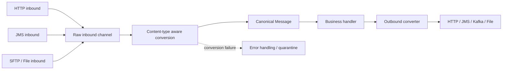
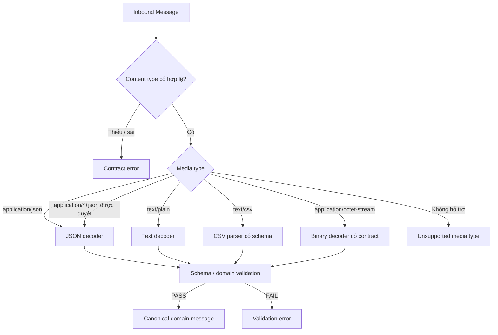

# Message converter dựa trên content type trong Spring Integration

Khi tích hợp nhiều hệ thống, cùng một sự kiện nghiệp vụ có thể đến dưới dạng **JSON từ HTTP**, **chuỗi UTF-8 từ JMS**, **byte[] từ Kafka**, **tệp CSV qua SFTP** hoặc một định dạng riêng của đối tác. Spring Integration giúp nối các hệ thống qua **inbound/outbound adapter**, **gateway**, **poller**, **MessageChannel** và các endpoint xử lý message. Tuy nhiên, việc đưa byte vào một channel **không tự biến byte thành đúng đối tượng nghiệp vụ**.

**Message converter dựa trên content type** là cơ chế lựa chọn cách **giải mã/biểu diễn payload** dựa trên loại nội dung đã khai báo, thường dưới dạng MIME type như `application/json`, `text/plain; charset=UTF-8` hoặc `application/octet-stream`. Thay vì đoán định dạng từ vài ký tự đầu của payload, luồng tích hợp sử dụng một **hợp đồng message** quy định transport, headers, content type, encoding, schema và cách xử lý định dạng không được hỗ trợ.

Trong phạm vi module **Spring Integration Adapters**, kiến thức này liên kết các adapter file, SFTP, HTTP, JMS, AMQP, Kafka và database với một mô hình message thống nhất. Mục tiêu là tách **giao thức vận chuyển** khỏi **kiểu dữ liệu nghiệp vụ**, đồng thời bảo toàn header cần thiết, xử lý lỗi minh bạch và vận hành an toàn trong suốt vòng đời kết nối.

> **Tư tưởng cốt lõi:** Content type là một tín hiệu của **hợp đồng dữ liệu**, không phải bằng chứng rằng payload hợp lệ, đáng tin hoặc đã được kiểm tra schema. Converter phải được cấu hình, chọn đúng chiều chuyển đổi, xác thực định dạng và trả lỗi có thể quan sát; adapter không mặc nhiên chuyển đổi tất cả message theo header này.

## 1. Mục tiêu học tập

Sau bài này, người học có thể:

1. Phân biệt **payload type**, **content type**, **transport encoding** và **schema version**.
2. Giải thích vai trò của `Message<?>`, `MessageHeaders.CONTENT_TYPE` và `MessageConverter` trong hệ sinh thái Spring Messaging/Spring Integration.
3. Thiết kế luồng **inbound → chuẩn hóa payload → MessageChannel → business handler** và luồng outbound ngược lại.
4. Chọn converter phù hợp cho JSON, text, binary hoặc media type riêng mà không phụ thuộc vào phỏng đoán.
5. Hiểu khác biệt giữa **MessageConverter**, **Transformer** và **serializer/deserializer của từng adapter**.
6. Viết ví dụ Java với `@Transformer`, `ObjectMapper`, `MimeType` và `MessageBuilder`.
7. Đặt chính sách khi header bị thiếu, sai cú pháp, mâu thuẫn với payload hoặc chứa charset không hỗ trợ.
8. Bảo toàn thông tin truy vết và tránh sao chép những header transport không nên đi qua các trust boundary.
9. Xử lý lỗi conversion ở luồng đồng bộ, poller và consumer bất đồng bộ theo đúng cơ chế endpoint.
10. Thiết kế kiểm thử hợp đồng, negative cases, giới hạn payload, versioning, monitoring và vận hành.

## 2. Bài toán: nhiều adapter, một mô hình dữ liệu nghiệp vụ

Giả sử hệ thống nhận sự kiện `OrderCreated` từ ba đối tác:

| Nguồn | Transport/adapter | Payload ở biên | Content type khai báo |
| --- | --- | --- | --- |
| Đối tác A | HTTP inbound gateway | JSON bytes hoặc text | `application/json` |
| Đối tác B | JMS inbound adapter | TextMessage | `text/plain; charset=UTF-8` |
| Đối tác C | SFTP inbound file adapter | Nội dung file | `text/csv; charset=UTF-8` |

Nếu mỗi business handler tự kiểm tra kiểu `byte[]`, `String` và tự parse, quy tắc chuyển đổi bị lặp, dễ lệch charset và khó kiểm soát hợp đồng. Một thiết kế tốt **chuẩn hóa tại ranh giới tích hợp**:



Sơ đồ là **mô hình logic**: các adapter thực tế có thể có channel riêng trước điểm chuẩn hóa để kiểm tra bảo mật và áp chính sách khác nhau. Ví dụ, inbound file adapter có thể tạo payload kiểu `File` chứ không phải byte[], JMS adapter có thể chọn chuyển đổi từ `TextMessage` trước khi vào channel. Nhiệm vụ của lớp đầu vào là đưa chúng về hợp đồng thống nhất, không giả định adapter nào cũng tạo byte[].

### 2.1. Ví dụ canonical event

```json
{
  "eventId": "evt-1001",
  "orderId": "ord-42",
  "amountCents": 159900
}
```

Cùng một sự kiện có thể được gửi bằng các biểu diễn khác nhau. **Canonical payload** trong ứng dụng có thể là Java object `OrderCreated`, nhưng biểu diễn wire được quyết định bởi nơi gửi/nhận và content type.

## 3. Spring Integration Message gồm những thành phần nào?

Spring Messaging cung cấp mô hình:

```java
org.springframework.messaging.Message<T>
```

Một message gồm hai phần chính:

- **Payload:** dữ liệu, có thể là `byte[]`, `String`, `File`, DTO, map, record hoặc object chuyên biệt.
- **Headers:** metadata dạng key/value; bao gồm định danh message, timestamp và các header nghiệp vụ, transport hoặc content type theo adapter.

Ví dụ một message biểu diễn dữ liệu JSON thô:

```java
Message<byte[]> message = MessageBuilder
    .withPayload("""
        {"eventId":"evt-1001","orderId":"ord-42","amountCents":159900}
        """.getBytes(StandardCharsets.UTF_8))
    .setHeader(MessageHeaders.CONTENT_TYPE, MimeTypeUtils.APPLICATION_JSON)
    .setHeader("correlationId", "order-flow-82")
    .setHeader("sourceSystem", "partner-a")
    .build();
```

Ở đây `MessageHeaders.CONTENT_TYPE` là tên header chuẩn phía Spring Messaging. **Đừng nhầm** header Spring với HTTP header `Content-Type`, JMS property riêng hoặc Kafka record header: một adapter/gateway cần có cơ chế **ánh xạ hoặc đặt header** cho đúng.

### 3.1. Ba khái niệm cần tách rời

| Khái niệm | Ví dụ | Ý nghĩa |
| --- | --- | --- |
| **Java payload type** | `byte[]`, `String`, `OrderCreated` | Kiểu của đối tượng đang đi trong JVM. |
| **MIME/content type** | `application/json`, `text/plain` | Quy ước biểu diễn dữ liệu, thường do nguồn gửi hoặc adapter cung cấp. |
| **Schema/contract version** | `order-created/v2` | Cấu trúc trường và ngữ nghĩa nghiệp vụ của dữ liệu. |

Một payload có kiểu Java `String` **không có nghĩa** là `text/plain`: nó có thể chứa JSON. Ngược lại, header `application/json` không bảo đảm payload đã được deserialize thành DTO hay JSON thực sự hợp lệ.

## 4. Content type là gì và được đọc như thế nào?

Content type thường là **MIME media type**, gồm loại chính, loại phụ và tham số:

```text
application/json
application/vnd.acme.order-created+json
text/plain; charset=UTF-8
text/csv; charset=UTF-8
application/octet-stream
```

Các thành phần cần hiểu:

- **Type/subtype:** định dạng tổng quát như JSON, văn bản hoặc dữ liệu nhị phân.
- **Suffix có cấu trúc:** `+json` hoặc `+xml` thể hiện họ biểu diễn của vendor-specific media type.
- **Parameters:** charset và những tham số có ý nghĩa theo hợp đồng; không phải mọi tham số đều ảnh hưởng converter.
- **Schema version:** thường cần một quy ước độc lập, ví dụ field version, header version hoặc tên media type được quản lý.

Trong Java/Spring, có thể biểu diễn bằng `org.springframework.util.MimeType` và parse bằng `MimeTypeUtils.parseMimeType(...)`.

```java
MimeType type = MimeTypeUtils.parseMimeType(
    "text/plain; charset=UTF-8"
);

String major = type.getType();        // "text"
String minor = type.getSubtype();     // "plain"
Charset charset = type.getCharset();  // UTF-8
```

Header `MessageHeaders.CONTENT_TYPE` có thể chứa một đối tượng `MimeType` hoặc một giá trị dạng chuỗi tùy nguồn và cách cấu hình adapter. Converter phải xử lý kiểu được cho phép và lỗi parse có kiểm soát, không gọi `toString()` trên dữ liệu tùy ý rồi mặc nhiên tin nó.

### 4.1. Header thiếu không đồng nghĩa text

Nếu inbound message không có content type, một hệ thống có thể:

1. **Từ chối** và trả lỗi hợp đồng, thích hợp với kênh nhiều định dạng.
2. **Gán mặc định theo endpoint** có hợp đồng rõ, ví dụ một folder chỉ nhận file CSV.
3. **Dùng metadata tin cậy của adapter** để suy ra loại nội dung theo cấu hình.
4. **Quarantine** dữ liệu chưa xác định để kiểm tra bằng quy trình riêng.

Không nên tùy tiện đổi mọi payload không có content type thành `text/plain` hoặc `application/json` chỉ vì “thử parse được”.

## 5. MessageConverter khác Transformer như thế nào?

Hai khái niệm có liên quan nhưng **không đồng nhất**.

| Thành phần | Vai trò | Khi nào dùng |
| --- | --- | --- |
| **MessageConverter** (Spring Messaging) | Chuyển giữa `Message<?>` và object Java thông qua `fromMessage`/`toMessage`. | Khi endpoint/adapter hoặc luồng xử lý được cấu hình để dùng converter. |
| **Transformer** (Spring Integration) | Endpoint biến đổi payload hoặc toàn bộ message trong integration flow. | Chuẩn hóa dữ liệu sau inbound, làm sạch headers, chuyển kiểu trước outbound. |
| **Serializer/Deserializer** (Kafka, JMS/AMQP hoặc HTTP codec) | Biểu diễn dữ liệu trên wire theo cơ chế transport/framework tương ứng. | Ở ranh giới broker/protocol, thường cần cấu hình độc lập. |
| **Content-Type Router** | Chọn nhánh xử lý dựa trên media type. | Khi nhiều định dạng đi qua một channel, mỗi nhánh có converter/transformer riêng. |
| **Object-to-JSON / JSON-to-object transformer** | Chuyển đổi theo một định dạng cụ thể. | Khi contract đã xác định là JSON và không cần dispatch động. |
| **Schema validator** | Kiểm tra cấu trúc/quy tắc sau parse. | Sau giải mã hoặc theo luồng kiểm tra trước xử lý nghiệp vụ. |

**Lưu ý quan trọng:** Việc set `contentType=application/json` trong message **không mặc nhiên khiến mọi Spring Integration channel tự gọi Jackson**. Cần cấu hình một converter phù hợp tại endpoint, handler hoặc một transformer/router chủ động dùng nó.

### 5.1. Hai chiều của converter

Giao diện `org.springframework.messaging.converter.MessageConverter` có ý tưởng:

```java
Object fromMessage(Message<?> message, Class<?> targetClass);

Message<?> toMessage(Object payload, MessageHeaders headers);
```

- **Inbound conversion:** bytes/string/message → object Java.
- **Outbound conversion:** object Java → message có payload biểu diễn tương ứng và headers.

Một converter cụ thể có thể trả `null` nếu không hỗ trợ chuyển đổi theo hợp đồng API; luồng gọi cần xử lý trường hợp đó, không coi null là business event hợp lệ.

### 5.2. Converter nhận biết content type đến mức nào?

Khả năng dùng media type phụ thuộc loại converter và cấu hình. Ví dụ một JSON converter có thể chỉ hỗ trợ một số MIME types; một composite converter có thể thử nhiều delegate theo thứ tự. Không nên giả định chỉ thêm hai converter là chúng luôn tự chọn đúng theo `contentType` trong mọi endpoint.

Thiết kế cần quy định **điều kiện chọn converter**, kiểu target và behavior khi không tìm được converter phù hợp. Nếu dùng thư viện sẵn có, hãy kiểm tra media types được hỗ trợ và cách nó kiểm tra headers trong phiên bản Spring thực tế.

## 6. Thiết kế hợp đồng message trước khi viết converter

Một hợp đồng inbound nên mô tả đủ:

| Thành phần | Nội dung phải quy định |
| --- | --- |
| **Nguồn** | Đối tác/hệ thống nào gửi; mức độ tin cậy của metadata. |
| **Transport** | HTTP POST, JMS queue, Kafka topic, file/SFTP path, polling DB... |
| **Wire payload** | byte[], text, file/stream, encoding, compression. |
| **Content type** | Media types và charset được chấp nhận. |
| **Schema** | Loại event, phiên bản schema, trường bắt buộc và quy tắc tương thích. |
| **Target Java type** | DTO/record hoặc một canonical envelope được kiểm soát. |
| **Headers** | Correlation, source, tenant, event ID, format version và các header cần bảo toàn. |
| **Lỗi hợp đồng** | Reject, retry hay quarantine khi MIME/JSON/schema sai. |
| **Hạn mức** | Kích thước tối đa, độ sâu JSON, timeout, bộ nhớ, kiểm tra charset. |
| **An toàn** | Xác thực nguồn, không tin tenant/role chỉ vì chúng có trong message. |

Ví dụ:

```yaml
contract: order-created-inbound
allowedContentTypes:
  - application/json
  - application/vnd.acme.order-created+json
  - text/plain; charset=UTF-8
targetType: OrderCreated
requiredHeaders:
  - sourceSystem
  - correlationId
validation:
  maxBytes: 1048576
  requireEventId: true
  requirePositiveAmount: true
onUnsupportedContentType: REJECT
onMalformedPayload: QUARANTINE
```

Đây là **mô tả hợp đồng minh họa**, không phải cấu hình mà Spring Integration tự hiểu. Để thực thi được cần code, endpoint hoặc cấu hình chuyển đổi phù hợp.

## 7. Quy tắc chọn converter theo content type

Một bộ dispatch đơn giản có thể hoạt động như sau:



### 7.1. Tại sao không dùng fallback “parse thử JSON”?

Khi có nhiều định dạng, cơ chế thử converter lần lượt cho tới khi không lỗi có những nguy cơ:

- Text không có content type nhưng giống JSON có thể bị xử lý sai contract.
- Converter ưu tiên có thể diễn giải payload khác với sender.
- Dữ liệu bị lỗi có thể rơi vào fallback và **được chấp nhận sai**.
- Lỗi format biến thành lỗi nghiệp vụ, làm khó điều tra.
- Payload độc hại có thể kích hoạt parser không dự kiến.

Chỉ nên dùng fallback nếu được thiết kế thành **chính sách tương thích có giới hạn**, có đo lường, không mở rộng âm thầm diện định dạng chấp nhận.

### 7.2. Vendor-specific JSON

Media type như `application/vnd.acme.order-created+json` cho biết payload dùng họ biểu diễn JSON nhưng **không khẳng định schema tương thích** với DTO hiện tại. Khi dùng `+json`, nên kiểm tra **allowlist media type cụ thể hoặc schema version**, thay vì tự chấp nhận mọi `application/*+json` của nguồn bất kỳ.

## 8. Ví dụ Java: Transformer chọn định dạng theo content type

Ví dụ sau minh họa một **inbound transformer** nhận `Message<byte[]>` với hai hợp đồng đã phê duyệt:

- `application/json` chứa event JSON.
- `text/plain; charset=UTF-8` chứa dòng theo format `ORDER|eventId|orderId|amountCents`.

Để tập trung vào chuyển đổi, ví dụ giả định adapter trước đó đã đọc dữ liệu thành `byte[]` và có header `MessageHeaders.CONTENT_TYPE`. Đây là hợp đồng của **channel thô**, không phải giả định chung cho mọi adapter.

### 8.1. DTO canonical

```java
public record OrderCreated(
    String eventId,
    String orderId,
    long amountCents
) {
    public OrderCreated {
        if (eventId == null || eventId.isBlank()
                || orderId == null || orderId.isBlank()
                || amountCents <= 0) {
            throw new IllegalArgumentException("Invalid OrderCreated fields");
        }
    }
}
```

Ví dụ dùng Java record và Jackson có hỗ trợ record (phù hợp các bản Jackson hiện đại). Trong hệ thống dùng cấu hình Jackson khác, cần kiểm thử khả năng deserialize DTO và xử lý trường không biết/thiếu theo chính sách schema.

### 8.2. Code transformer

```java
import com.fasterxml.jackson.core.JsonProcessingException;
import com.fasterxml.jackson.databind.ObjectMapper;
import java.nio.ByteBuffer;
import java.nio.charset.CharacterCodingException;
import java.nio.charset.StandardCharsets;
import java.nio.charset.CodingErrorAction;
import java.util.Locale;
import org.springframework.integration.annotation.Transformer;
import org.springframework.messaging.Message;
import org.springframework.messaging.MessageHeaders;
import org.springframework.messaging.support.MessageBuilder;
import org.springframework.stereotype.Component;
import org.springframework.util.MimeType;
import org.springframework.util.MimeTypeUtils;

@Component
public class OrderContentTypeTransformer {

    private static final int MAX_WIRE_BYTES = 1_048_576;
    private final ObjectMapper objectMapper;

    public OrderContentTypeTransformer(ObjectMapper objectMapper) {
        this.objectMapper = objectMapper;
    }

    @Transformer(
        inputChannel = "rawOrdersChannel",
        outputChannel = "canonicalOrdersChannel"
    )
    public Message<OrderCreated> convert(Message<byte[]> input) {
        byte[] body = input.getPayload();

        if (body.length == 0 || body.length > MAX_WIRE_BYTES) {
            throw new IllegalArgumentException("Invalid payload length");
        }

        MimeType mediaType = readContentType(input.getHeaders());
        OrderCreated event;

        if (isJson(mediaType)) {
            try {
                event = objectMapper.readValue(body, OrderCreated.class);
            } catch (JsonProcessingException ex) {
                throw new IllegalArgumentException(
                    "Malformed JSON order event", ex
                );
            }
        } else if (isPlainText(mediaType)) {
            event = parsePipeDelimitedText(body, mediaType);
        } else {
            throw new IllegalArgumentException(
                "Unsupported content type: " + mediaType
            );
        }

        // Header source từ bên ngoài phải được kiểm soát tại trust boundary.
        // Chỉ giữ metadata đã được xác minh/cho phép ở các adapter trước đó.
        return MessageBuilder.withPayload(event)
            .setHeader("wireContentType", mediaType.toString())
            .setHeader(
                "correlationId",
                input.getHeaders().get("correlationId")
            )
            .setHeader(
                "sourceSystem",
                input.getHeaders().get("sourceSystem")
            )
            .build();
    }

    private static MimeType readContentType(MessageHeaders headers) {
        Object raw = headers.get(MessageHeaders.CONTENT_TYPE);
        if (raw instanceof MimeType mimeType) {
            return mimeType;
        }
        if (raw instanceof String text && !text.isBlank()) {
            return MimeTypeUtils.parseMimeType(text);
        }
        throw new IllegalArgumentException(
            "Missing or invalid contentType header"
        );
    }

    private static boolean isJson(MimeType type) {
        return type.getType().equalsIgnoreCase("application")
            && type.getSubtype().equalsIgnoreCase("json");
    }

    private static boolean isPlainText(MimeType type) {
        return type.getType().equalsIgnoreCase("text")
            && type.getSubtype().equalsIgnoreCase("plain");
    }

    private static OrderCreated parsePipeDelimitedText(
        byte[] body, MimeType mediaType
    ) {
        if (mediaType.getCharset() != null
                && !StandardCharsets.UTF_8.equals(mediaType.getCharset())) {
            throw new IllegalArgumentException("Only UTF-8 is supported");
        }

        final String text;
        try {
            text = StandardCharsets.UTF_8.newDecoder()
                .onMalformedInput(CodingErrorAction.REPORT)
                .onUnmappableCharacter(CodingErrorAction.REPORT)
                .decode(ByteBuffer.wrap(body))
                .toString();
        } catch (CharacterCodingException ex) {
            throw new IllegalArgumentException("Malformed UTF-8 text", ex);
        }

        // Định dạng bài học đơn giản, không phải parser CSV tổng quát.
        String[] parts = text.strip().split("\\|", -1);
        if (parts.length != 4 || !parts[0].equals("ORDER")) {
            throw new IllegalArgumentException("Invalid text order format");
        }
        try {
            return new OrderCreated(
                parts[1], parts[2], Long.parseLong(parts[3])
            );
        } catch (NumberFormatException ex) {
            throw new IllegalArgumentException("Invalid amount", ex);
        }
    }
}
```

**Giới hạn của ví dụ:**

- `sourceSystem` và `correlationId` phải được kiểm tra/chuẩn hóa ở inbound trust boundary; code trên chỉ minh họa việc chuyển metadata sang message canonical. Không chấp nhận `sourceSystem` do client tự khai làm bằng chứng xác thực.
- Trong triển khai thực tế, cần quyết định header nào **bắt buộc**, header nào nên bỏ và có chính sách kiểm soát header size/type.
- Ví dụ cố tình chỉ nhận `application/json` đúng subtype; vendor-specific `+json` phải được thêm vào **allowlist với schema phù hợp**.
- Bộ text parser này dùng delimiter đơn giản, không xử lý escaping hoặc quote như CSV thực tế; với `text/csv` cần dùng parser CSV chuyên dụng cùng schema.
- Cấu hình ObjectMapper, cách xử lý trường chưa biết, giới hạn độ sâu JSON và schema compatibility cần xác định ở tầng contract.
- `@Transformer` cần được phát hiện trong Spring context có cấu hình Spring Integration phù hợp; khai báo channel và endpoint tùy ứng dụng.

### 8.3. Tại sao tạo một Message mới?

Sau khi parse, payload là `OrderCreated` chứ **không còn JSON bytes**. Nếu sao chép nguyên header `contentType=application/json` và để mọi downstream hiểu nó mô tả **payload hiện tại**, dễ gây hiểu nhầm: object Java không phải dữ liệu JSON wire. Ví dụ này lưu `wireContentType` riêng để phục vụ truy vết nguồn và chỉ chuyển các header được chấp thuận.

Một hệ thống có thể chọn giữ header content type nếu các endpoint downstream có quy ước riêng, nhưng phải xác định rõ **nó mô tả biểu diễn hiện tại hay biểu diễn gốc**. Không nên để một header có hai ý nghĩa không phân biệt.

## 9. Cấu hình MessageChannel cho luồng chuẩn hóa

Ví dụ có thể khai báo các channel Spring Integration:

```java
import org.springframework.context.annotation.Bean;
import org.springframework.context.annotation.Configuration;
import org.springframework.integration.channel.DirectChannel;
import org.springframework.messaging.MessageChannel;

@Configuration
public class OrderChannels {

    @Bean
    public MessageChannel rawOrdersChannel() {
        return new DirectChannel();
    }

    @Bean
    public MessageChannel canonicalOrdersChannel() {
        return new DirectChannel();
    }
}
```

`DirectChannel` dispatch handler theo cách đồng bộ trong luồng gọi. Điều này ảnh hưởng đến **cách exception conversion được truyền ngược**. Không được mặc định rằng mọi exception sẽ được gửi vào một global error channel: với flow đồng bộ, exception có thể lan tới caller/gateway.

Một handler nghiệp vụ nhận event đã chuẩn hóa:

```java
import org.springframework.integration.annotation.ServiceActivator;
import org.springframework.messaging.Message;
import org.springframework.stereotype.Component;

@Component
public class OrderBusinessHandler {

    @ServiceActivator(inputChannel = "canonicalOrdersChannel")
    public void handle(Message<OrderCreated> message) {
        OrderCreated event = message.getPayload();

        // Thực thi nghiệp vụ có transaction/idempotency phù hợp.
        // Không cần đọc JSON hoặc phân tích MIME tại đây.
    }
}
```

Ý nghĩa kiến trúc: **business handler không cần biết sự kiện đến từ HTTP, JMS hay SFTP**. Nó nhận một kiểu domain có hợp đồng được kiểm tra. Metadata cần thiết vẫn có thể đi cùng message qua header đã chuẩn hóa.

## 10. Outbound conversion: từ object Java sang định dạng wire

Chiều outbound phải chọn **content type đích** dựa trên hợp đồng của consumer, không chỉ dựa vào kiểu đối tượng nguồn. Nếu đối tác A cần JSON, object có thể được serialize thành UTF-8 JSON và mang header `application/json` ở biên thích hợp.

```java
import com.fasterxml.jackson.core.JsonProcessingException;
import com.fasterxml.jackson.databind.ObjectMapper;
import org.springframework.integration.annotation.Transformer;
import org.springframework.messaging.Message;
import org.springframework.messaging.MessageHeaders;
import org.springframework.messaging.support.MessageBuilder;
import org.springframework.stereotype.Component;
import org.springframework.util.MimeTypeUtils;

@Component
public class OrderJsonOutboundTransformer {

    private final ObjectMapper objectMapper;

    public OrderJsonOutboundTransformer(ObjectMapper objectMapper) {
        this.objectMapper = objectMapper;
    }

    @Transformer(
        inputChannel = "outboundDomainOrdersChannel",
        outputChannel = "outboundWireOrdersChannel"
    )
    public Message<byte[]> encode(Message<OrderCreated> input) {
        try {
            byte[] json = objectMapper.writeValueAsBytes(input.getPayload());

            return MessageBuilder.withPayload(json)
                .setHeader(
                    MessageHeaders.CONTENT_TYPE,
                    MimeTypeUtils.APPLICATION_JSON
                )
                .setHeader(
                    "correlationId",
                    input.getHeaders().get("correlationId")
                )
                .build();
        } catch (JsonProcessingException ex) {
            throw new IllegalArgumentException(
                "Cannot serialize OrderCreated as JSON", ex
            );
        }
    }
}
```

**Các lưu ý:**

- Không nên sao chép tùy tiện header từ inbound sang outbound; chúng có thể chứa metadata của transport cũ hoặc thông tin không được phép tiết lộ cho đối tác.
- Khi outbound là HTTP, adapter/gateway phải **ánh xạ content type sang HTTP response/request header** theo cấu hình; set header trong message nội bộ không bảo đảm mọi transport tự xuất nó.
- Khi outbound là Kafka, value serializer và Kafka headers phải được cấu hình phù hợp; set `contentType` trong Spring Message không tự biến serializer thành Jackson.
- Khi outbound là file, kết quả có thể cần chuyển byte[] thành File/Resource hay stream và quyết định tên/đường dẫn; content type không thay thế file writer.

## 11. MessageConverter có sẵn trong Spring Messaging

Một số converter có thể gặp trong ứng dụng Spring:

| Thành phần | Ý tưởng | Điểm cần kiểm tra |
| --- | --- | --- |
| `StringMessageConverter` | Chuyển biểu diễn văn bản và String. | Charset, supported media types, target class. |
| `ByteArrayMessageConverter` | Xử lý byte[] làm payload. | Không có nghĩa biết tự parse JSON hoặc CSV. |
| `MappingJackson2MessageConverter` | Dùng Jackson cho JSON ↔ object. | Supported media types, ObjectMapper, target class, schema. |
| `CompositeMessageConverter` | Kết hợp danh sách converter. | Thứ tự delegate và hành vi khi converter không hỗ trợ. |
| Converter riêng của ứng dụng | Xử lý định dạng đặc thù. | Contract, validation, bảo mật, test. |

Tên class và package trên thuộc **Spring Messaging**, còn các endpoint/adapter Spring Integration có thể dùng converter của riêng giao thức. Không nên cắm một converter ở một tầng rồi kỳ vọng mọi layer tự động dùng nó.

### 11.1. Vì sao target Java type vẫn quan trọng?

Chỉ biết `application/json` không cho biết cần map vào `OrderCreated`, `CustomerUpdated` hay một danh sách DTO. Converter có thể cần **targetClass** hoặc routing theo event type/schema trước khi deserialize.

Một cách quản lý:

```text
Content-Type: application/json
Event-Type: order.created
Schema-Version: 2
Destination: orders.inbound

=> Chọn target DTO OrderCreatedV2 theo allowlist.
=> Deserialize.
=> Validate.
=> Convert về canonical domain model.
```

Không nên đọc tên class từ header ngoài rồi gọi load class tùy ý để deserialize, vì có thể tạo vấn đề an ninh và phá hợp đồng.

## 12. Xử lý content type theo từng loại adapter

### 12.1. HTTP inbound/outbound gateway

HTTP có header chuẩn `Content-Type` và có thể có `Accept`. Ý nghĩa:

- `Content-Type`: biểu diễn của **request/response body** hiện có.
- `Accept`: các biểu diễn response mà client sẵn sàng nhận, không phải định dạng body request.
- `415 Unsupported Media Type`: hướng phản hồi thường phù hợp khi server không hỗ trợ định dạng request.
- `400 Bad Request`: thường dùng cho payload sai cú pháp hoặc không đạt hợp đồng.
- `406 Not Acceptable`: có thể dùng khi không thể cung cấp response phù hợp `Accept`.

Trong Spring Integration HTTP, gateway/adapter có thể có cơ chế chuyển đổi body/header ở tầng HTTP riêng. Phải kiểm tra **converter nào thực sự được cấu hình** và thời điểm nó chạy so với integration transformer; nếu HTTP layer đã deserialize JSON thành object thì không nên ép transformer byte[] parse lần hai.

### 12.2. JMS

JMS có các message type như `TextMessage` và `BytesMessage`, kèm properties và headers của JMS. Không mặc định rằng JMS client cung cấp một content-type chuẩn giống HTTP.

Có thể quy định riêng một message property như `contentType=application/json` hoặc cấu hình JMS message converter theo hợp đồng. Cần làm rõ:

- Kiểu JMS message nào đang được sản xuất?
- Thông tin content type được lưu vào property nào?
- Cơ chế mapping từ JMS tới Spring Message có giữ property đó không?
- Có trường hợp sender đổi TextMessage sang BytesMessage nhưng không đổi converter không?
- Conversion lỗi có tác động gì tới transaction/acknowledgement và redelivery?

### 12.3. AMQP/RabbitMQ

AMQP message properties có thể mang content type và content encoding; thư viện Spring AMQP còn có các message converter riêng. Cần phân biệt **AMQP wire message converter** với **Spring Messaging MessageConverter** của flow.

Nếu listener đã chuyển JSON thành POJO, downstream có thể chỉ cần validate và chuẩn hóa. Nếu listener giữ `byte[]`, có thể route ở Spring Integration. Phải xác định rõ một nơi sở hữu việc giải mã.

### 12.4. Kafka

Kafka record chứa key, value và headers ở mức record; **serializer/deserializer** cấu hình tại producer/consumer quyết định kiểu value trong client.

Ví dụ:

- `ByteArrayDeserializer` tạo byte[]; sau đó converter theo content type có thể xử lý.
- `StringDeserializer` tạo String; nếu payload JSON, nó vẫn là chuỗi JSON cho tới khi được deserialize.
- JSON serializer/deserializer riêng có thể tạo object ngay ở tầng Kafka.
- Header tự đặt `contentType` có thể giúp chọn cách xử lý **nếu** logic consumer đọc và kiểm tra nó.

Một header `contentType=application/json` **không tự khiến Kafka client đổi value deserializer**. Ngoài ra, Spring Kafka có thể dùng các header type metadata riêng tùy converter; không nên coi chúng là schema contract tin cậy của mọi producer.

### 12.5. File và SFTP

Một inbound file adapter thường liên quan payload `File` hoặc metadata về file/remote file. Tên file `orders.csv` chỉ là **gợi ý định dạng**, không phải bằng chứng MIME đáng tin.

Thiết kế tốt:

1. Chỉ định folder/remote path và đối tác nguồn.
2. Quy định format trong **partner contract** hoặc mapping theo route.
3. Đọc file theo cơ chế có kiểm soát thành byte[]/stream nếu cần.
4. Giới hạn dung lượng và tránh đọc file khổng lồ vào heap.
5. Gắn content type theo hợp đồng được kiểm chứng, không dựa một cách mù quáng vào đuôi file.
6. Chuyển đổi, validate và đưa vào channel canonical.
7. Quản lý rename/archive/quarantine và không đọc lại file lỗi vô hạn.

SFTP chuyển tệp, không tự bảo đảm nội dung tệp là JSON, CSV hay XML. MIME dispatch vẫn là trách nhiệm của lớp tích hợp.

### 12.6. JDBC/database adapter

JDBC inbound adapter hoặc polling có thể tạo row map, list hoặc đối tượng đã được row mapper xử lý. Khái niệm content type thường **ít trực tiếp hơn** so với HTTP vì dữ liệu đã ở dạng cột có kiểu.

Chỉ cần MIME-based converter khi một cột chứa blob/text với nhiều định dạng, hoặc khi chuyển row thành message wire cho hệ đích. Khi đó phải có contract xác định cột nào mang `payload`, cột nào mang `content_type` và schema/version.

## 13. Inbound adapter, outbound adapter và gateway: converter đặt ở đâu?

| Mẫu tích hợp | Hướng dữ liệu | Vị trí chuyển đổi thường phù hợp |
| --- | --- | --- |
| **Inbound channel adapter** | External → MessageChannel | Ở adapter nếu adapter hỗ trợ converter, hoặc transformer ngay sau inbound. |
| **Outbound channel adapter** | MessageChannel → External | Transformer encode trước adapter, hoặc converter do outbound adapter cấu hình. |
| **Inbound gateway** | External request → flow → external response | Cần cân nhắc cả request decoder và response encoder. |
| **Outbound gateway** | Flow → external request/response → flow | Encode request và decode response theo hợp đồng từng chiều. |
| **Poller** | Định kỳ lấy dữ liệu từ file/DB/queue | Chuẩn hóa sau poll, xác định retry và xử lý bản ghi lỗi. |
| **MessageChannel** | Chuyển Message giữa endpoint | Không tự hiểu MIME hay parse body nếu không cấu hình endpoint xử lý. |

### 13.1. Vì sao gateway phức tạp hơn adapter một chiều?

Gateway có **hai chiều chuyển đổi**. Ví dụ một outbound HTTP gateway gửi JSON và nhận XML lỗi. Nếu chỉ cấu hình JSON decoder cho response, hệ thống có thể báo lỗi parse thay vì giữ đúng trạng thái HTTP và message lỗi. Contract nên nêu riêng:

- Request content type và encoder.
- Response expected content types, status handling và decoder.
- Error body format và giới hạn kích thước.
- Timeout, correlation, retry và idempotency của thao tác bên ngoài.

## 14. Content type và charset

Với `text/plain` và `text/csv`, charset là phần thiết yếu. Nếu bên gửi dùng UTF-8 nhưng bên nhận dùng encoding mặc định của JVM hoặc hệ điều hành, ký tự tiếng Việt có thể bị lỗi.

Ví dụ sai:

```java
// Không nên phụ thuộc charset mặc định.
String text = new String(body);
```

Ví dụ có chủ đích:

```java
String text = new String(body, StandardCharsets.UTF_8);
```

Cách thứ hai quy định UTF-8 nhưng việc tạo String vẫn có thể thay ký tự lỗi bằng replacement character trong một số trường hợp. Khi cần từ chối dữ liệu sai, nên dùng `CharsetDecoder` với `CodingErrorAction.REPORT` như ví dụ transformer.

### 14.1. Quy tắc chọn charset

- Nếu contract quy định UTF-8 cố định, có thể từ chối charset khác được khai báo.
- Nếu contract hỗ trợ nhiều charset, cần allowlist và parse parameter đúng cách.
- Nếu charset vắng mặt, dùng mặc định **được ghi rõ trong contract**, không dựa vào môi trường.
- Kiểm thử BOM, ký tự đa byte, xuống dòng, nội dung rỗng và dữ liệu không hợp lệ.
- Không coi content type và `Content-Encoding: gzip` là một: compression là một tầng biểu diễn khác cần xử lý trước/sau theo đúng thứ tự.

### 14.2. Binary content

`application/octet-stream` không có nghĩa payload có thể map trực tiếp thành object domain. Cần biết binary schema (ví dụ protobuf/Avro với schema registry hoặc contract riêng), phiên bản và cách lấy schema ID. Tránh dùng serialization Java không tin cậy từ bên ngoài làm một đường parse tùy tiện.

## 15. Header mapping và ranh giới tin cậy

Message headers có thể mang thông tin giúp xử lý và truy vết, nhưng không phải header nào cũng được phép đi xuyên suốt luồng.

### 15.1. Các header thường có ích

- `correlationId` / `traceId`: nối request và sự kiện.
- `sourceSystem`: hệ thống gửi đã được xác minh ở adapter.
- `eventType` / `schemaVersion`: chọn DTO hoặc validate hợp đồng.
- `contentType` / `wireContentType`: biểu diễn wire của message.
- `tenantId`: nếu do nguồn có thẩm quyền xác nhận và ràng buộc với quyền nguồn.
- `originalFilename`: metadata phục vụ truy vết file, cần lọc/sanitize.
- `receivedAt`: thời điểm hệ thống nhận.

### 15.2. Header không đáng tin

Không được mặc nhiên tin các header do client/producer tự đặt như:

```text
role=ADMIN
tenantId=TENANT-A
deviceTrusted=true
validated=true
internalSource=true
```

Converter chịu trách nhiệm **hiểu payload format**, không có quyền xác thực một claim về role/tenant chỉ vì nó nằm trong message. Cần xác minh transport identity, producer credentials, tenancy và policies ở ranh giới trước khi sử dụng metadata này.

### 15.3. Không copy toàn bộ header vô điều kiện

Một header có thể liên quan chỉ tới inbound JMS, HTTP hoặc Kafka và không nên xuất ra ngoài. Khi đưa message tới hệ thống khác, xác định:

1. Những header nào cần cho xử lý tiếp.
2. Header nào đã được xác thực/chuẩn hóa.
3. Header nào thuộc transport cũ hoặc chứa dữ liệu nhạy cảm.
4. Có mâu thuẫn giữa `contentType` gốc và payload sau transform không.
5. Header nào phải được tái tạo bởi adapter outbound.

Một phép copy toàn bộ `MessageHeaders` có thể gây nhầm lẫn hoặc lộ metadata xuyên biên tin cậy.

## 16. Schema version và content type không phải một

Hai event cùng là JSON nhưng có thể có schema khác:

```json
{
  "eventId": "evt-1001",
  "orderId": "ord-42",
  "amountCents": 159900
}
```

Version mới có thể bổ sung:

```json
{
  "eventId": "evt-1001",
  "orderId": "ord-42",
  "amount": {
    "value": "1599.00",
    "currency": "VND"
  }
}
```

Cả hai có thể mang `Content-Type: application/json`. Converter JSON chỉ xác định **cú pháp biểu diễn**; ứng dụng vẫn cần quyết định schema nào hợp lệ.

### 16.1. Các cách quản lý version

- Header `schemaVersion` hoặc `eventType` đã được quy định.
- Field `version` nằm trong envelope của message.
- Vendor-specific media type, chẳng hạn `application/vnd.acme.order.v2+json`, có quản trị allowlist.
- Schema registry/ID với định dạng có hỗ trợ.

Cần tránh sử dụng một chuỗi version không được xác minh để tùy ý nạp class/serializer. Mapping **event type + version → parser/schema** nên tường minh, có allowlist và kiểm thử compatibility.

### 16.2. Tương thích tiến và lùi

Một luồng có thể cần chấp nhận payload v1/v2 trong thời gian migration. Hãy quy định:

1. Producer và consumer nào dùng version nào.
2. Trường nào bắt buộc, trường nào có default hợp lệ.
3. Khi nào một version bị loại bỏ.
4. Có được bỏ qua unknown fields hay phải fail theo hợp đồng.
5. Cách monitor tỷ lệ version cũ và chặn downgrade không được phép.

**Content type hợp lệ không đồng nghĩa schema hợp lệ**, và schema hợp lệ chưa chứng minh được dữ liệu nghiệp vụ đúng.

## 17. Error handling: phân loại lỗi trước khi retry

Lỗi conversion có nhiều nguyên nhân và không phải lỗi nào retry cũng có ích.

| Lỗi | Ví dụ | Hướng xử lý thường hợp lý |
| --- | --- | --- |
| **Missing content type** | Producer quên header. | Reject hoặc gán default đã phê duyệt theo endpoint. |
| **Unsupported content type** | `application/x-java-serialized-object` ngoài allowlist. | Reject/quarantine; không thử deserialize tùy tiện. |
| **Malformed MIME** | Chuỗi MIME sai cú pháp. | Lỗi hợp đồng, cảnh báo producer. |
| **Malformed charset** | Bytes không hợp UTF-8. | Reject/quarantine; không lặng lẽ thay ký tự. |
| **Malformed JSON/CSV** | Sai cấu trúc, quote hoặc dấu phân cách. | Lỗi dữ liệu; không retry vô hạn. |
| **Schema validation failed** | Thiếu `eventId` hoặc amount âm. | Báo lỗi nghiệp vụ/schema. |
| **Temporary downstream error** | DB/HTTP target timeout. | Có thể retry với backoff và idempotency. |
| **Converter infrastructure error** | Schema registry tạm không khả dụng. | Retry có giới hạn và circuit breaker phù hợp. |
| **Payload too large** | Dữ liệu vượt giới hạn. | Từ chối hoặc hướng cơ chế streaming được thiết kế. |

### 17.1. Exception đi đâu phụ thuộc kiểu flow

- **DirectChannel / sync gateway:** exception từ transformer có thể lan ngược tới thread caller và được gateway/controller chuyển thành response lỗi.
- **Poller / consumer bất đồng bộ:** error có thể được đưa qua cơ chế error handling/error channel khi được cấu hình hoặc framework hỗ trợ theo endpoint.
- **Kafka/JMS/AMQP consumer:** retry, ack/commit, DLQ/DLT và transaction thuộc cơ chế adapter/listener tương ứng; phải kiểm tra thực tế trước khi coi lỗi được xử lý an toàn.

Đừng mặc định rằng chỉ khai báo `errorChannel` toàn cục là mọi lỗi trong mọi lời gọi trực tiếp sẽ tự xuất hiện ở đó.

### 17.2. Poison message và quarantine

Một message không bao giờ parse được có thể khiến consumer nhận đi nhận lại nếu bị retry vô hạn. Giải pháp gồm:

1. Phân loại lỗi **không thể khắc phục bằng retry**.
2. Ghi metadata đã giảm nhạy cảm: source, event ID, content type, reason code, correlation.
3. Đưa payload vào quarantine/DLQ an toàn theo chính sách lưu giữ.
4. Cung cấp quy trình kiểm tra/sửa/cho phép replay có phê duyệt.
5. Chống xử lý trùng khi replay.

Không đưa toàn bộ payload nhạy cảm hoặc secret vào log để chẩn đoán dễ hơn.

## 18. Kiểm thử converter theo hợp đồng

Nên kiểm thử converter như một đơn vị xử lý rõ input/output, sau đó kiểm thử adapter thực tế để bảo đảm header không bị mất hoặc thay đổi trên đường đi.

### 18.1. Ma trận kiểm thử tối thiểu

| Trường hợp | Input | Kết quả mong đợi |
| --- | --- | --- |
| JSON hợp lệ | `application/json`, đúng schema | `OrderCreated` đúng giá trị. |
| Text hợp lệ | `text/plain; charset=UTF-8`, contract đúng | `OrderCreated` đúng giá trị. |
| Vendor JSON không hỗ trợ | `application/vnd.other+json` | Từ chối đúng chính sách. |
| Thiếu MIME | Không có `contentType` | Lỗi hợp đồng hoặc default endpoint rõ ràng. |
| MIME sai | Header không parse được | Lỗi có reason code, không lặp retry vô hạn. |
| MIME mâu thuẫn | Khai JSON nhưng gửi plain text | Lỗi decode, không fallback âm thầm. |
| Sai UTF-8 | Text có byte lỗi | Từ chối nếu strict decoder. |
| Thiếu trường | JSON không có eventId | Validation failure. |
| Giá trị không hợp lệ | `amountCents <= 0` | Validation failure. |
| Payload quá lớn | Vượt giới hạn | Từ chối trước khi parse. |
| Header cần thiết | Correlation/source hợp lệ | Bảo toàn ở canonical message. |
| Header nguy hiểm | `role=ADMIN` do client khai | Không tạo quyền hoặc truyền claim như dữ liệu tin cậy. |
| Adapter không trả byte[] | File object/String payload | Có normalization trước converter. |
| JSON outbound | DTO → byte[] | Payload parse được và content type phù hợp. |

### 18.2. Unit test minh họa

```java
import static org.junit.jupiter.api.Assertions.*;

import com.fasterxml.jackson.databind.ObjectMapper;
import java.nio.charset.StandardCharsets;
import org.junit.jupiter.api.Test;
import org.springframework.messaging.Message;
import org.springframework.messaging.MessageHeaders;
import org.springframework.messaging.support.MessageBuilder;
import org.springframework.util.MimeTypeUtils;

class OrderContentTypeTransformerTest {

    private final OrderContentTypeTransformer transformer =
        new OrderContentTypeTransformer(new ObjectMapper());

    @Test
    void convertsJsonByContentType() {
        byte[] body = """
            {"eventId":"evt-1","orderId":"ord-7","amountCents":1200}
            """.getBytes(StandardCharsets.UTF_8);

        Message<byte[]> message = MessageBuilder.withPayload(body)
            .setHeader(MessageHeaders.CONTENT_TYPE, MimeTypeUtils.APPLICATION_JSON)
            .setHeader("correlationId", "trace-1")
            .setHeader("sourceSystem", "test-producer")
            .build();

        OrderCreated result = transformer.convert(message).getPayload();

        assertEquals("evt-1", result.eventId());
        assertEquals("ord-7", result.orderId());
        assertEquals(1200L, result.amountCents());
    }

    @Test
    void rejectsUnsupportedMediaType() {
        Message<byte[]> message = MessageBuilder
            .withPayload(new byte[] {1, 2, 3})
            .setHeader(
                MessageHeaders.CONTENT_TYPE,
                MimeTypeUtils.APPLICATION_OCTET_STREAM
            )
            .build();

        assertThrows(
            IllegalArgumentException.class,
            () -> transformer.convert(message)
        );
    }
}
```

Ví dụ JUnit 5 để minh họa logic converter; ở bước viết bài chưa chạy build/test. Với ứng dụng thực tế nên bổ sung test charset sai, content type chuỗi, JSON thiếu trường, size limit, wrong source, error channel và integration test từng adapter.

### 18.3. Kiểm thử End-to-End

Một bài test E2E nên chạy đường thật:

```text
Producer HTTP/JMS/Kafka/SFTP
   -> adapter/gateway
   -> raw channel + headers
   -> converter/transformer
   -> canonical channel
   -> handler
   -> outbound serialization
   -> target
```

Kiểm tra cả message bị từ chối: ack/commit, retry/DLQ, trạng thái file khi lỗi, correlation và liệu payload sai có vô tình được xử lý lại hay không.

## 19. Performance, memory và backpressure

Content-type conversion có thể là điểm nghẽn khi lưu lượng lớn hoặc dữ liệu lớn.

### 19.1. Các nguồn chi phí

- Parse JSON/XML/CSV tốn CPU, allocations và object creation.
- Chuyển byte[] → String → DTO hai lần có thể làm tăng copy và GC.
- File lớn bị đọc toàn bộ vào heap gây memory spike.
- Một channel đồng bộ có thể làm producer chậm theo thời gian parse.
- Poller đọc nhanh hơn handler xử lý khiến backlog tăng.
- Schema lookup từ hệ thống ngoài có thể tăng latency hoặc thất bại.

### 19.2. Biện pháp thiết kế

- Quy định **max payload bytes** và giới hạn parser (độ sâu, độ dài chuỗi, số phần tử).
- Ưu tiên parse trực tiếp từ byte[]/InputStream khi parser hỗ trợ.
- Dùng streaming với file lớn theo hợp đồng phù hợp.
- Chọn concurrency, queue capacity và poller batch size dựa trên khả năng downstream.
- Tách luồng nặng với luồng cần độ trễ thấp; quản lý ordering khi cần.
- Không cache thông tin schema/format vô hạn nếu contract có version.
- Theo dõi latency và lỗi theo content type/producer, tránh chỉ đo tổng chung.

**Lưu ý:** Đổi sang `QueueChannel` hoặc executor không tự giải quyết bài toán tăng tải; phải thiết kế backpressure, retry và khả năng lưu bền của message khi hệ thống ngừng.

## 20. Bảo mật dữ liệu khi deserialize

Parser hoạt động trên dữ liệu do hệ thống ngoài cung cấp, vì vậy conversion cũng là **ranh giới xử lý dữ liệu không tin cậy**.

### 20.1. Nguy cơ cần kiểm soát

- **Deserialization không an toàn:** nạp class tùy ý theo dữ liệu đầu vào hoặc cho phép polymorphic type quá rộng.
- **XML External Entities (XXE):** parser XML không được cấu hình an toàn có thể đọc tài nguyên ngoài trong một số môi trường.
- **Resource exhaustion:** payload quá lớn, JSON lồng sâu, chuỗi dài hoặc tệp nén giải phóng nhiều dung lượng.
- **Charset confusion:** khác cách hiểu text dẫn tới kiểm tra lệch hoặc dữ liệu sai.
- **Header spoofing:** producer tự gửi `sourceSystem=trusted`, `tenant=admin` hoặc role.
- **Schema confusion:** media type giống nhưng ý nghĩa trường khác giữa đối tác.
- **Logging secrets:** ghi body/headers nhạy cảm vào log khi parse lỗi.

### 20.2. Hướng phòng ngừa

1. Dùng allowlist media type và target DTO cố định được quản trị.
2. Không bật Jackson default typing tùy tiện với dữ liệu ngoài.
3. Cấu hình giới hạn parser và size trước khi deserialize.
4. Với XML, dùng parser cấu hình chống external entity và các tính năng nguy hiểm.
5. Xác thực producer ở tầng transport; phân biệt claims đã xác minh với metadata tự khai.
6. Validate schema và quy tắc nghiệp vụ sau parse.
7. Bảo vệ quarantine store, hạn lưu và truy cập log.
8. Chọn retry theo loại lỗi; không để poison message chiếm hết consumer.

## 21. Quan sát, audit và truy vết conversion

Mỗi lần conversion quan trọng nên có metadata giúp trả lời:

- Message đến từ adapter và producer nào?
- Content type được khai báo và đã được chuẩn hóa như thế nào?
- Target DTO/schema nào được lựa chọn?
- Conversion thành công, từ chối vì MIME hay lỗi schema?
- Độ lớn payload và độ trễ parse là bao nhiêu?
- Correlation ID, event ID, trace ID và thời điểm nhận?
- Message có được retry/quarantine không, ai chịu trách nhiệm xử lý?

### 21.1. Ví dụ log an toàn

```json
{
  "event": "CONTENT_TYPE_CONVERSION",
  "correlationId": "order-flow-82",
  "sourceSystem": "partner-a",
  "adapter": "http-inbound",
  "declaredContentType": "application/json",
  "targetType": "OrderCreated",
  "schemaVersion": "v1",
  "payloadBytes": 74,
  "decision": "REJECTED",
  "reasonCode": "MALFORMED_JSON",
  "durationMs": 3
}
```

Số liệu chỉ minh họa, không phải kết quả đo. Không log toàn payload, token hoặc body lỗi chưa được kiểm soát. Trace và log cần liên kết được với request/record bên ngoài nhưng không rò rỉ metadata nhạy cảm.

### 21.2. Chỉ số vận hành

| Chỉ số | Ý nghĩa |
| --- | --- |
| `conversion_success_total{contentType,source}` | Số message parse thành công theo nguồn và media type. |
| `conversion_failure_total{reason,source}` | Tách unsupported MIME, malformed payload, schema failure, infrastructure error. |
| `conversion_duration_seconds` | Theo dõi latency parse, percentile và spike. |
| `inbound_payload_bytes` | Quan sát size distribution và vượt giới hạn. |
| `quarantine_pending_messages` | Số message cần xử lý thủ công hoặc replay. |
| `retry_attempts_total` | Phát hiện retry storm và poison message. |
| `message_contract_version_usage` | Theo dõi version cũ trước khi ngừng hỗ trợ. |
| `header_mapping_error_total` | Phát hiện mất/ghi sai header khi qua adapter. |

Tránh gắn payload/subject ID có số lượng giá trị gần như vô hạn làm label metrics, vì tăng cardinality. Có thể dùng correlation ID trong log/trace thay vì metrics label.

## 22. Thay đổi content type và migration contract

Đôi khi một producer chuyển từ CSV sang JSON hoặc từ JSON v1 sang v2. Không nên đổi parser trong luồng production ngay mà không quản trị tương thích.

Một kế hoạch có thể gồm:

1. Công bố media type/version mới và ví dụ payload hợp lệ.
2. Cho consumer hỗ trợ song song định dạng cũ/mới trong khoảng chuyển tiếp được phê duyệt.
3. Kiểm thử header mapping qua adapter thật, không chỉ unit test Jackson.
4. Thêm validator và kiểm tra nghiệp vụ cho định dạng mới.
5. Theo dõi mức sử dụng của format cũ theo từng producer.
6. Thông báo deadline loại bỏ định dạng cũ.
7. Từ chối định dạng cũ theo chính sách và giữ thông điệp lỗi có thể hỗ trợ.
8. Rà soát replay/DLQ: message cũ có thể quay lại sau khi converter cũ bị gỡ.

### 22.1. Versioned content type

Ví dụ:

```text
application/vnd.acme.order-created.v1+json
application/vnd.acme.order-created.v2+json
```

Nếu chấp nhận hai phiên bản, nên map tường minh:

```text
v1 -> OrderCreatedV1 -> canonical OrderCreated
v2 -> OrderCreatedV2 -> canonical OrderCreated
other -> UNSUPPORTED_MEDIA_TYPE
```

Sự khác biệt version **không nhất thiết chỉ là thêm trường**. Việc đổi đơn vị tiền, precision, timezone hoặc ý nghĩa event phải được xử lý như thay đổi ngữ nghĩa, không thể chỉ dựa vào JSON parser.

## 23. Các anti-pattern thường gặp

| Anti-pattern | Hậu quả | Giải pháp |
| --- | --- | --- |
| Thấy `contentType=application/json` là tin payload đã thành DTO | ClassCastException hoặc double deserialize. | Kiểm tra payload Java type và vị trí converter thực tế. |
| Mọi lỗi đều fallback sang String | Payload lỗi bị chấp nhận sai và che mất lỗi hợp đồng. | Reject/quarantine theo MIME và schema. |
| Dựa vào đuôi `.json`/`.csv` làm bằng chứng duy nhất | Tệp có thể chứa nội dung khác. | Partner contract, validate payload, giới hạn nguồn. |
| Đọc mọi tệp SFTP vào heap | OutOfMemoryError khi file lớn. | Size limit, streaming và backpressure. |
| Không xét charset | Lỗi tiếng Việt và sai dữ liệu nghiệp vụ. | Charset trong contract, strict UTF-8/allowlist. |
| Copy toàn bộ headers từ inbound ra outbound | Rò rỉ metadata hoặc transport headers sai. | Allowlists và map lại headers ở trust boundary. |
| Tin `tenantId` hoặc `role` từ message | Truy cập sai tenant/quyền. | Xác thực nguồn và authorization độc lập với converter. |
| Chọn Java class theo header do client tự khai | Deserialization không an toàn. | Mapping target type cố định và allowlist. |
| Bật Jackson polymorphic typing không kiểm soát | Mở rộng bề mặt deserialize. | Cấu hình ObjectMapper an toàn, DTO cụ thể. |
| Dùng `contentType` để thay schema version | JSON hợp lệ nhưng sai semantics. | Schema/version contract rõ. |
| Cho retry vô hạn malformed JSON | Poison message gây tắc consumer. | Phân loại permanent failure và DLQ. |
| Cho rằng global errorChannel nhận mọi lỗi sync | Lỗi không được xử lý như mong đợi. | Test theo endpoint và transport semantics. |
| Coi Kafka header thay thế serializer | Consumer nhận sai payload type. | Cấu hình serializer/deserializer độc lập. |
| Đặt MIME nội bộ sau khi đã đổi payload thành object nhưng vẫn coi là wire | Downstream parse lại object hoặc encode sai. | Lưu `wireContentType` và quy định contentType hiện hành. |
| Không test từ adapter thực | Unit test pass nhưng header bị mất khi qua transport. | E2E test, negative cases và observability. |

## 24. Tình huống thực hành

### Tình huống A – Kafka JSON có header nhưng consumer nhận byte[]

Producer ghi Kafka value bằng byte[] JSON và đặt header `contentType=application/json`. Consumer dùng `ByteArrayDeserializer` nên handler nhận byte[]; developer cho rằng Kafka sẽ tự map thành `OrderCreated`.

**Câu hỏi:** Nhận định sai ở đâu? Cần bổ sung gì?

**Gợi ý:** Kafka deserializer quyết định kiểu value. Header chỉ là metadata; phải dùng deserializer có hợp đồng phù hợp hoặc áp transformer/converter sau inbound, rồi validate schema. Kiểm tra header mapping từ Kafka sang Spring Message.

### Tình huống B – HTTP content type bị bỏ qua

HTTP gateway nhận body JSON nhưng không có `Content-Type`. Một handler dùng `new String(body)`, tự tìm dấu ngoặc `{` và parse JSON. Người gọi có thể gửi text bất kỳ khiến hệ thống thử parser sai.

**Câu hỏi:** Nên thay đổi thế nào?

**Gợi ý:** Đặt allowlist MIME/contract tại gateway; thiếu header phải từ chối hoặc dùng default đã xác định theo endpoint. Không sniff tùy tiện; phân biệt lỗi 415/400 theo trường hợp.

### Tình huống C – SFTP file lớn có extension CSV

Một file `orders.csv` 4 GB được tải từ SFTP rồi converter thực hiện `Files.readAllBytes` trước khi parse.

**Câu hỏi:** Những rủi ro gì và phương án nào hợp lý?

**Gợi ý:** Memory spike, GC, OOM, việc retry file có thể tốn chi phí. Cần hợp đồng size, streaming/parser theo lô, lifecycle file, checkpoint/idempotency và quarantine khi schema sai.

### Tình huống D – Mất charset và sai tiếng Việt

JMS producer gửi text UTF-8 chứa tên `“Đặng”`; consumer dùng charset mặc định của môi trường và lưu thành ký tự sai.

**Câu hỏi:** Đây là lỗi ở tầng nào? Làm sao kiểm tra?

**Gợi ý:** Encoding/charset contract và quá trình giải mã. Ghi rõ UTF-8, chọn parser phù hợp, test Unicode và invalid bytes; không dựa vào default charset của JVM.

### Tình huống E – JSON hợp lệ nhưng schema khác

Producer gửi `application/json` với `amount` là số tiền đơn vị VND; consumer v1 kỳ vọng `amountCents`. Jackson parse thành công một phần nhưng tổng tiền sai.

**Câu hỏi:** Vì sao MIME validation không đủ?

**Gợi ý:** Content type chỉ xác định biểu diễn. Cần schema version, DTO và validation; không gán default nguy hiểm cho trường thiếu rồi coi payload hợp lệ.

### Tình huống F – Lỗi converter và retry vô hạn

Một message có `text/csv` nhưng thiếu một cột luôn parse lỗi. JMS consumer rollback rồi nhận lại liên tục, làm queue đình trệ.

**Câu hỏi:** Chính sách error handling nên là gì?

**Gợi ý:** Phân loại schema/format failure là lỗi không khắc phục bằng retry, giới hạn retry, chuyển tới DLQ/quarantine bảo vệ dữ liệu, ack/transaction theo adapter và hỗ trợ replay có kiểm soát.

### Tình huống G – Outbound giữ header sai

Sau khi parse message JSON thành `OrderCreated`, service copy toàn bộ headers, bao gồm `Content-Type: application/json`, sang message Java object. Một handler sau đó tin rằng payload vẫn là byte[] JSON và cast thất bại.

**Câu hỏi:** Làm sao thiết kế ranh giới message?

**Gợi ý:** Phân biệt content type wire ban đầu và kiểu payload hiện hành. Chỉ chuyển headers cần thiết, có thể giữ `wireContentType` riêng, và đặt content type mới khi encode outbound.

### Tình huống H – Quyền được khai trong metadata

Một client gửi payload hợp lệ cùng header `role=ADMIN`, `tenantId=TENANT-B`. Converter chuyển cả headers xuống domain handler; handler dùng chúng để chọn database.

**Câu hỏi:** Lỗ hổng ở đâu?

**Gợi ý:** Header do client khai không đáng tin. Cần xác thực producer, ánh xạ tenant theo nguồn có thẩm quyền, kiểm tra authorization độc lập; converter không nên nâng metadata thành quyền.

## 25. Checklist triển khai content-type message converter

- [ ] Đã xác định rõ inbound/outbound adapters, payload Java type và nơi thực hiện conversion.
- [ ] Có contract cho media type, charset, schema/version, target DTO, header và lỗi.
- [ ] Spring header `contentType` được ánh xạ đúng từ transport khi cần.
- [ ] Không giả định MessageChannel tự parse JSON hoặc Kafka header tự chọn deserializer.
- [ ] Converter có allowlist media type; vendor `+json` được quản lý rõ.
- [ ] Thiếu/sai MIME được xử lý theo chính sách, không fallback âm thầm.
- [ ] Payload bị giới hạn size trước parser; parser có giới hạn tài nguyên.
- [ ] Charset được xác định và kiểm thử Unicode/invalid bytes.
- [ ] DTO/schema được validate sau parse; kiểm tra cả quy tắc nghiệp vụ.
- [ ] Content type gốc và kiểu payload hiện tại không bị nhầm lẫn.
- [ ] Inbound/outbound không copy header transport hoặc metadata không đáng tin vô điều kiện.
- [ ] Quyền/tenant/ngữ cảnh được xác minh ở trust boundary, không tin từ header tự khai.
- [ ] Error handling phân biệt lỗi permanent với transient, có retry/DLQ phù hợp.
- [ ] Đã kiểm tra hành vi exception ở flow đồng bộ và consumer/poller bất đồng bộ.
- [ ] Có correlation ID, reason code, metrics, log an toàn và owner xử lý quarantine.
- [ ] Có unit tests cho JSON/text/unsupported MIME/charset/schema và payload quá lớn.
- [ ] Có integration tests qua adapter HTTP, JMS, AMQP, Kafka, SFTP hoặc DB thực tế trong phạm vi.
- [ ] Có chiến lược schema migration, backward compatibility và xử lý message replay cũ.
- [ ] Có cơ chế chống lặp/idempotency phù hợp khi retry và redelivery.
- [ ] Đã xác định trách nhiệm quản lý mapping converter và vòng đời kết nối.

## 26. Ghi nhớ

**Message converter dựa trên content type** giúp Spring Integration chọn cách biến đổi message theo **biểu diễn dữ liệu được khai báo**, thay vì phụ thuộc vào việc adapter nào đã nhận message. Để vận hành đúng, phải phân biệt **MIME/content type**, **Java payload type**, **schema/version** và **serialization của từng transport**.

Trong thực tế, inbound/outbound adapter, gateway, poller và MessageChannel tạo ra **đường truyền message**; converter/transformer tạo ra **hợp đồng payload canonical**; validation và security bảo đảm dữ liệu hợp lệ, còn error handling và audit giúp kiểm soát dữ liệu sai hoặc không được hỗ trợ. HTTP, JMS, AMQP, Kafka, file/SFTP và database có cơ chế mapping headers/encoding khác nhau, vì vậy cần kiểm thử tại đúng ranh giới.

Câu hỏi quan trọng nhất khi thiết kế là: **“Ai đặt content type này, payload hiện đang ở kiểu Java nào, converter nào sẽ dùng nó, schema nào được chấp nhận, và khi dữ liệu không khớp thì message sẽ được từ chối, retry hay quarantine theo cơ chế nào?”**
