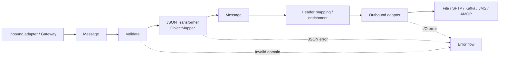
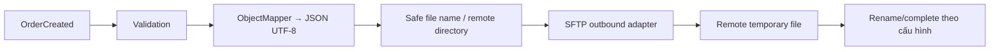
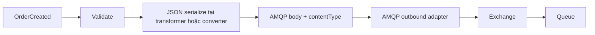

# JSON converter và ObjectMapper

## 1. Bài toán: Một DTO Java, nhiều hệ thống ngoài

Một ứng dụng xử lý đơn hàng có đối tượng Java `OrderCreated`. Sau khi xác thực và kiểm tra nghiệp vụ, ứng dụng cần gửi dữ liệu tới các hệ thống khác:

- Xuất file JSON để bộ phận đối soát nhận qua thư mục nội bộ hoặc SFTP.
- Gọi HTTP API đối tác với body `application/json`.
- Phát sự kiện tới Kafka, JMS hoặc RabbitMQ để dịch vụ khác xử lý.
- Nhận JSON từ HTTP, broker hoặc file rồi ánh xạ trở lại đối tượng Java.
- Ghi thông tin đã chuẩn hóa vào database và theo dõi trạng thái đã gửi.

Nếu tùy tiện dùng `toString()`, chuyển bằng chuỗi nối tay hoặc để mỗi adapter tự đoán cách chuyển đổi, consumer có thể nhận dữ liệu không đúng schema: tên trường bị đổi, ngày giờ không có múi giờ, số tiền sai độ chính xác hoặc JSON bị mã hóa hai lần.

Trong chương **Chuyển đổi dữ liệu**, **JSON converter và ObjectMapper** là chủ đề giúp kiểm soát ranh giới giữa **object Java**, **JSON** và **thông điệp của giao thức**. Bài thuộc module `SPRING_INTEGRATION_ADAPTERS`: kết nối hệ thống ngoài bằng inbound/outbound adapter, gateway, poller và `MessageChannel`; thực hành với file, SFTP, HTTP, JMS, AMQP, Kafka, cơ sở dữ liệu, hợp đồng message, xử lý lỗi và vòng đời kết nối.

**Nguyên tắc:** `ObjectMapper` xử lý chuyển đổi giữa mô hình Java và JSON; transformer/codec tổ chức chuyển đổi payload trong luồng Spring Integration; message converter, serializer hoặc outbound adapter xử lý cách đưa dữ liệu đã chuyển đổi vào một giao thức cụ thể. Các lớp này liên quan nhau nhưng **không phải một thứ**.

## 2. Các khái niệm nền tảng

| Khái niệm | Trách nhiệm | Ví dụ |
| --- | --- | --- |
| **JSON** | Định dạng trao đổi dữ liệu dạng văn bản theo cấu trúc object, array, string, number, boolean, null | `{"order_id":"O-1"}` |
| **DTO / domain object** | Mô hình Java nội bộ hoặc hợp đồng dữ liệu ứng dụng | `OrderCreated`, `OrderRecord` |
| **Jackson ObjectMapper** | Serialize Java → JSON và deserialize JSON → Java | `writeValueAsBytes`, `readValue` |
| **ObjectReader / ObjectWriter** | Cấu hình bất biến cho thao tác đọc/ghi JSON cụ thể | Reader dành cho `OrderCreated.class` |
| **Spring Integration Transformer** | Biến đổi payload/message trong luồng tích hợp | `Message<OrderCreated>` → `Message<byte[]>` |
| **MessageConverter** | Chuyển object/message sang representation do protocol/framework yêu cầu | HTTP converter, JMS converter, AMQP converter |
| **Serializer / Deserializer** | Chuyển key/value sang bytes và ngược lại trong cơ chế cụ thể | Kafka value serializer |
| **MessageChannel** | Vận chuyển message giữa các endpoint trong luồng | `DirectChannel`, `QueueChannel` |
| **Outbound adapter** | Gửi/ghi một chiều tới hệ thống ngoài | Ghi file, publish message |
| **Outbound gateway** | Thực hiện tương tác request–reply với hệ thống ngoài | HTTP outbound gateway |
| **Header** | Metadata kèm payload: correlation, content type, routing, tên file | `contentType`, `eventId` |
| **Schema contract** | Cách producer/consumer thống nhất cấu trúc và ngữ nghĩa dữ liệu | Các trường bắt buộc, version và format thời gian |

**Serialization** là chuyển đối tượng sang biểu diễn có thể trao đổi/lưu trữ; **deserialization** là đọc biểu diễn đó thành đối tượng. Serialize thành JSON không đồng nghĩa message đã đến hệ thống đích, cũng không đồng nghĩa consumer đã xử lý xong.

### Cặp khái niệm dễ nhầm

- **ObjectMapper vs MessageConverter:** ObjectMapper hiểu kiểu Java và JSON; converter gắn việc chuyển đổi với giao thức, metadata và cơ chế của transport.
- **Transformer vs outbound adapter:** transformer tạo payload phù hợp; adapter thực hiện I/O.
- **JSON String vs byte[]:** một bên là chuỗi ký tự Java, bên kia là bytes theo charset. Giao thức nhận bytes, nhưng nơi chọn charset có thể khác.
- **JSON hợp lệ vs hợp đồng hợp lệ:** `{"amount":"100"}` có thể là JSON hợp lệ nhưng sai nếu schema yêu cầu number.
- **Phản hồi gửi thành công vs xử lý nghiệp vụ thành công:** một broker nhận message chưa chứng minh downstream đã xử lý.

## 3. Message và vị trí chuyển đổi trong IntegrationFlow

Một Spring Integration message có hai phần: **payload** và **headers**.

```text
Message<T>
├── payload: T
└── headers:
    ├── id, timestamp
    ├── contentType
    ├── correlationId / trace metadata
    └── protocol-specific metadata (theo adapter)
```

Ví dụ luồng gửi:



Một nhánh khác có thể giữ DTO và để message converter của HTTP tự serialize:

```text
Message<OrderCreated> → HTTP outbound gateway + JSON HttpMessageConverter
                                                → HTTP request body
```

Hai cách đều có thể đúng. **Điều nguy hiểm là vừa serialize thủ công thành JSON, vừa để converter tiếp tục serialize chuỗi JSON như một JSON string.**

### Chuyển đổi inbound theo chiều ngược lại

```text
File / HTTP / Broker inbound
    → Message<byte[] | String>
    → JSON parsing (ObjectMapper)
    → Message<OrderCreated>
    → validation nghiệp vụ
    → service / router / downstream channel
```

Không nên tin một body JSON chỉ vì nó parse được. Deserialization và **validation** là hai bước khác nhau.

## 4. Jackson ObjectMapper làm gì?

Jackson là thư viện thường được dùng để ánh xạ Java ↔ JSON trong ứng dụng Spring. Thành phần `ObjectMapper` chịu trách nhiệm chọn cấu trúc JSON dựa trên class, annotation, naming strategy, module và cấu hình đọc/ghi.

Các API minh họa (tên import dưới đây theo **Jackson 2**, phổ biến với Spring Boot 3; khi dùng Jackson 3/Spring Boot mới hơn phải đối chiếu package và API của phiên bản dự án):

```java
import com.fasterxml.jackson.databind.ObjectMapper;

ObjectMapper mapper = /* ObjectMapper đã được cấu hình */;

// Java object -> JSON string
String json = mapper.writeValueAsString(order);

// Java object -> UTF-8 JSON bytes
byte[] bytes = mapper.writeValueAsBytes(order);

// JSON string -> Java object
OrderCreated fromString =
    mapper.readValue(json, OrderCreated.class);

// JSON bytes -> Java object
OrderCreated fromBytes =
    mapper.readValue(bytes, OrderCreated.class);
```

Trong code thực tế, `writeValueAsString`/`writeValueAsBytes` và `readValue` có thể phát sinh ngoại lệ đọc/ghi JSON. Cần phân loại, bọc hoặc chuyển lỗi tới error flow phù hợp; không để lỗi bị nuốt rồi gửi payload rỗng.

### Vì sao không tạo ObjectMapper mới cho mỗi message?

ObjectMapper có thể được dùng lại giữa nhiều luồng nếu **cấu hình hoàn tất trước khi sử dụng đồng thời**. Tạo mới mỗi message thường tốn tài nguyên, có thể bỏ mất module/cấu hình thống nhất và khiến các adapter xuất JSON khác nhau.

Khuyến nghị:

- Dùng một mapper được cấu hình chung theo phạm vi ứng dụng hoặc mapper chuyên biệt theo hợp đồng.
- Cấu hình module, naming và chính sách bảo mật **trước** khi chia sẻ.
- Dùng `ObjectReader` và `ObjectWriter` cho cấu hình đọc/ghi chuyên biệt; các object này phù hợp để dùng lại.
- Tránh gọi các phương thức thay đổi cấu hình ObjectMapper trên đường xử lý message song song.
- Không trộn một mapper dành cho input không đáng tin với tính năng polymorphic deserialization không được kiểm soát.

## 5. Xác định JSON contract trước khi viết code

Giả sử domain phát sự kiện đơn hàng:

```json
{
  "event_id": "evt-2401",
  "schema_version": 1,
  "event_type": "order.created",
  "occurred_at": "2026-11-23T08:30:00Z",
  "order": {
    "order_id": "ORD-1001",
    "total_amount": 125000,
    "currency": "VND"
  }
}
```

Hợp đồng phải mô tả:

| Thành phần | Yêu cầu minh họa | Lý do |
| --- | --- | --- |
| `event_id` | String ổn định, không rỗng | Deduplication và tracing |
| `schema_version` | Integer có version được hỗ trợ | Rollout và tương thích consumer |
| `event_type` | Giá trị xác định, ví dụ `order.created` | Routing/diễn giải nghiệp vụ |
| `occurred_at` | ISO-8601 instant với offset/UTC | Không nhập nhằng múi giờ |
| `order.order_id` | Business ID ổn định | Idempotency và đối chiếu |
| `order.total_amount` | Number với ý nghĩa đơn vị được định nghĩa | Tránh hiểu sai tiền tệ |
| `order.currency` | Mã đơn vị tiền tệ được phép | Xác thực dữ liệu |
| Content-Type | `application/json` | Consumer chọn cách parse |
| Charset khi trao đổi text bytes | UTF-8 theo hợp đồng | Tính nhất quán bytes |
| Kích thước tối đa | Giới hạn theo nguồn và adapter | Chống nghẽn, bảo vệ memory |

Một số quy ước dễ bị bỏ sót:

- **Tên trường**: `orderId` hay `order_id`? Phải thống nhất.
- **Trường thiếu vs null vs rỗng**: có nghĩa khác nhau.
- **Number**: `100` và `100.0` có thể cùng giá trị số nhưng downstream kiểm tra kiểu/độ chính xác khác.
- **String time**: `2026-11-23T08:30:00Z` khác ngày nghiệp vụ `2026-11-23`.
- **Compatibility**: consumer đang dùng version cũ phải xử lý được thay đổi dự kiến.
- **Dữ liệu nhạy cảm**: không đẩy toàn bộ domain entity ra ngoài nếu chỉ cần vài trường.

## 6. DTO đích và annotation Jackson

Dùng Java `record` giúp biểu diễn một hợp đồng dữ liệu bất biến tương đối rõ (giả định phiên bản JDK/Jackson hỗ trợ records).

```java
import com.fasterxml.jackson.annotation.JsonProperty;
import java.math.BigDecimal;
import java.time.Instant;

public record OrderCreated(
    @JsonProperty("event_id") String eventId,
    @JsonProperty("schema_version") int schemaVersion,
    @JsonProperty("event_type") String eventType,
    @JsonProperty("occurred_at") Instant occurredAt,
    @JsonProperty("order") OrderBody order
) {}

public record OrderBody(
    @JsonProperty("order_id") String orderId,
    @JsonProperty("total_amount") BigDecimal totalAmount,
    @JsonProperty("currency") String currency
) {}
```

### Một số annotation hữu ích

| Annotation | Mục đích |
| --- | --- |
| `@JsonProperty("order_id")` | Ánh xạ tên field trong JSON |
| `@JsonIgnore` | Bỏ thuộc tính không được xuất/nhập theo cấu hình |
| `@JsonInclude` | Quy định cách xử lý null/giá trị mặc định khi serialize |
| `@JsonFormat` | Chọn định dạng cụ thể theo trường (cần quản trị thống nhất) |
| `@JsonCreator` | Chỉ định cách tạo object trong trường hợp cần thiết |
| `@JsonAlias` | Chấp nhận tên thay thế khi deserialize, không đổi tên serialize |
| `@JsonIgnoreProperties` | Kiểm soát hành vi với thuộc tính không mong muốn theo class |

**Không lạm dụng annotation trực tiếp trên domain entity nếu schema tích hợp thay đổi độc lập.** Có thể tạo DTO riêng cho external contract để thay đổi nội bộ mà không làm hỏng JSON public.

### Cẩn thận với `@JsonIgnoreProperties(ignoreUnknown = true)`

Cho phép bỏ qua field lạ có thể hỗ trợ tương thích khi consumer nhận thêm trường tùy chọn. Nhưng nó cũng có thể **che việc producer gõ sai tên trường quan trọng**. Chính sách nên dựa trên vai trò của schema: input không đáng tin và hợp đồng nghiêm ngặt có thể cần từ chối unknown fields; hợp đồng cho phép mở rộng có thể chấp nhận một số trường lạ.

## 7. Cấu hình ObjectMapper nhất quán

Trong ứng dụng Spring Boot, có thể tiêm `ObjectMapper` đã được framework cấu hình thay vì tạo mới ở mỗi handler. Dưới đây là ví dụ **thiết lập mapper chuyên biệt** cho hợp đồng khi dùng API Jackson 2:

```java
import com.fasterxml.jackson.databind.DeserializationFeature;
import com.fasterxml.jackson.databind.SerializationFeature;
import com.fasterxml.jackson.databind.json.JsonMapper;
import com.fasterxml.jackson.datatype.jsr310.JavaTimeModule;

JsonMapper mapper = JsonMapper.builder()
    .addModule(new JavaTimeModule())
    .disable(SerializationFeature.WRITE_DATES_AS_TIMESTAMPS)
    .enable(DeserializationFeature.FAIL_ON_UNKNOWN_PROPERTIES)
    .build();
```

**Tại sao cần JavaTimeModule?** Kiểu ngày/giờ Java Time như `Instant` cần module hỗ trợ tương ứng trong nhiều cấu hình Jackson. Cách Boot tự đăng ký module phụ thuộc dependency và phiên bản; kiểm tra thực tế bằng test.

**Tại sao disable timestamps?** Ví dụ yêu cầu JSON ISO-8601 string thay vì number hoặc array theo cấu hình default.

**Tại sao bật fail on unknown?** Đối với một hợp đồng đóng, input có field lạ nên được phát hiện. Không phải mọi tích hợp cần chọn chính sách này: có schema cho phép mở rộng, khi đó phải định nghĩa cách xử lý unknown fields rõ.

### Cấu hình global và cấu hình riêng

| Phạm vi | Khi nào phù hợp | Điểm cần chú ý |
| --- | --- | --- |
| Mapper dùng chung của ứng dụng | Nhiều API có cùng quy ước | Thay đổi global có thể làm hỏng endpoint khác |
| Mapper riêng cho integration contract | Partner/SaaS có schema/format đặc thù | Cần test và quản lý version độc lập |
| ObjectReader/ObjectWriter chuyên biệt | Luồng có kiểu đích hoặc view riêng | Tái sử dụng instance đã cấu hình |
| Converter riêng của transport | HTTP/JMS/AMQP cần protocol metadata | Bảo đảm không serialize trùng với transformer |

**Tránh thay đổi mapper sau khi đã chia sẻ giữa nhiều thread.** Nếu mỗi đối tác có quy ước khác nhau, hãy tạo mapper chuyên biệt khi khởi động hoặc dùng writer/reader thích hợp.

## 8. ObjectReader và ObjectWriter: Cố định hợp đồng theo kiểu

Một codec có thể giữ reader/writer cho từng loại payload để làm rõ đầu vào–đầu ra.

```java
import com.fasterxml.jackson.core.JsonProcessingException;
import com.fasterxml.jackson.databind.ObjectMapper;
import com.fasterxml.jackson.databind.ObjectReader;
import com.fasterxml.jackson.databind.ObjectWriter;
import java.io.IOException;

public final class OrderJsonCodec {

    private final ObjectWriter writer;
    private final ObjectReader reader;

    public OrderJsonCodec(ObjectMapper mapper) {
        this.writer = mapper.writerFor(OrderCreated.class);
        this.reader = mapper.readerFor(OrderCreated.class);
    }

    public byte[] writeBytes(OrderCreated event) {
        if (event == null) {
            throw new IllegalArgumentException("Order event is null");
        }
        try {
            return writer.writeValueAsBytes(event);
        } catch (JsonProcessingException exception) {
            throw new IllegalArgumentException(
                "Cannot serialize OrderCreated", exception);
        }
    }

    public OrderCreated readBytes(byte[] json) {
        if (json == null || json.length == 0) {
            throw new IllegalArgumentException("JSON payload is empty");
        }
        try {
            return reader.readValue(json);
        } catch (IOException exception) {
            throw new IllegalArgumentException(
                "Cannot deserialize OrderCreated", exception);
        }
    }
}
```

**Ý nghĩa:**

- `writeBytes` chuyển DTO sang JSON UTF-8 bytes theo cấu hình Jackson.
- `readBytes` đọc bytes thành DTO.
- Reader/writer có kiểu đích rõ và được tái sử dụng.
- Lỗi conversion **không bị đổi thành payload rỗng**.
- Chưa có validation nghiệp vụ; cần thêm tầng kiểm tra field bắt buộc, giá trị, kích thước.

Trong dự án Spring, bean codec có thể nhận mapper qua constructor injection. Không tạo `ObjectMapper` mới mỗi lần gọi `transform`.

## 9. Transformer với Java DSL trước outbound adapter

Một cách đơn giản là transformer trả `byte[]`, rồi đưa đến một channel hoặc adapter nhận được bytes. Ví dụ sau minh họa cách mắc transformer vào luồng:

```java
import org.springframework.context.annotation.Bean;
import org.springframework.context.annotation.Configuration;
import org.springframework.integration.dsl.IntegrationFlow;

@Configuration
public class OrderJsonFlowConfiguration {

    @Bean
    IntegrationFlow orderJsonFlow(OrderJsonCodec codec) {
        return IntegrationFlow.from("orderEvents")
            .transform(OrderCreated.class, codec::writeBytes)
            .channel("jsonReadyChannel")
            .get();
    }
}
```

Ở đây:

1. Producer đưa `Message<OrderCreated>` vào `orderEvents`.
2. Transformer gọi `OrderJsonCodec.writeBytes`.
3. Payload sau bước chuyển đổi là `byte[]` chứa JSON UTF-8.
4. Channel `jsonReadyChannel` là ranh giới cho outbound handler phù hợp.
5. Vẫn cần cấu hình adapter để tiêu thụ `jsonReadyChannel`; đoạn trên **chưa gửi ra mạng hoặc file**.

**Lưu ý phiên bản:** tên API Java DSL, extension và cách khai báo channel có thể thay đổi giữa các bản Spring Integration. Đoạn code trình bày ý tưởng API Java DSL; trong dự án thực tế cần đối chiếu dependency/version và chạy compilation/test.

### Khi muốn transformer trả String

```java
public String writeText(OrderCreated event) {
    try {
        return writer.writeValueAsString(event);
    } catch (JsonProcessingException exception) {
        throw new IllegalArgumentException(
            "Cannot serialize OrderCreated", exception);
    }
}
```

`String` phù hợp cho một số HTTP/file use case. `byte[]` phù hợp khi muốn xác định rõ bytes tại ranh giới. **Đừng chọn theo thói quen**: chọn theo converter, serializer và hợp đồng của adapter đích.

## 10. Header và payload: Chuyển đổi đúng nhưng metadata sai vẫn có lỗi

Một message sau transformer có thể có payload JSON hợp lệ nhưng bị gửi sai topic, sai content type hoặc mất correlation ID.

| Header / metadata | Vì sao quan trọng | Cách quản trị |
| --- | --- | --- |
| `contentType` | Consumer/converter cần biết dữ liệu là JSON | Gắn đúng với bytes hoặc String |
| `correlationId` | Theo dõi request và reply, trace một giao dịch | Kế thừa hoặc map có chọn lọc |
| `eventId` | Dedup và audit | Dùng ID ổn định, không sinh lại khi retry |
| `schemaVersion` | Chọn parser và quy tắc tương thích | Đồng bộ với schema trong payload |
| `fileName` | Ghi file và SFTP remote name | Tạo từ nguồn tin cậy, sanitize |
| `topic` / key | Kafka routing/partition | Cấu hình hoặc map qua header adapter hỗ trợ |
| `routingKey` | AMQP exchange routing | Được xác định bởi policy |
| HTTP headers | Content-Type, Accept, idempotency key | Chỉ map những header được phép |
| Error/reply channel | Xử lý lỗi và request–reply nội bộ | Không vô tình đưa metadata nội bộ ra network |

### Header được giữ thế nào?

Khi transformer của Spring Integration trả về **payload**, endpoint thường tạo message kết quả và mang theo các header phù hợp theo cơ chế framework. Nhưng nếu custom transformer tự dựng `Message` mới, tự lọc header hoặc protocol converter có quy tắc khác, một số header có thể bị đổi hoặc mất.

Kiểm chứng qua test:

```java
import org.springframework.messaging.Message;
import org.springframework.messaging.support.MessageBuilder;

Message<byte[]> toJsonMessage(
        Message<OrderCreated> input,
        OrderJsonCodec codec) {

    OrderCreated event = input.getPayload();
    byte[] json = codec.writeBytes(event);

    // Không copy mọi header không kiểm soát.
    MessageBuilder<byte[]> builder = MessageBuilder.withPayload(json)
        .setHeader("contentType", "application/json")
        .setHeader("eventId", event.eventId());

    Object correlation = input.getHeaders().get("correlationId");
    if (correlation != null) {
        builder.setHeader("correlationId", correlation);
    }

    return builder.build();
}
```

Đây là một hàm tạo Message minh họa, **không phải lời khuyên tự tạo message ở mọi transformer**. Khi dùng transformer thông thường, thường chỉ cần trả payload mới rồi dùng `HeaderEnricher`/header mapper cho metadata. Việc copy chọn lọc giúp tránh gửi lộ header chứa thông tin nhạy cảm hoặc định tuyến nội bộ.

### Header dành cho adapter không phải tên tùy ý

File, SFTP, Kafka và AMQP có các constant/header mapper riêng. Ví dụ tiêu đề `fileName` trong bảng là tên logic, **không mặc định** là key framework mà mọi adapter tự hiểu. Phải tra và kiểm thử tên header, kiểu giá trị và cách map của phiên bản Spring Integration tương ứng.

## 11. Chuyển JSON ra File và SFTP

### File outbound adapter

Nếu muốn ghi một file JSON cho mỗi event:

```text
Message<OrderCreated>
    → validate
    → header enrichment: outputFileName
    → ObjectMapper JSON bytes
    → File outbound adapter
    → ./outbox/order-ORD-1001.json
```

Ví dụ một flow tích hợp (các API cụ thể cần được xác nhận theo bản Spring Integration của dự án):

```java
import java.io.File;
import org.springframework.context.annotation.Bean;
import org.springframework.integration.dsl.IntegrationFlow;
import org.springframework.integration.file.dsl.Files;

@Bean
IntegrationFlow orderJsonFileFlow(OrderJsonCodec codec) {
    return IntegrationFlow.from("orderFileRequests")
        .enrichHeaders(h -> h.headerFunction(
            "outputFileName", message -> {
                OrderCreated event = (OrderCreated) message.getPayload();
                String id = event.order().orderId();
                if (!id.matches("[A-Za-z0-9_-]{1,64}")) {
                    throw new IllegalArgumentException("Unsafe orderId");
                }
                return "order-" + id + ".json";
            }))
        .transform(OrderCreated.class, codec::writeBytes)
        .handle(Files.outboundAdapter(new File("./outbox"))
            .autoCreateDirectory(true)
            .fileNameGenerator(message ->
                (String) message.getHeaders().get("outputFileName")))
        .get();
}
```

Đây là **mẫu cấu trúc**. Vận hành production cần xác định quyền filesystem, file-exists mode, ghi file tạm, atomic rename (khi filesystem hỗ trợ), trạng thái kết quả và giới hạn kích thước.

### SFTP outbound adapter

Với SFTP, payload có thể là `File`, `String` hoặc `byte[]` tùy handler/cấu hình. Thường nên chọn JSON bytes rõ encoding:



Các vấn đề quan trọng:

- Không lấy remote path trực tiếp từ nguồn không đáng tin; chặn `../` và đường dẫn tuyệt đối ngoài phạm vi.
- Giữ quyền tối thiểu cho SFTP account, xác thực host key và quản lý credential/session.
- Quy định hành vi khi file đã tồn tại hoặc gửi lại cùng event.
- Dùng tên file tạm rồi đổi tên khi consumer phải tránh đọc file chưa ghi xong.
- Phân biệt lỗi **JSON transformation** với lỗi **mạng/permission/timeout** của SFTP.
- Không mặc định ghi file thành công chứng minh hệ thống nhận đã xử lý nội dung.

## 12. HTTP outbound gateway và nguy cơ double serialization

HTTP là nơi dễ nhầm giữa **ObjectMapper do mình gọi trực tiếp** và **HttpMessageConverter do framework dùng**.

### Phương án A: Để HTTP converter serialize DTO

```text
Message<OrderCreated>
    → validate / map to external DTO
    → HTTP outbound gateway
    → JSON HttpMessageConverter
    → HTTP request body: JSON object
```

Ưu điểm: converter dùng một cấu hình Jackson/HTTP nhất quán, quản lý media type và representation.

### Phương án B: Serialize chủ động thành JSON

```text
Message<OrderCreated>
    → ObjectMapper.writeValueAsBytes(event)
    → Message<byte[]> with application/json
    → HTTP outbound gateway
    → raw body bytes theo cấu hình
```

Ưu điểm: kiểm soát bytes và có thể ký/hàm băm payload sau serialize. Nhược điểm: phải bảo đảm converter không mã hóa thêm.

### Lỗi double serialization

Giả sử transformer trả:

```json
{"order_id":"ORD-1001"}
```

Nhưng converter tiếp tục serialize nó **như một Java String**, HTTP body có thể trở thành:

```json
"{\"order_id\":\"ORD-1001\"}"
```

Body thứ hai là JSON string, không phải JSON object. Cả hai đều hợp lệ cú pháp JSON nhưng khác hợp đồng.

**Cách xử lý:**

1. Quyết định serialization xảy ra ở **transformer** hay **HTTP converter**, không cả hai.
2. Kiểm tra body thực tế bằng mock HTTP server.
3. Đảm bảo `Content-Type` và `Accept` phù hợp.
4. Kiểm tra các response code và representation mà gateway trả về.
5. Xác định chính sách retry/idempotency với timeout sau khi server có thể đã xử lý.

### HTTP adapter hay gateway?

Nếu cần xử lý response nghiệp vụ, dùng **outbound gateway** theo mô hình request–reply. Nếu chỉ gửi một chiều, xem xét outbound adapter hoặc handler phù hợp với use case và API được sử dụng. Đừng coi mọi lời gọi HTTP là fire-and-forget: HTTP status không tự đảm bảo downstream commit nghiệp vụ.

## 13. JMS: JSON và JMS MessageConverter

Trong JMS, message được truyền dưới dạng các loại thông điệp JMS, ví dụ `TextMessage` hoặc `BytesMessage`. Spring JMS có **MessageConverter** để ánh xạ Java object ↔ JMS message.

Ví dụ pipeline:

```text
OrderCreated DTO
    → validate
    → (a) ObjectMapper JSON String
        hoặc
      (b) DTO + JMS JSON converter
    → JMS outbound adapter
    → JMS TextMessage/BytesMessage theo converter
```

**Điểm cần chốt trước triển khai:**

- Consumer đọc `TextMessage` hay `BytesMessage`?
- Converter nào chịu trách nhiệm Jackson serialization?
- Charset/schema version và cách biểu diễn lỗi được quản lý ở đâu?
- JMS destination, properties và correlation ID được map ra sao?
- Delivery mode, acknowledgment, transaction và redelivery được cấu hình thế nào?
- Khi consumer không hiểu version mới, message đi đâu?

Nếu đã tạo JSON String, cấu hình converter phải ghi String như text theo hợp đồng; không để converter Java object serialization tùy tiện hoặc mã hóa JSON hai lần.

**Tránh phụ thuộc vào Java native serialization để chia sẻ object giữa dịch vụ** khi có thể dùng JSON/schema rõ. Native deserialization của dữ liệu không đáng tin còn có rủi ro bảo mật và tương thích classpath.

## 14. AMQP/RabbitMQ: Jackson converter, body và content type

Ở AMQP, message bao gồm body bytes và properties như `contentType`; Spring AMQP có các converter, bao gồm giải pháp dùng Jackson theo phiên bản.



### Những điểm kiểm tra

| Vấn đề | Nguy cơ | Cách kiểm soát |
| --- | --- | --- |
| Converter nhận DTO | Không rõ representation | Chốt converter, schema và test body bytes |
| Converter nhận JSON String | JSON bị mã hóa lần hai | Chỉ serialize một lần |
| Content-Type sai | Consumer chọn sai parser | Gắn và kiểm thử media type |
| Header routingKey | Gửi nhầm queue hoặc lộ dữ liệu | Chỉ dùng routing policy đáng tin |
| Publisher confirm | Nhầm broker nhận với consumer xử lý | Theo dõi tầng broker và business riêng |
| Retry/redelivery | Message xử lý trùng | Event ID ổn định và idempotent consumer |
| Poison message | Retry vô hạn dữ liệu sai | Dead-letter/quarantine với owner xử lý |

Một message chuyển đổi thành JSON hợp lệ nhưng routing sai vẫn gây lỗi tích hợp. Jackson không kiểm soát exchange/binding hay bảo đảm giao dịch của broker.

## 15. Kafka: ObjectMapper và Kafka JsonSerializer khác nhau gì?

Kafka producer sử dụng **serializer** cho key và value. Tùy cấu hình:

- **Cách 1:** Transformer gọi `ObjectMapper.writeValueAsBytes` → producer value serializer nhận `byte[]`.
- **Cách 2:** Transformer giữ DTO có contract rõ → Kafka JSON serializer (sử dụng Jackson hoặc cơ chế tương ứng) tạo bytes.
- **Cách 3:** Dùng String JSON và String serializer, nếu consumer contract yêu cầu text.

| Payload producer | Serializer tương ứng | Điều cần kiểm chứng |
| --- | --- | --- |
| `byte[]` đã là JSON | ByteArraySerializer | Không serialize thêm |
| `String` JSON | StringSerializer | UTF-8/encoding và JSON object đúng |
| DTO có annotation Jackson | JSON serializer phù hợp | Field names, time format, headers type metadata |
| Avro/Protobuf object | Serializer chuyên biệt | Schema compatibility và registry nếu có |

### Các metadata không nằm trong ObjectMapper

- **Topic**: đích publish theo quy tắc routing của hệ thống.
- **Key**: thường dùng ID nghiệp vụ như `orderId` để phân vùng và hỗ trợ ordering theo partition.
- **Partition**: phụ thuộc key, partitioner, cấu hình producer và topic.
- **Headers**: correlation, trace, schema version hoặc metadata được phép.
- **Acknowledgment**: phản hồi ở lớp Kafka; không đồng nghĩa consumer xử lý xong.

### Lỗi schema và type metadata

Một JSON serializer có thể thêm type headers của Java class. Những header này không phải lúc nào cũng phù hợp khi gửi qua các nhóm dịch vụ có model khác nhau; tránh để consumer phụ thuộc vào fully qualified Java class name của producer nếu hợp đồng cần độc lập ngôn ngữ.

Quy định schema/version từ góc nhìn dữ liệu, không chỉ dựa vào type metadata của thư viện. Khi consumer không biết schema, đưa vào đường lỗi thay vì deserialize polymorphic tùy ý.

## 16. JDBC/database: JSON là payload hay dữ liệu lưu trữ?

Database không phải lúc nào cũng cần JSON. Có hai trường hợp khác nhau:

**Trường hợp A – Dùng JSON để lưu một cột dữ liệu:**

```sql
INSERT INTO integration_outbox (
    event_id,
    aggregate_id,
    payload_json
) VALUES (
    :eventId,
    :aggregateId,
    :payloadJson
);
```

Transformer `OrderCreated` → JSON String/bytes, sau đó mapper dữ liệu chuẩn bị tham số `payloadJson` theo SQL dialect/driver và kiểu cột.

**Trường hợp B – Lưu dữ liệu có cấu trúc theo cột:**

```sql
INSERT INTO orders (
    order_id,
    total_amount,
    currency
) VALUES (
    :orderId,
    :totalAmount,
    :currency
);
```

Trong trường hợp B, convert toàn bộ DTO thành JSON rồi parse lại để lấy các cột có thể là vòng chuyển đổi thừa. Nên dùng DTO/Map tham số phù hợp.

### Cẩn thận với transaction

- Transformer tạo JSON **không có nghĩa** transaction database đã commit.
- Nếu cùng lúc ghi database và publish Kafka, hai thao tác không tự động trở thành một transaction nguyên tử.
- Có thể dùng **transactional outbox** hoặc thiết kế trạng thái gửi để giảm nguy cơ mất/nhân đôi message.
- Khi retry, dùng unique key/event ID hoặc idempotent upsert thay vì INSERT tự do.
- Không nối SQL string từ JSON field chưa xác minh; dùng parameter binding để tránh SQL injection.

## 17. Chuyển JSON inbound thành DTO: Parsing khác validation

Một outbound flow tốt thường có inbound flow đối xứng để consumer hiểu dữ liệu.

```text
HTTP/File/SFTP/JMS/AMQP/Kafka inbound
    → Message<String | byte[]>
    → JSON deserializer: OrderCreated
    → schema validation
    → domain validation
    → service/router/processor
```

**Ba mức kiểm tra:**

1. **Syntactic validation:** JSON có parse được không? Có vượt giới hạn độ sâu/kích thước không?
2. **Schema/contract validation:** field bắt buộc, type, version và null policy có đúng không?
3. **Business validation:** `eventId`, `orderId` không rỗng, tiền không âm, currency hợp lệ, trạng thái nghiệp vụ cho phép xử lý?

### Deserialization không tự chạy Bean Validation

Các annotation như `@NotBlank`, `@NotNull` hoặc `@PositiveOrZero` thường cần một **Validator** phù hợp được gọi tại biên xử lý; ObjectMapper đơn thuần không tự bảo đảm mọi constraint nghiệp vụ.

Ví dụ:

```java
OrderCreated event = codec.readBytes(jsonBytes);

// Minh họa: dùng Validator của ứng dụng sau khi parse.
Set<ConstraintViolation<OrderCreated>> violations =
    validator.validate(event);

if (!violations.isEmpty()) {
    throw new IllegalArgumentException("Invalid order event");
}
```

Các field lồng nhau cần cascade validation nếu muốn áp dụng constraint cho record con. Cần xem kỹ cách dùng `@Valid` và chính sách đối với trường optional/unknown.

### Khi input có version lạ

Không nên luôn deserialize mọi version vào cùng DTO rồi âm thầm bỏ qua trường lạ. Có thể chọn:

- Reader/DTO theo từng schema version.
- Upcaster chuyển format cũ sang contract canonical đã kiểm thử.
- Reject và đưa vào quarantine nếu version không hỗ trợ.
- Tách channel xử lý version trong giai đoạn migration theo chính sách.

## 18. Xử lý JSON collection, generic và JsonNode

Khi payload là danh sách hoặc generic wrapper, `readValue(json, List.class)` có thể tạo `List<Map>` thay vì đối tượng kiểu mạnh.

### Dùng TypeReference

```java
import com.fasterxml.jackson.core.type.TypeReference;
import java.util.List;

List<OrderCreated> orders = mapper.readValue(
    json,
    new TypeReference<List<OrderCreated>>() {}
);
```

### Dùng JavaType

```java
JavaType listType = mapper.getTypeFactory()
    .constructCollectionType(List.class, OrderCreated.class);

List<OrderCreated> orders = mapper.readValue(json, listType);
```

### Dùng JsonNode cho message có cấu trúc động

```java
JsonNode root = mapper.readTree(json);

JsonNode versionNode = root.path("schema_version");
if (!versionNode.isInt()) {
    throw new IllegalArgumentException("Missing schema_version");
}
int version = versionNode.intValue();
```

**Chọn kỹ cách dùng:**

- DTO typed giúp kiểm tra hợp đồng, rõ nghĩa và ít sai sót khi refactor.
- `JsonNode` hữu ích cho routing theo version hoặc extract field khi schema động.
- `Map<String,Object>` linh hoạt nhưng dễ mất ràng buộc type, số hoặc null semantics.
- Với tập dữ liệu rất lớn, đọc cả một array vào memory có thể gây OOM; cân nhắc streaming parser/chunking theo luồng.

## 19. Ngày giờ, số tiền, null, enum và encoding

### Instant và thời điểm

Nếu hợp đồng yêu cầu:

```json
{"occurred_at":"2026-11-23T08:30:00Z"}
```

Hãy kiểm thử cấu hình Jackson với `Instant`, timezone, offset và precision. Không đồng nhất `LocalDateTime` không kèm múi giờ với thời điểm toàn cầu.

### BigDecimal và đơn vị tiền tệ

Dùng `BigDecimal` hoặc integer minor units khi domain cần chính xác. Nếu producer dùng `double` để tính tiền, sai số có thể xảy ra trước khi ObjectMapper serialize; Jackson không thể sửa lại semantics nghiệp vụ đã sai.

### Null, missing và default

| JSON | Ý nghĩa có thể khác |
| --- | --- |
| `{"code": null}` | Producer chủ động truyền null |
| `{}` | Trường không có, có thể do version/optional |
| `{"code": ""}` | Chuỗi rỗng, chưa chắc hợp lệ |
| `{"code": "   "}` | Có ký tự khoảng trắng, có thể cần trim/reject |

Không ép ba trạng thái vào một giá trị mặc định nếu nghiệp vụ cần phân biệt.

### Enum

Nếu consumer đòi `"order.created"`, đừng mặc định gọi `enum.name()` là ra đúng chuỗi. Dùng DTO/annotation hoặc mapping explicit và test.

### Encoding

- `ObjectMapper.writeValueAsBytes` tạo bytes JSON theo encoding của API JSON (UTF-8 trong đường dùng phổ biến).
- `writeValueAsString` trả `String` Java; adapter/converter quyết định cách encode thành bytes.
- Khi tự chuyển String → bytes, ghi rõ `StandardCharsets.UTF_8`.
- Một `Content-Type: application/json` sai không biến bytes không hợp lệ thành JSON đúng.
- Không thêm BOM nếu consumer không hỗ trợ.

## 20. Bảo mật: JSON không phải dữ liệu đáng tin

### 20.1. Nguy cơ deserialization

Input JSON từ HTTP, file, SFTP hoặc broker có thể do bên ngoài tác động. Nếu chấp nhận **polymorphic type metadata** không giới hạn, một số cấu hình deserialization có thể tạo rủi ro an toàn.

Kiểm soát:

- Tránh bật **default typing rộng** cho input không đáng tin.
- Nếu phải deserialize polymorphic, dùng allowlist/type validator và DTO type cụ thể.
- Không tin `@class` hay type header từ nguồn bên ngoài để tạo class bất kỳ.
- Cập nhật thư viện và dependency theo chính sách bảo mật của tổ chức.
- Tránh deserialize trực tiếp vào domain entity có side effect không mong muốn.
- Validate object sau parse.

### 20.2. Giới hạn kích thước và độ sâu

Một message JSON rất lớn hoặc lồng sâu có thể làm tiêu thụ CPU, memory hoặc gây lỗi parser. Thiết kế:

- Giới hạn kích thước HTTP body, file, message broker và payload ở ranh giới inbound.
- Dùng **streaming** hoặc chunking khi dữ liệu thực sự lớn.
- Cấu hình giới hạn parser/nesting qua khả năng của phiên bản Jackson đang dùng.
- Hạn chế số lần parse cùng payload.
- Thiết lập timeout và backpressure ở channel/poller.

### 20.3. PII và thông tin bí mật

Không serialize nguyên object chứa mật khẩu, token, API secret, số định danh nhạy cảm hoặc dữ liệu cá nhân không cần thiết. Dùng DTO outbound riêng, allowlist field và logging có chọn lọc.

**Đừng xem `@JsonIgnore` là toàn bộ chiến lược bảo mật**: một đường serialize khác hoặc DTO khác có thể vẫn xuất dữ liệu. Kiểm soát tại hợp đồng, test payload thực tế và kiểm tra phân quyền/nguồn dữ liệu.

### 20.4. Injection và metadata định tuyến

- SQL: dùng parameter binding, không nối truy vấn từ JSON.
- File/SFTP: kiểm tra tên file và remote path, chặn path traversal.
- HTTP: không để client quyết định tự do outbound URL nếu có nguy cơ SSRF.
- Kafka/AMQP: hạn chế topic/exchange/routing key theo policy.
- Logs: escape/sanitize dữ liệu để tránh log injection và lộ payload.

## 21. Error handling: Parse lỗi hay transport lỗi?

Một flow tích hợp cần tách **lỗi không thể sửa bằng retry** và **lỗi tạm thời từ hệ thống ngoài**.

| Nơi lỗi | Ví dụ | Xử lý phù hợp |
| --- | --- | --- |
| JSON parser | JSON thiếu dấu ngoặc, encoding sai | Reject/quarantine, log an toàn |
| JSON mapping | Kiểu field sai, Instant không parse được | Contract error, không retry mù |
| Domain validation | `orderId` rỗng, `amount` âm | Reject, thông báo chủ dữ liệu |
| Schema mismatch | Version lạ hoặc thiếu field bắt buộc | Route theo version hoặc quarantine |
| HTTP outbound | 429/503, timeout | Retry/backoff có giới hạn, idempotency |
| SFTP outbound | Connection reset, remote permission | Retry có điều kiện, kiểm tra file đã tạo |
| JMS/AMQP/Kafka outbound | Broker unavailable, timeout | Retry theo cơ chế broker, dedup |
| JDBC outbound | Deadlock, constraint violation | Phân loại transient/duplicate, transaction |
| AuthN/AuthZ | Credential sai hoặc không đủ quyền | Xử lý cấu hình/permission, không retry vô hạn |

### Truyền exception trong Spring Integration

Trong flow đồng bộ qua `DirectChannel`, lỗi có thể quay về thread gửi. Với poller, executor channel hoặc adapter bất đồng bộ, lỗi có thể được đưa tới **error channel** theo topology và cấu hình.

`errorChannel` không phải là phép màu: một header đơn lẻ không bảo đảm bắt được mọi lỗi. Cần kiểm thử chính xác ở nơi JSON được deserialize, chuyển payload và gửi outbound.

### Error message nên mang thông tin gì?

```json
{
  "eventId": "evt-2401",
  "stage": "json-deserialization",
  "errorCode": "INVALID_SCHEMA_VERSION",
  "schemaVersion": 99,
  "correlationId": "req-861",
  "retryable": false
}
```

Đây là dữ liệu minh họa. Tránh log toàn bộ body nhạy cảm hoặc stack trace chứa secret. Cần có DLQ/quarantine có owner, chính sách lưu, retry và quy trình phát lại sau khi sửa nguyên nhân.

## 22. Retry và idempotency khi serialize JSON

ObjectMapper có thể serialize cùng DTO hai lần ra cùng nội dung logic, nhưng hệ thống vẫn có thể xử lý **hai sự kiện** nếu adapter retry sau timeout.

Ví dụ:

1. Producer serialize `OrderCreated(eventId="evt-2401")`.
2. Kafka nhận message, nhưng producer timeout khi chờ acknowledgment.
3. Producer retry. Nếu transformer sinh event ID mới mỗi lần, consumer không nhận diện được duplicate.
4. Một dịch vụ downstream tạo hai bản ghi đơn hàng.

**Giải pháp:** định danh event phải ổn định theo sự kiện nghiệp vụ, được tạo trước hoặc trong bước tạo event có kiểm soát, không sinh lại tùy tiện mỗi lần transform.

```text
Domain event with stable eventId
   → ObjectMapper serialize
   → Send / retry same logical event
   → Consumer dedup by eventId or business key
```

Tùy giao thức, dùng transaction, outbox, producer idempotence, queue acknowledgment hoặc upsert có unique key. **Exactly-once chỉ có nghĩa trong phạm vi cụ thể của cơ chế**, không tự có khi nối nhiều hệ thống File/SFTP/HTTP/Kafka/DB.

### Một số kết luận quan trọng

- JSON serialization thành công **không chứng minh** adapter gửi thành công.
- Adapter gửi thành công **không chứng minh** consumer xử lý thành công.
- Retry transport có thể tạo duplicate dù JSON giữ nguyên.
- Nếu schema transformer thay đổi giữa các lần retry, cùng event có thể phát ra hai representation; cần gắn schema version và kiểm soát rollout.

## 23. Poller, MessageChannel và hiệu năng khi xử lý JSON

### DirectChannel

Transformer thường chạy đồng bộ trên thread gửi. Serialize JSON lớn trước outbound HTTP/SFTP chậm có thể làm tăng thời gian request từ gateway/inbound.

### QueueChannel/executor channel

Tách producer–consumer giúp giảm coupling thời gian nhưng tạo hàng đợi. Nếu queue ở memory, message không tự có persistence; cần xem yêu cầu mất dữ liệu, sức chứa và backpressure.

### Poller

Poller điều khiển lịch lấy file, database rows hoặc message ở endpoint polling. Khi một batch gồm nhiều JSON record:

- Không mặc định poller sẽ tự parse JSON.
- Transformer có thể parse từng record; khi đọc một file JSON array, có thể cần splitter.
- Nếu muốn gom thành một file JSON array outbound, cần aggregator hoặc batch pipeline phù hợp.
- Có giới hạn `maxMessagesPerPoll`, concurrency và backpressure nếu đích chậm.
- Cần bảo vệ transaction/ack: đọc nguồn xong không đồng nghĩa ghi đích thành công.

### Performance patterns

- Tái sử dụng `ObjectMapper`, `ObjectReader`, `ObjectWriter`.
- Tránh `Object → JSON String → JsonNode → DTO → JSON bytes` nếu không thực sự cần.
- Tránh log nguyên body lớn; đo kích thước và tốc độ xử lý riêng.
- Với JSON array khổng lồ, dùng streaming API hoặc xử lý chia nhỏ.
- Tách metric **serialization latency** khỏi **network/adapter latency**.
- Cân nhắc schema caching và khối lượng dữ liệu trước khi tăng thread pool.

## 24. Kiểm thử theo từng lớp

### 24.1. Unit test cho codec

```java
import static org.junit.jupiter.api.Assertions.*;
import com.fasterxml.jackson.databind.ObjectMapper;
import org.junit.jupiter.api.Test;
import java.math.BigDecimal;
import java.time.Instant;

class OrderJsonCodecTest {

    private final OrderJsonCodec codec =
        new OrderJsonCodec(/* mapper đã đăng ký JavaTimeModule */ mapper());

    @Test
    void serializesExpectedFields() throws Exception {
        OrderCreated event = new OrderCreated(
            "evt-2401",
            1,
            "order.created",
            Instant.parse("2026-11-23T08:30:00Z"),
            new OrderBody("ORD-1001", new BigDecimal("125000"), "VND")
        );

        String json = new String(
            codec.writeBytes(event),
            java.nio.charset.StandardCharsets.UTF_8
        );

        assertTrue(json.contains("\"event_id\":\"evt-2401\""));
        assertTrue(json.contains("\"order_id\":\"ORD-1001\""));
        assertTrue(json.contains("\"currency\":\"VND\""));
    }

    private static ObjectMapper mapper() {
        return com.fasterxml.jackson.databind.json.JsonMapper.builder()
            .addModule(new com.fasterxml.jackson.datatype.jsr310.JavaTimeModule())
            .disable(com.fasterxml.jackson.databind.SerializationFeature.WRITE_DATES_AS_TIMESTAMPS)
            .build();
    }
}
```

Test này minh họa một **partial assertion** trên JSON. Với contract test đầy đủ nên parse JSON thành tree để so sánh cấu trúc/kiểu hoặc so với file fixture/schema, thay vì chỉ tìm substring.

### 24.2. Round-trip test

```java
OrderCreated original = /* tạo event hợp lệ */;
byte[] bytes = codec.writeBytes(original);
OrderCreated restored = codec.readBytes(bytes);

assertEquals(original, restored);
```

Round-trip test phát hiện một số lỗi mapping nhưng **chưa chứng minh output đúng hợp đồng bên ngoài**: producer và consumer có thể dùng cùng một mapping sai. Cần test độc lập theo schema/fixture do consumer chấp nhận.

### 24.3. Negative tests

| Case | Kết quả mong đợi |
| --- | --- |
| JSON malformed | Lỗi parse được phân loại, không gửi tiếp |
| Payload null/rỗng | Reject có mã lỗi rõ |
| Unknown field trong strict contract | Từ chối theo chính sách cấu hình |
| Thiếu `event_id` | Validation không cho outbound |
| `occurred_at` sai format | Mapping/validation báo lỗi |
| `total_amount` sai kiểu | Không âm thầm đổi thành giá trị khác |
| JSON quá lớn/nested sâu | Bị giới hạn trước khi gây OOM |
| Dữ liệu nhạy cảm trong DTO | Không xuất ra JSON ngoài hợp đồng |
| Custom transformer làm mất correlation | Test thất bại |
| HTTP converter serialize hai lần | Mock server phát hiện body là JSON string |
| Kafka payload/serializer mismatch | Integration test phát hiện trước production |
| Retry sau timeout | Consumer có dedup/idempotency hoặc workflow kiểm soát |
| File/SFTP path từ dữ liệu xấu | Bị sanitize/reject |

### 24.4. Integration tests với adapter

- **File**: ghi vào thư mục tạm, kiểm tra bytes, file name, overwrite và Unicode.
- **SFTP**: test server, host key, permission, temp file/rename, reconnect.
- **HTTP**: mock server kiểm tra body JSON thật, Content-Type, status và timeout.
- **JMS**: broker test, TextMessage/BytesMessage, converter và redelivery.
- **AMQP**: broker test, content type, exchange/routing, confirms và DLQ.
- **Kafka**: key/value serializer, schema version, topic, headers, duplicate.
- **Database**: column types/JSON column, prepared parameters, constraint và transaction.
- **Inbound**: dữ liệu không hợp lệ không lọt qua validator vào nghiệp vụ.

## 25. Quan sát vận hành và chẩn đoán sự cố

Đo riêng các lớp:

| Metric | Ý nghĩa |
| --- | --- |
| `json.serialization.count` / failures | Số lần tạo JSON thành công/thất bại |
| `json.deserialization.count` / failures | Số lần đọc JSON thành công/thất bại |
| `json.mapping.latency` | Độ trễ mapping độc lập transport |
| `json.payload.size` | Kích thước bytes, phát hiện dữ liệu bất thường |
| `schema.version.rejected` | Tỷ lệ version không hỗ trợ |
| `outbound.send.latency` | Thời gian File/SFTP/HTTP/broker/DB gửi/ghi |
| `retry.attempts` / age | Tình trạng lỗi tạm thời và backlog |
| `dead.letter.count` | Lỗi không xử lý được và cần owner |
| `channel.queue.depth` / poll lag | Nguồn nhanh hơn đích |
| `duplicate.detected` | Sự kiện trùng được xử lý |
| `conversion.mismatch` | Sai kiểu payload/converter/serializer |
| `trace.correlation.coverage` | Tỷ lệ message có metadata truy vết phù hợp |

Một log dạng an toàn:

```text
received eventId=evt-2401 payloadType=OrderCreated
validated eventId=evt-2401 schemaVersion=1 result=OK
serialized eventId=evt-2401 contentType=application/json bytes=186
outbound eventId=evt-2401 target=kafka:orders.events ack=true
```

**Không log nguyên bearer token, client secret, mật khẩu hoặc payload nhạy cảm**. Nếu cần debug nội dung, dùng dữ liệu giả hoặc cơ chế truy cập có kiểm soát. Truy vết broker acknowledgment phải được phân biệt với kết quả xử lý cuối của consumer.

## 26. Anti-pattern thường gặp

| Anti-pattern | Hệ quả | Thay bằng |
| --- | --- | --- |
| Gọi `toString()` thay JSON serializer | Output không ổn định, không đúng schema | ObjectMapper và DTO contract |
| Tạo `new ObjectMapper()` mỗi message | Chậm và thiếu module thống nhất | Mapper/reader/writer đã cấu hình dùng lại |
| Cấu hình mapper sau khi share | Hành vi không nhất quán khi concurrent | Cấu hình trước khi sử dụng |
| Serialize JSON ở transformer **và** HTTP converter | Double encoding | Một nơi chịu trách nhiệm serialize |
| Đẩy domain entity ra ngoài | Lộ field nội bộ hoặc dữ liệu nhạy cảm | DTO outbound có allowlist |
| Bật polymorphic default typing rộng | Rủi ro deserialize dữ liệu không đáng tin | Kiểu cụ thể, type validator |
| Bỏ qua schema version | Consumer cũ không đọc được event | Version, compatibility test |
| Không phân biệt null/missing | Sai nghiệp vụ không phát hiện | Contract rõ và validation |
| Dùng `double` cho tiền | Sai độ chính xác | BigDecimal/minor units |
| Không quản lý charset | Lỗi Unicode khi qua file/SFTP | Chốt UTF-8 hoặc charset theo hợp đồng |
| Tin topic/path từ header nguồn | Gửi sai đích, path traversal/SSRF | Metadata do hệ thống kiểm soát |
| Copy mọi header qua outbound | Lộ metadata nội bộ | Header mapping có chọn lọc |
| Retry JSON malformed vô hạn | Poison message gây backlog | Quarantine và lỗi không retry |
| Mỗi retry sinh eventId mới | Duplicate business events | Event ID ổn định và dedup |
| Chỉ test round-trip cùng mapper | Cùng sai mà test vẫn pass | Contract fixture/schema độc lập |
| Không có retry/error policy cho adapter | Mất hoặc trùng message | Chính sách theo lỗi và idempotency |
| Xem ACK của broker là xử lý xong | Thiếu bằng chứng end-to-end | Theo dõi xử lý consumer riêng |

## 27. Bài tập tình huống

### Tình huống A: JSON qua HTTP có thêm dấu ngoặc kép

Producer chuyển DTO thành JSON String, HTTP converter tiếp tục serialize và API đích báo body không có field `order_id`.

**Hướng giải:** xem raw HTTP body, xác định lớp serialize, chuyển sang DTO + HTTP JSON converter hoặc bytes raw JSON đúng Content-Type. Không giữ hai bước serialize.

### Tình huống B: Kafka gửi đúng JSON nhưng consumer không đọc được

Producer dùng `byte[]` payload nhưng producer value serializer cấu hình JSON serializer dành cho DTO, hoặc consumer phụ thuộc Java type header đã thay đổi.

**Hướng giải:** đồng bộ kiểu payload và serializer, kiểm tra raw bytes và schema. Không lệ thuộc tùy tiện vào class name của producer làm contract giữa các dịch vụ.

### Tình huống C: File JSON Unicode bị lỗi

Ở máy local file đọc được tiếng Việt; trên server ký tự bị thay do dùng encoding mặc định khi chuyển `String` thành bytes.

**Hướng giải:** chọn UTF-8 có kiểm soát, kiểm tra bytes thực tế, charset của writer và consumer. Ưu tiên `writeValueAsBytes` hoặc `getBytes(StandardCharsets.UTF_8)` theo hợp đồng.

### Tình huống D: Sự kiện bị nhân đôi sau timeout

HTTP API đã xử lý request, client timeout và retry. Transformer tạo `eventId=UUID.randomUUID()` ở mỗi lần gọi.

**Hướng giải:** tạo stable event ID từ nghiệp vụ trước serialize; gửi idempotency key nếu API hỗ trợ; dùng dedup ở consumer và kiểm tra trạng thái kết quả.

### Tình huống E: Input JSON có unknown property

Đối tác thêm `discount_code`. Hệ thống đang strict reject mọi trường lạ và dừng nhận đơn.

**Hướng giải:** đánh giá chính sách compatibility: nếu field mở rộng là optional, có thể cho phép unknown theo contract và test; không bật bỏ qua toàn bộ trong mọi luồng nếu có rủi ro che lỗi dữ liệu.

### Tình huống F: Account có quyền broker nhưng dữ liệu vẫn sai

Một service account đăng nhập RabbitMQ thành công, publish vào exchange thành công, nhưng consumer không parse được JSON vì `occurredAt` là array thay vì ISO string.

**Hướng giải:** AuthN/AuthZ, serialization và broker delivery là các lớp độc lập. Kiểm tra JavaTimeModule/format, contract test và consumer fixture; không giải quyết bằng tăng quyền broker.

### Tình huống G: Poller xử lý file JSON lớn làm cạn memory

Ứng dụng đọc một file có hàng triệu phần tử bằng `readValue(..., List.class)` và giữ toàn bộ trong bộ nhớ.

**Hướng giải:** cân nhắc streaming parser, splitter/batch, giới hạn kích thước và backpressure. Tách checkpoint nguồn khỏi transformation để tránh xử lý trùng sau restart.

## 28. Checklist trước khi đưa JSON converter vào production

1. **Contract** đã xác định tên trường, type, null policy, timezone, currency và schema version chưa?
2. **ObjectMapper** có được cấu hình trước khi dùng và có module phù hợp cho Java Time/kiểu đặc biệt không?
3. Có DTO dành riêng cho external API/event thay vì xuất nguyên domain object không?
4. Chọn một ranh giới serialize: **transformer, message converter hay Kafka serializer**?
5. Đầu ra của transformer là `String`, `byte[]` hay DTO và có phù hợp với adapter đích không?
6. JSON bị serialize hai lần hoặc bị đổi charset ngoài ý muốn có được kiểm thử không?
7. `contentType`, `eventId`, `correlationId`, topic/key, routing key và file name có được map đúng không?
8. Metadata từ nguồn không đáng tin có bị giới hạn trước khi dùng làm URL, path hoặc destination không?
9. Deserialization có schema validation, Bean Validation và kiểm soát unknown fields phù hợp không?
10. Có giới hạn payload size, nesting và streaming cho batch lớn không?
11. Có cấm default typing không an toàn và không deserialize type metadata tự do không?
12. File/SFTP có kiểm tra tên file an toàn, ghi tạm/rename, xử lý file đã tồn tại và reconnect không?
13. HTTP có kiểm tra raw request/response body, content type, status và timeout không?
14. JMS/AMQP/Kafka có converter/serializer, key/routing và schema version tương thích không?
15. JDBC có binding đúng kiểu dữ liệu, transaction và cơ chế chống duplicate không?
16. Poller và MessageChannel có capacity, concurrency, backpressure và acknowledgment phù hợp không?
17. Lỗi parse/schema có được tách khỏi lỗi transport để retry đúng loại không?
18. Event ID có ổn định qua retry, consumer có idempotency/dedup khi cần không?
19. Unit test, contract test, integration test và negative test có kiểm tra raw bytes thực tế không?
20. Log/metric có giúp truy ra lỗi mà **không tiết lộ payload nhạy cảm hoặc credential** không?

### Ghi nhớ

**JSON converter và ObjectMapper** là thành phần quan trọng để bảo đảm payload Java được trao đổi dưới dạng JSON đúng hợp đồng trong Spring Integration. `ObjectMapper` ánh xạ object ↔ JSON; **transformer** đặt bước chuyển đổi trong `IntegrationFlow`; **message converter/serializer** gắn dữ liệu với HTTP, JMS, AMQP hoặc Kafka; **outbound adapter/gateway** thực hiện I/O và xử lý kết nối. Thiết kế bền vững phải kiểm soát schema, charset, header, security, lỗi, retry, idempotency, poller và MessageChannel; kiểm thử cả **nội dung JSON thực tế lẫn hành vi của hệ thống đích**, không chỉ xác nhận serialization thành công.

