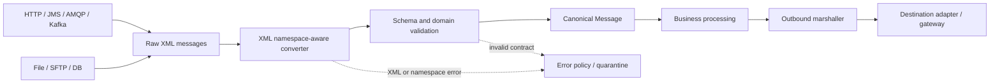
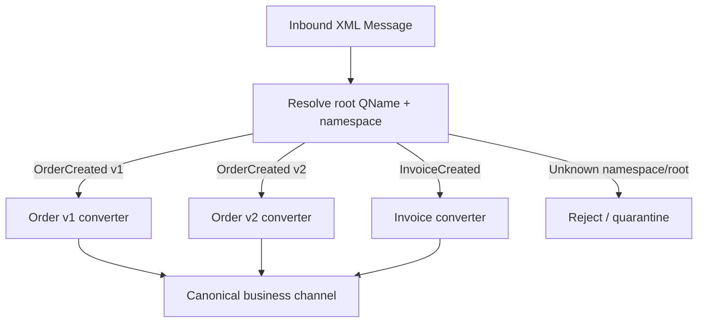
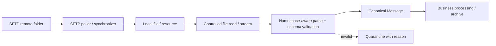

# XML converter và namespace trong Spring Integration Adapters

**XML converter** là thành phần biến đổi một biểu diễn XML (byte, chuỗi, `Source` hoặc tài liệu XML đã được xử lý an toàn) thành đối tượng Java, rồi chuyển ngược đối tượng thành XML khi cần gửi sang hệ thống khác. Trong Spring Integration, chuyển đổi này thường đặt ở **ranh giới inbound/outbound adapter hoặc gateway**, để các `MessageChannel` bên trong hệ thống có thể truyền một mô hình dữ liệu đã chuẩn hóa thay vì khiến mỗi handler tự parse XML.

Một phần đặc biệt quan trọng của XML là **namespace**. Hai tài liệu có thể cùng chứa thẻ `OrderCreated` nhưng thuộc **hai hợp đồng hoàn toàn khác nhau** nếu namespace URI khác. Một XML document có thể đổi tiền tố `o` thành `ord` mà ý nghĩa phần tử không đổi. Nếu converter, XPath router, JAXB mapping hoặc XSLT xử lý namespace sai, hệ thống có thể không tìm thấy phần tử, parse sai DTO, mất dữ liệu hoặc vô tình chấp nhận message của đối tác khác.

Bài học thuộc chương **Chuyển đổi dữ liệu** của module **Spring Integration Adapters**. Nội dung gắn XML với **inbound/outbound adapter, gateway, poller và MessageChannel**, minh họa luồng tích hợp file/SFTP, HTTP, JMS, AMQP, Kafka và database, từ hợp đồng message, định dạng, phiên bản, xử lý lỗi đến vòng đời kết nối.

> **Quy tắc nền tảng:** converter phải dựa trên **hợp đồng XML đã được phê duyệt**, xét đúng **QName (namespace URI + local name)**, kiểm tra dữ liệu và đặt giới hạn bảo mật. Một thẻ có tên nhìn giống nhau hoặc một HTTP header `Content-Type: application/xml` **không chứng minh** payload thuộc đúng schema, đến từ nguồn tin cậy hoặc được phép thực hiện thao tác nghiệp vụ.

## 1. Mục tiêu học tập

Sau bài này, người học có thể:

1. Phân biệt XML parsing, unmarshalling, marshalling, transformation, validation và serialization.
2. Giải thích **namespace URI, prefix, default namespace, QName, attribute namespace** và cách chúng tác động tới kết quả chuyển đổi.
3. Cấu hình **Spring OXM `Jaxb2Marshaller`** và dùng nó trong luồng Spring Integration.
4. Tách **XML DTO** khỏi **canonical domain model**, giữ hợp đồng định dạng tại biên.
5. Đọc đúng XML có prefix khác nhau nhưng cùng namespace URI và từ chối namespace không hỗ trợ.
6. Dùng XPath và XSLT có **namespace binding rõ ràng**, không chọn phần tử chỉ bằng `local-name()` một cách vô điều kiện.
7. Kết hợp XSD để phát hiện lỗi cấu trúc và hiểu giới hạn của schema validation.
8. Đặt converter đúng trong luồng HTTP, SFTP/file, JMS, AMQP, Kafka và JDBC.
9. Phòng ngừa XXE, entity expansion, truy cập tài nguyên ngoài, payload quá lớn và kiểu Java không được phê duyệt.
10. Thiết kế error handling, DLQ/quarantine, idempotency, observability và kiểm thử cho cả happy path lẫn dữ liệu sai.

## 2. XML converter giải quyết vấn đề nào?

Giả sử hệ thống nhận thông báo đơn hàng XML từ một đối tác:

```xml
<?xml version="1.0" encoding="UTF-8"?>
<OrderCreated xmlns="urn:acme:orders:v1">
    <eventId>evt-1001</eventId>
    <orderId>ORD-42</orderId>
    <amountCents>159900</amountCents>
</OrderCreated>
```

Business handler muốn làm việc với mô hình Java:

```java
public record OrderCreated(
    String eventId,
    String orderId,
    long amountCents
) {}
```

Không nên bắt handler biết cách đọc `InputStream`, xử lý namespace, parse phần tử, kiểm tra schema và quản lý lỗi XML. Một kiến trúc rõ ràng là:



Đây là **sơ đồ logic**. Trong triển khai, có thể có nhiều channel và điểm kiểm tra riêng theo nguồn. Adapter không nhất thiết luôn trả về `byte[]`: file adapter có thể tạo `File`, HTTP gateway có thể giải mã body trước và một listener AMQP/JMS có thể đã áp converter ở tầng transport.

**Nguyên tắc thiết kế:** quyết định rõ **mỗi ranh giới dùng kiểu payload nào**, converter chạy ở đâu, ai chịu trách nhiệm kiểm tra namespace/schema, và thông tin nào còn được giữ sau chuyển đổi.

## 3. Các tầng chuyển đổi liên quan nhưng khác nhau

| Thành phần | Nhiệm vụ | Ví dụ |
| --- | --- | --- |
| **Transport adapter** | Nhận/gửi message qua một hệ thống bên ngoài. | HTTP inbound gateway, JMS inbound adapter, SFTP inbound file adapter. |
| **Transport message converter/codec** | Chuyển biểu diễn riêng của transport. | AMQP message converter, HTTP body conversion, Kafka deserializer. |
| **XML parser** | Đọc cú pháp XML thành sự kiện/cấu trúc XML. | SAX, StAX, DOM. |
| **XML unmarshaller** | Map biểu diễn XML vào object Java. | Spring OXM `Jaxb2Marshaller.unmarshal(...)`. |
| **XML marshaller** | Biểu diễn object Java thành XML. | `Jaxb2Marshaller.marshal(...)`. |
| **Spring Integration Transformer** | Endpoint biến đổi payload/message trong flow. | `UnmarshallingTransformer` hoặc transformer riêng. |
| **XSD validator** | Kiểm tra XML theo schema được quản trị. | XML Schema validation. |
| **XPath selector/router** | Tìm giá trị hoặc chọn nhánh xử lý dựa trên XML. | Định tuyến theo QName/event type. |
| **XSLT transformer** | Biến đổi cấu trúc XML sang XML hoặc định dạng khác. | Đổi namespace/schema của đối tác thành canonical XML. |

Một số adapter dùng converter riêng của tầng transport; Spring OXM có các giao diện `Marshaller` và `Unmarshaller`; Spring Integration cung cấp transformer XML để nối chúng vào luồng. Không nên mặc định rằng cấu hình `contentType=application/xml` sẽ khiến mọi `MessageChannel` tự parse XML.

## 4. XML namespace: danh tính thực của một phần tử

Một tên XML có namespace nên được hiểu là một **expanded name**:

```text
{namespace URI}localName
```

Ví dụ:

```text
{urn:acme:orders:v1}OrderCreated
```

Hai cách viết sau thường đại diện cho **cùng một QName của phần tử gốc**:

```xml
<OrderCreated xmlns="urn:acme:orders:v1">
    <eventId>evt-1001</eventId>
</OrderCreated>
```

```xml
<ord:OrderCreated xmlns:ord="urn:acme:orders:v1">
    <ord:eventId>evt-1001</ord:eventId>
</ord:OrderCreated>
```

Trong trường hợp này, tiền tố `ord` chỉ là alias cục bộ trỏ tới URI. Đổi alias thành `x` nhưng giữ URI và local name không làm thay đổi QName.

### 4.1. Ba phần thường bị nhầm

- **Namespace URI:** định danh logic của tập tên, ví dụ `urn:acme:orders:v1`. Không bắt buộc là URL có thể tải nội dung.
- **Prefix:** tên ngắn do tài liệu khai báo, ví dụ `ord` trong `xmlns:ord="..."`; không có ý nghĩa độc lập với URI.
- **Local name:** phần tên sau dấu hai chấm, ví dụ `OrderCreated`.

Do đó, converter đúng **không nên gắn cứng vào chuỗi prefix**. Nó nên đối chiếu namespace URI và local name theo hợp đồng.

### 4.2. So sánh sai và đúng

| Cách kiểm tra | Ví dụ | Kết luận |
| --- | --- | --- |
| So chuỗi tag `<ord:OrderCreated>` | Đối tác đổi prefix thành `p:`. | Dễ hỏng dù XML tương đương. |
| Chỉ so local name `OrderCreated` | Có thêm XML của namespace khác cùng tên. | Có thể nhầm hợp đồng. |
| So expanded name | `{urn:acme:orders:v1}OrderCreated`. | Phù hợp cho nhận diện định dạng. |
| So namespace đúng nhưng bỏ schema version | Hai version dùng cùng namespace. | Vẫn có thể parse sai cấu trúc. |

## 5. Default namespace và tiền tố được khai báo

Một phần tử không có prefix **vẫn có thể nằm trong namespace**, nếu namespace mặc định đang có hiệu lực:

```xml
<Envelope xmlns="urn:acme:envelope:v1">
    <OrderCreated xmlns="urn:acme:orders:v1">
        <eventId>evt-1001</eventId>
    </OrderCreated>
</Envelope>
```

Ở đây:

- `Envelope` thuộc `urn:acme:envelope:v1`.
- `OrderCreated` và `eventId` thuộc `urn:acme:orders:v1`.
- Default namespace được khai báo lại ở phần tử con.

### 5.1. Hủy default namespace

```xml
<OrderCreated xmlns="urn:acme:orders:v1">
    <metadata xmlns="">
        <source>partner-a</source>
    </metadata>
</OrderCreated>
```

`metadata` và `source` **không thuộc** namespace order vì `xmlns=""` đã đặt default namespace về rỗng trong phạm vi đó.

Một DTO/JAXB mapping mong `{urn:acme:orders:v1}metadata` sẽ không tự coi `metadata` không namespace là cùng phần tử.

### 5.2. Prefix được khai báo trên ancestor

```xml
<env:Envelope
    xmlns:env="urn:acme:envelope:v1"
    xmlns:o="urn:acme:orders:v1">
    <o:OrderCreated>
        <o:eventId>evt-1001</o:eventId>
    </o:OrderCreated>
</env:Envelope>
```

Bộ xử lý XML có namespace nhận biết `o` dù khai báo nằm ở phần tử cha. Không cần khai báo `xmlns:o` lại ở từng phần tử.

## 6. Namespace của attribute: một quy tắc đặc biệt quan trọng

**Default namespace không áp dụng cho attribute không có prefix.** Đây là nguồn lỗi phổ biến khi viết XPath hoặc JAXB.

```xml
<OrderCreated xmlns="urn:acme:orders:v1"
              id="ORD-42"
              xmlns:m="urn:acme:metadata:v1"
              m:source="partner-a">
    <eventId>evt-1001</eventId>
</OrderCreated>
```

Phân tích:

| Thành phần | Expanded name |
| --- | --- |
| Phần tử `OrderCreated` | `{urn:acme:orders:v1}OrderCreated` |
| Phần tử `eventId` | `{urn:acme:orders:v1}eventId` |
| Attribute `id` | `{}id` — không namespace |
| Attribute `m:source` | `{urn:acme:metadata:v1}source` |

Nếu dùng XPath, cách tham chiếu attribute `id` thường là `@id`, trong khi attribute `m:source` phải dùng prefix được ánh xạ tới đúng URI, ví dụ `@m:source`.

## 7. Content type không quyết định namespace

HTTP thường dùng:

```text
Content-Type: application/xml
Content-Type: text/xml; charset=UTF-8
Content-Type: application/vnd.acme.order+xml
```

Các giá trị này mô tả **biểu diễn XML trên wire**. Chúng không thay thế kiểm tra:

1. Root element và namespace của document.
2. Schema/contract version.
3. Cấu trúc và kiểu dữ liệu XML.
4. Quy tắc nghiệp vụ.
5. Xác thực nguồn gửi và authorization độc lập với payload.

Hai đối tác có thể cùng dùng `application/xml` nhưng một bên gửi `{urn:acme:orders:v1}OrderCreated` và bên còn lại gửi `{urn:other:inventory:v1}StockChanged`.

Mô hình dispatch có thể gồm:

```text
Verified producer + endpoint contract
  -> Allowed media type (application/xml or approved +xml)
  -> Root QName (namespace URI + local name)
  -> Schema/version mapping
  -> Unmarshal to permitted DTO
  -> Validate domain data
  -> Canonical Message<T>
```

Đừng sử dụng XML root name hoặc content type do bên ngoài cung cấp để **tự động nạp Java class bất kỳ**.

## 8. Chuẩn bị thư viện và lựa chọn JAXB cho Java hiện đại

Trong một dự án Spring Integration hiện đại sử dụng Spring Framework 6/Spring Boot 3, nhiều API JAXB dựa trên namespace **Jakarta** (`jakarta.xml.bind.*`), thay vì `javax.xml.bind.*` của các thế hệ cũ.

Các thành phần khái niệm thường cần:

- Spring Integration core cho channel, endpoint, transformer và gateway.
- Module **Spring Integration XML** nếu dùng transformer XML tích hợp sẵn.
- **Spring OXM** cho giao diện marshalling/unmarshalling và `Jaxb2Marshaller`.
- JAXB API và runtime tương thích nếu dùng JAXB trên JDK hiện đại.
- Spring Test/JUnit nếu cần kiểm thử.

Không nên sao chép phiên bản dependency một cách mù quáng từ dự án cũ. Cần giữ các phiên bản tương thích với **Spring Boot/Spring Framework đang sử dụng** và phân biệt mã nguồn `javax.*` với `jakarta.*` theo thế hệ.

### 8.1. Khi nào dùng JAXB và khi nào dùng XML parser khác?

| Công cụ | Thường phù hợp | Lưu ý |
| --- | --- | --- |
| **JAXB + Spring OXM** | XML schema/DTO có cấu trúc ổn định, marshalling hai chiều. | QName, annotations, JAXB context, schema validation. |
| **Jackson XML / XmlMapper** | DTO hướng JSON/XML, ứng dụng đã dùng Jackson. | Cần kiểm thử hành vi namespace, attributes và cấu trúc XML cụ thể. |
| **StAX** | Dữ liệu XML lớn, cần đọc dạng streaming. | Tự quản lý state, namespace và xử lý từng phần. |
| **SAX** | Event-driven parser, memory thấp. | Handler phức tạp nếu cần mô hình đối tượng. |
| **DOM** | Tài liệu nhỏ, cần điều hướng/chỉnh sửa cây XML. | Tốn bộ nhớ với tài liệu lớn; parser phải cấu hình an toàn. |
| **XSLT** | Chuyển cấu trúc XML giữa hai hợp đồng. | Stylesheet, resource access và version cần quản trị. |

JAXB là một lựa chọn minh họa cho bài học; không phải mọi dạng XML đều phù hợp map thẳng vào một DTO.

## 9. Ví dụ dữ liệu: XML order với namespace v1

Hợp đồng inbound mẫu:

```xml
<?xml version="1.0" encoding="UTF-8"?>
<o:OrderCreated xmlns:o="urn:acme:orders:v1">
    <o:eventId>evt-1001</o:eventId>
    <o:orderId>ORD-42</o:orderId>
    <o:amountCents>159900</o:amountCents>
</o:OrderCreated>
```

Đặt quy ước:

| Mục | Giá trị |
| --- | --- |
| Media type | `application/xml` hoặc `application/vnd.acme.order+xml` theo allowlist |
| Root QName | `{urn:acme:orders:v1}OrderCreated` |
| Encoding | UTF-8 |
| eventId | Chuỗi khác rỗng, dùng làm idempotency key theo thiết kế |
| orderId | Chuỗi khác rỗng |
| amountCents | Số nguyên dương |
| Max payload | Ví dụ 1 MiB cho sự kiện đơn hàng đơn lẻ |
| Target DTO | `OrderCreatedXml` |
| Canonical model | `OrderCreated` |
| Lỗi format | Reject/quarantine theo transport và chính sách retry |

Các giới hạn này là **ví dụ về hợp đồng được phê duyệt**, không phải giá trị mặc định của Spring Integration.

## 10. Định nghĩa JAXB DTO có QName rõ ràng

Ví dụ dành cho Jakarta JAXB:

```java
import jakarta.xml.bind.annotation.XmlAccessType;
import jakarta.xml.bind.annotation.XmlAccessorType;
import jakarta.xml.bind.annotation.XmlElement;
import jakarta.xml.bind.annotation.XmlRootElement;
import jakarta.xml.bind.annotation.XmlType;

@XmlRootElement(
    name = "OrderCreated",
    namespace = "urn:acme:orders:v1"
)
@XmlAccessorType(XmlAccessType.FIELD)
@XmlType(propOrder = {"eventId", "orderId", "amountCents"})
public class OrderCreatedXml {

    @XmlElement(
        name = "eventId",
        namespace = "urn:acme:orders:v1",
        required = true
    )
    private String eventId;

    @XmlElement(
        name = "orderId",
        namespace = "urn:acme:orders:v1",
        required = true
    )
    private String orderId;

    @XmlElement(
        name = "amountCents",
        namespace = "urn:acme:orders:v1",
        required = true
    )
    private long amountCents;

    public OrderCreatedXml() {
        // JAXB cần constructor không đối số.
    }

    public OrderCreatedXml(
        String eventId, String orderId, long amountCents
    ) {
        this.eventId = eventId;
        this.orderId = orderId;
        this.amountCents = amountCents;
    }

    public String getEventId() {
        return eventId;
    }

    public String getOrderId() {
        return orderId;
    }

    public long getAmountCents() {
        return amountCents;
    }
}
```

**Lý do ghi namespace tường minh:** namespace của root và namespace của phần tử con được xác định rõ, tránh phụ thuộc vào mặc định của package. Một XML producer có thể gửi tài liệu tương đương với default namespace hoặc tiền tố khác, miễn là QName của các phần tử đúng.

### 10.1. Biến thể dùng package-level `@XmlSchema`

Với nhiều DTO cùng namespace, có thể khai báo trong `package-info.java`:

```java
@jakarta.xml.bind.annotation.XmlSchema(
    namespace = "urn:acme:orders:v1",
    elementFormDefault =
        jakarta.xml.bind.annotation.XmlNsForm.QUALIFIED
)
package com.example.integration.xmlorders;
```

Khi `elementFormDefault=QUALIFIED`, các phần tử thuộc package có thể sử dụng namespace tương ứng theo quy tắc JAXB, giúp giảm annotation lặp. Tuy nhiên, thay đổi package-level annotation có thể ảnh hưởng toàn bộ DTO trong package. Cần kiểm thử lại XML đầu ra và XSD.

### 10.2. Validation ở DTO không thay thế XSD

`@XmlElement(required=true)` cung cấp metadata cho JAXB, nhưng **không nên giả định** mọi ràng buộc bắt buộc, số lần xuất hiện hoặc định dạng đều được thực thi đầy đủ nếu không bật schema validation thích hợp. Trường `long` primitive cũng có thể nhận giá trị mặc định 0 khi thiếu, tùy quá trình unmarshalling.

Do đó, sau unmarshal vẫn phải **validate schema và dữ liệu nghiệp vụ**, ví dụ `eventId` không rỗng, `amountCents > 0` và version được phép.

## 11. Cấu hình Spring OXM Jaxb2Marshaller

Spring OXM cung cấp `org.springframework.oxm.jaxb.Jaxb2Marshaller`, hỗ trợ cả marshalling và unmarshalling.

```java
import org.springframework.context.annotation.Bean;
import org.springframework.context.annotation.Configuration;
import org.springframework.oxm.jaxb.Jaxb2Marshaller;

@Configuration
public class XmlOrderConfiguration {

    @Bean
    public Jaxb2Marshaller orderXmlMarshaller() {
        Jaxb2Marshaller marshaller = new Jaxb2Marshaller();

        marshaller.setClassesToBeBound(OrderCreatedXml.class);

        // Không cho phép DTD và XML external entities đối với
        // dữ liệu XML không tin cậy.
        marshaller.setSupportDtd(false);
        marshaller.setProcessExternalEntities(false);

        return marshaller;
    }
}
```

Những lựa chọn trong ví dụ nhằm minh họa **cấu hình có chủ ý**. Các kiểm soát an toàn còn phụ thuộc vào loại `Source`, parser và phiên bản thư viện. Nếu XML đã được biến thành `DOMSource` từ trước, cấu hình `Jaxb2Marshaller` **không thể sửa một lần parse DOM không an toàn đã xảy ra**. Phải bảo vệ mọi điểm parse trong pipeline.

### 11.1. JAXB context phải được kiểm soát

Có thể dùng `setClassesToBeBound(...)` cho DTO đã được duyệt, hoặc cấu hình context path theo mô hình dữ liệu của dự án. Không nhận trực tiếp tên class từ header XML ngoài rồi tạo context/dynamically load class tùy ý.

### 11.2. Có bắt buộc dùng transformer tự viết?

Không. Spring Integration XML có các transformer như **`UnmarshallingTransformer`** và **`MarshallingTransformer`** tích hợp với Spring OXM; chúng hữu ích khi cần biến đổi đơn giản theo một hợp đồng cố định. Transformer riêng hợp lý hơn nếu muốn:

- Kiểm tra allowlist QName, content type hoặc schema version trước mapping.
- Chuẩn hóa nhiều DTO về một canonical model.
- Kiểm soát header nào được giữ.
- Áp dụng validate nghiệp vụ và reason code riêng.
- Quản lý payload size và lỗi theo nguồn.

Các loại payload được transformer tích hợp hỗ trợ có thể phụ thuộc phiên bản và cách adapter tạo `Source`/`String`/`byte[]`; cần kiểm tra với luồng cụ thể, không giả định mọi adapter đều sinh cùng kiểu.

## 12. Ví dụ inbound Transformer: XML bytes sang domain event

Ví dụ sau giả định một inbound adapter đã chuẩn hóa payload thành `Message<byte[]>` và content type XML đã được kiểm tra ở ranh giới. Transformer dùng JAXB để unmarshal, sau đó tạo canonical event:

```java
public record OrderCreated(
    String eventId,
    String orderId,
    long amountCents
) {
    public OrderCreated {
        if (eventId == null || eventId.isBlank()) {
            throw new IllegalArgumentException("eventId is required");
        }
        if (orderId == null || orderId.isBlank()) {
            throw new IllegalArgumentException("orderId is required");
        }
        if (amountCents <= 0) {
            throw new IllegalArgumentException("amountCents must be positive");
        }
    }
}
```

```java
import java.io.ByteArrayInputStream;
import org.springframework.integration.annotation.Transformer;
import org.springframework.messaging.Message;
import org.springframework.messaging.support.MessageBuilder;
import org.springframework.oxm.jaxb.Jaxb2Marshaller;
import org.springframework.stereotype.Component;
import javax.xml.transform.stream.StreamSource;

@Component
public class XmlOrderInboundTransformer {

    private static final int MAX_BYTES = 1_048_576;
    private final Jaxb2Marshaller marshaller;

    public XmlOrderInboundTransformer(Jaxb2Marshaller marshaller) {
        this.marshaller = marshaller;
    }

    @Transformer(
        inputChannel = "rawXmlOrdersChannel",
        outputChannel = "canonicalOrdersChannel"
    )
    public Message<OrderCreated> convert(Message<byte[]> input) {
        byte[] bytes = input.getPayload();

        if (bytes.length == 0 || bytes.length > MAX_BYTES) {
            throw new IllegalArgumentException("Invalid XML payload size");
        }

        // Marshaller được cấu hình để không cho DTD/external entities.
        Object parsed = marshaller.unmarshal(
            new StreamSource(new ByteArrayInputStream(bytes))
        );

        if (!(parsed instanceof OrderCreatedXml xml)) {
            throw new IllegalArgumentException("Unexpected XML root/type");
        }

        OrderCreated domain = new OrderCreated(
            xml.getEventId(),
            xml.getOrderId(),
            xml.getAmountCents()
        );

        // Không copy tất cả headers từ nguồn ngoài.
        return MessageBuilder.withPayload(domain)
            .setHeader(
                "correlationId",
                input.getHeaders().get("correlationId")
            )
            .setHeader("wireFormat", "application/xml")
            .setHeader("schemaId", "order-created-v1")
            .build();
    }
}
```

Đây là **ví dụ học tập tập trung vào bước convert**. Trong triển khai production phải xử lý thêm:

- **Xác minh content type** và nguồn gửi tại inbound boundary.
- Bật XSD validation khi hợp đồng yêu cầu; mapping thành DTO chưa bảo đảm mọi ràng buộc XSD.
- Kiểm soát entity, độ sâu, dung lượng và parser resource limits.
- Không giả định `correlationId` do client tự khai là một định danh đáng tin.
- Đối với message đã chuyển thành DOM/Source ở tầng trước, kiểm tra parser tầng đó.
- Nhất quán với Java/Jakarta imports ở thế hệ Spring sử dụng.
- Bảo vệ log và không in raw XML có dữ liệu nhạy cảm khi exception xảy ra.

### 12.1. Vì sao dùng bytes thay vì String?

Khi nhận XML dưới dạng byte[], parser có thể xét **XML declaration và quy tắc encoding XML** theo API. Nếu chuyển bytes thành `String` bằng charset tùy tiện trước khi parse, dữ liệu có thể sai trước khi JAXB được gọi.

Không phải trường hợp nào cũng phải giữ bytes tới business layer: một HTTP gateway có thể đã giải mã body đúng cách. Điểm quan trọng là **mỗi bước decode chỉ được thực hiện theo hợp đồng có chủ ý**, không chuyển qua nhiều charset một cách ngẫu nhiên.

## 13. Outbound: marshalling canonical event sang XML

Luồng outbound cần biết **đối tác đích yêu cầu namespace/version nào**. Không nên serialize domain object với DTO của một đối tác khác rồi hi vọng bên nhận hiểu được.

Ví dụ transformer từ canonical event sang XML bytes:

```java
import java.io.ByteArrayOutputStream;
import javax.xml.transform.stream.StreamResult;
import org.springframework.integration.annotation.Transformer;
import org.springframework.messaging.Message;
import org.springframework.messaging.MessageHeaders;
import org.springframework.messaging.support.MessageBuilder;
import org.springframework.oxm.jaxb.Jaxb2Marshaller;
import org.springframework.stereotype.Component;
import org.springframework.util.MimeTypeUtils;

@Component
public class XmlOrderOutboundTransformer {

    private final Jaxb2Marshaller marshaller;

    public XmlOrderOutboundTransformer(Jaxb2Marshaller marshaller) {
        this.marshaller = marshaller;
    }

    @Transformer(
        inputChannel = "outboundDomainOrdersChannel",
        outputChannel = "outboundXmlBytesChannel"
    )
    public Message<byte[]> toXml(Message<OrderCreated> input) {
        OrderCreated order = input.getPayload();

        OrderCreatedXml xml = new OrderCreatedXml(
            order.eventId(),
            order.orderId(),
            order.amountCents()
        );

        ByteArrayOutputStream output = new ByteArrayOutputStream();
        marshaller.marshal(xml, new StreamResult(output));

        return MessageBuilder.withPayload(output.toByteArray())
            .setHeader(MessageHeaders.CONTENT_TYPE,
                       MimeTypeUtils.APPLICATION_XML)
            .setHeader(
                "correlationId",
                input.getHeaders().get("correlationId")
            )
            .build();
    }
}
```

**Điều cần kiểm thử:** `marshaller.marshal(...)` phải tạo ra root QName đúng với contract, charset/encoding phù hợp và nội dung được target chấp nhận. Tiền tố XML được tạo có thể khác mẫu minh họa, nhưng **namespace URI + local name** phải đúng. Không nên viết test so chuỗi XML nguyên văn khi khác biệt prefix, whitespace hoặc thứ tự khai báo namespace không làm thay đổi ý nghĩa XML.

### 13.1. Header nội bộ và header transport

Sau khi tạo XML bytes, header `MessageHeaders.CONTENT_TYPE` mô tả wire payload. Tuy nhiên, adapter outbound phải **ánh xạ metadata này** sang transport:

- HTTP: HTTP `Content-Type` của request/response.
- AMQP: message properties theo cấu hình.
- JMS: property hoặc converter theo hợp đồng.
- Kafka: record headers và serializer độc lập.
- File: phần mở rộng/metadata lưu trữ theo quy ước, không có HTTP content type mặc định.

Set header trong Spring Message **không tự bảo đảm** mọi outbound adapter sẽ xuất hiện đúng header ở hệ thống đích.

## 14. Namespace và XPath: tại sao query thường trả rỗng?

XPath 1.0 có quy tắc dễ gây nhầm: **tên phần tử không có prefix trong XPath thường khớp phần tử không namespace**, kể cả khi XML dùng một default namespace.

XML:

```xml
<OrderCreated xmlns="urn:acme:orders:v1">
    <orderId>ORD-42</orderId>
</OrderCreated>
```

XPath sai với tài liệu này:

```xpath
/OrderCreated/orderId/text()
```

XPath đúng sau khi bind `o` → `urn:acme:orders:v1`:

```xpath
/o:OrderCreated/o:orderId/text()
```

**Không cần** XML gốc sử dụng prefix `o`. Prefix trong biểu thức XPath chỉ là alias do XPath context khai báo; nó vẫn khớp phần tử có cùng namespace URI trong XML.

### 14.1. NamespaceContext trong Java

Ví dụ dùng Java XML XPath:

```java
import java.util.Collections;
import java.util.Iterator;
import javax.xml.XMLConstants;
import javax.xml.namespace.NamespaceContext;
import javax.xml.xpath.XPath;
import javax.xml.xpath.XPathFactory;

XPath xpath = XPathFactory.newInstance().newXPath();

xpath.setNamespaceContext(new NamespaceContext() {
    @Override
    public String getNamespaceURI(String prefix) {
        if ("o".equals(prefix)) {
            return "urn:acme:orders:v1";
        }
        if (XMLConstants.XML_NS_PREFIX.equals(prefix)) {
            return XMLConstants.XML_NS_URI;
        }
        if (XMLConstants.XMLNS_ATTRIBUTE.equals(prefix)) {
            return XMLConstants.XMLNS_ATTRIBUTE_NS_URI;
        }
        return XMLConstants.NULL_NS_URI;
    }

    @Override
    public String getPrefix(String namespaceURI) {
        if ("urn:acme:orders:v1".equals(namespaceURI)) {
            return "o";
        }
        return null;
    }

    @Override
    public Iterator<String> getPrefixes(String namespaceURI) {
        String prefix = getPrefix(namespaceURI);
        return prefix == null
            ? Collections.emptyIterator()
            : Collections.singleton(prefix).iterator();
    }
});

String expression = "/o:OrderCreated/o:orderId/text()";
```

Sau đó có thể dùng XPath với một `Document` hoặc `Source` đã được parse an toàn. **Ví dụ chỉ tạo XPath context**, không bao gồm đoạn parse XML; khi parse dữ liệu ngoài, phải bật namespace awareness và chặn DTD/external entities ở parser.

### 14.2. Vì sao không dùng `local-name()` cho mọi thứ?

Đôi khi người viết dùng:

```xpath
/*[local-name()='OrderCreated']/*[local-name()='orderId']
```

Cách này bỏ qua namespace, nên có thể chọn phần tử của **một hợp đồng XML khác** có cùng local name. Nó chỉ nên dùng nếu cố ý chấp nhận nhiều namespace và vẫn có cách kiểm tra namespace/contract riêng. Trong tích hợp nhiều đối tác, XPath gắn namespace rõ thường an toàn và dễ bảo trì hơn.

## 15. XPath trong Spring Integration: selector, router và splitter

Spring Integration XML cung cấp khả năng dùng XPath trong **routing, filtering/selecting, splitting** hoặc lấy giá trị header, tùy phiên bản và endpoint được cấu hình.

Ví dụ nghiệp vụ:

- **Selector:** chỉ nhận event có `/o:OrderCreated/o:status = 'CONFIRMED'`.
- **Router:** chọn nhánh xử lý theo loại event trong namespace được hỗ trợ.
- **Splitter:** tách danh sách `/o:Orders/o:Order` thành nhiều message con.
- **Header enrichment:** trích `orderId` từ XML để đặt metadata cho luồng xử lý.

### 15.1. Sơ đồ router



Hợp đồng nên dựa vào QName và version được phê duyệt, không dựa đơn thuần vào chuỗi prefix hoặc tên class do producer khai.

### 15.2. Khi split XML document lớn

Một splitter dựa XPath có thể chọn nhiều node con. Nhưng **mỗi node con có thể phụ thuộc namespace declarations và context từ cha**. Khi serialize thành message độc lập, cần bảo đảm namespace cần thiết vẫn hợp lệ.

Ngoài ra, DOM-based splitting có thể yêu cầu load cả tài liệu lớn vào memory. Với file vài GB, nên cân nhắc StAX streaming hoặc xử lý theo record/chunk với hợp đồng rõ ràng thay vì dựng DOM hoàn chỉnh.

## 16. XSLT và chuyển đổi namespace giữa hai hợp đồng

Đôi khi hai hệ thống dùng XML nhưng khác namespace hoặc cấu trúc:

- Legacy: `urn:legacy:orders:v1`.
- Target: `urn:acme:orders:v2`.

Không nên sửa namespace URI bằng cách thay chuỗi thô trong XML, vì có thể làm hỏng attribute, text hoặc các phần tử cùng tên trong namespace khác. Có thể dùng **XSLT** đã được quản trị để chuyển cấu trúc có hiểu namespace.

XML nguồn:

```xml
<l:Order xmlns:l="urn:legacy:orders:v1">
    <l:Id>ORD-42</l:Id>
</l:Order>
```

Một XSLT tối giản:

```xml
<?xml version="1.0" encoding="UTF-8"?>
<xsl:stylesheet
    version="1.0"
    xmlns:xsl="http://www.w3.org/1999/XSL/Transform"
    xmlns:l="urn:legacy:orders:v1"
    xmlns:o="urn:acme:orders:v2"
    exclude-result-prefixes="l">

    <xsl:output method="xml" encoding="UTF-8" indent="yes"/>

    <xsl:template match="/l:Order">
        <o:OrderCreated>
            <o:orderId>
                <xsl:value-of select="l:Id"/>
            </o:orderId>
        </o:OrderCreated>
    </xsl:template>
</xsl:stylesheet>
```

Đây là **ví dụ biến đổi cấu trúc tối giản**, chưa phải schema đầy đủ của `OrderCreated`. Nếu downstream yêu cầu thêm `eventId` hoặc `amountCents`, cần bổ sung mapping và validation; không được tự coi XSLT đã tạo XML hợp lệ chỉ vì transform không báo lỗi.

### 16.1. XSLT nên chạy ở đâu?

Tùy pipeline:

```text
SFTP file (legacy XML)
    -> safe XML parsing / XSLT transformation
    -> target XML contract
    -> XSD validation / JAXB unmarshal
    -> canonical domain model
```

Spring Integration XML có **`XsltPayloadTransformer`** cho các luồng cần XSLT. Cần xác định nguồn stylesheet cố định/được duyệt, transformer factory an toàn và chiến lược quản lý version.

### 16.2. Bảo mật XSLT

Stylesheet hoặc XML có thể tham chiếu tài nguyên bên ngoài qua `document()`, include/import hoặc entity. Với dữ liệu không tin cậy, phải:

- Không cho user/producer tự chọn URL stylesheet bất kỳ.
- Dùng stylesheet đã được kiểm soát và version hóa.
- Giới hạn truy cập network/file từ transformer factory theo khả năng hỗ trợ.
- Bật secure processing và giới hạn các external access properties khi có thể.
- Kiểm tra timeout/tài nguyên, đặc biệt với input lớn.
- Không ghi XML nhạy cảm nguyên văn vào log khi transform thất bại.

## 17. XSD validation: namespace và schema phải khớp

XSD mô tả cấu trúc, kiểu dữ liệu và những ràng buộc nhất định của XML. Thuộc tính `targetNamespace` là một phần trọng yếu của hợp đồng.

XSD ví dụ:

```xml
<?xml version="1.0" encoding="UTF-8"?>
<xs:schema
    xmlns:xs="http://www.w3.org/2001/XMLSchema"
    targetNamespace="urn:acme:orders:v1"
    xmlns:o="urn:acme:orders:v1"
    elementFormDefault="qualified">

    <xs:element name="OrderCreated">
        <xs:complexType>
            <xs:sequence>
                <xs:element name="eventId" type="xs:string"/>
                <xs:element name="orderId" type="xs:string"/>
                <xs:element name="amountCents" type="xs:positiveInteger"/>
            </xs:sequence>
        </xs:complexType>
    </xs:element>
</xs:schema>
```

Nếu XML dùng namespace khác, validator sẽ không coi phần tử gốc là `{urn:acme:orders:v1}OrderCreated` chỉ vì local name trùng.

### 17.1. XSD không thay thế validation nghiệp vụ

Schema ví dụ có thể kiểm tra `amountCents` dương, nhưng chưa bảo đảm:

- Event ID chưa từng được xử lý.
- Order ID thực sự tồn tại hoặc đúng tenant.
- Số tiền nhất quán với một giao dịch.
- Người gửi được phép tạo sự kiện.
- Trạng thái chuyển đổi nghiệp vụ hợp lệ.
- Chữ ký/chứng thực nguồn gửi đáng tin.

Các điều kiện này phải được kiểm tra ở các tầng appropriate của ứng dụng.

### 17.2. `xsi:schemaLocation` chỉ là gợi ý từ tài liệu

Ví dụ XML:

```xml
<OrderCreated
    xmlns="urn:acme:orders:v1"
    xmlns:xsi="http://www.w3.org/2001/XMLSchema-instance"
    xsi:schemaLocation="
        urn:acme:orders:v1 https://example.org/orders-v1.xsd">
</OrderCreated>
```

Địa chỉ schema trong XML **không phải nguồn tin cậy bắt buộc phải tải**. Với môi trường tích hợp an toàn, nên dùng **XSD được đóng gói/quản trị cục bộ hoặc schema registry có xác minh**, không để payload tùy ý buộc parser tải nội dung qua mạng.

### 17.3. XSD include/import

XSD có thể dùng `xs:include` và `xs:import`. Khi validator tải các schema phụ, phải quản lý resource resolution theo allowlist và chính sách access. Một schema chính nằm trong classpath nhưng import trỏ URL ngoài vẫn có thể tạo đường truy cập không mong muốn nếu không giới hạn resolver.

## 18. Bật kiểm tra schema với Spring OXM

`Jaxb2Marshaller` hỗ trợ cấu hình schema validation bằng các resource XSD theo API của nó. Một cấu hình minh họa:

```java
import org.springframework.beans.factory.annotation.Value;
import org.springframework.context.annotation.Bean;
import org.springframework.core.io.Resource;
import org.springframework.oxm.jaxb.Jaxb2Marshaller;

@Bean
Jaxb2Marshaller validatedOrderMarshaller(
    @Value("classpath:xsd/order-created-v1.xsd") Resource schema
) {
    Jaxb2Marshaller marshaller = new Jaxb2Marshaller();

    marshaller.setClassesToBeBound(OrderCreatedXml.class);
    marshaller.setSupportDtd(false);
    marshaller.setProcessExternalEntities(false);

    marshaller.setSchemas(schema);
    return marshaller;
}
```

Đây là **đoạn cấu hình minh họa nằm trong configuration class**. Phải bảo đảm XSD có sẵn trong classpath, resource imports được kiểm soát và thư viện/runtime hỗ trợ những biện pháp bảo vệ parser đã chọn.

### 18.1. Khi nào kiểm tra schema?

Một pipeline hợp lý:

```text
Transport authentication + body limits
    -> XML media type / root QName / version allowlist
    -> Secure parse + XSD validation
    -> JAXB unmarshal
    -> Domain validation
    -> Canonical channel
```

Tùy implementation, XSD validation có thể xảy ra **ngay trong unmarshal** khi marshaller được cấu hình schema, thay vì một endpoint riêng. Điều quan trọng là tránh **parse lặp nhiều lần** không cần thiết và bảo đảm **không có đường bypass validator** trong những luồng bắt buộc.

### 18.2. Versioning schema

Nếu có v1 và v2:

| Thành phần | v1 | v2 |
| --- | --- | --- |
| Namespace | `urn:acme:orders:v1` | `urn:acme:orders:v2` |
| Root | `OrderCreated` | `OrderCreated` |
| Trường amount | `amountCents` | Có thể là `amount` cùng currency |
| DTO | `OrderCreatedXmlV1` | `OrderCreatedXmlV2` |
| Mapping | V1 → canonical model | V2 → canonical model |

Không phải mọi hệ thống đều encode version trong namespace. Nếu cùng namespace giữa các phiên bản, phải có **version discriminator** và schema strategy riêng; không suy version chỉ từ URI.

## 19. XML security: phòng ngừa XXE và entity expansion

XML là định dạng có nhiều khả năng xử lý nâng cao, vì vậy parser không an toàn có thể tạo ra rủi ro.

### 19.1. Những nguy cơ thường gặp

| Rủi ro | Kịch bản | Biện pháp |
| --- | --- | --- |
| **XXE** | XML tham chiếu external entity tới file hoặc địa chỉ mạng nội bộ. | Vô hiệu hóa external entities/DTD theo hợp đồng, kiểm soát resolver. |
| **Entity expansion** | Entity được khai báo lồng nhau làm tăng tài nguyên parse. | Chặn DTD/entity expansion và giới hạn parser. |
| **XInclude / external schema** | Parser tự tải tài nguyên ngoài. | Tắt xử lý không cần thiết; chặn external access. |
| **XSLT document()/include** | Stylesheet đọc dữ liệu ngoài. | Stylesheet tin cậy, secure processing và allowlist. |
| **Depth / size exhaustion** | XML lớn hoặc lồng sâu gây CPU/RAM tăng. | Giới hạn body, nesting, streaming và timeout. |
| **Namespace confusion** | Dùng `local-name()` để chấp nhận XML sai contract. | Kiểm tra QName và schema. |
| **DTD/schema downgrade** | Dữ liệu có format khác được parse vì fallback. | Allowlist hợp đồng và fail closed. |
| **Sensitive logging** | Exception in toàn bộ XML/PII ra log. | Log reason code, kích thước, correlation; bảo vệ quarantine. |

### 19.2. Không chỉ bảo vệ JAXB

Dù đã gọi `marshaller.setProcessExternalEntities(false)`, một bước DOM, XPath hoặc XSLT trước đó vẫn có thể không an toàn. Kiểm kê **mọi nơi tạo XML parser hoặc Source**.

Ví dụ nếu dùng `DocumentBuilderFactory`:

```java
import javax.xml.XMLConstants;
import javax.xml.parsers.DocumentBuilderFactory;

DocumentBuilderFactory factory =
    DocumentBuilderFactory.newInstance();

factory.setNamespaceAware(true);
factory.setXIncludeAware(false);
factory.setExpandEntityReferences(false);
factory.setFeature(XMLConstants.FEATURE_SECURE_PROCESSING, true);
factory.setFeature(
    "http://apache.org/xml/features/disallow-doctype-decl",
    true
);
factory.setAttribute(XMLConstants.ACCESS_EXTERNAL_DTD, "");
factory.setAttribute(XMLConstants.ACCESS_EXTERNAL_SCHEMA, "");
```

**Chú ý:** mức hỗ trợ các feature/property có thể khác theo provider JAXP và runtime. Cần **kiểm thử startup và hành vi parser**; không nên nuốt lỗi cấu hình rồi tiếp tục parse không bảo vệ. Đối với parser phục vụ dữ liệu ngoài, việc không thể bật kiểm soát bảo mật bắt buộc phải dẫn đến fail safe/không nhận dữ liệu cho đến khi có phương án phù hợp.

### 19.3. Encoding và XML declaration

Nếu XML bytes có:

```xml
<?xml version="1.0" encoding="UTF-8"?>
```

thì quá trình chuyển từ bytes sang ký tự phải nhất quán với encoding được chấp nhận. Cần định nghĩa rõ tương tác giữa HTTP/JMS content type charset và XML declaration, xử lý BOM và từ chối trường hợp mâu thuẫn theo contract. Đừng dùng `new String(bytes)` phụ thuộc charset mặc định trước khi parse.

## 20. File và SFTP: từ XML file tới canonical Message

Trong các hệ tích hợp theo lô, đối tác có thể tải file XML qua SFTP.



### 20.1. Những việc cần quản lý ở adapter file/SFTP

1. **Nguồn file:** remote directory và danh tính SFTP đáng tin.
2. **File readiness:** tránh đọc file đang upload dở; hợp đồng có thể dùng rename/marker file.
3. **Loại dữ liệu:** XML được xác định theo folder/partner contract và xác minh nội dung; extension `.xml` không đủ.
4. **Kích thước:** tránh đọc nhiều GB vào một `byte[]` nếu không có giới hạn.
5. **Polling:** `maxMessagesPerPoll`, chu kỳ và concurrency phù hợp tải.
6. **Idempotency:** ngăn xử lý lại khi poller khởi động lại.
7. **Quarantine:** file XML không hợp lệ phải có nơi lưu an toàn và reason code.
8. **Archive:** chuyển file sau khi đã đạt mốc xử lý theo thiết kế; không coi chỉ parse thành công là nghiệp vụ đã commit.
9. **Lifecycle:** kết nối SFTP, session cache, timeout và retry có kiểm soát.

### 20.2. Streaming cho XML lớn

Với file hàng trăm MB hoặc GB, DOM/JAXB full-document có thể gây áp lực bộ nhớ. Có thể dùng **StAX streaming**, xử lý từng phần tử record, nhưng phải quản lý namespace context, schema/validation theo chiến lược phù hợp và trạng thái checkpoint.

Không nên đồng thời cho nhiều poller xử lý cùng file khi chưa có lock/idempotency rõ ràng.

## 21. HTTP gateway: hai chiều XML request/response

Trong HTTP inbound gateway:

```text
HTTP client
  -> Content-Type: application/xml
  -> HTTP message conversion / raw body mapping
  -> Spring Integration request channel
  -> XML unmarshal / validate / business handler
  -> XML marshal or error mapping
  -> HTTP response
```

### 21.1. Request và response có thể dùng contract khác

| Chiều | Cần xác định |
| --- | --- |
| **Inbound request** | Allowed Content-Type, max body, namespace, schema, authn/authz. |
| **Business handling** | Canonical DTO, idempotency, transaction. |
| **Outbound success response** | Response QName/namespace, Content-Type, status code. |
| **Outbound error response** | Lỗi chuẩn của API, nội dung an toàn, error namespace hoặc JSON theo hợp đồng. |

Nếu gateway/HTTP codec đã parse XML thành object, transformer downstream **không nên ép cast sang byte[] rồi parse lần hai**. Cần xác định conversion thực sự xảy ra ở tầng HTTP hay Spring Integration flow.

### 21.2. HTTP status tham khảo

- `415 Unsupported Media Type`: request Content-Type không được hỗ trợ.
- `400 Bad Request`: XML sai cú pháp hoặc sai hợp đồng request tùy chính sách API.
- `401/403`: lỗi xác thực/ủy quyền, tách khỏi lỗi XML.
- `422 Unprocessable Content`: có thể dùng cho một số lỗi ngữ nghĩa nghiệp vụ tùy API contract.
- `5xx`: lỗi hệ thống/transient, không dùng để che mọi payload sai.

Đừng phản hồi raw parser stack trace hoặc nội dung XML nhạy cảm cho client. Một `correlationId`/mã hỗ trợ đủ để đội vận hành tra cứu.

## 22. JMS, AMQP và Kafka: content type không tự chọn JAXB

### 22.1. JMS

JMS có `TextMessage`, `BytesMessage` và cơ chế properties riêng; không mặc định có HTTP Content-Type chuẩn. Một producer có thể gửi chuỗi XML qua `TextMessage` hoặc byte[] qua `BytesMessage`.

Cần quy định:

- Payload JMS message type nào được chấp nhận?
- Charset, encoding XML và property biểu thị format được quản lý ra sao?
- Conversion ở JMS listener/adapter hay Spring Integration Transformer?
- Nếu unmarshal lỗi, transaction/acknowledgement và redelivery thực tế thế nào?

### 22.2. AMQP

AMQP có message properties như content type/content encoding tùy broker/client, và Spring AMQP có message converter riêng.

Nếu AMQP layer đã chuyển byte[] XML sang Java object, downstream chỉ nhận canonical object và validate cần thiết. Nếu giữ XML bytes, dùng transformer XML tại flow. **Không nên parse hai lần** hay giả định Spring Messaging `contentType` tự được mapped từ mọi AMQP property.

### 22.3. Kafka

Kafka producer/consumer dùng **serializer/deserializer** cho key/value. Header `contentType=application/xml` là metadata nếu producer đặt và adapter chuyển tiếp; nó không khiến Kafka client tự dùng JAXB.

Ví dụ:

```text
Kafka value serializer = ByteArraySerializer
Kafka record value = XML bytes
Kafka header contentType = application/xml

Consumer ByteArrayDeserializer
  -> byte[]
  -> Spring Integration XML transformer
  -> OrderCreated
```

Nếu consumer dùng `StringDeserializer` thì payload có thể là `String`; nếu dùng deserializer khác, có thể là object. Converter phải biết kiểu đầu vào thực tế.

### 22.4. Poison message và offset/ack

Khi Kafka/JMS/AMQP nhận XML không hợp lệ, không nên retry mãi trong cùng một vị trí rồi chặn cả partition/queue. Chính sách cần phân biệt:

- **Permanent contract failure:** XML syntax, QName không hỗ trợ, schema invalid.
- **Transient dependency failure:** schema service, database, downstream tạm không sẵn sàng.
- **Business rejection:** dữ liệu đúng schema nhưng không hợp lệ về nghiệp vụ.

Retry, DLQ/DLT, commit/ack và transaction phải thiết kế theo từng adapter, có khả năng replay có kiểm soát và idempotency.

## 23. Database adapters và XML nằm trong cột dữ liệu

Với JDBC polling hoặc database inbound adapter, payload thường là row map/list hoặc đối tượng đã qua row mapper, không nhất thiết là XML bytes.

Nếu database lưu XML trong một cột:

```text
EVENT_OUTBOX
  event_id
  event_type
  payload_xml
  schema_version
  created_at
  status
```

Luồng có thể là:

```text
DB poller -> row map
          -> extract payload_xml
          -> read metadata event_type/schema_version
          -> XML converter
          -> canonical event
          -> handler
```

Chú ý:

1. Đừng tin `schema_version`/`event_type` chỉ vì nằm trong bảng nếu nguồn ghi không được kiểm soát.
2. Nếu column là SQL XML/CLOB, kiểm tra cách JDBC driver trả value và dung lượng dữ liệu.
3. Quy định transaction/idempotency để không bỏ mất event hoặc xử lý trùng khi poller restart.
4. Nếu XML sai, lưu trạng thái failure/quarantine mà không làm một record lỗi chặn toàn bộ poller.

## 24. Error handling cho lỗi XML và namespace

Lỗi parser, schema, namespace và lỗi nghiệp vụ cần được phân biệt.

| Loại lỗi | Ví dụ | Hướng xử lý |
| --- | --- | --- |
| **Malformed XML** | Thẻ đóng không khớp, ký tự không hợp lệ. | Reject/quarantine, không retry vô hạn. |
| **Unsupported namespace/QName** | `urn:partner-other:orders` ngoài allowlist. | Contract error, không ép về DTO hiện tại. |
| **Wrong schema version** | Gửi v2 tới endpoint chỉ chấp nhận v1. | Reject hoặc route v2 nếu đã hỗ trợ. |
| **XSD violation** | Thiếu trường, sai kiểu số. | Validation error, lưu reason có kiểm soát. |
| **XXE/DTD forbidden** | Có DOCTYPE hoặc external entity. | Chặn và cảnh báo tùy rủi ro. |
| **Encoding mismatch** | XML declaration và bytes không khớp. | Reject theo encoding contract. |
| **Business validation** | Amount không hợp lệ, orderId rỗng. | Domain error, có thể phản hồi caller. |
| **Infrastructure timeout** | Database/schema registry tạm lỗi. | Retry có giới hạn và backoff. |
| **Outbound marshal error** | DTO không thể biểu diễn theo XML target. | Không gửi payload lỗi; điều tra mapping/contract. |

### 24.1. Luồng đồng bộ khác bất đồng bộ

- **DirectChannel/gateway đồng bộ:** exception có thể lan lên caller và được gateway/HTTP layer chuyển thành lỗi phản hồi.
- **Poller/executor channel bất đồng bộ:** lỗi thường được xử lý qua cơ chế error handling/error channel khi cấu hình phù hợp.
- **JMS/AMQP/Kafka:** khả năng redelivery/DLQ và ack phụ thuộc adapter, transaction manager và listener container.

Không mặc định rằng mọi exception trong Spring Integration tự gửi tới một global error channel. Cần viết integration test cho **đường lỗi của chính transport đang dùng**.

### 24.2. Quarantine có kiểm soát

Một message XML không parse được có thể lưu vào vùng quarantine với:

- Source system đã xác minh, event ID hoặc file/record ID.
- Declared content type, root QName nếu đã parse an toàn được.
- Reason code, schema version, correlation ID.
- Thời gian nhận, số lần xử lý và owner.
- Payload gốc được mã hóa/lưu theo chính sách, không ghi nguyên văn vào application log.

Cần đường replay có phân quyền, kiểm tra tránh xử lý trùng và thời hạn giữ dữ liệu.

## 25. Kiểm thử đúng namespace và hợp đồng XML

Test XML **không nên chỉ so chuỗi nguyên văn**. Hai XML có prefix khác nhau hoặc whitespace khác nhau có thể tương đương về QName và dữ liệu.

### 25.1. Ma trận kiểm thử

| Test case | Input | Kỳ vọng |
| --- | --- | --- |
| Default namespace đúng | `xmlns="urn:acme:orders:v1"` | Parse thành `OrderCreatedXml`. |
| Prefix khác nhưng URI đúng | `xmlns:x="urn:acme:orders:v1"` | Kết quả như trên. |
| Root local name đúng, URI sai | `urn:other:orders:v1` | Reject namespace/contract. |
| Default namespace bị xóa ở con | `xmlns=""` cho `eventId` | Không map nhầm vào phần tử có namespace. |
| Attribute không namespace | `id="ORD-42"` | Không nhầm với attribute namespace khác. |
| Namespace bị thiếu | `<OrderCreated>` không `xmlns` | Reject nếu contract yêu cầu QName có URI. |
| XSD thiếu required field | Bỏ `orderId` | Schema/domain validation fail. |
| Sai amount | Số âm hoặc không phải số | Fail. |
| XML với DOCTYPE/entity ngoài | External entity | Reject trước truy cập tài nguyên. |
| XML quá lớn | Vượt max payload | Reject trước parse. |
| Encoding sai | Invalid UTF-8 khi contract yêu cầu UTF-8 | Fail theo chính sách. |
| Outbound namespace | DTO → XML | Root và child QName đúng. |
| XSLT đổi namespace | Legacy v1 → target v2 | Namespace và field mapping được xác nhận. |
| XPath default namespace | Biểu thức có alias đúng URI | Tìm được phần tử. |
| Kafka/JMS headers | Raw transport → Spring Message | Đúng content type, payload type và metadata. |
| Error replay | Quarantine → retry có phép | Không tạo business event trùng. |

### 25.2. Unit test unmarshalling

Ví dụ JUnit 5, minh họa kiểm tra **cùng namespace URI nhưng khác prefix**:

```java
import static org.junit.jupiter.api.Assertions.*;

import java.io.ByteArrayInputStream;
import java.nio.charset.StandardCharsets;
import javax.xml.transform.stream.StreamSource;
import org.junit.jupiter.api.Test;
import org.springframework.oxm.jaxb.Jaxb2Marshaller;

class OrderXmlMappingTest {

    @Test
    void acceptsDifferentPrefixWithSameNamespaceUri() {
        Jaxb2Marshaller marshaller = new Jaxb2Marshaller();
        marshaller.setClassesToBeBound(OrderCreatedXml.class);
        marshaller.setSupportDtd(false);
        marshaller.setProcessExternalEntities(false);
        marshaller.afterPropertiesSet();

        String xml = """
            <x:OrderCreated xmlns:x="urn:acme:orders:v1">
                <x:eventId>evt-1</x:eventId>
                <x:orderId>ORD-7</x:orderId>
                <x:amountCents>1200</x:amountCents>
            </x:OrderCreated>
            """;

        Object result = marshaller.unmarshal(
            new StreamSource(new ByteArrayInputStream(
                xml.getBytes(StandardCharsets.UTF_8)
            ))
        );

        assertInstanceOf(OrderCreatedXml.class, result);
        OrderCreatedXml order = (OrderCreatedXml) result;

        assertEquals("evt-1", order.getEventId());
        assertEquals("ORD-7", order.getOrderId());
        assertEquals(1200L, order.getAmountCents());
    }
}
```

Ví dụ nhằm trình bày kiểm thử JAXB mapping; chưa chạy JUnit/build ở bước viết bài. Với application thực tế cần thêm test **reject namespace sai**, schema validation, XXE, malformed XML và vận hành qua từng adapter.

### 25.3. So sánh XML theo cấu trúc

Không nên dựa vào kết quả:

```text
Expected: <o:OrderCreated ...>
Actual:   <ns2:OrderCreated ...>
```

Nếu hai prefix ánh xạ cùng namespace URI và nội dung tương đương, đây không nhất thiết là lỗi. Sử dụng assertion theo DOM namespace-aware, XPath đã bind namespace hoặc công cụ so sánh XML cấu trúc có chính sách rõ về whitespace/attribute ordering.

## 26. Performance, memory và khả năng mở rộng

Chuyển đổi XML có thể tốn CPU/RAM, nhất là khi JAXB tạo nhiều object hoặc DOM giữ toàn bộ tài liệu trong bộ nhớ.

| Vấn đề | Dấu hiệu | Hướng xử lý |
| --- | --- | --- |
| File XML rất lớn | Heap/GC tăng, OOM. | Streaming StAX hoặc chia record/chunk theo contract. |
| Parse trùng nhiều tầng | Latency cao, copy byte/string lặp. | Chỉ định một nơi sở hữu decode/validation. |
| XML lồng sâu | CPU/stack/memory tăng. | Giới hạn parser, max depth và payload size. |
| Nhiều version/schema | Cache/context tăng, chọn sai marshaller. | Mapping version tường minh, quản trị lifecycle. |
| Poller quá nhanh | Queue/backlog tăng. | Điều chỉnh poll rate, batch, concurrency và backpressure. |
| Marshal theo từng message lớn | OutputStream/body copy nhiều. | Streaming hoặc giới hạn hợp đồng. |
| XSLT quá phức tạp | CPU cao, tác động latency. | Tối ưu template và kiểm tra resource limits. |

**Tránh tối ưu bằng việc bỏ schema validation hoặc bảo vệ parser** trong một hệ thống nhận XML từ nguồn ngoài. Nếu cần cải thiện hiệu năng, trước tiên đo bottleneck, thiết kế streaming hoặc hợp đồng giới hạn dữ liệu.

## 27. Truy vết và vận hành converter XML

Một hệ thống production cần biết định dạng nào đang được sử dụng, lỗi ở đâu và adapter nào bị ảnh hưởng.

### 27.1. Log/trace sự kiện minh họa

```json
{
  "eventType": "XML_CONVERSION",
  "correlationId": "sftp-batch-0281",
  "sourceSystem": "partner-a",
  "adapter": "sftp-inbound",
  "contentType": "application/xml",
  "rootNamespace": "urn:acme:orders:v1",
  "rootLocalName": "OrderCreated",
  "schemaVersion": "v1",
  "payloadBytes": 817,
  "result": "REJECTED",
  "reasonCode": "XSD_VALIDATION_FAILED",
  "durationMs": 4
}
```

Giá trị và số liệu chỉ minh họa. **Không log raw XML có dữ liệu nhạy cảm hoặc credential**. Namespace URI và schema version cũng là metadata cần được phân loại theo chính sách tổ chức nếu chúng tiết lộ thông tin nội bộ.

### 27.2. Metrics hữu ích

| Chỉ số | Mục tiêu |
| --- | --- |
| `xml_conversion_success_total` | Đếm chuyển đổi thành công theo nguồn/format/version. |
| `xml_conversion_failure_total{reason}` | Phân biệt malformed, unsupported namespace, XSD, security. |
| `xml_conversion_duration_seconds` | Đo độ trễ và percentile. |
| `xml_payload_bytes` | Theo dõi phân phối kích thước dữ liệu. |
| `xml_contract_version_usage` | Biết đối tác còn dùng version cũ nào. |
| `quarantine_pending_messages` | Quan sát số payload lỗi chưa được xử lý. |
| `consumer_redelivery_total` | Phát hiện poison message/retry storm. |
| `adapter_connection_errors_total` | Phân biệt lỗi SFTP/JMS/Kafka với lỗi XML converter. |

Tránh dùng `orderId`/`eventId` làm label metric vì cardinality lớn; để các định danh cụ thể trong log/trace có kiểm soát.

### 27.3. Audit và vòng đời kết nối

XML converter không sở hữu toàn bộ lifecycle của transport. Cần theo dõi thêm:

- SFTP session và file poller có khởi động/dừng đúng không?
- JMS/AMQP connection/listener container có reconnect và ack đúng không?
- Kafka consumer group/offset có được xử lý sau lỗi schema không?
- HTTP gateway có timeout và mapping status phù hợp không?
- JDBC poller có transaction/idempotency không?
- Outbound gateway có encode request và decode error response đúng namespace không?

Điều tra lỗi cần phân biệt **connection failure**, **transport conversion failure**, **XML/schema failure** và **business rejection**.

## 28. Migration và phát triển hợp đồng namespace

Đối tác có thể nâng cấp từ:

```text
urn:acme:orders:v1
          |
          v
urn:acme:orders:v2
```

Một kế hoạch chuyển đổi có thể gồm:

1. Công bố hợp đồng XML v2 và XSD tương ứng.
2. Tạo DTO/marshaller hoặc mapping tường minh cho v2.
3. Hỗ trợ đồng thời v1/v2 trong thời gian chuyển tiếp nếu được phê duyệt.
4. Route theo QName/version thay vì dựa tên prefix.
5. Kiểm thử hai hướng: v1/v2 → canonical model và canonical model → XML từng đối tác.
6. Giới hạn source/tenant nào được dùng v2, tránh chấp nhận định dạng không rõ nguồn.
7. Đo tỷ lệ producer còn phát v1.
8. Thông báo thời hạn ngừng hỗ trợ v1.
9. Xử lý khả năng replay message v1 từ DLQ hoặc file archive sau khi converter v1 đã bị gỡ.
10. Phân biệt **thay namespace** với **thay ngữ nghĩa nghiệp vụ**; không giả định v2 chỉ đổi URI.

### 28.1. Không sửa prefix bằng thay chuỗi

Thay `o:` thành `n:` trong văn bản mà không cập nhật khai báo `xmlns` hoặc điều kiện QName có thể tạo XML sai hoặc đổi phần tử không mong muốn. Nếu chỉ muốn thay tiền tố xuất hiện, thường **không cần** vì prefix không quyết định danh tính XML. Nếu cần thay namespace/schema thật, dùng mapping/XSLT có kiểm tra.

## 29. Các anti-pattern thường gặp

| Anti-pattern | Hậu quả | Biện pháp |
| --- | --- | --- |
| So prefix thay vì namespace URI | Đổi alias làm converter thất bại. | So QName theo URI + local name. |
| Chỉ dùng `local-name()` để route | Có thể nhận nhầm XML hợp đồng khác. | XPath namespace-aware và contract allowlist. |
| Nghĩ default namespace áp vào attribute | Đọc sai thuộc tính. | Tách element QName với attribute QName. |
| Bỏ `namespaceAware` khi parse DOM | XPath/JAXB chọn sai phần tử. | Bật namespace awareness ở parser thích hợp. |
| Coi `Content-Type: application/xml` là schema | XML khác hợp đồng vẫn được nhận. | QName, schema version và XSD/domain validation. |
| Copy XML bytes sang String theo charset mặc định | Sai ký tự, vi phạm encoding contract. | Parse bytes với encoding kiểm soát. |
| Bật external entities vì “cần parse nhanh” | XXE/SSRF hoặc đọc file trái phép. | Chặn DTD/external entities, quản lý resolver. |
| Tin `xsi:schemaLocation` từ bên ngoài | Parser tải schema từ URL không tin cậy. | XSD có kiểm soát, resolver/allowlist. |
| Parse DOM trước rồi nghĩ JAXB an toàn là đủ | XXE có thể đã xảy ra ở bước DOM. | Bảo vệ toàn bộ parsing pipeline. |
| Gán mọi XML vào một DTO bằng tên root | Schema v1/v2 hoặc đối tác khác bị lẫn. | Map QName + version + source vào DTO đã duyệt. |
| Dùng JAXB cho file nhiều GB trong một object | Memory spike/OOM. | StAX streaming, chunking và giới hạn size. |
| Exception nào cũng retry vô hạn | Poison message chặn consumer/queue. | Phân loại permanent/transient và quarantine. |
| Copy mọi transport header ra outbound | Rò rỉ metadata hoặc content type sai. | Header allowlist và mapping tại adapter. |
| So XML output nguyên văn | Test fail chỉ vì khác prefix/whitespace. | So cấu trúc/QName/schema. |
| Không kiểm thử adapter thật | Header/encoding bị mất ở HTTP/JMS/Kafka/SFTP. | End-to-end test theo transport. |
| Không quản lý version/namespace của XSLT/XSD | Khó tái dựng lỗi hoặc rollback contract. | Version hóa mapping, schema và bằng chứng. |

## 30. Tình huống thực hành

### Tình huống A – Đổi prefix làm parser thất bại

Đối tác trước đây gửi `<o:OrderCreated>` với `xmlns:o="urn:acme:orders:v1"`, nay dùng `<x:OrderCreated>` với `xmlns:x` cùng URI. Một router so chuỗi tên thẻ bắt đầu bằng `o:` nên báo lỗi.

**Câu hỏi:** Router sai ở đâu?

**Gợi ý:** Prefix là alias, không phải danh tính element. Cần kiểm tra expanded QName, hoặc XPath có namespace binding theo URI; không yêu cầu đối tác giữ nguyên prefix nếu contract không quy định thêm.

### Tình huống B – XPath không tìm thấy phần tử

XML dùng default namespace `xmlns="urn:acme:orders:v1"` nhưng XPath viết `/OrderCreated/orderId`. Kết quả rỗng.

**Câu hỏi:** Phải sửa thế nào?

**Gợi ý:** Bind một prefix tùy chọn tới URI và viết `/o:OrderCreated/o:orderId`. Prefix trong XPath không cần trùng cách XML khai báo.

### Tình huống C – Attribute không thuộc default namespace

XML:

```xml
<o:OrderCreated xmlns:o="urn:acme:orders:v1"
                xmlns="urn:acme:orders:v1"
                id="ORD-42"/>
```

Một mapper tìm `{urn:acme:orders:v1}id` nên không thấy.

**Câu hỏi:** Lý do?

**Gợi ý:** Attribute không có prefix không nhận default namespace. Tên `id` ở no namespace. Chỉ attribute có prefix hoặc cách khai báo đặc biệt mới thuộc namespace tương ứng.

### Tình huống D – XXE từ file SFTP

Một tệp XML từ SFTP chứa DOCTYPE trỏ tới URI nội bộ. Một thành phần DOM parse trước khi gọi JAXB.

**Câu hỏi:** Có đủ an toàn nếu chỉ bật `setProcessExternalEntities(false)` trên JAXB marshaller?

**Gợi ý:** Không. DOM có thể đã xử lý external entity. Phải bảo vệ parser đầu tiên, chặn DTD/entities, external resource access và kiểm thử payload tấn công tại ranh giới thực.

### Tình huống E – XSD không khớp v2

Đối tác chuyển sang `urn:acme:orders:v2` nhưng consumer vẫn dùng JAXB DTO/XSD v1; developer định đổi namespace URI trong XML thành v1 bằng replace chuỗi.

**Câu hỏi:** Rủi ro và hướng xử lý?

**Gợi ý:** Thay URI không giải quyết khác biệt schema/semantics. Cần phiên bản contract, DTO/mapping/XSLT được quản trị, validation, test và thời gian hỗ trợ song song khi phù hợp.

### Tình huống F – JMS XML sai bị nhận lại mãi

Consumer nhận một `TextMessage` XML không hợp lệ, rollback transaction, broker redeliver liên tục và chặn queue.

**Câu hỏi:** Nên đổi error policy?

**Gợi ý:** Phân biệt lỗi XML cố định với lỗi phụ thuộc tạm thời; giới hạn retry, đưa vào DLQ/quarantine an toàn, giữ metadata để sửa/replay và kiểm thử ack/transaction thực tế của listener.

### Tình huống G – XML file 2 GB gây OOM

Một poller SFTP đọc toàn bộ XML 2 GB thành byte[] rồi JAXB unmarshal vào một danh sách lớn. JVM hết bộ nhớ.

**Câu hỏi:** Tối ưu thế nào mà không bỏ validation?

**Gợi ý:** Hợp đồng size/chunk, xử lý streaming StAX, validate theo cấu trúc phù hợp, backpressure, idempotency và chỉ archive khi nghiệp vụ thành công. Đừng chỉ tăng heap vô hạn.

### Tình huống H – Kafka header có XML nhưng payload đã là String

Producer gửi Kafka message với content type XML; consumer `StringDeserializer` trả String, nhưng transformer được khai `Message<byte[]>` và gặp lỗi kiểu.

**Câu hỏi:** Ai chịu trách nhiệm chuyển kiểu?

**Gợi ý:** Kafka deserializer và adapter quyết định payload Java type trước Spring Integration; phải chuẩn hóa sang Source/bytes theo hợp đồng hoặc dùng transformer nhận String, tránh cast giả định.

### Tình huống I – Outbound response đổi prefix

JAXB outbound tạo `<ns2:OrderCreated>` thay vì `<o:OrderCreated>`, cả hai cùng namespace URI và local name. Test string-equality thất bại.

**Câu hỏi:** Đây có phải lỗi hợp đồng?

**Gợi ý:** Thường không, nếu hệ đích tuân thủ XML Namespaces và hợp đồng không ràng buộc cách serialise prefix. Kiểm tra QName/schema và dữ liệu theo cấu trúc; cân nhắc yêu cầu riêng nếu đối tác thực sự có parser không chuẩn.

## 31. Checklist triển khai XML converter và namespace

- [ ] Đã xác định adapter/gateway, kiểu payload Java đầu vào và điểm đặt converter.
- [ ] Có allowlist media type, root QName, namespace URI và schema/version.
- [ ] Không so prefix cứng, không bỏ namespace khi XPath/router/selector.
- [ ] Hiểu default namespace và quy tắc riêng của attribute không prefix.
- [ ] JAXB DTO hoặc mapping khác khai báo namespace phù hợp.
- [ ] Nếu dùng `@XmlSchema` package-level, đã kiểm tra ảnh hưởng tới toàn bộ DTO.
- [ ] Có XSD validation thích hợp và validation nghiệp vụ sau khi unmarshal.
- [ ] XSD/import được lấy từ nguồn quản trị, không mù quáng tin `xsi:schemaLocation`.
- [ ] Bảo vệ mọi bước XML parse, kể cả DOM/XPath/XSLT trước JAXB.
- [ ] Chặn DTD/external entities theo hợp đồng; kiểm tra hạn mức size/depth.
- [ ] Encoding XML và charset của transport được kiểm soát nhất quán.
- [ ] Inbound/outbound không chuyển header độc hại hoặc metadata nhạy cảm tùy tiện.
- [ ] Có bản đồ QName/version → DTO/schema/mapping rõ, không load Java class theo input ngoài.
- [ ] Converter xử lý đúng `String`, `byte[]`, `File` hoặc `Source` theo thiết kế.
- [ ] Có code/test riêng cho HTTP request/response và error mapping.
- [ ] JMS/AMQP/Kafka serializer/converter và ack/retry đã được kiểm tra tại transport thực.
- [ ] SFTP/file poller có readiness, archive/quarantine, giới hạn size và idempotency.
- [ ] Database/XML column có contract dữ liệu và transaction phù hợp.
- [ ] Lỗi namespace/XSD/malformed XML được phân loại permanent failure.
- [ ] Retry, DLQ và replay có hạn, có dấu vết và tránh xử lý trùng.
- [ ] Có unit tests cho prefix tương đương, default namespace, attribute và wrong namespace.
- [ ] Có negative tests cho XXE, payload lớn, encoding sai và schema invalid.
- [ ] Outbound test so cấu trúc/QName, không phụ thuộc prefix được serialize.
- [ ] Có log/metrics theo source, schema version, reason code và latency.
- [ ] XSD/XSLT/DTO/mapping được version hóa và quản lý vòng đời kết nối/contract.

## 32. Ghi nhớ

**XML converter và namespace** là hai phần không thể tách rời khi đưa XML từ hệ thống ngoài vào Spring Integration. Converter biến đổi **biểu diễn XML thành kiểu Java và ngược lại**; namespace xác định **danh tính của phần tử/attribute** để converter, XPath, XSLT và XSD hiểu đúng hợp đồng.

Trong thiết kế đúng, inbound adapter/gateway/poller chỉ đưa message vào luồng; một tầng chuyển đổi có kiểm soát sẽ **đọc đúng QName, schema và encoding**, validate XML an toàn, tạo canonical message và giữ metadata cần thiết. Outbound converter tạo XML đúng namespace mà đối tác mong đợi, còn HTTP, JMS, AMQP, Kafka, file/SFTP và database có cách xử lý header/payload và lỗi khác nhau.

**Bốn câu hỏi cần kiểm tra trước khi đưa vào production:**

1. XML này thuộc **namespace URI + local name + schema version** nào, và nguồn gửi có được phép dùng hợp đồng đó không?
2. Payload hiện đang là `byte[]`, `String`, `File` hay `Source`; converter nào thực sự được gọi và ở ranh giới nào?
3. Toàn bộ parser/XPath/XSLT/JAXB đã được bảo vệ trước **XXE, DTD, external access và resource exhaustion** chưa?
4. Khi namespace hoặc schema không hợp lệ, luồng sẽ **từ chối, retry hay quarantine** như thế nào, với bằng chứng và idempotency ra sao?

Một hệ thống tích hợp XML đáng tin không được đánh giá bằng việc parse thành công một file mẫu; nó phải **chấp nhận chính xác những XML hợp lệ thuộc hợp đồng, từ chối XML sai hoặc không đáng tin, và xử lý lỗi an toàn trong toàn bộ vòng đời kết nối**.
