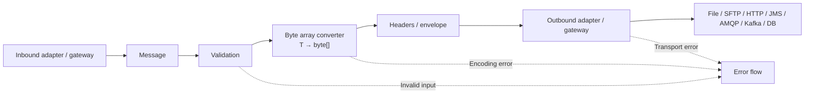
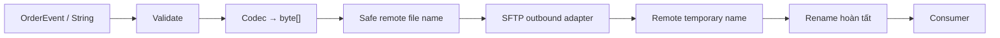
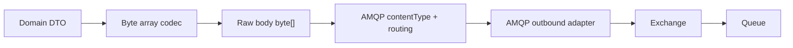
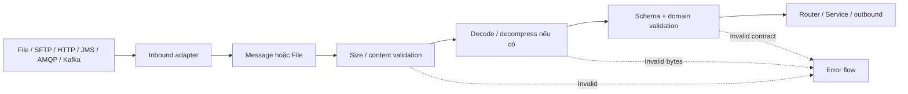

# Byte array converter

## 1. Bài toán: Vì sao luồng tích hợp cần `byte[]`?

Một dịch vụ Spring Boot nhận thông báo giao hàng dưới dạng DTO Java. Thông báo này phải đi qua nhiều hệ thống:

- **File outbound adapter** ghi một tệp text hoặc binary vào thư mục trao đổi.
- **SFTP outbound adapter** đưa dữ liệu lên máy chủ của đối tác.
- **HTTP outbound gateway** gửi request body có `Content-Type` rõ ràng.
- **JMS/AMQP/Kafka outbound adapter** đẩy message tới broker, với converter hoặc serializer phù hợp.
- **JDBC/database adapter** lưu dữ liệu binary vào cột BLOB hoặc chuyển một số trường thành tham số SQL.

Dù là text JSON, ảnh, PDF, ZIP hay định dạng nhị phân riêng, dữ liệu cuối cùng phải được biểu diễn thành **một dãy byte** để truyền hoặc lưu. Trong Java, dạng thường gặp là `byte[]`. Tuy nhiên, “đưa dữ liệu về bytes” chưa đủ để tạo ra một tích hợp đúng:

1. Consumer cần biết **bytes thể hiện định dạng gì**.
2. Text cần **charset**, schema, cấu trúc trường và quy ước xuống dòng.
3. Hệ thống nhận cần biết cách **giải mã, kiểm tra và xác thực**.
4. Adapter cần hiểu **payload và header** nào dành cho giao thức.
5. Retry, chuyển đổi, ghi file và kết nối có thể tạo ra **bản sao trùng hoặc dữ liệu bị cắt** nếu không có cơ chế kiểm soát.

**Byte array converter** trong bối cảnh Spring Integration là thành phần hoặc bước chuyển đổi **giữa payload Java/text và `byte[]`**, hoặc từ `byte[]` trở lại kiểu dữ liệu mà pipeline cần. Bước chuyển đổi này có thể được thực hiện bằng transformer, codec chuyên biệt, message converter hoặc serializer của adapter, tùy vị trí trong luồng.

Bài thuộc chương **Chuyển đổi dữ liệu** của module `SPRING_INTEGRATION_ADAPTERS`. Mục tiêu là hiểu cách tích hợp inbound/outbound adapter, gateway, poller và `MessageChannel` với File, SFTP, HTTP, JMS, AMQP, Kafka, database; đồng thời quản lý **hợp đồng message, lỗi, hiệu năng và vòng đời kết nối**.

> **Nguyên tắc:** `byte[]` chỉ là **representation trong bộ nhớ**. Nó không tự mô tả đây là JSON, văn bản UTF-8, dữ liệu nén, Protobuf hay file nhị phân; cũng không chứng minh đã gửi hoặc lưu thành công.

## 2. Byte array là gì và không phải là gì?

Trong Java, `byte[]` là một mảng chứa các phần tử kiểu `byte` có dấu (`-128` tới `127`). Những giá trị này đại diện cho **8 bit**, không phải ký tự, số thập phân nghiệp vụ hay một format cụ thể.

```java
byte[] payload = new byte[] {72, 101, 108, 108, 111};

// Cùng các byte có thể được diễn giải là text UTF-8:
String text = new String(payload, java.nio.charset.StandardCharsets.UTF_8);
// text = "Hello"
```

Cần phân biệt:

| Đối tượng | Ý nghĩa | Sai lầm thường gặp |
| --- | --- | --- |
| `String` | Chuỗi ký tự Unicode trong Java | Dùng charset mặc định khi chuyển sang bytes |
| `byte[]` | Dãy byte trong bộ nhớ | Cho rằng bytes luôn là văn bản |
| `ByteBuffer` | Bộ đệm có vị trí/giới hạn để làm việc với bytes | Quên `position`, `limit` khi lấy dữ liệu |
| `InputStream` | Luồng đọc dữ liệu từng phần | Nạp toàn bộ file nhiều GB chỉ để chuyển sang `byte[]` |
| `Resource` | Trừu tượng truy cập nội dung như file/classpath/stream | Tưởng mọi resource đều nằm sẵn trong memory |
| `Base64 String` | Biểu diễn text có thể chuyển ngược sang bytes | Nhầm Base64 với mã hóa bảo mật |
| `JSON byte[]` | Bytes chứa tài liệu JSON đã serialize | Nhầm với `byte[]` là một **field** được Jackson serialize |
| `Message<byte[]>` | Spring message có payload bytes và headers | Bỏ qua content type, routing và correlation |

Một mảng byte có thể chứa:

- JSON UTF-8: các bytes của `{"id":"O-1"}`.
- CSV UTF-8: bytes của một dòng hoặc tệp CSV.
- Ảnh PNG/JPEG, PDF, ZIP hoặc file mã hóa.
- Dữ liệu protobuf/Avro/CBOR/MessagePack theo schema.
- Một binary frame có header nội bộ, length, checksum.
- Bytes nén từ GZIP hoặc một thuật toán khác.

Không thể xác định an toàn format chỉ bằng một phép ép kiểu Java: phải có **hợp đồng, metadata tin cậy hoặc cơ chế nhận diện được kiểm soát**.

## 3. Spring Message: Payload khác với header

Thông điệp trong Spring Integration có **payload** và **headers**:

```text
Message<T>
  payload: T
  headers:
    id, timestamp
    contentType
    correlationId / eventId (theo hợp đồng ứng dụng)
    fileName / topic / routingKey (theo adapter)
    các metadata nội bộ khác
```

Ví dụ message truyền trong luồng:

```text
Message<String>
    payload = "Xin chào"
    headers:
      eventId = "evt-2401"
      contentType = "text/plain;charset=UTF-8"

  ↓ String -> UTF-8 byte[]

Message<byte[]>
    payload = [0x58, 0x69, 0x6E, ...]
    headers:
      eventId = "evt-2401"
      contentType = "text/plain;charset=UTF-8"
```

Nếu một adapter thấy payload `byte[]` nhưng header ghi `application/json`, bytes phải thật sự là JSON hợp lệ. **Đổi header không chuyển đổi nội dung.** Ngược lại, chuyển String thành bytes nhưng bỏ mất charset có thể khiến consumer giải mã sai.

### Ranh giới kiến trúc



**Transformer/codec** chịu trách nhiệm representation của dữ liệu. **Adapter/gateway** chịu trách nhiệm I/O, connection, timeout và đặc điểm giao thức. **Message converter/serializer** có thể nằm ngay ở ranh giới protocol để thực hiện bước byte conversion cuối cùng.

## 4. Transformer, message converter, serializer và adapter: Phân vai

| Thành phần | Câu hỏi được giải quyết | Ví dụ |
| --- | --- | --- |
| **Transformer** | Payload nội bộ phải đổi dạng ra sao? | `OrderEvent` → JSON `byte[]` |
| **Codec / formatter** | Quy tắc encode/decode là gì? | UTF-8 codec, Jackson, Protobuf |
| **MessageConverter** | Object/message được ánh xạ sang message của giao thức thế nào? | Converter sang JMS BytesMessage hoặc AMQP message body |
| **Kafka Serializer** | Key/value được biến thành bytes Kafka ra sao? | `ByteArraySerializer`, JSON serializer |
| **Header Enricher / Mapper** | Metadata nào cần gắn hoặc chuyển sang protocol? | Content type, filename, key, correlation |
| **Outbound adapter** | Gửi/ghi một chiều ra hệ thống nào? | File, SFTP, JMS, Kafka |
| **Outbound gateway** | Gửi request và nhận response thế nào? | HTTP request–reply |
| **Inbound adapter** | Dữ liệu ngoài trở thành Spring Message thế nào? | Poll file, nhận broker message |
| **Poller** | Lấy message vào những thời điểm/tần suất nào? | Lấy file hoặc hàng database định kỳ |
| **MessageChannel** | Thông điệp được chuyển qua các endpoint ra sao? | DirectChannel hoặc QueueChannel |

Không phải mọi adapter đều cần một transformer tách riêng. Ví dụ Kafka JSON serializer có thể trực tiếp serialize DTO; HTTP converter có thể chuyển object thành body JSON. Nhưng nếu muốn kiểm soát bytes trước khi tính hash, ký payload, lưu raw file hoặc gửi nhiều giao thức, một **byte array transformer** rõ ràng thường dễ kiểm thử hơn.

**Tránh serialize hai lần.** Nếu `ObjectMapper` đã tạo JSON bytes, không cấu hình serializer đích coi cả mảng bytes là object cần chuyển tiếp thành JSON.

## 5. Thiết kế hợp đồng bytes trước khi viết code

Một hợp đồng cho `Message<byte[]>` cần đầy đủ hơn câu “payload là bytes”.

| Thành phần hợp đồng | Ví dụ | Rủi ro nếu bỏ qua |
| --- | --- | --- |
| **Media type / format** | `application/json`, `text/csv`, `application/octet-stream` | Consumer dùng sai parser |
| **Schema/version** | `order-created.v2` | Producer–consumer không tương thích |
| **Charset** | UTF-8 với nội dung text | Mất dấu tiếng Việt, decode sai |
| **Byte order** | Big-endian/little-endian cho binary number | Giải mã sai độ dài/số |
| **Framing** | Length-prefix hoặc một message = một document | Không biết ranh giới bản ghi |
| **Compression** | GZIP với metadata phù hợp | Consumer đọc bytes nén như text |
| **Integrity** | Checksum/hash/signature khi cần | Không phát hiện payload hỏng/thay đổi |
| **Size limit** | Giới hạn bytes và nesting/decompressed size | OOM, nghẽn queue, zip bomb |
| **Null/empty** | Cho phép body rỗng hay không? | Lẫn payload trống với message không hợp lệ |
| **Idempotency key** | `eventId` ổn định | Retry làm phát sinh xử lý trùng |
| **Destination** | Topic, remote directory, URL, SQL column | Bytes hợp lệ nhưng gửi sai nơi |
| **Security** | Dữ liệu nhạy cảm, mã hóa kênh, log policy | Rò rỉ bí mật hoặc dữ liệu cá nhân |

### Bytes không tự mô tả cấu trúc

```text
0x00 0x00 0x00 0x2A
```

Các bytes này có thể biểu thị số nguyên 42 theo **big-endian 32-bit**, nhưng cũng có thể là header chứa length, một phần ảnh hoặc dữ liệu ứng dụng khác. Cần schema/framing rõ ràng trước khi decode.

### Content-Type và Content-Encoding khác nhau

- `Content-Type: application/json` mô tả **định dạng nội dung**.
- `Content-Encoding: gzip` (khi giao thức sử dụng) mô tả **cách biểu diễn nội dung đã nén**.
- Charset có ý nghĩa với media type dạng text hoặc nơi giao thức định nghĩa, **không tự làm JSON bytes hợp lệ**.
- Trong File/SFTP/Kafka/JMS, metadata tương đương có thể được lưu qua header, properties, manifest hoặc theo hợp đồng ngoài; không phải adapter nào cũng có khái niệm HTTP header.

## 6. Ma trận byte conversion theo đích

| Hệ thống đích | Payload hoặc input thường dùng | Phần phải kiểm tra |
| --- | --- | --- |
| **File outbound** | `byte[]`, `String`, `File` tùy handler | Filename, bytes ghi ra, file exists mode |
| **SFTP outbound** | `byte[]`, `File`, `String` theo cấu hình | Remote path, temp file, session, permissions |
| **HTTP outbound gateway** | `byte[]` raw body hoặc DTO/String qua converter | HTTP method, Content-Type, response/timeout |
| **JMS outbound** | `byte[]` có thể được converter đưa thành `BytesMessage` | Loại JMS message, properties, acknowledgment |
| **AMQP outbound** | Bytes của message body hoặc object được converter xử lý | Body, contentType, routing, publisher confirm |
| **Kafka outbound** | Key/value có serializer tương thích | ByteArraySerializer, key/partition, topic |
| **JDBC/database outbound** | `byte[]` bind BLOB/VARBINARY hoặc DTO/map tham số | SQL type, transaction, tham số, kích thước |
| **File/SFTP inbound** | Bytes hoặc `File` sau bước đọc | Giới hạn file, charset, xử lý trùng |
| **HTTP/JMS/AMQP/Kafka inbound** | Body/bytes theo protocol converter | Decode type, schema, headers, validation |

Bảng mô tả **kiểu thường gặp**, không phải cam kết mọi adapter đều hỗ trợ cùng kiểu đầu vào ở mọi phiên bản. Chọn đúng handler, converter, serializer và cấu hình hiện có; kiểm thử raw bytes thực tế.

## 7. Chuyển `String` thành `byte[]` bằng UTF-8

Với text, chỉ định charset là nguyên tắc cơ bản:

```java
import java.nio.charset.StandardCharsets;

String text = "Đơn hàng đã tạo: ORD-1001";
byte[] bytes = text.getBytes(StandardCharsets.UTF_8);

String restored = new String(bytes, StandardCharsets.UTF_8);
```

**Không nên dùng:**

```java
// Phụ thuộc default charset hoặc cách code được viết.
byte[] bytes = text.getBytes();
String restored = new String(bytes);
```

Default charset có thể khác giữa JDK, runtime, môi trường hoặc cấu hình. Khi ký/hash payload hoặc trao đổi dữ liệu xuyên hệ thống, chỉ một khác biệt byte cũng có thể làm sai chữ ký hoặc checksum.

### Ví dụ sự khác nhau giữa ký tự và byte

```java
String value = "Aé";
int charUnits = value.length();
int bytesUtf8 = value.getBytes(StandardCharsets.UTF_8).length;

// charUnits = 2 (hai UTF-16 code units trong ví dụ)
// bytesUtf8 = 3 (A = 1 byte, é = 2 byte trong UTF-8)
```

`String.length()` không cho biết kích thước bytes gửi ra broker. Với ký tự bổ sung, một Unicode code point còn có thể dùng hai UTF-16 code units trong Java.

### UTF-8 BOM và xuống dòng

Nếu đối tác yêu cầu text không BOM, phải kiểm tra file/bytes đầu ra không tự thêm `EF BB BF`. Nếu consumer yêu cầu CRLF, hãy tạo `\r\n` rõ ràng. Không nên tự thay đổi newline sau khi đã tính checksum hoặc chữ ký.

## 8. Chuyển `byte[]` thành `String`: Decode nghiêm ngặt khi cần

Cách đơn giản:

```java
String text = new String(bytes, StandardCharsets.UTF_8);
```

Tuy nhiên, constructor này có thể **thay các chuỗi byte không hợp lệ bằng ký tự thay thế** thay vì báo lỗi. Nếu hợp đồng yêu cầu UTF-8 hợp lệ tuyệt đối, hãy dùng decoder với chế độ `REPORT`:

```java
import java.nio.ByteBuffer;
import java.nio.charset.CharacterCodingException;
import java.nio.charset.CodingErrorAction;
import java.nio.charset.StandardCharsets;

public final class Utf8Codec {
    private Utf8Codec() {}

    public static byte[] encode(String value) {
        if (value == null) {
            throw new IllegalArgumentException("Text must not be null");
        }
        return value.getBytes(StandardCharsets.UTF_8);
    }

    public static String decodeStrict(byte[] bytes)
            throws CharacterCodingException {
        if (bytes == null) {
            throw new IllegalArgumentException("Bytes must not be null");
        }
        return StandardCharsets.UTF_8.newDecoder()
            .onMalformedInput(CodingErrorAction.REPORT)
            .onUnmappableCharacter(CodingErrorAction.REPORT)
            .decode(ByteBuffer.wrap(bytes))
            .toString();
    }
}
```

**Lưu ý:**

- Decoder nghiêm ngặt giúp phát hiện bytes không hợp lệ, nhưng không kiểm tra JSON schema hoặc nghiệp vụ.
- Byte Order Mark (BOM) là vấn đề khác: cần chính sách chấp nhận, bỏ hoặc từ chối BOM theo hợp đồng; decoder không tự biến mọi vấn đề BOM thành lỗi.
- Nếu payload là ảnh/ZIP/Protobuf, **không** được decode bằng UTF-8 chỉ để quan sát. Biến bytes binary thành text có thể phá hỏng dữ liệu nếu encode ngược.
- Không tạo một shared `CharsetDecoder` rồi dùng đồng thời từ nhiều thread; hãy tạo decoder riêng như ví dụ hoặc quản lý việc dùng an toàn.

## 9. Chuyển DTO/JSON thành bytes bằng Jackson

Khi dữ liệu là event Java, không dùng `toString()` để gửi ra ngoài. Hãy ánh xạ sang DTO có hợp đồng rõ rồi serialize.

### DTO ví dụ

```java
import com.fasterxml.jackson.annotation.JsonProperty;
import java.time.Instant;

public record OrderEvent(
    @JsonProperty("event_id") String eventId,
    @JsonProperty("order_id") String orderId,
    @JsonProperty("amount_minor") long amountMinor,
    @JsonProperty("occurred_at") Instant occurredAt
) {}
```

Payload mong muốn:

```json
{
  "event_id": "evt-2401",
  "order_id": "ORD-1001",
  "amount_minor": 125000,
  "occurred_at": "2026-11-23T08:00:00Z"
}
```

### Codec chuyên biệt cho JSON bytes

Ví dụ dùng package của **Jackson 2**; nếu dự án dùng Jackson 3 hoặc stack mới hơn, cần đối chiếu import/API của phiên bản thực tế.

```java
import com.fasterxml.jackson.core.JsonProcessingException;
import com.fasterxml.jackson.databind.ObjectMapper;
import com.fasterxml.jackson.databind.ObjectReader;
import com.fasterxml.jackson.databind.ObjectWriter;
import java.io.IOException;

public final class OrderEventJsonBytes {
    private final ObjectWriter writer;
    private final ObjectReader reader;

    public OrderEventJsonBytes(ObjectMapper mapper) {
        this.writer = mapper.writerFor(OrderEvent.class);
        this.reader = mapper.readerFor(OrderEvent.class);
    }

    public byte[] encode(OrderEvent event) {
        if (event == null) {
            throw new IllegalArgumentException("OrderEvent is null");
        }
        try {
            return writer.writeValueAsBytes(event);
        } catch (JsonProcessingException ex) {
            throw new IllegalArgumentException("Cannot write order JSON", ex);
        }
    }

    public OrderEvent decode(byte[] bytes) {
        if (bytes == null || bytes.length == 0) {
            throw new IllegalArgumentException("Empty order JSON");
        }
        try {
            return reader.readValue(bytes);
        } catch (IOException ex) {
            throw new IllegalArgumentException("Invalid order JSON", ex);
        }
    }
}
```

`writeValueAsBytes` tạo representation JSON dạng bytes; `readValue` làm chiều ngược lại. Để `Instant` có representation ISO-8601 đúng hợp đồng, mapper cần module/config tương ứng (ví dụ JavaTimeModule và không viết thời gian dạng timestamp số khi dùng Jackson 2).

**Tái sử dụng mapper/reader/writer** đã cấu hình trước khi chạy đa luồng. Không tạo `new ObjectMapper()` cho mỗi message hoặc thay đổi cấu hình mapper sau khi nhiều endpoint đang cùng dùng.

### Serialization không đồng nghĩa validation

Với object:

```java
new OrderEvent(null, "", -10, null)
```

Jackson có thể vẫn serialize được nhiều trường theo cấu hình, nhưng sự kiện **không hợp lệ về nghiệp vụ**. Validation field bắt buộc, trị số, timestamp và schema cần là một bước riêng trước khi gửi.

## 10. Hai nghĩa khác nhau của `byte[]` trong JSON

Đây là bẫy phổ biến khi làm việc với ObjectMapper.

### Trường hợp A: Toàn bộ payload là bytes của tài liệu JSON

```java
byte[] jsonBytes = mapper.writeValueAsBytes(
    java.util.Map.of("message", "Hello")
);
```

Bytes chứa representation UTF-8 của một JSON object:

```json
{"message":"Hello"}
```

### Trường hợp B: Object cần serialize **có một trường byte[]**

```java
public record AttachmentDto(
    String name,
    byte[] content
) {}
```

Khi Jackson serialize một trường `byte[]` bên trong JSON, representation thường là **chuỗi Base64**, ví dụ:

```json
{
  "name": "hello.txt",
  "content": "SGVsbG8="
}
```

Chuỗi `"SGVsbG8="` không phải raw bytes của file được gắn trực tiếp vào văn bản JSON; đó là dữ liệu đã được mã hóa Base64 để biểu diễn binary bằng ký tự.

**Tuyệt đối không nhầm:**

- `writeValueAsBytes(attachmentDto)` → bytes **của tài liệu JSON** chứa chuỗi Base64.
- `attachmentDto.content()` → raw bytes của file.
- `writeValueAsBytes(attachmentDto.content())` → bytes của **JSON value** đại diện dữ liệu Base64, không giữ nguyên raw bytes đầu vào.

### Base64 không phải mã hóa bảo mật

```java
import java.util.Base64;
import java.nio.charset.StandardCharsets;

byte[] raw = "Hello".getBytes(StandardCharsets.UTF_8);
String encoded = Base64.getEncoder().encodeToString(raw);
byte[] decoded = Base64.getDecoder().decode(encoded);
// encoded = "SGVsbG8="
```

Base64 **có thể đảo ngược mà không cần secret**; nó không cung cấp tính bí mật hay xác thực. Khi truyền JSON có nội dung binary nhạy cảm, vẫn cần bảo vệ transport, quyền truy cập và lưu trữ.

## 11. Binary payload không phải text: Framing và byte order

Không phải dữ liệu nào cũng nên convert sang JSON hoặc UTF-8. Với định dạng binary tự thiết kế, cần xác định cách đọc từng trường.

Ví dụ một frame đơn giản: bốn byte đầu chứa độ dài dữ liệu theo **big-endian**, sau đó là body:

```text
0x00 0x00 0x00 0x05  0x48 0x65 0x6C 0x6C 0x6F
|--- length = 5 --|  |------ "Hello" -------|
```

Ví dụ Java:

```java
import java.nio.ByteBuffer;
import java.nio.ByteOrder;
import java.nio.charset.StandardCharsets;

byte[] body = "Hello".getBytes(StandardCharsets.UTF_8);

ByteBuffer framed = ByteBuffer.allocate(4 + body.length)
    .order(ByteOrder.BIG_ENDIAN);
framed.putInt(body.length);
framed.put(body);

byte[] frame = framed.array();
```

Để giải mã, phải kiểm tra trước:

1. Có ít nhất bốn byte cho trường length?
2. Length có không âm và dưới ngưỡng được phép không?
3. Phần body có đủ số byte đã khai báo không?
4. Frame có còn bytes thừa và hợp đồng có cho phép không?
5. Byte order và charset có đúng không?

Một handler nhận `byte[]` mà không biết framing có thể đọc thiếu hoặc đọc nhầm nhiều record.

### Khi nào nên dùng binary codec chuyên biệt?

Nếu cần Protobuf, Avro, CBOR, MessagePack hoặc format doanh nghiệp riêng, hãy dùng codec/serializer có schema và test tương thích. Đừng biến object thành native Java serialization rồi kỳ vọng hệ thống khác ngôn ngữ đọc được.

**Tránh Java native object serialization của dữ liệu không đáng tin**: phụ thuộc mạnh vào class/version và có thể tạo nguy cơ bảo mật khi deserialize.

## 12. Java DSL: Transformer String → bytes

Ví dụ tối giản cho thấy `byte[]` được tạo như một bước trong IntegrationFlow.

```java
import java.nio.charset.StandardCharsets;
import org.springframework.context.annotation.Bean;
import org.springframework.integration.dsl.IntegrationFlow;

@Bean
IntegrationFlow textToBytesFlow() {
    return IntegrationFlow.from("textInputChannel")
        .transform(String.class, text ->
            text.getBytes(StandardCharsets.UTF_8))
        .channel("binaryReadyChannel")
        .get();
}
```

Luồng này:

- Đọc payload `String` trên channel đầu vào.
- Trả payload `byte[]` theo UTF-8.
- Chuyển sang channel tiếp theo.
- **Chưa thực hiện I/O**; cần gắn outbound handler để ghi/gửi.

Java DSL và tên module phụ thuộc phiên bản Spring Integration đang dùng. Kiểm tra source/dependency và compile khi tích hợp vào dự án; ví dụ nhằm minh họa rõ ranh giới transformation.

### Chiều ngược lại

```java
@Bean
IntegrationFlow bytesToTextFlow() {
    return IntegrationFlow.from("binaryInputChannel")
        .transform(byte[].class, bytes -> {
            try {
                return Utf8Codec.decodeStrict(bytes);
            } catch (java.nio.charset.CharacterCodingException ex) {
                throw new IllegalArgumentException("Invalid UTF-8", ex);
            }
        })
        .channel("textReadyChannel")
        .get();
}
```

Nếu source đang đưa `File` hoặc `InputStream` thay vì `byte[]`, không ép kiểu tùy tiện. Cần xác định endpoint đầu vào trả loại payload nào, rồi dùng transformer/codec thích hợp.

## 13. Java DSL: DTO → JSON bytes → outbound channel

Từ DTO `OrderEvent`, có thể dùng codec Jackson ở một luồng riêng:

```java
import org.springframework.context.annotation.Bean;
import org.springframework.integration.dsl.IntegrationFlow;

@Bean
IntegrationFlow orderEventToJsonFlow(OrderEventJsonBytes codec) {
    return IntegrationFlow.from("orderEventChannel")
        .transform(OrderEvent.class, codec::encode)
        .channel("orderJsonBytesChannel")
        .get();
}
```

Lúc này `orderJsonBytesChannel` có thể được nối với:

- File outbound: ghi JSON bytes.
- SFTP outbound: upload JSON bytes.
- JMS/AMQP: gửi binary body nếu converter/contract cho phép.
- Kafka: dùng `ByteArraySerializer` cho value.
- HTTP outbound gateway: truyền raw JSON bytes với Content-Type được map đúng.

**Không nhất thiết sử dụng cùng một channel gửi vào nhiều đích**: nếu một message phải fan-out, cần thiết kế publish-subscribe channel/router/bridge hoặc các flow riêng. `DirectChannel` có nhiều consumer không có nghĩa mỗi message đều được gửi tới tất cả consumer.

### Đặt header phù hợp

Có thể thêm metadata **sau khi** đã chuyển payload:

```java
@Bean
IntegrationFlow jsonBytesWithTypeFlow(OrderEventJsonBytes codec) {
    return IntegrationFlow.from("typedOrderEvents")
        .transform(OrderEvent.class, codec::encode)
        .enrichHeaders(headers -> headers
            .header("contentType", "application/json"))
        .channel("jsonTypedBytesChannel")
        .get();
}
```

Tên header phục vụ nội bộ ở ví dụ; các giao thức có cơ chế ánh xạ header riêng, và một số converter mong đợi giá trị `MimeType`/`MediaType` chứ không phải String. Phải kiểm chứng **tên và kiểu header** theo adapter/phiên bản framework.

## 14. Ví dụ trọn luồng: Text → bytes → File outbound adapter

Giả sử một hệ thống nhận `Message<String>` và cần ghi nguyên văn UTF-8 vào file tương ứng `eventId`.

```java
import java.io.File;
import java.nio.charset.StandardCharsets;
import org.springframework.context.annotation.Bean;
import org.springframework.integration.dsl.IntegrationFlow;
import org.springframework.integration.file.dsl.Files;

@Bean
IntegrationFlow exportTextFileFlow() {
    return IntegrationFlow.from("textExportRequests")
        .transform(String.class, text ->
            text.getBytes(StandardCharsets.UTF_8))
        .handle(Files.outboundAdapter(new File("./data/outbox"))
            .autoCreateDirectory(true)
            .fileNameGenerator(message -> {
                Object raw = message.getHeaders().get("eventId");
                if (!(raw instanceof String id)
                        || !id.matches("[A-Za-z0-9_-]{1,64}")) {
                    throw new IllegalArgumentException("Invalid eventId");
                }
                return "event-" + id + ".txt";
            }))
        .get();
}
```

**Giải thích:**

1. `textExportRequests` cung cấp String đã được kiểm tra nội dung.
2. Transformer tạo UTF-8 bytes; File handler không cần đoán charset để chuyển String.
3. Header `eventId` được lấy từ metadata đã xác thực và kiểm tra whitelist.
4. `fileNameGenerator` tạo tên file nằm trong thư mục cấu hình, không dùng đường dẫn tùy ý từ client.
5. Adapter thực hiện ghi file; trạng thái **gửi vào channel** không đồng nghĩa ghi hoàn tất trong mọi topology.

Ví dụ dựa trên Java hỗ trợ pattern matching `instanceof` và API DSL tương ứng. Hãy đối chiếu chữ ký builder và dependency thực tế khi compile.

### Quyết định quan trọng với file đã tồn tại

Nếu cùng `eventId` được gửi hai lần, tên file giống nhau. Cần xác định file-exists mode (fail, replace, append hoặc chính sách khác được handler hỗ trợ), cơ chế ghi atomic nếu cần và trạng thái đã xử lý. Chọn ghi đè không kiểm soát hoặc append một bản ghi trùng có thể làm mất hay nhân đôi dữ liệu.

### Ghi file lớn

Nếu mỗi payload có thể nhiều trăm MB hoặc GB, tạo `byte[]` toàn bộ trong memory có thể không phù hợp. Cân nhắc streaming/chunking, `Resource`/`File` và các handler có khả năng xử lý stream, cùng giới hạn size và cơ chế hoàn tất file rõ ràng.

## 15. SFTP outbound: Bytes, filename và kết nối

SFTP outbound adapter truyền file hoặc nội dung lên hệ thống ngoài qua SSH. Một `Message<byte[]>` có thể phù hợp nếu handler hỗ trợ representation đó.



**Transformer không quản lý phiên SFTP.** Phải cấu hình ở adapter/session factory:

- Host, port, username, private key/credential và chính sách host key verification.
- Session lifecycle, reconnect, timeout và giới hạn connection.
- Remote directory, quyền ghi và naming contract.
- Temporary filename/rename nếu consumer cần tránh đọc file chưa hoàn chỉnh.
- Chính sách overwrite, retry và phát hiện file đã upload.
- Đảm bảo ngắt kết nối hoặc thu hồi credential khi không còn nhu cầu.

Nếu remote path lấy trực tiếp từ dữ liệu nguồn, nguy cơ path traversal hoặc ghi vào vị trí không được phép. Dùng remote directory cố định/được ánh xạ theo policy và filename đã sanitize.

**Lỗi thường gặp:** transformer đã tạo bytes thành công nhưng SFTP trả permission denied. Đây là **transport/authorization error**, không nên thử chuyển lại JSON hàng nghìn lần để “sửa”.

## 16. HTTP outbound: raw bytes và HTTP converter

HTTP request body luôn được truyền bằng bytes. Nhưng khi dùng Spring, ứng dụng có thể:

1. Đưa **DTO** cho HTTP message converter để serialize JSON.
2. Đưa **String** cho String-based converter.
3. Đưa **byte[]** cho converter/handler gửi **raw body bytes**.

### Phương án A: Giữ DTO

```text
Message<OrderEvent>
  → HTTP outbound gateway
  → JSON-capable HttpMessageConverter
  → request body: JSON bytes
```

### Phương án B: Byte array converter chủ động

```text
Message<OrderEvent>
  → Jackson writeValueAsBytes
  → Message<byte[]> + contentType=application/json
  → HTTP outbound gateway / byte-array handling
  → request body: raw JSON bytes
```

Trong phương án B, phần gửi HTTP phải được cấu hình để **không serialize `byte[]` thêm lần nữa**.

### Lỗi double encoding

```java
byte[] originalJson = "{\"id\":\"O-1\"}"
    .getBytes(StandardCharsets.UTF_8);
```

Nếu một JSON serializer xem `originalJson` như **giá trị thuộc tính kiểu byte[]**, nó có thể tạo JSON string Base64 thay vì gửi raw bytes.

Khác nhau:

- **Đúng raw body**: bytes của `{"id":"O-1"}`.
- **Sai nếu consumer cần JSON object**: bytes của một chuỗi JSON chứa Base64 hoặc JSON string đã escape.

### Header và response

- Content-Type phải phù hợp body. Với binary tùy ý, thường là `application/octet-stream` hoặc media type cụ thể.
- Content-Length/transfer coding thường do HTTP client quản lý; không tự ghép thiếu kiểm soát.
- Header ứng dụng như idempotency key phải được kiểm tra và map đúng.
- Outbound **gateway** có response; xử lý status, body, timeout và lỗi HTTP theo hợp đồng.
- Timeout không chứng minh request chưa tới server. Retry phải xét idempotency.

Một mock HTTP server nên kiểm tra **raw request bytes**, content type và số lần gọi, không chỉ kiểm tra controller nhận DTO trong test nội bộ.

## 17. JMS: Byte array và BytesMessage

Trong JMS, `BytesMessage` là một dạng message để chở dữ liệu nhị phân. Spring JMS `MessageConverter` có thể ánh xạ Java `byte[]` sang biểu diễn JMS phù hợp, tùy cấu hình converter.

```text
Message<byte[]>  → JMS outbound adapter + converter
                 → JMS BytesMessage
                 → JMS broker
                 → JMS consumer nhận bytes
                 → codec/schema decode
```

**Cần xác minh:**

- Consumer kỳ vọng `BytesMessage` hay `TextMessage`?
- Converter có đang coi payload bytes như raw bytes hay serialize thành representation khác?
- JMS properties có chứa content type/schema version cần thiết không?
- Correlation ID và message ID có được map đúng không?
- Transaction/acknowledgment, redelivery, TTL và dead-letter được cấu hình thế nào?
- Khi message bị xử lý lại, consumer có thể idempotent không?

### Vì sao không dùng native Java serialization thay cho byte codec?

Một `ObjectMessage` phụ thuộc vào classpath và cách deserialize của Java, gây khó khăn khi nhiều dịch vụ dùng phiên bản khác nhau. Với input không tin cậy, native deserialization còn có thể mang rủi ro bảo mật. Dùng JSON, Protobuf hoặc binary codec có schema rõ thường thích hợp hơn cho hợp đồng xuyên dịch vụ.

**BytesMessage không bảo đảm consumer hiểu bytes.** Phải có quy ước format/version ngoài JMS container.

## 18. AMQP/RabbitMQ: Raw body và converter

AMQP message có body bytes và các thuộc tính như content type, routing key, correlation theo cơ chế hỗ trợ.



Một số cách triển khai:

- Gửi `byte[]` dưới dạng body raw khi converter hỗ trợ.
- Gửi String/DTO và để converter của Spring AMQP tạo body bytes.
- Dùng codec có schema riêng cho binary payload và content type phù hợp.

**Không để converter JSON serialize mảng `byte[]` như một giá trị Base64 nếu ý định là gửi raw body.** Kiểm tra message body thực tế ở broker test.

### Cấu hình liên quan nhưng không thuộc transformer

- Exchange, routing key và binding.
- Publisher confirm/return; broker đã nhận khác với consumer đã xử lý.
- Retry/backoff, dead-letter queue và xử lý poison message.
- Connection factory, credential, TLS và vòng đời kết nối.
- Header mapping, message TTL và giới hạn size.

Tránh lấy tên exchange/routing key từ header do người dùng tự nhập mà không có chính sách kiểm soát.

## 19. Kafka: `ByteArraySerializer` và key/value

Kafka record gồm **key**, **value**, topic/partition, timestamp và headers. Producer serialize key/value theo cấu hình tương ứng.

### Ba cấu hình thường gặp

| Payload trước producer | Serializer value | Kết quả mong đợi |
| --- | --- | --- |
| `byte[]` raw JSON/binary | `ByteArraySerializer` | Giữ nguyên bytes |
| `String` JSON | `StringSerializer` | Encode String theo serializer |
| DTO Java | JSON/Avro/Protobuf serializer phù hợp | Tạo bytes theo contract |

Nếu producer nhận `byte[]` nhưng dùng JSON serializer dành cho DTO, kết quả có thể không còn là raw bytes cần thiết, hoặc gửi thất bại do kiểu payload không tương thích.

### Key để làm gì?

Ví dụ:

```text
topic       = orders.events
key         = ORD-1001
value       = byte[] JSON of OrderEvent
schema      = order-created.v1
correlation = req-891
```

Dùng cùng `orderId` làm key thường giúp các event cùng khóa đi vào cùng partition theo cấu hình partitioner, hỗ trợ thứ tự **trong partition**. Kafka không tự bảo đảm thứ tự trên mọi partition hoặc đúng thứ tự nghiệp vụ nếu có nhiều producer, retry và xử lý bất đồng bộ khác nhau.

### Header và schema metadata

Một số serializer JSON có thể thêm Java type headers. Nếu consumer khác ngôn ngữ, không nên biến **fully qualified Java class name** thành schema giao tiếp bắt buộc. Dùng schema/version có quản trị và test compatibility.

**Producer acknowledgment** chỉ phản ánh một mức xác nhận của Kafka theo cấu hình, không chứng minh consumer đã xử lý thành công hoặc ghi database xong.

## 20. Database/JDBC: Byte array và dữ liệu BLOB

Nếu cần lưu chính bytes đã nhận vào database, có thể bind `byte[]` vào tham số của prepared statement cho cột BLOB/VARBINARY hoặc kiểu tương ứng với database.

Ví dụ:

```sql
INSERT INTO exported_payloads (
    event_id,
    content_type,
    payload_bytes
) VALUES (
    :eventId,
    :contentType,
    :payloadBytes
);
```

Payload cho JDBC handler có thể là DTO/Map chứa:

```text
eventId      = "evt-2401"
contentType  = "application/json"
payloadBytes = byte[] ...
```

### Cần phân biệt hai yêu cầu

**Yêu cầu A:** lưu raw body để truy vết hoặc chuyển tiếp. Khi đó `byte[]` là nội dung cột binary, nhưng cần chính sách bảo vệ dữ liệu, retention và giới hạn dung lượng.

**Yêu cầu B:** lưu các trường nghiệp vụ `orderId`, `amountMinor`, `occurredAt` thành cột có kiểu tương ứng. Khi đó chuyển toàn bộ DTO sang bytes rồi parse lại để bind SQL có thể không cần thiết; map trực tiếp sang tham số.

### Không nên làm

- Ghép byte array hoặc JSON thành chuỗi SQL bằng phép nối; dùng parameter binding.
- Tưởng transformer chạy thành công nghĩa là transaction đã commit.
- Tin rằng một lần INSERT và một lần publish Kafka tự động là giao dịch nguyên tử.
- Bỏ qua unique event ID/idempotent upsert khi retry.
- Chọn BLOB cho dữ liệu cần query theo trường thường xuyên mà không cân nhắc thiết kế schema.

Khi cần ghi DB rồi publish event tin cậy, có thể cân nhắc **transactional outbox** và consumer idempotent theo yêu cầu kiến trúc.

## 21. Byte array ở chiều inbound: Đọc đúng trước khi biến đổi

Chiều inbound thường đi ngược outbound:



**Không ép mọi payload inbound thành bytes vô điều kiện.** File inbound adapter có thể đưa ra `File`; HTTP/JMS/AMQP/Kafka inbound có thể đã chạy converter và trả DTO/String. Cần kiểm tra loại payload thực tế trước khi đặt transformer.

### Quy trình kiểm tra inbound

1. Xác minh nguồn, protocol metadata và quyền truy cập ở biên.
2. Kiểm tra giới hạn kích thước **trước** khi nạp toàn bộ dữ liệu.
3. Xác định format từ hợp đồng/metadata đã tin cậy.
4. Nếu có compression, giải nén với giới hạn kích thước đầu ra.
5. Decode bằng charset hoặc binary codec phù hợp.
6. Validate schema/version và rule nghiệp vụ.
7. Chỉ sau đó chuyển tới service hoặc adapter tiếp theo.

### Empty payload có hợp lệ không?

Tùy hợp đồng. Với tín hiệu heartbeat, body rỗng có thể hợp lệ; với order event, body rỗng thường là lỗi. Không tự động biến `byte[0]` thành một DTO có các field null nếu không được quy định.

## 22. Compression, hashing, checksum và encryption

Một byte array converter có thể được kết hợp với các bước kỹ thuật khác, nhưng nên giữ **trách nhiệm riêng** để dễ kiểm tra.

### 22.1. Compression

Ví dụ nén GZIP:

```java
import java.io.ByteArrayOutputStream;
import java.io.IOException;
import java.util.zip.GZIPOutputStream;

public static byte[] gzip(byte[] input) throws IOException {
    if (input == null) {
        throw new IllegalArgumentException("input is null");
    }
    ByteArrayOutputStream output = new ByteArrayOutputStream();
    try (GZIPOutputStream gzip = new GZIPOutputStream(output)) {
        gzip.write(input);
    }
    return output.toByteArray();
}
```

Luồng logic:

```text
DTO → JSON UTF-8 bytes → GZIP bytes → outbound adapter
                                 |
                                 └─ metadata: compression = gzip
```

Khi giải nén phải giới hạn kích thước **sau giải nén**, không chỉ kích thước bytes nén, để tránh payload có tỷ lệ nén bất thường gây cạn memory.

**Compression không phải encryption**. Dữ liệu nén vẫn có thể đọc được nếu không có kiểm soát bảo mật khác.

### 22.2. Checksum và hash

```java
import java.security.MessageDigest;

byte[] digest = MessageDigest.getInstance("SHA-256")
    .digest(payloadBytes);
```

Hash có thể hỗ trợ đối chiếu integrity/duplicate trong phạm vi phù hợp, nhưng **hash không chứng minh nguồn gửi đáng tin**. Nếu cần xác thực nguồn và chống sửa đổi có chủ đích, dùng MAC/chữ ký với quản lý khóa và giao thức phù hợp.

### 22.3. Encryption

Mã hóa payload đòi lựa chọn thuật toán/chế độ và quản lý khóa an toàn (ví dụ authenticated encryption được hỗ trợ). Không tự tạo thuật toán mã hóa chỉ vì đã có `byte[]`. Với các tích hợp qua mạng, vẫn cần TLS/SSH phù hợp và chính sách bảo vệ dữ liệu ở đích.

### Thứ tự thao tác phải cố định

Nếu hợp đồng yêu cầu **serialize → compress → encrypt**, consumer phải biết và thực hiện giải mã ngược. Đổi thứ tự có thể làm output không giải được, sai checksum hoặc mất tương thích. Header không đáng tin không được tùy ý điều khiển thuật toán giải mã nhạy cảm.

## 23. Kích thước payload, streaming và quản lý bộ nhớ

`byte[]` nằm trong memory và là mảng **mutable**. Với dữ liệu lớn, lợi ích tiện lợi phải được cân đối với chi phí.

### 23.1. Nhiều bản sao bytes

Một flow có thể vô tình giữ đồng thời:

```text
Object domain
  -> JSON String
  -> UTF-8 byte[] (copy #1)
  -> GZIP byte[]   (copy #2)
  -> HTTP buffer  (copy #3, tùy client)
```

Điều này tăng peak memory và áp lực GC. Khi cần nhiều MB/file lớn, cân nhắc streaming, output stream, chunking, batch hoặc handler hỗ trợ truyền dần.

### 23.2. Mảng byte có thể bị sửa sau khi gửi

```java
byte[] bytes = codec.encode(event);
Message<byte[]> message = MessageBuilder.withPayload(bytes).build();

// Không nên tiếp tục sửa bytes sau khi đã giao cho
// một flow/queue bất đồng bộ.
```

Nếu code còn giữ reference và thay đổi `bytes[0]`, downstream có thể nhận nội dung khác với lúc gửi. Trong môi trường async, cần đảm bảo ownership, tính bất biến theo quy ước hoặc defensive copy tại biên khi cần.

### 23.3. Không đồng nhất `ByteBuffer` với raw `byte[]`

`ByteBuffer` có `position`, `limit`, `remaining` và có thể là direct buffer không có backing array. Gọi `buffer.array()` không phải lúc nào cũng hợp lệ hoặc trả đúng phần dữ liệu cần gửi.

Nếu bắt buộc chuyển một ByteBuffer sang mảng:

```java
ByteBuffer view = buffer.asReadOnlyBuffer();
byte[] remaining = new byte[view.remaining()];
view.get(remaining);
```

Cần xét việc buffer chứa dữ liệu nào, có được chia sẻ và có cần hạn chế copy hay không.

### 23.4. Kích thước và giới hạn giao thức

Giới hạn có thể đến từ:

- HTTP request/response size.
- JMS/broker max message size.
- Kafka record/batch limits.
- SFTP/filesystem quota.
- Database column/driver limits.
- Channel buffer/queue capacity.
- Giới hạn heap/process và chính sách an toàn dữ liệu.

Một converter chạy được với payload 1 KB không bảo đảm hoạt động tốt với payload 200 MB.

## 24. Poller, channel, backpressure và thứ tự xử lý

### DirectChannel

`DirectChannel` thường chạy handler trên thread gửi theo cơ chế đồng bộ. Transformer và outbound I/O chậm có thể làm caller bị block; exception thường có thể truyền ngược theo call stack.

### QueueChannel và executor channel

Cho phép tách thời gian giữa producer và consumer, nhưng cần quản lý:

- Capacity và memory.
- Độ bền của message store.
- Số worker/concurrency.
- Khả năng backpressure khi consumer chậm.
- Thứ tự message và cam kết delivery.

Một QueueChannel in-memory không đương nhiên bảo đảm message còn sau restart.

### Poller

Poller định kỳ lấy dữ liệu từ file/database hoặc endpoint polling. Khi nguồn có nhiều file binary:

- Cần giới hạn số message mỗi poll và mức concurrency.
- Tránh đọc hàng nghìn file khổng lồ vào heap cùng lúc.
- Không coi poll thành công đồng nghĩa outbound gửi thành công.
- Xác định khi nào đánh dấu file/row đã xử lý, để restart không mất dữ liệu.
- Với batch, phân biệt một message chứa nhiều bytes với nhiều message độc lập.

### Độ trễ đo riêng từng lớp

```text
Tổng thời gian ≈ Chờ trong channel
               + Encode/decode
               + Validation
               + Outbound I/O
               + Confirmation theo hợp đồng
```

Phép cộng nhằm gợi ý cách quan sát, không phải công thức chính xác cho mọi flow có concurrency hoặc pipeline song song.

## 25. Lỗi converter khác lỗi giao thức

Khi vận hành, phân loại nguyên nhân trước khi quyết định retry.

| Giai đoạn | Ví dụ lỗi | Retry? |
| --- | --- | --- |
| **Input validation** | Payload null trong sự kiện bắt buộc | Thường không nếu dữ liệu không đổi |
| **Decode** | UTF-8 hỏng, binary frame thiếu bytes | Không retry mù; quarantine |
| **JSON/schema** | Field type sai, version không hỗ trợ | Sửa contract/dữ liệu |
| **Compression** | GZIP header hỏng hoặc giải nén vượt limit | Reject/quarantine |
| **Encoding** | Chọn charset sai so với hợp đồng | Sửa cấu hình, không retry nguyên bytes sai |
| **File I/O** | Disk full, path permission, file exists | Phụ thuộc loại lỗi và policy |
| **SFTP** | Timeout, mất kết nối, host key mismatch | Timeout có thể retry; host key bất thường cần điều tra |
| **HTTP** | 429/503, timeout | Retry có backoff và idempotency |
| **JMS/AMQP/Kafka** | Broker unavailable, timeout | Theo cấu hình delivery và dedup |
| **Database** | Connection lost, deadlock, duplicate key | Phân loại transient/duplicate trước khi retry |
| **AuthN/AuthZ** | Credential hết hạn hoặc thiếu quyền | Cần sửa permission/credential, không thử vô hạn |

### `errorChannel` và luồng đồng bộ/bất đồng bộ

Với `DirectChannel`, exception thường được trả về caller theo cơ chế gửi đồng bộ. Với poller, executor channel hoặc adapter async, lỗi có thể đi qua **error channel** theo cấu hình.

Không giả định chỉ đặt header `errorChannel` là mọi exception đều được chuyển vào đó. Cần kiểm thử endpoint, error handler, poller và advice chain theo topology cụ thể.

### Một error record có kiểm soát

```json
{
  "eventId": "evt-2401",
  "stage": "byte-decode",
  "errorCode": "INVALID_UTF8",
  "contentType": "text/plain",
  "retryable": false,
  "correlationId": "req-903"
}
```

Không ghi raw bytes chứa secret hay dữ liệu nhạy cảm vào log để debug. Nếu cần lưu payload lỗi vào quarantine/DLQ, phải quản lý quyền truy cập và thời hạn lưu tương ứng.

## 26. Retry, idempotency và kiểm soát dữ liệu trùng

**Transformer tạo cùng bytes hai lần không bảo đảm hệ thống đích chỉ xử lý một lần.** Ví dụ:

1. `OrderEvent(eventId="evt-2401")` được encode thành JSON bytes.
2. HTTP hoặc Kafka nhận request, nhưng phía gửi timeout khi chờ confirmation.
3. Producer retry cùng message.
4. Hệ thống đích có thể xử lý hai lần nếu không có idempotency.

### Khóa idempotency

- Tạo `eventId` ổn định **trước bước chuyển đổi**; không sinh UUID mới khi retry.
- Kafka key có thể dựa trên order ID; consumer dùng event ID hoặc business key để dedup.
- HTTP endpoint có thể hỗ trợ idempotency key theo hợp đồng; không tự giả định có.
- File/SFTP có thể dựa vào filename, checksum và cơ chế hoàn tất file để kiểm soát ghi trùng.
- JDBC có thể dùng unique constraint/upsert hoặc transaction theo thiết kế.

### Các mức bảo đảm delivery

| Thuật ngữ | Ý nghĩa khái quát |
| --- | --- |
| **At-most-once** | Có thể mất message, giới hạn xử lý lặp trong phạm vi cơ chế |
| **At-least-once** | Cố gắng không mất message nhưng có thể lặp |
| **Exactly-once** | Chỉ hợp lệ trong phạm vi và điều kiện cụ thể của hệ thống |
| **Idempotent consumer** | Xử lý lại cùng event nhưng không nhân đôi kết quả nghiệp vụ |
| **Transactional outbox** | Gắn event và transaction DB nhằm hỗ trợ phát tin cậy |
| **Dead-letter / quarantine** | Lưu message lỗi chưa thể xử lý với quy trình khắc phục |

**Không thể tạo exactly-once end-to-end chỉ bằng cách chọn `byte[]` hoặc bật retry của adapter.**

## 27. Bảo mật payload nhị phân

### 27.1. Bytes không phải dữ liệu an toàn mặc định

Một blob bytes có thể chứa:

- Thông tin cá nhân, dữ liệu thanh toán hoặc thông tin y tế.
- Secret/token/credential bị serialize nhầm.
- File giả mạo content type.
- Nội dung nén giải nén thành dữ liệu rất lớn.
- Định dạng binary có parser dễ bị khai thác.
- Nội dung độc hại với hệ thống mở file downstream.

### 27.2. Kiểm soát tại biên

1. Giới hạn kích thước, loại nội dung và schema theo nguồn.
2. Không dựa hoàn toàn vào extension file hoặc Content-Type do client tự khai.
3. Nếu parse file không tin cậy, dùng thư viện cập nhật và giới hạn tài nguyên.
4. Kiểm soát decompression bomb và giới hạn độ sâu/record count.
5. Không deserialize Java object tùy ý từ bytes không đáng tin.
6. Dùng TLS/SSH, kiểm tra certificate/host key và bảo vệ credential adapter.
7. Không cho header nguồn tự quyết định arbitrary HTTP URL, SFTP remote path, Kafka topic hoặc AMQP routing key.
8. Không lưu raw bytes nhạy cảm trong log/traces mặc định.
9. Dùng quản lý retention và mã hóa lưu trữ theo yêu cầu.
10. Kiểm tra quyền ứng dụng và account của connector; encoding chính xác không thay thế AuthN/AuthZ.

### 27.3. Integrity khác authentication

SHA-256 giúp phát hiện bytes thay đổi khi so sánh với digest tin cậy, nhưng không tự ngăn kẻ tấn công thay cả payload và digest. Nếu cần chứng minh nguồn và tính toàn vẹn có đối thủ, dùng MAC/chữ ký với quản lý khóa thích hợp.

### 27.4. Hạn chế log hex dump

Một đoạn log `0x...` của toàn bộ payload có thể làm lộ dữ liệu nhạy cảm như log String. Khi debug chỉ dùng dữ liệu thử nghiệm, metadata, độ dài, schema/version hoặc hash khi chính sách cho phép.

## 28. Kiểm thử unit, contract và integration

### 28.1. Unit test UTF-8 converter

```java
import static org.junit.jupiter.api.Assertions.*;
import java.nio.charset.CharacterCodingException;
import java.nio.charset.StandardCharsets;
import org.junit.jupiter.api.Test;

class Utf8CodecTest {

    @Test
    void roundTripsVietnameseText() throws Exception {
        String original = "Đơn hàng đã tạo";
        byte[] bytes = Utf8Codec.encode(original);
        assertArrayEquals(
            original.getBytes(StandardCharsets.UTF_8),
            bytes
        );
        assertEquals(original, Utf8Codec.decodeStrict(bytes));
    }

    @Test
    void rejectsMalformedUtf8() {
        byte[] invalid = {(byte) 0xC3, (byte) 0x28};
        assertThrows(
            CharacterCodingException.class,
            () -> Utf8Codec.decodeStrict(invalid)
        );
    }
}
```

### 28.2. Unit/contract test cho JSON bytes

```java
OrderEvent event = new OrderEvent(
    "evt-2401",
    "ORD-1001",
    125000,
    java.time.Instant.parse("2026-11-23T08:00:00Z")
);

byte[] bytes = orderEventCodec.encode(event);
OrderEvent restored = orderEventCodec.decode(bytes);

assertEquals(event, restored);
```

Round-trip **không đủ** nếu producer và consumer cùng dùng một mapping sai. Nên so sánh cấu trúc JSON và kiểu field với fixture/schema độc lập, đặc biệt tên trường, format timestamp và amount.

### 28.3. Negative tests

| Tình huống | Kỳ vọng |
| --- | --- |
| `String` có dấu tiếng Việt | Encode UTF-8 đúng bytes |
| UTF-8 sai | Decoder strict từ chối |
| Body binary bị giải mã như text | Không route nhầm codec |
| Payload null/empty khi không được phép | Reject và ghi lỗi rõ |
| JSON schema version không hỗ trợ | Quarantine hoặc route theo version được phê duyệt |
| JSON chứa `byte[]` field | Xác minh Base64 JSON khác raw bytes |
| ByteBuffer có `position` khác 0 | Chỉ gửi bytes còn lại nếu đó là hợp đồng |
| Payload GZIP vượt giới hạn sau giải nén | Từ chối an toàn |
| Tên file chứa `../` | Không ghi ra ngoài thư mục |
| HTTP byte[] bị JSON-encode thêm | Mock server phát hiện body không đúng |
| Kafka serializer không phù hợp `byte[]` | Test producer bắt lỗi kiểu/bytes |
| JMS converter chọn sai message type | Test consumer phát hiện |
| Broker timeout rồi retry | Event ID không đổi, chống duplicate |
| DB transaction rollback | Không đánh dấu gửi hoàn tất |
| Payload nhạy cảm | Không bị dump vào log |

### 28.4. Integration test theo giao thức

- **File:** dùng thư mục tạm, so sánh bytes thực tế, kiểm tra ghi trùng và quyền file.
- **SFTP:** dùng test server, kiểm tra session, path, temp file, rename, retry và reconnect.
- **HTTP:** mock server kiểm tra raw body bytes, Content-Type, timeout, status và idempotency.
- **JMS:** kiểm tra BytesMessage/TextMessage, converter, redelivery và DLQ.
- **AMQP:** kiểm tra body/properties, exchange, routing, confirms, dead-letter.
- **Kafka:** kiểm tra key/value serializer, topic, header, byte-for-byte equality và duplicate.
- **Database:** kiểm tra BLOB/VARBINARY binding, unique constraints và transaction.
- **Flow:** kiểm tra transformer thực sự trả `Message<byte[]>` và những header quan trọng được giữ.

### 28.5. Quan sát dữ liệu tại ranh giới transformer–adapter

Trong test, có thể tạm chuyển output tới một test channel hoặc mock handler:

```text
Message<Domain DTO>
    → converter
    → Message<byte[]>
    → test handler: check bytes + headers
    → sau đó mới chạy adapter thật
```

Cách tách lớp này giúp xác định lỗi thuộc converter hay thuộc kết nối/giao thức.

## 29. Metric và logging cho byte array conversion

Các chỉ số hữu ích:

| Metric | Ý nghĩa |
| --- | --- |
| **Conversion success/failure** | Số message encode/decode đúng hoặc lỗi |
| **Payload bytes size** | Phân bố kích thước, phát hiện data spike |
| **Encoding/decoding latency** | Thời gian converter, tách khỏi network |
| **Invalid charset/schema rate** | Producer gửi dữ liệu không đúng hợp đồng |
| **Compressed/decompressed size ratio** | Phát hiện payload nén bất thường |
| **Queue depth / poll lag** | Backpressure khi adapter chậm |
| **Outbound I/O latency** | Thời gian ghi/gửi qua adapter |
| **Retry count/age** | Lỗi tạm thời kéo dài |
| **Dead-letter/quarantine volume** | Bytes/message cần xử lý thủ công |
| **Duplicate detection** | Retry tạo sự kiện trùng |
| **Message header coverage** | Tỷ lệ có eventId, correlation, content type phù hợp |
| **Connection health** | SFTP/HTTP/broker/database lỗi kết nối |

Log nên dùng định danh và metadata:

```text
received eventId=evt-2401 payloadType=OrderEvent
converted eventId=evt-2401 payloadType=byte[] bytes=104
outbound eventId=evt-2401 adapter=kafka topic=orders.events
ack eventId=evt-2401 result=broker-ack
```

Không ghi nhận `broker-ack` như bằng chứng consumer đã xử lý nghiệp vụ. Nếu hệ thống yêu cầu xác nhận end-to-end, cần một business acknowledgment hoặc trạng thái downstream riêng.

## 30. Các anti-pattern thường gặp

| Anti-pattern | Hệ quả | Hướng xử lý |
| --- | --- | --- |
| Dùng `String.getBytes()` không charset | Bytes có thể khác môi trường | Chốt UTF-8/charset hợp đồng |
| Decode binary bằng `new String(bytes)` | Dữ liệu bị thay thế/mất nghĩa | Dùng binary codec tương ứng |
| Dùng `toString()` trên `byte[]` | Ra mô tả object, không phải nội dung | Encode/format theo schema |
| Coi mọi `byte[]` đều là JSON | Parser lỗi hoặc xử lý sai nội dung | Content contract và validation |
| ObjectMapper serialize raw `byte[]` để gửi nguyên văn | Có thể thành JSON Base64 | Phân biệt raw body và JSON field |
| Base64 được xem là encryption | Dữ liệu dễ bị đọc lại | TLS/encryption và access control |
| Gửi cùng bytes qua mọi adapter không cấu hình | Serializer/converter/protocol mismatch | Kiểm tra handler và integration test |
| Content-Type không khớp body | Consumer chọn sai parser | Gắn metadata đúng |
| Tạo JSON bytes rồi serialize thêm lần nữa | Double encoding | Chỉ có một lớp serialization |
| Dùng header nguồn làm filename/path/URL | Path traversal, SSRF, gửi sai nơi | Ánh xạ và whitelist đích |
| Đọc file rất lớn vào một `byte[]` | OOM hoặc GC cao | Streaming/chunking/batch |
| Sửa mảng byte sau khi gửi async | Message bị thay đổi ngoài ý muốn | Ownership và defensive copy |
| Retry lỗi dữ liệu vô hạn | Poison message gây nghẽn | Quarantine, phân loại retry |
| Sinh eventId mỗi lần retry | Duplicate không dedup được | ID ổn định theo event |
| Ghi connector ACK = consumer đã xử lý | Kết luận sai trạng thái nghiệp vụ | Theo dõi business outcome |
| Không bảo vệ secret trong log bytes | Rò rỉ credential | Mask/không log raw body |
| Không xác minh charset/byte order/framing | Lỗi dữ liệu liên hệ thống | Contract test và raw-byte comparison |
| Không kiểm tra lỗi SFTP/DB/broker riêng | Retry không đúng nguyên nhân | Phân loại converter vs transport |

## 31. Bài tập tình huống

### Tình huống A: File tiếng Việt bị lỗi sau khi chuyển server

Ở máy local, ứng dụng tạo file “Đã nhận đơn” đúng. Sang server khác, file hiển thị ký tự lạ.

**Câu hỏi:** Lỗi ở dữ liệu hay transport?

**Gợi ý:** So sánh raw bytes, charset lúc encode/ghi và charset consumer dùng. Chỉ định UTF-8 trong transformer; nếu adapter tự encode String, kiểm tra converter/charset của adapter.

### Tình huống B: Consumer Kafka nhận Base64 thay vì JSON object

Producer có payload `byte[]` JSON đúng, nhưng value serializer tiếp tục dùng Jackson để serialize mảng bytes thành một JSON value.

**Gợi ý:** Dùng serializer dành cho raw bytes hoặc giữ DTO và để JSON serializer thực hiện một lần. Kiểm tra broker value thực tế; không suy đoán từ log object Java.

### Tình huống C: RabbitMQ nhận bytes nhưng client không parse được

Producer gửi raw GZIP bytes, header lại ghi `application/json` và consumer cố parse ngay.

**Gợi ý:** Thống nhất format, compression metadata và thứ tự giải nén trước JSON parsing. Kiểm tra giới hạn decompressed size.

### Tình huống D: HTTP timeout làm tạo đơn hai lần

HTTP server đã commit đơn, nhưng client không nhận response và retry. Converter trả cùng JSON bytes nhưng hệ thống đích vẫn tạo bản ghi trùng.

**Gợi ý:** Serialization đúng không loại bỏ duplicate. Thiết kế idempotency key ổn định, unique constraint và cách xác minh kết quả request không rõ trạng thái.

### Tình huống E: SFTP nhận một file không hoàn chỉnh

Đối tác quan sát thư mục và đọc file ngay khi uploader mới ghi được một phần bytes.

**Gợi ý:** Dùng temporary filename rồi rename khi upload hoàn tất (nếu server/adapter hỗ trợ), quy ước ready marker hoặc cơ chế giao nhận an toàn. Việc converter đúng bytes không đủ để consumer biết file đã hoàn chỉnh.

### Tình huống F: Binary frame giải mã sai chiều dài

Producer ghi length-prefix big-endian nhưng consumer đọc little-endian; một message nhỏ bị hiểu là dài hàng chục MB.

**Gợi ý:** Ghi rõ byte order, framing, kiểm tra length không vượt limit và test với fixture bytes cố định.

### Tình huống G: Poller đọc file ZIP 500 MB gây OOM

Inbound file adapter và transformer đọc toàn bộ ZIP vào `byte[]` rồi giải nén thành một mảng lớn.

**Gợi ý:** Giới hạn input, streaming/chunking, giới hạn kích thước sau giải nén, backpressure. Không ép mọi file thành một mảng trong memory.

### Tình huống H: JDBC handler không ghi được payload

Transformer trả `byte[]`, nhưng JDBC outbound handler cần Map/DTO để bind `eventId`, `contentType` và `payloadBytes`.

**Gợi ý:** Chuẩn bị payload tham số SQL có schema rõ; `byte[]` chỉ là **một trường** trong record được ghi, không phải toàn bộ hợp đồng của adapter.

## 32. Checklist trước khi triển khai byte array converter

1. Có biết chính xác **source payload type** từ inbound adapter/gateway không?
2. Đã chốt format: text, JSON, XML, CSV, GZIP hay binary codec?
3. Nếu là text, charset và BOM/newline policy có rõ ràng không?
4. Nếu là binary, byte order, framing, schema và giới hạn length đã được xác định chưa?
5. Đầu ra là `byte[]` raw body hay `byte[]` **bên trong JSON** (Base64)?
6. Transformer và message converter/serializer đã phân chia trách nhiệm để tránh **double serialization** chưa?
7. Nội dung bytes và `contentType`/compression metadata có khớp nhau không?
8. Header event ID, correlation, filename, routing key, topic có đúng tên/kiểu và được kiểm chứng không?
9. Dữ liệu không đáng tin có thể đổi remote path, HTTP URL, topic, exchange hoặc SQL hay không?
10. File/SFTP có quy tắc file trùng, temp file/rename, session, timeout và reconnect không?
11. HTTP gateway có raw-body test, status/timeout và idempotency policy không?
12. JMS/AMQP có converter phù hợp BytesMessage/body bytes, properties, retry và dead-letter không?
13. Kafka có ByteArraySerializer/Deserializer hoặc serializer phù hợp, key/topic/schema và dedup không?
14. Database có parameter binding, binary column type, transaction và chống ghi trùng không?
15. Với inbound bytes, có decode nghiêm ngặt, schema/domain validation và xử lý unknown version không?
16. Payload có giới hạn size; compression có giới hạn **kích thước sau giải nén** chưa?
17. Pipeline có tránh giữ quá nhiều bản sao bytes hoặc sửa mảng đang được dùng async không?
18. Poller/channel có capacity, concurrency, backpressure và quản lý acknowledgment phù hợp không?
19. Đã phân biệt lỗi **conversion** với lỗi **transport** để quyết định retry/quarantine chưa?
20. EventId có ổn định xuyên retry, consumer có idempotency khi cần không?
21. Có kiểm thử bằng **raw byte fixture**, unit/contract/integration/negative tests không?
22. Log, metric và tracing có đủ thông tin mà không lộ payload hoặc credential không?

### Ghi nhớ

**Byte array converter là bước nối giữa dữ liệu Java và biểu diễn bytes mà các hệ thống ngoài sử dụng.** Trong Spring Integration, transformer chuyển payload sang `byte[]` hoặc từ bytes trở lại đối tượng; message converter và serializer quyết định cách bytes được bọc vào HTTP, JMS, AMQP hay Kafka; outbound adapter/gateway thực hiện I/O và quản lý kết nối. Thiết kế đúng phải phân biệt rõ **raw bytes, JSON bytes, Base64 và text encoding**, đồng thời kiểm soát schema, content type, header, kích thước, security, retry, idempotency và trạng thái thực tế tại hệ thống đích. **Kiểm thử raw bytes lẫn toàn bộ luồng gửi/nhận** mới chứng minh chuyển đổi dữ liệu hoạt động đáng tin cậy.

