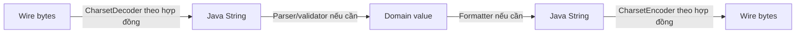
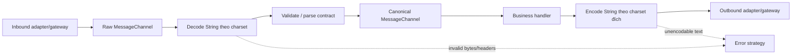
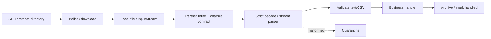

# String và charset converter trong Spring Integration Adapters

**String và charset converter** là phần của luồng tích hợp chịu trách nhiệm chuyển đổi giữa **dãy byte trên đường truyền** và **chuỗi ký tự trong Java**, theo một bảng mã (*character encoding/charset*) đã được thỏa thuận. Một message có thể đến từ file/SFTP, HTTP, JMS, AMQP, Kafka hoặc cơ sở dữ liệu; nhưng mỗi adapter có cách biểu diễn payload và metadata khác nhau. Vì vậy, việc chọn đúng charset và đặt converter đúng vị trí là điều kiện để không làm hỏng tên tiếng Việt, ký tự đặc biệt, định dạng tệp, chữ ký số hoặc dữ liệu nghiệp vụ.

Ví dụ, đối tác gửi một dòng CSV:

```text
ORDER-42,Đặng Thị Hà,Cà phê,159900
```

Nếu hệ thống nhận byte UTF-8 nhưng giải mã bằng một charset khác, các ký tự `Đ`, `ặ` hoặc `à` có thể biến thành chuỗi lỗi. Một khi dữ liệu đã bị giải mã sai, thao tác mã hóa lại sau đó không nhất thiết khôi phục được byte và nội dung ban đầu. Ngược lại, nếu mã hóa một `String` thành byte mà dùng encoding không biểu diễn được ký tự, một số API có thể âm thầm **thay thế ký tự**, gây mất dữ liệu.

Trong module **SPRING_INTEGRATION_ADAPTERS**, converter được xem như một **ranh giới hợp đồng message**: inbound adapter/gateway/poller đưa dữ liệu vào `MessageChannel`; bước chuyển đổi có kiểm soát giải mã sang Java `String` hoặc cấu trúc domain; business handler thực thi nghiệp vụ; outbound converter mã hóa lại thành byte theo yêu cầu của hệ đích. Bài học kết nối những bước này với **xử lý lỗi, khả năng quan sát, bảo mật và vòng đời kết nối**.

> **Nguyên tắc trọng tâm:** Không suy đoán charset từ tên tệp, hệ điều hành hoặc việc một đoạn văn trông “có vẻ đọc được”. Hãy xác định ai sở hữu hợp đồng encoding, payload thực tế đang là `byte[]` hay `String`, tầng nào đã giải mã, và phải xử lý ra sao khi byte không hợp lệ.

## 1. Mục tiêu học tập

Sau bài này, người học có thể:

1. Giải thích sự khác biệt giữa **ký tự Unicode**, **code point**, **Java String**, **byte** và **charset**.
2. Phân biệt **decode (bytes → String)** với **encode (String → bytes)** và tránh chuyển đổi hai lần.
3. Hiểu vai trò của `Message<?>`, `MessageHeaders.CONTENT_TYPE`, `MessageConverter`, `Transformer` và `MessageChannel`.
4. Thiết kế hợp đồng charset rõ ràng cho HTTP, file/SFTP, JMS, AMQP, Kafka và JDBC.
5. Viết Java converter sử dụng `CharsetDecoder` và `CharsetEncoder` với chính sách **REPORT** thay vì thay ký tự âm thầm.
6. Xử lý header `text/plain; charset=UTF-8`, charset không được hỗ trợ, thiếu header và byte sai mã hóa.
7. Giải thích **BOM, UTF-8, UTF-16, ISO-8859-1, Windows-1252** và những rủi ro khi trộn encoding.
8. Biết khi nào String converter là đủ và khi nào cần thêm CSV/JSON/XML parser, schema validation hoặc domain transformer.
9. Quản lý retry, error channel, quarantine, idempotency và lỗi conversion ở các adapter đồng bộ/bất đồng bộ.
10. Thiết kế unit test, integration test, metrics và checklist triển khai an toàn.

## 2. Mô hình căn bản: byte không phải ký tự

Một byte là đơn vị dữ liệu nhị phân 8 bit. Chuỗi ký tự trong Java là một dãy **UTF-16 code units**, được biểu diễn qua `String`. Charset quy định **cách ánh xạ giữa ký tự và byte** khi cần lưu hoặc truyền dữ liệu.



Ví dụ ký tự `Đ`:

- Trong Java, nó có thể được biểu diễn dưới dạng mã ký tự Unicode phù hợp.
- Khi mã hóa UTF-8, nó trở thành **nhiều byte**, không phải một byte ASCII.
- Khi giải mã cùng những byte đó bằng charset sai, kết quả có thể là ký tự khác.
- Một biểu thức `string.length()` đếm **UTF-16 code units**, không phải số byte UTF-8 hay số ký tự hiển thị với người dùng.

### 2.1. Ba kích thước khác nhau

Với một chuỗi có dấu tiếng Việt hoặc emoji:

| Đại lượng | Ý nghĩa | Công cụ Java tham khảo |
| --- | --- | --- |
| Số UTF-16 code units | Độ dài theo mô hình `String` | `text.length()` |
| Số Unicode code points | Số mã ký tự Unicode | `text.codePointCount(0, text.length())` |
| Số byte khi mã hóa | Kích thước khi truyền/lưu theo charset | Kết quả của encoder hoặc `getBytes(UTF_8).length` |
| Số cụm chữ hiển thị | Có thể khác code points do dấu kết hợp, emoji ghép | Cần quy tắc phân đoạn Unicode/grapheme thích hợp |

**Không dùng `String.length()` để áp giới hạn kích thước wire payload.** Với UTF-8, số byte có thể nhiều hơn số code units, và encoder phải được kiểm tra sau khi chạy.

### 2.2. Cần hiểu biểu thức “String là UTF-16”

Java `String` cung cấp API dựa trên UTF-16 code units; điều này **không có nghĩa** mọi String được truyền đi dưới dạng UTF-16. Khi lưu hoặc gửi, byte cuối cùng được tạo theo charset của **hợp đồng bên ngoài** như UTF-8 hoặc UTF-16LE. Chi tiết tối ưu lưu trữ nội bộ của JVM không nên là căn cứ cho thiết kế giao thức.

## 3. Encode và decode là hai thao tác khác nhau

### 3.1. Decode: byte → text

```java
byte[] wire = /* byte do adapter cung cấp */;
String text = new String(wire, StandardCharsets.UTF_8);
```

Đoạn này **chỉ rõ UTF-8**, tốt hơn dùng charset mặc định. Tuy nhiên, constructor `new String(bytes, charset)` có thể thay thế các chuỗi byte không hợp lệ bằng ký tự thay thế thay vì ném lỗi. Nếu hợp đồng yêu cầu không mất dữ liệu, hãy dùng **CharsetDecoder** với chính sách từ chối.

### 3.2. Encode: text → byte

```java
String text = "Đặng Thị Hà";
byte[] wire = text.getBytes(StandardCharsets.UTF_8);
```

Đoạn này mã hóa rõ UTF-8. Nhưng ở một số trường hợp chuỗi chứa surrogate không hợp lệ, API mã hóa tiện dụng có thể thay ký tự. Khi ứng dụng cần kiểm soát nghiêm ngặt lỗi encoding, dùng **CharsetEncoder** và xử lý exception.

### 3.3. Sai lầm: encode/decode nhiều lần

```text
Đúng:
UTF-8 bytes -> UTF-8 decode -> Java String

Sai:
UTF-8 bytes -> decode Latin-1 -> Java String lỗi
            -> encode UTF-8 -> bytes mới khác bản gốc
```

Một chuỗi “mojibake” như ký tự bị biến thành các chuỗi lạ có thể là dấu hiệu decode sai. Không nên sửa bằng cách nối thêm một vòng `getBytes`/`new String` tùy tiện mà chưa tìm ra tầng đã áp charset sai.

## 4. String converter ở đâu trong Spring Integration?

Một luồng tích hợp có nhiều ranh giới:



Vai trò mỗi bước:

| Thành phần | Chức năng | Điều cần tránh |
| --- | --- | --- |
| Inbound adapter/gateway | Đưa dữ liệu từ hệ thống ngoài thành Spring Message. | Không mặc định payload của mọi adapter là `byte[]`. |
| Raw channel | Nối inbound endpoint với bước xử lý dữ liệu thô. | Không giả định channel tự chọn charset. |
| Decoder/Transformer | Dịch byte thành String theo contract. | Không đoán charset hoặc silently replace ký tự lỗi. |
| Business handler | Xử lý dữ liệu nghiệp vụ đã chuẩn hóa. | Không trộn parser của từng transport vào business logic. |
| Encoder/Transformer | Mã hóa String sang byte theo yêu cầu đích. | Không dùng charset nguồn nếu đích yêu cầu charset khác. |
| Outbound adapter | Đẩy dữ liệu sang HTTP, broker, file hoặc hệ thống ngoài. | Không giả định header nội bộ được map ra wire tự động. |

**Thay đổi header `contentType` không tự động chuyển byte thành String trên mọi MessageChannel.** Conversion chỉ xảy ra khi endpoint/adapter hoặc một converter/transformer thực sự được cấu hình để làm việc đó.

## 5. Phân biệt MessageConverter, Transformer và codec của adapter

| Khái niệm | Vai trò thực tế | Ví dụ |
| --- | --- | --- |
| **Spring Messaging MessageConverter** | Chuyển payload và `Message<?>` giữa kiểu Java phù hợp với MIME/target type. | `StringMessageConverter`. |
| **Spring Integration Transformer** | Một endpoint biến đổi payload hoặc message trong flow. | `@Transformer` custom bytes → String. |
| **HTTP message converter** | Đọc/ghi HTTP request/response body theo contract của HTTP framework. | Có thể đọc body thành String trước Integration. |
| **Kafka serializer/deserializer** | Đổi key/value giữa bytes và object trong Kafka client. | `StringDeserializer`, `ByteArrayDeserializer`. |
| **JMS/AMQP message converter** | Chuyển biểu diễn message riêng của broker/client. | Text/bytes/message properties. |
| **File reader/writer hoặc JDBC mapper** | Đọc/ghi file hoặc dữ liệu database có kiểu. | `Files.newBufferedReader`, JDBC `getString`. |

Spring Messaging có converter như `org.springframework.messaging.converter.StringMessageConverter`; hành vi convert và MIME types hỗ trợ cần được kiểm tra theo **phiên bản và cấu hình thực tế**. Một Spring Integration flow có thể dùng converter đó tại một endpoint phù hợp, nhưng **không phải cứ có bean converter là toàn bộ adapter tự sử dụng**.

### 5.1. Khi nào dùng converter có sẵn?

Dùng converter sẵn có nếu:

- Chỉ cần kiểu `String` và một bộ MIME types được hỗ trợ.
- Charset/default charset và hành vi lỗi đáp ứng hợp đồng.
- Endpoint thực tế cho phép cấu hình converter.
- Không cần xử lý BOM, strict decoder hoặc metadata riêng.

Dùng transformer riêng nếu:

- Cần **fail closed** khi UTF-8 không hợp lệ.
- Phải giới hạn số byte trước decode.
- Nguồn có nhiều charset được allowlist.
- Cần audit reason code, xử lý BOM hoặc nội dung điều khiển.
- Phải chuẩn hóa headers từ nhiều adapter.
- Cần tách rõ wire text với text đã validate nghiệp vụ.

## 6. Content-Type, charset và Content-Encoding

Một header MIME thường có dạng:

```text
text/plain; charset=UTF-8
text/csv; charset=UTF-8
application/json
application/xml; charset=UTF-8
```

Có ba lớp phải phân biệt:

1. **Media type:** dữ liệu text/plain, text/csv, JSON hay XML?
2. **Charset:** byte được giải mã thành ký tự theo bảng mã nào?
3. **Content encoding/compression hoặc transfer encoding:** dữ liệu có được nén hoặc mã hóa vận chuyển thêm không?

Ví dụ:

```text
HTTP Content-Type: text/plain; charset=UTF-8
HTTP Content-Encoding: gzip

HTTP body bytes
  -> giải nén gzip theo hợp đồng và giới hạn an toàn
  -> nhận bytes UTF-8
  -> decode thành String
```

**Gzip không phải charset.** `UTF-8` cũng không phải media type. Tên `contentEncoding` ở một số broker hoặc thư viện có thể được dùng theo quy ước riêng để biểu thị character encoding; phải hiểu semantics của **transport cụ thể**, không tự áp ý nghĩa của HTTP sang JMS/AMQP/Kafka.

### 6.1. Header Spring Messaging

Spring Messaging dùng hằng:

```java
MessageHeaders.CONTENT_TYPE
```

Giá trị có thể là `MimeType` hoặc biểu diễn chuỗi tùy adapter và mapping. Ví dụ:

```java
MimeType type = MimeTypeUtils.parseMimeType(
    "text/plain; charset=UTF-8"
);

Message<byte[]> message = MessageBuilder
    .withPayload(rawBytes)
    .setHeader(MessageHeaders.CONTENT_TYPE, type)
    .build();
```

Ở HTTP có header `Content-Type` thật trên giao thức; ở Kafka có thể là một record header tự quản lý; ở file/SFTP thường phải dựa vào **hợp đồng thư mục/đối tác**. Không được coi tất cả giống hệt nhau.

## 7. Các charset phổ biến và cách lựa chọn

| Charset | Đặc điểm | Khi nào gặp |
| --- | --- | --- |
| **UTF-8** | Unicode, phổ biến cho API và dữ liệu văn bản hiện đại; ASCII tương thích theo byte. | HTTP, JSON, Kafka, file UTF-8, tích hợp mới. |
| **UTF-16LE/UTF-16BE** | Unicode với code unit 16-bit và thứ tự byte cụ thể. | Một số file/hệ thống legacy; cần hợp đồng BOM/endian. |
| **UTF-16** | Charset có quy tắc byte-order/BOM theo API Java. | Một số dữ liệu liên thông cũ. |
| **ISO-8859-1** | Bảng mã một byte cho một tập ký tự giới hạn, không chứa đủ tiếng Việt. | Hệ thống legacy phương Tây. |
| **Windows-1252** | Encoding legacy khác ISO-8859-1 ở một số vị trí. | CSV/flat files do phần mềm cũ phát hành. |
| **US-ASCII** | Chỉ bao phủ 7-bit ASCII. | Protocol fields hoặc dữ liệu rất hạn chế. |

**Ưu tiên UTF-8 cho giao thức mới** khi các bên có thể thỏa thuận. Nếu buộc hỗ trợ charset legacy, hãy ghi rõ theo **đối tác, endpoint, file route, hoặc version**, không bật một cơ chế tự đoán vô hạn.

### 7.1. Không thể khôi phục tất cả ký tự bằng legacy charset

Nếu đối tác yêu cầu Windows-1252 nhưng nội dung chứa chữ `Đặng`, nhiều ký tự có thể **không biểu diễn được**. Mã hóa nghiêm ngặt phải báo lỗi để các bên sửa hợp đồng, hoặc chỉ sử dụng một quy tắc chuyển tự (*transliteration*) nếu nghiệp vụ phê duyệt rõ — không lặng lẽ thay bằng dấu hỏi.

### 7.2. Java Charset.forName và allowlist

Một API có thể cho phép `Charset.forName(name)`, nhưng không nên dùng nguyên chuỗi `charset` tùy ý từ client để tạo encoding không giới hạn. Với đối tác có contract cố định, dùng allowlist:

```text
partner A -> UTF-8
partner B -> windows-1252 (legacy; sunset plan)
partner C -> UTF-16LE (fixed contract)
other     -> UNSUPPORTED_CHARSET
```

Những alias khác nhau của cùng charset cũng nên được chuẩn hóa để metrics, audit và validation nhất quán.

## 8. Thiết kế hợp đồng text trước khi viết converter

Một message contract tối thiểu nên có:

| Thành phần | Ví dụ quyết định |
| --- | --- |
| Hệ thống nguồn | `partner-a` đã được xác thực tại HTTP gateway hoặc SFTP session. |
| Transport | HTTP request, JMS queue, Kafka topic, file/SFTP route. |
| Java payload trước conversion | `byte[]`, `String`, `File`, `InputStream` hoặc row map. |
| Wire media type | `text/plain`, `text/csv` hoặc JSON/XML nếu phù hợp. |
| Charset | UTF-8 bắt buộc; legacy route có quy tắc riêng. |
| BOM policy | Không nhận BOM, chấp nhận BOM UTF-8, hoặc dựa BOM để phân biệt endian theo contract. |
| Newline policy | LF, CRLF, hay cả hai; cách xử lý trailing newline. |
| Schema/grammar | Dòng ký tự thường, CSV RFC-compatible, JSON/XML hay format domain. |
| Normalization | Giữ nguyên hay chuẩn hóa Unicode/newline một cách có chủ đích. |
| Size limit | Max bytes và max length sau decode. |
| Error strategy | Permanent reject, quarantine hoặc retry transient. |
| Traceability | Correlation/event ID, source, adapter, version, reason code. |

Ví dụ hợp đồng minh họa:

```yaml
contract: partner-a-order-text
transport: kafka
payloadJavaTypeBeforeConversion: byte[]
allowedMediaTypes:
  - text/plain
charset: UTF-8
charsetHeaderRequired: true
bomPolicy: REJECT
maxWireBytes: 1048576
lineFormat: "ORDER|eventId|orderId|amountCents"
onMalformedBytes: QUARANTINE
onUnsupportedCharset: REJECT
```

Đây **không phải cấu hình Spring Integration tự động hiểu**. Code, converter, routing và error handler phải thực thi các ràng buộc này.

## 9. Ví dụ inbound: chuyển byte[] UTF-8 sang String nghiêm ngặt

Giả sử inbound adapter đã chuẩn hóa payload thành `Message<byte[]>` và header `MessageHeaders.CONTENT_TYPE`. Ta muốn chấp nhận **chính xác** `text/plain; charset=UTF-8`, từ chối dữ liệu sai và không tự đoán encoding.

### 9.1. Java transformer hoàn chỉnh về mặt chức năng chuyển đổi

```java
import java.nio.ByteBuffer;
import java.nio.charset.CharacterCodingException;
import java.nio.charset.CodingErrorAction;
import java.nio.charset.StandardCharsets;
import org.springframework.integration.annotation.Transformer;
import org.springframework.messaging.Message;
import org.springframework.messaging.MessageHeaders;
import org.springframework.messaging.support.MessageBuilder;
import org.springframework.stereotype.Component;
import org.springframework.util.MimeType;
import org.springframework.util.MimeTypeUtils;

@Component
public class StrictUtf8InboundTransformer {

    private static final int MAX_WIRE_BYTES = 1_048_576;

    @Transformer(
        inputChannel = "rawTextChannel",
        outputChannel = "canonicalTextChannel"
    )
    public Message<String> decode(Message<byte[]> input) {
        byte[] bytes = input.getPayload();

        if (bytes.length == 0 || bytes.length > MAX_WIRE_BYTES) {
            throw new IllegalArgumentException(
                "EMPTY_OR_OVERSIZED_TEXT_PAYLOAD"
            );
        }

        MimeType mime = requiredMimeType(input.getHeaders());
        if (!mime.getType().equalsIgnoreCase("text")
                || !mime.getSubtype().equalsIgnoreCase("plain")
                || !StandardCharsets.UTF_8.equals(mime.getCharset())) {
            throw new IllegalArgumentException(
                "UNSUPPORTED_CONTENT_TYPE_OR_CHARSET"
            );
        }

        // Policy của ví dụ: không chấp nhận UTF-8 BOM.
        if (bytes.length >= 3
                && (bytes[0] & 0xff) == 0xef
                && (bytes[1] & 0xff) == 0xbb
                && (bytes[2] & 0xff) == 0xbf) {
            throw new IllegalArgumentException("UTF8_BOM_NOT_ALLOWED");
        }

        final String text;
        try {
            text = StandardCharsets.UTF_8.newDecoder()
                .onMalformedInput(CodingErrorAction.REPORT)
                .onUnmappableCharacter(CodingErrorAction.REPORT)
                .decode(ByteBuffer.wrap(bytes))
                .toString();
        } catch (CharacterCodingException ex) {
            throw new IllegalArgumentException(
                "MALFORMED_UTF8_PAYLOAD", ex
            );
        }

        // Tầng tiếp theo xử lý grammar/CSV/schema nếu cần.
        // Không giữ contentType=... cho payload Java String
        // nếu flow dùng nó để mô tả biểu diễn wire hiện tại.
        return MessageBuilder.withPayload(text)
            .setHeader("wireContentType", mime.toString())
            .setHeader(
                "correlationId",
                input.getHeaders().get("correlationId")
            )
            .build();
    }

    private static MimeType requiredMimeType(MessageHeaders headers) {
        Object raw = headers.get(MessageHeaders.CONTENT_TYPE);

        if (raw instanceof MimeType mimeType) {
            return mimeType;
        }

        if (raw instanceof String value && !value.isBlank()) {
            return MimeTypeUtils.parseMimeType(value);
        }

        throw new IllegalArgumentException("CONTENT_TYPE_REQUIRED");
    }
}
```

### 9.2. Điểm cần hiểu trong ví dụ

1. **Giới hạn bytes trước decoder:** ngăn dùng memory vô hạn khi input lớn.
2. **Media type và charset có allowlist:** không dùng “cứ decode thử UTF-8 xem sao”.
3. **Strict decoder:** malformed/unmappable bytes tạo lỗi có kiểm soát; không thay ký tự âm thầm.
4. **BOM policy cố định:** bài học chọn từ chối UTF-8 BOM; một hệ thống khác có thể chấp nhận và bỏ BOM nếu contract quy định.
5. **Mỗi lần gọi tạo decoder mới:** decoder có trạng thái và không nên chia sẻ tùy tiện giữa các thread.
6. **Metadata sau conversion:** giữ tham chiếu content type của wire, tránh làm downstream tưởng String vẫn là byte payload.
7. **Không cấp quyền theo header:** `correlationId` chỉ hỗ trợ truy vết; một header do client tự khai không phải bằng chứng xác thực hay tenant.

Ví dụ minh họa một transformer theo contract đơn giản, không xử lý toàn bộ những việc adapter phải làm như xác thực nguồn, giải nén, bảo vệ log, giới hạn thời gian hay transactional redelivery.

### 9.3. Nếu header charset bị thiếu thì sao?

Code trên từ chối `text/plain` không có `charset`. Đây là **lựa chọn hợp đồng**, không phải quy tắc bắt buộc của mọi media type. Một endpoint chỉ nhận file UTF-8 có thể hợp lệ khi **gán UTF-8 theo route đã được kiểm soát**, kể cả khi file không có MIME header. Điều quan trọng là default phải được **quy định rõ và kiểm thử**, không lấy ngầm từ môi trường runtime.

## 10. Ví dụ outbound: chuyển String sang UTF-8 bytes

Chiều outbound ngược lại: business handler đã tạo một `String` đúng grammar, cần mã hóa để gửi HTTP, broker hoặc file. Mã hóa nghiêm ngặt giúp phát hiện String có Unicode không hợp lệ trước khi xuất dữ liệu.

```java
import java.nio.ByteBuffer;
import java.nio.CharBuffer;
import java.nio.charset.CharacterCodingException;
import java.nio.charset.CodingErrorAction;
import java.nio.charset.StandardCharsets;
import org.springframework.integration.annotation.Transformer;
import org.springframework.messaging.Message;
import org.springframework.messaging.MessageHeaders;
import org.springframework.messaging.support.MessageBuilder;
import org.springframework.stereotype.Component;
import org.springframework.util.MimeType;
import org.springframework.util.MimeTypeUtils;

@Component
public class StrictUtf8OutboundTransformer {

    private static final int MAX_WIRE_BYTES = 1_048_576;
    private static final MimeType TEXT_UTF8 =
        MimeTypeUtils.parseMimeType("text/plain; charset=UTF-8");

    @Transformer(
        inputChannel = "outboundTextChannel",
        outputChannel = "outboundBytesChannel"
    )
    public Message<byte[]> encode(Message<String> input) {
        String text = input.getPayload();

        final byte[] bytes;
        try {
            ByteBuffer encoded = StandardCharsets.UTF_8.newEncoder()
                .onMalformedInput(CodingErrorAction.REPORT)
                .onUnmappableCharacter(CodingErrorAction.REPORT)
                .encode(CharBuffer.wrap(text));

            bytes = new byte[encoded.remaining()];
            encoded.get(bytes);
        } catch (CharacterCodingException ex) {
            throw new IllegalArgumentException(
                "INVALID_UNICODE_TEXT", ex
            );
        }

        if (bytes.length == 0 || bytes.length > MAX_WIRE_BYTES) {
            throw new IllegalArgumentException(
                "EMPTY_OR_OVERSIZED_OUTBOUND_TEXT"
            );
        }

        return MessageBuilder.withPayload(bytes)
            .setHeader(MessageHeaders.CONTENT_TYPE, TEXT_UTF8)
            .setHeader(
                "correlationId",
                input.getHeaders().get("correlationId")
            )
            .build();
    }
}
```

### 10.1. Những điều cần xác nhận ở outbound adapter

- HTTP: HTTP message converter/gateway có thể thực hiện encoding lại nếu gửi `String`; nếu đã tạo byte[] thì phải cấu hình body/header mapping đúng.
- JMS: nếu gửi `TextMessage`, provider chịu trách nhiệm biểu diễn text; nếu gửi `BytesMessage`, contract byte/charset phải đúng.
- Kafka: nếu value serializer là `ByteArraySerializer`, dữ liệu đã là bytes. Nếu value serializer là `StringSerializer`, **không** đưa byte[] vào mà không điều chỉnh.
- File/SFTP: ghi byte[] giữ nguyên encoding đã chọn; nếu dùng writer ký tự, cấu hình charset tại writer.
- Database: nếu cột là VARCHAR/CLOB, driver xử lý ký tự; nếu BLOB, lưu bytes theo contract.

**Đừng encode hai lần.** Mỗi đường outbound cần chỉ có một chủ sở hữu rõ ràng của việc `String → bytes` ở ranh giới tương ứng.

## 11. MessageChannel và kết nối transformer vào flow

Một cách cấu hình channel đơn giản:

```java
import org.springframework.context.annotation.Bean;
import org.springframework.context.annotation.Configuration;
import org.springframework.integration.channel.DirectChannel;
import org.springframework.messaging.MessageChannel;

@Configuration
public class TextChannels {

    @Bean
    public MessageChannel rawTextChannel() {
        return new DirectChannel();
    }

    @Bean
    public MessageChannel canonicalTextChannel() {
        return new DirectChannel();
    }

    @Bean
    public MessageChannel outboundTextChannel() {
        return new DirectChannel();
    }

    @Bean
    public MessageChannel outboundBytesChannel() {
        return new DirectChannel();
    }
}
```

Với `@Transformer` ở phần trước, một endpoint xử lý nghiệp vụ có thể nhận text:

```java
import org.springframework.integration.annotation.ServiceActivator;
import org.springframework.messaging.Message;
import org.springframework.stereotype.Component;

@Component
public class TextBusinessHandler {

    @ServiceActivator(inputChannel = "canonicalTextChannel")
    public void handle(Message<String> input) {
        String text = input.getPayload();

        // Ở đây xử lý grammar của text (ví dụ CSV hợp lệ)
        // hoặc chuyển tiếp sang domain parser.
        // Không cần tự suy đoán charset nữa.
    }
}
```

`DirectChannel` thực thi dispatch theo đường đồng bộ trong lời gọi. Với converter ném exception, lỗi có thể **lan về thread của sender/gateway**, khác với consumer có poller hoặc thread riêng. Cần kiểm thử error handling phù hợp, không mặc định mọi lỗi tự đi qua global error channel.

### 11.1. Khi nào nên tách channel raw và canonical?

Việc tách giúp:

- Người vận hành biết payload hiện ở dạng **bytes chưa kiểm tra** hay **String đã decode**.
- Gán metrics, size limit và error strategy ở đúng ranh giới.
- Hạn chế handler đọc raw untrusted bytes.
- Tái sử dụng cùng handler cho nhiều transport sau khi chuẩn hóa.
- Tách quy tắc charset của đối tác khỏi business logic.

Không phải ứng dụng nhỏ nào cũng cần nhiều channel riêng; có thể gộp endpoint khi đơn giản hơn, miễn **hợp đồng đầu vào/đầu ra và vị trí conversion** vẫn rõ.

## 12. StringMessageConverter của Spring Messaging

Spring Messaging cung cấp `StringMessageConverter` để hỗ trợ chuyển đổi message/payload văn bản theo hợp đồng và kiểu đích được hỗ trợ. Khi cân nhắc dùng converter này cần hiểu:

1. **Ai gọi converter?** Nó phải được cấu hình trong một endpoint/adapter hoặc được gọi trực tiếp.
2. **Payload hiện tại là gì?** Bytes, String hay object khác?
3. **Target class nào được yêu cầu?** String hay loại khác?
4. **Content type và charset nào được hỗ trợ?**
5. **Chế độ xử lý dữ liệu malformed** có phù hợp mức độ nghiêm ngặt của contract?
6. **Các headers** được giữ hoặc điều chỉnh thế nào?

Ví dụ ý tưởng:

```java
import org.springframework.messaging.converter.StringMessageConverter;

StringMessageConverter converter =
    new StringMessageConverter();
```

Ví dụ chỉ thể hiện **khởi tạo converter**, không khẳng định mọi transport sẽ tự dùng bean này. Phải kiểm tra API và cấu hình tích hợp với phiên bản Spring hiện hành trước khi gọi `fromMessage/toMessage` trong ứng dụng.

### 12.1. Custom transformer có thay thế converter sẵn không?

Không phải lúc nào. Với contract thuần UTF-8, một converter sẵn có có thể đủ. Transformer riêng trong bài nhằm minh họa **strict encoding, giới hạn dung lượng, lý do từ chối và kiểm soát headers** mà nhiều tích hợp bên ngoài cần thêm.

Sử dụng framework converter khi nó thực thi được hợp đồng; bổ sung custom logic khi có lý do kỹ thuật hoặc bảo mật, tránh viết lại toàn bộ hệ thống codec không cần thiết.

## 13. File inbound/outbound: encoding ở đâu?

Một file adapter có thể trả `File`, `Path` hoặc tài nguyên tùy endpoint. **File object không phải String.** Có hai cách thiết kế:

### 13.1. Đọc file có giới hạn thành bytes rồi decode

```text
Inbound file adapter -> File
   -> kiểm tra path/size/ready
   -> đọc byte theo giới hạn
   -> Message<byte[]> + route contract
   -> StrictUtf8InboundTransformer
   -> Message<String>
```

Có thể dùng `Files.readAllBytes(path)` cho file **đã được kiểm tra kích thước nhỏ**, nhưng không nên dùng cách này cho file vài GB. Trong production, thao tác kiểm tra size và đọc có thể gặp race khi file bị thay đổi; nên kết hợp cơ chế file readiness, quyền truy cập an toàn và giới hạn khi đọc.

### 13.2. Đọc dạng stream/reader

Với file lớn, dùng `InputStreamReader`/`BufferedReader` có decoder cấu hình:

```java
import java.io.BufferedReader;
import java.io.InputStreamReader;
import java.nio.charset.CodingErrorAction;
import java.nio.charset.StandardCharsets;
import java.nio.file.Files;
import java.nio.file.Path;

Path file = Path.of("inbox/orders.txt");

try (BufferedReader reader = new BufferedReader(
        new InputStreamReader(
            Files.newInputStream(file),
            StandardCharsets.UTF_8.newDecoder()
                .onMalformedInput(CodingErrorAction.REPORT)
                .onUnmappableCharacter(CodingErrorAction.REPORT)
        ))) {

    String line;
    while ((line = reader.readLine()) != null) {
        // Xử lý từng dòng theo giới hạn của contract.
        // Với CSV có trường xuống dòng trong dấu nháy,
        // cần CSV parser chứ không coi mỗi dòng là một record.
    }
}
```

**Lưu ý:** `readLine()` bỏ dấu phân cách dòng; nếu cần tái tạo byte gốc, chữ ký số hoặc phân biệt LF/CRLF thì chiến lược này không phù hợp. Bộ đọc stream cũng phải có giới hạn kích thước toàn tệp và độ dài dòng/record để tránh mất kiểm soát bộ nhớ.

### 13.3. Ghi file văn bản

```java
Files.writeString(
    Path.of("outbox/orders.txt"),
    text,
    StandardCharsets.UTF_8
);
```

Cách này thuận tiện cho nội dung vừa phải, nhưng trong tích hợp có idempotency và atomic file delivery, cần thêm cơ chế ghi tệp tạm rồi rename, quản lý tên tệp, permissions, flush/close và error recovery.

## 14. SFTP poller: chọn charset bằng hợp đồng đối tác

SFTP truyền **file bytes**; nó không tự chuẩn hóa charset của file. Đuôi `.txt` hoặc `.csv` chỉ là tín hiệu theo quy ước, không chứng minh encoding.

Luồng thực tế:



Các vấn đề cần xử lý:

- **File readiness:** tránh đọc file đối tác đang upload; có thể thống nhất rename/marker.
- **Metadata:** route/partner và charset phải có cấu hình đáng tin.
- **Không lặp xử lý:** file filter, idempotency key hoặc registry metadata.
- **Retry và quarantine:** file bytes malformed thường không tự lành khi retry.
- **Kích thước:** streaming cho tệp lớn; giới hạn records/batch.
- **Vòng đời kết nối:** SFTP session timeout/reconnect, remote/local cleanup và archive.
- **Quyền riêng tư:** không log nguyên file khách hàng khi phát hiện lỗi charset.

### 14.1. Tránh đoán encoding bằng Byte Order Mark

BOM có thể hữu ích với một số encoding, nhưng không phải bộ nhận dạng tin cậy tuyệt đối. Nếu route đã quy định UTF-8, có thể chọn chấp nhận hoặc từ chối BOM theo hợp đồng; đừng cho một file tự quyết định codec khác với quy tắc đã được phê duyệt chỉ bằng vài byte đầu.

## 15. HTTP adapter/gateway: content type và body conversion

HTTP có `Content-Type` ở request/response, ví dụ:

```http
POST /api/orders/text HTTP/1.1
Content-Type: text/plain; charset=UTF-8

ORDER-42,Đặng Thị Hà,Cà phê,159900
```

Phân biệt:

| HTTP khái niệm | Ý nghĩa |
| --- | --- |
| `Content-Type` | Kiểu biểu diễn của body hiện tại, có thể gồm charset. |
| `Accept` | Những media types response client có thể nhận. |
| `Content-Encoding` | Bước mã hóa nội dung như gzip; không phải charset. |
| `Content-Length` | Kích thước body trên đường truyền theo semantics HTTP, không phải số `String.length()`. |

### 15.1. Converter có thể đã chạy ở HTTP layer

Một HTTP inbound gateway hoặc HTTP framework có thể đọc body thành `String` bằng HTTP message converter. Nếu Spring Integration nhận `Message<String>`, **không được cast sang byte[] rồi decode lại**.

Có hai mô hình hợp lệ:

**Mô hình A – decode tại HTTP boundary:**

```text
HTTP bytes
 -> HTTP converter nhận Content-Type/charset
 -> Message<String>
 -> validate/parser
```

**Mô hình B – giữ bytes tới integration flow:**

```text
HTTP bytes
 -> Message<byte[]> + mapped/validated content type
 -> StrictUtf8InboundTransformer
 -> Message<String>
```

Chọn một mô hình và test với đúng version/framework, nhất là khi có custom HTTP converters.

### 15.2. Phân loại lỗi HTTP

- `415 Unsupported Media Type`: media type/charset theo API contract không được hỗ trợ.
- `400 Bad Request`: byte hoặc cấu trúc request không hợp lệ, theo quy định API.
- `401/403`: authentication/authorization failure, không đánh đồng với lỗi charset.
- `5xx`: lỗi hệ thống; không biến mọi malformed text thành server error.

Thông điệp phản hồi không nên in raw credential, body nhạy cảm hay nội dung stack trace; có thể trả mã tham chiếu để helpdesk tra cứu.

## 16. JMS: TextMessage và BytesMessage không tương đương

JMS có những loại message như `TextMessage` và `BytesMessage`. Một listener/adapter có thể chuyển chúng thành Java String hoặc byte[] theo cơ chế converter được cấu hình.

### 16.1. TextMessage

```text
Producer gửi JMS TextMessage
 -> JMS provider / converter
 -> Spring Message<String> theo mapping
 -> business validation
```

JMS TextMessage biểu diễn nội dung text ở mức API; provider xử lý wire representation. Không nên lấy String nhận được, mã hóa sang bytes bằng charset tự chọn rồi decode lại chỉ để “chắc chắn UTF-8”.

### 16.2. BytesMessage

```text
Producer gửi JMS BytesMessage (UTF-8 bytes)
 -> Spring Message<byte[]>
 -> charset converter theo contract
 -> Spring Message<String>
```

Nếu tích hợp JMS lưu thêm property `contentType` hoặc `charset`, phải biết **tên property và header mapping thực tế**. Không mặc định JMS có header HTTP chuẩn.

### 16.3. Lỗi converter và redelivery

Khi một BytesMessage chứa UTF-8 sai, cần quy định:

- Error xảy ra trước hay sau JMS acknowledgement?
- Có transaction rollback/retry không?
- Sau bao nhiêu lần đưa vào DLQ/quarantine?
- Message không hợp lệ có chặn queue khác không?
- Replay sau khi sửa contract có đảm bảo idempotency?

Không để poison message bị redeliver vô hạn chỉ vì converter luôn báo lỗi không thể tự khắc phục.

## 17. AMQP: contentEncoding, contentType và converter riêng

AMQP/RabbitMQ thường có properties mô tả loại nội dung và encoding; Spring AMQP còn có tầng message converter riêng. **Không đồng nhất tên property giữa các thư viện và transport**.

Ví dụ một AMQP message có:

```text
contentType = text/plain
contentEncoding = UTF-8
body = byte[] UTF-8
```

Tùy Spring AMQP converter/adapter, message đến Spring Integration có thể đã là String hoặc vẫn là byte[]. Vì vậy, cần xác minh:

1. AMQP producer đặt body và properties ra sao.
2. Listener/adapter dùng converter nào.
3. Header/property có được copy sang Spring Message không.
4. Charset mặc định và hành vi malformed bytes là gì.
5. Retry/DLQ vận hành ở broker hay trong flow.

Không kết luận rằng cứ có AMQP `contentEncoding=UTF-8` thì Spring Integration tự động gọi transformer của bài.

## 18. Kafka: StringDeserializer hay ByteArrayDeserializer?

Kafka key/value serializers và deserializers nằm ở tầng Kafka client, trước khi consumer đưa value vào Spring Integration.

| Cấu hình consumer | Kiểu value thường nhận | Nơi xử lý encoding |
| --- | --- | --- |
| `ByteArrayDeserializer` | `byte[]` | Converter/transformer ở flow, nếu cần String. |
| `StringDeserializer` | `String` | Kafka deserializer đã decode theo cấu hình của nó. |
| JSON deserializer riêng | Object hoặc tree | Không cần text decoder nếu đã được decode/parse. |

Ví dụ:

```text
Producer UTF-8 text -> ByteArraySerializer
Kafka topic value: UTF-8 bytes
Consumer ByteArrayDeserializer
  -> Spring Message<byte[]>
  -> StrictUtf8InboundTransformer
  -> String parser
```

Hoặc:

```text
Producer StringSerializer (UTF-8 theo cấu hình)
Kafka topic value: bytes
Consumer StringDeserializer (charset tương thích)
  -> Spring Message<String>
  -> String parser, không decode lần nữa
```

### 18.1. Kafka header không tự đổi deserializer

Producer có thể đặt Kafka record header `contentType=text/plain;charset=UTF-8`, nhưng `StringDeserializer`/`ByteArrayDeserializer` **được cấu hình tách biệt**. Header có thể phục vụ validation hoặc routing, không tự điều khiển chọn deserializer của Kafka client.

### 18.2. Lỗi trước khi vào flow

Nếu `StringDeserializer` gặp dữ liệu bất thường và lỗi được ném ở tầng Kafka listener, lỗi đó **có thể xảy ra trước Spring Integration transformer**. Không phải lúc nào global error channel của Integration cũng nhìn thấy nó. Cần kiểm thử error handling ở listener container, offset commit, retry và dead-letter policy riêng.

## 19. JDBC/database: String đã qua driver decoding

Đối với JDBC, cách dữ liệu xuất hiện trong Java phụ thuộc kiểu cột và API đọc:

- `VARCHAR`, `NVARCHAR`, `CLOB` hoặc kiểu text: driver/ORM thường cung cấp `String` hoặc reader.
- `BLOB`/binary: driver trả bytes/stream; charset do hợp đồng application quyết định.
- JSON/XML nằm trong cột text: sau khi nhận String, vẫn phải parse cấu trúc, không coi text conversion là đủ.
- Một database adapter có thể trả row map/list thay vì một String trực tiếp.

### 19.1. Điều gì không nên làm?

Nếu đã nhận `String` từ cột Unicode được driver xử lý đúng, **không nên gọi getBytes theo charset mặc định rồi new String ở charset khác**. Điều đó thêm một vòng conversion không cần thiết và có nguy cơ hỏng dữ liệu.

### 19.2. Outbox và idempotency

Với poller đọc các dòng sự kiện từ database:

```text
DB event row
 -> payload_text (String) + event_id + schema_version
 -> validate/parse
 -> outbound encoding nếu cần xuất wire text
 -> target broker/file
```

Cần transaction/checkpoint rõ để tránh mất sự kiện khi handler lỗi hoặc publish trùng sau retry. Error handling dữ liệu sai không nên chặn toàn bộ poller nếu có thể cách ly bản ghi lỗi theo contract.

## 20. BOM: dấu hiệu đầu tệp và cách xử lý

**Byte Order Mark (BOM)** là chuỗi byte đặc biệt có thể xuất hiện ở đầu một số biểu diễn Unicode. Nó có ý nghĩa khác nhau theo encoding:

| Định dạng | BOM thường gặp | Lưu ý |
| --- | --- | --- |
| UTF-8 | `EF BB BF` | Không cần thiết cho UTF-8; có producer vẫn ghi. |
| UTF-16BE | `FE FF` | Có thể chỉ thứ tự byte trong hợp đồng UTF-16. |
| UTF-16LE | `FF FE` | Có thể chỉ little-endian. |
| UTF-32 | Có các chuỗi BOM tương ứng | Chỉ hỗ trợ khi contract/codec quy định. |

### 20.1. Ba chiến lược có thể chọn

1. **REJECT:** không cho BOM, thích hợp message text protocol có contract cứng.
2. **STRIP_IF_PRESENT:** chấp nhận BOM UTF-8 ở đầu file và bỏ đúng ba byte trước decode.
3. **DETECT_ALLOWED_BOM:** chỉ dùng để chọn endian/charset trong một tập đã phê duyệt.

**Không được nhầm BOM với ký tự nghiệp vụ ở vị trí khác trong chuỗi.** Nếu chính sách cho phép bỏ BOM, chỉ bỏ ở đầu payload và ghi nhận hành vi; không xóa mọi ký tự U+FEFF trong nội dung một cách tùy tiện.

### 20.2. BOM sau khi decode

Với UTF-8 BOM, nếu decoder không tự xử lý nó như một chỉ báo và dữ liệu được chuyển thành ký tự U+FEFF ở đầu String, một parser CSV có thể coi phần đầu tiên của tên cột là `\uFEFForderId` thay vì `orderId`. Vì thế, BOM policy phải nằm ở **biên parse**, không để mỗi business handler tự đoán.

## 21. Line endings: LF, CRLF và dữ liệu nhiều dòng

Hai file nhìn giống nhau có thể khác bytes:

```text
LF:   \n
CRLF: \r\n
CR:   \r
```

Chúng đều là biểu diễn xuống dòng ở những môi trường/giao thức nhất định. Khi chuyển text:

- **Decode** nên bảo toàn ký tự xuống dòng, trừ khi hợp đồng yêu cầu chuẩn hóa.
- **Normalize newline** là một bước biến đổi nội dung, không phải bản chất của charset conversion.
- **Encode outbound** phải tuân theo format mà hệ đích cần.
- **Signature/hash** của payload có thể thay đổi nếu normalize newline.
- CSV có thể có field chứa newline trong dấu nháy; phân tách theo `String.split("\\n")` không phải CSV parser đúng.

### 21.1. Vì sao không nên tự gọi trim/strip mọi lúc?

`text.strip()` có thể loại bỏ khoảng trắng hoặc ký tự xuống dòng mang ý nghĩa trong một số hợp đồng. Một converter charset nên có phạm vi trách nhiệm hẹp: **bytes ↔ characters**; bước làm sạch/trimming cần **quy tắc nghiệp vụ tường minh** để tránh phá dữ liệu.

## 22. Unicode normalization và ký tự dễ gây nhầm

Một ký tự nhìn giống nhau có thể có hai biểu diễn Unicode khác nhau. Ví dụ một chữ cái có dấu có thể được mã hóa dưới dạng ký tự ghép sẵn hoặc chữ cơ sở + dấu kết hợp.

### 22.1. NFC và NFD

Java có API:

```java
import java.text.Normalizer;

String normalized = Normalizer.normalize(
    input,
    Normalizer.Form.NFC
);
```

**Không tự động normalize mọi message** nếu đối tác gửi dữ liệu đã ký, mã định danh nhạy cảm, khóa so sánh byte hoặc dữ liệu cần giữ chính xác nguyên bản. Normalization có thể đổi bytes khi mã hóa lại, dù văn bản nhìn không khác.

Có thể phân chia:

```text
Raw bytes (lưu hash/audit tham chiếu khi cần)
    -> Strict decode
    -> Unicode validation/normalization (nếu contract yêu cầu)
    -> Domain parsing
    -> Business identifiers and policies
```

### 22.2. Ký tự điều khiển và confusable

Một String đã decode đúng UTF-8 vẫn có thể chứa:

- NUL `\u0000` hoặc control characters không được phép.
- Ký tự xuống dòng bất ngờ trong header, filename hoặc CSV field.
- Unicode confusables/homoglyphs gây nhầm trong mã tài khoản hoặc tên tài nguyên.
- Ký tự điều khiển hiển thị hai chiều làm log khó đọc.

Đây là **bài toán validation và xử lý text an toàn**, không phải lỗi charset. Không được coi “decode thành công” là “dữ liệu an toàn để dùng làm path, SQL, header hoặc tên tài khoản”.

## 23. String converter không thay thế parser JSON, CSV hoặc XML

Một converter text chỉ biến bytes thành chuỗi. Nếu chuỗi đó có cấu trúc, vẫn cần bước parse theo grammar/schema.

| Format | Byte → String | Bước tiếp theo |
| --- | --- | --- |
| Plain text | Theo charset | Validation ký tự, length và ý nghĩa. |
| CSV | Theo encoding đã quy định | CSV parser xử lý quote/escape/delimiter/header. |
| JSON | Theo encoding/hợp đồng JSON | JSON parser + schema/domain validation. |
| XML | Theo encoding/hợp đồng XML | XML parser namespace-aware + XSD/domain validation và phòng XXE. |
| Fixed-width records | Theo charset, trước khi đếm cột | Áp quy tắc fixed width theo **byte** hay **character** đã thỏa thuận. |
| Protobuf/Avro | Không nhất thiết qua String | Decoder binary/schema phù hợp. |

### 23.1. Ví dụ fixed-width dễ sai

Một bản ghi có trường tên dài **20 bytes**, không phải 20 ký tự. Nếu chứa chữ tiếng Việt UTF-8, cắt String ở 20 UTF-16 code units có thể không tương ứng 20 bytes và còn cắt giữa ký tự Unicode. Hợp đồng fixed-width phải nêu rõ **đơn vị chiều dài** và chiến lược padding/truncation an toàn.

### 23.2. JSON/XML có encoding riêng cần được xem xét

Đối với JSON/XML, một HTTP converter hoặc parser có thể đã xử lý bytes theo quy tắc format/giao thức. Nếu thêm một String converter trước đó, phải bảo đảm không mâu thuẫn với quy tắc encoding và parser. Với XML, declaration và BOM có thể quan trọng; với binary formats thì decode String thường là sai.

## 24. Chuyển đổi xuyên nhiều transport: một kịch bản end-to-end

Giả sử một công ty nhận file CSV UTF-8 qua SFTP và công bố mỗi dòng giao dịch sang Kafka, sau đó một service khác đẩy kết quả qua HTTP.

### 24.1. Inbound từ SFTP

```text
SFTP remote file: orders-2026-11-23.csv
    -> SFTP download / poller
    -> File object (local)
    -> File reader với UTF-8 strict
    -> CSV parser theo contract
    -> OrderCreated canonical event
```

Ở đây có hai bước khác nhau: **decode characters** và **parse CSV**. Nếu một dòng sai charset, cần quyết định fail cả file hay chỉ quarantine record theo yêu cầu nghiệp vụ.

### 24.2. Outbound sang Kafka

```text
OrderCreated
    -> format CSV/JSON theo Kafka event contract
    -> String
    -> Strict UTF-8 encoding (nếu producer dùng ByteArraySerializer)
    -> byte[] record value
    -> Kafka topic
```

Nếu producer dùng `StringSerializer`, thay vì mã hóa trước, có thể truyền String và để serializer chuyển bytes theo cấu hình. **Không thực hiện cả hai cơ chế cùng lúc**.

### 24.3. Consumer và HTTP response

```text
Kafka topic
    -> consumer ByteArrayDeserializer
    -> strict UTF-8 decoder
    -> domain parser
    -> business handler
    -> HTTP response body
```

Tại HTTP response, có thể giao việc encode cho HTTP framework với Content-Type/charset đã cấu hình hoặc encode chủ động thành byte[] rồi ánh xạ đúng header. Hai hướng đều hợp lệ nếu **chỉ có một bước encode cuối**.

### 24.4. Tính idempotent trong luồng file → Kafka

Một file có thể được poll lại sau khi consumer hoặc ứng dụng restart. Nếu có `eventId` hoặc khóa nghiệp vụ, hệ thống cần chống xử lý trùng. Lỗi conversion không nên xóa file trước khi xác nhận trạng thái xử lý theo chính sách.

## 25. Error handling: permanent và transient khác nhau

Lỗi charset thường là lỗi dữ liệu/hợp đồng, nhưng cũng có trường hợp lỗi phụ thuộc vào cấu hình hệ thống.

| Loại lỗi | Ví dụ | Hướng xử lý |
| --- | --- | --- |
| **Malformed bytes** | UTF-8 có byte continuation sai. | Reject/quarantine; retry nguyên bytes thường không giúp. |
| **Unsupported charset** | Header khai charset ngoài allowlist. | Reject hợp đồng; cần producer sửa hoặc tuyến migration. |
| **Missing charset** | Endpoint yêu cầu rõ UTF-8 nhưng header thiếu. | Reject hoặc route default được duyệt. |
| **BOM không được phép** | File có UTF-8 BOM trong contract NO_BOM. | Reject/quarantine, thông báo producer. |
| **Unencodable characters** | String có ký tự ngoài legacy encoding. | Fail; không thay bằng dấu hỏi âm thầm. |
| **Oversized text** | Body vượt max bytes. | Reject/streaming theo kiến trúc. |
| **I/O transient** | SFTP tạm mất kết nối, HTTP timeout, broker lỗi. | Retry giới hạn, backoff và circuit breaker nếu phù hợp. |
| **Schema/grammar failure** | Decode được nhưng CSV thiếu cột. | Quarantine/nhánh lỗi nghiệp vụ; không retry vô hạn. |
| **Downstream unavailable** | Database hoặc service đích tạm lỗi. | Retry có kiểm soát và idempotency. |

### 25.1. Không mặc định global errorChannel nhận mọi lỗi

- Với `DirectChannel` và gateway đồng bộ, exception từ transformer có thể lan trực tiếp tới sender và được mapping thành HTTP response hoặc lỗi caller.
- Với poller hoặc channel/endpoint bất đồng bộ, lỗi có thể được đưa qua error channel theo cách container/framework được cấu hình.
- Với Kafka/JMS/AMQP, lỗi ngay tầng deserializer/converter có thể xảy ra **trước khi** message vào Integration flow; retry/ack/commit cần xử lý ở adapter/listener.

Tất cả những hành vi đó phải được kiểm tra bằng **integration test thật trên transport**. Không nên coi một bean error handler là bảo đảm chung cho mọi lệnh.

### 25.2. Quarantine và DLQ

Một message text sai encoding nên được ghi metadata:

```json
{
  "eventType": "TEXT_CONVERSION_FAILED",
  "sourceSystem": "partner-a",
  "adapter": "kafka-inbound",
  "correlationId": "order-flow-82",
  "mediaType": "text/plain",
  "charset": "UTF-8",
  "payloadBytes": 104,
  "reasonCode": "MALFORMED_UTF8_PAYLOAD",
  "retryable": false
}
```

Payload raw nếu cần giữ để điều tra phải nằm ở **kho cách ly có phân quyền, bảo vệ và thời hạn lưu**, không in toàn bộ ra application log. Nếu replay, cần giữ event ID và trạng thái xử lý chống trùng.

## 26. An toàn dữ liệu tại ranh giới charset converter

Byte-to-String converter là một **ranh giới xử lý dữ liệu không tin cậy**. Những biện pháp cần thiết:

1. **Xác thực nguồn:** HTTP/JMS/Kafka/SFTP identity theo chính sách trước khi tin metadata.
2. **Không tin role/tenant trong header:** converter hiểu byte, không quyết định authorization.
3. **Giới hạn kích thước:** trên dữ liệu nén và sau giải nén; tránh decompression bomb.
4. **Strict decode:** từ chối chuỗi malformed khi hợp đồng yêu cầu.
5. **Không thực thi nội dung:** String nhận được không mặc nhiên an toàn làm SQL, file path, command hoặc HTML.
6. **Đường log an toàn:** loại secret, token và dữ liệu cá nhân không cần thiết.
7. **Chặn header injection:** không đưa nguyên newline/control characters từ text vào HTTP headers.
8. **Chuẩn hóa có chủ đích:** Unicode normalization, trimming và case folding có thể đổi ý nghĩa hoặc hash.
9. **Giữ wire evidence khi cần:** nếu có chữ ký số trên payload, kiểm tra chữ ký trên đúng biểu diễn byte đã thỏa thuận.
10. **Error policy rõ ràng:** permanent failures không làm nghẽn toàn bộ consumer.

### 26.1. Header Content-Type không xác thực producer

Một client có thể gửi `Content-Type: text/plain; charset=UTF-8` ngay cả khi body khác hoặc client không được phép gọi API. Converter chỉ đánh giá **format/encoding**; xác thực danh tính và kiểm tra quyền phải ở tầng bảo mật riêng, với dữ liệu định danh đã được xác minh.

### 26.2. Ký số và canonicalization

Nếu một đối tác ký trên **raw bytes**, decode rồi encode lại trước khi xác minh có thể làm chữ ký không còn đúng do khác newline, BOM hoặc Unicode normalization. Nếu chữ ký dùng canonical text thì phải tuân theo **quy tắc canonicalization của giao thức đó**, không tự sáng tạo.

## 27. Kiểm thử strict converter

Cần có cả **đường hợp lệ** và **đường từ chối**.

### 27.1. Ma trận kiểm thử

| Test case | Input | Kỳ vọng |
| --- | --- | --- |
| UTF-8 ASCII | Bytes của `ORDER-42` | Decode đúng. |
| UTF-8 tiếng Việt | `Đặng Thị Hà, Cà phê` | Không mất dấu. |
| UTF-8 emoji | String chứa ký tự ngoài BMP | Round-trip bytes đúng. |
| Malformed UTF-8 | Byte mở đầu không có continuation đúng | Ném lỗi thay vì replacement. |
| Unsupported charset | `charset=ISO-8859-1` trên endpoint UTF-8-only | Từ chối. |
| Missing content type | Không có header bắt buộc | Từ chối. |
| Missing charset | `text/plain` không charset | Từ chối theo contract ví dụ. |
| UTF-8 BOM | `EF BB BF ...` | Từ chối theo policy ví dụ. |
| Payload empty | Mảng byte rỗng | Từ chối. |
| Payload too large | Vượt giới hạn | Từ chối trước decode. |
| Isolated UTF-16 surrogate | String không hợp lệ cho UTF-8 encoding | Strict encoder ném lỗi. |
| Non-plain MIME | `application/octet-stream` | Từ chối ở inbound text converter. |
| Header correlation | Có correlation ID hợp lệ theo adapter | Không làm mất metadata cần thiết. |
| Unicode normalization | NFC/NFD được gửi | Giữ nguyên nếu contract không normalize. |
| Newline differences | LF và CRLF | Bảo toàn cho tới bước grammar normalization. |
| Adapter mismatch | Kafka đã tạo String nhưng flow kỳ vọng byte[] | Test phát hiện lỗi cấu hình. |

### 27.2. JUnit 5 unit test minh họa

```java
import static org.junit.jupiter.api.Assertions.*;

import java.nio.charset.StandardCharsets;
import org.junit.jupiter.api.Test;
import org.springframework.messaging.Message;
import org.springframework.messaging.MessageHeaders;
import org.springframework.messaging.support.MessageBuilder;
import org.springframework.util.MimeTypeUtils;

class StrictUtf8TransformerTest {

    private final StrictUtf8InboundTransformer inbound =
        new StrictUtf8InboundTransformer();

    private final StrictUtf8OutboundTransformer outbound =
        new StrictUtf8OutboundTransformer();

    @Test
    void roundTripsVietnameseAndEmoji() {
        String original = "Đặng Thị Hà | Cà phê | 😀";

        Message<String> source =
            MessageBuilder.withPayload(original).build();

        Message<byte[]> encoded = outbound.encode(source);
        Message<String> decoded = inbound.decode(encoded);

        assertEquals(original, decoded.getPayload());
    }

    @Test
    void rejectsMalformedUtf8() {
        byte[] malformed = {
            (byte) 0xC3, (byte) 0x28
        };

        Message<byte[]> source = MessageBuilder
            .withPayload(malformed)
            .setHeader(
                MessageHeaders.CONTENT_TYPE,
                MimeTypeUtils.parseMimeType(
                    "text/plain; charset=UTF-8"
                )
            )
            .build();

        IllegalArgumentException ex = assertThrows(
            IllegalArgumentException.class,
            () -> inbound.decode(source)
        );

        assertEquals("MALFORMED_UTF8_PAYLOAD", ex.getMessage());
    }

    @Test
    void rejectsWrongCharset() {
        Message<byte[]> source = MessageBuilder
            .withPayload("text".getBytes(StandardCharsets.UTF_8))
            .setHeader(
                MessageHeaders.CONTENT_TYPE,
                MimeTypeUtils.parseMimeType(
                    "text/plain; charset=ISO-8859-1"
                )
            )
            .build();

        assertThrows(
            IllegalArgumentException.class,
            () -> inbound.decode(source)
        );
    }

    @Test
    void rejectsUtf8Bom() {
        byte[] bytes = {
            (byte) 0xEF, (byte) 0xBB,
            (byte) 0xBF, (byte) 'A'
        };

        Message<byte[]> source = MessageBuilder
            .withPayload(bytes)
            .setHeader(
                MessageHeaders.CONTENT_TYPE,
                MimeTypeUtils.parseMimeType(
                    "text/plain; charset=UTF-8"
                )
            )
            .build();

        assertThrows(
            IllegalArgumentException.class,
            () -> inbound.decode(source)
        );
    }
}
```

Ví dụ chỉ minh họa API và điều kiện kiểm thử; chưa chạy build/test ở bước tạo nội dung. Khi tích hợp thực tế, cần test thêm biến thể header dạng String, không có charset, charset alias, kích thước biên, invalid surrogate, và bảo toàn correlation.

### 27.3. Integration test qua adapter thực

Unit test converter **không đủ** để chứng minh toàn bộ flow chính xác. Nên kiểm tra:

- HTTP gateway nhận text với `Content-Type` thật và không decode hai lần.
- JMS TextMessage vs BytesMessage được map sang đúng Java type.
- AMQP contentEncoding/contentType được truyền đúng qua adapter/converter.
- Kafka StringDeserializer vs ByteArrayDeserializer và error handler.
- SFTP file UTF-8 BOM, CRLF và file lớn.
- DB BLOB vs VARCHAR và dữ liệu Unicode qua JDBC.
- Retry/redelivery với malformed bytes không bị vòng lặp vô hạn.
- Header mapping và outbound Content-Type/charset thực sự xuất hiện ở hệ đích.

## 28. Performance, memory và backpressure

Byte-to-String conversion thường không phải phép toán phức tạp, nhưng ở quy mô lớn nó có thể trở thành điểm nghẽn.

### 28.1. Những nguồn chi phí

- Byte[] lớn tạo ra String và allocations bổ sung.
- Một flow chuyển byte[] → String → byte[] nhiều lần làm tăng GC và latency.
- Decoder lặp trên cùng payload khi retry.
- Poller đọc nhiều file lớn hơn tốc độ downstream xử lý.
- Data URI/base64 hoặc gzip giải phóng khối lượng dữ liệu lớn.
- String parser phân tách thành nhiều substring/DTO.

### 28.2. Biện pháp vận hành

1. Đặt giới hạn wire size **trước** decode.
2. Dùng streaming và chunking với file/text lớn.
3. Chỉ encode/decode ở biên cần thiết; tránh double conversion.
4. Cấu hình rate, batch, concurrency, queue capacity và backpressure theo lưu lượng.
5. Dùng idempotency để retry không tạo hiệu ứng nghiệp vụ trùng.
6. Đặt timeout cho I/O, giới hạn retry và quarantine với lỗi không thể tự sửa.
7. Theo dõi latency conversion, max payload, lỗi theo source và charset.
8. Không tăng memory vô hạn để che dữ liệu vi phạm hợp đồng.

### 28.3. Dùng decoder mới theo message

`CharsetDecoder`/`CharsetEncoder` chứa state và **không nên dùng chung như một singleton không đồng bộ** giữa nhiều lời gọi concurrent. Tạo decoder/encoder mới cho mỗi message hoặc quản lý state/thread-safety theo API và thiết kế có kiểm chứng.

## 29. Monitoring, metrics và audit

Một converter nên ghi lại đủ metadata để hiểu lỗi nhưng không làm rò rỉ body.

### 29.1. Ví dụ sự kiện chuyển đổi

```json
{
  "eventType": "TEXT_CONVERSION",
  "correlationId": "order-flow-82",
  "adapter": "sftp-inbound",
  "sourceSystem": "partner-a",
  "inputPayloadType": "byte[]",
  "declaredMediaType": "text/plain",
  "declaredCharset": "UTF-8",
  "targetPayloadType": "String",
  "payloadBytes": 133,
  "outcome": "REJECTED",
  "reasonCode": "MALFORMED_UTF8_PAYLOAD",
  "durationMs": 2
}
```

Các giá trị chỉ minh họa. Không ghi token, mật khẩu, nội dung PII hoặc raw malformed payload trong application logs. Nếu lưu payload để điều tra, dùng quarantine an toàn.

### 29.2. Chỉ số gợi ý

| Metric | Mục đích |
| --- | --- |
| `text_conversion_success_total{adapter,charset}` | Số message decode/encode thành công. |
| `text_conversion_failure_total{reason,source}` | Phân loại malformed bytes, charset không hỗ trợ, BOM, size. |
| `text_conversion_duration_seconds` | Latency conversion và percentiles. |
| `inbound_payload_bytes` | Kích thước payload theo nguồn. |
| `quarantine_pending_messages` | Backlog dữ liệu không parse được. |
| `retry_attempts_total` | Phát hiện retry storm. |
| `encoding_contract_version_usage` | Theo dõi nguồn legacy trước khi migration. |
| `header_mapping_error_total` | Lỗi mapping content type/charset tại adapter. |

Tránh dùng event ID, order ID hoặc toàn bộ content type tùy ý do client đặt làm metric label không giới hạn, vì cardinality có thể tăng rất cao. Lưu định danh chi tiết trong log/trace có kiểm soát.

### 29.3. Quan sát vòng đời kết nối

Converter không sở hữu reconnect/ack/offset/transaction của adapter. Khi lỗi phải tách được:

- **Transport connection failure:** SFTP/JMS/AMQP/Kafka/HTTP/JDBC không kết nối được.
- **Wire decoding failure:** bytes không hợp charset.
- **Schema failure:** text đúng encoding nhưng không hợp CSV/JSON/XML.
- **Business rejection:** nội dung đúng cấu trúc nhưng không hợp nghiệp vụ.
- **Outbound encoding failure:** hệ đích yêu cầu charset không biểu diễn được ký tự.

Nhờ phân loại rõ, đội vận hành không xử lý lỗi mạng bằng cách sửa charset, hoặc xử lý malformed text bằng retry mạng vô hạn.

## 30. Migration từ legacy charset sang UTF-8

Một số hệ thống cũ vẫn dùng Windows-1252, ISO-8859-1 hoặc encoding riêng. Việc chuyển sang UTF-8 phải có kế hoạch và bằng chứng:

1. **Inventory:** xác định producer, route, tệp, message property và charset đang dùng.
2. **Contract:** phê duyệt UTF-8 hoặc giai đoạn hỗ trợ song song.
3. **Test fixtures:** chuẩn bị dữ liệu có dấu tiếng Việt, ký tự không nằm trong bảng mã legacy, BOM, newline và ký tự điều khiển.
4. **Consumer-first:** nếu cần hỗ trợ song song, cập nhật và kiểm thử consumer trước khi producer đổi.
5. **Routing có chủ đích:** chọn charset theo producer/contract, không tự sniff không giới hạn.
6. **Observability:** đo tỷ lệ charset cũ, lỗi decode, số payload bị quarantine.
7. **Cutover:** chuyển producer theo wave, có rollback không làm mất dữ liệu.
8. **Sunset:** sau thời hạn, từ chối legacy charset theo policy; xử lý replay từ DLQ/file archive.
9. **Kiểm toán:** ghi thay đổi hợp đồng, version và kết quả E2E.
10. **Phân loại dữ liệu đã hỏng:** nếu dữ liệu từng được decode sai trước đó, có thể cần làm sạch riêng; chỉ đổi charset metadata không tự phục hồi.

### 30.1. Không đổi mỗi header

Nếu producer gửi Windows-1252 bytes nhưng chỉ đổi header thành `charset=UTF-8`, consumer strict UTF-8 có thể từ chối; đó là **hành vi đúng**. Để migration thực sự, phải đổi **cách encode byte**, không chỉ sửa metadata.

### 30.2. Lưu trữ hỗn hợp encoding

Một thư mục chứa cả file UTF-8 và legacy mà không có metadata phân biệt là nguồn rủi ro. Có thể tách folder/endpoint theo version hoặc dùng manifest đáng tin có encoding/schema cho từng file. Không nên dựa duy nhất vào tên `orders.txt` và một heuristic khó kiểm soát.

## 31. Những anti-pattern thường gặp

| Anti-pattern | Hậu quả | Cải thiện |
| --- | --- | --- |
| Dùng `new String(bytes)` không charset | Phụ thuộc môi trường/default charset. | Chọn charset theo hợp đồng. |
| Nghĩ byte[] tự thành String khi đi qua MessageChannel | Handler nhận sai type hoặc cast lỗi. | Converter/transformer rõ ràng. |
| Coi `contentType=text/plain` là đã decode | Lỗi khi converter chưa chạy. | Kiểm tra payload Java type tại từng endpoint. |
| Thấy String rồi encode/decode lại để “sửa” | Double conversion làm mất dữ liệu. | Tìm đúng tầng đã decode và bỏ bước thừa. |
| Dùng `String.length()` để giới hạn byte payload | Có thể vượt wire limit với UTF-8. | Kiểm kích thước bytes thực tế. |
| Cho parser thay invalid bytes thành � mà không cảnh báo | Dữ liệu sai âm thầm đi vào nghiệp vụ. | Strict decoder với REPORT. |
| Không xử lý BOM | Header CSV có ký tự ẩn, XML/JSON xử lý sai. | BOM policy theo contract. |
| Ghép tất cả newline bằng `strip()` | Mất dữ liệu hoặc hỏng chữ ký. | Chỉ normalize theo hợp đồng riêng. |
| Chọn charset từ header không tin cậy | Producer có thể ép đường xử lý ngoài dự kiến. | Allowlist và xác thực producer/route. |
| Nghĩ Kafka contentType header chọn deserializer | Sai type, converter không chạy. | Cấu hình serializer/deserializer đúng. |
| JMS TextMessage bị decode lại như bytes | Thêm vòng encode/decode không cần. | Phân biệt TextMessage và BytesMessage. |
| Đọc toàn bộ file SFTP vào heap | Memory spike/OOM. | File readiness, streaming và size limits. |
| Dùng text converter thay CSV parser | Xử lý sai quote, escape hoặc newline trong field. | Decode trước, parse theo grammar sau. |
| Không quản lý legacy charset theo route | Dữ liệu giữa đối tác bị giải mã lẫn. | Metadata/contract riêng và migration. |
| Retry mãi malformed text | Poison message chặn consumer. | Permanent failure → DLQ/quarantine. |
| Log raw body khi lỗi | Lộ PII, token hoặc dữ liệu đối tác. | Log reason code và metadata tối thiểu. |
| Tin `role=ADMIN` hoặc `tenantId` trong message | Lỗ hổng authorization. | Xác thực nguồn và kiểm tra quyền độc lập. |

## 32. Bài tập thực hành

### Bài 1 – Tên tiếng Việt bị sai dấu

Một đối tác gửi tên `“Đặng Thị Hà”` bằng UTF-8 bytes. Consumer dùng `new String(bytes, ISO_8859_1)` nên hệ thống lưu chuỗi khó đọc.

**Câu hỏi:** Lỗi nằm ở đâu? Có nên encode lại String lỗi thành UTF-8 rồi coi như đã sửa?

**Gợi ý:** Sai ở bước decode. Phải xử lý đúng bytes nguồn bằng UTF-8 theo hợp đồng, và xác định chuỗi đã hỏng nào cần làm sạch nếu đã được lưu. Encode chuỗi lỗi thành UTF-8 chỉ tạo bytes của **nội dung đã sai**.

### Bài 2 – Kafka producer đặt header charset nhưng consumer vẫn nhận byte[]

Producer gửi Kafka value dưới dạng byte[] UTF-8 kèm header `charset=UTF-8`. Consumer sử dụng `ByteArrayDeserializer` và handler nhận byte[].

**Câu hỏi:** Vì sao header không tự tạo String?

**Gợi ý:** Value deserializer quyết định kiểu trước flow. Cần explicit converter hoặc chọn `StringDeserializer` phù hợp, không giả định record header điều khiển serializer.

### Bài 3 – JMS TextMessage bị xử lý hai lần

Listener đã trả Java String từ JMS TextMessage. Một transformer tiếp tục gọi `getBytes(ISO_8859_1)` rồi `new String(..., UTF_8)` để “chuẩn hóa”.

**Câu hỏi:** Thiết kế có vấn đề gì?

**Gợi ý:** String đã ở tầng ký tự; vòng conversion có thể làm mất dấu. Nếu cần Unicode normalization, hãy dùng API text phù hợp **theo contract**, không đổi charset giả tạo.

### Bài 4 – File CSV có BOM và CRLF

Một file UTF-8 bắt đầu bằng `EF BB BF` và dùng CRLF. Bộ parser báo thiếu cột `orderId` vì tên cột thực tế chứa ký tự U+FEFF ở đầu.

**Câu hỏi:** Nên sửa ở đâu?

**Gợi ý:** Chọn BOM policy tại bước đọc file/decoder; nếu cho phép strip BOM, chỉ strip đầu payload, không xóa ký tự bất kỳ trong field. Quản lý CRLF ở parser CSV chứ không trim toàn bộ nội dung tùy tiện.

### Bài 5 – Outbound legacy không biểu diễn được tiếng Việt

Một API cũ bắt buộc charset Windows-1252. Ứng dụng gửi tên có chữ `Đ`, strict encoder báo lỗi.

**Câu hỏi:** Có nên chuyển ký tự không hỗ trợ thành dấu hỏi để message gửi thành công?

**Gợi ý:** Chỉ làm vậy nếu nghiệp vụ phê duyệt quy tắc mất dữ liệu có thể chấp nhận. Thông thường nên báo lỗi contract, thương lượng UTF-8 hoặc áp transformation có dấu vết và tiêu chí rõ ràng.

### Bài 6 – HTTP gateway nhận text nhưng transformer yêu cầu byte[]

HTTP message conversion đã tạo String. Spring Integration transformer nhận `Message<byte[]>` rồi gặp lỗi kiểu payload.

**Câu hỏi:** Có hai hướng sửa nào?

**Gợi ý:** Decode tại HTTP boundary và đưa thẳng String vào validation, hoặc cấu hình gateway giữ bytes cùng metadata rồi decode ở transformer. Chọn **một** nơi chịu trách nhiệm.

### Bài 7 – File lớn hơn giới hạn bộ nhớ

Một SFTP poller đọc toàn bộ file text 3 GB bằng `Files.readAllBytes` và JVM bị OOM.

**Câu hỏi:** Chọn chiến lược nào?

**Gợi ý:** Dùng streaming/BufferedReader với strict decoder hoặc parser theo record, giới hạn số bytes và độ dài dòng, áp backpressure/idempotency, quản lý file readiness/rename/archive.

### Bài 8 – Malformed UTF-8 gây retry storm

Một Kafka record chứa bytes UTF-8 sai. Consumer retry mãi khiến partition không tiến.

**Câu hỏi:** Lỗi này có khả năng tự hết khi retry không?

**Gợi ý:** Với cùng byte input và contract, lỗi thường là permanent. Cần xử lý theo policy: quarantine/DLT, commit/skip được kiểm soát và replay có phê duyệt sau khi xử lý, không chặn toàn bộ partition vô hạn.

### Bài 9 – Chuỗi trông giống nhau nhưng hash khác

Hai String hiển thị cùng tên có Unicode NFC và NFD khác nhau. Hệ thống dùng raw UTF-8 bytes để tính checksum trước khi ghi file.

**Câu hỏi:** Có thể normalize tự động trước khi kiểm tra chữ ký không?

**Gợi ý:** Phải theo quy tắc chính thức của chữ ký/canonicalization. Nếu chữ ký trên bytes gốc, normalization thay bytes và làm kết quả khác. Tách bảo toàn wire bytes khỏi validation tên nghiệp vụ.

### Bài 10 – Header tenant tự khai

Một client gửi HTTP text kèm `tenantId=TENANT-B`, trong khi token đã xác thực thuộc tenant A. Converter copy header xuống handler và handler truy vấn tenant B.

**Câu hỏi:** Đây là lỗi ở đâu?

**Gợi ý:** Trust boundary và authorization, không phải bản thân UTF-8. Tenant hợp lệ phải được xác minh dựa trên principal và nguồn dữ liệu đáng tin; converter không được dùng metadata của client để mở quyền.

## 33. Checklist triển khai String và charset converter

- [ ] Mỗi adapter/gateway/poller có hợp đồng Java payload type trước conversion.
- [ ] Đã xác định nơi **duy nhất** chịu trách nhiệm decode và encode ở từng đường dữ liệu.
- [ ] Charset được gán theo source/route/contract; không dùng default không kiểm soát.
- [ ] Mapped `MessageHeaders.CONTENT_TYPE` đúng khi cần, nhưng không giả định nó tự đổi payload.
- [ ] Đã phân biệt media type, charset và compression/transfer encoding.
- [ ] Với dữ liệu cần không mất mát, dùng strict decoder/encoder và xử lý exception.
- [ ] Có giới hạn max bytes, độ dài text và parser resources.
- [ ] Có BOM policy, newline policy và quy tắc Unicode normalization.
- [ ] Không dùng `String.length()` làm số byte wire.
- [ ] Không cắt fixed-width record bằng code units nếu hợp đồng quy định bytes.
- [ ] Header từ nguồn ngoài được lọc/chuẩn hóa; không tin role/tenant không xác thực.
- [ ] HTTP body conversion và response charset được kiểm thử thực tế.
- [ ] JMS TextMessage/BytesMessage và acknowledgement được kiểm thử.
- [ ] AMQP content properties và converter được xác minh.
- [ ] Kafka serializer/deserializer và record header mapping đúng hợp đồng.
- [ ] File/SFTP có readiness, streaming, idempotency, quarantine và archive policy.
- [ ] JDBC text/blob mapping được xác định, không tự encode/decode lại String.
- [ ] JSON/CSV/XML parser chạy sau bước character decoding phù hợp.
- [ ] Permanent conversion errors không retry vô hạn; transient errors có backoff.
- [ ] Có E2E tests cho Unicode, BOM, CRLF, malformed bytes, invalid charset, replay.
- [ ] Có log/metrics không lộ raw payload, reason code và correlation reference.
- [ ] Có kế hoạch migration/sunset với legacy charset và file cũ trong DLQ/archive.
- [ ] Vòng đời kết nối, ack/offset/transaction của từng adapter được theo dõi độc lập với converter.

## 34. Ghi nhớ

**String và charset converter** trong Spring Integration giải quyết một vấn đề rất cụ thể nhưng rất quan trọng: **biến đổi bytes ↔ Java String theo một charset được thỏa thuận và được thực thi đúng chỗ**. Nó không tự parse CSV/JSON/XML thành domain object, không thay nhiệm vụ xác thực/ủy quyền và không tự quyết định retry/commit của các transport.

Ở **inbound**, adapter/gateway/poller đưa payload cùng metadata vào `MessageChannel`; decoder kiểm tra content type, charset, kích thước và byte hợp lệ; parser/validator xử lý grammar/nghiệp vụ. Ở **outbound**, formatter tạo String theo contract, encoder mã hóa đúng charset hoặc giao nhiệm vụ cho codec của adapter, rồi adapter gửi dữ liệu tới file/SFTP, HTTP, JMS, AMQP, Kafka hoặc database.

Những câu hỏi cần trả lời trước khi đưa vào production là:

1. **Ai đã tạo byte này và charset nào thực sự được sử dụng?**
2. **Payload hiện tại đã là String hay vẫn là byte[]/File/stream?**
3. **Tầng nào duy nhất sở hữu decode/encode và có giới hạn dữ liệu?**
4. **Khi byte hoặc ký tự không hợp lệ, hệ thống có báo lỗi thay vì lặng lẽ làm mất dữ liệu không?**
5. **Lỗi conversion đi đâu, có bị retry vô hạn, lộ payload hoặc xử lý trùng không?**
6. **Có thể kiểm chứng cùng một nội dung Unicode đi qua adapter thật mà không hỏng dấu, không mất dữ liệu và không đổi hợp đồng hay không?**

Một hệ thống tích hợp văn bản đáng tin không chỉ “hiển thị được” ví dụ ASCII; nó phải **bảo toàn dữ liệu theo hợp đồng, từ chối dữ liệu không hợp lệ đúng cách và cung cấp dấu vết vận hành** ngay cả khi có Unicode phức tạp, nhiều charset legacy, lỗi mạng hoặc sự kiện được phát lại.
