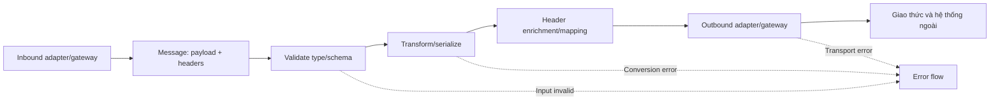
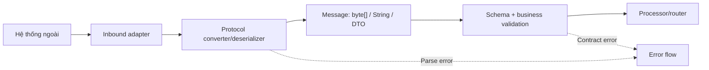
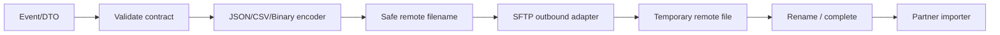
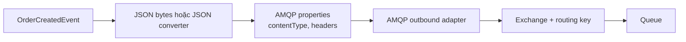
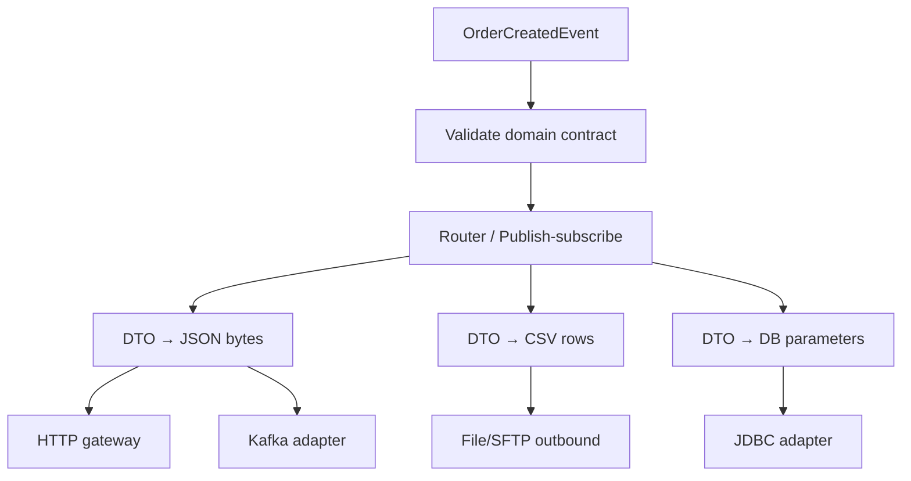
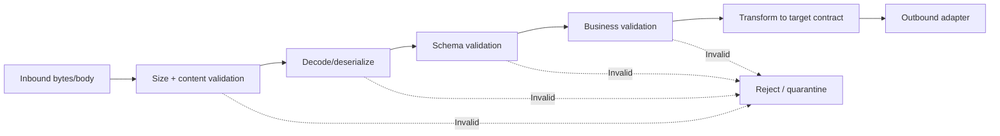

# Data format của adapter giao thức

## 1. Vì sao data format quyết định thành bại của một luồng tích hợp?

Một dịch vụ quản lý đơn hàng phát sự kiện `OrderCreated`. Cùng dữ liệu nghiệp vụ này cần được trao đổi qua nhiều giao thức:

- Ghi JSON vào file để một hệ thống batch xử lý.
- Upload CSV qua SFTP cho đối tác.
- Gọi HTTP API yêu cầu `application/json`.
- Đưa sự kiện lên JMS, AMQP hoặc Kafka để dịch vụ khác tiêu thụ.
- Ghi các trường đã chuẩn hóa hoặc lưu JSON/binary vào cơ sở dữ liệu.

Đầu vào trong Java có thể giống nhau nhưng **định dạng dữ liệu trên đường truyền** không giống nhau. Nếu đưa DTO Java nguyên vẹn tới mọi adapter, một số đích sẽ nhận sai kiểu; nếu tự chuyển sang JSON rồi để converter đích chuyển tiếp lần nữa, consumer có thể nhận JSON string hoặc Base64 thay vì JSON object.

Một sự cố thực tế thường không xuất hiện dưới tên “sai data format”, mà là:

- File CSV đúng số dòng nhưng sai charset nên mất dấu tiếng Việt.
- HTTP API báo `400 Bad Request` vì body là chuỗi JSON bị encode hai lần.
- JMS consumer chờ `TextMessage` trong khi producer gửi `BytesMessage`.
- AMQP consumer không biết body nén GZIP nhưng metadata vẫn ghi `application/json`.
- Kafka producer dùng serializer không phù hợp với payload kiểu `byte[]`.
- JDBC handler nhận một JSON String nhưng câu SQL yêu cầu ba tham số có kiểu riêng.

**Data format của adapter giao thức** là tập quy ước về **biểu diễn, cấu trúc, mã hóa, metadata và cách giải mã dữ liệu** khi message đi từ Spring Integration sang một hệ thống ngoài hoặc theo chiều ngược lại.

Bài thuộc chương **Chuyển đổi dữ liệu**, module `SPRING_INTEGRATION_ADAPTERS`, với mục tiêu kết nối inbound/outbound adapter, gateway, poller và `MessageChannel` qua file, SFTP, HTTP, JMS, AMQP, Kafka và cơ sở dữ liệu; quản lý hợp đồng message, lỗi và vòng đời kết nối.

**Ý chính:** Spring Integration giúp đưa message qua các endpoint, nhưng **không thể tự suy ra hợp đồng dữ liệu của mọi consumer**. Kiểu payload, encoder/serializer, protocol metadata và validation phải được thiết kế cùng nhau.

## 2. Phân biệt dữ liệu nghiệp vụ, data format và giao thức

| Lớp | Câu hỏi | Ví dụ |
| --- | --- | --- |
| **Ý nghĩa nghiệp vụ** | Sự kiện hoặc yêu cầu nói gì? | Đơn `ORD-1001` đã tạo, tổng tiền 125000 đơn vị nhỏ nhất |
| **Mô hình dữ liệu** | Đối tượng logic có những trường nào? | `OrderCreated(eventId, orderId, amountMinor)` |
| **Schema / contract** | Field nào bắt buộc, type gì, version nào? | `event_id` là string, `schema_version` là integer |
| **Serialization / format** | Cấu trúc được biểu diễn thành gì? | JSON, CSV, XML, Avro, Protobuf, bytes nhị phân |
| **Encoding / compression** | Ký tự và dữ liệu được biến thành bytes thế nào? | UTF-8, GZIP, binary framing |
| **Protocol envelope** | Giao thức chuyên chở body và metadata ra sao? | HTTP headers/body, Kafka record, JMS message |
| **Transport / I/O** | Làm sao gửi, lưu và xác nhận? | HTTP, SFTP, broker, filesystem, JDBC |
| **Business processing** | Consumer đã thực hiện nghiệp vụ chưa? | Đơn đã ghi database, email đã gửi |

Ví dụ, **JSON không phải một giao thức truyền tải độc lập**. Nó là định dạng có thể được đưa vào HTTP body, Kafka value, file hoặc JMS TextMessage. Ngược lại, **HTTP không bắt buộc JSON**: một endpoint có thể nhận XML, multipart, binary hoặc text.

### Những cặp khái niệm không nên đồng nhất

- **DTO Java ≠ JSON:** class và annotation quyết định mapping, không phải toàn bộ schema.
- **`byte[]` ≠ một format:** bytes có thể là UTF-8 JSON, PDF, Protobuf hoặc dữ liệu nén.
- **`Content-Type` ≠ encoding:** media type mô tả representation; charset, compression và framing là những quy ước bổ sung.
- **Converter ≠ adapter:** converter thay representation; adapter/gateway thực hiện giao tiếp.
- **Đã serialize ≠ đã gửi thành công:** transformation là bước nội bộ, confirmation là chuyện của giao thức.
- **Đã gửi thành công ≠ consumer xử lý thành công:** broker ACK và HTTP transport status không luôn chứng minh nghiệp vụ đích đã hoàn thành.

## 3. Spring Integration Message: Hai phần của một hợp đồng

Spring Integration truyền dữ liệu bằng `Message<T>`:

```text
Message<T>
├── payload: T
└── headers: MessageHeaders
    ├── id
    ├── timestamp
    ├── contentType
    ├── correlationId / eventId (theo ứng dụng)
    ├── fileName / topic / routingKey (theo adapter)
    └── các metadata khác
```

Một sự kiện có thể bắt đầu như sau:

```text
payload type = OrderCreated
payload      = OrderCreated("evt-2401", "ORD-1001", 125000)
headers      = {correlationId: "request-77"}
```

Sau bước chuyển đổi JSON:

```text
payload type = byte[]
payload      = UTF-8 bytes của JSON object
headers      = {
  correlationId: "request-77",
  contentType: "application/json",
  schemaVersion: 1
}
```

Sau outbound adapter, cùng payload có thể trở thành:

- body của một HTTP request;
- value của Kafka record;
- body của AMQP message;
- JMS TextMessage/BytesMessage tùy converter;
- nội dung file trên SFTP;
- giá trị cột binary/JSON trong database nếu mapping phù hợp.

**Không có quy tắc chung rằng mọi header Spring Message sẽ tự trở thành header giao thức.** Nhiều adapter có header mapper, tên constant, kiểu giá trị và phạm vi hỗ trợ riêng. Một số header chỉ có ý nghĩa **nội bộ luồng**, ví dụ `replyChannel` hoặc `errorChannel`, không nên đưa nguyên trạng ra hệ thống ngoài.

### Spring Message không phải toàn bộ wire message

`Message<byte[]>` là cấu trúc ở **trong ứng dụng Spring**. HTTP, Kafka, JMS và AMQP có envelope riêng. Khi qua adapter, converter/serializer sẽ diễn giải payload/headers thành những trường cụ thể của wire protocol.

## 4. Kiến trúc chuyển đổi trước và sau adapter



Ở chiều inbound:



Thứ tự thực tế có thể khác nhau. Chẳng hạn HTTP inbound gateway có thể đã dùng `HttpMessageConverter` để tạo DTO; JMS inbound có thể trả object do converter xử lý. Nếu không biết **kiểu payload sau inbound**, việc thêm một transformer ép `byte[]` sẽ tạo lỗi.

### Ba ranh giới cần chọn rõ

1. **Domain → external DTO:** đổi tên/trường/ý nghĩa nghiệp vụ.
2. **External DTO → wire body:** JSON/XML/CSV/bytes hoặc giao thức tự serialize.
3. **Wire body → transport envelope:** HTTP headers, Kafka key/topic, AMQP exchange/routing hoặc file name.

Một thiết kế tốt cho phép kiểm thử từng ranh giới độc lập.

## 5. Ma trận data format theo adapter

| Adapter/gateway | Payload phù hợp thường gặp | Wire representation | Metadata phải chốt |
| --- | --- | --- | --- |
| **File inbound/outbound** | `File`, `String`, `byte[]` theo handler | Bytes của file, không có protocol envelope ứng dụng cố định | Tên file, charset, directory, completion/rename |
| **SFTP inbound/outbound** | `File`, `String`, `byte[]` theo cấu hình | File bytes qua SSH/SFTP | Remote path, name, temp suffix, encoding theo contract |
| **HTTP inbound/outbound** | DTO, `String`, `byte[]`, Resource | HTTP entity body | Method, Content-Type, Accept, Content-Encoding, status |
| **JMS inbound/outbound** | Object/String/bytes theo `MessageConverter` | JMS TextMessage/BytesMessage/MapMessage/... | Destination, properties, correlation, delivery mode |
| **AMQP/RabbitMQ** | DTO/String/bytes theo converter | AMQP message body bytes + properties | Exchange, routing key, content type, correlation |
| **Kafka** | Key/value phù hợp serializer | Kafka record key/value bytes + headers | Topic, key, partition, schema/version |
| **Database/JDBC** | DTO, Map tham số, scalar, bytes tùy handler | SQL parameter values / row | Column type, SQL binding, transaction, unique key |

**Phạm vi hỗ trợ cụ thể phụ thuộc phiên bản Spring Integration và adapter.** Không được suy rằng vì File adapter có thể nhận String thì mọi SFTP handler cũng dùng cùng header hay encoding.

### Adapter không thay thế schema agreement

Kafka chấp nhận value bytes không chứng minh bytes đó là sự kiện `OrderCreated` version phù hợp. SFTP upload thành công không chứng minh đối tác đọc được file. Một DB insert hợp lệ không bảo đảm ý nghĩa số tiền được hiểu đúng. Đó đều là **vấn đề data contract**.

## 6. Thiết kế hợp đồng dữ liệu trước khi chọn converter

Giả sử tổ chức dùng sự kiện `order.created`.

### JSON contract mẫu

```json
{
  "event_id": "evt-2401",
  "schema_version": 1,
  "event_type": "order.created",
  "occurred_at": "2026-11-23T09:00:00Z",
  "order": {
    "order_id": "ORD-1001",
    "amount_minor": 125000,
    "currency": "VND"
  }
}
```

Các ràng buộc cần viết rõ:

| Thuộc tính | Hợp đồng minh họa | Nguy cơ nếu không quy định |
| --- | --- | --- |
| `event_id` | ID không rỗng, ổn định qua retry | Message trùng không được dedup |
| `schema_version` | Version được consumer hỗ trợ | Schema mới làm hỏng consumer cũ |
| `event_type` | Giá trị thuộc tập cho phép | Routing sai nghiệp vụ |
| `occurred_at` | ISO-8601 có offset/UTC | Mơ hồ thời điểm, lệch múi giờ |
| `order_id` | Business ID ổn định | Không liên kết được kết quả |
| `amount_minor` | Integer đơn vị nhỏ đã thống nhất | Sai số hoặc hiểu nhầm đơn vị |
| `currency` | Mã tiền tệ hợp lệ | Dữ liệu sai ngữ nghĩa |
| Encoding | UTF-8 với JSON/text | Ký tự tiếng Việt bị hỏng |
| Null/missing | Quy định cho từng field | Field thiếu bị coi thành null hoặc default |
| Size limit | Dựa vào giới hạn đích và an toàn | OOM hoặc broker từ chối |
| Idempotency | Dựa trên event ID/business key | Retry tạo bản ghi trùng |

**JSON hợp lệ cú pháp chưa chắc hợp lệ nghiệp vụ.** JSON `{"amount_minor":"125000"}` có thể parse được nhưng không đạt schema yêu cầu number. `{"event_id":null}` cũng cần bị xử lý theo contract.

### Contract không chỉ nằm trong payload

Ngoài nội dung, thống nhất:

- File có dùng đuôi `.json`, `.csv` hay manifest không?
- HTTP path/method và media type nào?
- JMS gửi dạng TextMessage hay BytesMessage?
- AMQP exchange, routing key và content-type là gì?
- Kafka topic, key, value serializer và schema version nào?
- Database field là BLOB/JSON column hay normalized columns?

## 7. Định dạng text, JSON, XML, CSV và binary: Chọn theo mục tiêu

| Định dạng | Phù hợp khi | Điểm cần kiểm soát |
| --- | --- | --- |
| **Plain text** | Chuỗi thông báo/command đơn giản | Charset, newline, escaping |
| **JSON** | API/event có cấu trúc, đa ngôn ngữ | Field names, null, schema, time, number |
| **XML** | Partner contract cần namespace/attribute, các tích hợp legacy | XML schema, namespace, XXE và size |
| **CSV/TSV** | Batch file dạng bảng, SFTP và import/export | Column order, quote/escape, delimiter, formula injection |
| **Avro** | Event/batch với schema và cơ chế versioning | Schema evolution, binary schema resolution |
| **Protobuf** | Payload binary compact với ID field và schema | Field number reuse, version compatibility |
| **CBOR/MessagePack** | Binary structured representation | Converter ở hai phía và contract |
| **Raw binary** | Ảnh, PDF, ZIP hoặc định dạng chuyên biệt | Content type, framing, checksum, size |
| **JSON Lines / NDJSON** | Streaming/batch một JSON object mỗi dòng | Mỗi dòng là một record, newline và partial-line handling |

Không có “format tốt nhất” cho tất cả. Chọn theo consumer, ràng buộc tương thích, nhu cầu truy vấn, kích thước, khả năng debug và bảo mật.

### Text format có thể cần escaping khác nhau

- JSON escape `"`, backslash và ký tự đặc biệt theo JSON.
- CSV escape dấu kép bằng cách nhân đôi; có thể bao trường bằng dấu kép.
- XML cần escape nội dung text/attribute đúng ngữ cảnh.
- Không được xem `String.valueOf(object)` là serialization có hợp đồng.

## 8. Charset và byte representation

Ở Java, `String` là chuỗi ký tự; khi gửi ra ngoài phải encode thành bytes.

```java
import java.nio.charset.StandardCharsets;

String value = "Đơn hàng ORD-1001";
byte[] bytes = value.getBytes(StandardCharsets.UTF_8);

String restored = new String(bytes, StandardCharsets.UTF_8);
```

**Tránh dùng charset mặc định:** `value.getBytes()` và `new String(bytes)` không biểu đạt rõ giao kèo, dễ sai khi môi trường và cách cấu hình thay đổi.

### Không phải byte nào cũng là text

```java
byte[] pdf = loadPdfBytes();
String incorrect = new String(pdf, StandardCharsets.UTF_8);
```

Việc decode dữ liệu PDF như UTF-8 có thể làm thay thế bytes không hợp lệ hoặc phá representation nếu lại encode ngược. Với binary file, hãy giữ nguyên `byte[]`/stream và xác định content type.

### UTF-8 strict decoder khi cần

```java
import java.nio.ByteBuffer;
import java.nio.charset.CodingErrorAction;
import java.nio.charset.StandardCharsets;

String decodeStrict(byte[] payload) throws Exception {
    return StandardCharsets.UTF_8.newDecoder()
        .onMalformedInput(CodingErrorAction.REPORT)
        .onUnmappableCharacter(CodingErrorAction.REPORT)
        .decode(ByteBuffer.wrap(payload))
        .toString();
}
```

Constructor `new String(bytes, UTF_8)` có thể thay byte sequence không hợp lệ; decoder `REPORT` thích hợp khi hợp đồng yêu cầu từ chối input malformed.

### BOM, newline và locale

- CSV/Text: chốt BOM, `\n` hay `\r\n` và delimiter.
- Timestamp: dùng format có timezone/offset khi đại diện một thời điểm.
- Số tiền: dùng `BigDecimal` hoặc integer minor units; không lệ thuộc locale in số.
- File nội bộ và file đối tác có thể yêu cầu mã hóa khác nhau, nhưng phải có bước chuyển rõ và kiểm thử bytes.

## 9. JSON serialization với Jackson: DTO khác raw body

Dùng DTO riêng để tránh vô tình xuất field nội bộ:

```java
import com.fasterxml.jackson.annotation.JsonProperty;
import java.time.Instant;

public record OrderCreatedEvent(
    @JsonProperty("event_id") String eventId,
    @JsonProperty("schema_version") int schemaVersion,
    @JsonProperty("event_type") String eventType,
    @JsonProperty("occurred_at") Instant occurredAt,
    @JsonProperty("order") OrderPayload order
) {}

public record OrderPayload(
    @JsonProperty("order_id") String orderId,
    @JsonProperty("amount_minor") long amountMinor,
    @JsonProperty("currency") String currency
) {}
```

Với Jackson 2:

```java
import com.fasterxml.jackson.databind.ObjectMapper;

// mapper phải được cấu hình phù hợp Java Time và contract.
byte[] jsonBytes = mapper.writeValueAsBytes(event);
String jsonText = mapper.writeValueAsString(event);

// Parse:
OrderCreatedEvent parsed =
    mapper.readValue(jsonBytes, OrderCreatedEvent.class);
```

Tùy stack sử dụng Jackson 2 hay Jackson 3, package/import và API có thể khác. Cấu hình Java Time module và timestamp format phải được kiểm chứng trên phiên bản thực tế, không mặc định mọi mapper cho cùng output.

### JSON String, JSON bytes và byte[] field

Hai thao tác rất khác nhau:

```java
byte[] rawJson = mapper.writeValueAsBytes(
    java.util.Map.of("id", "ORD-1001")
);

record FileAttachment(byte[] content) {}
String wrapped = mapper.writeValueAsString(
    new FileAttachment("Hello".getBytes(StandardCharsets.UTF_8))
);
```

- `rawJson` chứa bytes của JSON object `{"id":"ORD-1001"}`.
- `wrapped` là JSON object có một trường `byte[]`, trường đó thường được biểu diễn bằng **Base64** (ví dụ `"SGVsbG8="`).
- Base64 **không phải mã hóa bảo mật**.
- Nếu cần gửi file raw qua HTTP/Kafka, không được vô tình serialize một `byte[]` thành JSON Base64 string.

## 10. Message converter và serializer: Ai thực sự encode?

Nhiều Spring adapter dùng converter riêng:

| Biên tích hợp | Bộ chuyển đổi điển hình | Đầu ra |
| --- | --- | --- |
| Spring Integration transformer | Hàm Java, codec, Jackson | Spring message payload mới |
| Spring HTTP | `HttpMessageConverter` phù hợp | HTTP request/response body |
| Spring JMS | `MessageConverter` | JMS TextMessage/BytesMessage/... |
| Spring AMQP | AMQP `MessageConverter` | AMQP body và message properties |
| Spring Kafka / Kafka client | Kafka `Serializer`/`Deserializer` | Record key/value bytes |
| JDBC adapter | SQL parameter mapper/expression | Giá trị bind theo SQL/driver |
| File/SFTP | File handler/remote file handler | Nội dung file và metadata đường dẫn |

### Chọn một ranh giới serialize

**Phương án A – Serialize trước adapter:**

```text
Message<OrderCreatedEvent>
    → Jackson JSON byte[]
    → Message<byte[]> + metadata
    → outbound adapter sử dụng raw bytes
```

**Phương án B – Để converter ở adapter serialize:**

```text
Message<OrderCreatedEvent>
    → outbound adapter + JSON converter/serializer
    → giao thức nhận JSON bytes
```

Cả hai có thể đúng, nếu serializer/converter và kiểu payload ăn khớp.

### Bẫy double serialization

Nếu transformer tạo `String`:

```text
{"id":"ORD-1001"}
```

rồi converter xem nó là một **JSON string value**, output có thể thành:

```json
"{\"id\":\"ORD-1001\"}"
```

Consumer kỳ vọng JSON object sẽ không đọc được field `id`. Tương tự, một converter Jackson khi nhận raw `byte[]` có thể đưa ra một JSON Base64 string nếu nó serialize **giá trị mảng byte**, không phải gửi nguyên raw body.

**Test dữ liệu trên wire**, không chỉ dựa vào kiểu của object trước adapter.

## 11. Ví dụ Java DSL: DTO → JSON bytes → outbound channel

Với Java DSL, có thể tách bước chuyển định dạng khỏi logic gửi:

```java
import com.fasterxml.jackson.databind.ObjectMapper;
import org.springframework.context.annotation.Bean;
import org.springframework.integration.dsl.IntegrationFlow;

@Bean
IntegrationFlow orderToJsonBytesFlow(ObjectMapper mapper) {
    return IntegrationFlow.from("domainOrderEvents")
        .transform(OrderCreatedEvent.class, event -> {
            try {
                return mapper.writeValueAsBytes(event);
            } catch (com.fasterxml.jackson.core.JsonProcessingException ex) {
                throw new IllegalArgumentException(
                    "Cannot serialize OrderCreatedEvent", ex);
            }
        })
        .channel("jsonBytesReady")
        .get();
}
```

Luồng này:

1. Nhận Spring `Message<OrderCreatedEvent>` từ channel `domainOrderEvents`.
2. Dùng Jackson tạo JSON bytes.
3. Đưa output tới channel `jsonBytesReady`.
4. **Chưa gửi ra hệ thống ngoài**. Một flow khác hoặc handler phải tiêu thụ channel này.

Java DSL và package có thể thay đổi theo phiên bản Spring Integration. Ví dụ dùng cấu trúc API minh họa; cần compile/integration test với dependency trong dự án trước khi triển khai.

### Bổ sung header có kiểm soát

```java
@Bean
IntegrationFlow orderJsonWithHeaders(ObjectMapper mapper) {
    return IntegrationFlow.from("ordersForExport")
        .transform(OrderCreatedEvent.class, event -> {
            try {
                return mapper.writeValueAsBytes(event);
            } catch (com.fasterxml.jackson.core.JsonProcessingException ex) {
                throw new IllegalArgumentException(ex);
            }
        })
        .enrichHeaders(headers -> headers
            .header("contentType", "application/json")
            .header("schemaVersion", 1))
        .channel("validatedJsonOutbound")
        .get();
}
```

`contentType` trong ví dụ là tên logic trong Spring message. Ở thực tế, adapter có thể yêu cầu constant/header value kiểu `MimeType` hoặc `MediaType`, và header mapper có thể không tự đưa nó ra giao thức. Phải kiểm tra adapter/version.

## 12. File outbound: Định dạng là nội dung và quy ước file

File không có protocol envelope giống HTTP. Consumer thường nhận biết format qua:

- filename/extension như `.json`, `.csv`, `.xml`;
- hợp đồng ngoài luồng về charset/schema;
- manifest hoặc metadata đi cùng;
- nội dung file và magic bytes (nếu định dạng có);
- quy ước thư mục, lịch xuất và marker hoàn tất.

### Ví dụ OrderEvent → JSON File

```java
import java.io.File;
import org.springframework.context.annotation.Bean;
import org.springframework.integration.dsl.IntegrationFlow;
import org.springframework.integration.file.dsl.Files;

@Bean
IntegrationFlow orderJsonFileFlow(ObjectMapper mapper) {
    return IntegrationFlow.from("ordersForFile")
        .enrichHeaders(headers -> headers.headerFunction(
            "outputFileName",
            message -> {
                OrderCreatedEvent event =
                    (OrderCreatedEvent) message.getPayload();
                String eventId = event.eventId();
                if (eventId == null
                        || !eventId.matches("[A-Za-z0-9_-]{1,64}")) {
                    throw new IllegalArgumentException("Invalid eventId");
                }
                return "event-" + eventId + ".json";
            }))
        .transform(OrderCreatedEvent.class, event -> {
            try {
                return mapper.writeValueAsBytes(event);
            } catch (com.fasterxml.jackson.core.JsonProcessingException ex) {
                throw new IllegalArgumentException(ex);
            }
        })
        .handle(Files.outboundAdapter(new File("./data/outbox"))
            .autoCreateDirectory(true)
            .fileNameGenerator(message ->
                (String) message.getHeaders().get("outputFileName")))
        .get();
}
```

Đây là ví dụ flow dành cho Java DSL; khi dùng phiên bản khác phải kiểm tra method signature và module File của dự án.

### Những quy ước không thể bỏ qua

1. **Filename:** tạo từ ID đã validate, không ghép đường dẫn tùy ý từ request.
2. **Charset:** nếu payload là String, adapter cần encode theo hợp đồng; dùng JSON `byte[]` có thể cố định bytes trước đó.
3. **File exists mode:** ghi đè, fail, append hoặc thay thế phải có chính sách rõ.
4. **Atomic completion:** nếu consumer quan sát thư mục liên tục, cân nhắc temporary file rồi rename/ready marker theo khả năng filesystem.
5. **Batch:** một file chứa nhiều record phải được gom và đóng đúng thời điểm; một message đơn không tự mang toàn bộ batch.
6. **Integrity:** có thể kiểm tra size/hash nếu hai bên có cơ chế kiểm chứng.
7. **Security:** quyền filesystem, retention, dữ liệu nhạy cảm và path traversal.

**Không nhầm file được tạo với file đã được đối tác tiêu thụ.** Nếu nghiệp vụ cần xác nhận end-to-end, hãy thiết kế acknowledgment riêng.

## 13. SFTP: Cùng file format nhưng thêm remote contract

**SFTP** truyền file qua SSH; format bên trong file không tự thay đổi vì dùng SFTP. Nếu payload là JSON bytes trên filesystem, về nguyên tắc có thể upload nguyên bytes đó, trừ khi hệ thống đích yêu cầu chuyển đổi khác.



### Các thông tin cần thống nhất

| Hạng mục | Ví dụ hợp đồng SFTP |
| --- | --- |
| Remote directory | `/inbox/orders/` được cấu hình ở adapter |
| Filename | `orders-20261123-01.csv` |
| Charset | UTF-8, không BOM |
| Newline | LF hoặc CRLF theo đối tác |
| Delimiter/quote | Dấu phẩy và quote CSV chuẩn |
| Temporary suffix | Ví dụ `.writing` tới khi upload hoàn tất |
| Completion | Rename hoặc marker, nếu server và consumer hỗ trợ |
| Retry/idempotency | File ID ổn định, xử lý khi tên trùng |
| Security | Host key verification, credential, quyền tài khoản |
| Retention | Dọn file tạm/lỗi, lưu trữ theo thời hạn |

**SFTP adapter không quản lý giúp CSV escaping hay JSON schema.** Transformer/formatter chịu trách nhiệm điều đó.

### Vì sao đường dẫn là dữ liệu nhạy cảm?

Nếu dùng header `remotePath=../../outside` do người dùng nhập, adapter có thể ghi sai vị trí. Chỉ cho phép chọn một trong các thư mục đã định nghĩa bởi cấu hình hoặc policy; sanitize filename; không ghép chuỗi đường dẫn chưa kiểm chứng.

### Vòng đời kết nối SFTP

Session factory, pool/cache, timeout, reconnect và đóng session thuộc phần vận hành adapter. Lỗi host key hay credential không thể sửa bằng chuyển đổi payload; cần phân loại đúng để tránh retry vô hạn.

## 14. HTTP: Media type, body, headers và content negotiation

HTTP có cấu trúc request–response; **HTTP outbound gateway** thích hợp khi cần nhận status/body phản hồi để tiếp tục luồng.

### Request mẫu

```http
POST /api/orders/events HTTP/1.1
Host: partner.example.org
Content-Type: application/json
Accept: application/json
Idempotency-Key: evt-2401

{"event_id":"evt-2401","schema_version":1,"event_type":"order.created","occurred_at":"2026-11-23T09:00:00Z","order":{"order_id":"ORD-1001","amount_minor":125000,"currency":"VND"}}
```

- **HTTP method/path** mô tả thao tác và tài nguyên đích.
- **Content-Type** mô tả representation của request body.
- **Accept** diễn đạt representation của response mà client có thể chấp nhận.
- **Content-Encoding** có thể mô tả body bị nén, ví dụ gzip khi được hai phía hỗ trợ.
- **Idempotency-Key** là cơ chế **chỉ có tác dụng nếu API đích quy định và thực thi**.
- **Status** phản ánh kết quả theo API, không luôn là hoàn thành bất đồng bộ.

### Hai lựa chọn format

**Giữ DTO và dùng JSON HttpMessageConverter:**

```text
Message<OrderCreatedEvent>
  → HTTP outbound gateway
  → JSON HttpMessageConverter
  → HTTP application/json body
```

**Serialize trước thành raw bytes:**

```text
Message<OrderCreatedEvent>
  → Jackson writeValueAsBytes
  → Message<byte[]>
  → HTTP outbound gateway gửi raw body
```

Không serialize cả ở hai chỗ. Với raw bytes, phải cấu hình converter/handler để không coi mảng bytes là object JSON cần Base64 hóa.

### HTTP status và lỗi

| Dạng lỗi | Cách hiểu và hướng xử lý |
| --- | --- |
| `400` / `422` | Thường là payload/hợp đồng không đạt; cần kiểm tra response contract |
| `401` / `403` | Vấn đề AuthN/AuthZ hoặc credential integration |
| `404` | Sai endpoint/resource hoặc dữ liệu không tồn tại |
| `409` | Conflict; có thể liên quan idempotency/version theo API |
| `429` | Rate limit, thường cần backoff |
| `500` / `503` | Lỗi phía đích; có thể retry theo policy |
| Timeout sau POST | Không biết server đã xử lý hay chưa; cần idempotency/tra trạng thái |

Không ép tất cả HTTP 2xx là một kết quả nghiệp vụ: `202 Accepted` có thể chỉ là đã nhận xử lý bất đồng bộ. Phải đọc hợp đồng API.

## 15. JMS: Data format quyết định TextMessage hay BytesMessage

JMS có các loại message cụ thể, trong đó `TextMessage` và `BytesMessage` phổ biến cho trao đổi JSON/text và binary.

| Payload Spring | Converter JMS | Message phía JMS |
| --- | --- | --- |
| `String` JSON | Converter xử lý String phù hợp | Thường `TextMessage` |
| `byte[]` JSON/binary | Converter xử lý bytes phù hợp | Thường `BytesMessage` |
| DTO | JSON-capable converter được cấu hình | TextMessage/BytesMessage theo thiết kế |
| `Map` | Converter phù hợp | Có thể là MapMessage hoặc representation khác |

**Không mặc định loại message JMS từ payload Java nếu chưa biết `MessageConverter` đang dùng.** Consumer có thể chỉ xử lý `TextMessage`; producer gửi `BytesMessage` chứa JSON hợp lệ vẫn không tương thích.

### Hợp đồng JMS cần ghi rõ

- Destination/queue/topic và cơ chế quản lý.
- Message type: TextMessage, BytesMessage hoặc loại đã chốt.
- Content format: JSON, XML, binary schema.
- Charset/encoding nếu dùng bytes của text.
- JMS properties cần truyền: schemaVersion, eventId, correlation.
- Persistent/non-persistent delivery theo chính sách.
- Acknowledgment/transaction/redelivery.
- DLQ và điều kiện chuyển message lỗi.
- Versioning cho producer–consumer.

**Không tự dùng Java native serialization để chia sẻ domain object giữa dịch vụ.** Nó thường tạo phụ thuộc class/version và rủi ro deserialize không an toàn. Hợp đồng text/binary được kiểm soát rõ thường dễ duy trì hơn.

### JMS correlation ID

`JMSCorrelationID` có thể được dùng trong request–reply hoặc tracing theo thiết kế. Nó không tự có ý nghĩa với một header `correlationId` bất kỳ nếu mapping chưa được cấu hình. Kiểm tra message thực tế ở phía consumer.

## 16. AMQP/RabbitMQ: Body bytes đi cùng properties và routing

AMQP message mang **body bytes** cùng properties. Spring AMQP converter có thể biến DTO/String/bytes thành body và metadata.



### Những thứ phải chốt

- **Exchange:** điểm gửi message.
- **Routing key:** kết hợp bindings để chọn queue; không mặc định cùng tên topic.
- **Body format:** raw JSON bytes, JSON text hay binary schema.
- **Content type:** thông báo dạng dữ liệu, ví dụ `application/json`.
- **Content encoding/compression:** nếu có, được map bằng properties/hợp đồng.
- **Headers:** event ID, schema version, correlation ID, trace metadata.
- **Publisher confirms/returns:** broker đã tiếp nhận hay message không route được theo policy.
- **Dead-letter/quarantine:** xử lý message không thể tiêu thụ hoặc quá retry.

### Bẫy converter

Producer đã chuyển DTO thành `byte[]` raw JSON, nhưng AMQP converter tiếp tục coi `byte[]` như một object cần JSON serialize; consumer có thể thấy Base64 hoặc format không đúng.

Kiểm tra **raw body** và properties trong integration test thay vì chỉ kiểm tra Java class ở producer.

**Publisher confirm không đồng nghĩa consumer xử lý nghiệp vụ thành công.** Nếu cần biết đơn hàng được tạo ở consumer, phải có business acknowledgment/tracing tương ứng.

## 17. Kafka: Schema của value và serializer của producer

Kafka record có **key**, **value**, **topic**, **partition**, timestamp và headers. Key và value được serializer chuyển sang bytes.

| Payload tại producer | Value serializer cần tương thích | Representation dự kiến |
| --- | --- | --- |
| `byte[]` raw JSON | `ByteArraySerializer` | Giữ nguyên bytes |
| `String` JSON | `StringSerializer` | Text được encode |
| DTO Java | JSON serializer phù hợp | JSON bytes theo mapping |
| Avro/Protobuf message | Serializer chuyên biệt | Binary schema encoding |

### Ví dụ sự kiện Kafka

```text
topic   = orders.events
key     = ORD-1001
value   = UTF-8 JSON bytes (schemaVersion=1)
headers = {
  eventId: evt-2401,
  contentType: application/json
}
```

Header `contentType` ở đây là **quy ước của ứng dụng**, không phải mặc định Kafka tự suy ra format của value.

### Key và thứ tự

Chọn `orderId` làm key có thể giúp các event cùng order đi vào cùng partition theo cách partitioner được cấu hình. Kafka bảo đảm ordering theo những điều kiện cụ thể **trong partition**, không cho mọi partition hoặc mọi sự kiện toàn hệ thống. Producer concurrency, retry, repartition và consumer processing vẫn cần được xem xét.

### Schema Registry và evolution

Nếu dùng Avro/Protobuf/JSON Schema với registry, contract còn bao gồm schema ID, subject, compatibility policy, serializer/deserializer và cách consumer lấy schema. Không tự đồng nhất “JSON có field `schema_version`” với “đã có schema registry”.

### Type headers Java

Một số converter/serializer có thể thêm metadata chứa tên class Java. Trong tích hợp đa ngôn ngữ, không nên bắt consumer phụ thuộc vào fully qualified class name phía producer nếu mục tiêu là contract độc lập. Ưu tiên schema/version theo nghiệp vụ.

### Producer ACK

Kafka producer callback/ack chỉ báo một mức kết quả ở broker theo cấu hình; không xác nhận consumer đã commit database hoặc hoàn thành xử lý.

## 18. JDBC/Database: Data format là kiểu cột và tham số, không chỉ JSON

Database outbound có thể nhận payload để tạo tham số SQL. Đây là trường hợp mà **format của adapter** có thể là **mapping cột**, không phải một “wire document” JSON duy nhất.

### Trường hợp A: Lưu các trường chuẩn hóa

```sql
INSERT INTO orders (
    order_id,
    amount_minor,
    currency,
    occurred_at
) VALUES (
    :orderId,
    :amountMinor,
    :currency,
    :occurredAt
);
```

Payload phù hợp có thể là DTO hoặc `Map<String,Object>` chứa tham số và kiểu dữ liệu đúng. Không cần serialize toàn bộ Order thành JSON nếu đích cần các cột riêng.

### Trường hợp B: Lưu sự kiện JSON vào outbox

```sql
INSERT INTO integration_outbox (
    event_id,
    aggregate_id,
    payload_json,
    schema_version
) VALUES (
    :eventId,
    :aggregateId,
    :payloadJson,
    :schemaVersion
);
```

Ở đây `payloadJson` có thể là String/driver-specific JSON representation theo database. Cần mapping đúng SQL dialect, kiểu cột và cách bind.

### Trường hợp C: Lưu raw binary

```sql
INSERT INTO binary_payloads (
    event_id,
    content_type,
    body_bytes
) VALUES (
    :eventId,
    :contentType,
    :bodyBytes
);
```

`bodyBytes` tương ứng với BLOB/VARBINARY hoặc kiểu binary của database theo driver. Không phải cứ cho thẳng `Message<byte[]>` vào JDBC handler là handler tự biết `eventId` và `contentType` ở đâu.

### Kiểm soát bắt buộc

- Prepared statements / named parameters, không nối SQL từ payload người dùng.
- Kiểu tiền tệ, timestamp, timezone và độ chính xác phù hợp.
- Transaction và lỗi constraint/duplicate key.
- Batch size, row mapping và checkpoint nếu polling DB.
- Cơ chế idempotent upsert hoặc unique key theo nghiệp vụ.
- Không giả định ghi DB và publish Kafka là một transaction nguyên tử; cân nhắc **transactional outbox** hoặc kiến trúc phù hợp.

## 19. Headers qua biên giao thức: Metadata cần map chứ không chỉ giữ

Một Spring Message header có thể không tồn tại ở wire protocol nếu adapter không map nó.

| Metadata logic | File/SFTP | HTTP | JMS | AMQP | Kafka | Database |
| --- | --- | --- | --- | --- | --- | --- |
| **Content type** | Extension/manifest/contract | `Content-Type` | Property/contract | Message property | App-defined header/schema | Column/contract |
| **Encoding** | File contract/manifest | Media-type/protocol semantics | Property/contract | Property/contract | Serializer + contract | Column/driver |
| **Correlation** | Manifest/file ID | Header ứng dụng | JMS correlation/property | Correlation property | Header ứng dụng | Column |
| **Routing** | Directory/name | URL/method | Destination | Exchange/routing key | Topic/partition/key | SQL/table |
| **Schema version** | Manifest/filename/content | Header/body | Property/body | Header/body | Header/body/registry | Column/payload |
| **Idempotency** | Filename/event ID | API header nếu hỗ trợ | Consumer policy | Consumer policy | Consumer policy | Unique key |

Tên trong bảng là **logical contract**, không khẳng định `contentType` và `schemaVersion` là các tên header framework mặc định trên mọi adapter.

### Metadata nào không nên đưa ra bên ngoài?

- `replyChannel`, `errorChannel` là tham chiếu nội bộ của Spring Messaging.
- Authentication/session object nội bộ hoặc token không dành cho hệ thống đích.
- Internal exception/stacktrace.
- Sensitive identity/PII không cần cho consumer.
- Địa chỉ broker, storage path, credential hoặc tên topic có ý nghĩa bảo mật ngoài hợp đồng.

**Whitelist những header được phép truyền**, tránh copy toàn bộ message headers sang bên ngoài.

### Header nguồn có đáng tin không?

Nếu inbound client gửi `topic=admin.events` hoặc `remotePath=../../secret`, không thể tin nó chỉ vì là header. Routing và destination phải dựa trên **policy** hoặc mapping đã kiểm chứng.

## 20. Data format và content negotiation trong luồng nhiều nhánh

Một sự kiện có thể cần gửi đến nhiều đích với format khác nhau.



**Cẩn trọng:** Nếu dùng một `DirectChannel` có nhiều subscriber, điều đó không mặc nhiên fan-out mọi message cho mọi handler. Khi cần broadcast, dùng publish-subscribe channel hoặc thiết kế luồng tương đương; khi chỉ chọn một đích, dùng router.

### Tại sao có thể cần DTO riêng theo consumer?

- API HTTP đòi `customer_id` và `amount_minor`.
- Partner SFTP đòi CSV với cột theo thứ tự cố định.
- Kafka event cần `eventId`, `occurredAt` và schemaVersion.
- Database chỉ cần `orderId` và `amountMinor`.

Copy toàn bộ domain entity ra mọi nơi dễ lộ thông tin, tạo coupling và làm thay đổi schema ngoài ý muốn.

### Splitter và aggregator có liên quan gì?

- **Splitter:** một message chứa danh sách record → nhiều message.
- **Aggregator:** tập hợp nhiều message thành một batch/file theo correlation và điều kiện hoàn thành.
- **Transformer:** quyết định từng record hoặc batch được serialize thế nào.
- **Poller:** quyết định nhịp lấy dữ liệu từ nguồn polling.

Một CSV file cần 1.000 dòng không được tạo đúng chỉ bằng 1.000 lần gọi file outbound cùng tên nếu chưa có chiến lược append/aggregation và completion.

## 21. Evolution: Khi producer đổi data format hoặc schema

Tích hợp bền vững phải giải quyết thay đổi hợp đồng.

### Các kiểu thay đổi

| Thay đổi | Ảnh hưởng có thể xảy ra |
| --- | --- |
| Thêm field tùy chọn JSON | Consumer strict có thể reject unknown |
| Đổi tên field | Consumer cũ không đọc được |
| Đổi kiểu number thành string | Contract validation hỏng |
| Đổi cách viết timestamp | Consumer parse sai hoặc lệch timezone |
| Thêm enum value | Consumer cũ không biết nhánh xử lý |
| Đổi thứ tự cột CSV | Dữ liệu vào sai cột |
| Đổi delimiter/quote | File parser tách sai |
| Đổi JMS message type | Consumer chờ TextMessage nhận BytesMessage |
| Đổi Kafka serializer | Bytes không còn theo schema cũ |
| Đổi content type | Hệ thống chọn decoder khác |
| Đổi DB column/schema | JDBC mapping và nghiệp vụ lỗi |

### Chiến lược versioning

1. Xác định **schemaVersion** và nơi truyền nó: body, header, file manifest hoặc registry.
2. Phân loại backward/forward compatibility theo loại format và consumer.
3. Kiểm tra consumer cũ trước khi producer phát schema mới.
4. Nếu cần, dùng mapper/upcaster chuyển version cũ sang canonical model có kiểm thử.
5. Triển khai rollout có theo dõi lỗi, cảnh báo và phương án quay lại.
6. Không âm thầm đổi ngữ nghĩa field dù tên/kiểu giữ nguyên.
7. Lưu test fixture thực tế cho từng version cần hỗ trợ.

Ví dụ: thêm `discount_code` tùy chọn vào JSON có thể tương thích với consumer bỏ qua unknown fields; nhưng consumer strict reject fields không biết sẽ bị lỗi. Do đó “thêm field là luôn backward-compatible” là kết luận không đủ căn cứ.

## 22. Binary format, framing, compression và integrity

Với binary, data format cần nhiều quy tắc hơn một `byte[]`.

### Framing và byte order

Ví dụ frame gồm 4-byte length prefix big-endian và payload:

```text
00 00 00 05 48 65 6C 6C 6F
| length=5 | "Hello"
```

Decoder phải kiểm tra length, ngưỡng tối đa, bytes còn đủ và byte order. Nếu consumer đọc little-endian trong khi producer ghi big-endian, một độ dài nhỏ có thể biến thành số rất lớn.

### Compression

Luồng có thể là:

```text
Domain DTO
  → JSON UTF-8 bytes
  → GZIP bytes
  → outbound adapter
```

Consumer cần metadata và giải nén **trước khi parse JSON**. Một header `Content-Type: application/json` không nói rõ rằng bytes đã GZIP; với HTTP có `Content-Encoding`, còn với broker/file cần thỏa thuận tương ứng.

**Bảo mật:** giới hạn kích thước sau giải nén, số record và nested structure; payload nén nhỏ có thể giải ra dữ liệu rất lớn.

### Hash, checksum, MAC và chữ ký

- Hash/checksum hỗ trợ phát hiện thay đổi hoặc lỗi truyền khi so với giá trị tin cậy.
- Hash đơn thuần **không chứng minh** người gửi là ai.
- MAC/chữ ký có thể dùng để xác minh tính toàn vẹn và nguồn khi khóa/trust được quản lý đúng.
- Tính hash/chữ ký phải dựa trên **bytes cuối cùng theo hợp đồng**; thay đổi newline, charset hoặc thứ tự JSON sau khi ký sẽ làm verification thất bại.

### Binary không nên bị decode thành String vô cớ

Ảnh, PDF, ZIP, protobuf hoặc dữ liệu mã hóa không được tự chuyển qua `new String(bytes, UTF_8)` rồi `getBytes(UTF_8)`; dữ liệu có thể thay đổi hoặc mất mát.

## 23. Validation đặt ở đâu để ngăn lỗi format?

Phân biệt ba loại kiểm tra:

1. **Syntactic validation:** có parse được JSON/XML/CSV/binary theo format?
2. **Contract validation:** có đúng schema, version, kiểu trường, nội dung bắt buộc, size?
3. **Business validation:** sự kiện có hợp lệ về nghiệp vụ và quyền không?

Một pipeline minh họa:



**Deserialization không tự động là validation nghiệp vụ.** Jackson có thể tạo object với field null hoặc giá trị âm nếu không có ràng buộc bổ sung. Bean Validation annotations thường cần một Validator được gọi hoặc tích hợp đúng ở biên; không mặc định ObjectMapper thực thi chúng.

### Content-Type có thể bị giả mạo

Đối với inbound dữ liệu không tin cậy, Content-Type chỉ là tín hiệu do client gửi. Dù header ghi `application/json`, vẫn cần parse an toàn, giới hạn kích thước và kiểm tra schema/authorization. Với upload file, không chỉ tin file extension.

### XML phải có cấu hình parser an toàn

Nếu dùng XML input từ bên ngoài, cần tắt hoặc giới hạn các tính năng nguy hiểm như external entity resolution theo thư viện/parser. JSON và binary cũng cần giới hạn depth, size và loại deserialization, không chỉ XML.

## 24. Lỗi chuyển đổi và lỗi vận chuyển phải được phân loại riêng

| Lớp lỗi | Ví dụ | Hướng xử lý |
| --- | --- | --- |
| **Format/parse** | JSON malformed, UTF-8 hỏng, CSV thiếu cột | Không retry cùng bytes vô hạn; reject/quarantine |
| **Schema** | Version lạ, field type sai | Phân loại contract lỗi, nâng cấp schema hoặc route |
| **Business** | `amountMinor` âm, event ID thiếu | Reject, thông báo chủ dữ liệu |
| **Header mapping** | Content-Type sai, thiếu file name | Sửa cấu hình hoặc message metadata |
| **File/SFTP** | Disk full, permission denied, timeout | Phân biệt lỗi cố định/tạm thời |
| **HTTP** | `429`, `503`, timeout, `400` | Retry có điều kiện; `400` thường cần sửa request |
| **JMS/AMQP/Kafka** | Broker unreachable, serialization mismatch | Xác định lỗi serializer hay connection |
| **Database** | Deadlock, type mismatch, constraint | Retry transient; xử lý duplicate/schema |
| **AuthN/AuthZ** | Credential hết hạn, account thiếu quyền | Xử lý bảo mật/cấu hình thay vì retry vô hạn |

### Error flow trong Spring Integration

- Với `DirectChannel`, exception trong flow đồng bộ có thể truyền ngược cho caller.
- Với poller, executor-based channel và adapter async, lỗi có thể đi qua error channel/error handler theo topology.
- Header `errorChannel` **không tự bảo đảm** mọi ngoại lệ của mọi endpoint sẽ được bắt và route như mong muốn.
- Retry advice và DLQ/quarantine cần dựa trên loại lỗi, không chỉ catch-all.

### Bản ghi lỗi phù hợp

```json
{
  "eventId": "evt-2401",
  "stage": "serialization",
  "targetAdapter": "kafka-orders",
  "schemaVersion": 1,
  "errorCode": "UNSUPPORTED_FIELD_TYPE",
  "retryable": false,
  "correlationId": "request-77"
}
```

Không ghi toàn bộ payload nhạy cảm, bearer token, password hoặc private key vào log. Với message lỗi cần lưu lại để sửa, quản lý truy cập và retention riêng.

## 25. Retry, idempotency và trạng thái giao nhận

Khi gửi dữ liệu ra ngoài, một timeout không chứng minh phía đích chưa xử lý:

1. Producer tạo JSON bytes hợp lệ.
2. Adapter gửi message.
3. Hệ thống đích/broker nhận, nhưng acknowledgment bị mất.
4. Producer retry cùng message.
5. Nếu không có idempotency, consumer có thể xử lý trùng.

**Sử dụng event ID ổn định xuyên các lần retry**; không tạo UUID mới tại transformer nếu nó là định danh nghiệp vụ của cùng sự kiện.

| Đích | Chiến lược chống trùng có thể dùng |
| --- | --- |
| **File/SFTP** | Tên file/manifest ID ổn định, kiểm tra file tồn tại và policy ghi trùng |
| **HTTP** | Idempotency key nếu API hỗ trợ, tra trạng thái giao dịch |
| **JMS/AMQP** | Consumer dedup, transaction/ack, DLQ |
| **Kafka** | Producer idempotence theo phạm vi phù hợp, consumer dedup, event ID |
| **Database** | Unique key, upsert, transaction |
| **Đa đích** | Outbox/saga/reconciliation khi cần, không giả định distributed transaction |

### At-most-once, at-least-once, exactly-once

- **At-most-once:** hạn chế xử lý lặp nhưng có thể mất message trong phạm vi cơ chế.
- **At-least-once:** giảm khả năng mất nhờ retry, nhưng có thể trùng.
- **Exactly-once:** chỉ có ý nghĩa trong phạm vi điều kiện của một kiến trúc/cơ chế cụ thể; không tự kéo dài xuyên HTTP, SFTP, broker và DB.

Một converter **không thể** biến at-least-once thành exactly-once end-to-end. Đó là trách nhiệm của toàn luồng và hợp đồng nghiệp vụ.

## 26. Poller, channel và backpressure ảnh hưởng data format ra sao?

### Poller

Poller điều khiển nhịp lấy dữ liệu từ file/database hoặc endpoint polling, có thể giới hạn `maxMessagesPerPoll`, thời gian và concurrency. **Poller không tự chuyển file JSON thành DTO**: việc đó phụ thuộc inbound adapter, converter và transformer.

### DirectChannel

`DirectChannel` thường xử lý đồng bộ trên thread gửi. Một transformer nặng cộng với HTTP/SFTP adapter chậm có thể block producer.

### QueueChannel và executor channel

Có thể tách producer/consumer theo thời gian; đổi lại phải quản lý queue capacity, memory, persistence và xử lý lỗi trong luồng bất đồng bộ.

### Data format tác động hiệu năng

- JSON text lớn có thể cần nhiều memory khi serialize và parse.
- CSV batch nhiều dòng cần streaming hoặc aggregation phù hợp.
- Protobuf/Avro compact có thể giảm payload size nhưng tăng yêu cầu schema.
- Nén giảm bytes truyền, có chi phí CPU và rủi ro giải nén.
- `byte[]` lớn trong queue khiến heap và GC tăng.
- Serializer có thể tạo copy payload, nên cần đo memory/latency.
- Payload phải tuân thủ giới hạn size của broker, HTTP server, DB column và filesystem.

### Giữ thứ tự

Nếu consumer yêu cầu event theo thứ tự, data format đúng chưa đủ. Phải xét Kafka partition/key, độ đồng thời của channel/consumer, retry, polling checkpoint và event version. Đừng trông chờ thứ tự chỉ vì timestamp có trong JSON.

## 27. Bảo mật data format và metadata định tuyến

### Các rủi ro chính

| Rủi ro | Biểu hiện | Kiểm soát |
| --- | --- | --- |
| **Untrusted deserialization** | Deserialize class tùy ý từ type metadata | Dùng DTO type cụ thể, allowlist, không bật default typing rộng |
| **JSON/XML/CSV parsing** | Parser/resource exhaustion hoặc XXE | Giới hạn input, parser an toàn và validation |
| **Path traversal** | File name/remote path từ dữ liệu nguồn | Whitelist/mapping directory và sanitize |
| **SSRF** | Header/field quyết định arbitrary HTTP URL | Allowlist endpoint, tách control-plane |
| **Routing abuse** | Header điều khiển topic/exchange ngoài policy | Chỉ định tuyến qua cấu hình/quy tắc tin cậy |
| **PII exposure** | DTO serialize toàn bộ domain entity | External DTO theo danh sách field được phép |
| **Credential leak** | Token trong message/log/error | Secret management, không log raw sensitive data |
| **Compression bomb** | Bytes nhỏ giải nén thành dữ liệu khổng lồ | Giới hạn size/depth sau giải nén |
| **Format confusion** | Base64 giả raw bytes hoặc Content-Type sai | Contract và kiểm thử wire payload |
| **Schema downgrade** | Consumer chấp nhận version yếu không kiểm soát | Compatibility policy, version allowlist |
| **Improper authorization** | Payload hợp lệ nhưng caller không có quyền | AuthN/AuthZ tại biên, không chỉ validation |

**Định dạng hợp lệ không đồng nghĩa nguồn gửi đáng tin.** HTTPS/TLS, SFTP SSH, broker authentication, access control và resource authorization là những lớp riêng phải cấu hình đầy đủ.

## 28. Chiến lược kiểm thử data format theo từng lớp

### 28.1. Unit test mapper/codec

Kiểm tra:

- DTO → JSON bytes đúng field names.
- Format timestamp, number, null và enum.
- UTF-8 với tiếng Việt, newline và escaping.
- CSV quote/delimiter.
- Binary framing và byte order nếu có.
- Round-trip cho dữ liệu hợp lệ.

```java
import static org.junit.jupiter.api.Assertions.assertArrayEquals;
import java.nio.charset.StandardCharsets;
import org.junit.jupiter.api.Test;

class FormatContractTest {

    @Test
    void utf8HasStableBytes() {
        String input = "Đã tạo đơn";
        byte[] encoded = input.getBytes(StandardCharsets.UTF_8);
        assertArrayEquals(
            input.getBytes(StandardCharsets.UTF_8),
            encoded
        );
    }
}
```

Test trên minh họa kiểm tra encoding nhưng không độc lập với implementation; trong contract test nên dùng **fixture bytes hoặc output đã được thống nhất từ phía consumer** để phát hiện sai định dạng thực sự.

### 28.2. Contract test

So sánh output với fixture/schema ngoài code producer, gồm:

- JSON field/type/version, optional/null.
- CSV column order, header, quoting, newline, charset.
- XML namespace/schema và parser security.
- Avro/Protobuf compatibility theo schema.
- Kafka record value bytes và key.
- JMS message type/properties.
- HTTP raw body và Content-Type.
- SFTP file bytes/filename/marker.

### 28.3. Integration test

| Đích | Kiểm thử thiết yếu |
| --- | --- |
| **File** | Thư mục tạm, file tồn tại, bytes và filename, ghi trùng |
| **SFTP** | Test server, remote path, host key, temp/rename, reconnect |
| **HTTP** | Mock server, raw body, Content-Type/Accept, status, timeout |
| **JMS** | Broker test, TextMessage/BytesMessage, converter, redelivery |
| **AMQP** | Exchange/binding, body/properties, confirms, DLQ |
| **Kafka** | Serializer key/value, topic, headers, partition, duplicate |
| **Database** | Parameter binding, SQL types, transaction, constraints |
| **Flow** | Header preservation, correlation, error channel, routing |

### 28.4. Negative tests

1. JSON hợp lệ cú pháp nhưng thiếu field nghiệp vụ.
2. Từ String sang bytes nhưng dùng charset sai.
3. HTTP JSON double-encoded.
4. JMS consumer nhận sai message type.
5. Kafka `byte[]` đi qua JSON serializer không mong đợi.
6. AMQP body GZIP nhưng không có metadata compression.
7. File/SFTP filename chứa `../`.
8. CSV có dấu phẩy, quote, xuống dòng và dữ liệu kiểu công thức.
9. JSON/XML quá lớn hoặc nested sâu.
10. Binary frame length âm/vượt limit.
11. Event schema version lạ.
12. Adapter timeout sau khi đích đã nhận.
13. Retry cùng event ID.
14. Header routing không được tin cậy.
15. Log lỗi có nguy cơ chứa dữ liệu nhạy cảm.

## 29. Observability: Đo ở đâu để biết lỗi do format hay giao thức?

| Chỉ số/trace | Trả lời câu hỏi |
| --- | --- |
| `serialization.success/failure` | DTO đã chuyển thành wire format đúng chưa? |
| `deserialization.errors` | Consumer/inbound có đọc được không? |
| `schema.version.rejected` | Version producer–consumer có tương thích? |
| `message.payload.bytes` | Size có tăng đột biến hoặc vượt limit không? |
| `encoding.failure` | Có lỗi charset/invalid bytes? |
| `outbound.send.latency` | Độ trễ I/O của adapter là bao nhiêu? |
| `broker.ack.count` | Broker có xác nhận theo cơ chế cấu hình? |
| `http.status.count` | HTTP đích trả trạng thái gì? |
| `file/sftp.delivery.failures` | Có lỗi write/rename/permission không? |
| `retry.attempts/age` | Thao tác lỗi kéo dài bao lâu? |
| `deadletter/quarantine.depth` | Có dữ liệu bị giữ để xử lý? |
| `channel.queue.depth/poller.lag` | Có backlog/backpressure? |
| `correlation.coverage` | Có ghép được các bước end-to-end? |

Log minh họa không chứa payload nhạy cảm:

```text
received      eventId=evt-2401 payloadType=OrderCreatedEvent
validated     eventId=evt-2401 contract=order-created.v1
serialized    eventId=evt-2401 format=json bytes=174
outbound      eventId=evt-2401 adapter=kafka topic=orders.events
acknowledged  eventId=evt-2401 level=broker
```

Nếu nghiệp vụ yêu cầu consumer hoàn thành, hãy bổ sung một sự kiện/trạng thái khác như `businessProcessed` thay vì coi `brokerAck` là “đơn hàng đã tạo tại hệ thống nhận”.

**Không log raw bearer token, password, API key, file bytes nhạy cảm hoặc toàn bộ JSON chứa PII.**

## 30. Tình huống xuyên suốt: Một sự kiện, bốn format khác nhau

Giả sử dịch vụ nhận:

```text
OrderCreatedEvent(
  eventId="evt-2401",
  orderId="ORD-1001",
  amountMinor=125000,
  occurredAt=2026-11-23T09:00:00Z
)
```

Các downstream có yêu cầu:

| Consumer | Format yêu cầu | Metadata |
| --- | --- | --- |
| Đối tác SFTP | CSV một dòng/đơn, UTF-8 | File name theo batch, quy tắc hoàn tất |
| Microservice HTTP | JSON body | Content-Type, response status, idempotency key |
| Analytics Kafka | JSON event có version | Topic, key=orderId, schema metadata |
| Database outbox | JSON string và event ID trong cột | Transaction, unique event ID |

### Nhánh 1 – SFTP CSV

Transformer ánh xạ DTO sang dòng CSV và tập hợp vào file batch. CSV yêu cầu escaping theo delimiter, header và dấu xuống dòng. SFTP adapter upload file sau khi hoàn tất batch, có thể dùng temp rename.

### Nhánh 2 – HTTP JSON

Dùng external DTO và ObjectMapper/HTTP converter; test raw body để ngăn double serialization. HTTP status và response thể hiện kết quả theo hợp đồng API.

### Nhánh 3 – Kafka JSON

Dùng event ID ổn định; key là order ID theo partitioning policy; value JSON bytes phải tương thích serializer. Producer ACK không thay thế business consumption.

### Nhánh 4 – JDBC outbox

Trong cùng transaction phù hợp, lưu event ID và payload JSON; một publisher xử lý các bản ghi chưa gửi. Khi publish thất bại, retry theo ID cố định và consumer cần idempotency.

### Khi một nhánh lỗi thì sao?

Nếu CSV SFTP upload thành công nhưng HTTP 503, việc “phát lại cả bốn nhánh” có thể gây duplicate ở các đích đã thành công. Cần theo dõi **trạng thái từng đích**, retry chọn lọc, idempotency và cách khôi phục theo nghiệp vụ.

## 31. Những anti-pattern phổ biến

| Anti-pattern | Hệ quả | Thay bằng |
| --- | --- | --- |
| Gọi `toString()` rồi gửi đi | Representation không có schema | Codec/formatter rõ |
| Coi `byte[]` là format | Không biết decode theo cách nào | Media type + schema + encoding |
| JSON hóa dữ liệu hai lần | Consumer nhận JSON string/Base64 thay object | Chọn một nơi serialize |
| Dựa vào Content-Type để “tự sửa” body | Body vẫn sai representation | Kiểm tra và tạo raw bytes đúng |
| Dùng cùng DTO cho mọi đối tác | Coupling và lộ field nội bộ | DTO/contract theo consumer |
| Đổi tên field mà không version | Consumer cũ lỗi | Schema version/compatibility |
| Dùng default charset | Unicode bị hỏng | Encoding explicit |
| Dùng double cho tiền | Sai số/đơn vị | BigDecimal hoặc minor units |
| Cho Spring header tùy ý ra network | Lộ metadata nội bộ | Header allowlist/mapping |
| Tin file extension hoặc client Content-Type | Parse sai hoặc tấn công | Validate input/schema/size |
| Dùng email/username làm eventId | Không ổn định, trùng | Business event ID ổn định |
| JMS gửi BytesMessage cho consumer chỉ nhận TextMessage | Không tương thích | Contract loại JMS message |
| Kafka serializer không khớp payload | Sai bytes hoặc lỗi runtime | Serializer và fixture test |
| AMQP xác nhận publish = consumer xong | Sai trạng thái nghiệp vụ | Business acknowledgment |
| Ghi SQL bằng nối chuỗi | SQL injection/type mismatch | Parameter binding |
| Đọc file rất lớn vào `byte[]` | OOM/GC cao | Streaming/batch/chunking |
| Retry malformed JSON vô hạn | Poison message, backlog | Quarantine và xử lý nguyên nhân |
| Không kiểm tra file tạm/rename | Consumer đọc file dở | Completion protocol |
| Một DirectChannel nhiều subscriber để broadcast | Không đảm bảo fan-out | Publish-subscribe channel |
| Test chỉ object trước adapter | Không thấy lỗi wire format | Integration test raw bytes/properties |

## 32. Bài tập tư duy và tự kiểm tra

### Tình huống A: HTTP nhận JSON string thay vì JSON object

Transformer tạo `String` chứa JSON đúng, nhưng API nhận body bị bọc dấu kép và nhiều backslash.

**Giải thích:** converter đã serialize Java String thành JSON string. Cần chọn giữ DTO cho HTTP JSON converter hoặc gửi raw JSON body bằng converter phù hợp; kiểm tra raw bytes.

### Tình huống B: JMS consumer không đọc được payload

Producer gửi `byte[]` JSON nên JMS converter tạo `BytesMessage`, trong khi consumer chỉ parse `TextMessage`.

**Giải thích:** phải thống nhất loại JMS message trước. Có thể gửi String JSON theo converter phù hợp hoặc nâng consumer để đọc bytes đúng charset/schema.

### Tình huống C: Kafka message dùng đúng topic nhưng data sai

Producer gửi raw JSON bytes, Kafka value serializer lại được cấu hình như một JSON serializer cho object.

**Giải thích:** kiểm tra serializer. Nếu muốn giữ raw bytes, dùng ByteArraySerializer tương ứng; nếu để JSON serializer quyết định, truyền DTO được hỗ trợ và không serialize trước.

### Tình huống D: CSV bị lệch cột

Một trường customer name có dấu phẩy và xuống dòng; formatter ghép các trường bằng dấu phẩy trực tiếp.

**Giải thích:** dùng formatter CSV có escaping/quoting đúng hợp đồng; test với dấu phẩy, dấu kép, newline và Unicode. Không sửa bằng SFTP setting.

### Tình huống E: Gửi file SFTP thành công nhưng đối tác không nhận

Đối tác quét thư mục và đọc file khi uploader chưa hoàn tất. File đầy đủ về sau nhưng import đã lỗi.

**Giải thích:** hai bên cần completion protocol: temporary filename/rename, ready marker, checksum hoặc một cơ chế tương đương phù hợp server. “SFTP upload” và “consumer đã xử lý file” là hai sự kiện khác nhau.

### Tình huống F: Database nhận toàn bộ JSON thay vì cột

JDBC outbound handler yêu cầu `orderId`, `amountMinor` và `occurredAt`, nhưng transformer trả String JSON.

**Giải thích:** chuẩn bị DTO/Map tham số đúng SQL contract hoặc thay đổi SQL để lưu JSON trong cột chuyên biệt. Không kỳ vọng JDBC handler tự đoán field từ JSON string.

### Tình huống G: Event bị xử lý hai lần

Producer Kafka timeout và retry. Transformer sinh `eventId` mới mỗi lần serialize.

**Giải thích:** event ID phải ổn định theo sự kiện gốc, không tạo ở bước retry transport. Cần consumer dedup/idempotent processing và kiểm soát delivery theo phạm vi Kafka.

### Tình huống H: Consumer đọc nhầm dữ liệu GZIP

Message body đã nén GZIP nhưng header chỉ nói `application/json`.

**Giải thích:** bổ sung compression metadata theo protocol/contract, giải nén trước JSON parse, giới hạn decompressed size. Content-Type và Content-Encoding không thay thế nhau.

## 33. Checklist thiết kế data format của adapter giao thức

1. Đã xác định **kiểu payload inbound** thực tế (`File`, `String`, `byte[]`, DTO...)?
2. Đã chốt business contract, schema, version và field semantics chưa?
3. Có phân biệt **data format**, **encoding**, **protocol envelope** và **transport** không?
4. Content-Type/media type có khớp body thực tế không?
5. Với text, UTF-8/charset, newline, BOM, locale và timezone có được ghi rõ không?
6. Với JSON, null/missing/type/enum và DateTime có test fixture độc lập không?
7. Với CSV/XML/binary, có escaping/schema/framing/byte order an toàn không?
8. Chỉ một nơi chịu trách nhiệm cuối cùng cho serialization: transformer hay adapter converter/serializer?
9. Có kiểm thử nguy cơ JSON double-encoded hoặc `byte[]` bị Base64 hóa ngoài ý muốn không?
10. Metadata correlation/event ID, schema version, filename, topic/key, routing key có được map đúng không?
11. Có chặn việc header nguồn tự quyết định đường dẫn, URL, topic hoặc SQL không?
12. File/SFTP có naming, completion protocol, file exists policy, session/reconnect và quyền filesystem phù hợp không?
13. HTTP có kiểm tra raw body, Content-Type, Accept, status, timeout và retry/idempotency không?
14. JMS có thống nhất loại Message và MessageConverter, properties, redelivery và DLQ không?
15. AMQP có body/properties, exchange/routing, confirms và error handling rõ không?
16. Kafka có serializer đúng kiểu, partition key, schema compatibility và consumer dedup không?
17. JDBC có mapping cột/type, parameter binding, transaction và unique key không?
18. Khi cần nhiều đích, router/publish-subscribe/splitter/aggregator có đúng semantics không?
19. Input không đáng tin có validation về kích thước, schema, nested structure và quyền không?
20. Payload lớn có cần streaming/chunking thay vì tải toàn bộ vào memory không?
21. Flow có phân loại lỗi format/schema và lỗi transport để retry đúng không?
22. Event ID có ổn định qua retry, kết quả từng đích có được theo dõi riêng không?
23. Có unit, contract, integration và negative tests đối chiếu **wire bytes và metadata** không?
24. Log/metric giúp truy vết sự kiện mà không lộ dữ liệu nhạy cảm không?
25. Có tiêu chí xác nhận **consumer xử lý nghiệp vụ** riêng nếu hệ thống yêu cầu end-to-end confirmation không?

### Ghi nhớ

**Data format của adapter giao thức là hợp đồng giữa dữ liệu nội bộ và dữ liệu mà hệ thống bên ngoài thực sự hiểu.** Spring Integration `Message` chứa payload và headers; transformer/codec tạo representation phù hợp; converter/serializer ánh xạ representation tới HTTP, JMS, AMQP, Kafka hoặc file; outbound adapter/gateway chịu trách nhiệm vận chuyển và kết nối. Với File/SFTP, nội dung và quy ước file rất quan trọng; với JDBC, đó có thể là mapping tham số SQL; với broker/API, phải hiểu thêm wire envelope và acknowledgment.

Một luồng tích hợp đáng tin cần kiểm soát **schema, version, encoding, content type, header mapping, bảo mật, lỗi và retry**, đồng thời kiểm thử **nội dung thật trên wire** và phân biệt rõ **“đã gửi”** với **“consumer đã hoàn thành nghiệp vụ”**.

