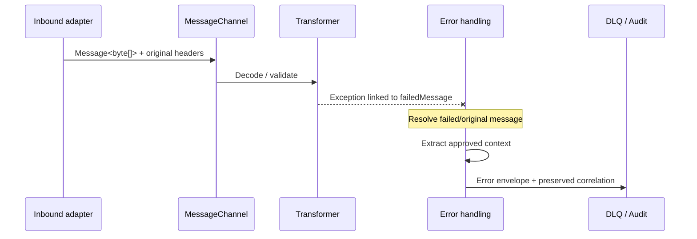
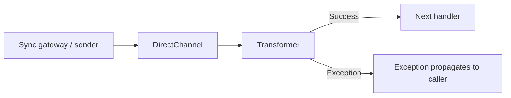
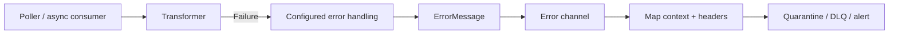
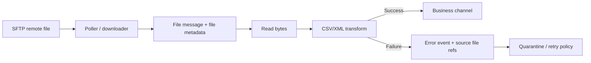
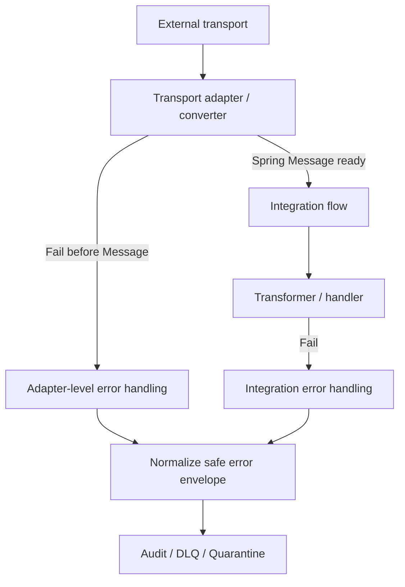

# Chuyển đổi lỗi không làm mất header trong Spring Integration Adapters

Trong một luồng **Spring Integration**, dữ liệu thường đi qua nhiều bước: **inbound adapter hoặc gateway → MessageChannel → transformer → router/handler → outbound adapter hoặc gateway**. Mỗi `Message<?>` có **payload** và **headers**. Payload chứa dữ liệu cần xử lý; headers mang ngữ cảnh như mã tương quan (*correlation ID*), nguồn gửi, kiểu nội dung, dấu vết phiên giao dịch, thông tin phân vùng hoặc dữ liệu phục vụ định tuyến.

Khi một transformer giải mã JSON/XML, chuyển charset hoặc chuẩn hóa DTO rồi gặp lỗi, một cách xử lý thiếu cẩn trọng có thể **làm mất những header cần thiết**. Ví dụ, ứng dụng tạo một message báo lỗi mới chỉ chứa chuỗi `"Invalid order"`. Nếu không còn `correlationId`, `sourceSystem`, `eventId` hoặc tham chiếu message gốc, đội vận hành khó biết lỗi bắt đầu từ HTTP request, file SFTP, JMS queue hay Kafka record nào. Hệ thống cũng có thể không biết nên phản hồi gateway, ghi nhận vào DLQ hay gắn lỗi với yêu cầu nghiệp vụ nào.

**Chuyển đổi lỗi không làm mất header** nghĩa là **giữ được ngữ cảnh phù hợp từ message gốc xuyên suốt quá trình phát hiện, biểu diễn, chuyển tiếp, lưu trữ và xử lý lỗi**. Điều này không đồng nghĩa phải sao chép mọi header vô điều kiện: các header nội bộ như `replyChannel`, `errorChannel` hoặc thông tin transport nhạy cảm có thể không được phép phát ra bên ngoài. Thiết kế đúng phải cân bằng giữa **khả năng truy vết** và **ranh giới tin cậy**.

Trong module **SPRING_INTEGRATION_ADAPTERS**, bài học này tập trung vào cách bảo toàn metadata khi tích hợp qua **file, SFTP, HTTP, JMS, AMQP, Kafka và cơ sở dữ liệu**, với **adapter, gateway, poller, MessageChannel**, hợp đồng message, lỗi và vòng đời kết nối.

> **Nguyên tắc chính:** Khi lỗi xảy ra, hãy **giữ tham chiếu đến message thất bại và chuyển tiếp các header được phê duyệt**. Đừng cho rằng `ErrorMessage` tự mang toàn bộ headers của request ban đầu, và đừng coi việc copy nguyên `MessageHeaders` ra hệ thống ngoài là an toàn.

## 1. Mục tiêu học tập

Sau bài này, người học có thể:

1. Giải thích `Message<?>`, `MessageHeaders`, `ErrorMessage`, `MessagingException` và `failedMessage` trong Spring Messaging/Spring Integration.
2. Phân biệt **header của message gốc**, **header của error message** và **header của message kết quả sau chuyển đổi lỗi**.
3. Giữ `correlationId`, `eventId`, nguồn, scope và tham chiếu cần thiết khi transformer thành công hoặc ném exception.
4. Hiểu vì sao một số header như `id`, `timestamp`, `replyChannel`, `errorChannel`, `contentType` cần **xử lý đặc biệt**.
5. Viết transformer Java ném exception có **liên kết với message thất bại**, thay vì ném một lỗi không có ngữ cảnh.
6. Tạo **error envelope** cho DLQ/audit mà không làm mất metadata phục vụ điều tra.
7. Biết sự khác biệt giữa lỗi trên `DirectChannel` đồng bộ và lỗi tại poller, executor channel hoặc message-driven adapter bất đồng bộ.
8. Thiết kế propagation headers qua HTTP, SFTP/file, JMS, AMQP, Kafka và JDBC.
9. Đánh giá tác động của retry, dead-letter/quarantine, redelivery, serialization và idempotency đối với metadata.
10. Kiểm thử **header preservation** cùng với bảo vệ dữ liệu nhạy cảm và ngăn routing lỗi lặp vô hạn.

## 2. Vì sao giữ header quan trọng hơn vẻ ngoài của thông báo lỗi?

Xét một HTTP inbound gateway nhận message:

```text
Payload:
  {"eventId":"evt-1001","orderId":"ORD-42","amountCents":"not-a-number"}

Headers:
  correlationId = req-72e4
  sourceSystem  = partner-a
  eventType     = order.created
  schemaVersion = 1
  contentType   = application/json
  tenantId      = tenant-a  (đã xác minh ở boundary)
```

Transformer cố chuyển payload thành `OrderCreated` nhưng parser báo sai kiểu số. Nếu tạo message lỗi như sau:

```java
Message<String> badError = MessageBuilder
    .withPayload("Cannot convert OrderCreated")
    .build();
```

Message mới này không tự động chứa các header nghiệp vụ của message ban đầu. Mất `correlationId` có thể khiến gateway không nối được kết quả với log/trace nghiệp vụ; mất `sourceSystem` khiến DLQ handler khó phân loại producer; mất `schemaVersion` khiến replay không biết phải áp decoder nào.

Ngược lại, nếu copy toàn bộ headers gốc rồi gửi ra một đối tác khác, luồng có thể vô tình rò rỉ internal routing object hoặc thông tin nội bộ. **Giữ header đúng** nghĩa là giữ **đúng thông tin cần cho công việc xử lý lỗi, đúng phạm vi tin cậy**.

### 2.1. Các giá trị thường phải truy được

| Header hoặc metadata | Công dụng | Nguồn gốc nên xác minh |
| --- | --- | --- |
| `correlationId` | Nối các bước cùng một yêu cầu/quy trình. | Gateway hoặc hệ thống điều phối; kiểm tra tính hợp lệ khi đi từ ngoài vào. |
| `eventId` | Nhận diện sự kiện và hỗ trợ chống xử lý trùng. | Producer theo contract, được kiểm tra và quản lý tính duy nhất. |
| `sourceSystem` | Biết đối tác, adapter hoặc service phát message. | Danh tính transport/connector đã xác thực, không chỉ header tự khai. |
| `schemaVersion` | Chọn parser và quy tắc validation/replay. | Contract của producer/endpoint được allowlist. |
| `tenantId` | Liên kết tài nguyên và phạm vi xử lý. | Context đã được xác minh; không dùng client header tùy ý để cấp quyền. |
| `contentType` | Cho biết biểu diễn wire payload tại một thời điểm. | Header transport hoặc contract đã được chuyển đổi hợp lệ. |
| `originalMessageId` | Giúp chỉ ra message gốc bị lỗi. | Lấy từ metadata message gốc. |
| `fileName`, `topic`, `partition`, `offset` | Hỗ trợ xác định bản ghi tại nguồn. | Metadata adapter được chuẩn hóa; xử lý riêng theo transport. |
| `retryCount` | Phân biệt lỗi đầu tiên và retry nhiều lần. | Retry mechanism có thẩm quyền. |

Một số trường nên nằm trong **error envelope payload**, một số nên là header, và một số chỉ cần lưu trong **audit store**. Không bắt buộc mọi thứ phải nằm trong headers.

## 3. Mô hình Message trong Spring Messaging

Spring Integration sử dụng các abstraction của Spring Messaging:

```java
org.springframework.messaging.Message<T>
org.springframework.messaging.MessageHeaders
org.springframework.messaging.support.MessageBuilder
```

Mỗi message có:

- **Payload:** đối tượng `T`, ví dụ `byte[]`, `String`, DTO hoặc exception.
- **Headers:** tập key/value thường được xem là immutable đối với message đã xây dựng.
- **Framework metadata:** ví dụ message ID và timestamp.
- **Application metadata:** ví dụ correlation, source hoặc schema version.
- **Integration/transport metadata:** có thể là reply/error channels và thông tin adapter.

### 3.1. Message gốc

```java
Message<byte[]> original = MessageBuilder
    .withPayload(jsonBytes)
    .setHeader("correlationId", "req-72e4")
    .setHeader("sourceSystem", "partner-a")
    .setHeader("eventId", "evt-1001")
    .setHeader("schemaVersion", "v1")
    .setHeader(
        MessageHeaders.CONTENT_TYPE,
        MimeTypeUtils.APPLICATION_JSON
    )
    .build();
```

Lúc này headers thuộc về **message có payload bytes**. Sau khi payload thành DTO hoặc message báo lỗi, cần xác định header nào còn đúng, header nào phải đổi tên/loại bỏ.

### 3.2. Headers không phải dữ liệu bất biến xuyên mọi bước

Một transformer có thể sinh message mới với ID mới. Cơ chế xây dựng message hoặc adapter có thể thêm, loại bỏ hay ánh xạ headers theo cấu hình. Vì vậy, **không dùng Spring message ID đơn lẻ làm khóa truy vết xuyên toàn bộ flow**; nên có `correlationId` và tham chiếu ổn định tới ID gốc theo contract.

## 4. Ba lớp metadata không được nhầm lẫn

Khi xảy ra lỗi, ít nhất có ba đối tượng khác nhau:

| Đối tượng | Payload | Headers | Vai trò |
| --- | --- | --- | --- |
| **Original/failed message** | Dữ liệu khiến bước xử lý lỗi. | Header ngữ cảnh nguồn. | Truy vết nguyên nhân, kiểm tra nguồn và replay. |
| **ErrorMessage** | Thường là `Throwable`. | Headers riêng của error message. | Chuyển sự kiện lỗi tới error flow. |
| **Normalized error event** | DTO lỗi nghiệp vụ/vận hành. | Chỉ các headers được giữ lại và chuẩn hóa. | Audit, DLQ, quarantine hoặc thông báo tới hệ ngoài. |

**Lỗi rất dễ mắc:** nhìn `errorMessage.getHeaders()` rồi giả định đây chính là toàn bộ headers của message đã thất bại. Một `ErrorMessage` có thể có headers riêng được thiết lập bởi cơ chế tạo lỗi; dữ liệu gốc thường cần được tìm trong **exception chứa failed message** hoặc **original message reference**, nếu có.

### 4.1. Minh họa chuỗi lỗi



Đường đi cụ thể phụ thuộc endpoint, transport và việc xử lý đồng bộ/bất đồng bộ; sơ đồ chỉ cho thấy **trách nhiệm bảo toàn ngữ cảnh**.

## 5. Khi nào header bị mất?

Các tình huống điển hình:

1. Transformer chỉ trả về `MessageBuilder.withPayload(newPayload).build()` và không mang metadata nghiệp vụ.
2. Chỉ trả DTO/chuỗi lỗi rồi downstream tạo message mới từ đầu.
3. Ném `IllegalArgumentException` không liên kết message thất bại, khiến error handler không có đối tượng gốc.
4. Error handler lấy headers từ `ErrorMessage` thay vì kiểm tra `MessagingException.getFailedMessage()`.
5. Adapter dùng header mapper mặc định không chuyển một custom header sang transport mới.
6. JSON/XML conversion làm thay đổi payload nhưng `contentType` gốc bị gỡ mà không giữ thông tin định dạng wire.
7. Retry handler dựng lại message và bỏ `eventId` hoặc `correlationId`.
8. DLQ chỉ gửi `exception.getMessage()`, không gửi tham chiếu nguồn.
9. Một nhánh router/filter hoặc handler loại bỏ headers không nằm trong allowlist.
10. File/SFTP poller đọc lại dữ liệu mà không giữ tên file, remote path hoặc khóa idempotency có kiểm soát.

**Kiểm tra logic:** thông báo lỗi hiển thị đầy đủ không chứng minh header đã được giữ. Phải kiểm tra **message tại từng boundary** và biết metadata nào còn truy lại được.

## 6. Bảo toàn header khác với sao chép tất cả header

Hai nhu cầu thường xung đột:

- **Traceability:** giữ correlation, event ID, source, schema, scope.
- **Security:** không chuyển internal routing objects, token, session hoặc thông tin nhạy cảm ra ngoài.

### 6.1. Hai chính sách khả dụng

| Chính sách | Khi phù hợp | Nguy cơ |
| --- | --- | --- |
| **Copy toàn bộ headers trong vùng tin cậy** | Flow nội bộ kiểm soát chặt, payload đổi nhưng header semantics còn đúng. | Giữ cả stale `contentType`, reply/error channel hoặc thông tin transport không cần thiết. |
| **Allowlist/explicit mapping** | Khi đổi trust boundary, ghi DLQ, gọi HTTP/JMS/Kafka khác hoặc tạo error event. | Dễ quên header nếu hợp đồng chưa đầy đủ; cần kiểm thử. |

Nên ưu tiên **allowlist khi đi qua ranh giới tin cậy**. Nếu dùng sao chép nội bộ, vẫn cần rà soát những header không còn phù hợp sau khi đổi payload.

### 6.2. Header không nên copy nguyên dạng ra ngoài

- `replyChannel` và `errorChannel`: có thể là tên channel hoặc đối tượng `MessageChannel` nội bộ; không phải metadata wire có thể gửi tùy ý.
- `MessageHeaders.ID` / `TIMESTAMP`: mô tả message cụ thể; không giả định ID của message mới là ID gốc.
- Security credentials: Authorization header, cookie, access token, API key, secret.
- Những thông tin transport nhạy cảm hoặc không tương thích giữa JMS/AMQP/Kafka/HTTP.
- `contentType` không còn đúng với **payload hiện tại**.
- Metadata do client tự khai nhưng chưa xác thực như `isAdmin=true` hoặc `tenantId`.

## 7. Xác định lineage: message mới và message gốc

Một flow có thể tạo nhiều message mới. Để giữ dấu vết, nên tách:

```text
originalMessageId  = ID của message ở điểm đầu cần theo dõi
correlationId      = ID quy trình xuyên nhiều message/service
eventId            = ID của sự kiện nghiệp vụ theo contract
errorEventId       = ID riêng của lần ghi nhận lỗi
retryAttempt       = số lần xử lý lại theo retry policy
```

Ví dụ:

```text
HTTP inbound message: id=MSG-A, correlation=req-72e4
Transformer attempt: id=MSG-B, correlation=req-72e4
Error event:         id=ERR-91, originalMessageId=MSG-A
DLQ record:          eventId=evt-1001, correlation=req-72e4
```

Các ID và quan hệ trên chỉ minh họa. Thực tế Spring Integration có thể giữ hoặc tạo message ID mới tùy endpoint/builder; điều quan trọng là **lineage được ghi có chủ đích**, không suy ra từ việc các message ID trùng hay khác.

### 7.1. Không tự tin giá trị correlation của client

Ở HTTP, người gọi có thể đặt `X-Correlation-ID`. Hệ thống nên kiểm tra định dạng, độ dài và chính sách tin cậy; có thể tạo correlation ID mới và giữ external request ID riêng. Không dùng correlation ID để xác minh danh tính, xác định tenant hay bỏ qua authorization.

## 8. Cách thành công cũng có thể làm mất header

Trước khi nói đến lỗi, cần phân biệt hai kiểu transformer:

1. Transformer trả **payload mới**: với những transformer/endpoint chuẩn của Spring Integration, framework thường có cơ chế dựng message phản hồi và truyền tiếp headers theo quy tắc của endpoint.
2. Transformer trả **Message mới**: code có quyền kiểm soát headers của message phản hồi; nếu chỉ tạo payload và build mà không sao chép metadata, có thể làm mất những header ứng dụng cần.

Vì các cơ chế phụ thuộc endpoint và phiên bản, hãy **kiểm thử kết quả thực tế** thay vì cho rằng mọi phương thức `@Transformer` có cùng cách propagation.

Ví dụ tạo message mới có headers lựa chọn:

```java
Message<OrderCreated> output = MessageBuilder
    .withPayload(event)
    .setHeader("correlationId",
               input.getHeaders().get("correlationId"))
    .setHeader("eventId",
               input.getHeaders().get("eventId"))
    .setHeader("sourceSystem",
               input.getHeaders().get("sourceSystem"))
    .setHeader("originalMessageId",
               input.getHeaders().getId().toString())
    .build();
```

Nếu toàn bộ luồng nội bộ tin cậy và hợp đồng cho phép, có thể sử dụng API `copyHeaders(...)` để giữ nhiều metadata, rồi loại bỏ/đổi header không còn đúng. Nhưng **copyHeaders không thay thế thiết kế hợp đồng**.

## 9. Throw exception có gắn failed message

Nếu converter gặp lỗi và muốn downstream nhận biết message gốc, nên dùng một exception có khả năng mang tham chiếu đến message thất bại.

Spring Messaging có `MessagingException` và một số subtype như `MessageHandlingException`; những exception này có khả năng tham chiếu `failedMessage`.

### 9.1. Ví dụ transformer giải mã JSON

```java
import com.fasterxml.jackson.core.JsonProcessingException;
import com.fasterxml.jackson.databind.ObjectMapper;
import org.springframework.integration.annotation.Transformer;
import org.springframework.messaging.Message;
import org.springframework.messaging.MessageHandlingException;
import org.springframework.messaging.support.MessageBuilder;
import org.springframework.stereotype.Component;

public record OrderCreated(
    String eventId,
    String orderId,
    long amountCents
) {}

@Component
public class OrderDecodeTransformer {

    private final ObjectMapper mapper;

    public OrderDecodeTransformer(ObjectMapper mapper) {
        this.mapper = mapper;
    }

    @Transformer(
        inputChannel = "rawOrdersChannel",
        outputChannel = "canonicalOrdersChannel"
    )
    public Message<OrderCreated> decode(Message<byte[]> input) {
        try {
            OrderCreated event =
                mapper.readValue(input.getPayload(), OrderCreated.class);

            if (event.eventId() == null
                    || event.eventId().isBlank()
                    || event.orderId() == null
                    || event.orderId().isBlank()
                    || event.amountCents() <= 0) {
                throw new IllegalArgumentException("Invalid order fields");
            }

            return MessageBuilder.withPayload(event)
                .setHeader(
                    "correlationId",
                    input.getHeaders().get("correlationId")
                )
                .setHeader(
                    "eventId",
                    input.getHeaders().get("eventId")
                )
                .setHeader(
                    "sourceSystem",
                    input.getHeaders().get("sourceSystem")
                )
                .setHeader(
                    "schemaVersion",
                    input.getHeaders().get("schemaVersion")
                )
                .setHeader(
                    "originalMessageId",
                    input.getHeaders().getId().toString()
                )
                .build();

        } catch (JsonProcessingException | IllegalArgumentException ex) {
            throw new MessageHandlingException(
                input,
                "ORDER_DECODE_FAILED",
                ex
            );
        }
    }
}
```

**Điểm mấu chốt:** exception được tạo với tham chiếu `input`, nên error handler có cơ sở để tìm `correlationId`, `eventId` và các headers của message thất bại.

### 9.2. Các giới hạn của ví dụ

- Dữ liệu JSON và DTO chỉ để học. `ObjectMapper` thật cần cấu hình schema/field policy, size limit và parser constraints.
- Header lấy từ input cần được kiểm tra hoặc chuẩn hóa ở inbound boundary; ví dụ này không xác thực một `sourceSystem` do đối tác tự khai.
- `@Transformer` và `MessageHandlingException` được dùng theo ý tưởng Spring Messaging/Integration; việc framework wrap thêm exception và tạo `ErrorMessage` phụ thuộc phiên bản và endpoint.
- Trong luồng bất đồng bộ, exception có thể bị bao bọc nhiều lớp; error handler phải kiểm tra nguyên nhân và tham chiếu message có sẵn, không giả định `getCause()` có độ sâu cố định.
- Nếu lỗi là thiếu kết nối database, không nên gắn nhãn `ORDER_DECODE_FAILED`; phân loại lỗi cần phản ánh đúng nguyên nhân.

## 10. Không nên làm gì khi bắt lỗi?

Ví dụ không tốt:

```java
try {
    return convert(input.getPayload());
} catch (Exception ex) {
    throw new RuntimeException("Conversion failed");
}
```

Ở đây vừa mất cause gốc, vừa không gắn message thất bại. Một error handler có thể không tìm được input hay metadata nguồn nếu framework không cung cấp bằng đường khác.

Ví dụ cải thiện:

```java
try {
    return convert(input.getPayload());
} catch (IllegalArgumentException ex) {
    throw new MessageHandlingException(
        input,
        "INVALID_INPUT_PAYLOAD",
        ex
    );
}
```

Không bắt `Exception` hoặc `Throwable` quá rộng chỉ để “chuẩn hóa” mọi lỗi. Các lỗi nghiêm trọng về hạ tầng hoặc programming bug nên được phân loại đúng, và không bao giờ để conversion failure tạo success payload giả khiến business handler tiếp tục.

### 10.1. Khi endpoint tự wrap exception

Một số Spring Integration endpoint có thể chuyển exception thông thường thành exception có failed message. Tuy vậy, để một thư viện chuyển đổi hoặc handler được gọi ở nhiều đường khác nhau dễ sử dụng, **đừng phụ thuộc hoàn toàn vào wrap tự động** nếu API cho phép giữ tham chiếu nguồn rõ ràng.

## 11. ErrorMessage là gì?

`org.springframework.messaging.support.ErrorMessage` là một kiểu message có **payload là Throwable**. Spring Integration dùng ErrorMessage trong nhiều cơ chế error handling.

Một điểm dễ nhầm:

```text
ErrorMessage
   payload: Throwable / MessagingException
   headers: headers của bản ghi lỗi
   originalMessage: có thể có hoặc không, tùy cách tạo lỗi
```

Khi exception là `MessagingException`, có thể kiểm tra:

```java
Throwable failure = errorMessage.getPayload();

if (failure instanceof MessagingException messagingException) {
    Message<?> failed = messagingException.getFailedMessage();
    // failed.getHeaders() là một nguồn truy vết có thể dùng.
}
```

Một số cách tạo `ErrorMessage` cung cấp thêm `originalMessage`. Tuy nhiên **không nên giả định reference đó luôn tồn tại**. Nếu nguồn gốc không được cung cấp, hệ thống nên ghi nhận `lineageMissing=true` và báo thiếu bằng chứng, thay vì tự ghép với message không liên quan.

### 11.1. Lấy header ở đâu khi có nhiều lớp?

Một chiến lược hợp lý:

1. Ưu tiên **failed message** từ exception đang thể hiện lỗi thực tế, nếu nó đúng message mong muốn.
2. Nếu không có, kiểm tra **original message reference** của ErrorMessage nếu được cung cấp.
3. Nếu cả hai không có, chỉ sử dụng header của error message **khi rõ semantics** và ghi nhận lineage thiếu.
4. Không suy ra user, tenant hoặc source chỉ từ nội dung exception message.
5. Không cho một header không tin cậy ghi đè thông tin nguồn đã xác thực ở gateway.

## 12. Tạo error envelope không làm mất header cần thiết

Một error envelope là một biểu diễn có cấu trúc của lỗi để ghi audit, chuyển DLQ hoặc lưu quarantine. Nó nên có dữ liệu tối thiểu nhưng đủ truy vết.

### 12.1. Định nghĩa DTO

```java
public record IntegrationFailure(
    String errorId,
    String errorCode,
    String correlationId,
    String sourceSystem,
    String eventId,
    String originalMessageId,
    String failedPayloadType,
    String reasonCategory
) {}
```

Không cần đưa raw payload và stack trace vào envelope công khai. Một error ID có thể được dùng để tra cứu chi tiết trong hệ thống có phân quyền.

### 12.2. Mapper chuyển ErrorMessage thành message nghiệp vụ lỗi

```java
import java.util.UUID;
import org.springframework.integration.annotation.ServiceActivator;
import org.springframework.messaging.Message;
import org.springframework.messaging.MessageHandlingException;
import org.springframework.messaging.MessagingException;
import org.springframework.messaging.support.ErrorMessage;
import org.springframework.messaging.support.MessageBuilder;
import org.springframework.stereotype.Component;

@Component
public class OrderFailureMapper {

    @ServiceActivator(
        inputChannel = "orderErrorChannel",
        outputChannel = "normalizedErrorsChannel"
    )
    public Message<IntegrationFailure> map(ErrorMessage error) {
        Throwable cause = error.getPayload();
        Message<?> failed = findFailedMessage(error);

        String correlationId = stringHeader(failed, "correlationId");
        String sourceSystem = stringHeader(failed, "sourceSystem");
        String eventId = stringHeader(failed, "eventId");

        String originalId = failed == null
            ? null
            : String.valueOf(failed.getHeaders().getId());

        IntegrationFailure body = new IntegrationFailure(
            UUID.randomUUID().toString(),
            "ORDER_DECODE_FAILED",
            correlationId,
            sourceSystem,
            eventId,
            originalId,
            failed == null
                ? "UNKNOWN"
                : failed.getPayload().getClass().getSimpleName(),
            "INVALID_MESSAGE_CONTRACT"
        );

        return MessageBuilder.withPayload(body)
            .setHeader("correlationId", correlationId)
            .setHeader("sourceSystem", sourceSystem)
            .setHeader("eventId", eventId)
            .setHeader("originalMessageId", originalId)
            .setHeader("errorCode", body.errorCode())
            .setHeader("lineageMissing", failed == null)
            .build();
    }

    private static Message<?> findFailedMessage(ErrorMessage error) {
        Throwable cause = error.getPayload();

        if (cause instanceof MessagingException messagingException
                && messagingException.getFailedMessage() != null) {
            return messagingException.getFailedMessage();
        }

        return error.getOriginalMessage();
    }

    private static String stringHeader(
        Message<?> message, String name
    ) {
        if (message == null) {
            return null;
        }
        Object value = message.getHeaders().get(name);
        return value instanceof String text ? text : null;
    }
}
```

**Lưu ý về Java code:** đây là mẫu minh họa cho cấu trúc message trong các phiên bản Spring có API tương ứng. Khi biên dịch vào project thực, cần khớp phiên bản Spring và các module đã chọn. Trong production, nên chuẩn hóa giới hạn độ dài/format của correlation/source, mã hóa đúng enum lỗi, lưu bản ghi có timestamp và tránh giả định mọi exception là lỗi `ORDER_DECODE_FAILED`.

### 12.3. Vì sao không đưa nguyên exception vào message outbound?

Exception object có thể chứa stack trace, nguyên nhân lồng nhau, dữ liệu nhạy cảm hoặc không thể serialize ổn định. Nó phù hợp với **kênh lỗi nội bộ**, không nhất thiết phù hợp làm hợp đồng JMS/AMQP/Kafka/HTTP cho đối tác.

Chuẩn hóa thành `IntegrationFailure` giúp xác định schema, bảo vệ dữ liệu và giữ metadata có chủ đích.

## 13. Thử tạo ErrorMessage có tham chiếu nguồn

Một ví dụ kiểm thử thuần message:

```java
Message<byte[]> original = MessageBuilder
    .withPayload(new byte[] {1, 2, 3})
    .setHeader("correlationId", "req-72e4")
    .setHeader("eventId", "evt-1001")
    .setHeader("sourceSystem", "partner-a")
    .build();

MessagingException failure = new MessageHandlingException(
    original,
    "Cannot decode payload",
    new IllegalArgumentException("Invalid bytes")
);

ErrorMessage error = new ErrorMessage(
    failure,
    java.util.Map.of("errorOrigin", "test"),
    original
);
```

Trong ví dụ này có **ba nơi**:

- `original.getHeaders()`: metadata đầu vào.
- `failure.getFailedMessage()`: tham chiếu từ exception.
- `error.getHeaders()`: metadata riêng của error event, chỉ có `errorOrigin` ngoài framework metadata.

Do đó, mã chỉ đọc `error.getHeaders().get("correlationId")` có thể nhận null, dù correlation tồn tại đầy đủ trong `original`.

### 13.1. Khi không có failed message

Một lỗi xảy ra **trước khi Spring Message được tạo** (ví dụ deserializer của Kafka thất bại) có thể không có `failedMessage` theo kiểu này. Cần dùng metadata còn sẵn ở adapter/listener và error strategy của transport, rồi ghi nhận phần nào chưa quan sát được. Không tạo một message “gốc” giả để làm đẹp số liệu.

## 14. Header của ErrorMessage và header của failedMessage

Đây là bảng tra nhanh:

| Câu hỏi | Nguồn dữ liệu thường phù hợp |
| --- | --- |
| Message nào bị lỗi? | `MessagingException.getFailedMessage()` hoặc `ErrorMessage.getOriginalMessage()` nếu có. |
| Lỗi xử lý loại gì? | Kiểu exception, cause, reason code của handler. |
| Correlation của quy trình là gì? | Header của message gốc đã được chuẩn hóa. |
| Error event có ID nào? | ID của ErrorMessage hoặc error envelope riêng. |
| Consumer lỗi của event ở đâu? | Metadata từ endpoint/adapter; có thể nằm ở error headers. |
| Phải reply về channel nào? | Cấu hình gateway/routing có thẩm quyền, không dùng dữ liệu tùy ý từ client. |
| Phải ghi DLQ nào? | Chính sách adapter/route; không dựa vào một header destination chưa xác minh. |
| Có cần giữ raw payload không? | Chính sách kiểm toán/quarantine với kiểm soát dữ liệu. |

Không có một thứ tự ưu tiên cứng cho mọi hệ thống. Đường truy vết cần xác định **message nào ở giai đoạn nào** và header nào có semantics được bảo đảm.

## 15. Error channel: đồng bộ và bất đồng bộ khác nhau

Trong Spring Integration, lỗi có thể:

- **Ném lên caller** trong một chuỗi xử lý đồng bộ.
- **Được công bố dưới dạng ErrorMessage** vào error channel khi endpoint/poller/container có cơ chế xử lý lỗi tương ứng.
- **Bị xử lý tại adapter/listener trước khi vào integration flow**, ví dụ lỗi deserializer hoặc xác thực transport.

### 15.1. DirectChannel



Với `DirectChannel`, lời gọi handler thường thực thi đồng bộ. Nếu converter ném exception, lỗi có thể được truyền trực tiếp lên gateway hoặc caller; **không thể giả định** nó sẽ luôn được chuyển vào một global `errorChannel`.

Nếu muốn chuẩn hóa lỗi trong đường đồng bộ, có thể thiết kế error mapping ở gateway hoặc xử lý exception tại một service boundary phù hợp.

### 15.2. Poller hoặc executor channel



Với poller hoặc endpoint có task executor, framework có thể dùng cơ chế công bố lỗi theo cấu hình. Cần kiểm tra **exception được wrap thế nào**, **original message có sẵn không**, **ack/transaction nằm ở đâu** và **error channel đang được sử dụng thực sự**.

### 15.3. ErrorMessageStrategy

Một số thành phần Spring Integration sử dụng **error message strategy** để tạo `ErrorMessage` chứa ngữ cảnh phù hợp (ví dụ original/failed message). Đây là một hướng cấu hình cần xem xét khi adapter cho phép, nhưng không nên dựa vào một cấu hình toàn cục không được kiểm thử để kết luận rằng mọi transport giữ cùng headers.

## 16. replyChannel và errorChannel: giữ hay loại bỏ?

Spring Integration dùng những header liên quan điều phối request/reply hoặc lỗi. Một request từ gateway có thể có `replyChannel` và `errorChannel`, đôi khi là đối tượng channel nội bộ chứ không phải một chuỗi có thể serialize.

### 16.1. Trong flow nội bộ

Giữ các header điều phối khi framework cần chúng có thể giúp gateway hoàn tất request/reply và xử lý lỗi đúng đường. Nếu một transformer chủ động tạo message mới mà bỏ mọi headers, các ngữ cảnh đó có thể bị mất hoặc cần framework bù lại theo quy tắc endpoint.

### 16.2. Khi phát sự kiện lỗi ra broker/HTTP

Không nên đưa raw `replyChannel`/`errorChannel` ra Kafka, JMS, AMQP hoặc API của đối tác. Cần:

- Chuyển thành metadata nghiệp vụ an toàn nếu thật sự cần.
- Giữ `correlationId` để hệ thống ngoài biết sự kiện liên quan yêu cầu nào.
- Định nghĩa destination được quản trị ở adapter, không cho client gửi tùy ý.
- Xử lý request/reply ở gateway/caller theo chính sách, không kỳ vọng một DLQ consumer tự gửi reply vào channel nội bộ đã bị serialize.

### 16.3. Tránh vòng lặp xử lý lỗi

Nếu normalized error message vô tình giữ lại `errorChannel` chỉ về chính error flow, một lỗi trong error handler có thể tiếp tục kích hoạt xử lý lỗi cùng đường. Thiết kế cần xác định **terminal error sink**, retry cap và đường xử lý lỗi của chính error pipeline.

## 17. Header nào trở nên stale sau khi đổi payload?

Giả sử inbound HTTP gửi:

```text
payload Java type: byte[]
contentType: application/json
schemaVersion: v1
```

Sau khi deserialize:

```text
payload Java type: OrderCreated
wireContentType: application/json
schemaVersion: v1
```

Nếu giữ `contentType=application/json` mà downstream coi đó là **kiểu biểu diễn hiện thời của Java object**, một adapter khác có thể cố serialize/deserialize sai. Ngược lại, nếu không giữ một dấu vết nào về wire format, đội vận hành khó chẩn đoán lỗi ở producer.

Giải pháp là có quy ước rõ:

| Trường | Diễn giải |
| --- | --- |
| `contentType` | Biểu diễn payload hiện hành khi cần thiết cho endpoint/adapter. |
| `wireContentType` | MIME type nhận từ wire ở ingress đã kiểm tra. |
| `schemaVersion` | Version nghiệp vụ của payload sau khi đã xác minh. |
| `originalMessageId` | Tham chiếu message gốc. |
| `payloadClass` | Kiểu Java hiện tại nếu cần audit hoặc routing nội bộ. |

**Không phải mọi project phải dùng đúng những tên custom header này.** Quan trọng là tránh một header mang hai ý nghĩa khác nhau trước/sau transform.

## 18. Copy headers an toàn khi thay payload

Trong vùng nội bộ đã tin cậy, đôi khi cần giữ phần lớn headers:

```java
Message<OrderCreated> transformed = MessageBuilder
    .withPayload(parsedOrder)
    .copyHeaders(original.getHeaders())
    .removeHeader(MessageHeaders.CONTENT_TYPE)
    .setHeader(
        "wireContentType",
        String.valueOf(original.getHeaders()
            .get(MessageHeaders.CONTENT_TYPE))
    )
    .build();
```

Đây là **ví dụ về chủ đích preservation** trong vùng tin cậy. Những lưu ý:

1. Header đã copy có thể chứa các đối tượng routing nội bộ hoặc metadata transport.
2. ID/timestamp của Spring Message có quy tắc đặc biệt; không dựa vào `copyHeaders` để xác định message ID mới hoặc cũ.
3. Có thể cần bỏ thêm header như `replyChannel`/`errorChannel` khi gửi ra ngoài, nhưng không làm vậy tùy tiện ở một gateway nội bộ.
4. Các header `contentType` phải phù hợp payload sau conversion.
5. Nếu có security metadata, chỉ giữ những giá trị do tầng xác thực đã cấp và cho phép truyền.
6. Kiểm tra bằng unit/integration test thay vì tin rằng mọi header sẽ được copy nguyên giá trị qua mọi adapter.

### 18.1. Explicit mapping tại trust boundary

Ở ranh giới ra ngoài, nên dùng:

```java
Message<IntegrationFailure> outboundError = MessageBuilder
    .withPayload(failure)
    .setHeader("correlationId", verifiedCorrelationId)
    .setHeader("eventId", verifiedEventId)
    .setHeader("sourceSystem", verifiedSourceSystem)
    .setHeader("errorCode", "ORDER_DECODE_FAILED")
    .build();
```

Không có `copyHeaders(original.getHeaders())` ở đây vì message lỗi có thể được gửi ra bên ngoài. Các biến `verified...` phải được tạo qua quy trình kiểm tra/chuẩn hóa trước đó.

## 19. Thiết kế hợp đồng error event

Để các adapter khác nhau xử lý nhất quán, một contract lỗi nên xác định:

| Thuộc tính | Mục đích |
| --- | --- |
| `errorId` | Mỗi lỗi được ghi nhận có ID độc lập. |
| `errorCode` | Mã ổn định cho phân loại và dashboard. |
| `occurredAt` | Thời điểm lỗi trong một timezone/instant rõ ràng. |
| `sourceSystem` | Hệ thống gửi đã được xác minh. |
| `adapterType` | HTTP, FILE, SFTP, JMS, AMQP, KAFKA hoặc JDBC. |
| `correlationId` | Nối chuỗi hoạt động liên quan. |
| `eventId` | Khóa nguồn phục vụ idempotency/replay nếu hợp đồng có. |
| `originalMessageId` | Tham chiếu message đã bị lỗi, nếu có. |
| `failureStage` | Parse, schema validation, transform, routing, outbound. |
| `retryable` | Theo error classification, không suy chỉ từ exception name. |
| `attempt` | Số lần thử khi cơ chế retry cung cấp. |
| `payloadReference` | Tham chiếu tới payload cách ly, không phải body raw lộ bí mật. |
| `reasonCategory` | Contract, transient infrastructure, business rejection... |

### 19.1. Ví dụ JSON khi publish lỗi

```json
{
  "errorId": "err-8821",
  "errorCode": "ORDER_DECODE_FAILED",
  "occurredAt": "2026-11-23T09:35:00Z",
  "adapterType": "KAFKA",
  "sourceSystem": "partner-a",
  "correlationId": "req-72e4",
  "eventId": "evt-1001",
  "originalMessageId": "msg-313",
  "failureStage": "TRANSFORM",
  "retryable": false,
  "attempt": 1,
  "reasonCategory": "INVALID_MESSAGE_CONTRACT",
  "payloadReference": "quarantine/err-8821"
}
```

Đây là **schema minh họa**, không phải định dạng lỗi bắt buộc của Spring Integration. Với hệ thống thật, event ID phải được phân biệt với broker message ID, và payload reference phải được bảo vệ, phân quyền, có thời hạn lưu phù hợp.

## 20. File/SFTP: giữ metadata nguồn khi chuyển đổi lỗi

Adapter file/SFTP có thể truyền header liên quan file name, file path, remote directory, remote file và metadata poller, tùy endpoint/configuration.

Một luồng mẫu:



### 20.1. Vì sao không chỉ giữ fileName?

Hai file có thể cùng tên ở những remote directory hoặc partner khác nhau. Để truy vết, có thể cần:

- Adapter/partner đã xác thực.
- Remote directory và tên file đã được sanitize.
- Định danh file hoặc idempotent key của lần import.
- Timestamp nhận và kích thước file.
- Hash hoặc checksum theo chính sách.
- Tên bước converter/schema version.
- Correlation ID gắn với một batch/record.

**Không dùng remote path do nguồn ngoài cung cấp làm đường dẫn local để ghi/quarantine mà không normalize và kiểm soát.** Metadata để truy vết không được biến thành lỗ hổng path traversal.

### 20.2. Không archive sớm

Khi transformer báo lỗi, nếu file đã bị xóa/đưa vào archive thành công mà không có bản gốc trong quarantine, khả năng replay có thể mất. Cần quyết định rõ mốc **đã đọc**, **đã parse**, **đã commit nghiệp vụ**, **đã archive** và giữ metadata tương ứng trong error event.

### 20.3. Record-level errors

Với một file CSV chứa nhiều record, lỗi có thể nằm ở **một dòng**. Error envelope nên có batch/file reference và record number hoặc record ID sau khi parser xác định được. Nếu file sử dụng CSV với newline bên trong field được quote, **dòng vật lý không nhất thiết là record number**; nên dùng parser có khả năng cho record index chính xác.

## 21. HTTP gateway: giữ header và trả lỗi đúng caller

HTTP inbound gateway có thể đặt request vào một integration flow. Với đường đồng bộ, exception có thể được chuyển thành HTTP response lỗi thông qua cơ chế gateway/application.

### 21.1. Luồng mong muốn

```text
HTTP request
  -> Xác thực producer / tạo hoặc chuẩn hóa correlation
  -> HTTP inbound gateway / Message
  -> Converter
  -> Exception gắn failedMessage
  -> Error mapper tại boundary
  -> HTTP 400/415 hoặc 5xx phù hợp + safe error body
```

### 21.2. Điều cần giữ và điều không nên trả lại

| Thông tin | Trong audit/error handler | Trong HTTP response cho client |
| --- | --- | --- |
| Correlation ID an toàn | Có | Có thể trả một mã tham chiếu đã chuẩn hóa. |
| Lỗi schema/MIME | Có reason code chi tiết hơn | Thông báo phù hợp hợp đồng API. |
| Internal channel object | Không cần đưa ra | Không. |
| Authorization token/cookie | Không log nội dung | Không phản chiếu. |
| Stack trace và đường dẫn nội bộ | Hạn chế, phân quyền trong hệ thống | Không. |
| Raw payload nhạy cảm | Chỉ vùng cách ly bảo vệ nếu thật sự cần | Không. |

**Lưu ý:** `correlationId` không thay thế việc ánh xạ HTTP request-reply của gateway. Việc giữ hoặc làm mất `replyChannel` trong flow đồng bộ có thể ảnh hưởng cơ chế phản hồi tùy cấu hình. Cần test cả success và error reply thực tế.

### 21.3. Status code gợi ý

- `400 Bad Request`: request payload sai cú pháp/contract theo API.
- `415 Unsupported Media Type`: content type không được hỗ trợ.
- `401/403`: lỗi authentication/authorization, khác conversion failure.
- `409 Conflict`: có thể phù hợp một số xung đột nghiệp vụ/idempotency.
- `5xx`: lỗi hệ thống/transient; không gộp lỗi schema cố định vào lỗi máy chủ.

Mỗi API có thể có error contract riêng; message nội bộ không tự ánh xạ thành status đúng nếu gateway/controller chưa cấu hình.

## 22. JMS: headers của Spring và JMS properties

JMS có headers/properties của broker và message type như `TextMessage`, `BytesMessage`. Khi vào Spring Integration, adapter/converter có thể ánh xạ một phần metadata sang Spring Message.

### 22.1. Ngữ cảnh cần giữ khi xảy ra lỗi

- Correlation ID nghiệp vụ hoặc JMS correlation theo quy ước.
- JMS message ID/destination phù hợp để điều tra.
- Event ID/idempotency key.
- Producer hoặc connector identity được xác thực.
- Delivery attempt/redelivery metadata (theo khả năng listener/container).
- Contract version và payload type.

**Không coi mọi JMS header name tương đương với custom Spring header**; mapping phụ thuộc adapter và cấu hình.

### 22.2. Retry và transaction

Nếu transformer ném lỗi ở JMS listener:

- Exception có thể dẫn tới rollback/redelivery tùy transaction/ack settings.
- ErrorMessage nội bộ không đồng nghĩa JMS message đã được ack.
- Khi đưa vào DLQ, cần giữ enough metadata để phân biệt **lỗi dữ liệu cố định** và **lỗi tạm thời**.
- Không copy broker/session objects không serialize được vào DLQ record.
- Không cho poison message redelivery vô hạn làm nghẽn queue.

**Mục tiêu:** log và DLQ chứa correlation/source/record ID có thể dùng, còn transaction semantics phải được xác minh độc lập.

## 23. AMQP: lưu metadata khi message converter thất bại

Với AMQP/RabbitMQ, body có thể là bytes, properties có content type/content encoding và routing metadata. Spring AMQP có converter và listener container riêng.

### 23.1. Vị trí lỗi tạo khác biệt

| Lỗi xảy ra ở đâu | Ngữ cảnh có thể có |
| --- | --- |
| Trước khi tạo Spring Message | Body/properties ở AMQP layer; có thể chưa có Integration failedMessage. |
| Trong Integration transformer | Spring Message và headers đã được map nếu adapter thực hiện. |
| Trong outbound AMQP serialization | Message nội bộ, converter, destination và cấu hình publisher. |
| Trong broker routing/delivery | Broker return/confirm/dead-letter metadata tùy cấu hình. |

Nếu lỗi xảy ra ở **AMQP converter trước Integration flow**, đừng yêu cầu error handler dựa vào `MessagingException.getFailedMessage()` như thể message đó chắc chắn đã tồn tại. Cần lấy metadata từ error strategy/listener layer phù hợp.

### 23.2. Khi gửi DLQ

Chỉ đưa những metadata cần thiết sang DLQ theo contract, ví dụ original routing key, correlation ID, event ID, reason code và source. Chú ý broker có thể thêm thông tin redelivery/death, nhưng schema và tên headers khác với message của Spring; hãy kiểm thử bằng broker thực.

## 24. Kafka: partition, offset và exception trước transformer

Kafka record có topic, partition, offset, key, value và headers. Spring Kafka/Integration cung cấp những abstraction và mapping riêng tùy loại adapter và cấu hình consumer.

### 24.1. Trường hợp transformer lỗi

```text
Kafka Consumer
  -> record deserialized thành byte[]/String
  -> Spring Integration Message
       correlationId = req-72e4
       eventId = evt-1001
       topic/partition/offset = metadata adapter
  -> Transformer
  -> MessageHandlingException(failedMessage)
  -> Error mapper hoặc listener error strategy
  -> DLT/quarantine theo chính sách
```

Nếu converter hỏng **trước** bước tạo Spring Message (ví dụ Kafka value deserializer lỗi), error flow trong Integration có thể không truy cập `failedMessage`. Một lớp xử lý lỗi ở Kafka listener/deserializer phải bảo toàn các metadata có thể lấy được từ record, theo khả năng container.

### 24.2. Offset không phải event ID

Kafka offset chỉ có ý nghĩa **trong một partition của một topic**, không phải ID duy nhất toàn hệ thống. Một error envelope nên ghi cả topic/partition/offset cho chẩn đoán và một event ID nghiệp vụ nếu producer có.

### 24.3. Header Kafka có thể là byte[]

Kafka record headers có thể mang byte[], trong khi Spring Message headers có thể là String/typed values sau mapping. Nếu error handler chỉ cast:

```java
String correlationId =
    (String) message.getHeaders().get("correlationId");
```

mà adapter đang cung cấp `byte[]`, có thể bị lỗi cast ngay trong error path. **Định nghĩa và kiểm thử quy tắc decode/normalize header** tại ingress, không chữa cháy bằng chuyển `toString()` trên byte[] (vì đó không phải nội dung text).

### 24.4. Replay và DLT

Khi publish sang dead-letter topic, cần có metadata đủ để replay đúng deserializer/schema version, nhưng không nhất thiết copy tất cả incoming Kafka headers. Cần tránh header size growth qua mỗi lần retry/dead-letter, và tránh để dữ liệu nhạy cảm được phát tán sang các topic có quyền đọc rộng hơn.

## 25. JDBC và database poller: giữ khóa bản ghi

Trong database inbound adapter, một message có thể được tạo từ kết quả query/JDBC row mapper. Khi chuyển đổi dữ liệu trong cột `payload` gặp lỗi, thông tin quan trọng nhất thường là **khóa bản ghi nguồn**.

Ví dụ dữ liệu outbox:

```text
EVENT_OUTBOX
  event_id
  aggregate_id
  payload_json
  schema_version
  created_at
  processing_status
```

Error event hữu ích cần liên kết `event_id` và `aggregate_id` (nếu được phép), để đội vận hành tìm row, kiểm tra schema và replay có kiểm soát.

### 25.1. Tránh mất row key khi chỉ giữ payload

Nếu JDBC poller tạo một Map chứa `event_id` và `payload_json` nhưng transformer chỉ trích chuỗi JSON mà không giữ event ID vào header hoặc canonical envelope, khi parser báo lỗi sẽ không biết row nào thất bại.

Một thiết kế:

```text
DB row
  -> extract event_id / schema_version as trusted metadata
  -> Message<String> + eventId + schemaVersion
  -> JSON transformer
  -> success: canonical event
  -> failure: failedMessage + eventId for quarantine/update status
```

### 25.2. Transaction và checkpoint

Một error event đã được ghi không tự đồng nghĩa database row đã được đánh dấu lỗi hoặc offset của poller đã tiến. Cần chiến lược transaction/outbox:

- Lỗi dữ liệu cố định có thể được đánh dấu `INVALID` có audit để không khóa cả batch.
- Lỗi downstream tạm thời nên retry có giới hạn.
- Đưa row vào trạng thái xử lý tiếp theo và ghi error record theo quy tắc tránh mất/nhân đôi.
- Nếu transaction rollback, phải biết thông điệp lỗi và trạng thái row còn giữ được ở đâu.

## 26. Message converter của từng transport có thể mất header trước Integration

Không chỉ transformer nội bộ mới làm mất metadata. Lỗi có thể xảy ra khi:

- HTTP converter đọc body nhưng gateway chưa xây Spring Message.
- JMS message converter thất bại khi xử lý TextMessage/BytesMessage.
- AMQP inbound converter gặp payload không hỗ trợ.
- Kafka deserializer không thể tạo value.
- SFTP/file reader thất bại trước bước `MessageBuilder`.
- JDBC driver/row mapper báo lỗi trước khi một message được phát hành.

Khi đó **không phải lúc nào có Message<?> gốc để copy headers**. Cần thiết kế adapter-level error handling với chính những metadata có tại tầng đó.

### 26.1. Mô hình hai tầng lỗi



Không cố tạo một abstraction chung bằng cách giả định **mọi nguồn lỗi đều có giống nhau các header**. Error envelope có thể có trường optional/unknown và nên ghi rõ độ tin cậy của lineage.

## 27. Retry: bảo toàn header qua nhiều lần xử lý

Một message có thể được xử lý lại do:

- Transient database/network failure.
- Ack timeout hoặc consumer restart.
- Poller tìm lại file.
- JMS/AMQP redelivery.
- Kafka replay/offset handling.
- Người vận hành replay DLQ/quarantine sau khi sửa dữ liệu.

Qua mỗi lần, cần giữ **identity của sự kiện** và phân biệt **identity của lần thử**.

```text
eventId:       evt-1001  (ổn định cho cùng một event)
correlationId: req-72e4 (ổn định theo quy trình khi phù hợp)
attempt:       1 -> 2 -> 3
errorId:       err-1 -> err-2 -> err-3
```

### 27.1. Không biến retry thành message mới không có gốc

Khi xây lại message để retry, cần định nghĩa rõ:

- `eventId` không đổi hay được cấp lại theo nguồn?
- `correlationId` được giữ thế nào?
- `originalMessageId` vẫn chỉ message gốc hay message ở lần xử lý gần nhất?
- `attempt` đến từ retry framework hay được lưu bền riêng?
- Có lặp lại dữ liệu credential nhạy cảm trong headers không?
- Khi retry qua một broker khác, những headers nào có thể serialize?

### 27.2. Idempotency không chỉ nhờ correlation ID

Một request có thể chứa nhiều event, hoặc cùng event được gửi trong các request khác nhau. Vì vậy, `correlationId` **không tự động là idempotency key**. Cần dùng event/business key được quản trị, cộng các điều kiện như source/tenant và trạng thái xử lý, để tránh tạo giao dịch trùng khi retry.

## 28. Bảo toàn header tại DLQ/quarantine và replay

DLQ/quarantine có thể là queue, topic, thư mục file, bảng database hoặc hệ thống lưu có kiểm soát. Một error record tốt có:

1. **Tham chiếu nguồn:** adapter, source/tenant hợp lệ, eventId, originalMessageId.
2. **Reason code:** lỗi do content type, charset, schema, authorization, downstream...
3. **Replay metadata:** parser/schema version và contract cần áp lại.
4. **Payload hoặc reference:** chỉ giữ dữ liệu cần thiết, mã hóa và phân quyền.
5. **Retry history:** lần xử lý, kết quả, mốc thời gian.
6. **Owner và quyết định:** ai được phép sửa/replay/discard.
7. **Dedupe key:** ngăn phát lại hiệu ứng nghiệp vụ đã commit.

Không nên serialize nguyên `MessageHeaders` của Spring qua JSON hoặc Kafka: chúng có thể chứa đối tượng không serialize được hoặc không phù hợp để xuất ra ngoài.

### 28.1. Trường hợp lỗi không thể replay trực tiếp

Một error event được ghi sau khi parser đã loại bỏ payload thô có thể chỉ đủ phục vụ audit, không đủ replay. Nếu replay là yêu cầu, phải **quyết định trước về nơi lưu raw payload an toàn**, checksum, retention và bảo vệ dữ liệu.

## 29. Bảo mật khi giữ header

Header có thể chứa dữ liệu nhạy cảm hoặc thông tin có thể bị giả mạo, ví dụ:

- Cookie hoặc Authorization bearer token.
- API key, session ID, secret.
- Tên tài nguyên nội bộ, network path, address hoặc credential metadata.
- Tenant, user, role hoặc device status do client tự khai.
- Raw exception chứa dữ liệu input.
- Header giá trị rất lớn, không đúng kiểu hoặc ký tự điều khiển.

### 29.1. Những kiểm soát cần áp dụng

| Rủi ro | Biện pháp |
| --- | --- |
| Rò rỉ token qua DLQ | Bỏ credentials trước khi phát; không log raw headers. |
| Header spoofing | Xác thực producer, chuẩn hóa `sourceSystem`/tenant từ ngữ cảnh đáng tin. |
| Oversized headers | Giới hạn độ dài và số lượng header; không cho payload chuyển vào header. |
| Header injection | Kiểm soát newline/control characters trước khi dùng làm HTTP header/filename. |
| Routing bất hợp pháp | Không dùng destination/replyChannel từ bên ngoài làm route đáng tin. |
| Lộ PII qua metrics | Không gắn correlation ID, user ID, raw error message làm metric labels. |
| Lưu lỗi quá lâu | Retention, encryption và quyền truy cập phù hợp với chính sách. |
| Lỗi handler làm lộ input | Dùng mã lỗi ổn định; giới hạn exception details được phát ra ngoài. |

### 29.2. Hai loại nguồn gốc cần phân biệt

- **Provenance đã xác minh:** adapter hoặc security layer xác định producer, tenant và phạm vi.
- **Metadata do producer khai:** correlation, fileName, eventId hoặc schemaVersion có thể hữu ích, nhưng cần xác minh định dạng, scope và quyền khi dùng.

Một error mapper không nên nâng một header client `role=ADMIN` thành quyền được cấp chỉ vì nó được bảo toàn.

## 30. Observability: đo được việc header bị mất

Không chỉ log exception, nên theo dõi **metadata coverage** của error events.

### 30.1. Log an toàn minh họa

```json
{
  "eventType": "INTEGRATION_TRANSFORM_FAILED",
  "errorId": "err-8821",
  "correlationId": "req-72e4",
  "eventId": "evt-1001",
  "sourceSystem": "partner-a",
  "adapter": "http-inbound",
  "failureStage": "JSON_TRANSFORM",
  "reasonCode": "INVALID_ORDER_AMOUNT",
  "originalMessageId": "msg-313",
  "lineageMissing": false,
  "retryable": false,
  "attempt": 1
}
```

Đây là ví dụ dữ liệu, không phải sự kiện đã đo từ hệ thống thật.

### 30.2. Metrics gợi ý

| Metric | Ý nghĩa |
| --- | --- |
| `integration_transform_error_total{adapter,reason}` | Lỗi conversion theo nguồn và nhóm nguyên nhân. |
| `error_envelope_missing_correlation_total` | Số lỗi không có correlation đã chuẩn hóa. |
| `error_envelope_missing_original_total` | Lỗi không truy lại được message gốc. |
| `dlq_publish_failure_total` | Lỗi ngay khi lưu/đẩy lỗi. |
| `quarantine_pending_messages` | Số lỗi cần xử lý. |
| `retry_attempts_total{adapter}` | Số lần thử và nguy cơ retry storm. |
| `header_mapping_failure_total{transport}` | Lỗi chuyển header qua protocol. |
| `error_handling_duration_seconds` | Độ trễ xử lý lỗi. |

Metrics nên dùng label có cardinality thấp; lưu `correlationId` và `eventId` trong log/trace thay vì metric label.

## 31. Kiểm thử đơn vị việc giữ header

Không thể chỉ kiểm tra exception type. Test phải hỏi:

- Exception có giữ failed message đúng không?
- ErrorMessage được xây dựng có original message khi policy yêu cầu không?
- Error mapper có lấy đúng correlation/eventId từ nguồn không?
- Message lỗi có giữ metadata cần thiết nhưng **không copy credentials**?
- Lỗi xảy ra trước Integration message có được báo thiếu lineage trung thực không?
- Retry vẫn giữ event ID và không làm tăng header vô hạn?

### 31.1. JUnit 5: kiểm tra exception giữ message gốc

```java
import static org.junit.jupiter.api.Assertions.*;

import java.nio.charset.StandardCharsets;
import org.junit.jupiter.api.Test;
import org.springframework.messaging.Message;
import org.springframework.messaging.MessageHandlingException;
import org.springframework.messaging.support.MessageBuilder;
import org.springframework.util.MimeTypeUtils;
import org.springframework.messaging.MessageHeaders;

class OrderTransformerHeaderTest {

    private final OrderDecodeTransformer transformer =
        new OrderDecodeTransformer(new ObjectMapper());

    @Test
    void failureCarriesOriginalHeaders() {
        Message<byte[]> original = MessageBuilder
            .withPayload(
                "{invalid-json".getBytes(StandardCharsets.UTF_8)
            )
            .setHeader("correlationId", "req-72e4")
            .setHeader("eventId", "evt-1001")
            .setHeader("sourceSystem", "partner-a")
            .setHeader(
                MessageHeaders.CONTENT_TYPE,
                MimeTypeUtils.APPLICATION_JSON
            )
            .build();

        MessageHandlingException failure = assertThrows(
            MessageHandlingException.class,
            () -> transformer.decode(original)
        );

        assertSame(original, failure.getFailedMessage());
        assertEquals(
            "req-72e4",
            failure.getFailedMessage()
                .getHeaders().get("correlationId")
        );
        assertEquals(
            "evt-1001",
            failure.getFailedMessage()
                .getHeaders().get("eventId")
        );
    }
}
```

Đây là ví dụ minh họa. Trong file test thật cần import `ObjectMapper`, cấu hình component theo project và xác minh phiên bản API đã chọn; bài STEP 4 chỉ tạo nội dung, không chạy build.

### 31.2. JUnit 5: kiểm tra error envelope

```java
import static org.junit.jupiter.api.Assertions.*;

import java.util.Map;
import org.junit.jupiter.api.Test;
import org.springframework.messaging.Message;
import org.springframework.messaging.MessageHandlingException;
import org.springframework.messaging.support.ErrorMessage;
import org.springframework.messaging.support.MessageBuilder;

class OrderFailureMapperTest {

    @Test
    void mapsErrorUsingFailedMessageHeaders() {
        Message<byte[]> original = MessageBuilder
            .withPayload(new byte[] {1, 2, 3})
            .setHeader("correlationId", "req-72e4")
            .setHeader("eventId", "evt-1001")
            .setHeader("sourceSystem", "partner-a")
            .setHeader("Authorization", "Bearer-secret-not-for-export")
            .build();

        MessageHandlingException exception =
            new MessageHandlingException(
                original,
                "Cannot decode",
                new IllegalArgumentException("Malformed payload")
            );

        ErrorMessage error = new ErrorMessage(
            exception,
            Map.of("errorOrigin", "test"),
            original
        );

        Message<IntegrationFailure> result =
            new OrderFailureMapper().map(error);

        assertEquals(
            "req-72e4", result.getHeaders().get("correlationId")
        );
        assertEquals(
            "evt-1001", result.getHeaders().get("eventId")
        );
        assertEquals(
            "partner-a", result.getHeaders().get("sourceSystem")
        );
        assertNull(result.getHeaders().get("Authorization"));
        assertNotNull(result.getPayload().errorId());
    }
}
```

Test này kiểm tra **cả preservation và không rò rỉ credential**. Không có yêu cầu giữ mọi header; chỉ giữ những header được xác định trong contract.

## 32. Kiểm thử tích hợp theo adapter

Để bảo đảm không mất header khi qua các lớp framework/transport, cần E2E tests:

| Luồng | Tình huống | Điều cần xác nhận |
| --- | --- | --- |
| HTTP inbound gateway | JSON sai cú pháp | Response lỗi an toàn, correlation đúng, không mất reply routing. |
| HTTP outbound gateway | Endpoint đích trả lỗi 4xx/5xx | Giữ request correlation, response status và reason theo contract. |
| SFTP file poller | File có dòng CSV hỏng | Error event có nguồn file/batch, quarantine và không archive sai. |
| JMS TextMessage | Sai dữ liệu nghiệp vụ | Error record còn event ID, broker redelivery hợp lý. |
| JMS BytesMessage | Decoder lỗi | Có đủ metadata từ adapter, không retry vô hạn. |
| AMQP inbound | JSON converter lỗi trước flow | Adapter-level error strategy có metadata nguồn khả dụng. |
| Kafka ByteArrayDeserializer | Transformer lỗi | Topic/partition/offset và event ID được ghi, DLT replay đúng. |
| Kafka deserializer | Lỗi trước khi tạo Message | Không giả định có failedMessage; xử lý ở listener. |
| JDBC poller | payload_json của một row sai | Có row/event ID và cập nhật trạng thái xử lý phù hợp. |
| Async channel | Lỗi ở executor thread | Error channel có message đủ context hoặc báo thiếu trung thực. |
| Gateway request/reply | Transformer tạo Message mới | Success/error response quay về đúng caller, không mất correlation. |
| DLQ replay | Lỗi được xử lý lại sau chỉnh schema | Không đổi event ID và không tạo side effect trùng. |

### 32.1. Kiểm thử tình huống bất thường

- Header `correlationId` bị thiếu: có tạo local error ID và đánh dấu thiếu nguồn không?
- Header `correlationId` là byte[] thay vì String: có xử lý đúng theo adapter mapping không?
- Header `sourceSystem` do client giả mạo: có ưu tiên nguồn đã xác thực không?
- `replyChannel` là đối tượng không serialize được: có bị xuất ra broker nhầm không?
- Lỗi trong chính error mapper: có terminal error handling tránh vòng lặp không?
- Event đến lại sau retry: có giữ idempotency key và retry count đúng không?
- `contentType` sau transform không phù hợp payload: outbound có sử dụng sai converter không?
- Trace bị sampling nhưng audit cần lưu: có giữ bằng chứng ở đường không sampling không?

## 33. Runbook xử lý mất correlation khi chuyển đổi lỗi

**Tình huống:** Dashboard cho thấy lỗi parse ở JMS, nhưng mọi message trong DLQ đều thiếu `correlationId`.

Một runbook có thể thực hiện:

1. **Xác định nguồn:** JMS queue, listener/adapter, kiểu TextMessage/BytesMessage và converter.
2. **Xem nguồn metadata:** producer gửi correlation ID qua JMS property nào? Nó có được adapter map sang Spring header không?
3. **Kiểm tra message trước transformer:** có `correlationId` không? Nếu không, lỗi nằm ở mapping ingress hoặc producer.
4. **Kiểm tra exception:** converter có ném `MessagingException` gắn `failedMessage` không?
5. **Kiểm tra ErrorMessage:** error handler đang đọc headers của ErrorMessage hay failed/original message?
6. **Kiểm tra DLQ mapper:** có allowlist tương quan không, có serialize được kiểu dữ liệu header không?
7. **Kiểm tra security:** nếu correlation ID do producer cung cấp, nó có được chuẩn hóa và giới hạn không?
8. **Sửa đúng nơi:** sửa mapping ingress, failed message reference hoặc outbound allowlist; không vá bằng cách đoán correlation từ exception string.
9. **Tạo test hồi quy:** JMS record lỗi phải có correlation xuyên tới DLQ/audit và retry.
10. **Theo dõi coverage:** metric missing correlation giảm, nhưng chỉ tính message thuộc phạm vi quan sát được.

**Kết luận cần có:** chỉ ra **điểm chuyển tiếp nào làm mất header**, bằng chứng trước/sau và owner xử lý; không dừng ở việc thêm một log statement.

## 34. Các anti-pattern thường gặp

| Anti-pattern | Rủi ro | Cải thiện |
| --- | --- | --- |
| Tạo lỗi bằng `MessageBuilder.withPayload(errorText).build()` | Mất correlation, event ID, source. | Chuẩn hóa error envelope và map header có chủ đích. |
| Ném `new RuntimeException("failed")` không cause | Mất stack cause và failed message. | Ném exception có failedMessage khi phù hợp. |
| Chỉ đọc `ErrorMessage.getHeaders()` | Có thể bỏ sót headers nguồn. | Kiểm tra `MessagingException.getFailedMessage()` / original message. |
| Giả định ErrorMessage luôn có originalMessage | Null hoặc thiếu bằng chứng. | Fallback rõ, đánh dấu lineageMissing. |
| Copy mọi headers ra Kafka/JMS/DLQ | Lộ token, channel object, metadata nội bộ. | Allowlist khi đổi trust boundary. |
| Giữ `contentType=application/json` sau khi đổi payload mà không làm rõ semantics | Decoder downstream hiểu sai. | Quy định content type hiện tại và wireContentType gốc. |
| Dùng Spring Message ID làm correlation duy nhất | ID có thể thay đổi qua transformer/adapter. | Correlation/event ID ổn định theo contract. |
| Tin client gửi `tenantId`/`role` | Sai phạm vi hoặc lỗ hổng authorization. | Xác thực nguồn và policy độc lập. |
| Giả định global errorChannel bắt mọi lỗi DirectChannel | Lỗi lan về caller mà không vào error flow. | Test sync/async và gateway errors. |
| Bỏ qua lỗi trước khi tạo Message | Kafka/AMQP/HTTP converter lỗi không có failedMessage. | Adapter-level error strategy. |
| DLQ chỉ lưu exception string | Thiếu record key và thông tin replay. | Error envelope với metadata/refs được bảo vệ. |
| Retry tạo eventId mới cho cùng event | Xử lý nghiệp vụ trùng. | Idempotency/source event ID có quy tắc. |
| Copy broker headers nhiều lần khi dead-letter | Header phình to, tăng rủi ro lộ dữ liệu. | Header mapping có giới hạn/allowlist. |
| Không kiểm thử lỗi error pipeline | Lỗi thứ hai tạo vòng lặp hoặc mất alert. | Terminal sink và negative tests. |
| Log raw payload/token để “dễ debug” | Rò rỉ bí mật và dữ liệu cá nhân. | Reason code, correlation, quarantine an toàn. |

## 35. Tình huống thực hành

### Tình huống A – Transformer mất header ở success path

Một transformer trả Message mới chỉ có payload DTO, khiến `correlationId` không xuất hiện ở handler sau đó. Khi có lỗi nghiệp vụ phía sau, DLQ cũng không có correlation.

**Câu hỏi:** Phải sửa ở đâu?

**Gợi ý:** Kiểm tra điểm transformer tạo Message mới và quy tắc propagation của endpoint. Đưa các header nghiệp vụ đã được duyệt vào message đầu ra hoặc dùng chiến lược copy nội bộ có lọc. Kiểm thử cả thành công và lỗi tiếp theo.

### Tình huống B – ErrorMessage có header nhưng không phải header gốc

Error handler chỉ in `error.getHeaders()`, thấy ID/timestamp của error event nhưng không thấy `eventId` từ Kafka.

**Câu hỏi:** Có thể tìm `eventId` ở đâu?

**Gợi ý:** Kiểm tra exception payload nếu là `MessagingException` và `getFailedMessage()`; sau đó `ErrorMessage.getOriginalMessage()` nếu được cung cấp. Nếu lỗi trước Integration message, tìm metadata ở Kafka listener/adapter layer.

### Tình huống C – Gửi replyChannel ra JMS

Một message lỗi được copy nguyên headers từ inbound gateway sang JMS DLQ. Một header `replyChannel` chứa đối tượng channel và serializer báo lỗi.

**Câu hỏi:** Đâu là ranh giới sai?

**Gợi ý:** Đã truyền internal framework routing metadata qua external serialization boundary. Phải xây error envelope có allowlist và quản lý reply tại gateway, không gửi raw channel object.

### Tình huống D – Kafka deserializer fail trước transformer

Một Kafka record không thể deserialize thành String, nên `OrderDecodeTransformer` không được gọi. Dashboard error mapper báo `lineageMissing=true`.

**Câu hỏi:** Có thể dùng transformer exception handling để lấy `failedMessage` không?

**Gợi ý:** Không nếu Spring Message chưa được tạo. Sử dụng Kafka listener/deserializer error handling để thu thập topic/partition/offset, key hoặc headers khả dụng theo container, rồi tạo error event theo contract.

### Tình huống E – File SFTP bị lỗi schema

Một batch file chứa 500 đơn hàng; đơn thứ 271 sai cấu trúc. Error event chỉ có `"invalid format"`, không có tên file, batch hoặc record ID.

**Câu hỏi:** Cần gì để replay chính xác?

**Gợi ý:** Source/remote path đã chuẩn hóa, batch/file ID, record index/record key từ parser, schema version, correlation, checksum và trạng thái archive/quarantine. Không suy record index từ dòng vật lý nếu CSV cho phép newline trong dấu nháy.

### Tình huống F – HTTP request có token trong headers

Để không mất headers, đội kỹ thuật copy toàn bộ incoming HTTP headers vào error event và publish lên topic được nhiều nhóm truy cập.

**Câu hỏi:** Vấn đề gì?

**Gợi ý:** Có thể phát tán Authorization/Cookie và metadata nhạy cảm. Cần lọc từ boundary, sử dụng thông tin danh tính đã xác minh, map correlation/errorCode và bỏ secret.

### Tình huống G – Lỗi retry tạo event mới

Một consumer nhận `eventId=evt-1001`, xử lý lỗi và retry bằng cách tạo `eventId=evt-1002`. Sau khi recovery, cả hai version được xử lý như hai đơn hàng.

**Câu hỏi:** Để đảm bảo idempotency cần sửa gì?

**Gợi ý:** Giữ identity của sự kiện nguồn, tạo error ID/attempt ID riêng; xây deduplication theo event/business key có scope. Không dùng error ID làm event ID mới.

### Tình huống H – Mapper lỗi lần hai

Một error mapper mong `correlationId` là String nhưng nhận byte[] từ transport header. Nó ném `ClassCastException` trong lúc đang xử lý lỗi.

**Câu hỏi:** Thiết kế bền vững hơn?

**Gợi ý:** Header normalization tại adapter boundary; error mapper kiểm tra kiểu an toàn, xử lý absent/unexpected type, có terminal fallback và test negative cases. Không biến lỗi phụ thành retry loop.

### Tình huống I – Content type không còn phù hợp

Inbound `Message<byte[]>` có `application/json`, transformer chuyển thành `OrderCreated` rồi giữ contentType như cũ. Outbound adapter chọn converter khác dựa header và báo mismatch.

**Câu hỏi:** Làm thế nào để vừa giữ ngữ cảnh vừa không làm sai contract?

**Gợi ý:** Phân biệt `wireContentType` gốc với content type hiện hành, cập nhật/bỏ stale header khi thay payload. Lưu metadata nguồn để truy vết nhưng không để điều khiển serializer sai.

### Tình huống J – Error channel không nhận lỗi sync

Một DirectChannel transformer ném exception; nhóm vận hành chờ message trong global errorChannel nhưng không thấy gì.

**Câu hỏi:** Tại sao?

**Gợi ý:** Đường đồng bộ thường truyền exception lên caller/gateway. Cần cấu hình error mapping đúng boundary, không mặc định error publisher giống poller/asynchronous consumer.

## 36. Checklist triển khai chuyển đổi lỗi không mất header

- [ ] Có hợp đồng inbound/outbound xác định các header cần giữ, nguồn và semantics.
- [ ] Phân biệt original message, failed message, ErrorMessage và normalized error event.
- [ ] Converter/thành phần xử lý lỗi có thể liên kết exception với failed message khi framework hỗ trợ.
- [ ] Khi transformer sinh message mới, các header nghiệp vụ cần thiết được giữ có chủ đích.
- [ ] Không dùng framework message ID làm correlation duy nhất xuyên hệ thống.
- [ ] Có `correlationId`, `eventId`, source và original message reference khi khả dụng.
- [ ] Header đã xác thực được phân biệt với metadata do producer/client tự khai.
- [ ] Không copy token, credential, session cookie hoặc raw Authorization header ra DLQ/audit.
- [ ] `replyChannel` và `errorChannel` được xử lý đúng trong nội bộ, không serialize tùy tiện ra ngoài.
- [ ] `contentType` sau payload transformation còn có nghĩa nhất quán; lưu wireContentType riêng khi cần.
- [ ] Error handler đọc failed message hoặc original message đúng cách, không coi error headers là bản sao gốc.
- [ ] Có đường xử lý khi exception không có failed/original message; không dựng lineage giả.
- [ ] DirectChannel/gateway và poller/async có error behavior được kiểm thử riêng.
- [ ] HTTP errors trả mã phù hợp và correlation an toàn.
- [ ] JMS/AMQP headers và ack/redelivery được kiểm thử trên adapter/container thực.
- [ ] Kafka topic/partition/offset và lỗi pre-deserialization được xử lý đúng.
- [ ] File/SFTP có batch/file metadata, archive/quarantine và idempotency.
- [ ] JDBC poller có row/event key và trạng thái xử lý lỗi có kiểm chứng.
- [ ] Retry giữ event identity, phân biệt attempt/error event ID; không tạo side effect trùng.
- [ ] DLQ/quarantine có dữ liệu/replay reference đúng contract, quyền xem và retention.
- [ ] Mất header quan trọng được theo dõi bằng log/metrics và cảnh báo.
- [ ] Error pipeline có terminal sink, không tạo vòng lặp lỗi vô hạn.
- [ ] Unit test kiểm tra preservation và không rò rỉ metadata bí mật.
- [ ] E2E test chạy cả đường success, conversion failure và failure trong error handler.

## 37. Ghi nhớ

**Chuyển đổi lỗi không làm mất header** không phải thao tác copy tất cả thuộc tính từ message cũ sang message mới. Đây là việc **bảo toàn ngữ cảnh có thể kiểm chứng** cho phép hệ thống biết **sự kiện nào, nguồn nào, yêu cầu nào, lỗi ở đâu và xử lý lại thế nào**, đồng thời bảo vệ ranh giới tin cậy.

Trong Spring Integration, `Message<?>` mang payload và headers; `MessagingException` có thể giữ `failedMessage`; `ErrorMessage` mang exception và có thể có tham chiếu original message; error mapper tạo một error envelope an toàn. **DirectChannel**, gateway, poller và adapter message-driven có những cơ chế truyền lỗi khác nhau; adapter của **HTTP, JMS, AMQP, Kafka, file/SFTP và JDBC** cũng có thể gặp lỗi trước khi một Spring Message được tạo.

Khi đánh giá một thiết kế, hãy hỏi:

1. **Nếu converter lỗi ngay lúc này, chúng ta còn biết message gốc và nguồn gửi nào không?**
2. **Những header nào phải giữ để truy vết, replay và đảm bảo idempotency?**
3. **Những header nào phải bỏ để tránh lộ thông tin hoặc tạo routing nguy hiểm?**
4. **ErrorMessage có thật sự chứa failed/original message, hay chỉ chứa một Throwable không có ngữ cảnh?**
5. **Đường đồng bộ, bất đồng bộ và lỗi tại adapter đã được kiểm thử riêng chưa?**
6. **DLQ/quarantine và audit có đủ metadata, có giới hạn retry và bảo vệ dữ liệu không?**

Một luồng chuyển đổi đáng tin **không chỉ thông báo rằng đã thất bại**: nó bảo toàn đúng dấu vết để xử lý, không làm sai hợp đồng message và không để thông tin nhạy cảm rò rỉ trong quá trình cứu lỗi.
