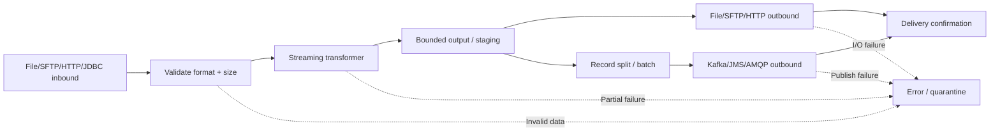
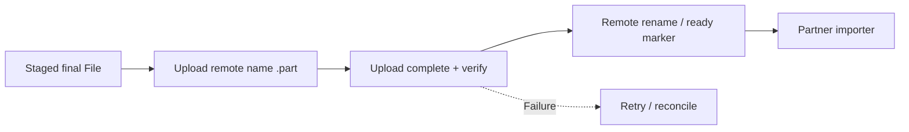
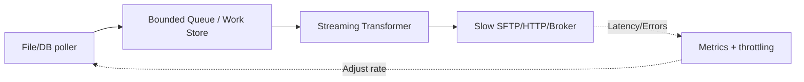

# Chuyển đổi streaming payload

## 1. Bài toán: Dữ liệu lớn không thể luôn nằm trong bộ nhớ

Một ứng dụng Spring Boot nhận mỗi ngày nhiều tệp NDJSON hoặc CSV, mỗi tệp có thể chứa hàng triệu bản ghi. Ứng dụng phải đọc từ thư mục hoặc SFTP, chuẩn hóa trường dữ liệu, gửi tiếp tới HTTP API, ghi một tệp xuất mới hoặc phân phối từng sự kiện qua JMS, AMQP, Kafka. Cùng lúc, database lưu trạng thái tiến độ và kết quả đối soát.

Một cách làm ngây thơ là:

```java
byte[] allBytes = java.nio.file.Files.readAllBytes(inputPath);
String text = new String(allBytes, java.nio.charset.StandardCharsets.UTF_8);
// Phân tích và chuyển đổi toàn bộ 'text' thành một collection lớn.
// Sau đó mới gửi ra hệ thống đích.
```

Mẫu này có thể hoạt động với 10 KB nhưng trở thành vấn đề khi tệp lớn:

- Toàn bộ dữ liệu gốc và bản sao chuyển đổi cùng chiếm heap.
- GC tăng, có thể xảy ra `OutOfMemoryError`.
- Tệp cần được tải/parse hết trước khi có thể tạo output đầu tiên.
- Một record lỗi ở cuối tệp có thể làm mất tiến độ đã xử lý trước đó.
- Nếu downstream chậm hơn upstream, dữ liệu cứ tích tụ nếu không có backpressure.
- Khi retry, `InputStream` đã được đọc có thể không còn dữ liệu để gửi lại.

**Chuyển đổi streaming payload** là xử lý dữ liệu **từng phần, theo thứ tự hoặc theo luồng có kiểm soát**, thay vì bắt buộc materialize toàn bộ payload vào một `String`, `byte[]` hoặc `List` lớn trước khi chuyển đổi.

Bài thuộc chương **Chuyển đổi dữ liệu** của module `SPRING_INTEGRATION_ADAPTERS`. Phạm vi bao gồm kết nối hệ thống bên ngoài bằng **inbound/outbound adapter, gateway, poller và MessageChannel**, qua **File, SFTP, HTTP, JMS, AMQP, Kafka và cơ sở dữ liệu**, cùng hợp đồng message, lỗi và vòng đời kết nối.

> **Nguyên tắc nền tảng:** Streaming là cách **đọc, biến đổi và ghi có giới hạn tài nguyên**. Việc một `Message<?>` chứa `InputStream` hoặc `Flux` không tự chứng minh toàn bộ pipeline đã streaming, cũng không bảo đảm adapter đích hỗ trợ backpressure.

## 2. Ba khái niệm cần phân biệt ngay từ đầu

| Khái niệm | Ý nghĩa | Ví dụ |
| --- | --- | --- |
| **Streaming transformation** | Đọc một phần dữ liệu, chuyển đổi rồi chuyển phần đó ra ngoài | Đọc từng dòng NDJSON, chuẩn hóa từng record |
| **Streaming transport** | Gửi/nhận nội dung qua network từng phần thay vì giữ toàn bộ body | HTTP request body streamed, SFTP upload file |
| **Message streaming** | Một stream logic được biểu diễn bằng chuỗi message độc lập | 100.000 Kafka records, mỗi record một sự kiện |

Ba khái niệm **có thể kết hợp nhưng không đồng nghĩa**:

- Một HTTP client có thể gửi `InputStream` theo chunks, nhưng transformer trước đó đã tạo toàn bộ `byte[]` trong memory.
- Một file được xử lý từng dòng, nhưng code lại gom mọi dòng đã chuyển đổi vào `List<String>` rồi mới ghi, nên không còn tiết kiệm bộ nhớ.
- Kafka gửi từng record có giới hạn kích thước message; đó là **message streaming**, không có nghĩa một Kafka record kích thước 2 GB tự được chia và chuyển liên tục.
- SFTP truyền file bằng các gói qua SSH; ứng dụng vẫn có thể nạp cả file vào `byte[]` trước khi gọi adapter.

### Một tiêu chí kiểm chứng đơn giản

Hãy hỏi ở **từng bước**: dữ liệu có bị **buffer toàn bộ** trước khi bước tiếp theo bắt đầu không? Nếu có, phần đó là một điểm materialization và phải xác định giới hạn kích thước cùng chi phí bộ nhớ.

## 3. Các kiểu payload thường gặp trong Java và Spring Integration

| Kiểu | Đặc điểm | Khi phù hợp | Rủi ro |
| --- | --- | --- | --- |
| `byte[]` | Toàn bộ bytes nằm trong một mảng | Message nhỏ, payload broker đã giới hạn | Heap, copy, mảng mutable |
| `String` | Chuỗi ký tự đã materialize | JSON/text nhỏ | Thêm bản sao khi encode/decode |
| `File` / `Path` | Tham chiếu tới tệp trên filesystem | File lớn, spool ra đĩa | File có thể bị xóa/đổi giữa các bước |
| `Resource` | Trừu tượng tài nguyên của Spring | File, classpath hoặc nguồn được hỗ trợ | Không phải Resource nào mở lại stream được |
| `InputStream` | Đọc dần, thường chỉ một lượt | Nguồn stream từ network/file | Ownership, close, retry, không thread-safe |
| `OutputStream` | Ghi dần | Sink file/network hoặc codec | Flush/close, ghi một phần khi lỗi |
| `Reader` / `Writer` | Xử lý từng ký tự theo charset | CSV/NDJSON/text | Malformed text, buffering |
| `ByteBuffer` | Buffer có position/limit | Byte-level protocols | Không được giả định luôn có backing array |
| `Flux<T>` / `Publisher<T>` | Reactive stream gồm nhiều phần tử | Pipeline reactive khi endpoints hỗ trợ | Backpressure không truyền qua mọi boundary |
| `Message<T>` | Payload + headers của Spring Messaging | Kết nối endpoints trong IntegrationFlow | Metadata không tự giải quyết vòng đời stream |

**Không tự động ép `File` thành `byte[]` chỉ vì downstream cần dữ liệu.** Nếu handler hỗ trợ `File`, có thể tận dụng đường streaming trên filesystem.

### Stream không giống immutable value

`byte[]` là value được giữ trong memory (dù vẫn mutable). `InputStream` là **một tài nguyên có trạng thái**: sau khi đọc 1.024 byte, vị trí đã thay đổi. Hai consumer cùng đọc một stream có thể làm mất dữ liệu của nhau.

## 4. Payload và headers trong MessageChannel

Trong Spring Integration, mỗi message có payload và metadata:

```text
Message<T>
├── payload: File | InputStream | Resource | byte[] | DTO | ...
└── headers:
    ├── id / timestamp
    ├── correlationId / operationId
    ├── contentType / charset / schemaVersion
    ├── fileName / remotePath / destination metadata
    └── errorChannel / replyChannel (nội bộ framework)
```

Ví dụ một message chứa `InputStream`:

```text
payload = InputStream (nguồn đang mở)
headers = {
  sourceRef: "upload-8721",
  contentType: "application/x-ndjson",
  schemaVersion: 1
}
```

**Hợp đồng message phải nói rõ ai sở hữu stream và ai đóng nó**. Một biến `InputStream` trong message có thể bị đóng trước khi consumer async nhận, hoặc bị quên đóng dẫn tới rò session/file descriptor.

### Metadata tối thiểu cần chốt

1. Source type, format, charset và schema/version.
2. Kích thước dự kiến hoặc giới hạn tối đa.
3. Stream **one-shot** hay có thể mở lại từ nguồn?
4. Ai close resource khi thành công, thất bại hoặc hủy?
5. Có checkpoint/resume không? Nếu có, theo byte offset hay record ID?
6. Operation/event ID nào ổn định qua retry?
7. Khi chuyển sang outbound adapter, milestone nào được coi là hoàn thành?

Không gắn raw authentication token, password hoặc PII vào message headers chỉ để tiện debug.

## 5. Kiến trúc tổng thể: Streaming trong luồng adapters



Một kiến trúc thường dễ kiểm soát là:

```text
Inbound File
   → validate file hoàn chỉnh, độ lớn, charset/schema
   → streaming transform (đọc record, ghi record)
   → staging file đã đóng, checksum/metadata
   → outbound File hoặc SFTP adapter
   → xác minh kết quả gửi theo contract
   → cập nhật trạng thái và dọn staging có kiểm soát
```

Sự tồn tại của staging file **không loại bỏ streaming**: chuyển đổi vẫn đọc/ghi từng phần, chỉ dùng đĩa làm ranh giới bền vững thay vì giữ cả payload trong heap.

### Tại sao đôi khi cần staging file?

- Source là one-shot stream nhưng outbound phải retry.
- Cần kiểm tra toàn bộ output hoặc tính hash trước khi công bố.
- Adapter đích nhận `File` thuận tiện hơn nhận `InputStream`.
- Thao tác ghi có thể thất bại, cần tránh publish dữ liệu chưa hoàn chỉnh.
- Flow cần tồn tại qua restart và có bằng chứng input/output.

Staging tạo chi phí disk và cleanup; phải đo cả storage quota, tuổi file, quyền truy cập và retention.

## 6. Chọn chiến lược theo kích thước, định dạng và SLA

| Tình huống | Chiến lược ưu tiên xem xét | Vì sao |
| --- | --- | --- |
| JSON object nhỏ, vài KB | DTO ↔ JSON String/bytes | Đơn giản, test dễ |
| NDJSON nhiều dòng | Parse từng dòng → transform → ghi từng dòng | Không giữ tất cả records |
| CSV lớn có quoted newlines | Streaming CSV parser đúng quy tắc | `readLine().split(",")` làm sai dữ liệu |
| XML lớn | StAX/SAX hoặc streaming parser an toàn | Không cần xây toàn DOM |
| Ảnh/PDF/ZIP | Copy theo buffer/stream, validate loại và size | Không decode nhầm thành text |
| HTTP upload lớn | Body streaming nếu client/server/converter hỗ trợ | Hạn chế memory và thời gian phản hồi |
| SFTP file lớn | File-based hoặc remote streaming adapter | Quản lý session và file completion |
| Kafka/JMS/AMQP | Chia thành message có giới hạn hoặc gửi tham chiếu | Broker vẫn có message-size limits |
| JDBC BLOB lớn | Stream qua JDBC driver/transaction khi hỗ trợ | Tránh materialize BLOB |
| Luồng reactive | Publisher + endpoint thật sự hỗ trợ demand | Có backpressure nếu toàn pipeline phối hợp |

**Giới hạn kích thước không do transformer quyết định một mình.** HTTP server, broker, JDBC driver, filesystem, SSH session và ứng dụng tiêu thụ đều có giới hạn riêng.

## 7. Streaming khác batching và chunking ra sao?

- **Streaming:** xử lý tăng dần một nguồn mà không giữ toàn bộ dữ liệu.
- **Batching:** gom nhiều record để xử lý/gửi cùng một đơn vị logic.
- **Chunking:** chia dữ liệu thành các phần có kích thước/giới hạn cụ thể.
- **Pagination:** lấy dữ liệu theo trang từ API/DB, thường cần cursor/checkpoint.
- **Reactive streams:** giao thức điều phối demand của các phần tử giữa publisher và subscriber.

Ví dụ:

```text
5 GB NDJSON file
  → streaming reader: một record mỗi lần
  → batch 500 records
  → serialize từng batch 500 record
  → publish 1 message/batch
```

Pipeline trên **vẫn có buffering**, nhưng được **giới hạn tối đa 500 record** theo policy. Nếu một record cực lớn, phải có giới hạn **byte size** riêng, không chỉ số lượng record.

### Không tự tạo một batch vô hạn

Một `Aggregator` đợi “đủ mọi record” nhưng nguồn không có điều kiện đóng có thể giữ message mãi. Với batch cần biết `batchId`, điều kiện hoàn tất, timeout, size và cách xử lý batch thiếu/chưa đủ.

## 8. Ví dụ cơ bản: Copy `InputStream` → `OutputStream` với buffer cố định

Một thao tác streaming cơ bản:

```java
import java.io.IOException;
import java.io.InputStream;
import java.io.OutputStream;

public final class StreamCopy {

    private StreamCopy() {}

    public static long copy(InputStream in, OutputStream out)
            throws IOException {
        byte[] buffer = new byte[64 * 1024];
        long total = 0;
        int read;

        while ((read = in.read(buffer)) != -1) {
            if (read == 0) {
                continue;
            }
            out.write(buffer, 0, read);
            total = Math.addExact(total, read);
        }

        out.flush();
        return total;
    }
}
```

Hàm này chỉ copy bytes, **chưa phải chuyển đổi nội dung**, nhưng cho thấy cách pipeline tránh tải mọi dữ liệu vào một mảng lớn.

### Đặc điểm quan trọng

- Buffer có kích thước cố định, không phụ thuộc kích thước nguồn.
- `read(...)` không có nghĩa luôn đọc đầy buffer.
- Giá trị `-1` đánh dấu kết thúc stream.
- `flush()` giúp đẩy buffer phía ứng dụng; **không đồng nghĩa fsync hoặc network ACK**.
- Hàm **không tự đóng** input/output vì caller đang sở hữu tài nguyên.
- Thêm giới hạn `total` nếu dữ liệu đến từ nguồn không đáng tin.
- Nên dùng primitive copy của thư viện phù hợp khi chỉ cần copy; tự viết loop chỉ khi cần đo/chặn/biến đổi cụ thể.

### Không log nội dung stream để debug

Ghi `in.toString()` không giúp xem nội dung đúng, còn việc đọc stream để log có thể **tiêu thụ mất dữ liệu** trước khi adapter gửi.

## 9. Quản lý vòng đời `InputStream`: Mở, đọc, đóng và retry

`InputStream` thường chỉ đọc được **một lượt**:

```text
Created/opened
   → consumed partially
   → consumed fully
   → closed
```

### Những quy tắc cần thống nhất

1. Thành phần **mở stream** phải xác định rõ ai **đóng stream**.
2. Dùng `try-with-resources` khi consumer là chủ sở hữu tài nguyên.
3. Nếu stream nằm trong Spring Message, không tự đóng trong interceptor trước khi downstream đọc.
4. Không gửi cùng một instance InputStream vào nhiều subscriber rồi kỳ vọng mỗi bên đọc đầy đủ.
5. Khi lỗi giữa chừng, xem stream **không còn ở vị trí ban đầu**.
6. Không giả định `mark()/reset()` được hỗ trợ; nhiều stream network không hỗ trợ.
7. Không cố lưu object `InputStream` vào persistent `MessageGroupStore` hoặc queue để replay sau restart.
8. Nếu cần retry toàn bộ, dùng **nguồn mở lại được** như `Path`, staged File hoặc nguồn có API range/resume.

### Vòng đời kết nối remote

Với SFTP/HTTP/database, InputStream có thể gắn với **session, connection, cursor hoặc transaction**. Đóng stream quá muộn có thể giữ connection trong pool; đóng quá sớm làm downstream bị `IOException: Stream closed`.

**Không kéo dài thời gian chờ trên MessageChannel async khi đang giữ một remote InputStream mà không có contract resource ownership.**

## 10. Bài thực hành chính: NDJSON lớn → NDJSON chuẩn hóa

Bài toán:

- Inbound File adapter phát `Message<File>`.
- Tệp chứa **mỗi dòng là một JSON object** có `orderId` và `amountMinor`.
- Transformer chuyển từng dòng sang schema đích `order_id`, `amount_minor`, `schema_version`.
- Kết quả được ghi vào **staging file** trước khi outbound File/SFTP adapter gửi.
- Không giữ toàn bộ file thành `List<Order>` trong memory.

### Dữ liệu đầu vào

```jsonl
{"orderId":"ORD-1001","amountMinor":125000}
{"orderId":"ORD-1002","amountMinor":99000}
{"orderId":"ORD-1003","amountMinor":50000}
```

### Dữ liệu sau chuyển đổi

```jsonl
{"order_id":"ORD-1001","amount_minor":125000,"schema_version":2}
{"order_id":"ORD-1002","amount_minor":99000,"schema_version":2}
{"order_id":"ORD-1003","amount_minor":50000,"schema_version":2}
```

**Điểm mấu chốt:** NDJSON khác một JSON array lớn. Mỗi dòng là một JSON document độc lập; không áp dụng ví dụ `readLine()` cho dữ liệu CSV nhiều dòng trong dấu nháy hoặc JSON có thể chứa newline thô bên ngoài quy tắc NDJSON.

## 11. Java streaming transformer: Đọc và ghi từng record

Ví dụ Java 17+ và Jackson 2. Code minh họa core transformation, dùng `Path`/`File` làm đầu vào–đầu ra và giữ file kết quả có thể mở lại.

```java
import com.fasterxml.jackson.databind.JsonNode;
import com.fasterxml.jackson.databind.ObjectMapper;
import com.fasterxml.jackson.databind.node.ObjectNode;
import java.io.BufferedReader;
import java.io.BufferedWriter;
import java.io.File;
import java.io.IOException;
import java.nio.charset.StandardCharsets;
import java.nio.file.AtomicMoveNotSupportedException;
import java.nio.file.Files;
import java.nio.file.Path;
import java.nio.file.StandardCopyOption;
import java.nio.file.StandardOpenOption;
import java.util.UUID;

public final class NdjsonStreamingTransformer {
    private static final long MAX_FILE_BYTES = 2L * 1024 * 1024 * 1024;
    private static final int MAX_LINE_CHARS = 1_000_000;
    private static final long MAX_RECORDS = 10_000_000;

    private final ObjectMapper mapper;
    private final Path stagingDir;

    public NdjsonStreamingTransformer(ObjectMapper mapper, Path stagingDir) {
        this.mapper = mapper;
        this.stagingDir = stagingDir;
    }

    public File transform(File input) {
        Path temp = null;
        try {
            Path source = input.toPath();

            // File phải đã hoàn tất upload trước khi đi vào đây.
            if (Files.size(source) > MAX_FILE_BYTES) {
                throw new IllegalArgumentException("Input file too large");
            }

            Files.createDirectories(stagingDir);
            temp = Files.createTempFile(stagingDir, "orders-", ".part");

            try (BufferedReader reader =
                         Files.newBufferedReader(source, StandardCharsets.UTF_8);
                 BufferedWriter writer = Files.newBufferedWriter(
                         temp, StandardCharsets.UTF_8,
                         StandardOpenOption.WRITE,
                         StandardOpenOption.TRUNCATE_EXISTING)) {

                long count = 0;
                String line;
                while ((line = reader.readLine()) != null) {
                    count++;
                    if (count > MAX_RECORDS || line.length() > MAX_LINE_CHARS) {
                        throw new IllegalArgumentException("Input limit exceeded");
                    }
                    if (line.isBlank()) {
                        throw new IllegalArgumentException("Empty NDJSON record");
                    }

                    JsonNode row = mapper.readTree(line);
                    if (row == null || !row.isObject()) {
                        throw new IllegalArgumentException("Expected JSON object");
                    }

                    JsonNode idNode = row.path("orderId");
                    JsonNode amountNode = row.path("amountMinor");
                    if (!idNode.isTextual() || idNode.asText().isBlank()
                            || !amountNode.isIntegralNumber()
                            || !amountNode.canConvertToLong()
                            || amountNode.longValue() < 0) {
                        throw new IllegalArgumentException("Invalid order record");
                    }

                    ObjectNode converted = mapper.createObjectNode();
                    converted.put("order_id", idNode.asText());
                    converted.put("amount_minor", amountNode.longValue());
                    converted.put("schema_version", 2);

                    writer.write(mapper.writeValueAsString(converted));
                    writer.newLine();
                }
            }

            // Staging và final cùng directory để có thể atomic move.
            Path ready = stagingDir.resolve(
                "orders-" + UUID.randomUUID() + ".ndjson");
            try {
                Files.move(temp, ready, StandardCopyOption.ATOMIC_MOVE);
            } catch (AtomicMoveNotSupportedException ex) {
                // Ứng dụng cần quyết định rõ fallback/completion protocol.
                throw new IOException("Atomic move unavailable", ex);
            }
            return ready.toFile();

        } catch (IOException | RuntimeException ex) {
            // Không để file .part hỏng bị adapter phía sau đọc.
            if (temp != null) {
                try {
                    Files.deleteIfExists(temp);
                } catch (IOException cleanupFailure) {
                    ex.addSuppressed(cleanupFailure);
                }
            }
            throw new IllegalStateException("NDJSON transformation failed", ex);
        }
    }
}
```

### Cái gì thực sự streaming trong ví dụ?

- `BufferedReader` đọc **từng dòng**, không đọc toàn bộ file.
- Jackson chỉ parse **một JSON object mỗi lần**.
- `BufferedWriter` ghi ngay record đã chuyển đổi.
- File `.part` chỉ được đổi thành `.ndjson` sau khi transform hoàn tất.
- Downstream nhận một `File` đã đóng và có thể mở lại để retry.

### Giới hạn của ví dụ

Đây là **mẫu giáo dục**, chưa phải full production component:

- `readLine()` có thể cấp phát cả dòng **trước khi** check `MAX_LINE_CHARS`. Với input không tin cậy cần **bounded line reader/parser** thực sự giới hạn trong quá trình đọc.
- Check `Files.size(...)` không bảo vệ nếu file **vẫn đang bị ghi**. Cần ready marker/temp rename, khóa phù hợp hoặc input completion protocol.
- Charset decoder mức `Reader` có thể thay byte UTF-8 không hợp lệ theo cấu hình; với contract strict phải dùng decoder báo lỗi và reject malformed bytes.
- `UUID.randomUUID()` tạo tên staging mới khi retry; cần **operation ID ổn định và dedup** nếu gửi ra đích có thể lặp.
- `Files.move(..., ATOMIC_MOVE)` có thể không được filesystem hỗ trợ; ví dụ chọn fail rõ. Production phải có fallback an toàn hoặc completion marker được hai bên đồng ý.
- Checksum và `fsync` khi cần bảo đảm durability mạnh hơn chưa được triển khai.
- Staging file sau khi outbound hoàn tất cần **cleanup có kiểm soát**, không xóa ngay khi method trả `File`.
- Không ghi raw JSON chứa PII vào log khi một record bị lỗi.

## 12. Nối transformer vào Spring Integration Java DSL

Ví dụ conceptual Java DSL cho **File inbound → streaming File transformer → File outbound**:

```java
import java.io.File;
import java.nio.file.Path;
import java.time.Duration;
import org.springframework.context.annotation.Bean;
import org.springframework.integration.dsl.IntegrationFlow;
import org.springframework.integration.dsl.Pollers;
import org.springframework.integration.file.dsl.Files;

@Bean
IntegrationFlow largeNdjsonFileFlow(
        NdjsonStreamingTransformer transformer) {

    return IntegrationFlow.from(
            Files.inboundAdapter(new File("./data/inbox"))
                .autoCreateDirectory(true),
            endpoint -> endpoint.poller(
                Pollers.fixedDelay(Duration.ofSeconds(5))
                    .maxMessagesPerPoll(1)))
        .transform(File.class, transformer::transform)
        .handle(Files.outboundAdapter(new File("./data/outbox"))
            .autoCreateDirectory(true))
        .get();
}
```

**Dòng chảy:**

1. Inbound adapter/poller nhận một `File` trong thư mục nguồn.
2. Transformer chỉ dùng **buffer và một record tại một thời điểm**.
3. Transformer trả một `File` mới đã staging hoàn chỉnh.
4. File outbound adapter xử lý File theo chính sách của handler.
5. Hệ thống theo dõi trạng thái gửi và dọn staging sau khi thực sự hoàn thành.

### Điều ví dụ chưa tự đảm bảo

- `Files.inboundAdapter` có cơ chế lọc/accept-once; việc **phát File message** không đồng nghĩa mọi bước sau đã thành công. Cần thiết kế retry/đánh dấu hoàn thành sau lỗi, tránh file lỗi bị bỏ qua hoặc đọc lại trùng.
- File outbound handler có quy tắc đối với file đã tồn tại; phải cấu hình theo đích.
- Chỉ dùng `File` không tự mang `contentType`, schema version hoặc checksum.
- Kết quả file write của adapter không đồng nghĩa hệ thống bên ngoài đã import file.
- Phiên bản Spring Integration có thể khác về DSL/API. Cần đối chiếu dependency và compile trong dự án trước khi đưa vào production.

## 13. Vì sao không đưa trực tiếp `InputStream` qua mọi MessageChannel?

Một stream gắn với kết nối remote có thể được mở trong thread của poller:

```text
poller thread:
  open remote InputStream
  send Message<InputStream> to QueueChannel
  close connection/session
                     |
                     v
worker thread:
  receive Message<InputStream>  // stream có thể đã đóng!
```

Một cách dùng khác còn nguy hiểm: gửi **cùng instance** InputStream tới hai subscriber để kiểm tra checksum và upload; hai consumer cùng đọc làm thay đổi offset.

### Cách lựa chọn theo topology

| Topology | Lựa chọn thận trọng |
| --- | --- |
| Đồng bộ trực tiếp, cùng scope resource | Consumer đọc và đóng stream theo contract |
| QueueChannel/executor bất đồng bộ | Spool thành File/Resource reopenable hoặc đưa source reference |
| Nhiều nhánh fan-out | Mỗi nhánh mở stream **riêng** từ File/object store, không share instance |
| Group/aggregator dài | Lưu metadata và tham chiếu, không lưu một InputStream đang mở |
| Retry sau lỗi network | Mở lại từ nguồn ổn định hoặc staging file |
| Quy trình qua nhiều JVM | Gửi ID/URL đã bảo vệ và data contract, không cố serialize stream object |

Nếu dùng resource reference, quản lý authorization và thời hạn tồn tại để consumer không nhận một reference đã hết hạn.

## 14. Streaming inbound từ SFTP: Session và closeable resource

SFTP có cả cách **download file về local** và các kiểu **streaming inbound** theo khả năng module/phiên bản Spring Integration. Một adapter streaming có thể phát payload `InputStream`, kèm metadata hoặc **closeable resource** liên quan tới remote session.

**Điểm quan trọng:** một remote InputStream không chỉ là bytes; nó có thể đang giữ **SSH/SFTP session**. Phải tuân thủ contract đóng stream/resource từ adapter tương ứng (ví dụ header resource cần close trong các triển khai hỗ trợ).

### Luồng minh họa

```text
SFTP streaming inbound source
  -> Message<InputStream>
  -> synchronous streaming consumer
  -> write to controlled staging file
  -> close stream + remote resource/session
  -> Message<File>
  -> normalize / validate / outbound
```

Các câu hỏi cần trả lời:

- Ai close stream nếu parse lỗi giữa tệp?
- Khi timeout, remote session có được trả về cache/pool không?
- Nếu file chưa được đối tác upload xong, inbound có đọc nửa dữ liệu không?
- Filename/path/timestamp có đủ tin cậy để làm checkpoint?
- Streaming file từ đối tác có thay đổi giữa lúc đọc không?
- Nếu cần retry, có đọc lại cùng remote bytes được không?
- Có chặn path traversal và giới hạn remote directory theo policy không?

**Không tự khẳng định mọi SFTP adapter đều phát `InputStream`;** phải xem cấu hình adapter thực tế. Nhiều file inbound adapter thường trả `File` và cần một bước mở stream để biến đổi.

## 15. Streaming outbound tới File/SFTP: Ghi một phần và công bố hoàn tất

Khi gửi file lớn, consumer không được đọc file trước khi uploader hoàn tất nếu hợp đồng yêu cầu file nguyên vẹn.

### Mẫu hai giai đoạn



**Lưu ý:** việc rename có atomic hay không phụ thuộc filesystem/server/adapter và thao tác áp dụng. Không thể dùng một tên tạm bất kỳ rồi mặc định mọi hệ thống nhận sẽ không thấy partial file.

### Những thông tin phải thống nhất

- Thư mục local/remote và tên file an toàn.
- Quy ước temporary suffix và completion marker.
- Checksum/size nếu consumer cần xác minh integrity.
- Hành vi nếu file đích đã tồn tại: fail, replace, append hay versioned name.
- Chính sách khi upload dở và reconnect.
- Quota disk, cleanup file tạm mồ côi.
- Credential, SSH host key validation, quyền tài khoản SFTP.
- Khoảng thời gian retry và dấu mốc **đã publish** so với **đã được import**.

**Chuyển đổi streaming thành công chỉ bảo đảm nội dung staging được tạo theo quy trình của transformer; không bảo đảm remote upload hoặc business import thành công.**

## 16. HTTP request/response streaming: Không nhầm với gateway trả nhanh

HTTP có thể hỗ trợ body streaming/chunked transfer tùy client và server. Nhưng khi dùng Spring Integration HTTP inbound/outbound gateway, cách serialize/convert payload có thể **buffer toàn bộ** tùy adapter, converter, loại payload và stack HTTP.

### Ba lựa chọn

| Cách | Phù hợp | Điều cần kiểm chứng |
| --- | --- | --- |
| DTO/String qua JSON converter | Body nhỏ, schema rõ | Converter có materialize toàn bộ không? |
| `Resource`/File-backed body | Upload/download lớn | HTTP client gửi stream thật hay đọc hết trước? |
| Reactive publisher | Stack hỗ trợ nonblocking streaming | Demand/cancellation/backpressure truyền đến đâu? |

### `InputStreamResource` và request body một lượt

Một resource bọc **InputStream đã mở** thường **không repeatable**: retry, redirect hoặc authentication challenge có thể khiến client cần gửi lại body nhưng stream đã consumed.

Nếu API yêu cầu retry an toàn:

1. Lưu dữ liệu ở một File/Resource **mở lại được** hoặc nguồn có replay contract.
2. Thiết kế idempotency key ổn định.
3. Biết kích thước, Content-Type và giới hạn server.
4. Kiểm tra HTTP client/converter có thực sự stream và xử lý chunked transfer không.
5. Phân biệt `200/201`, `202 Accepted`, timeout và trạng thái “không biết server đã xử lý chưa”.

### Chú ý response streaming

Một HTTP response lớn có thể được trả như stream hoặc Resource tùy client. Đừng giả định `HTTP outbound gateway` mặc định cung cấp một InputStream còn mở để đọc sau khi request scope đã kết thúc. Cần kiểm tra **quyền sở hữu kết nối, converter và lifetime** khi thiết kế adapter.

## 17. Kafka: Một record vẫn là một đơn vị message có giới hạn

Kafka rất phù hợp truyền **nhiều sự kiện liên tục**, nhưng một Kafka record vẫn là một **đơn vị key/value bytes** với giới hạn kích thước ở producer, broker và consumer.

```text
Large NDJSON File
  -> Streaming parser
  -> validate từng record
  -> OrderEvent DTO
  -> JSON/Avro/Protobuf serializer
  -> Kafka outbound adapter
  -> many small records
```

### Phân biệt hai chiến lược

**Record streaming:** mỗi bản ghi nguồn tạo một Kafka message. Đây thường là lựa chọn tốt khi dữ liệu có các sự kiện độc lập.

**Fragment/chunk streaming:** một tài liệu binary được chia thành nhiều Kafka records có framing. Consumer phải reassemble; nên cân nhắc object storage + reference khi tài liệu lớn.

### Metadata và ordering

- Kafka key thường dựa trên business ID để partition theo contract.
- Một consumer có thể gặp duplicate do at-least-once/redelivery; dùng `eventId` ổn định.
- Ordering chỉ có ý nghĩa trong phạm vi partition và cách xử lý.
- Producer ACK không chứng minh consumer đã hoàn tất nghiệp vụ.
- Bản ghi nguồn cần checkpoint/offset phù hợp để không gửi trùng sau crash.

### Không cố sửa memory bằng cách tăng message max-size vô hạn

Cho phép Kafka record rất lớn có thể chuyển vấn đề từ heap ứng dụng sang broker, replication, network và consumer. Streaming đúng thường là **chia thành các record độc lập hoặc quản lý external object reference**, không chỉ nới mọi giới hạn.

## 18. JMS và AMQP: Broker message không phải raw byte stream vô hạn

JMS có `TextMessage`, `BytesMessage` và các loại khác; AMQP message có body bytes và properties. Dù một số API cung cấp cách **ghi/đọc nội dung từng đoạn**, broker vẫn thường quản lý một **message logic với kích thước, xác nhận và redelivery riêng**.

### Mô hình phù hợp

```text
Input file/batch
  -> streaming records
  -> bounded transform
  -> message converter
  -> JMS/AMQP outbound
  -> broker messages
```

### Những điều cần chốt

1. Consumer yêu cầu TextMessage, BytesMessage hay JSON body?
2. Converter nào chịu trách nhiệm encode? Tránh double serialization.
3. Message size và batch/chunk limit của broker là bao nhiêu?
4. Destination/exchange/routing key, headers và Content-Type ra sao?
5. Acknowledgment/transaction/redelivery có bảo đảm gì?
6. Cần DLQ/dead-letter, retry và idempotent consumer không?
7. Một chunk bị mất có làm cả tài liệu không thể reassemble không?
8. Trong queue/broker, message ordering và concurrency ảnh hưởng thế nào?

**Không truyền trực tiếp một object `InputStream` qua JMS/AMQP rồi kỳ vọng broker giữ resource Java đó.** Chuyển thành một representation serializable có schema và giới hạn.

## 19. Nếu phải chia một payload binary thành nhiều message

Khi không thể gửi một object lớn, đôi khi cần **application-level chunking**.

### Hợp đồng chunk ví dụ

```json
{
  "streamId": "upload-8721",
  "chunkId": "upload-8721-0004",
  "index": 4,
  "totalChunks": 12,
  "contentType": "application/octet-stream",
  "payloadEncoding": "base64",
  "payload": "AAECAwQ=",
  "schemaVersion": 1
}
```

Đây chỉ là ví dụ **JSON envelope**, trong đó bytes chunk được Base64 hóa. Với broker có binary value, có thể giữ raw bytes trong value và dùng headers chứa index/streamId, không nhất thiết Base64.

### Tại sao reassembly phức tạp?

- Các chunk có thể đến **khác thứ tự**.
- Một chunk bị gửi **hai lần**.
- Một chunk **không bao giờ đến**.
- Consumer crash khi đang giữ 11/12 chunk.
- `totalChunks` do nguồn khai có thể quá lớn hoặc sai.
- Một stream ID cũ bị dùng lại làm trộn hai upload.
- Checksum từng chunk đúng nhưng **toàn tài liệu** vẫn sai.
- Chunk sau timeout đến muộn và vô tình tạo một group mới.

### Các quy tắc cần có

- `streamId` ổn định, duy nhất trong namespace/operation.
- Giới hạn index/totalChunks, tổng bytes và thời hạn reassembly.
- Dedup bằng `(streamId, index)` và hash/version phù hợp.
- Chỉ assemble nếu đủ chunk và checksum toàn dữ liệu đạt.
- Dùng store bền vững và cleanup theo TTL/retention.
- Rà quyền truy cập, content type và resource limits trước khi reconstruct.
- Reassembly không tự tạo **exactly-once business processing**.

Một **Aggregator** có thể được dùng để gom chunks, nhưng phải có `CorrelationStrategy`, `ReleaseStrategy`, MessageGroupStore, timeout và dedup đúng; mặc định đếm số message có thể sai khi duplicate.

## 20. JDBC/database: Streaming BLOB và cursor

Database có các trường hợp riêng:

- **Inbound polling:** đọc các row đã hoàn tất theo cursor/keyset/checkpoint.
- **BLOB/CLOB:** đọc/ghi dữ liệu lớn qua stream với JDBC driver hỗ trợ.
- **Outbox:** ghi event nhỏ/metadata và tham chiếu tới tệp lớn, publish sau commit.
- **Batch INSERT:** gửi nhiều row nhỏ với batch size được kiểm soát.

### JDBC streaming BLOB (ví dụ API JDBC)

```java
import java.io.InputStream;
import java.sql.Connection;
import java.sql.PreparedStatement;
import java.sql.ResultSet;

void consumeBlob(Connection connection, String id) throws Exception {
    String sql =
        "SELECT payload_bytes FROM attachments WHERE attachment_id = ?";

    try (PreparedStatement ps = connection.prepareStatement(sql)) {
        ps.setString(1, id);
        try (ResultSet rs = ps.executeQuery()) {
            if (!rs.next()) {
                return;
            }
            try (InputStream in = rs.getBinaryStream(1)) {
                // Sử dụng stream hoàn toàn trước khi ResultSet đóng.
                processWithinTransactionScope(in);
            }
        }
    }
}
```

`processWithinTransactionScope` là hàm ứng dụng minh họa. Không nên trả `InputStream` này ra một `QueueChannel` để worker dùng sau khi `ResultSet`/`Connection` đã đóng.

### Lưu ý với JDBC drivers

- Không phải driver nào cũng thực hiện network streaming giống nhau; một số có thể buffer dữ liệu.
- Cursor/fetch size và transaction scope phụ thuộc database, driver và query.
- Kéo dài transaction khi transfer ra SFTP/HTTP có thể giữ lock/connection quá lâu.
- Nếu cần gửi dữ liệu sau khi transaction kết thúc, có thể spool sang file/object storage được bảo vệ rồi phát reference.
- Chốt chiến lược commit/checkpoint; đọc DB thành công **không có nghĩa** đã gửi dữ liệu đến broker hoặc đối tác.

## 21. Backpressure: Khi đích chậm hơn nguồn

Giả sử poller đọc 500 file/giây nhưng outbound SFTP chỉ upload được 10 file/giây. Nếu không có giới hạn, backlog sẽ tích tụ.



### Những cơ chế thường dùng

| Cơ chế | Tác dụng | Lưu ý |
| --- | --- | --- |
| `maxMessagesPerPoll` | Giới hạn lượng message nhận mỗi lần polling | Không thay thế giới hạn toàn bộ hệ thống |
| Fixed delay / trigger | Điều chỉnh nhịp nguồn | Chọn theo throughput và SLA |
| `QueueChannel` có capacity | Giới hạn chỗ đệm | In-memory queue không bền qua restart |
| Executor pool có giới hạn | Hạn concurrency | Không tạo thread vô hạn |
| Retry backoff | Giảm áp lực khi đích tạm lỗi | Có budget, jitter và timeout |
| Work store/queue bền vững | Giữ tiến độ khi process restart | Cần checkpoint, dedup, cleanup |
| Streaming/chunking | Giảm kích thước payload đang giữ | Không tự tạo backpressure cho broker |
| Reactive demand | Điều tiết theo subscriber | Chỉ có nếu toàn boundary tôn trọng demand |

### Streaming không ngăn queue phình nếu producer chạy vô hạn

Một `Message<File>` rất nhẹ nhưng **hàng triệu file reference** trong QueueChannel vẫn tiêu tốn memory và mở rộng backlog trên disk. Tính tổng tài nguyên: heap + temporary files + network connections + message store + thời gian chờ.

## 22. Reactive stream và Spring Integration: Đừng đồng nhất `Flux` với `InputStream`

`InputStream` là API đọc blocking. `Flux<T>`/`Publisher<T>` trong Reactive Streams cung cấp mô hình demand, error và cancellation khác.

### So sánh

| Khía cạnh | InputStream | Reactive Publisher |
| --- | --- | --- |
| Cách lấy dữ liệu | Gọi `read()`, thường blocking | `request(n)` thể hiện demand |
| Backpressure | Caller tự quyết định tốc độ đọc | Tích hợp trong protocol reactive nếu hỗ trợ |
| Cancellation | Đóng stream / cancel I/O theo thiết kế | Hủy subscription |
| Error | Throw exception từ read | `onError` |
| Completion | EOF `-1` | `onComplete` |
| Retry | Mở lại stream hoặc spool | Re-subscribe **chỉ nếu publisher repeatable** |
| Resource lifetime | Close stream | `usingWhen`/resource cleanup theo framework |

Có thể dùng reactive endpoints nếu stack Spring Integration và adapter đích hỗ trợ. Tuy nhiên:

- Bọc một blocking `InputStream` vào `Flux` không làm nó thành nonblocking I/O.
- Nếu handler cuối gọi `collectList()`, đã materialize toàn bộ.
- Một boundary giữa Reactor và adapter blocking có thể làm đứt backpressure.
- Các operator `buffer`, `window`, `flatMap` có tham số concurrency/prefetch cần giới hạn.
- Cancellation phải giải phóng file/network resources, không để session bị giữ.

**Đừng dùng reactive chỉ vì từ “streaming” xuất hiện trong yêu cầu.** Với file lớn và outbound SFTP truyền thống, `File` + streaming I/O có thể rõ ràng và tin cậy hơn.

## 23. Retry và one-shot stream: Thất bại giữa chừng xử lý sao?

Giả sử HTTP outbound gửi 60% body thì kết nối bị reset. Nếu payload là `InputStream` đã đọc 60%, gọi lại handler với **cùng stream** có thể chỉ gửi 40% còn lại.

### Ba mô hình retry

1. **Retry từ nguồn có thể mở lại:** mở `Files.newInputStream(path)` lần nữa cho mỗi attempt.
2. **Spool trước khi gửi:** chuyển thành staging file ổn định, retry từ file đó.
3. **Resume theo chunk/range:** chỉ khi giao thức đích có hợp đồng offset/part upload và xác minh integrity.

### Những câu hỏi không thể bỏ qua

- Retry có an toàn về mặt nghiệp vụ? HTTP POST có thể đã được server xử lý.
- Destination có hỗ trợ idempotency key hoặc overwrite có kiểm soát không?
- File remote đã ghi một phần có bị consumer đọc không?
- Có cần xóa bản upload dở trước retry không?
- Source có thay đổi giữa hai attempts không?
- Hash/checksum của bytes gốc có giữ nguyên không?
- Nếu retry policy hết budget, có nơi quarantine để điều tra không?

**`RetryTemplate` hoặc retry advice không tự làm một InputStream trở thành repeatable.** Trước khi bật retry, hãy chứng minh dữ liệu có thể mở lại và side effect không bị nhân đôi.

## 24. Checkpoint và resume: Không chỉ nhớ byte offset

Với file NDJSON, có thể lưu progress theo số dòng đã xử lý hoặc event ID; với HTTP/SFTP download có thể có byte range/resume nếu hệ thống hỗ trợ.

### Ví dụ checkpoint metadata

```json
{
  "operationId": "import-8721",
  "sourceRef": "file-opaque-103",
  "sourceVersion": "sha256:...",
  "lastCompletedRecord": 450000,
  "nextRecord": 450001,
  "schemaVersion": 2,
  "processorVersion": "transform-v4",
  "status": "RUNNING"
}
```

`sourceVersion` minh họa fingerprint có kiểm soát; một SHA-256 trên file rất lớn cũng cần đọc file và không thay thế authorization.

### Tại sao byte offset có thể không đủ?

- UTF-8 có ký tự chiếm nhiều bytes; cắt offset giữa ký tự có thể làm hỏng decode.
- CSV record có newline trong dấu nháy; line count không bằng record count.
- HTTP API có thể không hỗ trợ Range hoặc nội dung thay đổi giữa requests.
- File SFTP có thể được đối tác ghi bổ sung sau checkpoint.
- Parser có state giữa các chunks (JSON/XML stream), không thể resume tùy ý.
- Output có thể đã ghi xong một phần nhưng checkpoint chưa commit.

### Nguyên tắc resume an toàn

- Dữ liệu nguồn phải **ổn định/phiên bản hóa**.
- Checkpoint gắn với mốc record/frame có thể khôi phục.
- Side effect downstream dùng ID/unique key để chịu retry.
- Đánh dấu checkpoint **sau khi hoàn tất mức xác nhận được yêu cầu**.
- Nếu không thể resume đúng, chạy lại từ đầu với idempotent downstream có thể an toàn hơn.

## 25. Tính toàn vẹn và công bố output

Một stream được xử lý xong ở tầng Java vẫn có thể chưa **bền vững** hoặc chưa được đích xác nhận.

### Các mức hoàn tất khác nhau

| Mức | Ý nghĩa |
| --- | --- |
| `READ_EOF` | Đã đọc hết source stream |
| `TRANSFORMED` | Đã tạo đủ output theo transformer |
| `STAGED_READY` | Output đã đóng và được đánh dấu hoàn chỉnh |
| `SENT_TO_ADAPTER` | Message đã đi vào outbound handler/channel |
| `TRANSPORT_CONFIRMED` | Gửi/ghi được xác nhận theo giao thức |
| `BUSINESS_CONSUMED` | Đối tác/consumer đã xử lý nghiệp vụ |

Không được nhảy từ `READ_EOF` tới `BUSINESS_CONSUMED` mà thiếu bằng chứng.

### Hash/checksum

Có thể tính SHA-256 **khi ghi** để không cần tải toàn bộ output lần nữa:

```java
import java.io.OutputStream;
import java.security.DigestOutputStream;
import java.security.MessageDigest;

MessageDigest sha256 = MessageDigest.getInstance("SHA-256");
try (OutputStream fileOut = java.nio.file.Files.newOutputStream(target);
     DigestOutputStream hashing = new DigestOutputStream(fileOut, sha256)) {
    // Ghi dữ liệu output theo từng phần qua 'hashing'.
    writeTransformedContent(hashing);
}
byte[] digest = sha256.digest();
```

Hash giúp đối chiếu integrity khi so sánh với giá trị tin cậy, nhưng **không tự chứng minh nguồn gửi đáng tin**. Khi cần authenticity, dùng MAC/chữ ký theo cơ chế quản lý khóa phù hợp.

### Atomic rename và durability

Rename cùng filesystem có thể hỗ trợ atomic visibility, nhưng:

- Cần xem adapter, filesystem và remote server có hỗ trợ không.
- `flush` không bằng `fsync` hoặc commit bền vững khi mất điện.
- Khi ghi sang object storage, semantics của publish/rename có thể khác.
- Nếu đích xử lý async, “file đã xuất hiện” chưa phải “file đã import”.

## 26. Lỗi conversion, lỗi I/O và `errorChannel`

Một pipeline streaming có nhiều loại lỗi:

| Lớp | Ví dụ | Hành động phù hợp |
| --- | --- | --- |
| **Input validation** | File quá lớn, chưa hoàn tất upload | Từ chối hoặc chờ completion |
| **Decode** | UTF-8 malformed, gzip hỏng | Quarantine hoặc sửa nguồn, không retry mù |
| **Schema mapping** | NDJSON thiếu trường, số tiền sai kiểu | Dừng/skip theo chính sách, ghi record reference |
| **Resource** | Disk full, quá quota, OOM risk | Backpressure, alert, cleanup |
| **Network/transport** | SFTP timeout, HTTP reset, broker unavailable | Retry có giới hạn khi repeatable |
| **Authorization** | HTTP 403, SFTP permission denied | Kiểm tra credential/quyền, không retry vô hạn |
| **Database** | SQL deadlock/connection unavailable | Retry transaction an toàn hoặc quarantine |
| **Business** | Duplicate, stale event, invalid transition | Idempotency/reconcile, không coi là decode error |

### Khi một record lỗi ở giữa file

Có ba chính sách:

1. **Fail-fast toàn file:** không công bố output nếu bất kỳ record nào sai; giữ source/quarantine để sửa.
2. **Skip + reject record:** gửi record lỗi vào quarantine, tiếp tục; cần thống nhất với consumer vì output không còn đầy đủ.
3. **Partial output:** công bố phần thành công kèm manifest/trạng thái PARTIAL nếu nghiệp vụ cho phép.

Không tự skip record lỗi để “giữ pipeline chạy” nếu yêu cầu là **đủ 100% đơn hàng**.

### `errorChannel` và topology

Với `DirectChannel` đồng bộ, exception thường truyền ngược caller. Với endpoint polling hoặc async, một số lỗi có thể trở thành `ErrorMessage` trên error channel theo cấu hình. Không chỉ tạo bean lắng nghe `errorChannel` rồi kết luận mọi lỗi file/SFTP/HTTP đều được bắt ở đó.

**Nhớ dọn file tạm trong mọi nhánh lỗi** và giữ source/reference để có thể phục hồi theo policy.

## 27. Dead-letter, quarantine và tái xử lý stream

Khi stream lớn bị lỗi, không nhất thiết đẩy **toàn bộ bytes** vào DLQ message broker.

### Envelope gọn có thể dùng

```json
{
  "failureId": "failure-73a2",
  "operationId": "import-8721",
  "sourceRef": "restricted-file-103",
  "sourceVersion": "etag-or-checksum",
  "recordIndex": 450001,
  "stage": "ndjson-transform",
  "errorCode": "INVALID_AMOUNT_MINOR",
  "retryable": false,
  "schemaVersion": 2,
  "status": "QUARANTINED"
}
```

`sourceRef` là tham chiếu logic đến dữ liệu được **bảo vệ**, không phải signed URL public chứa token trong log.

### Nguyên tắc vận hành

- Lưu bytes hoặc file gốc ở kho có quyền hạn tương ứng.
- Giữ metadata nguồn, processor version và vị trí lỗi.
- Không ghi toàn bộ raw payload chứa PII vào `ErrorMessage` log.
- Khi replay, kiểm tra source còn đúng phiên bản và business state hiện tại.
- Dùng checkpoint/idempotency để không nhân đôi các record đã publish.
- Giới hạn số lần phát lại và có owner xử lý message/file lỗi.
- Nếu DLQ/quarantine sink lỗi, **không claim đã lưu bền vững**.

## 28. Observability cho streaming: Đo byte và tiến độ, không dump payload

Một flow streaming có thể không log body mà vẫn chẩn đoán được:

| Metric | Ý nghĩa |
| --- | --- |
| `stream.bytes.read` | Tổng bytes đã đọc từ source |
| `stream.bytes.written` | Tổng bytes output |
| `stream.records.converted` | Số record đã chuyển thành công |
| `stream.records.rejected` | Số record sai schema |
| `stream.transform.duration` | Thời gian chuyển đổi |
| `stream.throughput.bytes_per_sec` | Throughput hữu ích |
| `stream.active.resources` | Stream, file handle, session đang mở |
| `stream.staging.bytes` | Dung lượng file tạm |
| `stream.staging.age` | File tạm tồn đọng |
| `stream.backlog.count` | Queue/poller backlog |
| `stream.retry.count` | Số lần thử gửi lại |
| `stream.timeout.count` | Deadline vượt hạn |
| `stream.checkpoint.lag` | Tiến độ đã xác nhận so với nguồn |
| `stream.delivery.confirmed` | Output được transport xác nhận |
| `stream.quarantine.count` | Input/record chưa xử lý được |

### Log an toàn mẫu

```text
event=stream.transform.completed
flow=orders-ndjson-export
sourceRef=file_103 operationId=import-8721
recordsRead=120000 recordsConverted=120000
outputBytes=9743201 durationMs=8533
stage=STAGED_READY
```

Không biến `sourceRef` thành đường dẫn SFTP chứa tên khách hàng, không dùng email/customerId hoặc filename tùy ý làm metric tag. Tags nên có tập giá trị hữu hạn như flow/adapter/status.

### Tracing và stream dài

Một span kéo dài nhiều phút không nhất thiết tốt hơn nhiều event/checkpoint đã được liên kết. Với asynchronous fan-out hoặc polling, dùng opaque operation ID và trace links/correlation phù hợp, không đưa payload hoặc credential vào baggage.

## 29. Bảo mật dữ liệu streaming

Đầu vào có thể đến từ file bên ngoài, HTTP upload hoặc broker. Vì streaming xử lý dữ liệu liên tục, lỗi bảo mật cũng có thể xuất hiện **sau khi đã xử lý một phần**.

### Những rủi ro đặc trưng

- **Oversized input:** file hoặc message quá lớn.
- **Decompression bomb:** dữ liệu nén nhỏ giải ra rất lớn.
- **Malformed encoding:** UTF-8 hỏng hoặc text có escape bất thường.
- **Resource exhaustion:** file descriptor/SSH session/DB cursor bị giữ.
- **Path traversal:** tên file/remote path lấy từ dữ liệu không tin cậy.
- **Content spoofing:** extension/contentType khai một kiểu nhưng bytes khác.
- **Serialization risk:** giải mã Java native objects từ nguồn không tin cậy.
- **PII exposure:** log raw record khi lỗi ở giữa stream.
- **SSRF:** cho message tự quyết định URL upload/download.
- **Partial overwrite:** viết đè dữ liệu quan trọng khi streaming thất bại.

### Các kiểm soát nên triển khai

1. Giới hạn bytes đầu vào **trong lúc đọc**, không chỉ kiểm tra size metadata.
2. Giới hạn bytes sau giải nén và số record/depth.
3. Whitelist remote path, file extension và destination theo policy.
4. Dùng charset và parser an toàn cho JSON/XML/CSV; với XML cần chống external entity theo thư viện.
5. Xác thực/ủy quyền trước khi xử lý data từ nguồn ngoài.
6. Tách tài khoản connector, dùng TLS/SSH và xác thực host/certificate.
7. Không giữ token/secret hoặc raw PII trong logs, traces, metrics và DLQ metadata.
8. Cleanup stream/temp file khi cancellation, timeout, exception.
9. Kiểm chứng checksum/signature khi hợp đồng yêu cầu.
10. Test với input giả độc hại, không dùng production secrets làm fixture.

## 30. Thiết kế streaming cho CSV, XML và JSON: Những bẫy định dạng

### CSV

CSV là dạng record-based nhưng **một record có thể chiếm nhiều dòng vật lý** nếu field quoted chứa newline. Vì vậy:

```java
// Sai với CSV tổng quát:
String[] fields = line.split(",");
```

Cần một **streaming CSV parser** hỗ trợ delimiter, escaping, quoted newlines, header, charset và giới hạn độ dài. Nếu consumer mở CSV trong spreadsheet, còn phải xem xét **CSV formula injection** theo chính sách, không chỉ escaping cú pháp.

### JSON

- JSON object/array duy nhất có thể được parse streaming bằng token-based parser, không cần tạo toàn bộ tree.
- NDJSON cho phép xử lý một JSON document mỗi dòng; ví dụ ở trên giả định **mỗi record một dòng**.
- Nếu input là `[ {...}, {...} ]` lớn, gọi `mapper.readValue(..., List.class)` vẫn materialize toàn bộ. Dùng Jackson streaming parser/iterator theo cấu trúc contract.
- Không tự gắn `schemaVersion` cho mỗi record nếu consumer yêu cầu envelope ngoài; hợp đồng cần thống nhất.

### XML

Với XML lớn, DOM tạo cây trong memory. Có thể dùng StAX/SAX để đọc từng event, nhưng phải cấu hình parser an toàn chống XXE/external entity, giới hạn expansion/depth và đảm bảo namespace/schema đúng.

### Binary

Với frame nhị phân, một chunk nhận được có thể chỉ chứa **một phần header** hoặc **một phần record**. Decoder phải giữ state và kiểm tra length/byte order, không giả định mỗi `read(buffer)` trả đúng một bản tin.

## 31. Kiểm thử streaming transformer theo từng lớp

### 31.1. Unit test cho record mapping

Tách hàm map một record khỏi I/O:

```java
import com.fasterxml.jackson.databind.JsonNode;
import com.fasterxml.jackson.databind.ObjectMapper;
import com.fasterxml.jackson.databind.node.ObjectNode;

ObjectNode mapOrder(ObjectMapper mapper, JsonNode row) {
    JsonNode id = row.path("orderId");
    JsonNode amount = row.path("amountMinor");
    if (!id.isTextual() || id.asText().isBlank()
            || !amount.isIntegralNumber()
            || !amount.canConvertToLong()) {
        throw new IllegalArgumentException("Invalid order");
    }
    ObjectNode result = mapper.createObjectNode();
    result.put("order_id", id.asText());
    result.put("amount_minor", amount.longValue());
    result.put("schema_version", 2);
    return result;
}
```

Test record field mapping và errors độc lập khỏi filesystem. Ví dụ hàm gọn này cần bổ sung rule không âm/limits tương ứng hợp đồng đầy đủ.

### 31.2. Integration test với file tạm

1. Tạo file NDJSON nhỏ bằng UTF-8.
2. Gọi transformer, xác minh output có đúng số dòng và schema.
3. Đọc output như từng record thay vì so khớp chuỗi không cần thiết.
4. Xác minh output chỉ được công bố sau khi writer đóng.
5. Chèn record malformed ở giữa, xác minh **không có ready file** hoặc áp dụng partial policy có kiểm soát.
6. Kiểm tra file `.part` được dọn sau lỗi.
7. Dùng cùng operation ID để kiểm tra retry/idempotency.
8. Dọn staging của test sau khi handler hoàn tất.

### 31.3. Test resource ownership

- Source InputStream có được đóng khi hết file?
- Khi parse lỗi, stream và session SFTP có đóng không?
- Khi downstream cancel, stream có được giải phóng không?
- Một one-shot stream có bị đọc bởi hai consumer?
- MessageChannel async có nhận stream sau khi bị đóng?
- Temp file được giữ đủ lâu cho retry nhưng có cleanup sau retention?

### 31.4. Test integration theo adapter

| Adapter | Ca kiểm thử |
| --- | --- |
| **File** | File inbound completion, staging, output bytes, file exists mode |
| **SFTP** | Session lifetime, temp/rename, reconnect, partial upload |
| **HTTP** | Raw request body lớn, converter có buffer không, timeout/retry |
| **JMS** | Message type/size, converter, redelivery và DLQ |
| **AMQP** | Body, properties, broker max-size, publisher confirms |
| **Kafka** | Serializer, key/partition, chunk/record semantics, duplicate |
| **JDBC** | BLOB streaming vs buffering, transaction/cursor lifetime |
| **Channel/poller** | Capacity, concurrency, stop/restart và backlog |

### 31.5. Negative tests quan trọng

- Một dòng NDJSON cực dài không có newline.
- UTF-8 invalid, binary đưa nhầm vào text decoder.
- File bị ghi thêm khi transformer đang đọc.
- Input size metadata nhỏ nhưng stream không kết thúc.
- Truncated gzip/zip bomb.
- SFTP session đóng giữa chừng.
- HTTP server reset khi đã nhận một phần body.
- Broker nhận chunk 2 trước chunk 1 và duplicate chunk 3.
- Crash sau upload thành công nhưng trước checkpoint.
- Message DLQ chứa raw payload nhạy cảm.
- Temp file tồn tại sau process crash.
- Staging disk đầy trong lúc ghi.

## 32. Kiểm thử tải, recovery và đặc tính bộ nhớ

Một bài test vài KB không cho biết streaming có giữ memory ổn định khi dữ liệu tăng.

### Bộ kịch bản đề xuất

| Kịch bản | Điều cần đo |
| --- | --- |
| 10 MB NDJSON | Đúng output và throughput |
| 1 GB NDJSON | Peak heap, GC, tốc độ và disk staging |
| Hàng trăm file nhỏ đồng thời | Queue depth, file descriptors, thread count |
| Một record JSON cực lớn | Bounded parser/read, từ chối trước OOM |
| SFTP chậm gấp 10 lần input | Backpressure, disk quota, retry |
| HTTP timeout ở 90% upload | Repeatability, idempotency, cleanup |
| Kill process giữa file | Temp orphan, source trạng thái, checkpoint |
| Kill process sau ACK trước state update | Dedup/reconciliation |
| Quarantine sink unavailable | Không đánh dấu thành công giả |
| Chạy nhiều giờ | Rò resource, session, staging retention |

### Kỳ vọng thực tế

Memory có thể tăng theo **số lượng worker × buffer per worker + parser state + message backlog**, nhưng không nên tăng tuyến tính với tổng kích thước nguồn nếu thiết kế streaming đúng. Peak heap vẫn phụ thuộc những phần khác của ứng dụng, không nên gán mọi tăng trưởng cho transformer.

Một phép ước lượng năng lực:

```text
bufferMemory ≈ concurrentWorkers × bufferBytesPerWorker
diskBacklog ≈ ingressBytesPerSecond - egressBytesPerSecond
              (tích lũy trong thời gian đích chậm)
```

Đây là gợi ý năng lực, không phải công thức đầy đủ cho mọi pipeline; cần tính overhead, retry copy, batch state và IO contention.

## 33. Runbook xử lý sự cố khi streaming conversion thất bại

### Bước 1: Xác định vị trí lỗi

Lỗi xuất hiện ở **source read, parser, transformer, staging, outbound adapter, ACK hay business consumer**? Kiểm tra operation ID, source reference, stage, bytes processed, records converted và mã lỗi đã sanitize.

### Bước 2: Bảo vệ dữ liệu nguồn

Không xóa nguồn hoặc đánh dấu processed nếu chưa có bằng chứng đúng hợp đồng. Với file remote, đừng tự move/delete trên SFTP đối tác khi không được phép.

### Bước 3: Kiểm tra resource

Tình trạng file descriptor, SSH session, HTTP connection pool, JDBC cursor, disk staging và heap. Nếu hệ thống đang nghẽn, giảm poll rate/concurrency thay vì tiếp tục tạo message mới.

### Bước 4: Phân loại lỗi

- Invalid schema/encoding → sửa producer/parser/contract, quarantine.
- Disk full/temp leak → xử lý quota và orphan files có kiểm soát.
- Timeout/network → retry có budget nếu stream repeatable.
- Credential/permission → sửa quyền/secret, không thử vô hạn.
- Ambiguous commit → đối soát trước khi gửi lại.

### Bước 5: Chọn replay

Từ source version và checkpoint hợp lệ, hoặc từ staging file đã hoàn chỉnh. Xác minh idempotency của đích, current business state và mức dữ liệu đã xử lý.

### Bước 6: Xác nhận kết quả

Kiểm tra cả **transform completion, transport confirmation và business outcome** khi cần. Sau đó cập nhật checkpoint, dọn staging theo retention và đóng incident với bằng chứng.

## 34. Anti-pattern thường gặp

| Anti-pattern | Hậu quả | Cách làm tốt hơn |
| --- | --- | --- |
| `Files.readAllBytes` cho mọi file | Heap tăng theo size | Reader/stream và staging |
| `InputStream.readAllBytes()` với upload lớn | OOM và copy dữ liệu | Buffered bounded copy/parse |
| `mapper.readValue(..., List.class)` cho array cực lớn | Materialize cả tập | Streaming parser |
| `lines().collect(toList())` | Vẫn gom toàn file vào memory | Xử lý từng phần tử |
| `InputStream` đưa vào async queue mà không quản lý close | Stream bị đóng/rò connection | File/reference repeatable |
| Share một InputStream cho fan-out | Hai nhánh cạnh tranh đọc | Mỗi nhánh mở stream riêng |
| Retry cùng instance stream | Chỉ gửi phần còn lại | Reopen/spool/resume contract |
| Chỉ kiểm tra `Files.size` | File có thể tăng trong lúc đọc | Completion protocol + bounded read |
| `readLine()` rồi mới check độ dài | Dòng cực dài đã cấp phát | Bounded line reader/parser |
| `String.split(",")` cho CSV tổng quát | Sai quoted newline/escape | Streaming CSV parser |
| Đổi `Content-Type` thay cho chuyển bytes | Consumer parse sai | Hợp đồng body/headers rõ |
| Gửi file 2 GB thành một Kafka record | Vượt broker limits | Record streaming hoặc reference |
| Dùng reactive `Flux` rồi `collectList()` | Mất lợi ích streaming | Bounded windows/processing |
| Poller không giới hạn | Queue/disk backlog quá lớn | Rate limit + backpressure |
| Ghi trực tiếp file final khi chưa xong | Consumer đọc file dở | Staging/temp + completion |
| `flush` được coi là durable commit | Mất dữ liệu khi crash | fsync/transaction tùy yêu cầu |
| Parse lỗi nhưng skip record âm thầm | Mất nghiệp vụ hợp lệ | Reject/quarantine policy |
| Không có checkpoint hoặc event ID ổn định | Retry tạo duplicate | State + idempotent downstream |
| Log raw stream khi debug | Tiêu thụ stream và lộ PII | Safe metadata/metrics |
| Quên cleanup file .part sau crash | Disk đầy theo thời gian | Orphan cleanup, TTL và audit |
| Coi HTTP 202 hoặc Kafka ACK là consumer done | Kết luận sai | Business completion contract |

## 35. Bài tập tình huống và câu hỏi tự kiểm tra

### Tình huống A: File 4 GB khiến heap tăng cao

Ứng dụng dùng File inbound adapter nhưng handler gọi `Files.readAllBytes` trước khi chuyển CSV.

**Hướng giải:** giữ `File`, dùng streaming CSV parser, viết output từng record và chỉ công bố khi hoàn tất. Đo peak heap và file descriptors; kiểm tra kích thước record riêng.

### Tình huống B: SFTP stream bị đóng trước khi worker đọc

Poller gửi `Message<InputStream>` sang QueueChannel, sau đó đóng SFTP session. Worker nhận `Stream closed`.

**Hướng giải:** xử lý stream trong scope còn mở hoặc spool sang File trước khi đi qua boundary async. Đóng stream/session tại đúng owner theo contract adapter.

### Tình huống C: HTTP POST retry gửi thiếu 60% payload

Lần đầu upload thất bại sau khi đã đọc 60% InputStream; retry cùng instance gửi phần còn lại.

**Hướng giải:** dùng repeatable File/Resource hoặc reopen stream mỗi attempt. Thêm idempotency/đối soát do server có thể đã nhận request.

### Tình huống D: Kafka chunk bị thiếu

File được chia thành 20 Kafka messages nhưng consumer chỉ nhận 19, aggregator đợi mãi.

**Hướng giải:** có timeout, distinct chunk index, checksum, durable group store, missing-chunk alert và replay theo stream ID. Không dùng `group.size()==20` nếu duplicate.

### Tình huống E: JSON Lines có một dòng dài 500 MB

Code kiểm tra `line.length()` sau `readLine()` và bị OOM trước khi từ chối.

**Hướng giải:** dùng reader/token parser có giới hạn ngay khi đọc, input size limit, record size limit và reject/quarantine.

### Tình huống F: DB cursor bị dùng sau transaction

JDBC handler trả `InputStream` đọc BLOB rồi transaction kết thúc. Gateway phía sau mới tiêu thụ stream.

**Hướng giải:** đọc trong connection/ResultSet scope hoặc spool an toàn trước khi đóng transaction. Cân nhắc lưu external object reference.

### Tình huống G: Output đã upload nhưng checkpoint chưa lưu

Ứng dụng crash sau SFTP rename success, trước khi đánh dấu job done; poller đọc lại file.

**Hướng giải:** dùng stable operation/file ID, kiểm tra remote final file/checksum, idempotent delivery và checkpoint theo xác nhận. Không xóa nguồn chỉ vì upload attempt đã bắt đầu.

### Tình huống H: NDJSON không cần đủ 100%?

Một file có 10.000 record, 3 record không hợp lệ. Nhóm muốn bỏ qua và gửi 9.997.

**Hướng giải:** cần yêu cầu nghiệp vụ và contract. Nếu đối soát đòi đủ 100%, fail/quarantine cả file; nếu cho partial, tạo manifest số accepted/rejected và quy trình xử lý ba record lỗi.

## 36. Checklist triển khai streaming payload

1. Có phân biệt **streaming transformation**, **streaming transport** và **message streaming** không?
2. Biết **kiểu payload thực tế** từ inbound adapter/gateway là File, Resource, InputStream, bytes hay DTO chưa?
3. Biết format, schema, charset, compression, framing và giới hạn record chưa?
4. Có checkpoint/operation ID ổn định khi cần retry/recovery không?
5. Có nguồn **reopenable** khi adapter có thể gửi lại không?
6. Ai sở hữu và đóng InputStream, SSH session, HTTP response, JDBC cursor?
7. Có hạn chế gửi one-shot stream qua QueueChannel/executor hay fan-out không?
8. Transformer có tránh tạo `List`/String/byte[] của cả file không?
9. Buffer, parser state, batch size, concurrency và queue capacity có giới hạn không?
10. `readLine`/CSV/XML/JSON parser có chịu được input xấu và record quá dài không?
11. Source file có completion protocol và chống đọc file đang upload dở không?
12. Staging file có temp suffix, completion/rename và quy tắc cleanup không?
13. File/SFTP outbound có xử lý file đã tồn tại, timeout, reconnect và xác minh upload không?
14. HTTP client/converter có **thực sự** streaming hay tự buffer toàn body không?
15. HTTP retry có idempotency và xử lý trạng thái không chắc chắn không?
16. Kafka/JMS/AMQP có serializer/message size, key/routing và delivery semantics phù hợp không?
17. Nếu chia chunk, có stream ID, index, total, checksum, timeout và dedup không?
18. JDBC streaming BLOB có nằm trong connection/transaction scope đúng không?
19. Poller có `maxMessagesPerPoll`, backlog alarm và backpressure không?
20. Lỗi parse/schema được tách khỏi lỗi network/auth để retry đúng loại không?
21. Có bảo vệ source khi conversion thất bại và không đánh dấu processed sớm không?
22. DLQ/quarantine có chỉ lưu reference/metadata an toàn khi payload rất lớn không?
23. Log/metrics/traces có bytes/records/stage nhưng không dump credential hoặc PII không?
24. Có test fail giữa stream, crash/restart, late chunks và temp file mồ côi không?
25. Đã đo peak heap, GC, file descriptors, session pools, staging disk dưới tải lớn chưa?
26. Đã xác minh giới hạn size của mọi đích chứ không chỉ của transformer chưa?
27. Kết quả được phân biệt `STAGED_READY`, `TRANSPORT_CONFIRMED` và `BUSINESS_CONSUMED` chưa?
28. Có đối soát/cleanup khi producer upload thành công nhưng chưa lưu checkpoint không?
29. Khi cần partial output, manifest và chính sách xử lý record lỗi đã được chốt chưa?
30. Các ví dụ code đã được điều chỉnh và kiểm thử theo **Spring Integration, Boot, JDK và adapter versions** của dự án chưa?

### Ghi nhớ

**Chuyển đổi streaming payload** giúp Spring Integration xử lý dữ liệu lớn bằng cách **đọc–biến đổi–ghi từng phần** với tài nguyên giới hạn, thay vì materialize toàn bộ nội dung trong memory. Ở biên File/SFTP/HTTP/JMS/AMQP/Kafka/JDBC, cần phân biệt **stream nội bộ, file/reopenable resource, record message và cách adapter thực sự gửi dữ liệu**. `InputStream` là tài nguyên có vòng đời, không phải payload bất biến; Kafka/JMS/AMQP có giới hạn từng message; HTTP converter có thể buffer dù ứng dụng gọi đó là streaming.

Một pipeline đáng tin phải kết hợp **schema/charset, resource ownership, backpressure, bounded buffering, retry repeatable, checkpoint, idempotency, staging completion, xử lý lỗi và observability an toàn**. Chỉ khi kiểm thử dưới tải lớn, sự cố giữa luồng và restart, ta mới biết hệ thống thật sự streaming và có thể phục hồi mà không làm mất hoặc nhân đôi dữ liệu.

