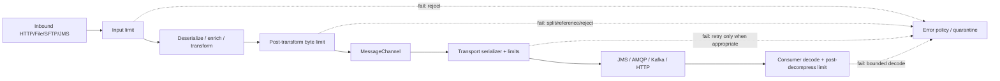
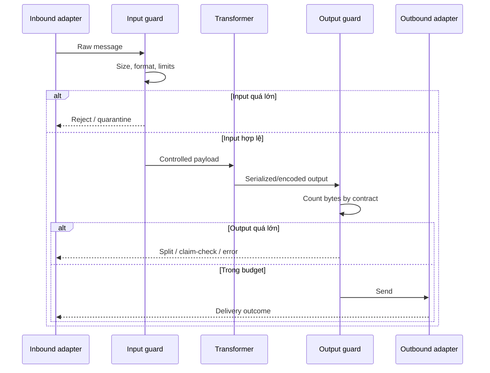
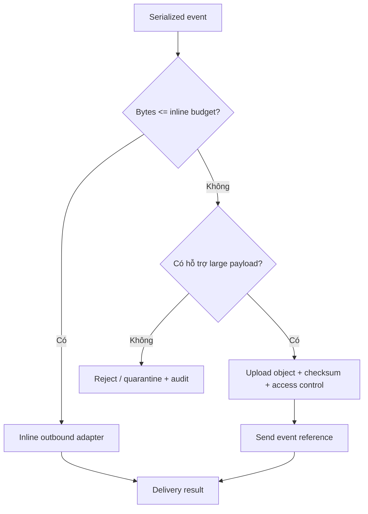
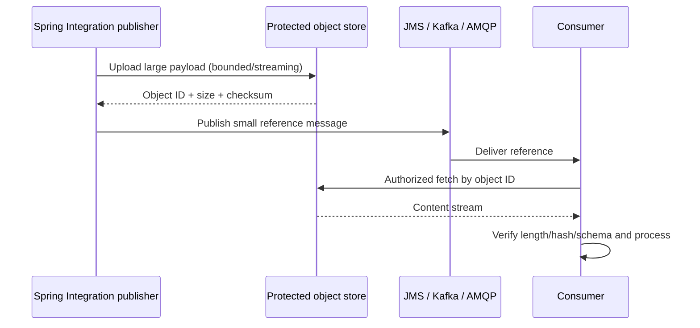
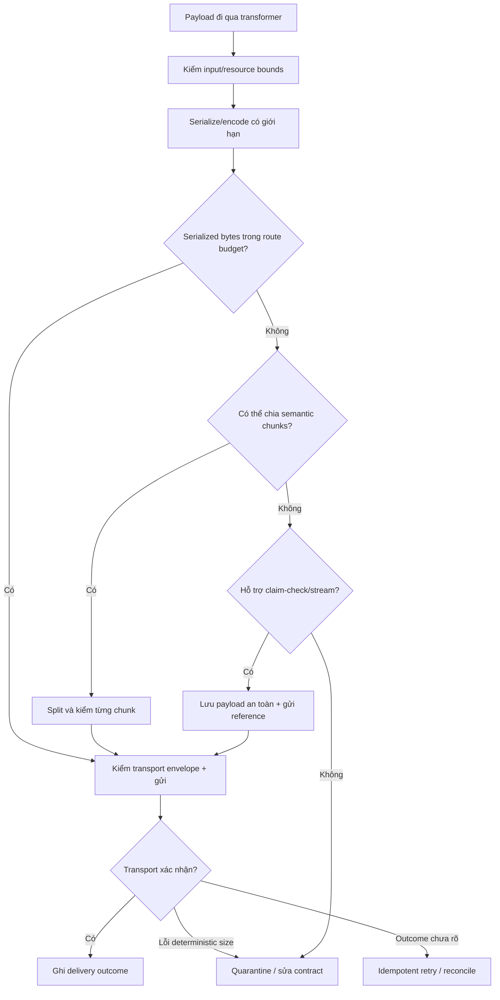

# Kiểm soát kích thước payload sau chuyển đổi trong Spring Integration Adapters

## 1. Vì sao payload hợp lệ ở đầu vào vẫn có thể quá lớn ở đầu ra?

Trong Spring Integration, một message có thể đi qua nhiều bước trước khi tới hệ thống ngoài:

1. **Inbound adapter/gateway** lấy dữ liệu từ File, SFTP, HTTP, JMS, AMQP, Kafka hoặc cơ sở dữ liệu.
2. **Transformer** chuẩn hóa, enrich, serialize, mã hóa, nén hoặc chuyển đổi sang định dạng giao tiếp.
3. **MessageChannel** chuyển message tới handler khác.
4. **Outbound adapter/gateway** gửi kết quả tới broker, REST API, file hoặc hệ thống đích.

Kích thước dữ liệu **sau transformer** có thể khác đáng kể so với dữ liệu ban đầu. Một chuỗi ngắn trong Java khi chuyển thành JSON có thêm dấu ngoặc kép và escape; một object chứa danh sách con khi enrich có thể tăng hàng chục lần; Base64 làm dữ liệu dài hơn; một file nén nhỏ có thể giải nén thành lượng dữ liệu cực lớn. Ngược lại, nén có thể giảm số byte truyền qua mạng nhưng không làm giảm lượng bộ nhớ cần xử lý khi giải nén.

Ví dụ, inbound HTTP nhận một JSON request có trường `orderId` và vài line items. Handler truy vấn database, thêm catalog details và biến object thành `byte[]` UTF-8 trước khi gửi Kafka. Request đầu vào chỉ 12 KiB nhưng sự kiện đầu ra có thể vượt giới hạn producer/broker đã cấu hình. Nếu kiểm kích thước **chỉ ở đầu vào**, lỗi sẽ xuất hiện muộn ở outbound adapter: send thất bại, retry liên tục, tăng backlog hoặc làm gián đoạn xử lý.

**Kiểm soát kích thước payload sau chuyển đổi** là việc định nghĩa ngân sách byte tại những ranh giới hợp đồng, đo được kích thước có ý nghĩa cho từng đích, và có chính sách rõ ràng khi message vượt ngưỡng: từ chối, chia nhỏ, lưu dữ liệu ngoài rồi gửi tham chiếu, hoặc dùng đường xử lý streaming.

Bài thuộc chương **Chuyển đổi dữ liệu** của module **SPRING_INTEGRATION_ADAPTERS**, đặt trong bối cảnh inbound/outbound adapter, gateway, poller, `MessageChannel` và các luồng File/SFTP, HTTP, JMS, AMQP, Kafka, JDBC. Trọng tâm là tính đúng đắn của message, khả năng vận hành khi lỗi và tránh sự cố tài nguyên.

### Mục tiêu học tập

Sau bài này, bạn có thể:

1. Phân biệt logical size, serialized size, encoded size, compressed size và wire size.
2. Xây dựng **size budget** theo từng endpoint, hợp đồng message, header và dạng encoding.
3. Đặt guard ở đúng vị trí **trước** và **sau** transformer, đặc biệt trước outbound boundary.
4. Viết kiểm tra số byte UTF-8, `byte[]` hoặc serialization có giới hạn trong Java.
5. Chọn giữa reject, splitter/chunk, streaming và claim-check/reference payload theo khả năng giao thức.
6. Thiết kế retry, quarantine, DLQ, observability và kiểm thử ranh giới để không làm mất message hoặc gây OOM.

## 2. Không có một “kích thước payload” duy nhất

| Loại kích thước | Đo ở đâu? | Ví dụ | Vì sao khác nhau? |
|---|---|---|---|
| **Logical size** | Trong model/domain | 500 dòng hàng, 20 thuộc tính | Đếm phần tử không bằng byte |
| **String length** | Java `String.length()` | Số UTF-16 code units | Không bằng số Unicode code points hay UTF-8 bytes |
| **Serialized payload size** | Sau chuyển sang JSON/XML/Protobuf/Avro/... | JSON UTF-8 `byte[]` | Escape, metadata và schema làm thay đổi byte count |
| **Encoded size** | Sau Base64/envelope/encryption | Payload nhúng vào JSON hoặc SFTP wrapper | Có overhead của encoding, IV/tag, envelope |
| **Compressed size** | Sau gzip/zstd hoặc producer compression | Lượng byte nén | Thay đổi theo nội dung và compression level |
| **Protocol message/record size** | Transport producer/broker | Kafka serialized record/batch, AMQP/JMS message | Header, key, properties, framing và batch overhead |
| **Wire size** | Trên kết nối mạng | TLS record, HTTP framing, network packets | Chịu nhiều lớp framing; thường khác limit broker |
| **In-memory footprint** | JVM heap/direct buffers | Java object graph, char arrays, buffers | Có thể lớn hơn serialized data nhiều lần |
| **Decompressed/decoded size** | Consumer sau giải mã/giải nén | Input ZIP 20 KiB bung thành hàng GB | Nguy cơ decompression bomb và OOM |

**Nguyên tắc:** khi nói “giới hạn 1 MiB”, phải nêu rõ giới hạn đo trên **đối tượng nào, ở giai đoạn nào, bằng đơn vị nào** và áp dụng cho transport nào. Một giá trị chung `MAX_MESSAGE_SIZE` đặt trong config mà không định nghĩa đối tượng đo sẽ dễ gây mâu thuẫn.

### 2.1 Đơn vị byte và ký tự

- `1 KiB = 1024 bytes`; `1 MiB = 1.048.576 bytes`.
- `1 kB = 1000 bytes`; `1 MB = 1.000.000 bytes`.
- Java `String.length()` trả số **UTF-16 code units**, không phải số byte UTF-8.
- Với `byte[]`, `array.length` cho số byte hiện có trong mảng, nhưng chưa chắc bằng kích thước message sau khi thêm headers/transport envelope.
- Với Java `ByteBuffer`, số byte còn lại trong phần sẽ đọc thường là `remaining()`; `capacity()` không phản ánh độ dài dữ liệu hữu ích.

### 2.2 Ví dụ UTF-8 và JSON

```java
String value = "Xin chào 🌏";

int utf16Units = value.length();
int utf8Bytes = value.getBytes(StandardCharsets.UTF_8).length;

// Hai số có thể khác nhau. Muốn đo JSON thì phải
// đo chính kết quả JSON đã serialize, không chỉ value.
byte[] jsonBytes = objectMapper.writeValueAsBytes(
    Map.of("message", value)
);
int jsonPayloadBytes = jsonBytes.length;
```

`getBytes` và `writeValueAsBytes` đều có thể **cấp phát bộ nhớ cho bản sao** của dữ liệu. Với payload không bị giới hạn, phép đo sau khi serialize có thể đã quá muộn: JVM có thể hết heap trước khi có cơ hội từ chối. Phải kết hợp kiểm sơ bộ, streaming/bounded serialization và giới hạn nguồn.

### 2.3 Base64, escaping, encryption và compression

Với `n` byte đầu vào, độ dài **Base64 chuẩn có padding** là:

```text
base64Length = 4 * ceil(n / 3)
```

Con số này mô tả ký tự ASCII của Base64, **chưa tính** JSON quotes, field name, MIME line breaks, headers hoặc compression khác. JSON escaping có thể làm ký tự như dấu ngoặc kép, backslash hoặc control characters dài hơn. Mã hóa có thể thêm IV/nonce, authentication tag và metadata.

Compression làm số byte **truyền đi** giảm trong một số trường hợp, nhưng dữ liệu khó nén có thể gần bằng hoặc lớn hơn do header. Ở chiều ngược lại, consumer phải đặt **giới hạn kích thước sau giải nén**; không dựa riêng vào kích thước compressed object.

## 3. Đặt size budget theo nhiều lớp

Hãy xem mỗi thông điệp có ít nhất ba budget:

1. **Input budget:** giới hạn đầu vào để không parse/allocate vượt khả năng.
2. **Internal processing budget:** giới hạn bộ nhớ, số item, depth và thời gian xử lý sau enrich/transform.
3. **Output contract budget:** giới hạn byte được phép gửi tới adapter đích, có dự phòng cho metadata/overhead.

Ví dụ minh họa cho một event gửi broker:

| Lớp | Ngưỡng minh họa | Đo bằng gì? |
|---|---:|---|
| HTTP inbound request body | 2 MiB | Body bytes theo điểm ingress được kiểm soát |
| Domain item count | 2.000 items | Validation trước enrich |
| JSON event UTF-8 | 700 KiB | Bytes thực sau serializer được giới hạn |
| Transport safety headroom | 100 KiB | Khoảng dự phòng key/properties/framing/batch |
| Broker maximum theo cấu hình | 1 MiB | Kiểm cấu hình **thực** ở producer, topic/queue/broker |

**Các số trên chỉ là ví dụ thiết kế**, không phải mặc định của Spring Integration, Kafka, JMS hoặc AMQP. Trong production, ưu tiên ngưỡng thấp nhất từ hợp đồng của consumer và tất cả điểm trung gian. Một giới hạn “lý thuyết” của broker chưa đủ nếu load balancer, producer client hoặc consumer có ngưỡng nhỏ hơn.

### 3.1 Công thức lập budget

Gọi:

- `L_destination`: giới hạn message/record theo hợp đồng đích.
- `H_protocol`: lượng overhead có khả năng xuất hiện từ key, headers, properties, framing/batching.
- `R_safety`: phần dự phòng cho thay đổi schema hoặc overhead chưa định lượng chính xác.
- `L_app`: giới hạn serialized payload do ứng dụng áp dụng.

Một chính sách bảo thủ:

```text
L_app <= L_destination - H_protocol - R_safety
```

Nếu không biết chính xác overhead, **đừng khẳng định** message chắc chắn được broker chấp nhận chỉ vì `payload.length <= L_destination`. Hãy chọn budget an toàn hơn và kiểm bằng integration test với key/header/serializer/compression thực.

### 3.2 Giới hạn nhỏ nhất trên toàn tuyến



Vị trí kiểm tra phải gắn với **lớp thực tế chịu trách nhiệm**. Không phải mọi flow có đủ bốn bước, nhưng một bước transform có khả năng phình payload nên được theo sau bởi guard trước outbound.

### 3.3 Chọn limit theo hợp đồng, không theo cảm tính

Các yếu tố:

- Broker/topic/queue/producer/consumer giới hạn tối đa bao nhiêu?
- API bên ngoài có giới hạn body, timeout hay response size?
- Payload có chứa `headers` lớn, Kafka record key, tracing metadata, schema ID?
- Consumer có thể parse và xử lý ở memory budget hiện hành không?
- Có batching, compression, encryption, Base64 hay JSON envelope sau guard?
- Mức quá tải chấp nhận được của queue và policy retry/quarantine là gì?

**Budget phải được định nghĩa và giám sát theo route/destination/message contract**, không nhất thiết một số chung cho tất cả adapter.

## 4. Các phép biến đổi khiến kích thước thay đổi bất ngờ

| Phép biến đổi | Tại sao thay đổi? | Kiểm soát phù hợp |
|---|---|---|
| Object → JSON | Field names, quotes, escape, nulls | Đo JSON UTF-8 thực sau Jackson |
| XML ↔ JSON | Metadata/attribute/namespace, format overhead | Kiểm serialized size, schema |
| Byte[] → Base64 | Mở rộng khoảng 4/3 trước envelope | Tính trước và đo sau |
| Enrich payload bằng DB/API | Mỗi item thêm dữ liệu mới | Giới hạn item count và output bytes |
| Aggregation | Gộp N messages vào một payload | Max group size, max aggregate bytes, release strategy |
| Splitter | Tách batch thành các phần nhỏ | Max chunk bytes, total count, reassembly metadata |
| Compression | Có thể giảm kích thước truyền | Limit raw/uncompressed và nén thực tế |
| Decompression | Input nhỏ có thể phình rất lớn | Cap decoded bytes và ratio/depth |
| Encryption | IV, nonce, tag, padding, envelope | Tính vào output budget |
| Protocol mapping | Headers, properties, key, schema | Integration test với adapter thực |
| File/SFTP copy | Không phải biến đổi logic nhưng có buffering | Stream, spool file, disk quota |
| Batching Kafka/AMQP | Gom nhiều records trong một lần send | Batch/request limit và record-level contract |

### 4.1 Aggregator nguy hiểm hơn nhìn bề ngoài

Một `Aggregator` có thể gộp các message nhỏ thành payload lớn hơn message đơn lẻ. Nếu mỗi event 100 KiB và aggregator gom 50 event, aggregate có thể vào khoảng nhiều MiB trước headers/serialization. Cần giới hạn:

- Số message trong group.
- Tổng số byte ước tính/đã serialize.
- Timeout và release strategy.
- GroupStore capacity/retention và cleanup.
- Cơ chế split/chunk trước outbound nếu destination không nhận batch lớn.

Không chỉ kiểm từng message đầu vào rồi tin aggregate sẽ nhỏ.

### 4.2 Enricher có thể làm payload tăng theo bội số

Content enricher tra cứu thông tin product của 1.000 items; mỗi item thêm mô tả, ảnh Base64 và metadata. Một event ban đầu nhỏ có thể vượt broker limit. Cân nhắc chỉ đưa ID, URL tham chiếu hoặc những field thật sự phục vụ consumer, thay vì copy toàn bộ object graph.

### 4.3 Header và metadata

Spring Integration `MessageHeaders` có thể mang correlation, sequence, tracing, content type và business metadata. Serializer transport có thể ánh xạ một phần headers thành broker properties. Kích thước message sau transport mapping vì thế có thể lớn hơn payload bytes.

Không đặt toàn bộ JSON payload vào header để “tránh giới hạn payload”. Một số transport có giới hạn header/properties riêng; việc này có thể còn tăng memory và log overhead.

## 5. Hai nguyên tắc quan trọng: kiểm trước và kiểm sau

**Pre-transform guard** bảo vệ parser/transformer: giới hạn input bytes, item count, JSON nesting depth, file size và thời gian xử lý.

**Post-transform guard** bảo vệ outbound contract: đo bytes **sau serialize/encode cuối cùng** mà adapter chuẩn bị gửi, kiểm ngưỡng per-route và quyết định reject/chunk/reference.



Nếu serializer thực sự nằm **bên trong outbound adapter** (ví dụ Kafka Serializer), post-transform guard ở flow Java object có thể chưa biết số byte cuối cùng. Khi đó có thể **pre-serialize với chính serializer được dùng**, hoặc có interceptor/validation tại boundary producer theo framework hỗ trợ. Quan trọng là không đo một representation khác rồi coi chắc chắn đủ.

## 6. Chọn đơn vị đo chính xác theo payload type

### 6.1 `byte[]`

```java
static long sizeOf(byte[] payload) {
    return payload.length;
}
```

Nếu thêm envelope/headers/record key sau đó, đây chỉ là **payload byte size**, không phải wire size.

### 6.2 `String`

```java
static long utf8SizeOf(String payload) {
    return payload.getBytes(StandardCharsets.UTF_8).length;
}
```

Đoạn này tạo bản sao `byte[]` và chỉ phù hợp khi chuỗi đã được giới hạn ở bước trước. `String.length()` không thay thế được phép đo byte. Nếu outbound serializer đổi sang UTF-16 hoặc thêm JSON escaping, phải đo output đúng định dạng cuối.

### 6.3 `ByteBuffer`

```java
static long readableBytes(ByteBuffer buffer) {
    return buffer.remaining();
}
```

Nếu buffer bị mutate giữa kiểm và gửi hoặc serializer đọc từ vị trí khác, phép đo có thể sai. Tránh dùng `capacity()` và không tự ý thay đổi `position()` khi chỉ muốn kiểm size.

### 6.4 `InputStream`, `Resource` và file

`InputStream.available()` **không phải tổng độ dài stream**; nó thường chỉ phản ánh số byte có thể đọc ngay mà không block. Khi file đã tồn tại, `Files.size(path)` có thể giúp preflight, nhưng file có thể thay đổi trước khi handler đọc. Với stream không biết trước kích thước, dùng **bounded read/streaming** và kiểm tổng byte thật sự đã tiêu thụ.

### 6.5 Object/DTO

Một Java object không có độ dài byte tự nhiên. `toString().length()`, `estimated heap size` hay đếm field không cho số byte của JSON/Protobuf. Hãy chọn serializer và version schema rõ ràng, đo serialization có giới hạn. Nếu producer tự thêm envelope, key hoặc headers, kiểm thêm ngưỡng transport tương ứng.

## 7. Bounded serialization: chặn trước khi tạo ra mảng quá lớn

Kiểu kiểm sau:

```java
byte[] bytes = objectMapper.writeValueAsBytes(hugeObject);
if (bytes.length > maxBytes) {
    throw new IllegalArgumentException("Payload too large");
}
```

có một hạn chế nghiêm trọng: **toàn bộ mảng đã được cấp phát** trước lúc kiểm. Đối với object có thể phình không kiểm soát, container có thể gặp `OutOfMemoryError` hoặc GC pressure trước khi guard hoạt động.

Giải pháp là kiểm soát ở nhiều cấp:

1. Giới hạn đầu vào và số item/domain record trước enrich.
2. Giới hạn serialization **trong lúc bytes được ghi ra**.
3. Chỉ tạo một `byte[]` sau khi đã chắc output nằm trong budget.
4. Với payload thực sự lớn, chuyển sang streaming, temp file có quota hoặc claim-check thay vì ép vào bộ nhớ.

### 7.1 Ví dụ Java: OutputStream đếm byte và từ chối khi vượt ngưỡng

```java
import java.io.FilterOutputStream;
import java.io.IOException;
import java.io.OutputStream;
import java.util.Objects;

final class PayloadLimitExceededException extends IOException {
    PayloadLimitExceededException(long maxBytes) {
        super("Serialized payload exceeds " + maxBytes + " bytes");
    }
}

final class CappedOutputStream extends FilterOutputStream {
    private final long maxBytes;
    private long written;

    CappedOutputStream(OutputStream delegate, long maxBytes) {
        super(Objects.requireNonNull(delegate));
        if (maxBytes < 0) {
            throw new IllegalArgumentException("maxBytes must be >= 0");
        }
        this.maxBytes = maxBytes;
    }

    private void check(long nextWriteBytes) throws IOException {
        // Trừ thay vì cộng để tránh long overflow.
        if (nextWriteBytes > maxBytes - written) {
            throw new PayloadLimitExceededException(maxBytes);
        }
    }

    @Override
    public void write(int value) throws IOException {
        check(1);
        out.write(value);
        written++;
    }

    @Override
    public void write(byte[] bytes, int offset, int length)
            throws IOException {
        Objects.checkFromIndexSize(offset, length, bytes.length);
        check(length);
        out.write(bytes, offset, length);
        written += length;
    }

    long writtenBytes() {
        return written;
    }
}
```

Guard này từ chối **trước khi ghi byte vượt giới hạn** xuống delegate. Nó không giới hạn lượng bộ nhớ dùng để **xây dựng object trước serialization**, hoặc buffer nội bộ mà thư viện serializer có thể sử dụng. Vì vậy vẫn phải kiểm soát upstream data và đối tượng đầu vào.

### 7.2 Serialize JSON với Jackson trong giới hạn byte

```java
import com.fasterxml.jackson.databind.ObjectMapper;
import java.io.ByteArrayOutputStream;
import java.io.IOException;

final class BoundedJsonSerializer {
    private final ObjectMapper mapper;

    BoundedJsonSerializer(ObjectMapper mapper) {
        this.mapper = mapper;
    }

    byte[] toJsonBytes(Object value, int maxBytes) throws IOException {
        if (maxBytes < 0) {
            throw new IllegalArgumentException("maxBytes must be >= 0");
        }

        ByteArrayOutputStream buffer =
            new ByteArrayOutputStream(Math.min(maxBytes, 8192));

        try (CappedOutputStream capped =
                new CappedOutputStream(buffer, maxBytes)) {
            mapper.writeValue(capped, value);
        }
        // Kết quả có độ dài <= maxBytes, nhưng toByteArray vẫn tạo bản sao.
        return buffer.toByteArray();
    }
}
```

Khi Jackson ghi quá ngưỡng, `CappedOutputStream` ném `IOException` và serialization dừng. Một số tầng có thể wrap lỗi vào exception khác: error handler phải **phân loại đúng nguyên nhân** thay vì retry vô hạn.

**Giới hạn của ví dụ:** dùng `ByteArrayOutputStream` vẫn giữ kết quả trong heap và `toByteArray()` tạo thêm một bản sao. Phù hợp với message-size budget nhỏ/vừa; với dữ liệu nhiều MiB/GiB, chọn temp file có quota hoặc streaming trực tiếp tới sink mà protocol hỗ trợ. Không coi đây là biện pháp chống mọi dạng payload bomb.

### 7.3 Áp dụng với XML hoặc Protobuf

Ý tưởng giống nhau: ghi byte qua `CappedOutputStream` thay vì tạo một string/mảng không giới hạn. Tuy nhiên mỗi serializer có cơ chế buffering riêng; cần kiểm:

- Serializer có giữ một object graph lớn trước khi stream không?
- Có ghi ngay ra `OutputStream` hay tạo một intermediate buffer lớn?
- Có hỗ trợ hạn chế depth, collection size, entity expansion?
- Error có dừng serialization an toàn không?

Với XML, bảo vệ chống entity expansion/XXE ở **parser phía nhận** là một lớp khác với output-size guard. Với Protobuf/Avro, cần kiểm serialized bytes và overhead của envelope/schema ID mà transport thực sự sử dụng.

## 8. Guard trong Spring Integration flow

Có thể triển khai guard như **service activator**, filter hoặc message handler. Điểm quan trọng: guard phải chạy **trước outbound adapter**, trên representation có kích thước đúng, và **không để lọt message đã vượt giới hạn**.

### 8.1 Guard cho payload đã là `byte[]`

```java
import org.springframework.integration.annotation.ServiceActivator;
import org.springframework.messaging.Message;

@Component
final class SerializedPayloadGuard {
    private static final int MAX_BYTES = 700 * 1024; // Ví dụ, không phải default.

    @ServiceActivator(
        inputChannel = "serializedOutbound",
        outputChannel = "guardedOutbound"
    )
    public Message<byte[]> validate(Message<byte[]> message) {
        if (message.getPayload().length > MAX_BYTES) {
            throw new OversizedMessageException(
                "Serialized payload exceeds route budget"
            );
        }
        return message; // Giữ nguyên payload và headers khi hợp lệ.
    }
}
```

`OversizedMessageException` là **custom RuntimeException** do dự án định nghĩa, không phải exception mặc định của Spring Integration. Đường `serializedOutbound` phải thật sự nhận `byte[]`. Nếu trước đó payload vẫn là DTO hay String, hãy chuyển sang serializer phù hợp rồi mới kiểm, hoặc sửa type contract.

Một flow:

```text
inboundChannel
  -> validator input / item count
  -> enrich
  -> bounded JSON serializer (byte[])
  -> serializedOutbound
  -> SerializedPayloadGuard
  -> guardedOutbound
  -> Kafka/JMS/AMQP/HTTP outbound adapter
```

Trong production, tránh hard-code `MAX_BYTES` chung cho toàn bộ flow; nên dùng policy theo route/destination và version hợp đồng. Nếu chuyển tiếp bất đồng bộ giữa serialization và guard, cần bảo đảm không có handler khác gửi payload trước khi được kiểm.

### 8.2 Khi nào dùng `MessageFilter`?

Một `MessageFilter` có thể chấp nhận/từ chối theo predicate, ví dụ `byte[].length <= limit`. Tuy nhiên việc từ chối message không nên im lặng bỏ công việc. Phải chọn:

- `discardChannel` cho message oversized có xử lý quarantine/claim-check.
- Ném lỗi có kiểu rõ, để error flow phân loại permanent/oversized.
- Lưu trạng thái bền vững và ACK/retry theo hợp đồng inbound.

**Không mặc định reject = retry.** Với payload quá lớn một cách bất biến, retry cùng message không thay đổi kích thước và chỉ tạo retry storm.

### 8.3 Giữ header mà không tin metadata đầu vào

Nếu transformer đặt header `payloadSizeBytes` để phục vụ monitoring, header đó là **metadata hỗ trợ**, không phải bằng chứng an ninh. Bên phát có thể cung cấp header sai hoặc message có thể bị transform thêm. Guard tại outbound boundary phải tự đo lại dữ liệu mà nó chuẩn bị gửi.

Khi transformer tạo message mới, cần giữ những header hợp lệ như correlation, routing key, trace ID; tránh copy toàn bộ header chưa được kiểm soát từ nguồn bên ngoài.

### 8.4 Định tuyến theo kích thước

Với một số contract, message nhỏ gửi qua broker, message lớn chuyển sang lưu object storage rồi gửi reference:



Đây là một mô hình **claim-check**. Việc upload object và publish reference cũng có cửa sổ lỗi giữa hai hệ thống, cần xử lý cleanup/retry theo mục 14.

## 9. Streaming và bounded read: tránh nạp cả file vào heap

### 9.1 File/SFTP inbound

Khi adapter nhận file, có hai cách xử lý:

- **Nạp toàn bộ:** đọc file thành `byte[]`/String, transform, gửi. Đơn giản nhưng bộ nhớ tăng theo file size.
- **Streaming:** đọc tuần tự qua `InputStream`, parse từng record hoặc chuyển tiếp theo chunk. Phức tạp hơn nhưng phù hợp file lớn.

File metadata có thể cung cấp kích thước ban đầu để preflight. Tuy nhiên file có thể bị thay đổi sau khi lấy metadata; cần bảo vệ khỏi file ghi dở (producer-side temp name/atomic rename nếu hỗ trợ), checksum, giới hạn byte thực đọc và kiểm tra thời điểm hoàn tất upload.

### 9.2 Mẫu đọc stream có giới hạn

```java
static byte[] readBounded(InputStream input, long maxBytes)
        throws IOException {
    if (maxBytes < 0) {
        throw new IllegalArgumentException("Negative limit");
    }

    try (ByteArrayOutputStream buffer = new ByteArrayOutputStream()) {
        byte[] chunk = new byte[8192];
        long readTotal = 0;
        int n;

        while ((n = input.read(chunk)) != -1) {
            if (n == 0) {
                continue; // Với stream bất thường, cần timeout/cancel ngoài.
            }
            if (n > maxBytes - readTotal) {
                throw new PayloadLimitExceededException(maxBytes);
            }
            buffer.write(chunk, 0, n);
            readTotal += n;
        }
        return buffer.toByteArray();
    }
}
```

Đây là ví dụ để hiểu **đọc tối đa maxBytes rồi từ chối**. Nó vẫn dùng heap và có bản sao khi gọi `toByteArray()`; chỉ dùng với limit nhỏ/vừa. Với file lớn, ghi tới spool file có quota, pipeline streaming hoặc xử lý record-by-record; đồng thời giới hạn tổng thời gian/byte và đóng tài nguyên theo lifecycle phù hợp.

### 9.3 Không giữ `InputStream` mở qua channel bất đồng bộ một cách tùy tiện

Một transformer trả `InputStream` vào `ExecutorChannel` nhưng đóng source ngay sau khi trả có thể khiến consumer nhận được stream đã đóng. Ngược lại, giữ stream mở vô hạn gây rò connection/file descriptor, nhất là SFTP. Cần quy định:

- Ai sở hữu stream và phải đóng?
- Stream có thể được đọc lại khi retry không?
- Source file còn bất biến cho đến khi kết thúc xử lý?
- Nếu consumer async thất bại, làm sao replay từ dữ liệu bền vững?
- Có checksum/length để xác minh integrity không?

Một **path/object-store reference** với quyền và thời hạn rõ có thể an toàn hơn việc truyền live stream qua queue.

## 10. Giới hạn khi giải nén và parse

### 10.1 Decompression bomb

Một tệp nén vài KiB có thể giải nén thành lượng dữ liệu rất lớn. Chỉ kiểm `Content-Length` hoặc compressed byte[] trước khi giải nén **không bảo vệ** heap và disk.

Đặt nhiều giới hạn:

1. Tối đa compressed input bytes.
2. Tối đa **decompressed bytes thực tế**.
3. Tối đa số entries nếu là archive ZIP/TAR.
4. Tối đa nesting/recursion depth của archive hoặc JSON/XML.
5. Tối đa tỷ lệ giải nén khi phù hợp, nhưng **không dùng ratio một mình** vì dữ liệu hợp lệ cũng có thể nén tốt.
6. Timeout/cancellation và quota bộ nhớ/disk khi parse.

### 10.2 Ví dụ đọc GZIP có giới hạn

```java
static byte[] gunzipWithLimit(byte[] compressed, long maxExpandedBytes)
        throws IOException {
    try (GZIPInputStream gzip =
             new GZIPInputStream(new ByteArrayInputStream(compressed))) {
        return readBounded(gzip, maxExpandedBytes);
    }
}
```

Ví dụ này yêu cầu compressed input đã được giới hạn trước khi cấp phát. `readBounded` sẽ dừng khi bytes giải nén vượt giới hạn, nhưng không thay thế giới hạn CPU, số lượng archive entries hoặc nested compression.

### 10.3 JSON parser constraints

Jackson hỗ trợ các ràng buộc parser tùy phiên bản, ví dụ depth, string length hoặc number length qua cấu hình stream constraints. Những ràng buộc đó giúp chống **deeply nested JSON**, chuỗi cực dài hoặc cấu trúc gây tốn tài nguyên; chúng **không mặc nhiên là giới hạn tổng serialized bytes của message**.

Ví dụ có 100.000 field nhỏ vẫn có thể vượt ngưỡng total bytes dù từng string không dài. Vì vậy phải kết hợp parser constraints + body byte limit + output byte limit.

### 10.4 Base64 decode

Khi nhận Base64, nên giới hạn số ký tự encoded input và kích thước decoded output trước khi đưa dữ liệu vào converter. Base64 không phải mã hóa bảo mật và không giảm payload size. Nếu decode xong lại enrich/serialize, phải đo lại output cuối.

## 11. Giới hạn cụ thể theo outbound adapter

Không thể dùng một `maxPayloadBytes` cho mọi transport mà không kiểm tra thông số của adapter và hệ thống đích.

| Transport / adapter | Các lớp giới hạn nên kiểm | Điểm đo phù hợp |
|---|---|---|
| **Kafka outbound** | Producer request size, broker/topic record-batch limit, consumer fetch/memory và serializer | Key/value serialized bytes + record/batch overhead; thử với producer thật |
| **JMS outbound** | Provider message-size limit, message body/properties, session/producer buffers | JMS message cuối cùng với body/properties theo provider |
| **AMQP/RabbitMQ outbound** | Broker message-size policy, client buffer, exchange/queue policy | Payload/properties sau mapping, broker reject/confirm |
| **HTTP outbound gateway** | Upstream ingress/proxy limit, server request-body limit, headers, content encoding | Request bytes thực trước HTTP client; validate response body khi nhận |
| **File outbound** | Disk quota, filesystem max file size, path và temp space | Bytes thực được ghi + quota spool |
| **SFTP outbound** | Remote disk/quota, session/connection, upload timeout | Bytes gửi, remote file length/checksum |
| **JDBC adapter** | Column types, DB packet/row limits, query size, fetch/batch memory | Serialized field size, row count, JDBC batch payload |

### 11.1 Kafka: record, batch và request là các ngưỡng khác nhau

Khi Spring Integration gửi Kafka message, quá trình thường gồm:

1. Từ Spring `Message<?>` tạo `ProducerRecord` theo mapping.
2. Serialize **key** và **value** theo serializer thực.
3. Thêm headers và record metadata.
4. Producer tạo request/batch theo cấu hình nén, batching và broker.

Các cấu hình thường cần xem:

- Producer `max.request.size`: ngưỡng kích thước request/batch do producer quản lý, không đơn giản là `payload.length`.
- Broker `message.max.bytes` và/hoặc topic `max.message.bytes`: ngưỡng message/record-batch theo cấu hình Kafka tương ứng.
- Consumer `max.partition.fetch.bytes` và `fetch.max.bytes`: ảnh hưởng fetch/memory/throughput; **không được giả định** một giá trị fetch nhỏ luôn là hard reject cho record quá lớn vì Kafka có các ngoại lệ nhằm bảo đảm consumer tiến lên.
- `batch.size`, compression và producer buffer memory: ảnh hưởng batching/memory nhưng **không phải tất cả đều là giới hạn từng event**.

Thông số và semantics chính xác phụ thuộc phiên bản Kafka và serializer. **Guard ở Java object hoặc JSON String trước `Serializer` có thể đo sai** nếu serializer thêm schema ID, headers hoặc encoding khác. Cần thử cùng key, value, headers và cấu hình producer thật.

#### Tình huống lỗi Kafka

Một event JSON có 900 KiB payload nhưng còn Kafka record headers, key và metadata. Producer được cấu hình giới hạn thấp hơn tổng serialized request, hoặc topic có ngưỡng khác. Send có thể thất bại sau khi transformer đã tạo output.

Xử lý:

1. Kiểm size bằng serializer thích hợp và budget an toàn ở bước trước producer.
2. Đánh dấu lỗi oversized là **non-retryable** nếu nội dung không thể thay đổi.
3. Chuyển sang splitter/claim-check hoặc quarantine theo hợp đồng.
4. Giữ event ID, nguyên nhân, đo kích thước và log không chứa payload thô.
5. Không chỉ tăng `max.request.size`; phải kiểm broker, topic, consumer, memory và giới hạn hệ thống khác.

### 11.2 JMS: giới hạn phụ thuộc provider

JMS API định nghĩa các kiểu message như `TextMessage`, `BytesMessage`, `MapMessage` và properties. Tuy nhiên **ngưỡng kích thước thực tế** thường là chi tiết của broker/provider, connection factory, persistence và quota.

Ví dụ:

- Một `TextMessage` có thể bị encode khác cách ứng dụng đo Java String.
- `BytesMessage` có body bytes nhưng còn JMS headers/properties.
- Một message quá lớn có thể bị client từ chối, broker reject hoặc gây tốn bộ nhớ trước khi có exception.

Đo payload sau transformer, xác định mapping của JMS outbound adapter, kiểm giới hạn broker và xử lý failure ở producer/session transaction. **JMS consumer acknowledgment không giúp giảm kích thước của message producer đang gửi.**

### 11.3 AMQP/RabbitMQ: `frame_max` không đồng nghĩa hard message limit

AMQP truyền body qua frames; cấu hình `frame_max` điều khiển kích thước frame, **không tự đồng nghĩa** toàn bộ message phải nhỏ hơn một frame. Broker/client còn có giới hạn message-size, memory, queue/policy và publisher confirmation riêng theo sản phẩm.

Với Spring Integration AMQP outbound adapter, hãy phân biệt:

- Serializer/converter từ DTO tới bytes.
- AMQP message properties/headers.
- Broker routing thành công hay thất bại.
- Publisher confirm/return nếu cấu hình.
- Consumer có đủ memory để decode payload không.

Không nhầm “publisher confirm” với business consumer đã xử lý. Nếu event oversized bị broker từ chối theo chính sách, retry cùng payload không sửa được vấn đề.

### 11.4 HTTP outbound gateway

Một REST API có thể giới hạn **request body**, tổng headers, multipart part size hoặc **response body**. Reverse proxy, WAF, load balancer, web server và application có thể dùng các giới hạn khác nhau.

Ví dụ, HTTP inbound trả `413 Content Too Large` khi body quá ngưỡng. Nhưng ứng dụng không nên đợi remote trả 413 mới kiểm kích thước: lúc đó có thể đã serialize và buffer quá nhiều trong JVM.

Lưu ý:

- `Content-Length` có thể vắng mặt (chunked transfer), phản ánh compressed body hoặc không đáng tin cậy nếu đến từ client.
- `Transfer-Encoding: chunked` không làm biến mất giới hạn tổng byte.
- Khi request `Content-Encoding: gzip`, server cần budget **compressed inbound bytes** và **decompressed bytes**.
- Với multipart, giới hạn từng part và toàn request có thể khác nhau.
- Response JSON/XML quá lớn cũng phải có **bounded receive/decode**, tránh OOM tại outbound gateway.

Nếu một API không hỗ trợ payload lớn, có thể thiết kế batch API, pagination, multipart upload hoặc gửi URL/reference theo hợp đồng của dịch vụ đích.

### 11.5 File outbound

File outbound adapter có thể ghi một file lớn mà broker không bao giờ chấp nhận dưới dạng message. Tuy nhiên vẫn cần:

- Disk quota, inode/file count và max file size theo filesystem.
- Temporary file khi ghi và bước rename sau khi hoàn tất nếu được hỗ trợ.
- Checksums và readback/manifest khi cần.
- Chính sách dọn file lỗi/partial files khi process chết.
- Tránh nạp toàn file lên heap trước khi ghi.

Với file kết quả rất lớn, **streaming ra file** có thể phù hợp hơn chuyển `byte[]` qua một `QueueChannel` trong memory.

### 11.6 SFTP outbound

Giới hạn thường liên quan remote filesystem quota, quyền, thời gian upload, kích thước network buffer và vòng đời connection/session; không có một “SFTP payload maximum” chung để thay thế capacity planning.

Sau transform, dùng:

- Preflight size nếu biết trước.
- Upload streaming qua temp filename, final rename theo hợp đồng phía remote.
- Checksum và remote file size khi yêu cầu tính toàn vẹn.
- Lỗi upload theo partial-file policy.
- Retry có idempotency bằng filename/version/manifest.

Remote server có thể đã nhận toàn bộ file dù client thấy timeout. Hãy kiểm remote state trước khi tự upload lại và tránh tạo hai file nghiệp vụ.

### 11.7 JDBC inbound và database batching

Với JDBC inbound adapter, một lần poll có thể trả danh sách row đã chọn. Số row không tương đương số byte:

- `maxRows` giới hạn số bản ghi source trả về theo cơ chế adapter.
- `maxMessagesPerPoll` là số lần `receive()` mỗi poll cycle, không nhất thiết số row hoặc số message sau splitter.
- Một row có thể chứa CLOB/BLOB rất lớn dù batch chỉ một row.
- Query result và mapper có thể nạp hết vào heap trước khi guard downstream nhìn thấy.

Cần giới hạn số row, cột được chọn, BLOB/CLOB size, streaming/fetch strategy của JDBC và output serialization sau map/enrich. Với dữ liệu lớn, dùng cursor/chunk theo khả năng database driver; không tự tin một `LIMIT 100` đảm bảo memory an toàn.

## 12. Size-aware splitter: chia nhỏ mà không phá hợp đồng nghiệp vụ

Khi output vượt giới hạn, **splitter** là lựa chọn nếu consumer có thể xử lý từng phần độc lập hoặc tái lắp dữ liệu.

### 12.1 Các chiến lược

| Chiến lược | Khi dùng | Rủi ro |
|---|---|---|
| Chia theo **số item** | Item size gần tương đương, có upper bound chặt | Item có kích thước không đều; vẫn vượt byte limit |
| Chia theo **estimated bytes** | Cần tốc độ và có bound an toàn cho item | Estimate sai do escaping/encoding/headers |
| Chia theo **serialized bytes thực** | JSON/Avro record cần giới hạn chính xác | Phải serialize/đếm; overhead tính toán |
| Chia thành **byte chunks** | Tải file/blob hoặc protocol hỗ trợ reassembly | Không thể xem mỗi chunk là JSON hoàn chỉnh |
| **Claim-check** | Single object vượt ngưỡng hoặc file lớn | Cần object store, authorization, lifecycle |

**Nguyên tắc:** nếu **một item đơn lẻ** đã lớn hơn budget thì việc chia danh sách theo item không giải quyết được. Chuyển item sang object reference, loại bỏ trường không cần thiết hoặc báo lỗi hợp đồng.

### 12.2 Không chia một JSON document tùy tiện

JSON object có thể bị cắt giữa ký tự UTF-8 nhiều byte hoặc giữa escape sequence. Consumer không thể parse các phần độc lập nếu chỉ cắt mảng bytes tại vị trí tùy ý. Có hai lựa chọn:

1. **Semantic split**: mỗi chunk là một JSON message hoàn chỉnh gồm subset items và metadata reassembly.
2. **Binary chunking**: mỗi chunk là `byte[]` có `transferId`, `chunkIndex`, `chunkCount`, digest và protocol tái lắp.

Nên chọn theo hợp đồng consumer; không gán một chunk byte bất kỳ là “message JSON”.

### 12.3 Envelope cho các chunk

```json
{
  "transferId": "order-export-1042",
  "chunkIndex": 2,
  "chunkCount": 7,
  "schemaVersion": 1,
  "aggregateId": "order-1042",
  "originalSha256": "sha256-hex-digest-from-source",
  "items": [
    {"sku": "A101", "qty": 2},
    {"sku": "B407", "qty": 1}
  ]
}
```

`originalSha256` trong ví dụ là placeholder; thực tế phải tính digest trên dữ liệu gốc theo cùng canonical form, không tự bịa. Cần version schema, kiểm size **bao gồm envelope của mỗi chunk** và bảo vệ chống duplicate/thiếu chunk.

### 12.4 Kiểm size của từng chunk sau serialization

Một thuật toán minh họa:

```text
chunks = []
current = []

for item in items:
    candidate = current + [item]
    candidateEnvelope = buildEnvelope(candidate)
    if serializedUtf8Bytes(candidateEnvelope) <= chunkLimit:
        current = candidate
    else:
        if current is not empty:
            chunks.add(current)
        current = [item]
        if serializedUtf8Bytes(buildEnvelope(current)) > chunkLimit:
            reject_or_store_by_reference(item)

if current is not empty:
    chunks.add(current)

set_final_chunkCount_and_revalidate_each_serialized_chunk(chunks)
```

Đây là pseudocode, không phải thuật toán tối ưu về CPU: serialize lại ứng viên có thể tốn O(n²) nếu mỗi lần mở rộng chunk lại serialize toàn bộ. Production nên dùng incremental serialization hoặc ước lượng bảo thủ kết hợp **kiểm xác nhận cuối**. Nếu `chunkCount`/metadata thay đổi độ dài sau split, phải revalidate từng output.

### 12.5 Consumer cần tái lắp an toàn

- Lưu chunk vào kho bền vững với `transferId + chunkIndex` duy nhất.
- Kiểm checksum, count, schema, tenant và aggregate ID.
- Cho phép chunks đến **không đúng thứ tự** và có thể bị gửi lại.
- Đặt TTL/retention cho transfer chưa đủ chunks; alert nếu thiếu.
- Giới hạn tổng bytes của **reassembled payload** để không bị DoS.
- Chỉ ghi business result khi đủ chunks và xác minh integrity; tránh áp dụng một nửa nếu nghiệp vụ yêu cầu atomicity.

Với Kafka/JMS/AMQP, thứ tự chunks có thể thay đổi khi có nhiều partition/consumer và retry. Không giả định vận chuyển bảo đảm đúng thứ tự toàn cục.

## 13. Claim-check: gửi tham chiếu thay vì nhét dữ liệu lớn vào broker

**Claim-check pattern** tách **phần dữ liệu lớn** ra khỏi message. Producer ghi payload vào object storage hoặc file store có kiểm soát, sau đó gửi một message nhỏ chứa `objectKey`, size, checksum và business metadata. Consumer đọc tham chiếu, xác minh quyền, tải dữ liệu theo giới hạn đã đặt và xử lý.



### 13.1 Reference contract

```json
{
  "eventId": "evt-b92d",
  "eventType": "LargeExportReady",
  "schemaVersion": 1,
  "content": {
    "storageKey": "exports/2026/11/23/exp-1042-v1",
    "contentType": "application/json",
    "sizeBytes": 20531264,
    "sha256": "replace-with-real-hex-digest",
    "expiresAt": "2026-11-30T00:00:00Z"
  }
}
```

Các giá trị chỉ minh họa, không phải dữ liệu hoặc khóa truy cập thật. Không đặt credential vĩnh viễn hoặc signed URL không được kiểm soát vào message. Reference message cũng có size budget và schema riêng.

### 13.2 Những yếu tố bắt buộc của claim-check

1. **Integrity:** kiểm hash, content length, schema và mã hóa/giải mã khi cần.
2. **Authorization:** consumer được phép tải object thuộc tenant/resource tương ứng; không tin `storageKey` chỉ vì nó đến từ broker.
3. **Immutability/versioning:** tránh object bị thay đổi sau khi message đã phát mà consumer không biết.
4. **Availability:** object store phải còn truy cập được khi consumer xử lý; nếu không phải retry theo deadline.
5. **Retention:** object chưa được consumer sử dụng không bị cleanup trước hạn; object hết hạn có quy trình giải quyết.
6. **Idempotency:** event có `eventId` để consumer không thực hiện side effect trùng khi broker redeliver.
7. **Observability:** phân biệt “reference đã gửi” và “object đã được consumer tải/xử lý”.

### 13.3 Upload object và publish reference vẫn có hai commit

Object store và broker không mặc nhiên ở chung transaction. Một workflow an toàn có thể:

1. Stream upload tới **temporary object key**, kiểm checksum/size.
2. Chốt object ở một version/key bất biến khi upload hoàn tất.
3. Lưu **durable intent** phát reference, ví dụ trong outbox DB nếu nằm trong cùng business transaction phù hợp.
4. Publisher gửi reference qua outbound adapter.
5. Khi chuyển giao đạt contract, mark sent; nếu timeout, retry reference cùng event ID.
6. Cleanup những temporary/orphan objects sau retention đã định.

Nếu object upload xong nhưng DB/outbox rollback, có thể tồn tại **orphan object**; cleanup phải tìm được. Nếu DB đã ghi reference trước khi upload hoàn tất, consumer có thể tải một object không tồn tại. Quy trình cần định nghĩa rõ thứ tự, trạng thái `STAGED/READY` và xử lý lỗi.

### 13.4 Khi nào claim-check không phù hợp?

- Consumer cần xử lý toàn bộ dữ liệu ở latency rất thấp, object store round-trip quá chậm.
- Không có object store với quyền/retention/availability phù hợp.
- Payload chứa dữ liệu nhạy cảm mà hệ thống đích không được phép truy cập qua storage reference.
- Nghiệp vụ yêu cầu transaction toàn cục ở đích mà reference không giải quyết được.

Trong các trường hợp này, cân nhắc giảm dữ liệu, thay đổi hợp đồng event, batch streaming API hoặc tích hợp theo domain boundary khác.

## 14. Error handling cho oversized payload

Một oversized payload **thường là lỗi deterministic của dữ liệu/hợp đồng**, không giống timeout mạng. Nếu cùng object không đổi và giới hạn không đổi, retry 1.000 lần vẫn sẽ vượt ngưỡng.

### 14.1 Ma trận quyết định

| Tình huống | Hành động nên cân nhắc | Có retry nguyên payload không? |
|---|---|---|
| JSON serialized quá hạn, có hỗ trợ split | Chia semantic chunks, kiểm từng chunk | Không, chuyển qua đường chunks |
| Một phần tử lớn không thể split | Claim-check hoặc reject với lý do | Không nếu không có đường thay thế |
| Schema hợp lệ nhưng enrich thêm trường không cần thiết | Giảm/loại field, thay schema | Không cho đến khi sửa transform |
| Broker báo record too large | Kiểm serializer/key/headers và policy | Không retry mù quáng |
| HTTP trả 413 | Đổi batch/streaming API hoặc reject | Không retry cùng request |
| File/SFTP quota exceeded | Alert/capacity/retry có kiểm soát | Có thể retry sau khi phục hồi capacity |
| Input compressed nhỏ nhưng decompressed vượt | Reject/quarantine, giới hạn decode | Không |
| Broker timeout không rõ đã nhận | Retry theo idempotency/ack contract | Có, vì lỗi không chắc do size |
| Header quá lớn dù payload nhỏ | Giảm/tránh metadata không cần thiết | Không cho đến khi sửa mapping |
| Serializer timeout/heap pressure | Giảm batch, limit nguồn, kiểm resource | Chỉ retry sau khi khắc phục nguyên nhân |

### 14.2 Error channel và transaction boundary

Trong Spring Integration, lỗi có thể:

- Ném ra **đồng bộ** qua `DirectChannel` về inbound listener/poller.
- Được chuyển thành `ErrorMessage` trên `errorChannel`.
- Xảy ra **bất đồng bộ** trong `ExecutorChannel`, Kafka producer callback hoặc HTTP client khác thread.

Hệ quả:

- Nếu JMS inbound container có transacted session, một exception oversized ném tới container có thể làm **rollback và redeliver vô hạn**.
- Nếu handler xử lý oversized bằng cách lưu DLQ/quarantine thành công rồi return bình thường, JMS nhận có thể commit theo policy và **không redeliver nữa**.
- Nếu flow từ JDBC poller đã update record là `CLAIMED` rồi lỗi tại outbound, record phải giữ trạng thái xử lý lỗi bền vững hoặc rollback theo thiết kế.
- Nếu Kafka producer đã nhận message vào buffer nhưng callback sau đó báo quá hạn, việc gửi message vào `MessageChannel` thành công không phải bằng chứng broker đã nhận.

**Chính sách chính:** oversized là permanent hay có đường xử lý thay thế? Hãy quyết định một lần ở route boundary và truyền kết quả bền vững, không rely vào exception trôi qua các thread.

### 14.3 ErrorMessage cần mang gì?

| Thông tin | Lợi ích |
|---|---|
| Correlation ID / event ID | Truy vết từ inbound sang error flow |
| Route/destination ID | Biết budget nào bị vi phạm |
| Payload byte count và configured limit | Chẩn đoán lỗi, báo KPI |
| Content type, schema version | Nhận diện transform đã làm phình |
| Stage: pre-transform/post-transform/transport | Biết nơi cần sửa |
| Error classification | Deterministic oversized, retryable, unknown outcome |
| Attempt/claim ID nếu có | Gắn vào hàng đợi/source record |
| Reference đến nội dung đã được bảo vệ | Reprocess mà không log full payload |

Không nhét toàn bộ payload nhạy cảm hoặc object graph rất lớn vào ErrorMessage chỉ để debug; việc này có thể **làm tình trạng quá tải tệ hơn**. Một exception với stack trace và vài ID thường đủ để gắn tới storage/quarantine bảo vệ riêng.

### 14.4 Nguyên tắc quarantine có thể khôi phục

Khi cần lưu oversized payload để xử lý thủ công:

1. Ghi content vào kho có quota và phân quyền, hoặc chỉ lưu reference.
2. Ghi reason code, bytes, route, timestamp, event ID, trace ID.
3. Đảm bảo lưu thành công trước khi ACK/commit message nguồn nếu yêu cầu không mất dữ liệu.
4. Có retention, owner, cảnh báo và đường reprocess sau khi thay đổi policy hoặc dữ liệu.
5. Không tự ý nâng giới hạn broker để reprocess một message không an toàn.

Nếu quarantine failure làm mất khả năng bảo toàn dữ liệu, transaction/ACK source phải tuân thủ chiến lược fail-safe được thiết kế. Không mặc định handler error trả thành công đồng nghĩa đã lưu được bản cần xử lý lại.

## 15. Transaction, ACK, retry và payload size trong nhiều adapter

### 15.1 JMS inbound → transform → HTTP outbound

Ví dụ container JMS dùng session transacted, handler transform JSON rồi HTTP POST. Nếu output vượt ngưỡng HTTP:

- **Không** nên throw error khiến JMS rollback/redeliver mãi nếu message sẽ luôn quá lớn.
- Có thể ghi một bản quarantine hoặc claim-check intent bền vững rồi hoàn tất JMS transaction theo policy.
- Nếu việc lưu trạng thái lỗi thất bại, phải giữ khả năng redeliver hoặc reprocess theo thiết kế.
- HTTP trả timeout không phải chứng minh oversized; cần phân biệt timeout và 413.

### 15.2 JDBC poller → aggregator → Kafka outbound

Với JDBC, source có thể claim nhiều row và aggregator gộp thành một event lớn:

- Đo tổng serialized bytes **sau aggregator**.
- Nếu oversized, có thể split group thành các events nhỏ theo contract.
- DB transaction nhận/claim không tự rollback Kafka đã nhận một phần messages.
- Sử dụng outbox, stable event ID và idempotency khi cần chống mất/duplicate.

### 15.3 SFTP inbound → XML transform → AMQP

Một file XML lớn được poll từ SFTP và chuyển thành nhiều message AMQP:

1. Kiểm remote file size khi có thể và dùng streaming/temporary local file.
2. Parse XML với entity expansion/depth protections.
3. Tạo semantic records/chunks có byte budget.
4. Chuyển qua AMQP adapter theo publisher confirm/routing contract.
5. Chỉ đánh dấu file đã xử lý khi mọi chunk cần thiết đạt điều kiện bàn giao.
6. Nếu có chunk thất bại, lưu manifest/record of progress để reprocess idempotently.

Filesystem/SFTP operation không tự tham gia AMQP transaction. Việc chuyển file từ `incoming` sang `done` trước khi tất cả chunks được chấp nhận có thể làm mất công việc.

### 15.4 HTTP inbound → File outbound

Giới hạn HTTP request body ngay ở ingress và chọn streaming to disk nếu workflow cho phép. Sau transform, kiểm kích thước file dự kiến/tổng bytes được ghi, tránh ghi quá quota. Với upload đa phần, xác minh tổng size và từng part; không tin `Content-Length` là guard duy nhất.

### 15.5 Hợp đồng retry phải thống nhất

Đặt phân loại:

- `OVERSIZED_PERMANENT`: không retry cùng bytes; route khác/quarantine.
- `TRANSPORT_TOO_LARGE`: cần xác nhận limit đúng ở producer/broker/API; không retry mù.
- `TRANSIENT_CAPACITY`: retry có hạn, backoff và circuit breaker.
- `DELIVERY_OUTCOME_UNKNOWN`: retry idempotent hoặc đối soát.
- `DECODING_LIMIT_EXCEEDED`: reject/quarantine, không tự tăng limit.

Thông tin này nên gắn với event ID và source record; không để một error flow tùy tiện biến deterministic oversized thành vô hạn redelivery.

## 16. Monitoring và SLO khi payload tăng theo thời gian

Một thay đổi schema có thể khiến kích thước trung bình từ 20 KiB lên 200 KiB mà không ai nhận thấy cho đến khi broker bắt đầu reject. Cần giám sát **phân phối kích thước** và tỷ lệ vượt ngưỡng.

### 16.1 Metrics đề xuất

| Metric / SLI | Mục đích | Tín hiệu cần điều tra |
|---|---|---|
| `payload.input.bytes` | Độ lớn đầu vào theo route | Spike hoặc input abuse |
| `payload.output.bytes` | Độ lớn sau transformer | p95/p99 tăng sau deploy |
| `payload.size.growth.ratio` | Output/input ratio | Enrichment hoặc encode phình bất thường |
| `payload.limit.exceeded.count` | Số lần vượt ngân sách | Schema/contract mismatch |
| `payload.serialization.duration` | CPU/time để serialize | Object graph phình, GC pressure |
| `payload.aggregation.group.bytes` | Kích thước group sau gộp | Batch/quota không hợp lý |
| `payload.chunk.count` | Số chunks mỗi business event | Quá nhiều messages/reassembly cost |
| `payload.claimcheck.count` / `bytes` | Số lần dùng object reference | Khiến storage/egress tăng |
| `payload.decompression.expanded.bytes` | Byte sau giải nén | Decompression bomb/capacity |
| `outbound.send.reject.count` | Broker/API từ chối vì size | Guard thiếu hoặc limit lệch |
| `quarantine.oversized.count` | Công việc cần xử lý riêng | Đường reprocess bị kẹt |
| `channel.queue.depth` / `oldest.age` | Hàng đợi nội bộ phình | Memory/durable store pressure |
| `jvm.heap.used` / `gc.pause` | Tài nguyên ứng dụng | Chuyển đổi tạo bản sao lớn |

Đây là **metric names gợi ý**, không phải tên sẵn có mặc định của Spring Integration/Micrometer. Không dùng message ID, customer ID, tenant ID hoặc payload content làm metric label có cardinality cao; dùng logs/tracing với quyền truy cập hạn chế.

### 16.2 Kích thước trung bình không đủ

Trung bình 30 KiB không phản ánh vài message 20 MiB gây failure. Theo dõi histogram `p50/p95/p99/max` cho mỗi route/contract và tỷ lệ `outputBytes / inputBytes` khi inputBytes lớn hơn 0. Với input rỗng, ratio không xác định; không chia cho 0.

Theo dõi riêng **largest serialized message**, số chunk, queue age và send latency. Dòng tải cao có thể khiến broker/buffer hỏng dù mỗi message không vượt hard limit.

### 16.3 Ví dụ cảnh báo

- `output p99` vượt 80% route budget nhiều phút liên tiếp.
- Có bất kỳ `TRANSPORT_TOO_LARGE` nào ở publisher dù application guard cho qua.
- Số oversized deterministic tăng ngay sau một thay đổi schema.
- Số byte decompressed thực tế gần giới hạn hoặc ratio bất thường.
- Aggregator group size vượt mức, release strategy không hoạt động.
- Quarantine không được xử lý vượt deadline.
- JVM heap/GC pressure tăng tương quan với kích thước output.

Ngưỡng 80% chỉ để minh họa early warning; mỗi dịch vụ cần căn cứ vào quy mô, data distribution và độ tin cậy của mức limit đang dùng.

## 17. Chiến lược capacity và backpressure

### 17.1 Một message hợp lệ vẫn có thể gây OOM khi concurrency quá cao

Ví dụ budget từng message là 1 MiB nhưng cùng lúc 2.000 handler giữ ba bản copy: DTO, JSON bytes, serialized producer buffer. Tổng nhu cầu bộ nhớ có thể vượt JVM heap dù **không message nào vượt individual limit**.

Vì vậy sizing cần quan tâm:

- Max bytes per message.
- Max in-flight messages.
- Số bản copy trung gian.
- Batch size và channel queue capacity.
- Kafka/JMS/AMQP producer/consumer buffers.
- GC behavior, direct memory và native allocations.

### 17.2 Backpressure theo route

- Giới hạn concurrency của poller/listener/handler.
- Dùng bounded queue hoặc capacity policy được quan sát.
- Split thành batch có kích thước giới hạn.
- Khi downstream tắc, giảm tốc độ poll/nhận hoặc dùng durable queue/outbox theo thiết kế.
- Có circuit breaker và retry budget cho remote outage.
- Nếu dữ liệu vượt hợp đồng không thể xử lý, **quarantine thay vì giữ vô hạn trong RAM**.

### 17.3 Mối quan hệ giữa kích thước và throughput

Giới hạn message không thể chọn độc lập với mục tiêu throughput. Payload 10 KiB ở 20.000 msg/s và payload 1 MiB ở 200 msg/s đều tạo lượng byte/giây lớn, nhưng CPU serialization, headers overhead và heap allocation khác nhau. Cần đo:

- Bytes/s theo nguồn/đích.
- Messages/s.
- Serialization/deserialization CPU.
- Broker request size/batching và network bandwidth.
- Thời gian in-flight từ inbound tới ACK.

Khi độ trễ gửi tăng, số message in-flight tăng có thể làm heap tăng theo, ngay cả khi byte limit không đổi.

## 18. Kiểm thử kích thước payload sau chuyển đổi

### 18.1 Kiểm ở đúng boundary

Một unit test chỉ gọi transformer và kiểm số phần tử chưa chứng minh outbound adapter thực sự nhận được message đúng ngưỡng. Bộ test nên có:

1. **Unit test:** tính byte và reject policy.
2. **Integration test:** converter + transformer + guard + message channel.
3. **Adapter test:** gửi qua producer/HTTP client/File/SFTP tương tự cấu hình production.
4. **Consumer test:** kiểm decode/decompress, ordering, chunk reassembly và idempotency.
5. **Load/fault test:** concurrency, GC pressure, retry/queue backlog và giới hạn tài nguyên.

### 18.2 Ma trận test bắt buộc

| Test case | Input | Kỳ vọng |
|---|---|---|
| Đúng dưới giới hạn | Serialized bytes = `N - 1` | PASS |
| Đúng bằng giới hạn | Serialized bytes = `N` | PASS nếu policy dùng `<=` |
| Vượt một byte | Serialized bytes = `N + 1` | Reject/chunk/quarantine rõ |
| Chuỗi Unicode đa byte | Emoji, tiếng Việt, ký tự kết hợp | Đo UTF-8 bytes, không dựa vào `String.length()` |
| JSON nhiều escape | Quotes, backslashes, control chars | Tính bytes JSON sau serialization |
| Base64 expansion | Nhị phân có độ dài chia hết/không chia hết cho 3 | Kiểm công thức và envelope bytes |
| Enrichment tăng kích thước | Một item có mô tả rất lớn | Post-transform guard chặn |
| Aggregation | N message nhỏ thành một group lớn | Group guard/splitter chặn |
| Single oversize item | Một item > chunk budget | Claim-check/reject, không loop |
| Header-heavy | Payload nhỏ, nhiều metadata | Transport mapping/broker vẫn được kiểm |
| Compression có lợi | Text lặp nén tốt | Dựa vào compressed/uncompressed budget đúng |
| Incompressible data | Random bytes | Compression không được giả định luôn giảm |
| Decompression bomb | Input nén nhỏ, expanded lớn | Dừng ở expanded byte cap |
| Nested JSON/XML sâu | Nhiều cấp lồng | Parser constraints từ chối |
| HTTP chunked | Không có Content-Length | Đếm bytes thực |
| Kafka record too large | Serializer/key/header làm vượt | Lỗi phân loại non-retryable |
| JMS/AMQP reject | Broker/provider từ chối size | Quarantine/route lại, không retry storm |
| File upload vượt quota | Disk đầy giữa lúc ghi | Partial file policy + cleanup |
| SFTP timeout | Remote có thể đã nhận | Remote readback/idempotency |
| Async send callback lỗi | Channel send đã success nhưng broker reject | Không mark delivered quá sớm |
| Splitter redelivery | Một chunk được gửi lại | Consumer dedupe |
| Missing chunk | Thiếu 1 trong N chunks | Không apply kết quả không đầy đủ |
| Claim-check reference stale | Object đã hết hạn | Retry/escalate đúng, không bỏ message |
| Many concurrent messages | Dưới per-message limit nhưng in-flight cao | Không OOM; backpressure rõ |

### 18.3 Ví dụ unit test với giới hạn inclusive

```java
import static org.junit.jupiter.api.Assertions.*;
import java.io.ByteArrayOutputStream;
import java.io.IOException;
import org.junit.jupiter.api.Test;

class CappedOutputStreamTest {

    @Test
    void allowsExactlyTheLimit() throws IOException {
        ByteArrayOutputStream sink = new ByteArrayOutputStream();
        try (CappedOutputStream output = new CappedOutputStream(sink, 4)) {
            output.write(new byte[] {1, 2, 3, 4});
            assertEquals(4, output.writtenBytes());
        }
        assertEquals(4, sink.size());
    }

    @Test
    void refusesTheNextByte() throws IOException {
        ByteArrayOutputStream sink = new ByteArrayOutputStream();
        try (CappedOutputStream output = new CappedOutputStream(sink, 4)) {
            output.write(new byte[] {1, 2, 3, 4});
            assertThrows(PayloadLimitExceededException.class,
                () -> output.write(5));
        }
        assertEquals(4, sink.size());
    }

    @Test
    void utf8ByteSizeCanDifferFromStringLength() {
        String text = "Việt Nam 🌏";
        assertTrue(text.getBytes(StandardCharsets.UTF_8).length
                   > text.length());
    }
}
```

Ví dụ sử dụng `CappedOutputStream` của mục 7; cần imports đầy đủ và JUnit 5 của dự án. Mục đích là chứng minh guard chặn **ngay ở ngưỡng**, không chờ outbound adapter. Không khẳng định đây là test đã được thực thi trong repository.

### 18.4 Integration test chuyển đổi và gửi thực tế

Một bài kiểm:

1. Tạo inbound test event có `eventId` ổn định.
2. Đưa qua **cùng transformer và serializer** sử dụng ở production.
3. Đo serialized bytes ở guard.
4. Với payload hợp lệ, gửi qua outbound adapter tới test broker/HTTP server.
5. Xác minh broker/endpoint **thực sự chấp nhận** message, không chỉ gọi `MessageChannel.send()`.
6. Với payload `N+1`, xác minh không gửi, có error classification và không retry vô hạn.
7. Đọc lại DLQ/quarantine hoặc trạng thái source khi message bị từ chối.

Với Kafka, nên thử nhiều key/header sizes và producer compression. Với JMS/AMQP, thử giới hạn thật của broker đang dùng. Với HTTP, thử cả proxy và application limits. **Không lấy kết quả một transport để suy cho transport khác.**

### 18.5 Kiểm thử end-to-end sau schema change

Một transformer thêm field mới `imagePreviewBase64`:

1. So sánh output distribution `p50/p95/p99/max` trước và sau schema change.
2. Test hợp đồng với consumer cũ và mới.
3. Test payload lớn nhất dự kiến bằng serializer thực.
4. Nếu output vượt budget, chọn bỏ field, gửi URL/reference hoặc splitter có contract.
5. Chạy load test để xem heap, time/GC, producer buffer, throughput và error rate.
6. Gắn metric/cảnh báo trước rollout rộng.

## 19. Runbook khi adapter gặp lỗi payload quá lớn

### Giai đoạn A — Xác định lỗi đúng loại

1. Lấy `routeId`, `eventId`, `contentType`, schema version và stage phát lỗi.
2. Phân biệt `PAYLOAD_TOO_LARGE` do guard, broker record-size reject, HTTP 413, parser limit, remote quota hay timeout.
3. Đọc metrics kích thước input/output, growth ratio, headers, aggregator group size.
4. Xác định lỗi chỉ xuất hiện ở một message hay sau một rollout transformer/schema.
5. Tách transport send failure do size khỏi lỗi mạng/authorization.

### Giai đoạn B — Giữ dữ liệu và giảm tác động

1. Với deterministic oversized, ngừng retry nóng và chuyển sang quarantine/alternate route được duyệt.
2. Với message đang nằm trong JMS/Kafka/AMQP, không ACK/commit bừa khi chưa bảo đảm có bản xử lý lại theo policy.
3. Nếu Java heap/GC đang nguy hiểm, giảm concurrency, batch và in-flight; không tăng giới hạn message trước khi đo memory.
4. Nếu file/SFTP đang ghi dở, giữ temp file hoặc manifest để có thể resume/cleanup.
5. Không log full payload; chỉ ghi metadata và tham chiếu được bảo vệ.

### Giai đoạn C — Chọn cách khắc phục

- **Giảm field:** loại dữ liệu dư, dùng projection nhỏ hơn, tránh embed binary Base64 khi không cần.
- **Split:** chia theo item/bytes có đủ metadata và consumer reassembly.
- **Claim-check:** lưu payload trong object store, gửi reference nhỏ có quyền và checksum.
- **Streaming:** thay đổi đường truyền để không giữ toàn bộ output trong heap.
- **Điều chỉnh config:** nếu hợp đồng thật yêu cầu payload lớn, đánh giá limit end-to-end producer/broker/consumer/HTTP và tác động vận hành trước khi tăng ngưỡng.
- **Sửa schema/transform:** nếu field mới làm phình payload ngoài dự kiến.

Không chọn “tăng max request size” như phản xạ đầu tiên; cần biết consumer có đủ năng lực và gateway/queue/file storage nào vẫn là bottleneck.

### Giai đoạn D — Reprocess và xác minh

1. Đảm bảo sửa chữa đã được kiểm bằng unit và integration tests ở giới hạn mới.
2. Chạy lại message/quarantine với **event ID ổn định**.
3. Chỉ gửi lại những event chưa được xác nhận theo contract; với timeout outcome unknown cần idempotency.
4. Với chunks, kiểm đủ chunk count, digest, schema, tenant và không duplicate business effect.
5. Với claim-check, xác minh object tồn tại, chưa hết hạn và access control đúng.
6. Đối chiếu trạng thái source/outbox/DLQ với broker/consumer; không bỏ qua các event đang kẹt.

### Giai đoạn E — Hậu kiểm

Ghi rõ:

- Input bytes, post-transform bytes, giới hạn đã áp dụng và transport limit thật.
- Root cause: serializer, enrichment, aggregation, schema, header, broker config hay decompression.
- Số message bị ảnh hưởng, thời gian retry/backlog, tài nguyên sử dụng và dữ liệu có nguy cơ mất.
- Cách phục hồi và bằng chứng consumer xử lý đúng.
- Guard/test/alert bổ sung để ngăn lặp lại.

## 20. Các anti-pattern thường gặp

**“Kiểm `String.length()` là đủ.”** Java String dùng UTF-16; HTTP/Kafka thường truyền bytes sau encoding/serialization.

**“Kiểm `byte[].length` ở đầu vào là đủ.”** Enrich, Base64, JSON escape, encryption và aggregation có thể làm output lớn hơn.

**“Serialize toàn bộ để đo rồi mới từ chối.”** Có thể OOM trước khi guard chạy; dùng bounded serialization/streaming và pre-transform limits.

**“Một message dưới 1 MiB chắc chắn gửi được tới Kafka.”** Key, headers, batch/request, topic/broker limits và serializer có thể làm tổng kích thước khác.

**“AMQP `frame_max` là giới hạn toàn message.”** Frames và toàn message có semantics khác; phải xem broker message-size policy.

**“HTTP Content-Length nhỏ nên body an toàn.”** Header có thể thiếu/không tin cậy hoặc phản ánh compressed body; cần đếm bytes thực và giới hạn giải nén.

**“`InputStream.available()` là kích thước stream.”** Giá trị không phản ánh toàn bộ dữ liệu; dùng bounded reading.

**“Có gzip thì không cần giới hạn payload.”** Data không nén tốt, compression overhead và decompression bombs vẫn gây lỗi.

**“Dùng Base64 để tránh giới hạn binary payload.”** Base64 thường **tăng số byte**, chưa kể JSON envelope.

**“`maxMessagesPerPoll=1` nghĩa là chỉ có một row và output chắc chắn nhỏ.”** Một receive của JDBC source có thể trả danh sách nhiều row; row đơn cũng có thể chứa BLOB rất lớn.

**“Aggregator đã kiểm từng item nên group tự an toàn.”** Tổng group có thể vượt budget; kiểm sau gộp.

**“Splitter theo 100 phần tử luôn đủ nhỏ.”** Kích thước item không đều; phải đo serialized bytes từng chunk.

**“Có thể cắt JSON bytes tùy ý thành message JSON mới.”** Cắt giữa UTF-8/JSON syntax tạo dữ liệu không parse được; cần semantic split hoặc binary chunk contract.

**“Một file reference có nghĩa consumer chắc chắn tải được.”** Claim-check đòi availability, ACL, checksum, expiry và cleanup.

**“Gửi vào ExecutorChannel thành công nghĩa là broker nhận.”** Handoff khác delivery confirmation.

**“Oversized chỉ cần retry cho đến khi thành công.”** Deterministic size violation không tự biến mất; cần route khác/quarantine.

**“Nâng broker limit không ảnh hưởng gì.”** Heap, direct buffers, disk, replication, network, consumer fetch và latency đều có thể bị ảnh hưởng.

**“Nếu một message hợp lệ thì 10.000 message đồng thời cũng an toàn.”** In-flight copies và buffers có thể làm vượt memory tổng.

## 21. Checklist thiết kế kiểm soát payload

### Xác định hợp đồng

- [ ] Đã định nghĩa rõ byte unit và representation tại mọi size limit?
- [ ] Input, output, transport và decompressed budgets có khác nhau khi cần?
- [ ] Đã đối chiếu producer/broker/topic/consumer/API/file size limits thực tế?
- [ ] Có safety headroom cho headers, key, envelope, schema và batching?
- [ ] Có policy riêng cho từng route/message type thay vì một limit mơ hồ?

### Chuyển đổi

- [ ] Có giới hạn đầu vào, JSON/XML parser, item count, nesting depth trước transform?
- [ ] Có guard sau enrichment, aggregation và serialization?
- [ ] Serialize theo đúng charset và format outbound thực?
- [ ] Có streaming/bounded serialization cho dữ liệu có thể lớn?
- [ ] Không giữ quá nhiều bản sao payload trong heap?
- [ ] Nếu compression/encryption/Base64, đã tính kích thước tại điểm đúng?

### Adapter và kênh

- [ ] Kafka key/value/headers, request/batch và broker topic limits đã kiểm thử?
- [ ] JMS/AMQP provider-specific limits và error outcomes đã rõ?
- [ ] HTTP body, compressed/decompressed size, multipart và response-body limits được kiểm?
- [ ] File/SFTP có quota, temp file, checksum, remote readback và retry policy?
- [ ] JDBC batch size, CLOB/BLOB và `maxMessagesPerPoll`/`maxRows` đã phân biệt?
- [ ] DirectChannel/ExecutorChannel/QueueChannel handoff có thay đổi đường kiểm và lỗi không?

### Quá ngưỡng

- [ ] Policy reject/split/claim-check/streaming được định nghĩa theo contract?
- [ ] Split chunk có byte cap sau envelope, sequence metadata và reassembly/idempotency?
- [ ] Claim-check có object authorization, immutability, checksum, retention và cleanup?
- [ ] Oversized deterministic không retry vô hạn?
- [ ] ErrorMessage/DLQ/quarantine có event ID, reason, stage, owner và bằng chứng?
- [ ] Có bảo đảm không ACK source trước khi lưu trạng thái lỗi cần thiết?

### Vận hành

- [ ] Metrics có p95/p99/max serialized bytes, error counts, backlog và GC?
- [ ] Đã kiểm trường hợp Unicode, escaping, Base64, compression, N/N+1 boundary?
- [ ] Đã thử đúng producer/consumer/HTTP proxy settings trong môi trường test?
- [ ] Đã thử batch lớn, nhiều message in-flight, crash/restart, timeout và retry?
- [ ] Có runbook xử lý oversized, orphan claim-check object và chunk thiếu?

## 22. Bài tập tình huống và câu hỏi ôn tập

### Tình huống A — Chuỗi Java ngắn nhưng JSON vượt ngưỡng

Một developer kiểm `orderDescription.length() < 100_000` rồi ghi chuỗi vào DTO và serialize JSON. Dữ liệu chứa nhiều dấu ngoặc kép, backslash, emoji và ký tự điều khiển. Sau khi gửi qua adapter, broker từ chối message quá lớn.

**Yêu cầu:**

1. Giải thích vì sao `String.length()` không đủ.
2. Xác định các phép đo cần thực hiện trước/sau JSON serialization.
3. Đề xuất guard tránh tạo `byte[]` vượt ngân sách.
4. Thiết kế test `N - 1`, `N`, `N + 1` bytes và Unicode/escaping.

*Gợi ý:* UTF-16, UTF-8, JSON escaping, bounded `OutputStream` và size contract của broker.

### Tình huống B — JDBC poller gộp 500 hàng rồi gửi Kafka

JDBC inbound adapter được cấu hình `maxMessagesPerPoll=1`. Mỗi lần `receive()` trả một `List<Map<String,Object>>` gồm 500 row. Transformer thêm product descriptions và gửi cả danh sách thành một event Kafka. Producer báo record too large.

**Yêu cầu:**

1. Phân biệt `maxMessagesPerPoll` với `maxRows` và số row trong một message.
2. Chọn vị trí post-transform byte guard.
3. Thiết kế splitter theo semantic items nhưng vẫn giới hạn serialized bytes.
4. Cho biết cách quản lý retry/idempotency của các chunks khi một chunk lỗi.

*Gợi ý:* Group size, chunk envelope, event ID, publisher ACK và consumer reassembly.

### Tình huống C — SFTP gzip nhỏ làm hết heap

Ứng dụng nhận file `archive.gz` 100 KiB từ SFTP và giải nén trực tiếp thành `byte[]`. File thực tế bung thành hàng GB. JVM báo OOM trước khi error handler hoạt động.

**Yêu cầu:**

1. Đề xuất preflight và bounded decoding.
2. Giải thích vì sao compressed input size không đủ.
3. Đặt giới hạn expanded bytes, entry count, depth và timeout.
4. Thiết kế quarantine không sao chép toàn bộ payload vào `ErrorMessage`.

*Gợi ý:* Stream nén, byte counter, temp spool, anti-bomb policy và lifecycle tài nguyên.

### Tình huống D — AMQP header lớn dù payload nhỏ

Một service enrich thêm nhiều business headers, trace baggage và nhúng JSON metadata vào message header. Body chỉ 16 KiB, nhưng broker/consumer reject do message/properties quá lớn.

**Yêu cầu:**

1. Vì sao `payload.length` không mô tả toàn bộ message?
2. Thiết kế hợp đồng cho những headers nào được chuyển qua AMQP.
3. Đề xuất test converter, properties, broker limit và publisher outcome.
4. Giải thích vì sao tăng `frame_max` đơn lẻ không chắc giải quyết vấn đề.

*Gợi ý:* Header mapping, provider policy, message vs frame, cardinality và security.

### Tình huống E — HTTP trả 202 rồi consumer vẫn không tải được file

Producer dùng claim-check: gửi một reference message chứa URL tới object storage. HTTP API nhận reference và trả 202. Sau đó consumer đọc URL thì object đã bị cleanup trước hạn.

**Yêu cầu:**

1. Định nghĩa chính xác mốc “accepted” so với “business completed”.
2. Thiết kế retention và object lifecycle.
3. Nêu cơ chế checksum, authorization, retry và cách tránh stale reference.
4. Giải thích vì sao `202` không chứng minh dữ liệu đã được xử lý.

*Gợi ý:* Object immutability, access control, TTL, durable intent và target acknowledgment.

### Tình huống F — ExecutorChannel làm mất kiểm soát kích thước

Transformer phát `byte[]` vào `ExecutorChannel`. Một service ở thread A đánh dấu bản ghi source là `DONE` khi `send()` trả `true`. Worker ở thread B mới kiểm byte budget và phát hiện oversized.

**Yêu cầu:**

1. Chỉ ra điểm kiểm size bị đặt quá muộn.
2. Vì sao handoff thành công không bằng outbound delivery?
3. Đặt guard ở đâu để từ chối trước khi source đánh dấu DONE?
4. Nếu cần xử lý async bền vững, source state/queue/retry contract nên được thiết kế thế nào?

*Gợi ý:* Synchronous validation, durable handoff, pending/retry/quarantine state và transaction boundary.

### Tình huống G — Thay đổi schema tăng p99 payload gấp 10

Sau khi thêm field `catalogDetails`, `p99` của output tăng từ 80 KiB lên 800 KiB. Broker hiện cho phép message lớn hơn, nhưng consumer JVM bắt đầu GC pause nhiều và queue lag tăng.

**Yêu cầu:**

1. Vì sao chỉ kiểm broker maximum là thiếu?
2. Thiết kế route budget và cảnh báo sớm.
3. So sánh bỏ field, claim-check, split và streaming.
4. Nêu các metrics, load tests và rollback criteria cần có trước rollout tiếp.

*Gợi ý:* In-memory footprint, number of in-flight messages, throughput, p99/max và downstream capacity.

### Tình huống H — Producer gzip làm thông điệp vừa broker limit nhưng consumer OOM

Một sự kiện có raw JSON 40 MiB nén còn 300 KiB. Broker chấp nhận message nén, nhưng consumer giải nén rồi parse thành DTO quá lớn và hết heap.

**Yêu cầu:**

1. Xác định compressed byte budget và expanded byte budget.
2. Đề xuất cách streaming/bounded parse ở consumer.
3. Vì sao không được tăng `maxInMemorySize` vô hạn?
4. Thiết kế size-aware split hoặc claim-check phù hợp hơn như thế nào?

*Gợi ý:* Decompression ratio, expanded bytes, parser constraints, safe stream consumption và consumer memory.

## 23. Tóm tắt quy trình chọn giải pháp

Một sơ đồ quyết định thực tế:



Khi thiết kế một route Spring Integration, có thể trả lời theo thứ tự:

1. **Payload đang ở representation nào?** Object, JSON String, UTF-8 `byte[]`, compressed bytes, stream hay file?
2. **Destination thật cần giới hạn gì?** Kafka record/batch, JMS/AMQP provider, HTTP body, SFTP/storage quota, hay JDBC row?
3. **Ai serialize cuối?** Transformer của app, MessageConverter hay producer client?
4. **Guard có chạy trước memory pressure và outbound handoff không?** Cần pre-parse và bounded serialization?
5. **Khi vượt ngưỡng sẽ làm gì?** Reject, quarantine, semantic chunks, claim-check hoặc thay hợp đồng?
6. **ACK/retry có thể làm mất hoặc lặp message không?** Xác định transaction boundary, event ID và durable state.
7. **Consumer có giới hạn decoded/decompressed/reassembled bytes không?** Sender hợp lệ chưa chắc receiver an toàn.
8. **Đã đo trong môi trường thật chưa?** Byte-size distribution, schema growth, broker reject, heap, backlog và negative tests.

## 24. Điều cần ghi nhớ

**Kiểm soát kích thước payload sau chuyển đổi** là một phần của **tính đúng đắn hợp đồng message và vận hành an toàn** trong Spring Integration Adapters. Không dùng `String.length()`, số row hoặc kích thước input làm đại diện cho bytes sau transformer. Hãy xác định **đơn vị, representation, điểm đo và giới hạn từng transport**, áp dụng **guard trước và sau serialization**, sử dụng bounded streaming khi cần, và bảo vệ cả **chiều nhận sau giải nén**. Khi payload vượt ngưỡng, chọn **semantic splitter, claim-check hoặc quarantine có thể khôi phục**, thay vì retry vô hạn. Một luồng thành công phải vừa **gửi/nhận được dữ liệu theo hợp đồng**, vừa **không làm cạn bộ nhớ, không mất message và không tạo side effect trùng khi lỗi**.

## Tài liệu tham khảo định hướng

- Spring Integration Reference — Message Transformation, Filter, Splitter, Aggregator, Content Enricher và Message Channels.
- Spring Integration Reference — File, SFTP, HTTP, JMS, AMQP, Kafka và JDBC adapters/gateways; poller, error handling và transactions.
- Spring Framework — Serialization/HTTP message conversion và lifecycle của `Resource`/`InputStream`.
- Jackson Databind/Core — Streaming JSON serialization, `ObjectMapper` và stream constraints theo version.
- Apache Kafka — Producer configuration, broker/topic record size, consumer fetch configuration và compression behavior.
- JMS/Jakarta Messaging, AMQP/RabbitMQ và HTTP specifications/documentation — message properties, provider/broker limits, acknowledgment và request-body semantics.

Các ngưỡng và cấu hình trong bài đều là ví dụ học thuật. Trước khi dùng trong hệ thống thật, hãy đối chiếu **phiên bản Spring Integration, serializer, Kafka/JMS/AMQP provider, HTTP gateway, file/SFTP server, database và memory limits** của môi trường cụ thể; xác minh bằng integration tests tại đúng outbound boundary.
