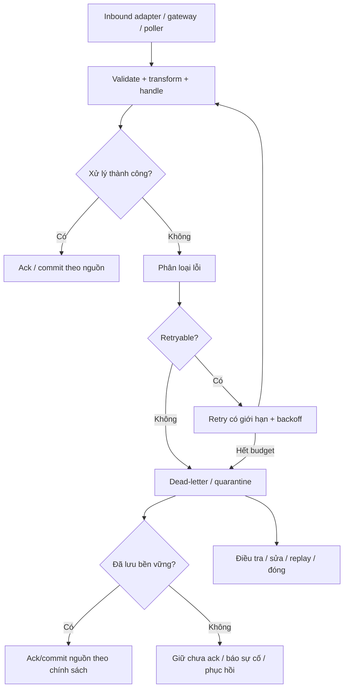
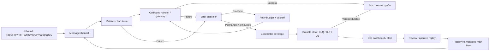
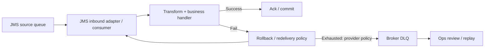
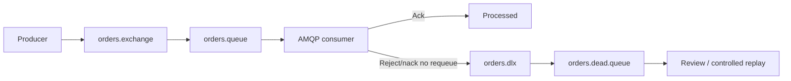
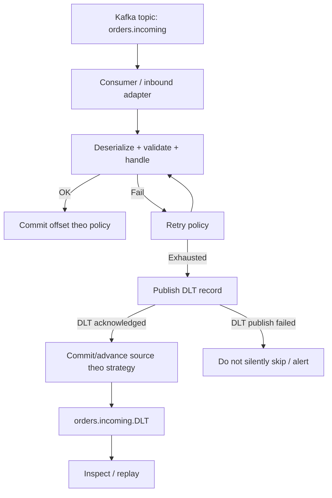
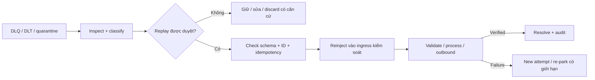

# Dead-letter flow cho message lỗi

## 1. Vì sao một luồng tích hợp cần dead-letter flow?

Một ứng dụng dùng Spring Integration nhận đơn hàng từ HTTP, chuyển sang sự kiện rồi gửi tới Kafka. Trong một ngày, phần lớn message hợp lệ nhưng có ba trường hợp:

- Một sự kiện thiếu `orderId` nên không thể chuyển thành JSON theo schema.
- Broker Kafka tạm thời không kết nối được; sau vài lần thử lại, sự kiện có thể gửi thành công.
- Consumer liên tục nhận sự kiện có `schemaVersion` không hỗ trợ, khiến mỗi lần xử lý đều ném exception.

Nếu hệ thống **bỏ qua message lỗi**, có thể mất đơn hàng. Nếu **retry vô hạn**, một message lỗi cố định có thể chiếm thread, làm đầy queue, trì hoãn những message hợp lệ. Nếu **đánh dấu đã xử lý trước khi lưu được message lỗi**, một lần crash có thể làm message biến mất. Ngược lại, nếu **phát lại không có kiểm soát**, consumer có thể xử lý một đơn nhiều lần.

**Dead-letter flow** là luồng xử lý dành cho message **không thể hoàn thành theo chính sách xử lý thông thường**. Nó ghi nhận đủ thông tin để kiểm tra, khắc phục và có thể phát lại an toàn, thay vì âm thầm loại bỏ hoặc lặp mãi tại pipeline chính.

Bài **“Dead-letter flow cho message lỗi”** thuộc chương **Reliability**, module `SPRING_INTEGRATION_ADAPTERS`. Ngữ cảnh là kết nối hệ thống ngoài bằng **inbound/outbound adapter, gateway, poller và MessageChannel** qua **File, SFTP, HTTP, JMS, AMQP, Kafka và database**; thiết kế hợp đồng message, cách xử lý lỗi và vòng đời kết nối.

> **Nguyên tắc:** Một message đi vào dead-letter **không có nghĩa đã hoàn thành nghiệp vụ**. Nó chỉ được chuyển sang trạng thái **chưa xử lý thành công nhưng đã được lưu giữ/ghi nhận có chủ đích** theo mức bảo đảm mà hệ thống thiết kế.

## 2. Dead-letter queue, dead-letter topic và quarantine khác nhau thế nào?

Trong thực tế, “DLQ” thường được dùng như tên chung, nhưng mỗi loại mang semantics khác nhau:

| Khái niệm | Ý nghĩa | Ví dụ |
| --- | --- | --- |
| **Dead-letter queue (DLQ)** | Hàng đợi giữ message không thể xử lý bình thường | JMS broker DLQ hoặc RabbitMQ queue dành cho message bị dead-letter |
| **Dead-letter exchange (DLX)** | Exchange nhận dead-letter từ queue ở RabbitMQ, rồi route đến queue khác | `orders.dlx` |
| **Dead-letter topic (DLT)** | Topic ứng dụng dùng để lưu record lỗi, thường gặp với Kafka | `orders.events.DLT` |
| **Quarantine store** | Kho cách ly để điều tra, sửa và điều phối phát lại | Bảng database chứa failed payload, metadata và trạng thái |
| **Error channel** | `MessageChannel` nhận thông báo lỗi trong Spring Integration theo topology | `errorChannel` hoặc `adapterErrors` |
| **Retry queue/topic** | Kênh giữ message cần thử lại về sau | `orders.retry.5m` |
| **Parking lot** | Nơi giữ lỗi chờ con người hoặc quy trình riêng xử lý | Queue hoặc bảng có trạng thái `PARKED` |
| **Poison message** | Message luôn gây lỗi với cùng điều kiện hiện có | Payload không khớp schema, version không hỗ trợ |

**Error channel không tự động là DLQ bền vững.** Nó có thể chỉ là luồng trong bộ nhớ hoặc endpoint để xử lý `ErrorMessage`. Chỉ khi nối tới nơi lưu bền vững có kiểm soát và xác minh kết quả, ta mới có khả năng giữ message để điều tra sau restart.

**Không phải mọi giao thức có sẵn một DLQ giống nhau.** JMS thường phụ thuộc chính sách của broker; RabbitMQ có cơ chế dead-letter exchange; Kafka thường cần consumer/framework chủ động publish bản ghi lỗi sang DLT; File/SFTP, HTTP và JDBC không có “DLQ mặc định” cho mọi ứng dụng.

## 3. Một message đi qua những trạng thái nào?

Ví dụ chuỗi xử lý tiêu chuẩn:



Sơ đồ diễn tả tư duy điều phối, không quy định rằng mọi connector có cách ack giống nhau. Có nguồn chỉ cho phép polling theo thời điểm; có nguồn hỗ trợ transaction/ack, nhưng **không thể chuyển mọi nguồn thành một transaction nguyên tử với mọi DLQ**.

### Những trạng thái nghiệp vụ nên phân biệt

| Trạng thái | Diễn giải |
| --- | --- |
| `RECEIVED` | Đã nhận message từ nguồn nhưng chưa hoàn tất xử lý |
| `PROCESSING` | Đang validate, transform hoặc gửi ra đích |
| `RETRY_WAIT` | Lỗi có thể tạm thời, đang chờ thử lại |
| `FAILED_FINAL` | Đã hết số lần thử hoặc lỗi không nên retry |
| `QUARANTINED` | Đã lưu message lỗi vào nơi được kiểm soát |
| `REPLAY_REQUESTED` | Đã có yêu cầu phát lại được phê duyệt |
| `REPLAYING` | Đang thử xử lý lại từ bản ghi cách ly |
| `RESOLVED` | Đã có bằng chứng kết quả nghiệp vụ phù hợp |
| `DISCARDED_APPROVED` | Đã quyết định không xử lý tiếp, có căn cứ và người phê duyệt |
| `PARKING_FAILED` | Không thể lưu message lỗi; cần cảnh báo ưu tiên cao |

Không được đánh dấu `RESOLVED` ngay khi chỉ gửi message ra broker hoặc khi tạo yêu cầu replay.

## 4. Phân loại lỗi trước khi quyết định dead-letter

Mỗi lỗi phải được đánh giá về **khả năng retry, tác động và tính an toàn khi gửi lại**.

| Nhóm lỗi | Ví dụ trong Spring Integration | Retry tự động? | Hướng xử lý |
| --- | --- | --- | --- |
| **Validation / contract** | Thiếu field, JSON malformed, sai schema, CSV cột thiếu | Thường không nếu payload không đổi | Quarantine, thông báo producer/chủ dữ liệu |
| **Serialization** | Jackson không map được kiểu, charset sai | Thường không cho tới khi cấu hình/code sửa | Dead-letter với schema/version và mã lỗi |
| **Authorization / credential** | SFTP permission denied, HTTP 403, token hết hiệu lực | Không retry mù | Kiểm tra credential, quyền và cấu hình |
| **Rate limit** | HTTP 429, broker throttle | Có, nếu hợp đồng cho phép | Backoff, giới hạn concurrency và attempts |
| **Transient network** | Timeout, connection reset, DNS/service chưa sẵn sàng | Có điều kiện | Retry có giới hạn + circuit breaker khi cần |
| **Broker unavailable** | Không kết nối Kafka/JMS/AMQP | Có điều kiện | Retry/backoff, quan sát broker và queue |
| **Database transient** | Deadlock, lỗi kết nối tạm thời | Có thể | Retry trong ranh giới transaction an toàn |
| **Data constraint** | Unique key conflict, foreign key violation | Phụ thuộc nghiệp vụ | Phân biệt duplicate hợp lệ và dữ liệu sai |
| **Timeout trạng thái không chắc chắn** | HTTP POST đã xử lý nhưng caller timeout | Chỉ khi có kiểm soát trùng | Idempotency key, kiểm tra trạng thái |
| **Lỗi hệ thống kéo dài** | Broker không khả dụng nhiều giờ | Retry trong budget, sau đó chuyển/giữ | Cảnh báo vận hành, tránh dồn vô hạn |

**Không retry mọi exception một cách giống nhau.** Lỗi `InvalidSchemaVersion` sẽ không tự khỏi chỉ vì thử lại 100 lần; ngược lại một lần network timeout không nhất thiết phải đưa thẳng vào DLQ.

### Transient và permanent không phải nhãn bất biến

Một HTTP 400 thường cần sửa request, nhưng API có thể dùng mã này với nghĩa riêng. Một JDBC constraint violation có thể biểu thị duplicate đã xử lý, hoặc dữ liệu vi phạm bất biến. Cần dựa trên **hợp đồng đích, loại exception, trạng thái transaction và khả năng xác minh**.

## 5. Phân biệt lỗi ở các lớp của pipeline

```text
Source / Inbound
    |
    v
[Deserializer / Converter]    -> parse/schema failure
    |
    v
[Filter / Router]             -> rejected / no route / policy mismatch
    |
    v
[Transformer]                 -> data mapping failure
    |
    v
[Outbound adapter / gateway]  -> connection / protocol / timeout / auth
    |
    v
[External system]             -> broker ack / HTTP response / DB commit
    |
    v
[Business consumer]           -> downstream processing outcome
```

Thông tin cần ghi là **thất bại ở bước nào**, không chỉ message “send failed”.

Ví dụ JSON bị thiếu trường ở transformer: có thể lưu bản gốc cùng lỗi mapping. Nếu adapter Kafka đã nhận ACK nhưng downstream consumer báo không xử lý được schema, đây là **lỗi của consumer**, không phải lỗi “producer không gửi được”. Hai loại cần luồng dead-letter và điểm ghi nhận khác nhau.

## 6. `errorChannel` và `ErrorMessage` trong Spring Integration

Spring Integration sử dụng hệ thống Spring Messaging để chuyển sự kiện lỗi. Thông thường một `ErrorMessage` có payload là `Throwable`, và khi ngoại lệ thuộc họ `MessagingException` nó có thể chứa thông điệp gây lỗi thông qua `getFailedMessage()`.

Ví dụ cấu trúc logic:

```text
ErrorMessage
├── payload: Throwable
│   ├── cause chain
│   ├── error type / stage
│   └── failedMessage? (khi exception có thông tin này)
└── headers: error metadata, id, timestamp, ...
```

### Cảnh báo quan trọng về topology

- Với `DirectChannel` và xử lý đồng bộ, exception thường **truyền ngược caller**; không tự nhiên trở thành một message trên `errorChannel`.
- Với poller, executor-based channel hoặc inbound endpoint bất đồng bộ, framework có thể phát `ErrorMessage` đến error channel theo cấu hình.
- Global `errorChannel` có thể dùng chung nhiều flow; nếu xử lý chung cần phân loại theo source/adapter, không được giả định mọi lỗi là đơn hàng.
- Đặt header `errorChannel` không phải cam kết mọi endpoint sẽ dùng header đó như nhau.
- Nếu handler error channel **cũng lỗi**, cần phương án bảo toàn message gốc và cảnh báo; không để lỗi thứ hai làm mất dấu lỗi thứ nhất.

**Một dead-letter flow đáng tin phải xác định rõ điểm phát lỗi, channel xử lý, nơi lưu và điều kiện ack nguồn.**

### Phân biệt ErrorMessage với message lỗi nghiệp vụ

Một `ErrorMessage` chứa throwable phục vụ chẩn đoán. Bản ghi DLQ nên có **envelope có schema ổn định** chứa định danh, stage, exception loại đã chuẩn hóa và payload gốc hoặc tham chiếu an toàn. Không nên serialize trực tiếp toàn bộ Java Throwable/stack trace vào một broker message để làm hợp đồng lâu dài.

## 7. Thiết kế kiến trúc dead-letter flow

Một thiết kế điển hình gồm:



Trong production, thực hiện `Ack/commit` còn phụ thuộc vào lifecycle của inbound adapter/broker, transaction boundary và failure mode. Có thể không tạo được giao dịch nguyên tử giữa nguồn và kho dead-letter; khi đó cần **at-least-once, idempotency và reconciliation**.

### Thành phần chức năng

1. **Error classifier:** xác định lỗi nào retry được, lỗi nào cần cách ly.
2. **Retry policy:** số lần, độ trễ, backoff, jitter, tổng thời gian được phép.
3. **Recoverer:** hành vi khi retry đã hết; publish hoặc lưu dead-letter.
4. **Dead-letter envelope:** bản ghi chứa dữ liệu đủ cho phân tích và replay.
5. **Durable dead-letter sink:** broker queue/topic hoặc database/object storage.
6. **Acknowledger/transaction coordinator:** đảm bảo nguồn không bị đánh dấu thành công quá sớm.
7. **Operational controls:** alert, dashboard, retention, quyền truy cập và quy trình replay.
8. **Replay ingress:** đưa message về đúng flow có validation, tránh đi thẳng vào hệ thống đích không kiểm tra.

## 8. Mẫu envelope cho message lỗi

Không nên chỉ lưu `exception.toString()`. Một bản ghi có cấu trúc giúp phân loại và xử lý hàng nghìn sự cố.

```json
{
  "deadLetterId": "dlq-000731",
  "originalMessageId": "evt-2401",
  "correlationId": "request-77",
  "source": {
    "type": "kafka",
    "resource": "orders.incoming",
    "partition": 2,
    "offset": 78129
  },
  "failure": {
    "stage": "json-validation",
    "code": "UNSUPPORTED_SCHEMA_VERSION",
    "exceptionType": "SchemaValidationException",
    "retryable": false,
    "attempts": 1,
    "firstFailedAt": "2026-11-23T08:30:00Z",
    "lastFailedAt": "2026-11-23T08:30:00Z"
  },
  "message": {
    "contentType": "application/json",
    "schemaVersion": 99,
    "payloadRef": "restricted://dead-letter-payloads/dlq-000731"
  },
  "status": "QUARANTINED",
  "owner": "orders-integration",
  "createdAt": "2026-11-23T08:30:01Z"
}
```

Đây là **schema minh họa**. `payloadRef` biểu thị tham chiếu logic tới dữ liệu được bảo vệ, không phải URL có thể truy cập tự do.

### Các nhóm trường nên cân nhắc

| Nhóm | Dữ liệu cần | Lý do |
| --- | --- | --- |
| **Identity** | Dead-letter ID, original event/message ID, correlation ID | Dedup và truy vết |
| **Nguồn** | Adapter name, queue/topic/file/path hoặc resource ID | Tìm message gốc và semantics nguồn |
| **Vị trí nguồn** | Kafka partition/offset, JMS message ID, file position nếu có | Điều tra và đối chiếu |
| **Payload** | Raw bytes có bảo vệ hoặc ref, content type, charset, schema version | Có thể replay đúng dữ liệu gốc |
| **Lỗi** | Stage, code, exception loại, retryability, attempt count | Phân loại lỗi và quyết định xử lý |
| **Thời điểm** | First/last failure, receivedAt, parkedAt, retryAt | SLA, tuổi message |
| **Routing** | Target resource logic đã được policy chấp nhận | Không phát lại sai đích |
| **Quản trị** | Owner, ticket, status, resolution, reviewer | Không tồn đọng vô chủ |
| **Tính toàn vẹn** | Hash/checksum hoặc signature khi cần | Phát hiện dữ liệu thay đổi không mong muốn |

**Không sao chép vô điều kiện toàn bộ headers**. Một số chứa bearer token, cookie, thông tin định tuyến nội bộ, `replyChannel` hoặc `errorChannel` không thể serialize/không nên lộ. Dùng allowlist header và cơ chế redaction.

## 9. Lưu payload gốc hay payload đã biến đổi?

Giả sử pipeline:

```text
HTTP JSON input
  -> parse DTO
  -> enrich customer data
  -> map outbound DTO
  -> serialize JSON
  -> Kafka publish
```

Có ba lựa chọn:

- **Raw input:** hữu ích nếu cần sửa parser/schema đầu vào.
- **Canonical message:** hữu ích để replay sau bước validation mà không lặp lại thao tác đọc nguồn.
- **Outbound bytes:** hữu ích nếu cần gửi lại đúng dữ liệu đã định dạng, đặc biệt khi mất ACK ở transport.

Chỉ lưu outbound bytes có thể thiếu ngữ cảnh để sửa lỗi mapping. Chỉ lưu raw input có thể tái tạo output khác sau khi code/policy đã thay đổi.

### Thiết kế thực tế

Đối với message có độ nhạy cao, lưu:

1. Bản gốc hoặc một **reference** tới bản gốc được bảo vệ.
2. Schema/version và metadata nguồn có chọn lọc.
3. Thông tin stage và lỗi.
4. Version transformer/policy, nếu cần tái hiện kết quả.
5. Dữ liệu đủ để quyết định **replay từ bước nào**.

**Không tự động lưu dữ liệu cá nhân hoặc credential vô thời hạn** chỉ vì dead-letter cần debug. Áp dụng retention, mã hóa, phân quyền và chính sách xóa thích hợp.

## 10. Retry trước khi dead-letter: Có giới hạn và theo phân loại

Không nên gửi mọi lỗi thẳng vào DLQ; nhưng cũng không nên retry vô hạn.

Một retry policy minh họa:

```yaml
retryPolicy:
  transientErrors:
    maxAttempts: 4
    initialBackoffMillis: 300
    multiplier: 2.0
    maxBackoffMillis: 5000
    jitter: true
  permanentErrors:
    maxAttempts: 1
  exhausted:
    action: "dead-letter"
    requireDurableConfirmation: true
```

Đây là **policy minh họa**, không phải cấu hình Spring Integration hay Spring Retry có thể dùng trực tiếp.

### Khi thiết kế budget phải hỏi

- `maxAttempts` có tính **lần đầu tiên** không? Quy ước cần rõ.
- Tổng thời gian retry có vượt HTTP timeout, broker poll interval hay SLA nghiệp vụ?
- Có nguy cơ nhiều consumer đồng thời retry gây **retry storm** không?
- Có nên dùng circuit breaker khi đích ngừng dài?
- Lỗi idempotent hay side effect có thể đã xảy ra?
- Sau cùng nên chuyển DLQ, trả lỗi caller hay giữ message chưa ack?

### Retry tạm thời không phải sửa dữ liệu

Payload JSON malformed không trở thành JSON đúng nhờ backoff. Khi producer sửa và gửi dữ liệu mới, đó là **một sự kiện/phiên bản mới hoặc quy trình correction**, cần quản lý ID và audit riêng.

## 11. Spring Integration: Retry advice và điểm recover

**Spring Integration** có các cơ chế advice cho endpoint xử lý message; trong những phiên bản hỗ trợ, `RequestHandlerRetryAdvice` có thể áp dụng cho message handler và dùng retry policy/recovery callback phù hợp.

Sơ đồ khái niệm:

```text
Message received
  -> outbound handler
      -> failure
      -> RetryTemplate / retry policy
      -> attempts exhausted
      -> recovery callback
      -> dedicated error/dead-letter channel
      -> durable sink
```

Các API Spring Retry/Spring Integration có thay đổi theo phiên bản; phải xác minh package, method signature và nơi advice được gắn vào handler đang dùng.

### Pseudocode của recoverer có điều kiện

```java
// Minh họa tư duy, KHÔNG phải implementation dùng trực tiếp.
handleWithRecovery(message):
    try:
        sendToExternalSystem(message)
        markProcessedOnlyAfterRequiredConfirmation(message)
    catch error:
        classification = classify(error)
        if classification.isTransient()
                && withinRetryBudget(message):
            scheduleRetryWithBackoff(message)
        else:
            envelope = buildSanitizedDeadLetter(message, error)
            persistAndVerifyDeadLetter(envelope)
            acknowledgeSourceAccordingToContract(message)
```

Mẫu trên nhấn mạnh **thứ tự lưu rồi mới ack** khi yêu cầu bền vững. Không được coi thao tác lưu là atomic với nguồn chỉ vì viết chúng trong cùng một method.

### Những nhầm lẫn về recovery callback

- Callback trả về “đã recovered” có thể khiến upstream coi handler đã hoàn tất; cần đảm bảo nó **chỉ hoàn tất khi parking bền vững**.
- Recovery gửi error message qua channel **không đồng nghĩa broker DLQ nhận thành công**.
- Advice gắn vào **một handler** không bao phủ mọi lỗi từ deserializer trước đó hoặc từ consumer downstream.
- Khi fail ở recoverer, phải **lan truyền hoặc giữ nguồn chưa ack** theo chính sách, không trả thành công giả.

## 12. Mẫu Java: Nhận ErrorMessage và tạo dead-letter record

Một handler minh họa trên kênh lỗi chuyên biệt:

```java
import org.springframework.messaging.Message;
import org.springframework.messaging.MessagingException;
import org.springframework.messaging.support.ErrorMessage;
import org.springframework.integration.annotation.ServiceActivator;
import org.springframework.stereotype.Component;

@Component
public class DeadLetterErrorHandler {

    private final DeadLetterRepository repository;

    public DeadLetterErrorHandler(DeadLetterRepository repository) {
        this.repository = repository;
    }

    @ServiceActivator(inputChannel = "adapterErrorChannel")
    public void onError(ErrorMessage errorMessage) {
        Throwable failure = errorMessage.getPayload();

        Message<?> failed = null;
        if (failure instanceof MessagingException messagingException) {
            failed = messagingException.getFailedMessage();
        }

        // Trong production: duyệt cause chain nếu cần,
        // lấy original message từ nguồn tin cậy/đã lưu trước đó,
        // không dựa duy nhất vào getFailedMessage().

        DeadLetterRecord record = DeadLetterRecord.from(
            failure,
            failed,
            errorMessage.getHeaders()
        );

        // Chỉ trả thành công khi durable write đã xác nhận.
        repository.saveDurably(record);
    }
}
```

`DeadLetterRepository` và `DeadLetterRecord` trong đoạn trên là **các abstraction của ứng dụng**, không phải class chuẩn của Spring Integration. Phương thức `from` cần xử lý trường hợp `failed == null`, redaction, định danh và schema của dữ liệu lưu. Mã dùng cú pháp `instanceof` pattern matching của Java hiện đại.

**Điểm mấu chốt:** handler chỉ nhận được `ErrorMessage` nếu **error producer đã thực sự route lỗi tới `adapterErrorChannel`**. Cần nối channel qua endpoint/recoverer phù hợp với phiên bản và topology. Đừng tạo bean listener rồi giả định nó tự quan sát toàn bộ lỗi.

### Vì sao không lưu nguyên Throwable?

`Throwable` có thể chứa stack trace nhạy cảm, class nội bộ và dữ liệu không ổn định khi serializing. Nên lấy **exception type, error code đã chuẩn hóa, stage, message đã làm sạch**, còn thông tin chẩn đoán chi tiết được ghi vào log hạn chế truy cập theo retention.

## 13. Thiết kế kho cách ly bền vững bằng database

Khi File/SFTP/HTTP không có broker DLQ sẵn, một bảng database có thể làm **quarantine store**.

### Schema minh họa

```sql
CREATE TABLE integration_dead_letter (
    dead_letter_id       VARCHAR(80) PRIMARY KEY,
    original_event_id    VARCHAR(160),
    correlation_id       VARCHAR(160),
    source_adapter       VARCHAR(100) NOT NULL,
    source_reference     VARCHAR(500),
    failure_stage        VARCHAR(100) NOT NULL,
    failure_code         VARCHAR(120) NOT NULL,
    retryable            BOOLEAN NOT NULL,
    attempt_count        INTEGER NOT NULL,
    payload_content_type VARCHAR(160),
    payload_schema       VARCHAR(100),
    payload_ref          VARCHAR(600),
    payload_sha256       VARCHAR(64),
    status               VARCHAR(40) NOT NULL,
    first_failed_at      TIMESTAMP NOT NULL,
    last_failed_at       TIMESTAMP NOT NULL,
    replay_requested_at  TIMESTAMP,
    resolved_at          TIMESTAMP,
    owner_id             VARCHAR(120)
);
```

Đây là SQL minh họa; cần điều chỉnh kiểu thời gian, DDL, constraint và indexing theo database thực tế.

Nếu lưu payload trực tiếp vào cột binary/JSON, phải quản lý kích thước, mã hóa, backup và retention. Nếu lưu ở object storage, reference phải có quyền truy cập/TTL phù hợp; **không dùng public URL có secret lâu dài**.

### Tránh trùng bản ghi dead-letter

Một message có thể bị phát lại và dead-letter nhiều lần. Không nên dùng duy nhất `originalEventId` làm khóa nếu một event có thể thất bại ở nhiều đích hoặc qua nhiều lần xử lý hợp lệ.

Có thể xác định khóa idempotent theo:

```text
(sourceId, sourceMessageId, consumerGroupOrTarget, failureStage, processingEpoch)
```

Đây là **một gợi ý**, không phải khóa chuẩn. Định nghĩa `processingEpoch`/attempt cycle rõ ràng để phân biệt cùng sự kiện thất bại lại sau replay. Lưu lịch sử sửa lỗi nhưng không tạo vô hạn bản ghi giống nhau chỉ vì broker redelivery.

## 14. JMS: Dead-letter phụ thuộc chính sách broker

**JMS API không định nghĩa một cơ chế DLQ giống hệt cho mọi broker**. Khả năng redelivery, backoff, delivery count và dead-letter destination phụ thuộc provider/đặc tả triển khai.

### Luồng điển hình



### Những quyết định cấu hình quan trọng

- Consumer dùng acknowledgment mode nào và transaction có áp dụng không?
- Nếu listener ném exception, broker có redeliver tự động hay adapter đã ack rồi?
- Delivery count và delay tăng theo chính sách nào?
- Có maximum redeliveries và dead-letter policy được broker hỗ trợ không?
- DLQ giữ nguyên JMS headers/properties và payload theo mức nào?
- Có thể phát lại về queue gốc với bảo toàn business ID và schema không?
- DLQ bị đầy hoặc không thể ghi thì điều gì xảy ra?

### Tránh vòng lặp redelivery

Nếu message không hợp lệ schema, broker có thể liên tục giao lại cùng message cho consumer. Một policy **max redeliveries** và DLQ phù hợp giúp tránh làm tắc consumer, nhưng phải kiểm tra broker có áp dụng chính sách hay không. Không suy ra chắc chắn từ một config chung của Spring rằng message sẽ tự vào DLQ.

## 15. RabbitMQ/AMQP: Dead-letter exchange và requeue

RabbitMQ có **dead-letter exchange (DLX)** để route message ra khỏi queue trong những trường hợp được hỗ trợ, ví dụ consumer reject/nack với `requeue=false`, TTL hết hạn hoặc các điều kiện queue khác.

### Luồng định tuyến



Một cấu hình logical tương đương:

```yaml
ordersQueue:
  name: orders.queue
  arguments:
    x-dead-letter-exchange: orders.dlx
    x-dead-letter-routing-key: orders.dead
deadLetterExchange:
  name: orders.dlx
  binding:
    routingKey: orders.dead
    queue: orders.dead.queue
```

Đây là **mô tả các thuộc tính broker**, không phải YAML Spring Boot có thể copy chạy trực tiếp. Cần khai báo queue, exchange, binding và chính sách broker bằng công cụ/framework đang dùng.

### Những điều cần nắm vững

1. **`requeue=true` có thể tạo vòng lặp:** message độc bị giao liên tục. Phân loại lỗi trước khi requeue.
2. DLX route tới dead queue **chỉ khi exchange/binding tồn tại và khớp routing key**.
3. RabbitMQ có metadata dead-letter như `x-death` trong những luồng tương ứng; không nên dùng riêng nó làm sự thật duy nhất về tổng số lần xử lý nghiệp vụ.
4. Dead-letter routing trong thiết lập phổ biến **không tự bảo đảm at-least-once tới DLQ ở mọi cấu hình**; cần đọc bảo đảm của queue type và broker policy, giám sát failures.
5. Không dựa vào TTL ngắn + DLX quay lại queue chính như một hệ thống retry vô hạn không có budget và cảnh báo.
6. Publisher confirms và consumer ACK khác nhau; DLQ cần theo dõi riêng.

### Khi adapter lỗi trước khi broker nhận

Nếu Spring Integration **AMQP outbound adapter** không publish được message, RabbitMQ chưa chắc đã có bản sao để dead-letter. Đây là **lỗi producer/outbound**, phải xử lý trong Spring Integration error flow, retry hoặc durable outbox; DLX của queue downstream không tự bảo vệ nó.

## 16. Kafka: DLT thường do ứng dụng/framework publish

Kafka không có khái niệm broker tự chuyển mọi record lỗi sang DLT theo cách giống queue RabbitMQ. DLT thường là **topic riêng** mà consumer hoặc framework chủ động publish khi xử lý thất bại.

### Luồng điển hình



Trong hệ sinh thái Spring, **Spring Kafka** có các khả năng như `DefaultErrorHandler` và `DeadLetterPublishingRecoverer` để xử lý lỗi listener; khi dùng **Spring Integration Kafka adapter**, cần xác định cách error handling của adapter và container tích hợp với các cơ chế đó. Chúng **không tự nhiên được bật** chỉ vì tạo một `IntegrationFlow`.

### DLT record nên mang gì?

- Original topic, partition, offset.
- Original key/value hoặc reference phù hợp bảo mật.
- Consumer group / processing stage.
- Exception class/error code được chuẩn hóa.
- Timestamp, attempt count và schema version.
- Business `eventId` ổn định.
- Một **replay marker** có kiểm soát khi phát lại.

Header của Kafka có định dạng bytes, và tên/header framework riêng có thể thay đổi theo phiên bản. Không giả định có thể truyền object Java hoặc mọi header Spring trực tiếp lên Kafka.

### Offset và DLT không tự nguyên tử

Nếu publish DLT thành công nhưng commit offset thất bại, record gốc có thể được xử lý lại. Nếu commit offset trước nhưng DLT publish thất bại, có thể mất đường phục hồi. Thiết kế phải cân nhắc producer/consumer transaction trong phạm vi được hỗ trợ, dedup và các phương án xử lý sau lỗi.

**Tuyệt đối không đánh dấu offset đã giải quyết khi không có bằng chứng DLT được lưu** nếu yêu cầu là không mất dữ liệu.

### Key và ordering

Chuyển record sang DLT và replay sau có thể phá thứ tự theo business key. Nếu các sự kiện cho cùng `orderId` phụ thuộc thứ tự, cần lưu original key/partition/offset và quyết định replay dựa trên state hiện tại; không phát lại mù một event cũ.

## 17. File inbound và SFTP: Khi không có broker DLQ

**File** và **SFTP** thường không có DLQ như message broker. Có thể dùng **quarantine directory**, kho đối tượng hoặc bảng DLQ để tách file lỗi.

### File inbound với poller

```text
/inbox/order-001.json
   -> File inbound adapter/poller
   -> read + validate
   -> lỗi schema
   -> lưu error record + copy/move có kiểm soát
   -> /quarantine/order-001.json
```

Cần cân nhắc:

- File đã bị move/delete trước khi pipeline xử lý xong chưa?
- File filter/accept-once có đang đánh dấu đã xử lý dù transform thất bại không?
- Quarantine move có an toàn khi hai bước khác filesystem không?
- Retry sau restart có tạo duplicate hay không?
- File đang được upload dở có bị poll và xem như malformed không?
- Có tên trùng và rủi ro overwrite file lỗi cũ không?

### SFTP inbound

SFTP thường cần xác định **giao nhận hoàn tất**: tệp có thể được upload bằng tên tạm rồi rename, hoặc có marker. Nếu remote file được tải về nhưng xử lý lỗi, cần giữ bằng chứng liên kết **remote path, size, mtime, checksum hoặc business ID** trong phạm vi tin cậy.

**Không tự move/delete file bên đối tác khi xử lý lỗi nếu chưa có hợp đồng và quyền cho phép.** Một lựa chọn là tải bản sao vào vùng quarantine và đánh dấu record trong kho theo dõi; thao tác trên server đối tác phải tuân thủ quy trình giao nhận đã thống nhất.

### File quarantine cũng cần retention

File lỗi có thể chứa PII hoặc dữ liệu thanh toán. Cần quyền đọc hạn chế, mã hóa lưu trữ khi phù hợp, thời hạn lưu, dọn file mồ côi và bảo vệ tránh consumer tự động đọc lại thư mục quarantine.

## 18. HTTP inbound/outbound: Không có ACK hay DLQ chung cho mọi API

### HTTP inbound gateway

Khi client gửi request và xử lý đồng bộ thất bại, HTTP server thường trả lỗi phù hợp (`4xx` hoặc `5xx` theo hợp đồng). Trong nhiều hệ thống, **client chịu trách nhiệm retry**, còn server có thể lưu trạng thái công việc vào kho bền vững nếu muốn trả `202 Accepted` và xử lý async.

Hai lựa chọn khác nhau:

1. **Synchronous fail:** trả lỗi, không claim đã nhận xử lý bền vững.
2. **Durable accept:** ghi request/job vào queue/DB trước, sau đó trả một response theo hợp đồng để client theo dõi.

Không trả `202 Accepted` chỉ vì message đã đi vào một `DirectChannel` trong memory nếu hệ thống muốn hứa “sẽ xử lý về sau” mà không có storage bền vững.

### HTTP outbound gateway

Khi gọi API ngoài, các tình huống:

| Kết quả | Diễn giải | Dead-letter/retry |
| --- | --- | --- |
| `200/201` | Có thể thành công theo API; cần đọc response contract | Ghi kết quả, không mặc định business workflow toàn hệ thống xong |
| `202` | Được tiếp nhận để xử lý tiếp | Cần poll/callback/đối soát trạng thái |
| `400/422` | Payload bị từ chối theo hợp đồng | Thường dead-letter để sửa dữ liệu |
| `401/403` | Credential/quyền không hợp lệ | Không retry mù, cảnh báo cấu hình bảo mật |
| `409` | Conflict hoặc duplicate theo API | Xác định tình trạng nghiệp vụ thực tế |
| `429/503` | Rate limit/lỗi tạm thời | Retry có backoff theo chính sách |
| Timeout sau POST | Không rõ server đã thực thi chưa | Idempotency key/tra trạng thái trước retry |

Nếu outbound request đi ra từ Kafka/JMS consumer, dead-letter phải gắn với **nguồn message gốc** và chiến lược commit/ack của consumer, không chỉ lưu một HTTP exception rời rạc.

## 19. Database/JDBC: Lỗi SQL và dead-letter trong transaction

Database có thể vừa là **hệ thống đích** vừa là **nơi giữ dead-letter**.

### Nếu JDBC là outbound target

- **Transient:** database unavailable, deadlock theo điều kiện có thể retry.
- **Permanent:** dữ liệu sai kiểu, thiếu foreign key, vi phạm constraint không thể sửa bằng retry mù.
- **Ambiguous:** timeout giữa commit và trả kết quả; phải kiểm tra trạng thái bằng khóa nghiệp vụ.

Nếu nguồn là broker và target là DB, một giao dịch DB thành công không tự đảm bảo consumer đã commit offset/ack tương ứng. Dùng unique key/idempotency để chịu được redelivery.

### Nếu dùng DB làm quarantine store

Không nên “nuốt exception” chỉ vì câu INSERT vào bảng DLQ thất bại:

```text
Source message fails
  -> retry exhausted
  -> INSERT dead_letter
      -> success / durable commit: proceed with ack policy
      -> failure: DO NOT claim parked
```

Một lời gọi repository thành công nhưng transaction chưa commit **chưa phải durability**. Trong kiến trúc dùng transaction chung, phải hiểu thứ tự commit/rollback của nguồn và store.

### Transactional outbox / inbox

- **Outbox:** ghi event để phát ra ngoài trong cùng transaction với thay đổi dữ liệu nguồn.
- **Inbox/dedup:** ghi nhận business event đã xử lý để tránh side effect lặp.
- **Dead-letter table:** lưu sự kiện không thể xử lý bình thường, có owner và metadata điều tra.

Ba loại bảng phục vụ mục tiêu khác nhau, có thể phối hợp nhưng không phải cùng một cơ chế.

## 20. Trường hợp lỗi trước khi tạo Spring Message

Không phải lỗi nào cũng tạo được `Message<?>` hợp lệ. Ví dụ:

- Kafka key/value deserializer thất bại ngay ở container.
- JMS converter không đọc được `BytesMessage`.
- HTTP body parser reject trước khi vào gateway handler.
- File content converter thất bại trước khi gửi lên channel.

Nếu message chưa được tạo, một listener chỉ nhận `ErrorMessage` từ business flow có thể **không bao giờ thấy lỗi**.

### Kiểm soát

1. Xác định **lỗi ở adapter/container trước channel**.
2. Dùng cơ chế error handling/recoverer của **adapter cụ thể** hoặc lưu raw source record trước parse khi cần.
3. Ghi metadata nguồn có thể lấy được: file path, Kafka partition/offset, JMS message ID, HTTP request ID.
4. Không cố deserialize dữ liệu lỗi chỉ để tạo DLQ; dùng raw bytes/ref kèm content type và error code.
5. Kiểm thử riêng trường hợp deserialization error, không chỉ exception ném từ `@ServiceActivator`.

Kafka có các cơ chế xử lý deserialization error của Spring Kafka phù hợp từng phiên bản; cần cấu hình có chủ đích thay vì suy rằng `DefaultErrorHandler` mặc định xử lý mọi thất bại trước khi record tồn tại.

## 21. Replay: Không phải cứ lấy từ DLQ rồi gửi lại

Replay là một **quy trình nghiệp vụ có kiểm soát**, vì trạng thái hệ thống và hợp đồng có thể đã thay đổi từ khi message lỗi.

### Điều kiện cho phép replay

- Nguyên nhân gốc đã được sửa hoặc đích đã phục hồi.
- Payload gốc vẫn hợp lệ theo schema/version được hỗ trợ.
- Quyền truy cập, tenant, resource và các chính sách hiện tại vẫn cho phép xử lý.
- Có cách chống duplicate và xử lý event quá cũ.
- Target service có khả năng tiếp nhận và backpressure phù hợp.
- Người/automation được ủy quyền phê duyệt theo phân loại rủi ro.
- Có cách ghi nhận kết quả và đóng record DLQ.

### Luồng replay



**Không replay bằng cách bypass validation/AuthZ** để “cho message chạy được”. Nếu message lỗi vì schema, cần sửa producer/transformer hoặc biến đổi migration có kiểm thử và audit.

### Một bản ghi có thể phát lại mấy lần?

Cần có `replayAttemptCount`, tổng giới hạn, trạng thái, thời gian và người/automation kích hoạt. Không để DLT replay vào main topic rồi ngay lập tức dead-letter, tạo vòng lặp vô hạn giữa hai nơi.

## 22. Replay an toàn khi business state đã thay đổi

Ví dụ một message `order.cancelled` bị lỗi hôm qua, nhưng hôm nay đơn đã hoàn tất giao hàng. Phát lại nguyên event có thể gây hành động không hợp lệ.

**Cần đánh giá:**

- Event có tính **state transition** hay chỉ là notification?
- Consumer có kiểm tra version/sequence number hoặc current state không?
- Đã có event mới hơn cho cùng aggregate?
- Phát lại có side effect như gửi email, hoàn tiền hoặc ghi sổ?
- Nếu event đã được xử lý một phần trước timeout, cách phát hiện và ngăn lặp ra sao?

### Cách diễn đạt business idempotency

```text
businessKey = (eventType, aggregateId, eventId)

Nếu eventId đã được ghi là processed:
    không thực thi side effect lần nữa
Nếu event version cũ hơn current aggregate version:
    áp dụng chính sách stale-event rõ ràng
Ngược lại:
    validate, xử lý, commit và ghi nhận outcome
```

Đây là pseudocode, không phải cơ chế đảm bảo duy nhất. Với giao dịch tài chính hoặc nhiều hệ thống đích, có thể cần khóa, transaction, idempotency record và đối soát bổ sung.

## 23. Preserve context: Payload, headers, version và correlation

Một lỗi thường gặp là lưu DLQ chỉ có body JSON nhưng mất ngữ cảnh cần để giải mã lại.

Ví dụ cùng một JSON:

```json
{"id":"24","state":"ACTIVE"}
```

Nếu không có **event type, schemaVersion, tenant, source và timestamp**, record có thể bị giải thích sai bởi consumer mới.

### Metadata tối thiểu cho replay

| Metadata | Vai trò |
| --- | --- |
| `eventId` | Nhận diện sự kiện và dedup |
| `schemaVersion` | Chọn decoder/upcaster |
| `contentType`, encoding | Giải mã đúng raw bytes |
| `sourceSystem`, source reference | Truy nguyên và điều tra |
| `targetSystem` hoặc logical route | Tránh gửi nhầm đích |
| `correlationId` | Ghép log/trace xuyên flow |
| `originalOccurredAt` | Đánh giá độ cũ và thứ tự nghiệp vụ |
| `firstFailedAt` / attempts | Điều hành SLA và retry |
| `failureStage` / code | Quyết định remediation |
| `owner` / status | Có người chịu trách nhiệm |
| `payload hash/ref` | Tính toàn vẹn và nơi lưu payload |

### Những header cần loại bỏ hoặc làm sạch

`replyChannel`, `errorChannel`, thread/executor references, session/cookie, bearer token, secret và exception object **không nên được serialize thẳng**. Có thể chuyển dữ liệu định tuyến sang một dạng ổn định, không gắn với object/runtime của Spring.

## 24. Vấn đề ACK, commit và tránh mất message

Đây là bài toán reliability cốt lõi của dead-letter.

### Ba thứ phải phân biệt

1. **Adapter đã thấy message**.
2. **Dead-letter sink đã lưu thành công**.
3. **Nguồn đã ack/commit và không giao lại message**.

Thứ tự sai có thể gây mất dữ liệu:

```text
BAD:
  source ack
  -> DLQ write
  -> DLQ write fails
  -> message lost
```

Thứ tự thận trọng hơn:

```text
BETTER:
  DLQ durable write/ack confirmed
  -> source ack/commit
  -> on failure, use idempotency on redelivery
```

Tuy nhiên **BETTER không đồng nghĩa atomic**: có thể crash sau khi DLQ đã lưu nhưng trước source ack, khiến record gốc được giao lại. Dead-letter sink phải chấp nhận trường hợp lặp và dùng khóa nhận diện phù hợp.

### Nếu source là file?

Không có broker ACK chung. Tùy thiết kế, “ack” có thể là chuyển file sang `processed`, đặt marker, cập nhật checkpoint hoặc xóa source. Đảm bảo hành động đó không xảy ra trước khi DLQ bền vững hoặc xử lý thành công.

### Nếu nguồn là HTTP?

Phải phân biệt phản hồi sync với durable accept. Một HTTP 200/202 được gửi trước khi message được lưu bền vững có thể khiến client nghĩ server đã chịu trách nhiệm nhưng dữ liệu mất khi process crash.

## 25. Retention, bảo mật và quyền riêng tư của DLQ

DLQ là một kho chứa message **đã thất bại**, thường gồm nhiều dữ liệu khó lường; không thể coi nó ít nhạy cảm hơn luồng chính.

### Các rủi ro

- Payload gốc chứa PII, token, thông tin thanh toán hoặc tài liệu.
- Headers chứa session, authentication context hay URL có secret.
- Stack trace chứa cấu hình nội bộ.
- Đội vận hành có quyền đọc DLQ rộng hơn quyền đọc nguồn dữ liệu.
- Message tồn tại lâu vì không có owner/retention.
- Replay vượt quyền nghiệp vụ hoặc gửi đến endpoint không còn được phép.

### Kiểm soát cần có

1. **Least privilege** cho đọc, sửa, replay, xóa và quản lý key.
2. Mã hóa dữ liệu khi lưu và vận chuyển theo yêu cầu, quản lý khóa đúng.
3. **Redaction/allowlist** header và diagnostic text.
4. Payload reference có quyền hạn rõ, không public link dài hạn.
5. Thời hạn lưu theo phân loại dữ liệu, nghĩa vụ pháp lý và chính sách nội bộ.
6. Audit đối với thao tác inspect/download/replay/discard.
7. Giới hạn số lượng/kích thước message và quota để tránh DLQ làm đầy storage.
8. Policy xóa sau resolution, chấp thuận discard và lưu bằng chứng cần giữ.
9. Không phát lại token/secret cũ được chụp từ message gốc.
10. Kiểm tra quyền và current business state trước khi replay.

**Không dùng Base64 như biện pháp bảo mật.** Base64 là encoding có thể đảo ngược, không bảo vệ dữ liệu.

## 26. Runbook vận hành: Từ cảnh báo tới đóng lỗi

Khi xuất hiện message dead-letter, đội vận hành cần biết hành động tiếp theo chứ không chỉ thấy một queue đang tăng.

### Bước 1 – Phát hiện và phân loại

Ghi nhận queue/topic/store, số lượng, thời gian tồn đọng, loại lỗi, adapter, consumer group và phạm vi tác động. Xác định đây là lỗi cá biệt hay sự cố diện rộng.

### Bước 2 – Kiềm chế

Nếu broker, HTTP API hoặc DB đích đang lỗi diện rộng, giảm concurrency, kích hoạt backoff/circuit breaker và tránh retry storm. Nếu message mang dữ liệu nhạy cảm ngoài policy, hạn chế truy cập và xử lý an toàn.

### Bước 3 – Xác minh bản gốc

Đọc metadata và payload **theo quyền được cấp**, kiểm tra schema/version, correlation, ID, trạng thái nguồn/đích. Không cần dump toàn bộ payload ra log.

### Bước 4 – Xác định nguyên nhân

Phân biệt: producer sai schema, converter đổi charset, logic nghiệp vụ lỗi, credential hết hạn, broker outage, DB constraint, consumer version chưa tương thích.

### Bước 5 – Chọn hướng xử lý

- **Retry có kiểm soát** sau khi khắc phục sự cố tạm thời.
- **Replay** sau khi nâng cấp parser/schema hoặc sửa dữ liệu theo quy trình.
- **Compensation** khi side effect đã xảy ra một phần.
- **Discard có phê duyệt** nếu event không còn hợp lệ/cần thiết và chính sách cho phép.
- **Escalate** nếu không đủ quyền/thông tin hoặc data loss risk cao.

### Bước 6 – Xác minh outcome

Kiểm tra đích hoặc business state, không chỉ trạng thái DLT publish/HTTP 202. Ghi ai xử lý, tại sao, khi nào, message ID và evidence.

### Bước 7 – Ngăn tái diễn

Bổ sung contract test, schema compatibility, producer validation, circuit breaker, alert và owner. Với lỗi phân loại sai, điều chỉnh retry policy; với consumer lỗi đọc format, sửa serializer hoặc converter.

## 27. Đo lường dead-letter flow

| Chỉ số | Câu hỏi trả lời | Lưu ý |
| --- | --- | --- |
| **Dead-letter count/rate** | Bao nhiêu message đi vào DLQ theo nguồn/đích? | So sánh với tổng message và thay đổi traffic |
| **DLQ age** | Message lỗi cũ nhất đã tồn tại bao lâu? | Thường phản ánh backlog nghiêm trọng hơn count |
| **Retry attempts/rate** | Có retry storm hoặc lỗi tạm thời kéo dài? | Phân theo loại lỗi và adapter |
| **Recovery success rate** | Bao nhiêu lần lỗi được khắc phục mà không mất message? | Tách retry success với DLQ parking |
| **Parking failure rate** | Bao nhiêu message không lưu được vào sink? | Cảnh báo ưu tiên cao |
| **Replay success/failure** | Replay có thật sự xử lý thành công? | Không đo bằng số lần bấm replay |
| **Repeated poison rate** | Message replay rồi lại dead-letter bao nhiêu lần? | Cần giới hạn vòng lặp |
| **DLQ storage/quota** | DLQ có sắp đầy hoặc hết retention? | Không để DLQ trở thành điểm lỗi mới |
| **Ack-after-park compliance** | Nguồn có bị ack trước khi parking xác nhận? | Cần đo/thử failure injection |
| **Schema mismatch rate** | Producer và consumer có lệch hợp đồng? | Phân loại theo schema version |
| **Age by priority** | Lỗi nghiệp vụ quan trọng bị treo bao lâu? | Có SLA khác nhau theo sự kiện |
| **Owner coverage** | Dead-letter có người chịu trách nhiệm? | Không để queue vô chủ |

### Tracing minh họa

```text
received    eventId=evt-2401 source=kafka:orders.incoming
failed      eventId=evt-2401 stage=json-validation code=SCHEMA_UNSUPPORTED
classified  eventId=evt-2401 retryable=false
parked      eventId=evt-2401 deadLetterId=dlq-000731 result=durable
committed   eventId=evt-2401 sourceOffset=78129
replay      deadLetterId=dlq-000731 approval=change-104 status=requested
resolved    deadLetterId=dlq-000731 outcome=business-verified
```

Các tên field là ví dụ, không phải event format mặc định của Spring Integration. Không in full payload hoặc secret trong observability.

## 28. Alerting và cơ chế on-call

**Alert có người nhận** quan trọng hơn việc có nhiều dashboard.

Một số tín hiệu nên cảnh báo:

- `PARKING_FAILED` > 0 trong hệ thống có yêu cầu durability cao.
- DLQ tăng nhanh sau deployment mới hoặc schema version mới.
- Message rủi ro cao vượt tuổi tối đa chưa được xử lý.
- Một loại exception chiếm phần lớn dead-letter đột ngột.
- Consumer redelivery loop không tiến lên offset/ack.
- Replay liên tiếp thất bại cùng nguyên nhân.
- Broker disk/queue quota hoặc database dead-letter store sắp đầy.
- Connector outbound mất credential/permission.
- Nhiều DLQ chứa dữ liệu không đúng phân loại bảo mật.

Ngưỡng cụ thể cần dựa trên traffic, SLA và business impact. Một DLQ count nhỏ trên hệ thống thanh toán quan trọng có thể đáng ưu tiên hơn một queue lớn chứa sự kiện thông báo ít nhạy cảm.

### Báo động cần đủ ngữ cảnh

Cảnh báo nên bao gồm adapter/source, failure code, start time, số lượng, oldest age, runbook, owner và liên kết dashboard đã kiểm soát truy cập. Tránh đính kèm raw payload chứa PII vào alert email/chat.

## 29. Kiểm thử dead-letter flow: Không chỉ thử handler lỗi

Một luồng DLQ chưa được kiểm thử trong tình huống **DLQ cũng lỗi** là chưa chứng minh được độ tin cậy.

### 29.1. Unit tests

- Classifier phân biệt malformed JSON với timeout.
- Retry budget dừng ở đúng số lần.
- Backoff không vượt ngưỡng.
- Envelope có eventId/source/stage/schema.
- Header sanitizer không lưu credential.
- Replay validator chặn schema không hỗ trợ.
- Status transition không cho `RESOLVED` khi chưa có outcome.

### 29.2. Integration tests theo adapter

| Adapter | Ca lỗi cần thử | Bằng chứng |
| --- | --- | --- |
| **File** | JSON sai/filename trùng/file chưa hoàn tất | Quarantine an toàn, không xóa bản gốc sớm |
| **SFTP** | Host key mismatch, timeout, permission denied | Phân loại đúng; session/credential không bị lộ |
| **HTTP** | `400`, `429`, `503`, timeout sau commit | Retry policy và idempotency hợp đồng |
| **JMS** | Redelivery tới ngưỡng broker | Chuyển provider DLQ đúng và không lặp vô hạn |
| **AMQP** | Nack requeue=false, DLX binding sai | Có/không có DLQ đúng thiết kế, alert khi routing sai |
| **Kafka** | Deserialization fail, DLT publish timeout, offset commit fail | Không skip record; dedup khi redelivery |
| **JDBC** | Constraint/transient/DB DLQ write fail | Không ack khi chưa có durability cần thiết |
| **Spring Integration** | DirectChannel error vs async errorChannel | Error route xảy ra đúng topology |

### 29.3. Failure injection

Kiểm thử theo các điểm crash:

1. Trước khi lưu DLQ.
2. Trong lúc ghi DLQ.
3. Sau khi DLQ đã lưu nhưng trước khi ack nguồn.
4. Sau khi ack nguồn.
5. Trong lúc replay.
6. Sau khi business side effect xảy ra nhưng trước khi cập nhật status.

### Expected outcome

- Không mất message đã cam kết nhận theo hợp đồng.
- Nếu lặp, idempotency/dedup giữ kết quả nghiệp vụ đúng.
- Có log/metric/owner cho mọi bản ghi còn treo.
- Replay không bỏ qua validation và các chính sách hiện tại.
- Khi sink chết, hệ thống không báo “đã parked” sai sự thật.

## 30. Case study: Một lô order event bị lỗi khi nâng schema

Giả sử hệ thống nhận `OrderCreated` từ Kafka; consumer vừa nâng cấp lên schema version 3, trong khi một producer cũ gửi version 1. Consumer dùng rule chỉ nhận version 2–3 và liên tục fail với version 1.

### Diễn biến giả định

1. Kafka inbound nhận record `eventId=evt-2401`, partition 2, offset 78129.
2. Deserializer đọc được JSON nhưng bước contract validation từ chối version 1.
3. Classifier xác định `UNSUPPORTED_SCHEMA_VERSION` là lỗi cố định trong cấu hình hiện tại.
4. Không retry cùng payload hàng trăm lần.
5. Tạo envelope gồm raw bytes được bảo vệ, offset, partition, key, version và failure code.
6. Publish sang DLT hoặc lưu quarantine store theo cơ chế đã cấu hình.
7. Xác nhận dead-letter durable trước khi xử lý commit offset nguồn theo chính sách.
8. Ops phát hiện tỷ lệ schema mismatch tăng, liên hệ nhóm producer/consumer.
9. Nhóm phát triển bổ sung bộ upcaster version 1 → 3 đã kiểm thử, hoặc sửa quy trình rollout.
10. Replay message theo thứ tự và idempotency phù hợp với business state.
11. Xác minh bản ghi đơn đã được xử lý, đánh dấu `RESOLVED` và lưu audit.

### Điểm dễ sai

- **Chỉ chuyển JSON object** mà không giữ original Kafka key/offset làm mất dấu sự kiện.
- **Commit offset trước DLT ack** có thể mất record.
- **Replay nhiều lần** có thể tạo order duplicate nếu không có business idempotency.
- **Upcaster thay logic nghiệp vụ** mà không có approval có thể làm sai dữ liệu.
- **Đọc lại record quá cũ** mà không xét current state có thể đảo ngược thay đổi mới.

### Bài học

DLT tạo **khả năng phục hồi**, không tự giải quyết sai lệch schema và business state. Giá trị thực sự đến từ việc có nguồn chứng cứ, owner, quy trình sửa đúng nguyên nhân và replay có kiểm soát.

## 31. Anti-pattern trong thiết kế dead-letter

| Anti-pattern | Hậu quả | Thay bằng |
| --- | --- | --- |
| Catch exception rồi log và return thành công | Mất message không có bằng chứng | Chỉ ack khi xử lý hoặc parking bền vững |
| Retry mọi lỗi vô hạn | Poison loop, cạn thread/queue | Classification và retry budget |
| Xem `errorChannel` là DLQ sẵn có | Lỗi mất khi process restart | Durable sink có confirmation |
| Tạo DLQ nhưng không có consumer/owner vận hành | Message treo mãi | Dashboard, SLA, runbook, ownership |
| Lưu exception Java object làm payload chính | Khó tương thích và rủi ro lộ dữ liệu | Envelope ổn định, error code đã chuẩn hóa |
| Chuyển sang DLQ mà không giữ event ID | Không thể dedup hoặc truy vết | Preserve source ID và correlation |
| Gửi toàn bộ headers sang broker | Lộ token/cookie và metadata nội bộ | Header allowlist/redaction |
| Commit Kafka offset trước khi DLT lưu | Có thể mất record | Chờ DLT durable và thiết kế recovery |
| Bỏ qua lỗi publish DLT | Mất cả đường phục hồi | Error-on-error handling, alert |
| RabbitMQ luôn requeue=true | Độc message liên tục | Nack strategy, DLX và retry budget |
| JMS broker mặc định có DLQ như nhau | Cấu hình sai, mất khả năng điều tra | Kiểm chứng provider policies |
| Cho rằng Kafka tự chuyển lỗi sang DLT | Không có recoverer, record lặp | Thiết kế DLT publisher và offset policy |
| Replay thẳng tới outbound handler | Bỏ validation/authorization | Replay qua ingress được kiểm soát |
| Sinh event ID mới mỗi lần replay | Duplicate side effects | ID ổn định và audit replay attempt |
| Dùng replay để sửa trạng thái nghiệp vụ tùy tiện | Áp dụng event cũ lên state mới | Business-state checks/versioning |
| Lưu raw PII/secret vô hạn trong DLQ | Rủi ro rò rỉ dữ liệu | Retention, encryption, RBAC |
| Coi broker ACK = consumer đã xử lý | Đóng lỗi quá sớm | Business outcome verification |
| Chỉ test happy path | Không biết hành vi khi DLQ down | Failure injection và negative tests |

## 32. Câu hỏi tự kiểm tra

### Câu 1: `DirectChannel` và `errorChannel`

Một service activator chạy đồng bộ qua `DirectChannel` ném exception. Có thể mặc định một `@ServiceActivator(inputChannel="errorChannel")` sẽ nhận lỗi không?

**Hướng trả lời:** Không. Với luồng đồng bộ, exception có thể truyền về caller; phải cấu hình cách chuyển lỗi vào channel ở điểm phù hợp và kiểm tra topology.

### Câu 2: JSON malformed và HTTP 503

Lỗi nào nên retry ngay? Vì sao?

**Hướng trả lời:** HTTP 503 có thể là transient, tùy hợp đồng và idempotency. JSON malformed thường cố định nếu dữ liệu không đổi; nên dead-letter/quarantine và sửa nguyên nhân.

### Câu 3: Kafka DLT publish thành công nhưng offset chưa commit

Điều gì xảy ra nếu process crash?

**Hướng trả lời:** Record nguồn có thể được giao lại và park lần nữa. Thiết kế idempotency/dedup cho DLT, offset và business handling.

### Câu 4: RabbitMQ consumer ném exception mãi

Điều gì cần kiểm tra để ngăn infinite redelivery?

**Hướng trả lời:** Requeue/nack semantics, listener retry, DLX binding, max attempts và queue/broker policy; không chỉ sửa converter.

### Câu 5: SFTP file lỗi schema

Có nên xóa file trên server đối tác sau khi lưu log lỗi?

**Hướng trả lời:** Không mặc định. Cần hợp đồng giao nhận, trạng thái quarantine bền vững, quyền thao tác và cách xử lý lại; log không phải bản copy dữ liệu.

### Câu 6: HTTP POST timeout sau khi server đã commit

Retry có an toàn không?

**Hướng trả lời:** Chỉ khi có idempotency/kiểm tra trạng thái theo API; nếu không có thể tạo giao dịch trùng.

### Câu 7: DLQ chứa message có access token

Phải làm gì?

**Hướng trả lời:** Hạn chế truy cập, redaction, đánh giá thu hồi token, mã hóa/retention và cải tiến cơ chế lưu envelope để không lưu secret không cần thiết.

### Câu 8: Replay thông báo `order.cancelled` cũ

Tại sao cần kiểm tra current business state?

**Hướng trả lời:** Event có thể đã lỗi thời; áp dụng lại có thể đảo trạng thái hoặc gây side effect trái quy tắc.

## 33. Checklist triển khai dead-letter flow

1. Xác định đầy đủ nguồn **inbound adapter/gateway/poller** và các outbound endpoint cần bảo vệ.
2. Biết lỗi có thể xuất hiện **trước hay sau** khi tạo Spring `Message<?>`.
3. Có phân biệt lỗi validation/serialization, AuthN/AuthZ, transient network và business failure không?
4. Retry có **max attempts, backoff, jitter, timeout budget và classifier** không?
5. Mỗi handler biết **khi nào gửi ErrorMessage** và ai tiêu thụ error channel không?
6. Có kiểm tra khác biệt đồng bộ `DirectChannel` và endpoint async/polling không?
7. Recovery callback/handler chỉ báo hoàn tất **sau khi DLQ được ghi bền vững** chưa?
8. Nếu DLQ sink lỗi, hệ thống có tránh ack nguồn sai và gửi cảnh báo không?
9. Envelope có source ID, event ID, schema, format, stage, error code và correlation không?
10. Headers có được allowlist/redact thay vì copy thẳng không?
11. Payload gốc có nơi lưu an toàn và đủ metadata để replay đúng không?
12. JMS broker DLQ/redelivery policy đã được kiểm chứng với provider thực tế chưa?
13. RabbitMQ DLX, routing key, nack/requeue và dead queue đã được test chưa?
14. Kafka DLT publisher, deserializer error handling, offset/commit policy đã được test chưa?
15. File/SFTP có quarantine an toàn, completion protocol và policy không xóa nguồn quá sớm không?
16. HTTP có phân biệt 4xx, 5xx, timeout, durable `202` và idempotency không?
17. JDBC có phân biệt SQL transient, constraint, transaction và dead-letter write failure không?
18. Có cơ chế ngăn replay loop và duplicate side effects theo event/business ID không?
19. Replay có đi qua validation/authorization và kiểm tra business state hiện tại không?
20. DLQ có owner, SLA, runbook, alert, dashboard, quota và retention không?
21. Có audit cho thao tác inspect, sửa, replay, discard và đóng lỗi không?
22. Có xử lý bảo mật PII/credential và phân quyền DLQ như một kho nhạy cảm không?
23. Test đã bao gồm **lỗi DLQ sink, crash trước/sau source ack**, không chỉ lỗi handler không?
24. Có đo oldest age, retry storm, parking failures, replay outcome và schema mismatch không?
25. Điều kiện kết luận **RESOLVED** dựa trên outcome nghiệp vụ chứ không chỉ broker ACK chưa?

### Ghi nhớ

**Dead-letter flow là đường phục hồi có kiểm soát cho message chưa thể xử lý, không phải thùng rác cho mọi exception.** Trong Spring Integration, `errorChannel` và `ErrorMessage` giúp chuyển thông tin lỗi theo topology; retry/backoff xử lý những lỗi tạm thời; recoverer và kho DLQ/DLT/quarantine giúp giữ message khi xử lý bình thường không còn khả thi. Với **JMS, AMQP và Kafka**, semantics của broker/adapter khác nhau; với **File, SFTP, HTTP và JDBC**, cần thiết kế nơi giữ lỗi và điều kiện hoàn tất riêng.

Một luồng đáng tin phải **phân loại lỗi, giới hạn retry, xác minh dead-letter đã lưu trước khi ack phù hợp, bảo vệ dữ liệu, quan sát backlog và chỉ replay sau khi khắc phục nguyên nhân**. Mục tiêu cuối cùng không phải “DLQ rỗng”, mà là **không làm mất nghiệp vụ hợp lệ, không tạo lặp vô hạn và có bằng chứng về cách mỗi message lỗi được xử lý**.

