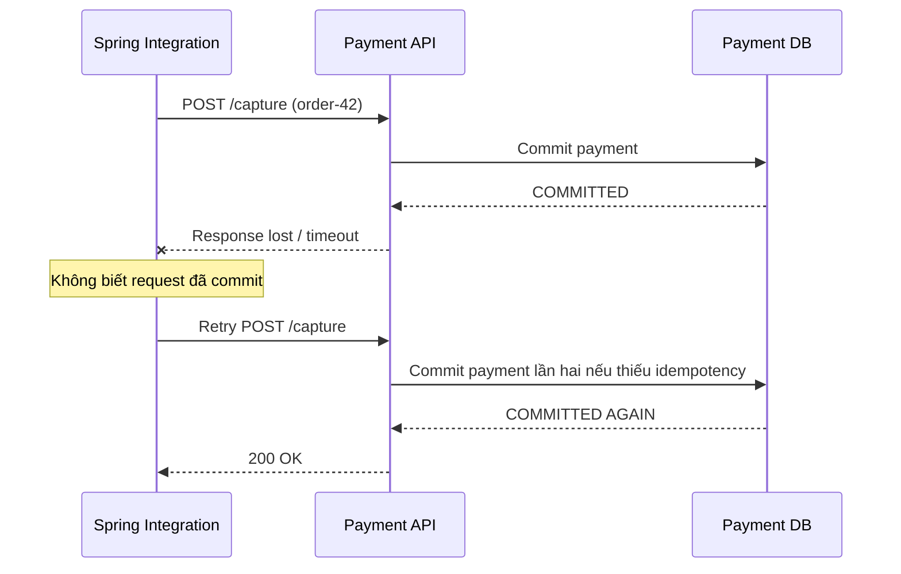
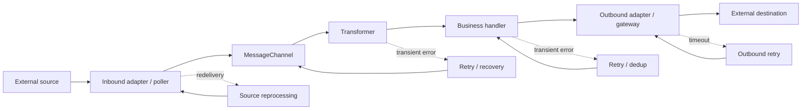
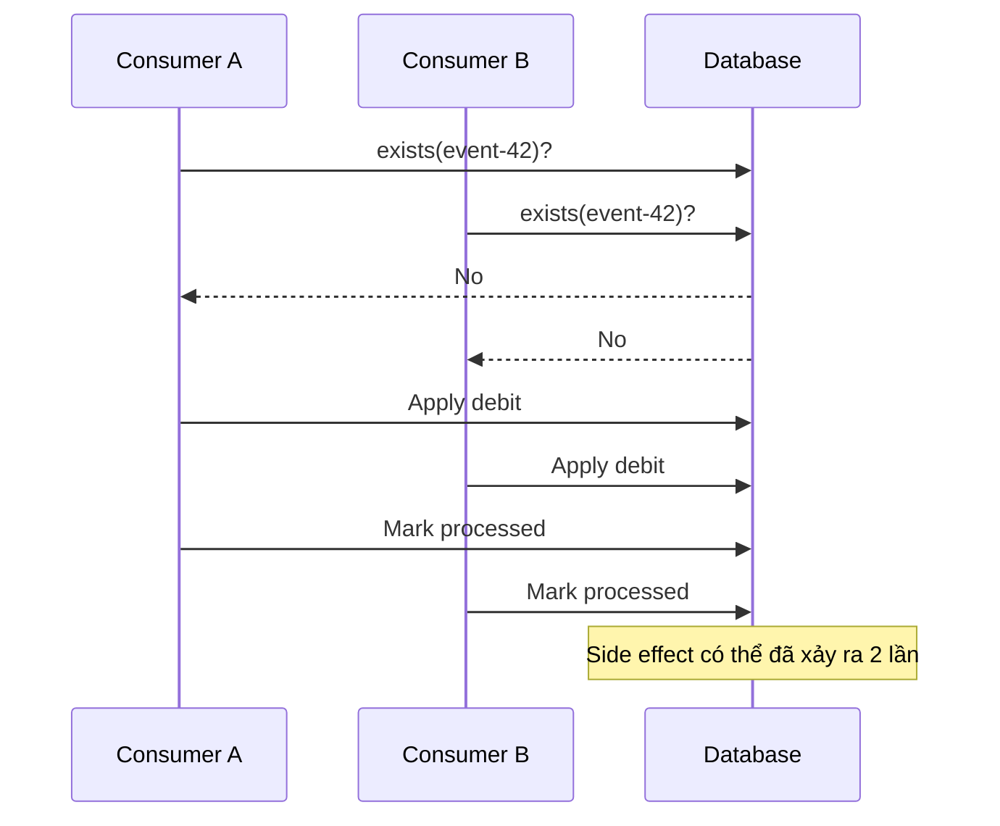
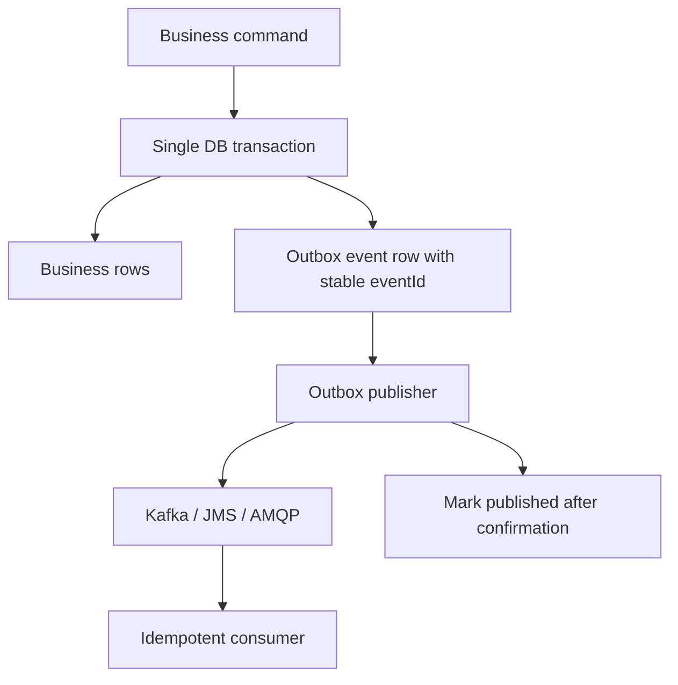

# Phân biệt retry an toàn và retry gây trùng trong Spring Integration Adapters

Trong hệ thống tích hợp, **retry** (thử lại) là cơ chế thực hiện lại một thao tác sau lỗi hoặc khi chưa nhận được kết quả mong đợi. Retry có thể giúp hệ thống vượt qua lỗi mạng ngắn hạn, broker tạm ngừng, database deadlock hoặc một dịch vụ bên ngoài trả `503 Service Unavailable`. Tuy nhiên, retry cũng có thể **tạo tác động nghiệp vụ hai lần**: trừ tiền hai lần, gửi hai email, tạo hai đơn hàng, cộng tồn kho hai lần hoặc xuất cùng một lô dữ liệu nhiều lần.

Bài học **“Phân biệt retry an toàn và retry gây trùng”** thuộc chương **Reliability**, trong module **SPRING_INTEGRATION_ADAPTERS**. Phạm vi là kết nối hệ thống ngoài bằng **inbound/outbound adapter, gateway, poller và MessageChannel** của Spring Integration, bao gồm file, SFTP, HTTP, JMS, AMQP, Kafka và cơ sở dữ liệu. Trọng tâm không chỉ là cấu hình số lần thử lại, mà là **hợp đồng message, ranh giới tác động nghiệp vụ, acknowledgement, transaction, idempotency, xử lý lỗi và vòng đời kết nối**.

> **Nguyên tắc quan trọng nhất:** Một thao tác chỉ được retry an toàn khi **việc thực hiện lại không tạo thêm tác động ngoài ý muốn**, hoặc khi hệ thống có cơ chế chứng minh/khống chế tác động đó. **Timeout không chứng minh thao tác trước đã thất bại.** “Gửi lại cùng payload” cũng không tự động đồng nghĩa “không bị xử lý trùng”.

## 1. Mục tiêu học tập

Sau bài học, người học có thể:

1. Phân biệt **retry an toàn**, **retry gây trùng**, **redelivery**, **replay**, **resubmit** và **compensation**.
2. Giải thích tại sao phản hồi bị mất có thể gây **kết quả mơ hồ** (*ambiguous outcome*) dù thao tác bên đích đã thành công.
3. Phân biệt **at-most-once**, **at-least-once** và phạm vi thực tế của những cam kết **exactly-once**.
4. Xác định **idempotency key** ổn định, phạm vi khóa, thời hạn giữ và hành vi khi cùng khóa nhưng payload khác.
5. Thiết kế deduplication bằng ràng buộc duy nhất và transaction thay vì chỉ dựa vào kiểm tra tồn tại trong bộ nhớ.
6. Phân biệt retry ở **outbound adapter/gateway**, inbound consumer, poller, broker, database và tầng nghiệp vụ.
7. Thiết lập tiêu chí retry theo **loại lỗi, tác động, hạn thời gian, backoff, jitter và ngân sách retry**.
8. Hiểu đặc điểm HTTP, JMS, AMQP, Kafka, file/SFTP và JDBC trong việc phát sinh xử lý trùng.
9. Áp dụng **transactional inbox/outbox**, trạng thái xử lý và reconciliation khi có hiệu ứng giữa nhiều hệ thống.
10. Kiểm thử các cửa sổ crash, redelivery, nhiều consumer đồng thời, lỗi xảy ra trước/sau commit và DLQ/replay.

## 2. Retry an toàn nghĩa là gì?

Một thao tác được xem là **an toàn để thử lại trong một phạm vi đã xác định** khi các lần thực hiện lặp lại cùng **một ý định nghiệp vụ** không làm thay đổi kết quả quan sát theo cách không được phép so với một lần thành công.

Ví dụ:

- Đọc trạng thái một đơn hàng theo ID, không tạo side effect: thường có thể retry khi lỗi mạng tạm thời.
- Đặt trạng thái đơn hàng thành `CANCELLED` với kiểm tra chuyển trạng thái: có thể idempotent nếu nghiệp vụ chỉ thực hiện cùng một chuyển trạng thái một lần.
- Trừ `100_000` đồng khỏi ví bằng lệnh “trừ thêm 100_000”: **không tự idempotent**. Thực hiện hai lần có thể trừ `200_000`.
- Tạo thanh toán bằng `POST /payments` với idempotency key được nhà cung cấp thực thi: có thể retry an toàn **trong phạm vi và thời hạn cam kết của nhà cung cấp**.

### 2.1. Ba điều kiện cần hỏi trước khi bật retry

1. **Thao tác có side effect gì?** Ghi DB, gọi API thu tiền, gửi email, tạo file, publish event, cập nhật offset hay thay đổi trạng thái thiết bị?
2. **Kết quả lần trước có thể đã thành công không?** Nếu chỉ bị timeout hoặc mất ACK, phải giả định rằng tác động có thể đã xảy ra.
3. **Cơ chế nào khiến lần sau không tạo side effect lần nữa?** Đó có thể là phép toán idempotent, khóa nghiệp vụ ổn định, unique constraint, transaction, trạng thái đã xác nhận, idempotency contract hoặc reconciliation.

Nếu chưa trả lời được câu (3), **đừng gắn retry vô điều kiện vào thao tác ghi dữ liệu**.

## 3. Vì sao timeout là tình huống nguy hiểm?

Giả sử một outbound HTTP gateway gửi lệnh thu tiền:



Ở đây kết quả HTTP lần đầu là **unknown**, không phải **failed**.

| Điều quan sát được | Điều chắc chắn có thể kết luận | Điều không được tự kết luận |
| --- | --- | --- |
| Kết nối lỗi trước khi gửi bất kỳ byte nào, đã được xác nhận chắc chắn | Request chưa tới đích theo lớp được quan sát. | Mọi tầng trung gian cũng chưa xử lý, nếu không có bằng chứng. |
| Client timeout sau khi gửi body | Không nhận phản hồi trong thời hạn. | Server chưa nhận hoặc chưa commit. |
| Broker không trả publisher confirm | Chưa biết message đã được broker nhận bền vững hay chưa. | Có thể publish lại mà không có duplicate. |
| DB commit thành công nhưng ứng dụng crash trước ACK | Tác động DB đã commit. | Broker sẽ không giao lại message. |
| HTTP 500 trả sau xử lý | Server báo lỗi. | Không có side effect nào đã xảy ra. |
| Một retry thành công | Ít nhất một lần xử lý đã thành công ở mức được xác nhận. | Chỉ có đúng một side effect diễn ra. |

**Kết luận:** retry phải dựa trên **mô hình lỗi và hợp đồng của thao tác**, không dựa vào nhãn “timeout” rồi mặc định tất cả request có thể gửi lại.

## 4. At-most-once, at-least-once và exactly-once

| Mô hình | Ý tưởng | Mặt trái |
| --- | --- | --- |
| **At-most-once** | Một message không được cố xử lý lại sau một số tình huống lỗi. | Có thể **mất** công việc khi chưa kịp xử lý. |
| **At-least-once** | Cố giao lại đến khi có xác nhận theo cơ chế. | **Có thể trùng** xử lý; consumer phải chống tác động trùng. |
| **Exactly-once trong phạm vi cụ thể** | Một tác động/logical operation chỉ được ghi nhận một lần trong ranh giới đã chứng minh. | Không tự lan sang các API, DB, file và hệ thống khác. |

**Exactly-once** không phải tính chất tự động của toàn bộ ứng dụng chỉ vì một broker hoặc framework có chế độ giao dịch. Ví dụ, Kafka có cơ chế idempotent producer và transaction cho một số luồng Kafka-to-Kafka, nhưng khi handler gọi **API thanh toán bên ngoài** hoặc cập nhật **database độc lập**, cần thêm hợp đồng idempotency hoặc cơ chế nhất quán riêng cho hiệu ứng đó.

### 4.1. Tách giao message khỏi thực hiện side effect

```text
Message delivery count    = 2
Business effect count     = 1

=> Có thể là hệ thống at-least-once hoạt động đúng với idempotent consumer.

Message delivery count    = 1
Business effect count     = 2

=> Có thể là handler tự gửi hai yêu cầu, hoặc downstream tự lặp;
   chỉ nhìn broker delivery count không đủ.
```

Mục tiêu là **ngữ nghĩa nghiệp vụ đúng**, không nhất thiết số lần handler được gọi phải bằng một.

## 5. Idempotent operation và idempotent consumer

**Idempotent operation** là thao tác có kết quả tương đương khi thực hiện nhiều lần với cùng ý định và điều kiện hợp đồng.

**Idempotent consumer** là consumer có khả năng nhận cùng một logical event nhiều lần nhưng chỉ áp dụng side effect được phép một lần.

Ví dụ:

```text
Không idempotent:
  UPDATE account SET balance = balance - 100000 WHERE id = 7;

Có thể idempotent theo dữ liệu mục tiêu:
  UPDATE job SET status = 'COMPLETED' WHERE id = 7;
```

Tuy nhiên, thao tác `SET status='COMPLETED'` có thể vẫn kích hoạt trigger, audit notification hoặc workflow nhiều lần. Phải kiểm tra **toàn bộ side effects**, không chỉ giá trị cột cuối cùng.

### 5.1. Retry an toàn là thuộc tính của một hợp đồng

Câu nói “HTTP PUT idempotent” mô tả kỳ vọng semantics của HTTP, nhưng API cụ thể có thể còn tác động ngoài như gửi thông báo mỗi lần gọi. Vì vậy cần kiểm tra implementation, business effects và những trạng thái concurrency thực tế.

## 6. Phân biệt retry, redelivery, replay và gửi yêu cầu mới

| Thuật ngữ | Ai kích hoạt | Điểm quan trọng |
| --- | --- | --- |
| **Retry trong handler** | Ứng dụng/thư viện thử lại operation trong cùng lượt xử lý. | Có thể lặp side effect trước khi broker ACK. |
| **Retry tại gateway/client** | HTTP/JMS/Kafka client hoặc Spring Integration advice. | Client có thể không biết đích đã commit. |
| **Redelivery** | Broker giao lại message chưa được xác nhận. | Cùng event có thể được consumer nhận lại. |
| **Replay** | Đọc lại topic, file, outbox hoặc DLQ một cách có chủ đích. | Có thể cách thời điểm gốc rất lâu, cần giữ event identity. |
| **Resubmit request mới** | Người dùng/producer chủ động tạo ý định mới. | Có thể là giao dịch hợp lệ khác, không nên dedup nhầm. |
| **Compensation** | Một tác vụ đảo/giảm tác động sau khi đã commit. | Không giống việc đảm bảo không hề có duplicate. |

Nếu một khách hàng muốn thanh toán **hai lần riêng biệt**, hai yêu cầu phải có hai **idempotency key khác nhau**. Dùng cùng key cho mọi request của cùng khách hàng sẽ **làm mất giao dịch hợp lệ**.

## 7. Bản đồ retry theo vị trí trong Spring Integration



Sơ đồ minh họa nhiều **điểm có thể retry**; không nên bật đồng thời tất cả mũi tên mà không tính số lần thử và hiệu ứng.

### 7.1. Tại sao retry chồng tầng nguy hiểm?

Giả sử:

- HTTP client thử **3 lần**.
- Spring Integration handler retry **4 lần**.
- Broker redeliver cùng message **5 lần**.

Trong điều kiện bất lợi, một logical event có thể dẫn đến **tối đa 3 × 4 × 5 = 60 lần gọi xuống hệ ngoài** nếu các tầng lồng nhau đúng cách và không có cơ chế chặn. Con số chỉ là minh họa về phép nhân retry; thực tế phụ thuộc cấu trúc flow.

Đó là **retry amplification**. Cần một chiến lược duy nhất bao quát ngân sách tổng hoặc phối hợp giới hạn giữa các tầng.

## 8. Bảng nhận diện retry an toàn và retry gây trùng

| Hành động | Nếu retry trực tiếp | Điều kiện để an toàn |
| --- | --- | --- |
| Đọc GET từ API chỉ đọc | Thường không thêm side effect. | API thật sự read-only, đáp ứng thời gian và rate limit. |
| PUT đặt toàn bộ trạng thái tài nguyên | Có thể an toàn về state cuối. | Side effects phụ được kiểm soát; precondition/version phù hợp. |
| DELETE cùng tài nguyên | Có thể an toàn về state cuối. | Định nghĩa đúng response khi tài nguyên đã vắng; không xóa nhầm tài nguyên được tạo lại. |
| POST tạo payment | Nguy cơ thu tiền hai lần. | Server thực thi idempotency key và hợp đồng TTL/fingerprint. |
| POST gửi email/SMS | Có thể gửi thông báo trùng. | Provider hoặc application dedup theo notification ID. |
| UPDATE `counter=counter+1` | Cộng nhiều lần. | Dedupe event trong cùng transaction với update. |
| INSERT với ID random mỗi lần | Tạo bản ghi trùng nghiệp vụ. | Unique business ID và same-key conflict handling. |
| Publish Kafka event sau DB commit | Có thể publish trùng khi crash. | Outbox + consumer idempotent, hoặc cơ chế transaction cùng phạm vi. |
| Ghi file cùng tên | Có thể ghi đè hoặc tạo bản duplicate. | Naming/atomic write/checksum/idempotency và owner. |
| Poll file qua SFTP | File có thể đọc lại sau restart. | Persistent filter/metadata và dedup ở business layer. |
| JMS/AMQP consumer sau commit DB | Redelivery có thể lặp side effect. | Inbox/idempotent consumer; ACK sau commit. |
| Kafka consume → external API | Offset replay gọi API lần nữa. | API idempotency contract và business dedup. |

Không có nhãn “an toàn tuyệt đối” cho mọi trường hợp; phải xét **nguồn gây lặp, biên transaction và hiệu ứng quan sát được**.

## 9. Idempotency key: một khóa cho một ý định nghiệp vụ

Idempotency key là định danh dùng để nhận biết **cùng một logical command/event** khi bị gửi lại.

Ví dụ:

```json
{
  "eventId": "evt-2026-0042",
  "tenantId": "TENANT-A",
  "operation": "reserve-stock",
  "sku": "BOOK-101",
  "quantity": 2
}
```

Một khóa hữu dụng có thể là:

```text
tenantId + producerId + operationType + eventId

Ví dụ:
TENANT-A | partner-a | reserve-stock | evt-2026-0042
```

### 9.1. Các đặc tính cần thiết

- **Ổn định qua retry:** lần thử lại dùng **đúng key cũ**, không tạo UUID khác mỗi lần.
- **Đủ phạm vi:** không va chạm giữa tenant, producer hoặc loại thao tác khác nhau.
- **Phản ánh ý định:** hai giao dịch thực sự riêng biệt có hai key khác nhau.
- **Được kiểm tra:** độ dài, ký tự và nguồn phát phù hợp; không tin producer bất kỳ.
- **Có chính sách retention:** duplicate đến sau một ngày/tuần có được nhận ra không?
- **Có fingerprint:** cùng key nhưng body khác phải được xử lý như lỗi hợp đồng, không silently coi là duplicate đúng.
- **Có nguồn khôi phục:** key phải sống qua restart, crash và nhiều consumer khi yêu cầu độ bền.

### 9.2. Vì sao không dùng correlation ID làm key duy nhất?

Một correlation ID có thể bao trùm **nhiều event**, ví dụ một HTTP request tạo ba lệnh khác nhau. Ngược lại, một event có thể được replay trong một trace mới. Vì vậy:

```text
correlationId = nối đường xử lý để điều tra
eventId       = định danh một event
commandId     = định danh một ý định thao tác
attemptId     = định danh một lần thử cụ thể
```

Các giá trị này có thể liên quan nhưng không mặc nhiên thay thế được nhau.

## 10. Fingerprint: cùng key nhưng khác nội dung

Giả sử producer gửi:

```text
Idempotency-Key: pay-42
Amount: 100000
```

Sau đó gửi lại **cùng key** với:

```text
Idempotency-Key: pay-42
Amount: 900000
```

Nếu server chỉ kiểm tra key rồi trả success cũ, client có thể nghĩ lệnh thanh toán mới đã được áp dụng. Nếu server áp dụng số tiền mới, lại vi phạm kỳ vọng cùng key là cùng ý định.

Giải pháp:

1. Lưu fingerprint của những trường nghiệp vụ quyết định ý định.
2. Nếu key đã có và fingerprint trùng, trả kết quả đã ghi hoặc trạng thái hiện hành theo contract.
3. Nếu key đã có nhưng fingerprint khác, trả lỗi **idempotency conflict**.
4. Không lấy toàn bộ raw JSON bytes làm fingerprint nếu serializer có thể thay whitespace/thứ tự trường mà ngữ nghĩa không đổi; cần canonicalization được phê duyệt.
5. Không loại bỏ những trường quan trọng như số tiền, loại tiền, account đích khỏi fingerprint.

## 11. Deduplication không phải chỉ hỏi “đã thấy ID này chưa?”

Một cách viết có race:

```java
if (!repository.existsByEventId(eventId)) {
    applyBusinessChange();
    repository.saveProcessed(eventId);
}
```

Hai consumer song song có thể cùng thấy “chưa tồn tại”, rồi cùng thực hiện side effect trước khi một trong hai lưu trạng thái.



Cần một **ranh giới nguyên tử** như unique constraint kết hợp transaction cho những side effect trong cùng DB, hoặc hợp đồng idempotency của hệ ngoài.

## 12. Transactional inbox: khóa duy nhất và tác động trong cùng DB

Với một consumer cập nhật **một cơ sở dữ liệu**, pattern thực tế là **transactional inbox/dedup table**.

Schema PostgreSQL minh họa:

```sql
CREATE TABLE inventory (
    tenant_id     VARCHAR(64) NOT NULL,
    sku           VARCHAR(128) NOT NULL,
    available     BIGINT NOT NULL CHECK (available >= 0),
    PRIMARY KEY (tenant_id, sku)
);

CREATE TABLE processed_reservation (
    tenant_id     VARCHAR(64) NOT NULL,
    producer_id   VARCHAR(64) NOT NULL,
    event_id      VARCHAR(128) NOT NULL,
    sku           VARCHAR(128) NOT NULL,
    quantity      BIGINT NOT NULL,
    processed_at  TIMESTAMPTZ NOT NULL DEFAULT now(),
    PRIMARY KEY (tenant_id, producer_id, event_id)
);
```

Mỗi logical reservation có một khóa. Việc ghi `processed_reservation` và trừ tồn kho phải nằm **trong cùng transaction của cùng DB**.

### 12.1. Pseudocode transaction

```text
BEGIN TRANSACTION
    INSERT inbox(key, fingerprint)
        ON CONFLICT DO NOTHING

    IF key already existed:
        VERIFY fingerprint matches
        RETURN previous equivalent outcome

    UPDATE inventory
        SET available = available - quantity
        WHERE sku = ...
          AND available >= quantity

    IF no inventory row updated:
        ROLLBACK
        RETURN business rejection

COMMIT
ACK source message only after durable result
```

Nếu crash **trước COMMIT**, cả marker và tác động DB rollback. Nếu crash **sau COMMIT nhưng trước ACK**, broker có thể redeliver; unique key khiến consumer không trừ tồn kho thêm lần nữa.

### 12.2. Vì sao marker và effect phải cùng transaction?

| Thứ tự | Crash ở giữa | Rủi ro |
| --- | --- | --- |
| Ghi marker rồi commit, sau đó trừ tồn kho | Crash sau marker | Retry bị bỏ qua dù chưa trừ tồn kho. |
| Trừ tồn kho rồi commit, sau đó ghi marker | Crash trước marker | Retry trừ tồn kho thêm lần nữa. |
| Marker + trừ tồn kho trong cùng DB transaction | Crash trước commit | Cả hai rollback; có thể retry. |
| Marker + trừ tồn kho trong cùng DB transaction | Crash sau commit nhưng trước ACK | Retry thấy marker, bỏ hiệu ứng trùng. |

**Giới hạn:** pattern này đảm bảo tính nguyên tử với **những thay đổi trong cùng database transaction**. Nó không tự đảm bảo atomicity với HTTP payment API, Kafka publish hay file write bên ngoài DB.

## 13. Java Spring: consumer idempotent bằng transaction

Ví dụ Java dưới đây minh họa cùng logic bằng Spring JDBC, với PostgreSQL `ON CONFLICT DO NOTHING`.

```java
public record StockReservation(
    String tenantId,
    String producerId,
    String eventId,
    String sku,
    long quantity
) {}

public enum ProcessingOutcome {
    APPLIED,
    DUPLICATE_ALREADY_APPLIED
}
```

Một service riêng được Spring proxy để quản lý transaction:

```java
import java.util.Map;
import org.springframework.jdbc.core.JdbcTemplate;
import org.springframework.stereotype.Service;
import org.springframework.transaction.annotation.Transactional;

@Service
public class StockReservationService {

    private final JdbcTemplate jdbc;

    public StockReservationService(JdbcTemplate jdbc) {
        this.jdbc = jdbc;
    }

    @Transactional
    public ProcessingOutcome apply(StockReservation event) {
        if (event.quantity() <= 0
                || event.eventId() == null
                || event.eventId().isBlank()) {
            throw new IllegalArgumentException("Invalid reservation event");
        }

        // Các định danh/tenant phải được xác minh ở inbound boundary.
        int inserted = jdbc.update(
            """
            INSERT INTO processed_reservation
                (tenant_id, producer_id, event_id, sku, quantity)
            VALUES (?, ?, ?, ?, ?)
            ON CONFLICT DO NOTHING
            """,
            event.tenantId(), event.producerId(),
            event.eventId(), event.sku(), event.quantity()
        );

        if (inserted == 0) {
            Map<String, Object> old = jdbc.queryForMap(
                """
                SELECT sku, quantity
                FROM processed_reservation
                WHERE tenant_id = ? AND producer_id = ? AND event_id = ?
                """,
                event.tenantId(), event.producerId(), event.eventId()
            );

            String oldSku = (String) old.get("sku");
            long oldQuantity = ((Number) old.get("quantity")).longValue();

            if (!oldSku.equals(event.sku())
                    || oldQuantity != event.quantity()) {
                throw new IllegalArgumentException(
                    "IDEMPOTENCY_KEY_CONFLICT"
                );
            }

            return ProcessingOutcome.DUPLICATE_ALREADY_APPLIED;
        }

        int changed = jdbc.update(
            """
            UPDATE inventory
            SET available = available - ?
            WHERE tenant_id = ?
              AND sku = ?
              AND available >= ?
            """,
            event.quantity(), event.tenantId(),
            event.sku(), event.quantity()
        );

        if (changed != 1) {
            // RuntimeException khiến Spring rollback transaction,
            // kể cả marker vừa được insert.
            throw new IllegalStateException(
                "INSUFFICIENT_OR_UNKNOWN_STOCK"
            );
        }

        return ProcessingOutcome.APPLIED;
    }
}
```

Service activator gọi service đã được quản lý transaction:

```java
import org.springframework.integration.annotation.ServiceActivator;
import org.springframework.messaging.Message;
import org.springframework.stereotype.Component;

@Component
public class StockReservationHandler {

    private final StockReservationService service;

    public StockReservationHandler(StockReservationService service) {
        this.service = service;
    }

    @ServiceActivator(inputChannel = "stockReservationChannel")
    public void handle(Message<StockReservation> message) {
        ProcessingOutcome result =
            service.apply(message.getPayload());

        // Handler hoàn thành sau khi transaction của apply() commit.
        // ACK/offset của inbound adapter vẫn cần cấu hình riêng.
    }
}
```

### 13.1. Các giới hạn quan trọng của ví dụ

- SQL sử dụng **PostgreSQL**; DB khác cần cú pháp hoặc transaction strategy khác.
- Ví dụ chỉ xét **một local DB side effect**. Nếu thêm gửi email, HTTP call hoặc publish Kafka vào cùng method, chúng không tự nằm trong transaction DB.
- Việc `ON CONFLICT DO NOTHING` phối hợp với concurrency thực tế phải được kiểm thử ở mức isolation và load của ứng dụng.
- `tenantId` và `producerId` phải được xác nhận ở inbound adapter/security layer; không nên tin trực tiếp giá trị producer tự khai để vượt ranh giới tenant.
- Cần quyết định policy khi thiếu hàng: đó là **business rejection**, thường không nên retry vô hạn; có thể lưu outcome riêng nếu yêu cầu “lặp lại request luôn trả cùng kết quả”.
- Idempotency retention phải đủ lâu cho phạm vi replay đã cam kết.
- ACK/commit của broker xảy ra sau side effect DB như thế nào phụ thuộc listener/adapter và transaction setup.

## 14. Còn cách dùng IdempotentReceiverInterceptor?

Spring Integration có khái niệm **Idempotent Receiver**, thường dùng một **metadata store** và logic chọn/đánh dấu message đã thấy để chặn xử lý lặp ở endpoint.

Ý tưởng:

```text
Message vào endpoint
    -> compute stable key
    -> check-and-mark metadata store
    -> nếu mới: cho handler xử lý
    -> nếu duplicate: filter hoặc gắn duplicate marker theo policy
```

Cơ chế này hữu ích cho **các luồng cần lọc duplicate**. Nhưng trước khi dùng, phải trả lời:

1. Metadata store có **persistent và shared** giữa nhiều instance không?
2. Khi nào key được ghi: trước hay sau business effect?
3. Crash sau khi đánh dấu mà trước khi side effect có thể làm **mất** công việc không?
4. Thao tác update metadata và business effect có chung transaction không?
5. Key hết hạn, tái xử lý hoặc rollback được quản lý thế nào?
6. Phản hồi duplicate tới gateway/producer được định nghĩa thế nào?

**Không nên coi việc bật interceptor hoặc filter là tương đương transactional exactly-once business processing.** Khi side effect nằm trong DB, unique constraint và transaction cùng DB thường là lớp bảo vệ then chốt.

## 15. Ba cửa sổ crash bắt buộc phải kiểm thử

### 15.1. Crash trước side effect

```text
Message received
 -> validate
 -> crash
 -> no DB commit
 -> broker redelivery
 -> process first effective time
```

Nếu ACK chưa được gửi và nguồn hỗ trợ redelivery, có thể xử lý lại. Nhưng nếu ACK đã được gửi quá sớm, message có thể bị mất.

### 15.2. Crash sau side effect, trước ACK

```text
Message received
 -> DB transaction COMMIT
 -> crash
 -> no broker ACK
 -> broker redelivery
 -> idempotency detects duplicate
 -> no second business effect
 -> ACK after safe handling
```

Đây là tình huống điển hình cho **at-least-once + idempotent consumer**.

### 15.3. Crash trong lúc gọi hệ thống ngoài

```text
Message received
 -> POST payment provider
 -> provider commits
 -> response lost / process crash
 -> status UNKNOWN locally
 -> retry same idempotency key or query status
 -> avoid double charge
```

Không có transaction DB cục bộ nào tự giải quyết tình huống này nếu provider không hỗ trợ idempotency hoặc truy vấn kết quả đáng tin. Cần giao thức và reconciliation riêng.

## 16. Outbound HTTP: phương thức HTTP không đủ để quyết định retry

### 16.1. GET, PUT, DELETE, POST

| Phương thức | Kỳ vọng semantics HTTP | Điều vẫn cần kiểm tra |
| --- | --- | --- |
| **GET** | Safe/read-only theo quy ước HTTP. | API không lạm dụng GET để thay đổi trạng thái; rate limits. |
| **PUT** | Idempotent về trạng thái tài nguyên của cùng request. | Side effects phụ, version/concurrency và resource identity. |
| **DELETE** | Idempotent về tác động xóa theo semantics. | Xóa lại sau khi tài nguyên được tạo lại có thể cần precondition. |
| **POST** | Không mặc nhiên idempotent. | Idempotency key, stable request ID, API contract. |
| **PATCH** | Không mặc nhiên idempotent. | Patch semantics cụ thể: “set” khác “increment”. |

Một API có thể ghi audit mỗi lần GET, nhưng audit log không nhất thiết làm mất tính “safe” theo semantics HTTP; điều quan trọng trong reliability là **tác động nghiệp vụ nào không được phép nhân đôi**.

### 16.2. HTTP idempotency key

Ví dụ outbound gateway gửi:

```http
POST /payments/capture HTTP/1.1
Content-Type: application/json
Idempotency-Key: tenant-a:order-42:capture-v1

{"paymentId":"payment-42","amountCents":100000}
```

Phía server phải **thực thi** hợp đồng: lưu hoặc khóa cùng key, so request fingerprint, và trả kết quả đã xử lý hoặc trạng thái nhất quán cho các lần lặp.

Chỉ set header `Idempotency-Key` ở Spring Integration **không tự khiến endpoint bên ngoài chống trùng**.

### 16.3. Kết quả chưa rõ nên làm gì?

Khi outbound timeout:

1. Giữ nguyên idempotency key.
2. Nếu API có endpoint tra cứu trạng thái theo paymentId/key, **reconcile trước khi tạo ý định mới**.
3. Nếu retry, gửi lại cùng key trong cửa sổ còn hiệu lực và với cùng nội dung nghiệp vụ.
4. Phân loại response duplicate/in-progress/conflict theo hợp đồng provider.
5. Khi không thể xác định kết quả, đánh dấu `UNKNOWN_OUTCOME` để điều tra; không tự tạo key mới rồi POST lại.

## 17. Phân loại lỗi: lỗi nào nên retry?

Không phải mọi exception đều là lỗi tạm thời. Một chính sách ví dụ:

| Tình huống | Phân loại ban đầu | Ghi chú |
| --- | --- | --- |
| Connection reset, timeout | **Ambiguous/transient** | Thao tác có thể đã được áp dụng; retry chỉ khi đã có bảo đảm idempotency. |
| HTTP `429 Too Many Requests` | Transient/capacity | Tôn trọng `Retry-After` và budget; không gây retry storm. |
| HTTP `503`, `502`, `504` | Thường transient/ambiguous | Có thể retry có giới hạn khi side effect an toàn. |
| HTTP `400` malformed payload | Permanent | Producer phải sửa payload, không retry nguyên dữ liệu vô hạn. |
| HTTP `401/403` | Auth/config/policy | Không retry dồn dập; khắc phục credential/quyền. |
| HTTP `409` | Phụ thuộc contract | Có thể là idempotency conflict, version conflict hoặc đang xử lý. |
| JSON/XML schema invalid | Permanent | Quarantine/DLQ, báo producer. |
| DB deadlock/serialization failure | Có thể transient | Retry toàn **transaction** có kiểm soát; đảm bảo operation idempotent. |
| Duplicate unique key đúng fingerprint | Không phải lỗi cần side effect | Trả kết quả cũ/duplicate acknowledged. |
| Duplicate key khác fingerprint | Contract violation | Từ chối, không che dấu. |
| External payment status UNKNOWN | Ambiguous | Reconcile/status lookup, retry cùng key nếu được bảo đảm. |

**Đặc biệt:** không phải mọi `5xx` đều đảm bảo chưa có side effect. Khi chọn retry theo status code, phải kết hợp **safe operation / idempotency guarantee**.

## 18. Backoff, jitter và giới hạn thời gian

Retry ngay lập tức nhiều lần có thể làm dịch vụ đang quá tải trở nên quá tải hơn.

Một chiến lược thông dụng:

```text
attempt 1: ngay lúc đầu
attempt 2: sau khoảng 200 ms + jitter
attempt 3: sau khoảng 400 ms + jitter
attempt 4: sau khoảng 800 ms + jitter
sau giới hạn: chuyển recovery/UNKNOWN/DLQ theo chính sách
```

Cấu hình cần xem:

- **maxAttempts:** tổng số lần thực hiện, làm rõ có tính lần đầu hay không.
- **Initial delay:** độ trễ bắt đầu retry.
- **Multiplier:** hệ số exponential backoff.
- **Max delay:** giới hạn độ trễ.
- **Jitter:** ngẫu nhiên có giới hạn để tránh thundering herd.
- **Overall deadline:** request/gateway không còn ý nghĩa sau hạn.
- **Retry budget:** tránh 5 tầng retry nhân số lần gọi.
- **Retry-After:** nếu provider yêu cầu, sử dụng theo hợp đồng.
- **Circuit breaker:** ngăn lặp các request vào dependency đang lỗi kéo dài.

**Backoff làm giảm tải, không tự tạo idempotency.** Retry một lệnh trừ tiền sau 2 giây thay vì 100 ms vẫn có thể trừ tiền hai lần.

## 19. Cấu hình retry trong Spring Integration: đặt đúng tầng

Spring Integration có thể áp dụng retry thông qua **retry advice** tại những endpoint hỗ trợ advice chain, hoặc cấu hình retry trong listener container/gateway/client. Spring Retry thường được dùng để xây policy.

Ví dụ minh họa cấu hình một `RequestHandlerRetryAdvice` với `RetryTemplate`:

```java
import org.springframework.context.annotation.Bean;
import org.springframework.integration.handler.advice.RequestHandlerRetryAdvice;
import org.springframework.retry.support.RetryTemplate;
import org.springframework.web.client.ResourceAccessException;

@Bean
RequestHandlerRetryAdvice transientHttpRetryAdvice() {
    RetryTemplate retryTemplate = RetryTemplate.builder()
        .maxAttempts(3)
        .exponentialBackoff(200, 2.0, 2_000)
        .retryOn(ResourceAccessException.class)
        .build();

    RequestHandlerRetryAdvice advice = new RequestHandlerRetryAdvice();
    advice.setRetryTemplate(retryTemplate);
    return advice;
}
```

**Ví dụ cấu hình này chỉ minh họa API và backoff**, không phải bảo đảm an toàn để áp dụng cho bất kỳ HTTP POST nào. Trong triển khai thật:

1. Chỉ gắn advice vào **endpoint có thao tác retry được phép**.
2. Nếu exception bị Spring Integration wrap trong exception khác, phải xác minh exception classification có nhận đúng nguyên nhân không.
3. `ResourceAccessException` có thể mang timeout với outcome mơ hồ; **phải có idempotency key/contract** trước khi retry outbound side effect.
4. Phải cấu hình recovery/error channel/response phù hợp với flow sync hay async.
5. Kiểm thử số lần gọi thực tế, jitter/budget, callback và việc trùng side effect.
6. API cụ thể và module dependency phải tương thích phiên bản Spring Integration/Spring Retry của dự án.

### 19.1. Tại sao không đặt advice cho mọi handler?

Một flow có thể bao gồm:

```text
Transformer -> DB update -> HTTP publish -> Email send
```

Nếu advice bao quanh toàn bộ ba side effect và email thất bại, **toàn bộ chuỗi có thể chạy lại**, dẫn tới DB update và HTTP publish trùng. Cần xác định **đơn vị retry nhỏ nhất có semantics an toàn**, hoặc biến từng side effect thành một command/idempotent stage độc lập.

## 20. Giao diện gateway: đồng bộ và timeout

Một outbound gateway đồng bộ thường chờ response. Nếu gateway timeout, caller có thể thấy lỗi mặc dù destination đã xử lý thành công.

Một inbound gateway cũng có deadline từ HTTP client; consumer xử lý lâu hơn deadline có thể vẫn commit sau khi client đã nhận timeout và gửi lại request.

### 20.1. Thiết kế đúng

- Có stable request/command ID trước khi vào gateway.
- Server/consumer thực thi idempotency, không chỉ client.
- Lưu outcome/status có thể truy vấn.
- Cấu hình timeout tổng và số lần thử phù hợp SLA.
- Không hứa “request thất bại” khi chỉ biết “chưa nhận kết quả”.
- Có response thể hiện trạng thái `PROCESSING` hoặc cơ chế status polling nếu hợp đồng nghiệp vụ cho phép.

### 20.2. Phân biệt retry của framework và retry từ người dùng

Một người dùng bấm nút “Thanh toán” hai lần sau khi trang quay vòng có thể tạo **hai HTTP requests**. Client retry tự động và double-click đều có thể gửi trùng ý định. Dedupe phải dựa trên **business request identity**, không dựa vào việc Java method được gọi lại từ cùng một thread.

## 21. JMS: ACK, transaction và redelivery

Trong JMS, một message có thể được giao lại nếu listener chưa xác nhận theo acknowledgement/transaction policy. `JMSRedelivered` hoặc các thông tin delivery count do provider/container cung cấp có thể hỗ trợ điều tra nhưng **không thay thế event ID nghiệp vụ**.

### 21.1. Hai lỗi kinh điển

**ACK trước khi commit nghiệp vụ:**

```text
JMS receive
 -> ACK
 -> DB update starts
 -> process crashes

Kết quả: broker nghĩ đã xong, side effect có thể chưa thực hiện.
```

**Commit nghiệp vụ trước ACK:**

```text
JMS receive
 -> DB COMMIT
 -> process crashes before ACK

Kết quả: broker redeliver; nếu consumer không idempotent,
DB có thể bị thay đổi hai lần.
```

Mô hình thứ hai kết hợp **dedup trong DB transaction** thường bảo vệ tốt hơn ở kiểu at-least-once, nếu ACK đúng sau commit.

### 21.2. Cần xác minh theo cấu hình thực

- Mode ack/transaction của listener container.
- Thời điểm ACK có thực sự xảy ra sau handler success/commit không.
- Rollback/redelivery policy, số lần giao lại và dead-letter.
- Lỗi converter xảy ra trước hay sau khi tạo Spring Message.
- Correlation/event ID có được bảo toàn khi message được đưa lại vào flow không.
- Nếu DB và JMS cần một transaction nguyên tử thực sự, phải đánh giá kiến trúc transaction riêng, không giả định local DB transaction tự bao gồm broker.

## 22. AMQP/RabbitMQ: ACK, NACK, requeue và DLX

AMQP thường cho phép consumer ACK message, hoặc NACK/REJECT kèm chính sách requeue/dead-letter.

| Hành vi | Điều có thể xảy ra |
| --- | --- |
| ACK trước khi xử lý xong | Crash làm mất cơ hội broker giao lại, có thể mất side effect. |
| Side effect commit rồi ACK thất bại | Message redeliver, có nguy cơ side effect trùng. |
| NACK với requeue liên tục | Poison message hoặc dependency lỗi tạo retry storm. |
| Dead-letter sau số lần quy định | Message được cách ly, vẫn cần kiểm soát replay/dedup. |
| Producer không nhận confirm | Không biết message đã publish thành công, publish lại có thể trùng. |

### 22.1. Đừng nhầm producer confirm và consumer ACK

- **Publisher confirm:** bên gửi biết broker đã xử lý publish theo mức đảm bảo của cơ chế.
- **Consumer ACK:** bên nhận báo đã xử lý message theo policy.
- **Business commit:** side effect ở ứng dụng hoặc hệ ngoài có thể hoàn toàn độc lập.

Ba tín hiệu này **không tự động nguyên tử**. Khi publish lại do confirm bị mất, producer nên giữ một event ID ổn định; consumer dùng idempotency để hạn chế duplicate.

## 23. Kafka: producer retry, consumer replay và transaction

Kafka có nhiều tầng reliability cần phân biệt.

### 23.1. Producer idempotence

Kafka hỗ trợ cơ chế **idempotent producer** để giảm duplicate do retry của producer trong phạm vi các điều kiện được broker/client bảo đảm.

Điều đó **không** có nghĩa:

- Hai request nghiệp vụ mang hai event ID khác nhau sẽ bị gộp.
- Một ứng dụng restart rồi phát một event mới với ID mới sẽ được dedup ở DB bên đích.
- Kafka-to-external-HTTP payment tự trở thành exactly-once.
- Một consumer không thể đọc lại record sau lỗi offset/transaction.

### 23.2. Offset commit sau business effect

```text
Kafka record consumed
 -> business DB COMMIT
 -> crash before offset commit
 -> record consumed again
```

Cần consumer idempotent, như transactional inbox, để chống duplicate effect.

Ngược lại:

```text
Kafka offset committed
 -> crash before business effect

Có thể bỏ mất tác động nghiệp vụ của record.
```

Do đó **thứ tự commit** và idempotency phải được thiết kế theo SLA; không có một lựa chọn ack đơn giản giải quyết mọi cửa sổ crash giữa hai hệ thống.

### 23.3. Kafka transaction và giới hạn phạm vi

Với luồng **consume → transform → produce trên Kafka**, producer transaction và offset handling được cấu hình đúng có thể giúp bảo đảm ngữ nghĩa mạnh **trong phạm vi Kafka**. Nhưng nếu một bước còn ghi **DB khác**, gọi **HTTP API** hoặc tạo file, phải xây sự nhất quán cho hiệu ứng ngoài Kafka riêng.

### 23.4. Event ID qua DLT/replay

Khi record được đưa sang dead-letter topic rồi replay:

- Giữ identity của sự kiện nguồn.
- Có thể tạo `attemptId` và error ID mới.
- Không dùng topic/partition/offset của record DLT như business event ID mới.
- Nếu schema/headers thay đổi khi dead-letter, phải có mapping theo contract.
- Consumer cuối cần chịu được cùng event được xử lý trước hoặc sau migration/replay.

## 24. File và SFTP: poller có thể đọc cùng file nhiều lần

File/SFTP inbound adapter thường dựa trên poller hoặc synchronizer. Khi ứng dụng restart, metadata/filter chưa được lưu bền hoặc file chưa được archive, cùng file có thể được nhìn thấy lần nữa.

```mermaid
sequenceDiagram
    participant S as SFTP
    participant P as Poller
    participant D as Business DB
    P->>S: Download batch-42.csv
    P->>D: Apply rows; COMMIT
    Note over P: Crash before archive/mark
    P->>S: Download batch-42.csv again
    P->>D: Apply same rows again if no dedup
```

### 24.1. Accept-once filter giúp gì?

Spring Integration file/SFTP có các cơ chế lọc file đã thấy và metadata store, tùy adapter/cấu hình. Chúng giúp giảm đọc lại file, đặc biệt khi state được lưu bền và chia sẻ giữa nhiều instance.

Tuy nhiên:

- Một file có thể được nhận diện theo path, timestamp hoặc metadata khác; cần biết **key thực sự dùng**.
- Thay nội dung file nhưng giữ tên có thể tạo trường hợp khó xác định.
- Metadata store lưu “đã thấy file” không tự đồng nghĩa **mọi record đã commit nghiệp vụ**.
- Nếu đánh dấu đã thấy trước khi xử lý và crash, có thể **bỏ sót công việc**.
- Khi replay sau lỗi hoặc restore metadata store, file có thể được xử lý lại.

### 24.2. Thiết kế file an toàn hơn

1. Quy định file readiness (rename/marker sau upload).
2. Dùng file/batch ID hoặc checksum có scope theo source/tenant.
3. Parse từng record theo format hợp đồng.
4. Dedupe nghiệp vụ theo event/record key; không chỉ theo tên file.
5. Archive hoặc đánh dấu thành công **sau mốc xử lý được xác nhận**.
6. Có quarantine với file lỗi, metadata và đường replay có kiểm soát.
7. Kiểm thử crash giữa commit và archive.
8. Tránh hai poller/instance cùng claim file bằng một cơ chế coordination phù hợp.

## 25. JDBC poller và database: atomic claim, commit và outbox

JDBC inbound polling thường đọc những row có trạng thái `NEW` rồi xử lý. Một vòng lặp đơn giản có thể đọc lại row nếu crash xảy ra trước cập nhật `PROCESSED`.

### 25.1. Race giữa nhiều poller

```text
Poller A: SELECT row id=42 WHERE status='NEW'
Poller B: SELECT row id=42 WHERE status='NEW'
Both process row 42
```

Có thể dùng row locking, claim state, optimistic version hoặc chiến lược DB tương ứng (ví dụ `FOR UPDATE SKIP LOCKED` ở những DB hỗ trợ), nhưng cần kiểm tra transaction/lease/timeout.

### 25.2. Mark processed sau tác động

Nếu side effect và trạng thái row nằm **trong cùng DB**, có thể commit nguyên tử. Nếu side effect là publish Kafka hoặc gọi API, cập nhật `status=PROCESSED` trong DB không tự bảo đảm message đã tới đích.

Đó là một lý do để dùng **transactional outbox**.

## 26. Transactional outbox: không publish hai lần do crash

Một tình huống phổ biến:

```text
Business transaction commits order
 -> Publish OrderCreated to broker
 -> process crashes before knowing publish success
 -> retry publish
 -> duplicate event possible
```

Transactional outbox thay đổi trình tự:



### 26.1. Ý nghĩa

- Trong **một DB transaction**, ghi business state và outbox event.
- Publisher đọc outbox và gửi tới broker.
- Nếu publisher crash sau publish nhưng trước đánh dấu SENT, nó có thể publish lại **cùng event ID**.
- Consumer phía đích phải idempotent vì **outbox thường tạo at-least-once publishing**, không phải một magic exactly-once end-to-end.

### 26.2. Mẫu schema outbox minh họa

```sql
CREATE TABLE integration_outbox (
    event_id       VARCHAR(128) PRIMARY KEY,
    aggregate_id   VARCHAR(128) NOT NULL,
    event_type     VARCHAR(128) NOT NULL,
    payload_json   TEXT NOT NULL,
    status         VARCHAR(24) NOT NULL,
    created_at     TIMESTAMPTZ NOT NULL DEFAULT now(),
    published_at   TIMESTAMPTZ
);
```

Publisher có thể dùng lease/claim/transaction phù hợp khi nhiều instance chạy song song, và phải dùng **event_id gốc ổn định** khi gửi lại.

## 27. External side effect: Payment API và saga

Nếu thao tác là **thu tiền**, **gửi email** hoặc **điều khiển thiết bị**, không thể đặt hiệu ứng đó trong một transaction DB cục bộ như một câu lệnh SQL thông thường.

### 27.1. Mẫu luồng thanh toán có trạng thái

```text
LOCAL COMMAND CREATED
  -> payment request with stable idempotency key
  -> status:
       CONFIRMED_SUCCESS
       CONFIRMED_REJECTED
       UNKNOWN_OUTCOME
       IN_PROGRESS
  -> on timeout:
       query provider status or retry same key if contract allows
  -> reconcile external outcome
  -> finalize local state
```

**Không được đánh đồng `UNKNOWN_OUTCOME` với `FAILED`.** Nếu không biết provider đã thu tiền chưa, tạo lại một payment mới bằng idempotency key mới là con đường gây thu tiền trùng.

### 27.2. Saga và compensation

Trong chuỗi nhiều hệ thống, một saga có thể ghi các bước và hành động bù trừ khi thất bại. Ví dụ hoàn tiền khi đã thu tiền nhưng đơn hàng không thể hoàn tất.

Tuy nhiên:

- Compensation có thể thất bại hoặc chạy lại.
- Hoàn tiền không có nghĩa khách hàng chưa từng bị thu hai lần.
- Các bước saga và compensation **cũng cần idempotency**.
- Cần audit và reconciliation, đặc biệt với giao dịch tài chính.

## 28. Multi-step flow: xác định lại điểm retry

Ví dụ:

```text
1. Parse inbound JSON
2. Insert order into DB
3. Reserve stock
4. Charge payment provider
5. Send confirmation email
```

Nếu bước (5) thất bại và retry **toàn bộ flow**, có thể:

- Thêm một order mới.
- Reserve stock hai lần.
- Charge payment hai lần.
- Gửi email trùng sau các lần retry tiếp theo.

Thiết kế tốt hơn:

1. Định danh một command/order nhất quán.
2. Tách các bước thành **state transitions** với unique keys riêng.
3. Dùng transaction khi side effect nằm trong cùng DB.
4. Dùng outbox để phát event sang hệ khác.
5. Dùng idempotency key khi gọi payment/email provider nếu được hỗ trợ.
6. Retry **bước thất bại** theo đúng guarantee, không mặc định bắt đầu lại từ đầu.
7. Có reconciliation và thông tin trạng thái sau crash/timeout.

### 28.1. “Retry từ bước nào?” là câu hỏi kiến trúc

Ở flow có trạng thái bền vững, retry nên bắt đầu từ **bước chưa được xác nhận**, không phải cố thực hiện mọi hành động từ đầu. Nếu không biết kết quả bước trước, cần tra cứu lại hoặc khôi phục trạng thái bằng dữ liệu đáng tin.

## 29. Phân biệt retry do lỗi format và lỗi hạ tầng

Một message XML sai namespace hoặc JSON thiếu trường bắt buộc sẽ không tự sửa sau 5 lần đọc lại cùng bytes.

| Lỗi | Retry hữu ích? | Hướng thường phù hợp |
| --- | --- | --- |
| JSON/XML malformed | Không nếu input không đổi. | DLQ/quarantine, thông báo producer. |
| Charset không đúng hợp đồng | Không nếu byte không đổi. | Sửa contract/producer, replay có kiểm soát. |
| Missing required header | Không nếu cùng message. | Chẩn đoán header mapper/producer. |
| Không được phép theo policy | Không bằng cách gửi lại ngay. | Xử lý authorization/điều kiện nghiệp vụ. |
| Database deadlock | Có thể nếu transaction idempotent. | Retry bounded transaction. |
| HTTP 503 từ provider | Có thể với idempotency guarantee. | Backoff/jitter/budget. |
| Network timeout outbound | Outcome không rõ. | Reconcile hoặc retry cùng key hợp lệ. |
| Broker connection lost trước publish | Có thể, nhưng publish outcome có thể mơ hồ. | Stable event ID, publish retry + consumer dedup. |
| Business stock insufficient | Thường là business rejection. | Trả kết quả có ngữ nghĩa; không retry liên tục. |

### 29.1. Poison message và DLQ

Một poison message là message liên tục gây thất bại theo cùng điều kiện. Không nên để nó chặn cả queue/partition hoặc poller.

Cần:

- Giới hạn số lần retry.
- Phân loại nguyên nhân và khả năng khắc phục.
- Lưu message hoặc reference trong DLQ/quarantine có phân quyền.
- Có người chịu trách nhiệm sửa và replay.
- Giữ event identity, schema version và idempotency key khi replay.
- Không làm mất ACK/offset semantics của nguồn do error handler tự ý trả thành công giả.

## 30. Headers phải bảo toàn qua retry

Đối với Spring Integration, `Message<?>` mang payload và headers. Khi retry hoặc gửi lại qua adapter khác, những trường quan trọng gồm:

| Header | Có nên giữ qua retry? | Lưu ý |
| --- | --- | --- |
| `eventId` hoặc `commandId` | **Có, ổn định.** | Khóa nhận diện cùng logical operation. |
| `correlationId` | Thường có. | Phục vụ trace, không tự là dedup key. |
| `sourceSystem` | Có nếu đã được xác minh. | Không tin header client tự khai làm quyền. |
| `tenantId` | Có nếu được xác thực theo principal/contract. | Đưa vào key để tránh cross-tenant collision. |
| `schemaVersion` | Có khi replay cần parser cũ. | Bảo đảm backward compatibility. |
| `retryAttempt` | Cập nhật theo policy. | Không coi attempt ID là event ID mới. |
| `contentType` | Giữ nếu còn đúng với payload wire. | Sau transformer có thể cần `wireContentType` riêng. |
| `replyChannel`/`errorChannel` | Chỉ khi phù hợp nội bộ. | Không xuất raw framework channel object ra broker. |
| `Authorization`/credential | Không tự copy ra DLQ. | Tránh rò rỉ secret. |

### 30.1. Đừng tạo key mới khi xây lại message

Ví dụ nguy hiểm:

```java
Message<OrderCommand> retryMessage = MessageBuilder
    .withPayload(original.getPayload())
    .setHeader("eventId", UUID.randomUUID().toString())
    .build();
```

Nếu `eventId` là idempotency key, code này biến retry thành một **sự kiện mới**, khiến dedup không nhận ra bản trùng.

Ví dụ nguyên tắc đúng:

```java
Message<OrderCommand> retryMessage = MessageBuilder
    .withPayload(original.getPayload())
    .setHeader(
        "eventId",
        original.getHeaders().get("eventId")
    )
    .setHeader(
        "correlationId",
        original.getHeaders().get("correlationId")
    )
    .setHeader("retryAttempt", nextAttempt)
    .build();
```

Khi tạo message mới, cần bảo toàn các header điều phối nội bộ còn cần thiết theo chính sách; đây chỉ là ví dụ về **ổn định event ID**.

## 31. Retry và errorChannel: đừng coi mọi lỗi là cùng một đường

Spring Integration có thể xử lý lỗi khác nhau theo endpoint:

- **DirectChannel/gateway đồng bộ:** exception thường lan ngược đến sender/caller nếu không được bắt ở boundary.
- **Poller hoặc executor channel:** lỗi có thể được đưa tới error handling/error channel tương ứng.
- **JMS/AMQP/Kafka listener:** adapter/container có retry, ack/commit và dead-letter semantics riêng; lỗi có thể xảy ra **trước khi Spring Message được tạo**.
- **Outbound handler:** retry advice chỉ bao quanh thao tác handler được advice gắn vào, không tự bao phủ những side effect ở endpoint khác.

### 31.1. Nhận diện failed message

Nếu transformer ném `MessagingException` gắn `failedMessage`, error handler có thể truy lại event ID/correlation của message gốc. Nhưng `ErrorMessage` không tự bảo đảm chứa toàn bộ headers đầu vào ở cùng cấp.

Khi gửi DLQ, nên tạo error envelope với:

```json
{
  "errorCode": "TRANSIENT_HTTP_TIMEOUT",
  "eventId": "evt-2026-0042",
  "correlationId": "req-88",
  "sourceSystem": "partner-a",
  "attempt": 3,
  "outcome": "UNKNOWN",
  "retryable": false,
  "reconciliationRequired": true
}
```

Ví dụ này đánh dấu không tự retry tiếp **vì đã hết budget hoặc outcome chưa thể xác nhận**, không có nghĩa sự kiện đã thất bại ở provider.

## 32. Retry budget và circuit breaker

Khi hàng nghìn message cùng gặp lỗi, một retry policy riêng cho từng message có thể đủ nhỏ nhưng **tổng lượng retry vẫn làm sập dependency**.

### 32.1. Các lớp bảo vệ

1. **Per-message max attempts** và thời gian tồn tại của công việc.
2. **Per-dependency retry budget**, tránh tất cả clients đồng thời retry.
3. **Exponential backoff + jitter** để trải đều tải.
4. **Circuit breaker** ngừng gửi khi dependency liên tục lỗi.
5. **Rate limiter** theo tài nguyên/tenant/producer khi cần.
6. **Bulkhead** không để một tích hợp lỗi chiếm hết thread/connection pool.
7. **DLQ/quarantine** với lỗi permanent hoặc budget hết.
8. **Manual reconciliation** cho những outcome mơ hồ có side effect lớn.

Không có một số lần retry cố định đúng cho mọi kịch bản. Một retry HTTP chỉ đọc có thể chấp nhận nhanh; một payment capture phải ưu tiên idempotency/status lookup và kiểm soát rủi ro.

## 33. TTL của deduplication: trùng có thể tới muộn

Nếu lưu idempotency key trong cache chỉ **10 phút** nhưng broker có thể replay message sau **7 ngày**, cùng event sẽ bị xem là mới khi cache hết hạn.

Cần thiết kế:

```text
dedupe retention >= maximum expected duplicate/replay window
                   + operational safety margin
```

Tuy nhiên, “giữ mọi key mãi mãi” cũng có chi phí lưu trữ và quyền riêng tư. Có thể:

- Dùng business identity tồn tại lâu dài trong DB.
- Lưu dedup record theo thời hạn replay đã cam kết.
- Phân tách hot cache để tăng tốc và durable store để bảo đảm.
- Có quy trình replay dữ liệu lịch sử sau khi hết retention.
- Ghi rõ nếu **không còn guarantee** cho dữ liệu cũ.

### 33.1. Cùng key bị tái sử dụng

Không được tự cho phép producer tái sử dụng key cho một giao dịch mới sau TTL nếu phía consumer vẫn có khả năng gặp replay từ lịch sử. Quy ước key namespace/version và thời hạn phải là một phần của hợp đồng tích hợp.

## 34. Ordering, concurrency và retry

Một event có thể phụ thuộc vào thứ tự:

```text
E1: OrderCreated
E2: OrderCancelled
```

Nếu E2 được xử lý trước do E1 retry, hoặc E1 được replay sau E2, consumer có thể đưa đơn hàng đã hủy về trạng thái mới tạo nếu chỉ áp dụng “event đến sau cùng”.

### 34.1. Idempotency không giải quyết ordering

- **Dedup** trả lời: “event này đã được áp dụng chưa?”
- **Ordering** trả lời: “event này có phù hợp phiên bản/trạng thái hiện tại không?”
- **Concurrency** trả lời: “nhiều worker có thể cùng thay đổi tài nguyên này không?”

Cần state machine và version/event sequence:

```text
orderId = ORD-42
version 1: CREATED
version 2: CONFIRMED
version 3: CANCELLED

Replay version 1 sau version 3:
  không được khôi phục lại CREATED.
```

Có thể dùng optimistic locking, version column, partitioning theo aggregate key, row lock hoặc xử lý ordered per key theo kiến trúc. Không nên giả định broker giữ thứ tự toàn hệ thống; Kafka bảo đảm thứ tự theo partition, còn nhiều consumer và retry có thể ảnh hưởng thứ tự quan sát.

## 35. Các trường hợp retry tưởng an toàn nhưng vẫn gây trùng

### 35.1. “Tôi đã kiểm tra DB trước”

Kiểm tra `exists()` rồi mới ghi không atomic; hai consumer song song đều có thể đi qua. Cần unique constraint/transaction hoặc locking đúng.

### 35.2. “Tôi có Redis SETNX”

Nếu đánh dấu SETNX thành công rồi process crash trước khi ghi DB, retry có thể bị bỏ qua. Nếu ghi DB trước rồi SETNX sau, retry có thể gây trùng. Redis lock hoặc cache **không tự tạo transaction chung** với database bên ngoài.

### 35.3. “Tôi dùng POST nhưng timeout được retry tự động”

POST không mặc nhiên idempotent. Cần server-side key, status lookup hoặc một contract tương đương.

### 35.4. “Tôi đã bật Kafka idempotent producer”

Cơ chế đó không dedup hai event nghiệp vụ được sinh lại với ID mới, và không điều khiển effect ở payment/DB bên ngoài.

### 35.5. “Tôi dùng unique constraint”

Constraint chỉ trên `eventId` nhưng không scope theo tenant/producer có thể làm hai producer khác nhau bị nhận nhầm là duplicate. Ngược lại, key tạo mới mỗi retry khiến unique constraint vô dụng.

### 35.6. “Tôi đã có DLQ”

DLQ là cơ chế xử lý lỗi, không phải bằng chứng side effect chưa xảy ra. Replay từ DLQ **vẫn có thể trùng** nếu effect đã commit trước khi message bị đưa vào DLQ.

### 35.7. “Chúng tôi dùng DELETE, nên có thể gọi lại”

DELETE cùng URL có thể là idempotent về trạng thái cuối, nhưng nếu tài nguyên đã được tạo lại với cùng ID giữa hai lần, retry có thể xóa **phiên bản mới**. Có thể cần conditional request hoặc version guard.

## 36. Kiểm thử theo ma trận điểm lỗi

Một bộ kiểm thử reliability phải **chủ động chèn lỗi tại những thời điểm nguy hiểm**, không chỉ test happy path.

| Trường hợp | Vị trí inject lỗi | Kỳ vọng |
| --- | --- | --- |
| Timeout trước outbound call thực hiện | Client/network | Retry có giới hạn theo policy. |
| Outbound đã commit, response bị mất | Provider/response network | Retry cùng key hoặc reconciliation; không tạo duplicate effect. |
| DB commit xong, JMS ACK thất bại | Consumer/container | Redelivery, inbox dedup, effect count vẫn 1. |
| Kafka offset chưa commit, handler đã commit DB | Consumer | Replay không ghi DB thêm lần hai. |
| ACK/offset trước khi xử lý | Consumer | Test phải phát hiện nguy cơ mất công việc. |
| Hai consumer nhận cùng event đồng thời | Concurrency | Unique constraint/transaction ngăn double apply. |
| Key trùng, payload khác | Idempotency boundary | Conflict được báo rõ, không áp dụng lần hai. |
| File SFTP được poll lại sau crash | File/poller | Không nhân đôi record nghiệp vụ. |
| Outbox publish thành công nhưng chưa mark SENT | Publisher | Duplicate event có thể phát, consumer dedup. |
| HTTP 429/503 nhiều lần | Outbound gateway | Backoff, jitter, max attempts, budget. |
| JSON sai cú pháp | Transformer | Permanent failure, không retry vô hạn. |
| Retry sau TTL của idempotency store | Long-delayed replay | Guarantee được kiểm chứng hoặc có quy trình hạn chế. |
| Retry event cũ sau Mover/order status mới | Ordering/state machine | Không đảo ngược trạng thái mới hơn. |
| Lỗi ngay trong DLQ publisher | Error pipeline | Có terminal recovery, không mất ngữ cảnh hoặc retry vô hạn. |

### 36.1. Test định lượng điều quan trọng

Không chỉ assert `handler.calledTimes() == 1`. Với at-least-once, handler có thể được gọi nhiều lần **một cách đúng đắn**. Thay vào đó:

```text
message_delivery_attempts = 2
database_side_effect_count = 1
business_state = expected
idempotency_duplicate_suppressed = 1
acked_after_durable_result = true
```

Cần tách **số lần gọi** và **số lần tác động nghiệp vụ thành công**.

## 37. Pseudocode xử lý retry theo mức rủi ro

```text
handle(command, transportContext):
    assert producer/tenant/contract are authorized
    identity = stableBusinessKey(command)
    fingerprint = semanticFingerprint(command)

    if local DB effect:
        begin transaction
        result = claimOrRead(identity, fingerprint)
        if result == SAME_ALREADY_PROCESSED:
            commit
            acknowledge transport
            return previousOutcome
        if result == KEY_CONFLICT:
            rollback
            reject permanent
        apply DB effect
        commit
        acknowledge transport
        return success

    if external effect:
        result = callProvider(identity, fingerprint)

        if result == CONFIRMED_SUCCESS:
            persist outcome
            acknowledge transport
        else if result == DEFINITIVE_REJECTION:
            persist rejection
            acknowledge according to contract
        else if result == UNKNOWN_OUTCOME:
            query provider status if available
            retry SAME key only when contract guarantees safety
            otherwise flag reconciliation
        else if result == TRANSIENT_SAFE_TO_RETRY:
            backoff within budget and retry same identity

    never create a new business identity simply because a retry occurred
```

Pseudocode thể hiện tư duy; implementation phải xử lý transaction isolation, token/auth, message ordering, deadline, circuit breaker, concurrency và hạ tầng cụ thể. ACK chỉ nên thực hiện tại điểm phù hợp với cấu hình container/adapter.

## 38. Observability: biết retry có đang gây trùng không?

Các log/metrics hữu ích:

| Chỉ số | Ý nghĩa |
| --- | --- |
| `retry_attempts_total{adapter,reason}` | Tổng số lần thử lại và lý do. |
| `retry_exhausted_total{dependency}` | Số yêu cầu hết budget. |
| `duplicate_detected_total{source,operation}` | Số duplicate được nhận diện. |
| `duplicate_suppressed_total` | Số side effect trùng đã được chặn. |
| `idempotency_conflict_total` | Số key trùng nhưng fingerprint khác. |
| `business_effects_committed_total{operation}` | Số tác động nghiệp vụ đã xác nhận. |
| `ambiguous_outcome_total{dependency}` | Số thao tác chưa xác định kết quả ở bên ngoài. |
| `outbox_pending_age_seconds` | Độ trễ event chưa publish. |
| `dlq_pending_messages` | Backlog lỗi cần xử lý/replay. |
| `ack_commit_failure_total{transport}` | Lỗi khi xác nhận message/offset. |
| `reconciliation_pending_count` | Số command cần đối soát kết quả thật. |

### 38.1. Log minh họa

```json
{
  "eventType": "RETRY_DECISION",
  "correlationId": "req-88",
  "eventId": "evt-2026-0042",
  "tenantScope": "TENANT-A",
  "adapter": "http-outbound",
  "operation": "capture-payment",
  "attempt": 2,
  "failureClass": "AMBIGUOUS_TIMEOUT",
  "idempotencyEnabled": true,
  "decision": "QUERY_PROVIDER_STATUS",
  "businessEffectCount": null
}
```

Các giá trị chỉ mang tính minh họa. Không log payment secret, raw token hoặc payload chứa dữ liệu nhạy cảm. Tránh đưa `eventId`, `correlationId` thành metric label có cardinality cao; dùng log/trace có phân quyền.

## 39. Runbook xử lý nghi ngờ duplicate sau retry

**Tình huống:** Khi API thanh toán chậm, tỷ lệ retry tăng, khách hàng phản ánh có hai lần capture.

Quy trình điều tra:

1. **Xác định ý định gốc:** business command/order/payment ID; không chỉ một HTTP trace ID.
2. **Tập hợp các lần thử:** correlation ID, attempt IDs, thời điểm, host, destination và idempotency keys.
3. **Kiểm tra provider outcome:** hai capture thật hay hai response/log của cùng capture?
4. **Xác định hợp đồng idempotency:** provider có hỗ trợ không, TTL bao lâu, scope và fingerprint?
5. **Kiểm tra cách client tạo key:** có sinh key mới mỗi retry hoặc mỗi restart không?
6. **Kiểm tra advice/client/broker:** số tầng retry và tối đa bao nhiêu lần gọi thực tế?
7. **Kiểm tra bản ghi local:** trạng thái `SUCCESS/UNKNOWN/REJECTED` và có race giữa hai worker không?
8. **Giảm rủi ro đang diễn ra:** tạm ngừng retry không an toàn, chuyển sang truy vấn trạng thái/reconciliation theo quy trình.
9. **Khắc phục tác động đã xảy ra:** xác minh điều kiện hoàn/đối soát theo quy trình tài chính; không tự tạo thao tác bù trừ không kiểm soát.
10. **Sửa nguyên nhân và test hồi quy:** lost response, concurrent retries, TTL expiry, key conflict và crash.
11. **Theo dõi kết quả:** `ambiguous_outcome_total`, `duplicate_suppressed_total` và số capture thực.
12. **Lưu evidence:** quyết định, phạm vi, owner và thời điểm xác nhận, không đưa dữ liệu nhạy cảm vào ticket chung.

## 40. Anti-pattern thường gặp

| Anti-pattern | Hậu quả | Thay bằng |
| --- | --- | --- |
| Retry mọi exception 5 lần | Permanent errors gây storm; side effect trùng. | Phân loại lỗi, safe retry và budget. |
| Timeout được hiểu là chưa commit | POST trừ tiền hai lần. | UNKNOWN outcome, stable key, status lookup. |
| Sinh UUID mới ở mỗi attempt | Dedupe không nhận ra logical event cũ. | Stable business request/event ID. |
| Chỉ dùng `exists()` trước update | Race giữa consumers. | Unique constraint + transaction. |
| Lưu dedup marker ngoài transaction của effect | Crash gây mất việc hoặc nhân đôi. | Atomic business state + dedup marker. |
| Chỉ dùng in-memory cache | Restart mất dấu, nhiều replica không đồng bộ. | Durable/shared dedup theo rủi ro. |
| TTL ngắn hơn cửa sổ replay | Duplicate cũ được nhận như mới. | Retention và business identity contract. |
| Lấy correlation ID làm duy nhất | Gộp nhầm nhiều event của cùng request. | Event/command key riêng. |
| ACK trước commit | Message có thể mất. | Ack theo kết quả bền vững. |
| Tin DB commit + broker ACK là nguyên tử | Cửa sổ crash vẫn tồn tại. | Inbox/outbox hoặc transaction thiết kế riêng. |
| Bật retries chồng ở nhiều tầng | Số lần gọi nhân lên. | Điều phối retry budget và owner. |
| Cho poison message requeue vô hạn | Queue/partition bị chặn. | Bounded retry + DLQ/quarantine. |
| Coi Kafka idempotent producer là end-to-end exactly-once | External DB/API vẫn trùng. | Dedupe ở từng side-effect boundary. |
| Coi file accept-once filter là business commit | Crash giữa filter và handler làm mất việc. | Persistent coordination + business idempotency. |
| Retry cả flow khi bước cuối lỗi | Lặp các bước đã thành công. | State machine và retry theo bước. |
| Gửi retry với body khác nhưng cùng key | Conflict hoặc kết quả không nhất quán. | Request fingerprint, key conflict rule. |
| Trả “thất bại” khi provider outcome không rõ | Người dùng gửi lệnh mới gây trùng. | Thể hiện UNKNOWN/PROCESSING và đối soát. |
| Log raw payment token để điều tra retry | Rò rỉ bí mật. | Correlation, reason code, audit có phân quyền. |

## 41. Bài tập vận dụng

### Bài 1 – Timeout sau khi thanh toán thành công

Spring Integration outbound HTTP gateway POST tới payment provider. Provider đã commit nhưng client timeout. Advice thử lại bằng một UUID mới.

**Câu hỏi:** Retry có an toàn không? Sửa thế nào?

**Gợi ý:** Không bảo đảm. Cần stable idempotency key theo một payment intent, kiểm tra hỗ trợ của provider, status lookup và xử lý UNKNOWN outcome; không tạo UUID mới cho cùng một lần thanh toán.

### Bài 2 – Kafka offset chưa commit

Consumer ghi DB thành công, crash trước khi offset được commit. Record được nhận lại.

**Câu hỏi:** Đây là lỗi của Kafka hay mô hình at-least-once? Làm sao ngăn DB bị ghi hai lần?

**Gợi ý:** Đây là cửa sổ replay phổ biến. Dùng transactional inbox/unique key với side effect trong cùng DB transaction và ACK/offset theo cấu hình phù hợp.

### Bài 3 – Hai consumer cùng cập nhật tồn kho

Hai instance nhận cùng `eventId`, cùng gọi `existsByEventId` và đều thấy false.

**Câu hỏi:** Có thể sửa chỉ bằng synchronized trong Java không?

**Gợi ý:** Khóa trong một JVM không bảo vệ nhiều replica. Dùng unique constraint hoặc cơ chế claim atomic chia sẻ, đồng transaction với update tồn kho.

### Bài 4 – SFTP poller đọc lại file

File `orders-42.csv` đã import DB xong, ứng dụng crash trước archive. Lần sau poller tải file lại.

**Câu hỏi:** File filter có đủ chưa?

**Gợi ý:** Cần persistent metadata và quan trọng hơn dedup theo batch/record/business event ID. Kiểm thử crash giữa business commit và archive.

### Bài 5 – Email gửi hai lần

Order DB commit thành công, service gửi email xác nhận, client email provider timeout và retry. Khách hàng nhận hai email.

**Câu hỏi:** Cách bảo vệ?

**Gợi ý:** Notification ID ổn định, provider/application dedup, outbox ghi ý định gửi và theo dõi outcome; nếu provider không bảo đảm idempotency, cần quản lý UNKNOWN và hạn chế tự retry.

### Bài 6 – HTTP 400 bị retry liên tục

Một đối tác gửi JSON sai schema. Retry advice ở gateway bắt mọi exception và thử 10 lần.

**Câu hỏi:** Tại sao đây là anti-pattern?

**Gợi ý:** Dữ liệu không đổi nên lỗi permanent. Nên reject/quarantine và phản hồi rõ, không tiêu tốn tài nguyên cho retry vô ích.

### Bài 7 – Redis đánh dấu trước khi ghi DB

Consumer gọi SETNX thành công, sau đó process chết trước khi cập nhật tài khoản. Redelivery tới, SETNX báo đã xử lý.

**Câu hỏi:** Có phải duplicate được xử lý an toàn?

**Gợi ý:** Không, công việc bị mất. Cần transaction đồng nhất marker/effect hoặc state machine/lease có recovery phù hợp; Redis marker ngoài DB transaction không đủ guarantee.

### Bài 8 – Outbox publish trùng

Publisher gửi event thành công, crash trước khi cập nhật row thành SENT. Khi restart, gửi lại cùng event.

**Câu hỏi:** Outbox có thất bại không?

**Gợi ý:** Không nhất thiết. Outbox bảo đảm ý định event không mất, nhưng có thể publish at-least-once; consumer idempotent chặn duplicate business effect.

### Bài 9 – Cùng key khác amount

Hai request có cùng `Idempotency-Key: pay-42` nhưng một lần amount 100000 và lần sau 900000.

**Câu hỏi:** Có nên trả success cũ cho request thứ hai?

**Gợi ý:** Không. Phải nhận diện mismatch fingerprint và báo conflict theo hợp đồng; không coi đây là cùng ý định hợp lệ.

### Bài 10 – Mover trạng thái theo thứ tự

Event `OrderCancelled v3` xử lý trước do `OrderCreated v1` bị retry chậm, sau đó v1 replay tới.

**Câu hỏi:** Dedup theo event ID có đủ không?

**Gợi ý:** Không. Cần state machine, aggregate version/order sequencing và policy xử lý sự kiện đến sai thứ tự.

### Bài 11 – HTTP PUT có side effect phụ

API PUT đặt trạng thái thiết bị thành ACTIVE và **gửi SMS mỗi lần gọi**. Retry cùng request khi timeout.

**Câu hỏi:** Có thật sự an toàn về toàn bộ tác động không?

**Gợi ý:** State cuối có thể idempotent nhưng SMS vẫn bị lặp. Phải idempotent cả tác động phụ hoặc tách notification thành event/command có key riêng.

### Bài 12 – Retry budget bị nhân

Spring Integration advice retry 4 lần; HTTP client tự retry 3 lần; RabbitMQ requeue 5 lần.

**Câu hỏi:** Rủi ro và biện pháp?

**Gợi ý:** Có thể tạo tối đa 60 calls trong cấu trúc lồng minh họa, làm trầm trọng outage. Cần chủ sở hữu retry, giới hạn theo dependency, backoff/jitter, circuit breaker và idempotency.

## 42. Checklist triển khai retry an toàn

Trước khi bật retry trong một Spring Integration adapter/gateway/handler:

- [ ] Xác định logical operation và **mọi side effects** của nó.
- [ ] Xác định outcome khi timeout có thể là **UNKNOWN**, không tự coi FAILED.
- [ ] Có stable event/command ID xuyên retry, redelivery và replay.
- [ ] Idempotency key có scope theo tenant/source/operation thích hợp.
- [ ] Có fingerprint và chính sách lỗi khi cùng key nhưng payload khác.
- [ ] Consumer chịu concurrency bằng unique constraint/atomic claim phù hợp.
- [ ] Dedup marker và local DB side effect cùng transaction khi cần guarantee đó.
- [ ] Nếu side effect là external API, provider có idempotency/status lookup hoặc reconciliation plan.
- [ ] Đã phân biệt transport retry, handler retry, broker redelivery và manual replay.
- [ ] Không bật retry chồng tầng mà chưa tính tổng số lần gọi.
- [ ] Lỗi permanent không được retry vô hạn.
- [ ] Retry có backoff, jitter, max attempts, deadline và budget.
- [ ] Có circuit breaker/rate limiting đối với dependency lỗi kéo dài.
- [ ] ACK/offset được xác nhận theo outcome bền vững, không quá sớm.
- [ ] Đã test crash trước/sau DB commit và trước ACK/offset.
- [ ] Transactional outbox/inbox được cân nhắc khi giao tiếp qua broker và DB.
- [ ] JMS/AMQP redelivery, transaction và DLQ đã được thử bằng container thực.
- [ ] Kafka producer idempotence/transactions chỉ được đánh giá trong phạm vi guarantee thật.
- [ ] File/SFTP poller có persistent coordination, archive và record-level idempotency.
- [ ] JDBC polling dùng claim/lock/lease và transaction phù hợp.
- [ ] Ordering/version được xử lý riêng với idempotency.
- [ ] Header `eventId`/`correlationId` được bảo toàn qua converter và error flow.
- [ ] Không copy token, credential hoặc routing channel nội bộ sang DLQ.
- [ ] Replay từ DLQ vẫn dùng identity cũ và có owner/phê duyệt khi cần.
- [ ] TTL của dedup phù hợp với độ dài cửa sổ replay đã cam kết.
- [ ] Có metric retry, duplicate detected/suppressed, ambiguous outcome và business effects.
- [ ] Có runbook xử lý double effect và đối soát các transaction chưa rõ kết quả.
- [ ] Đã kiểm thử failure injection, concurrent consumers và cùng key khác payload.

## 43. Ghi nhớ

**Retry an toàn** không đơn giản là gọi lại một hàm thêm vài lần. Nó là kết quả của một **hợp đồng toàn luồng**: một ý định nghiệp vụ có định danh ổn định, tác động được phép thực hiện một lần, kết quả mơ hồ được quản lý, trạng thái được lưu bền và các tầng giao tiếp phối hợp ACK/transaction/retry đúng cách.

Trong Spring Integration, **inbound/outbound adapter, gateway, poller và MessageChannel** chỉ tổ chức luồng message; chúng **không tự đảm bảo** business effect không trùng. HTTP có thể bị timeout sau commit; JMS/AMQP có thể redeliver; Kafka có thể replay sau khi DB commit; file/SFTP poller có thể đọc lại file; JDBC poller có thể xử lý một row nhiều lần khi crash. Với mọi transport, cần kiểm tra **idempotency, deduplication, transaction boundary, source event identity và error handling**.

Ba câu hỏi cuối cùng:

1. **Nếu kết quả lần trước chưa rõ mà tôi thực hiện lại thao tác này, liệu có thể tạo tác động nghiệp vụ thứ hai không?**
2. **Bằng chứng/kỹ thuật nào khiến cùng một command chỉ được áp dụng một lần dù hai consumer chạy đồng thời hoặc crash trước ACK?**
3. **Nếu dữ liệu chưa thể được xác nhận, hệ thống sẽ retry cùng key, tra cứu trạng thái, đưa vào DLQ hay chuyển sang reconciliation theo quy tắc nào?**

Khi chưa có câu trả lời kiểm chứng được cho những câu hỏi đó, cách an toàn không phải là tăng `maxAttempts`, mà là **thiết kế lại idempotency và ranh giới giao dịch trước khi bật retry**.
