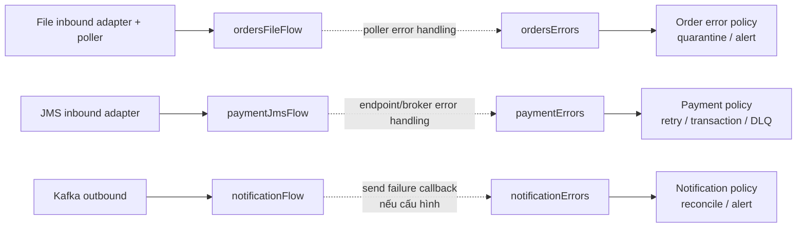
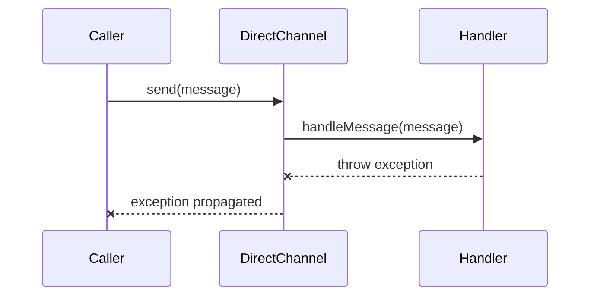
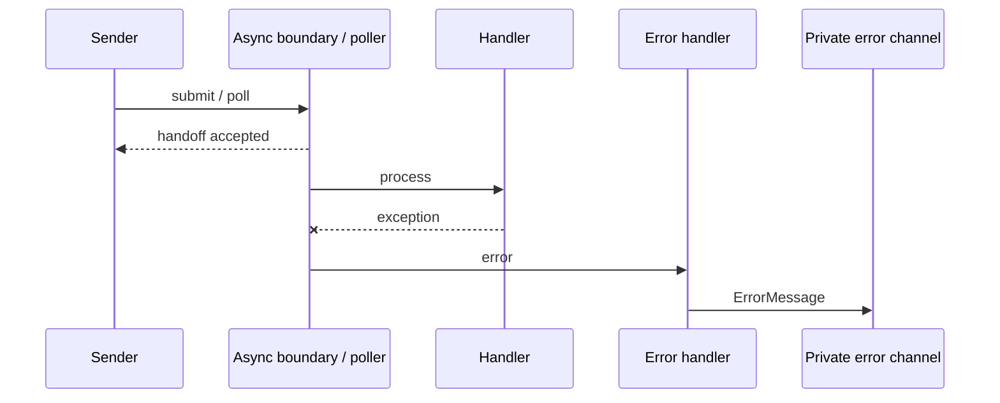
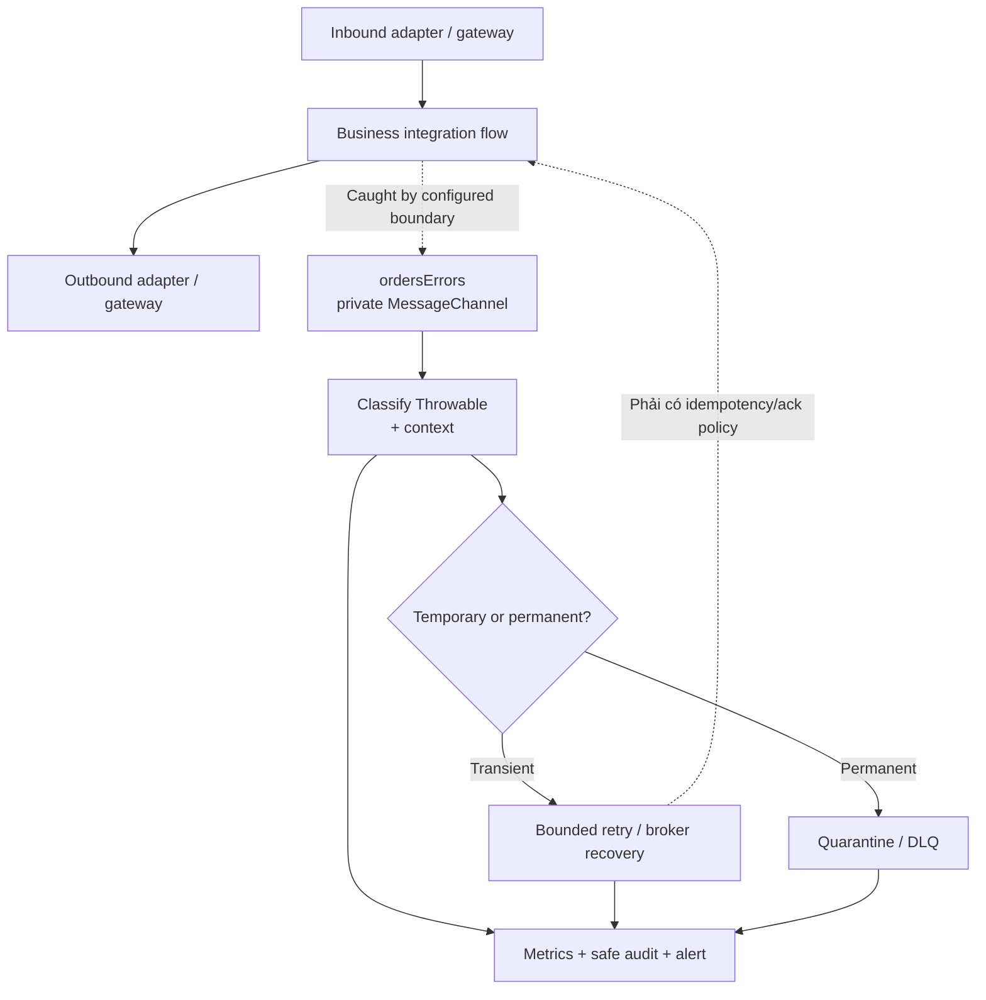
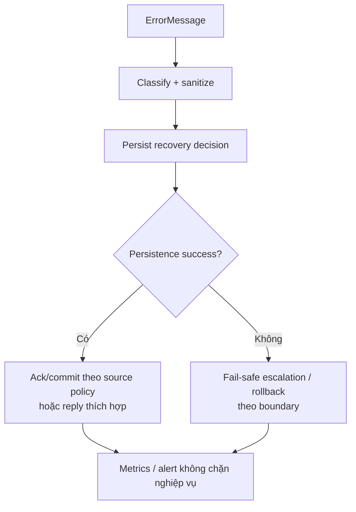

# Private error channel theo flow trong Spring Integration Adapters

> **Chương:** Error handling  
> **Module:** `SPRING_INTEGRATION_ADAPTERS`  
> **Phạm vi:** Kết nối hệ thống bên ngoài với Spring Integration qua **inbound/outbound adapter, gateway, poller và MessageChannel**; áp dụng với luồng **file, SFTP, HTTP, JMS, AMQP, Kafka và cơ sở dữ liệu**.  
> **Mục tiêu:** Thiết kế **kênh lỗi riêng cho từng integration flow** để cô lập sự cố, phân loại nguyên nhân, bảo toàn ngữ cảnh message và xử lý retry, quarantine/DLQ, monitoring, đồng thời hiểu ranh giới giữa lỗi đồng bộ và lỗi bất đồng bộ.

## 1. Bài toán: Vì sao cần private error channel?

Trong một ứng dụng tích hợp, có thể có nhiều luồng nhận và gửi dữ liệu:

- `ordersFileFlow` đọc file CSV từ một thư mục, kiểm tra dữ liệu rồi lưu vào cơ sở dữ liệu.
- `paymentJmsFlow` nhận sự kiện thanh toán từ JMS, gọi HTTP API và phát kết quả.
- `inventorySftpFlow` tải file từ SFTP rồi đối chiếu kho.
- `notificationKafkaFlow` gửi sự kiện ra Kafka.
- `billingAmqpFlow` nhận message từ AMQP, cập nhật trạng thái và gửi phản hồi.

Các luồng này có **đặc điểm lỗi, SLA, retry, ownership và yêu cầu nghiệp vụ khác nhau**. Nếu toàn bộ lỗi không phân biệt đều đổ vào một nơi, việc xử lý có thể trở nên mơ hồ:

- File sai định dạng bị retry như sự cố mạng.
- Lỗi broker tạm thời bị đưa thẳng vào DLQ dù có thể phục hồi.
- Một luồng có yêu cầu kiểm toán cao làm log tràn vì lỗi của luồng khác.
- Lỗi chứa dữ liệu cá nhân của thanh toán bị chuyển tới nhóm vận hành inventory.
- Quá trình replay lỗi vô tình chạy lại cả những thao tác đã có side effect.
- Metrics và cảnh báo không cho biết **flow nào** bị ảnh hưởng.

**Private error channel theo flow** nghĩa là mỗi luồng, hoặc mỗi **ranh giới xử lý có cùng chính sách lỗi**, có một `MessageChannel` chuyên nhận `ErrorMessage` liên quan. Tên “private” trong bài ám chỉ **cô lập theo cấu hình và trách nhiệm**, không tự động có nghĩa một cơ chế bảo mật, namespace hay loại channel đặc biệt của framework.

### 1.1. Một tình huống cụ thể

Giả sử `ordersFileFlow` cần lưu file hỏng vào quarantine sau khi thử xử lý, còn `paymentJmsFlow` phải bảo toàn transaction của broker để có thể redeliver. Nếu cả hai cùng nhận một handler “gặp lỗi thì nuốt exception và ghi log”, giao dịch JMS có thể bị commit dù công việc chưa hoàn tất, trong khi file vẫn bị đọc lại gây lặp.

Thiết kế phù hợp hơn:



Các đường nét đứt thể hiện **đường lỗi phụ thuộc loại endpoint và cấu hình**, không phải cam kết rằng mọi exception ở bất kỳ nơi nào cũng tự động thành `ErrorMessage` trên channel bên cạnh.

## 2. Phân biệt error channel với luồng xử lý nghiệp vụ

Spring Integration dùng **Message** với `payload` và `headers` để chuyển dữ liệu qua `MessageChannel`. Một **integration flow** nối inbound endpoint, channel, transformer, filter, router, service activator, gateway và outbound endpoint.

**Kênh nghiệp vụ** vận chuyển message bình thường. **Kênh lỗi** vận chuyển thông tin lỗi, thường là một `ErrorMessage`:

```text
Business path:
  inbound source -> Message<?> -> transform -> handle -> outbound

Error path:
  failed task / handler -> ErrorMessage(Throwable, headers, originalMessage?)
                         -> private error channel
                         -> error handler / recovery policy
```

Một private error channel không tự:

- Retry message.
- Nack một message từ broker.
- Rollback database transaction.
- Xóa hoặc chuyển file hỏng.
- Tạo HTTP response chính xác cho client.
- Lưu message bền vững qua restart.
- Ngăn lỗi bị ghi nhận ở kênh toàn cục nếu cấu hình chưa khép kín.

Những hành vi đó phải do **endpoint, advice, transaction, broker hoặc flow phục hồi** thực hiện rõ ràng.

### 2.1. Các thuật ngữ quan trọng

| Thuật ngữ | Vai trò |
|---|---|
| `MessageChannel` | Trừu tượng chuyển message giữa các endpoint |
| `DirectChannel` | Gửi tới subscriber trong cùng thread theo mô hình đồng bộ |
| `ExecutorChannel` | Chuyển xử lý qua executor; thay đổi thread và cách lỗi lan truyền |
| `QueueChannel` | Lưu message trong queue của channel; đặc tính bền vững tùy cấu hình |
| `PublishSubscribeChannel` | Phân phát tới nhiều subscriber, có thể đồng bộ hoặc bất đồng bộ theo cấu hình |
| `ErrorMessage` | Message có payload là `Throwable`, có thể mang thông tin message gốc |
| `errorChannel` | Tên channel toàn cục thường được framework tạo làm đường lỗi dự phòng |
| `MessagePublishingErrorHandler` | Thành phần có thể chuyển exception thành `ErrorMessage` để publish tới error channel |
| `MessagingException` | Exception trong hệ sinh thái Spring Messaging, có thể mang `failedMessage` |
| `Poller` | Thành phần lấy message theo lịch; có phạm vi error handling riêng |
| `RequestHandlerRetryAdvice` | Advice retry quanh handler trong phạm vi được áp dụng |
| **DLQ / quarantine** | Cơ chế lưu lỗi để điều tra hoặc xử lý lại, **không đồng nghĩa** một `MessageChannel` thường |

## 3. Mô hình mặc định: global `errorChannel`

Spring Integration có cơ chế error channel toàn cục thường mang tên bean `errorChannel`. Một số thành phần bất đồng bộ hoặc poller dùng error handler để publish exception vào đó khi không có nơi nhận lỗi cụ thể. Cơ chế mặc định có thể có subscriber logging; hành vi chính xác và cấu hình phụ thuộc phiên bản, endpoint và application context.

Điểm cần nhớ:

- **Không phải mọi exception đều đến global `errorChannel`.**
- Một handler trên `DirectChannel` có thể ném exception **trực tiếp lên caller**.
- Một poller có thể bắt lỗi và publish qua `MessagePublishingErrorHandler`.
- Một message-driven adapter có thể có cơ chế error channel hoặc exception/rollback riêng.
- Lỗi **Kafka outbound async send** có thể đi theo callback/success-failure channel chuyên biệt.
- Một gateway đồng bộ có thể chuyển exception thành phản hồi hoặc ném lên client tùy cấu hình.

Do đó, không nên dựng một kênh riêng rồi cho rằng Spring tự chọn nó vì tên giống flow. Phải **cấu hình đúng điểm phát lỗi** và kiểm thử.

### 3.1. Khi nào global channel vẫn hữu ích?

Global `errorChannel` có thể làm đường dự phòng cho lỗi ngoài dự kiến, logging hoặc cảnh báo “unrouted error”. Tuy nhiên, mỗi flow quan trọng nên có chính sách lỗi rõ để không phụ thuộc vào handler chung đoán ngữ cảnh từ payload.

Một kiểm soát hữu ích là **cảnh báo khi lỗi của flow đã thiết kế private channel lại xuất hiện ở global channel**. Đó có thể là dấu hiệu mất header, endpoint chưa gắn error channel hoặc lỗi phát sinh ngoài phạm vi được cấu hình.

## 4. Đồng bộ và bất đồng bộ là ranh giới quan trọng nhất

Hành vi xử lý lỗi thay đổi rõ rệt theo **thread và boundary**.

### 4.1. Lỗi đồng bộ trên `DirectChannel`



Trong tình huống điển hình trên, exception được ném về **bên gửi**, không tự biến thành `ErrorMessage` ở kênh riêng chỉ vì tồn tại một bean `ordersErrors`. Nếu caller là **poller** có error handler đã cấu hình, poller có thể bắt lỗi rồi publish tới channel đó. Nếu caller là HTTP gateway, nó có thể xử lý lỗi theo giao thức request–reply.

### 4.2. Lỗi tại một boundary bất đồng bộ

Với `ExecutorChannel`, poller, message-driven endpoint hoặc callback gửi bất đồng bộ, bên gửi ban đầu có thể không còn ở cùng thread để nhận exception. Một thành phần thích hợp sẽ **publish ErrorMessage**, gọi callback, ném lỗi để broker xử lý hoặc kết hợp các cơ chế, tùy cấu hình.



Sơ đồ này là **một mô hình được cấu hình**, không phải mô tả bắt buộc của mọi transport.

### 4.3. Bảng quyết định

| Tình huống | Exception thường đi đâu? | Cách thiết kế private handling |
|---|---|---|
| Handler đồng bộ được gọi trực tiếp | Trả về caller qua exception | Xác định caller; xử lý ở gateway/poller/boundary |
| Handler nằm trong polling task | Poller/error handler có thể publish | Cấu hình error channel cho poller |
| Executor/async channel | Error handler trong thread xử lý | Kiểm tra cơ chế `ErrorMessage` tại boundary |
| HTTP inbound gateway | Gateway/request–reply error path | Xác định HTTP response, status và reply rõ |
| JMS/AMQP message-driven | Listener/container và error handling | Cân nhắc transaction, ack/requeue và error channel |
| Kafka outbound async | Producer callback hoặc send-failure path | Cấu hình failure channel/callback, theo dõi confirmation |
| JDBC outbound trong transaction | Exception tới transaction boundary | Chọn rollback/retry; không nuốt exception ngoài ý muốn |

**Nguyên tắc thiết kế:** Định vị **exception thực sự bị bắt tại đâu** trước khi chọn nơi route `ErrorMessage`.

## 5. Private error channel thực sự là gì?

Không có một kiểu bean `PrivateErrorChannel` chung bắt buộc cho mỗi Spring Integration flow. Một thiết kế riêng có thể đơn giản là:

1. Định nghĩa một bean `MessageChannel` với tên riêng, ví dụ `ordersErrors`.
2. Cấu hình **poller hoặc adapter/gateway phù hợp** để gửi lỗi tới đó.
3. Tạo consumer nhận `ErrorMessage` và áp chính sách lỗi của chính flow.
4. Chọn nơi lưu/notify/retry phù hợp với loại nguồn.
5. Đặt monitoring, access control và retention theo flow.
6. Kiểm thử rằng lỗi của flow A không bị đưa nhầm vào flow B.

Tên channel **không tự đảm bảo tính riêng tư về bảo mật**. Nếu cần chặn truy cập dữ liệu nhạy cảm, phải bổ sung quyền truy cập, phân vùng tenant, redaction và giám sát.

### 5.1. Khi nào tách channel?

Có thể tách khi các flow khác nhau về:

- Chủ sở hữu xử lý và lịch trực vận hành.
- Chính sách retry/timeout hoặc transaction.
- Nội dung message và mức độ nhạy cảm.
- Loại transport và cách ack/redelivery.
- Quarantine/DLQ và retention.
- SLA, alert, số lần retry, yêu cầu đối soát.
- Vùng tin cậy hoặc tenant.

Không nhất thiết tạo một channel cho **mỗi endpoint** nếu nhiều endpoint có chung lỗi và cùng runbook. Nhưng không nên gộp chỉ vì cùng dùng một ứng dụng Spring Boot.

## 6. Kiến trúc gợi ý: business flow, private channel và recovery flow



Ở kiến trúc này, kênh lỗi chỉ chịu trách nhiệm **vận chuyển và cô lập sự kiện lỗi**. Hành động retry hoặc ghi quarantine cần được thiết kế riêng để không tạo vòng lặp hoặc mất message.

### 6.1. Chính sách lỗi nên tách làm hai phần

**Routing policy:** lỗi đi vào channel nào? Ví dụ `ordersErrors`, `paymentsErrors`.

**Recovery policy:** có retry hay không, ai quyết định, bao nhiêu lần, DLQ ở đâu, giữ thông tin gì, khi nào alert, có cần rollback/negative acknowledgement?

Gộp cả hai vào một generic handler “catch mọi thứ” khó kiểm tra và thường làm mất ngữ nghĩa giao dịch.

## 7. Ví dụ Java DSL: file inbound flow với poller error channel riêng

Ví dụ dưới đây minh họa flow đọc file đơn hàng, chuyển giao xử lý và đưa exception phát sinh trong **polling task** tới một channel riêng. Mã sử dụng các thành phần quen thuộc trong Spring Integration Java DSL; chữ ký và cách tạo spec cần đối chiếu với phiên bản Spring Integration đang dùng trước khi đưa vào production.

### 7.1. Cấu hình flow và channel

```java
import java.io.File;
import java.time.Duration;

import org.springframework.beans.factory.annotation.Qualifier;
import org.springframework.context.annotation.Bean;
import org.springframework.context.annotation.Configuration;
import org.springframework.integration.dsl.IntegrationFlow;
import org.springframework.integration.dsl.Pollers;
import org.springframework.integration.file.dsl.Files;
import org.springframework.integration.channel.DirectChannel;
import org.springframework.messaging.MessageChannel;

@Configuration
class OrdersIntegrationConfiguration {

    @Bean("ordersErrors")
    MessageChannel ordersErrors() {
        return new DirectChannel();
    }

    @Bean
    IntegrationFlow ordersFileFlow(OrderImporter importer) {
        return IntegrationFlow
            .from(
                Files.inboundAdapter(new File("/var/app/orders/in"))
                    .patternFilter("*.csv"),
                endpoint -> endpoint.poller(
                    Pollers.fixedDelay(Duration.ofSeconds(2))
                        .maxMessagesPerPoll(10)
                        .errorChannel("ordersErrors")
                )
            )
            .handle(File.class, (file, headers) -> {
                importer.importFile(file);
                return null; // Terminal handler: không phát reply.
            })
            .get();
    }
}

interface OrderImporter {
    void importFile(File file);
}
```

**Giải thích:**

- `Files.inboundAdapter(...)` tạo nguồn polling file, không tự tạo transaction database.
- `Pollers.fixedDelay(...)` quyết định nhịp lấy file.
- `errorChannel("ordersErrors")` đặt đích nhận lỗi cho **poller** trong phạm vi được endpoint hỗ trợ.
- `DirectChannel` đưa `ErrorMessage` tới subscriber đồng bộ trong thread publish.
- Handler ném exception runtime khi không xử lý được file; poller có thể publish exception tới channel đã cấu hình.
- `return null` kết thúc flow sau thành công; nó không có nghĩa file được archive, di chuyển hay xóa.

**Điểm cần kiểm tra ở ứng dụng thật:** tính khả dụng của API DSL theo phiên bản, hành vi poller khi exception xuất hiện, danh sách subscriber trên kênh lỗi, trạng thái file filter và cách xác định file “đã xử lý”.

### 7.2. Handler dành riêng cho `ordersErrors`

```java
import org.springframework.context.annotation.Bean;
import org.springframework.context.annotation.Configuration;
import org.springframework.integration.dsl.IntegrationFlow;
import org.springframework.messaging.Message;
import org.springframework.messaging.MessagingException;
import org.springframework.messaging.support.ErrorMessage;

@Configuration
class OrdersErrorHandlingConfiguration {

    @Bean
    IntegrationFlow ordersErrorFlow(OrdersFailureRecorder recorder) {
        return IntegrationFlow.from("ordersErrors")
            .handle(message -> {
                ErrorMessage error = (ErrorMessage) message;

                Throwable cause = error.getPayload();

                Message<?> failed = error.getOriginalMessage();
                if (cause instanceof MessagingException messagingException
                        && messagingException.getFailedMessage() != null) {
                    failed = messagingException.getFailedMessage();
                }

                recorder.recordSafely(
                    "ordersFileFlow",
                    cause,
                    failed
                );
            })
            .get();
    }
}

interface OrdersFailureRecorder {
    void recordSafely(
        String flowId,
        Throwable cause,
        Message<?> failedMessage);
}
```

Handler này **cố ý không log raw payload**. `recordSafely` là giao diện nghiệp vụ cần triển khai để phân loại, redaction, lưu quarantine/metrics và kiểm soát lỗi của chính quá trình ghi nhận. Không nên gửi nguyên `Throwable.toString()` và `failedMessage` tới một hệ thống giám sát công cộng vì exception message hoặc payload có thể chứa PII/secret.

**Lưu ý:** `getFailedMessage()` hoặc `getOriginalMessage()` **có thể không có** tùy nguồn lỗi và cách tạo `ErrorMessage`. Handler phải chấp nhận `null` và dựa thêm vào correlation ID, metadata nguồn và log được phép.

### 7.3. Trường hợp không có subscriber

Nếu kênh lỗi không có consumer hoặc consumer lỗi, hệ thống có thể phát sinh lỗi tiếp theo hoặc không ghi nhận được sự cố như dự định, tùy loại channel và cấu hình. Vì vậy cần kiểm thử **flow lỗi khi handler lỗi**, startup health checks hoặc cơ chế fallback thích hợp.

Không nên xem việc khai báo `@Bean("ordersErrors")` là hoàn tất triển khai error handling.

## 8. Tách nhiều private error channels trong cùng ứng dụng

Giả sử đơn hàng và thanh toán không được dùng chung recovery policy:

```java
@Bean("ordersErrors")
MessageChannel ordersErrors() {
    return new DirectChannel();
}

@Bean("paymentErrors")
MessageChannel paymentErrors() {
    return new DirectChannel();
}
```

Ở những endpoint hỗ trợ cấu hình error channel riêng:

```text
orders poller       -> ordersErrors
payment listener    -> paymentErrors
inventory poller    -> inventoryErrors

ordersErrors        -> order quarantine + ops alert
paymentErrors       -> transaction-aware recovery + finance alert
inventoryErrors     -> SFTP retry + warehouse alert
```

**Không chỉ route bằng header `flowId` do dữ liệu bên ngoài cung cấp.** Một message gửi từ HTTP client hoặc broker có thể chứa header giả. Đích lỗi nên đến từ cấu hình **endpoint được tin cậy**, hoặc context nội bộ đã được xác minh.

### 8.1. Vì sao dùng tên rõ ràng?

Tên nên phản ánh **nghiệp vụ và ranh giới**:

| Tên | Đánh giá |
|---|---|
| `ordersErrors` | Dễ biết luồng và người chịu trách nhiệm |
| `paymentsErrors` | Tách SLA và transaction policy |
| `sftpInventoryErrors` | Phân biệt nguồn file từ SFTP |
| `error2` | Mơ hồ khi vận hành |
| `myErrors` | Không chỉ ra purpose |
| `tenantA.errors` | Có thể phù hợp nếu tenant thực sự là ranh giới an toàn |

Dấu chấm trong bean name là hợp lệ theo cấu hình Spring nhưng có thể ảnh hưởng quy ước metrics/naming ở công cụ khác; cần thống nhất trong nhóm.

## 9. `ErrorMessage` chứa gì và cần xử lý thế nào?

`ErrorMessage` là message có `payload` dạng `Throwable`. Spring Messaging cho phép kèm original message; một số exception thuộc loại `MessagingException` mang `failedMessage`. Không phải lúc nào cả hai cũng có.

```text
ErrorMessage
  payload: Throwable
    type: MessageHandlingException, ...
    cause: root exception
    failedMessage?: Message<?>
  headers: error metadata / correlation data
  originalMessage?: Message<?>
```

### 9.1. Một mẫu lỗi cần lấy metadata

| Thông tin | Có ích cho | Lưu ý |
|---|---|---|
| `flowId` | Định tuyến/metrics | Lấy từ nguồn cấu hình tin cậy |
| `correlationId` | Ghép chuỗi xử lý | Không dùng làm credential |
| `messageId` | Đối soát event | Không mặc định có ở mọi connector |
| `transport` | Biết file, SFTP, HTTP, JMS, Kafka... | Nên chuẩn hóa nội bộ |
| `resourceRef` | Tìm file, topic/partition, destination | Có thể nhạy cảm |
| `exceptionClass` | Phân loại lỗi | Tránh log giá trị dữ liệu thô |
| `rootCauseCode` | Recovery policy | Dùng mã ổn định, không phải stack trace toàn bộ |
| `attempt` | Retry budget | Phải được kiểm soát ở đúng layer |
| `firstFailureAt` | SLA và điều tra | Tránh reset khi retry |
| `failedPayloadRef` | Quarantine ở kho riêng | Không chép payload vô hạn vào log |
| `tenantId` | Cô lập dữ liệu | Xác minh với endpoint/source |
| `policyVersion` | Audit quyết định | Hữu ích để tái hiện nguyên nhân |

### 9.2. Đừng mất cause chain

Một lỗi có thể có các lớp:

```text
MessageHandlingException
    caused by DataIntegrityViolationException
        caused by constraint violation
```

Phân loại chỉ dựa vào exception ngoài cùng sẽ gộp mọi lỗi thành “message handling failed”. Nên duyệt cause chain có giới hạn và chuyển thành **error code** thuộc danh mục cho phép.

Tuy nhiên, không log nguyên các exception message có thể chứa SQL parameters, đường dẫn nhạy cảm, token hoặc nội dung người dùng. Mã lỗi và bằng chứng tham chiếu thường an toàn hơn stack trace ở dashboard mở rộng.

## 10. Cấu hình header `errorChannel` và giới hạn

Spring Messaging dùng `MessageHeaders.ERROR_CHANNEL`, tên header thường là `errorChannel`, để chỉ một kênh xử lý lỗi trong các đường message hỗ trợ cơ chế đó. Giá trị có thể là tham chiếu channel hoặc tên cần được giải quyết theo context phù hợp.

Ví dụ tạo **message nội bộ** với header:

```java
Message<String> message = MessageBuilder
    .withPayload("order-123")
    .setHeader(MessageHeaders.ERROR_CHANNEL, "ordersErrors")
    .setHeader("correlationId", "corr-1048")
    .build();
```

Các import tương ứng là `org.springframework.messaging.Message`, `org.springframework.messaging.MessageHeaders` và `org.springframework.messaging.support.MessageBuilder`.

**Điều quan trọng:** đặt header không đảm bảo một exception được ném đồng bộ ở bất kỳ handler nào sẽ tự publish tới channel. Endpoint phải hỗ trợ hoặc có một error handler thực sự sử dụng header đó. Thứ tự ưu tiên giữa **header error channel, endpoint configuration, poller configuration và global fallback** cũng cần được kiểm tra với loại endpoint và phiên bản đang triển khai.

### 10.1. Không tin header từ nguồn không tin cậy

Khi nhận HTTP headers, Kafka headers hoặc custom JMS properties, không để bên ngoài tự quyết định Spring internal error channel bằng cách truyền một header tên `errorChannel` không được kiểm soát.

Một chiến lược an toàn:

1. Whitelist headers đi qua inbound adapter.
2. Loại hoặc ghi đè header dùng để điều khiển routing nội bộ khi cần.
3. Đặt error channel từ **endpoint config** hoặc enrichment nội bộ đáng tin.
4. Test client gửi `errorChannel=paymentsErrors` vào một order request.
5. Bảo đảm tenant A không thể ép lỗi của mình vào handler tenant B.

Ranh giới riêng theo flow có ý nghĩa khi **quyền quyết định routing** nằm trong ứng dụng, không phải dữ liệu bên ngoài.

## 11. Poller và polling adapters: nơi dễ cấu hình private error channel

Các inbound adapter như **file, SFTP, JDBC polling** lấy message theo lịch. Poller sở hữu một vòng xử lý task; trong mô hình thường gặp, lỗi trong task được error handler bắt và gửi tới error channel cấu hình cho poller.

### 11.1. Poller-level error policy

Các điểm cần xác định:

- Poller thuộc flow nào, bean nào sở hữu?
- Nếu `receive()` thất bại trước khi tạo message, error context có gì?
- Nếu transformer/handler lỗi, `failedMessage` có sẵn không?
- Exception có được đưa tới đúng private channel không?
- Kênh lỗi có subscriber trước khi poller bắt đầu không?
- Một polling task thất bại có làm bỏ các file/message khác trong cùng batch không?
- Có cơ chế tránh đọc lại vô hạn hoặc mất message không?

### 11.2. Lỗi trước và sau khi tạo message

**Trước khi có Message:** ví dụ SFTP session không thiết lập được. `ErrorMessage` có thể chứa exception kết nối nhưng không có file payload gốc.

**Sau khi có Message:** ví dụ parse CSV thất bại. `MessagingException.getFailedMessage()` có thể có thông tin message chứa `File` hoặc payload đã transform.

Handler không được giả định luôn có tên file hoặc topic/offset ở lỗi. Khi thiếu context, cần dùng metadata poller/adapter hoặc correlation data do ứng dụng quản lý.

### 11.3. Poller lỗi không tự làm file được “xử lý lại đúng”

Một file inbound adapter có thể dùng filter **accept-once** hoặc metadata store. Sau khi file được chọn để xử lý, exception không nhất thiết khiến file quay lại danh sách nhận trong lần poll sau.

Phải thiết kế cụ thể:

- Khi thành công, di chuyển file sang archive hoặc đánh dấu processed.
- Khi lỗi tạm thời, có lịch retry an toàn, backoff, idempotency.
- Khi dữ liệu lỗi vĩnh viễn, chuyển quarantine và ghi lý do.
- Với file đang ghi dở, dùng chiến lược atomic rename/ready marker hoặc age filter phù hợp.
- Với nhiều instance, dùng cơ chế phối hợp/metadata store khi cần tránh đọc trùng.
- Không giả định có rollback file system giống database transaction.

## 12. File inbound: parse errors và quarantine

Luồng đọc file có hai loại lỗi thường gặp:

| Loại lỗi | Ví dụ | Chính sách phù hợp |
|---|---|---|
| **Permanent / dữ liệu không hợp lệ** | CSV thiếu cột bắt buộc, encoding sai | Quarantine, cảnh báo người gửi, không retry vô hạn |
| **Transient / phụ thuộc hệ thống** | Database timeout, service downstream tạm unavailable | Retry có giới hạn và idempotency |
| **Source readiness** | File đang được ghi, chưa đầy đủ | Chờ file ổn định, không xử như dữ liệu xấu |
| **Permission / storage** | Không đọc được thư mục hoặc không ghi được archive | Alert hạ tầng, giảm tốc hoặc tạm dừng |
| **Side-effect partial** | Đã insert một phần trước khi lỗi | Transaction/idempotency và đối soát |

### 12.1. Quarantine record cần gì?

```json
{
  "failureId": "fail-order-1005",
  "flowId": "ordersFileFlow",
  "sourceType": "file",
  "sourceReference": "orders/2026-11-23/batch-18.csv",
  "errorCode": "CSV_INVALID_HEADER",
  "firstFailedAt": "2026-11-23T08:30:00Z",
  "attempts": 1,
  "status": "quarantined",
  "payloadStoreRef": "restricted-object-store/ref-1005"
}
```

Đây là **schema nghiệp vụ minh họa**, không phải cấu trúc `ErrorMessage` tiêu chuẩn. Nếu payload chứa PII, không lưu raw CSV trực tiếp trong message/log của channel lỗi. Dùng vùng bảo vệ với access control, checksum, retention và chính sách xóa.

### 12.2. Kết luận

**Private error channel** giúp lỗi file không trộn với lỗi JMS, nhưng **quarantine chính xác** cần thêm file lifecycle, kiểm soát trùng và xử lý file đang ghi.

## 13. SFTP inbound/outbound: kết nối, file và idempotency

SFTP tích hợp thêm lớp **remote session, credential, mạng, directory listing, remote file rename, local staging**. Lỗi có thể xảy ra **trước khi tạo message** hoặc trong khi đang truyền.

### 13.1. Cách phân loại

| Lỗi | Nhóm | Hành động dự kiến |
|---|---|---|
| SFTP server timeout | Transient nếu phù hợp | Backoff, giới hạn retry, giám sát |
| Authentication failed | Cấu hình/secret | Chặn retry nóng, kiểm tra credential và rotation |
| Remote file missing | Race hoặc vận hành | Kiểm tra metadata/listing, không giả định file còn |
| Partial download | Trạng thái chuyển file | Dùng temp suffix/atomic move khi thích hợp |
| File content invalid | Permanent data | Quarantine sau khi đã nhận đủ |
| Remote permission denied | Quyền | Escalate owner, không retry vô hạn |
| Duplicate file after restart | Idempotency | Persistent accept-once/filter và key xử lý |

### 13.2. Scope error channel

Có thể sử dụng `inventorySftpErrors` cho lỗi của polling SFTP và `ordersFileErrors` cho lỗi parse file, **nếu** hai luồng có owner và quy trình khác nhau. Nhưng đừng tách theo cảm tính: phải biết tại endpoint nào exception được bắt và ErrorMessage được publish.

### 13.3. Cẩn thận khi replay

Retry nhận lại SFTP file có thể tạo duplicate local file hoặc trùng giao dịch database. Dùng khóa nghiệp vụ/checksum thích hợp và ghi nhận trạng thái, không chỉ đếm số lần retry ở error handler.

## 14. HTTP inbound/outbound gateway: lỗi đồng bộ cần trả phản hồi đúng

HTTP gateway thường hoạt động theo mẫu **request–reply**. Lỗi cần được chuyển thành **phản hồi HTTP có status rõ ràng** hoặc exception theo cơ chế Spring Integration/Spring Web, không chỉ gửi `ErrorMessage` rồi để caller chờ.

### 14.1. Ví dụ mapping nghiệp vụ

| Lỗi | Kết quả HTTP thường cân nhắc | Lưu ý |
|---|---|---|
| Payload không hợp lệ | 4xx phù hợp | Không retry ở client nếu nội dung chưa sửa |
| Chưa xác thực/không đủ quyền | 401/403 theo semantics | Không tiết lộ dữ liệu nội bộ |
| Tài nguyên không tồn tại | 404 khi phù hợp | Cân nhắc ngăn enumeration |
| Timeout downstream | 502/503/504 tùy tầng và nguyên nhân | Cần contract timeout và retry riêng |
| Lỗi xử lý nội bộ | 500 khi phù hợp | Có correlation ID, không trả stack trace |
| Rate limiting | 429 khi đúng policy | Backoff / Retry-After nếu áp dụng |

Bảng chỉ nêu **phân loại tham khảo**; status code cuối cùng phải đúng giao thức và nghiệp vụ của API.

### 14.2. Private error channel với gateway

Các gateway/endpoint có thể hỗ trợ error channel và luồng trả lời lỗi; nhưng phải kiểm tra **reply channel, request timeout, reply timeout và cách chuyển kết quả lỗi thành HTTP response** của đúng loại gateway.

Nếu error flow chỉ log rồi trả `null`:

- Caller có thể **timeout** chứ không nhận thông báo lỗi có cấu trúc.
- Một exception đồng bộ có thể được propagate thay vì đi tới channel.
- Gửi một `ErrorMessage` không có nghĩa HTTP status tự thành 500.

Thiết kế tốt cần một **error response contract** có trace ID, mã lỗi nghiệp vụ được phép tiết lộ và HTTP status chính xác; xử lý dữ liệu/stack trace trong vùng nội bộ.

### 14.3. Outbound HTTP gateway

Khi một handler gọi HTTP hệ thống ngoài, lỗi 4xx và 5xx có thể được xử lý khác tùy client và error handler cấu hình. Không retry toàn bộ 4xx; lỗi 429, 503 hoặc network timeout cần xét chính sách của provider và tính **idempotency của request**.

## 15. JMS message-driven: private channel và transaction rollback

JMS tạo thêm vấn đề **acknowledgement và transaction**. Một error flow “nhận lỗi rồi coi đã xử lý” có thể ảnh hưởng việc listener/container quyết định commit hay rollback.

### 15.1. Hai đường thiết kế cần tách

**Đường A — redelivery từ broker:** exception phải tới transaction/listener boundary tương ứng để rollback hoặc trigger redelivery theo cấu hình. Phải có retry/redelivery policy và DLQ của broker.

**Đường B — xử lý lỗi ứng dụng có chủ đích:** handler error quyết định lưu quarantine, ghi audit và xác nhận message phù hợp sau khi công việc khôi phục đã bền vững.

Không thể mặc định một `paymentErrors` consumer trả thành công sẽ khiến JMS tự rollback. Kết quả phụ thuộc vào việc exception có được **rethrow** hoặc container nhận lỗi thế nào.

### 15.2. Những câu hỏi phải kiểm tra

- Listener dùng session transacted, ack mode nào?
- Error được publish vào channel có bị xem là **đã xử lý** không?
- Có `RequestHandlerRetryAdvice` ở đúng handler hay không?
- Có broker redelivery policy và DLQ không?
- Nếu database update đã thành công nhưng reply publish lỗi, replay có tạo side effect trùng không?
- Message IDs, correlation IDs và delivery count có được giữ?
- Transaction có bao phủ được những tài nguyên liên quan không? Không được tự giả định transaction xuyên database, JMS và HTTP.
- Khi quarantine thất bại, transaction sẽ xử lý ra sao?

### 15.3. Một bảng tình huống

| Tình huống | Kỳ vọng |
|---|---|
| Lỗi DB transient trước commit | Rollback/redeliver hoặc retry theo policy |
| Message JSON sai schema | Không lặp vô hạn; DLQ/quarantine có evidence |
| Payment đã ghi DB, HTTP callback thất bại | Outbox/idempotency, tách hiệu ứng phụ |
| Error handler cũng lỗi | Có fallback rõ và không âm thầm ack/mất message |
| Broker DLQ đầy hoặc không khả dụng | Alert và fail-safe theo yêu cầu nghiệp vụ |

**Private error channel chỉ là đường xử lý sự cố**, không thay thế thiết kế giao dịch.

## 16. AMQP: lỗi adapter và quyết định ack/requeue

AMQP inbound adapter có listener/container và cơ chế ack/requeue phụ thuộc cấu hình. Phải quyết định:

- Có requeue lỗi tạm thời không và **giới hạn số lần** thế nào?
- Lỗi payload vĩnh viễn có nên đi DLQ thay vì lặp vô hạn?
- Có cấu hình TTL, dead-letter exchange/routing hoặc retry infrastructure không?
- Error handler nhận `ErrorMessage` có thay đổi semantics ack không?
- Có publisher confirms cho outbound và ai nhận lỗi publish?
- Nếu đang dùng manual ack, **ai** chịu trách nhiệm ack/nack?
- Khi broker đóng kết nối, việc retry được xử lý ở container hay application?

Một luồng có thể dùng `billingAmqpErrors` để đưa lỗi ứng dụng tới recovery logic, trong khi broker quản lý redelivery/DLQ theo cấu hình container. Hai hệ thống phải **thống nhất quyết định**; không tạo retry hai tầng không giới hạn.

### 16.1. Poison message

Một message luôn lỗi khi parse (poison message) có thể chiếm worker và spam logs nếu requeue mãi. Cần **retry budget**, dead-letter/quarantine và cơ chế replay sau sửa dữ liệu.

Không đưa raw body chứa thông tin thanh toán vào alert công khai. Thay bằng message ID, routing key và reference tới vùng lưu được bảo vệ.

## 17. Kafka: phân biệt consumer error và producer send failure

Kafka có **topic, partition, offset, consumer group và producer acknowledgement**. Không nên coi kênh lỗi giống một exception queue phổ quát.

### 17.1. Kafka inbound consumer

Khi Spring Integration Kafka inbound adapter nhận record, phải hiểu cơ chế:

- Adapter/message listener được cấu hình ack/commit offset ra sao?
- Handler lỗi đồng bộ hay bất đồng bộ?
- Consumer có dừng, retry, seek/replay, publish DLT hay commit không?
- Có transaction Kafka, database hoặc outbox được phối hợp thế nào?
- Có poison record gây kẹt partition không?
- Error message có đủ `topic`/`partition`/`offset`/`consumerGroup` hoặc reference từ nguồn không?

Private `kafkaOrdersErrors` có thể phục vụ audit và routing chính sách, nhưng **không tự commit/nack offset**. Offset management phải gắn với container và error handling của adapter.

### 17.2. Kafka outbound producer

Lỗi **asynchronous send** có thể xuất hiện sau khi handler ban đầu đã trả về. Spring Integration Kafka outbound adapter có những cơ chế báo cáo send success/failure theo cấu hình, ví dụ **send-failure channel** trong trường hợp được hỗ trợ.

Không giả định mọi lỗi producer tự chảy vào `errorChannel` của inbound flow. Cần kiểm tra producer handler, callback, delivery timeout, broker acknowledgement, error channel/failure channel và version của thư viện.

```text
application event
    -> Kafka outbound adapter
       -> accepted for send (không đồng nghĩa broker đã xác nhận)
       -> success callback / confirmation
       -> failure callback / configured send-failure channel
```

### 17.3. Idempotency khi replay Kafka

Kafka cung cấp các cơ chế producer/consumer riêng; nhưng **exactly-once của một pipeline nhiều hệ thống** không thể suy ra chỉ từ cấu hình Kafka. Khi consume Kafka rồi gọi HTTP/DB/SFTP, cần idempotency key, transaction/outbox hoặc đối soát theo nghiệp vụ.

## 18. JDBC và database polling: transaction, lock và dữ liệu lỗi

Một polling adapter đọc các row `status=NEW`, sau đó biến đổi và cập nhật trạng thái. Một lỗi có thể xảy ra ở:

- Đọc DB hoặc kết nối.
- Parse dữ liệu row.
- Gọi một dịch vụ bên ngoài.
- Ghi trạng thái thành công/thất bại.
- Commit transaction hoặc cập nhật đồng thời.
- Outbound adapter thực thi SQL sai schema/constraint.

### 18.1. Không nên chỉ đưa ErrorMessage rồi “nuốt” exception

Nếu polling đã đánh dấu row là `PROCESSING` hoặc `DONE` trước khi xử lý downstream và error handler được coi thành công, row có thể bị mất hoặc kẹt. Cần transaction boundaries và trạng thái recovery:

```text
NEW -> CLAIMED -> PROCESSING -> DONE
                 \-> RETRY_WAIT
                 \-> QUARANTINED
```

Đây là **state model nghiệp vụ minh họa**, không phải mặc định của Spring Integration.

### 18.2. Câu hỏi bắt buộc

| Câu hỏi | Rủi ro |
|---|---|
| Row được claim bằng lock/version hay chỉ SELECT? | Hai worker cùng xử lý |
| Claim có timeout/lease không? | Row kẹt khi worker chết |
| Transaction bao phủ gì? | Partial success và rollback không như mong đợi |
| Lỗi vĩnh viễn được lưu ở đâu? | Retry vô hạn |
| Retry có idempotency key không? | Ghi trùng payment/order |
| Khi DB tạm unavailable, error channel có khả dụng không? | Mất giám sát vì lỗi phụ thuộc chung |
| Có bản ghi lỗi chứa PII không? | Lộ dữ liệu qua audit/retry table |

## 19. Retry đúng chỗ: trước hay sau khi publish lỗi?

Một thiết kế quan trọng là chọn **tầng retry**.

### 19.1. Retry quanh handler

`RequestHandlerRetryAdvice` có thể áp dụng cho handler tương ứng. Nó phù hợp cho lỗi transient có giới hạn, kết hợp retry template và recovery policy. Phải kiểm tra advice có bao phủ đúng hoạt động cần retry và không retry các bước đã gây side effect ngoài ý muốn.

### 19.2. Broker/container retry

JMS, AMQP hoặc Kafka có cơ chế redelivery/retry/offset handling riêng. Có thể cần để exception quay lại boundary của broker. Nếu error handler đã “tiêu thụ” lỗi, broker có thể coi xử lý hoàn tất, tùy cấu hình.

### 19.3. Orchestrated replay

Với file/SFTP/DB hoặc lỗi cần can thiệp, có thể ghi một **replay request** có idempotency key và payload reference, rồi xử lý lại theo scheduler riêng. Cách này cần retention, quyền truy cập và cơ chế chống replay song song.

### 19.4. Retry budget

```text
attempt 1: immediate
attempt 2: exponential backoff
attempt 3: exponential backoff with jitter
after budget exhausted: quarantine / DLQ + alert
```

Đây là minh họa, không phải lịch retry tối ưu cho mọi hệ thống. Bất kỳ retry nào cũng cần định nghĩa **lỗi nào được phép retry, tổng thời gian tối đa, side effects và người chịu trách nhiệm**.

**Cấm vòng lặp không giới hạn:** ErrorMessage → private channel → gửi lại business channel → lỗi → private channel... nếu không có attempt cap và idempotency.

## 20. Phân loại lỗi để chọn recovery policy

Một taxonomy dễ vận hành:

| Nhóm | Ví dụ | Recovery cơ bản |
|---|---|---|
| `VALIDATION` | Schema lỗi, thiếu field | Quarantine, phản hồi người gửi |
| `AUTHENTICATION` | SFTP/JMS credential sai | Kiểm tra secret/cấu hình, dừng hot retry |
| `AUTHORIZATION` | API 403, directory permission | Escalate owner, không retry vô hạn |
| `TRANSIENT_NETWORK` | Timeout, DNS/network tạm | Bounded retry/backoff |
| `RATE_LIMIT` | HTTP 429 | Respect retry policy của provider |
| `DEPENDENCY_UNAVAILABLE` | DB/broker unavailable | Circuit breaker/pause/backoff |
| `DATA_CONFLICT` | Duplicate key/optimistic lock | Kiểm tra idempotency và nghiệp vụ |
| `BUSINESS_REJECTION` | Đơn hàng không hợp lệ | Trạng thái nghiệp vụ và thông báo phù hợp |
| `UNEXPECTED` | Null pointer, bug handler | Alert, giữ evidence, không retry mù quáng |
| `RECOVERY_FAILURE` | Không ghi được DLQ/quarantine | Escalate; fail-safe theo nguồn và transaction |

Cần phân loại bằng **exception type và thông tin đáng tin**, không chỉ bằng chuỗi exception message có thể thay đổi hoặc chứa dữ liệu nhạy cảm.

### 20.1. Tránh nhầm lỗi 4xx

Không phải mọi HTTP 4xx đều permanent: `429 Too Many Requests` có thể retry sau thời gian phù hợp, trong khi `400 Bad Request` do schema sai thường cần sửa dữ liệu. Chính sách phải gắn với tài liệu của downstream API.

## 21. DLQ, error channel và quarantine khác nhau thế nào?

| Thành phần | Chức năng | Có tự bền vững? | Có tự retry? |
|---|---|---|---|
| `DirectChannel` private | Chuyển `ErrorMessage` đồng bộ tới handler | Không | Không |
| `PublishSubscribeChannel` | Phân phát lỗi tới nhiều subscriber | Không mặc định | Không |
| `QueueChannel` | Đệm message trong channel | Tùy message store/config | Không mặc định |
| Broker DLQ/DLT | Lưu message lỗi trong broker | Theo broker/config | Phải có replay policy |
| Quarantine object store | Lưu payload/file lỗi để điều tra | Tùy hạ tầng | Không |
| Retry scheduler/table | Theo dõi lịch và attempt | Theo implementation | Có theo policy được xây |
| Audit/metrics | Quan sát tình trạng | Tùy backend | Không |

**Private error channel không phải DLQ.** Nếu process chết trước khi handler lỗi ghi message vào nơi bền vững, ErrorMessage trên một `DirectChannel` thường không tồn tại để replay sau restart.

### 21.1. Định nghĩa “handled” rõ ràng

Một lỗi chỉ nên được coi là **handled** khi chính sách đã hoàn thành hành động cần thiết, ví dụ:
 
- Đã persist trạng thái quarantine cùng payload reference.
- Đã quyết định rollback để broker redeliver.
- Đã gửi response lỗi hợp lệ cho HTTP caller.
- Đã ghi work item vào retry scheduler bền vững.
- Đã phát cảnh báo phù hợp khi cần vận hành.

**Ghi một dòng log** có thể không đủ để bảo toàn nghiệp vụ.

## 22. Error handler cũng có thể lỗi

Nếu handler của `ordersErrors` gọi database quarantine và database đó unavailable, sẽ xảy ra **secondary failure**. Với channel đồng bộ, exception của subscriber có thể quay lại thread đang publish; với channel bất đồng bộ, hành vi phụ thuộc executor và error handling.

### 22.1. Cấu trúc an toàn



Cần thiết kế theo transport; **không tự động ack mọi nguồn** sau khi persist, đặc biệt khi transaction hoặc semantics xử lý khác nhau.

### 22.2. Tránh infinite error loop

Không cho lỗi trong private error handler đi ngược về chính handler đó vô hạn. Có thể dùng:

- Fallback handler riêng với phạm vi tối thiểu.
- Cơ chế alert độc lập và không phụ thuộc vào hạ tầng đang lỗi.
- Bounded retry cho việc ghi recovery record.
- Circuit breaker hoặc pause adapter khi recovery storage không khả dụng.
- Escalation và runbook thủ công được bảo vệ.

### 22.3. Tách cảnh báo và lưu chứng cứ

Metrics/logging thường nên **không làm thay đổi transaction outcome**. Lưu quarantine có thể là điều kiện nghiệp vụ bắt buộc. Hai trách nhiệm này không nên gộp một method khiến lỗi gửi metric làm mất message.

## 23. Lựa chọn loại private channel

| Channel | Phù hợp | Điều phải cân nhắc |
|---|---|---|
| `DirectChannel` | Một consumer xử lý lỗi đồng bộ, đơn giản | Consumer throw có thể ảnh hưởng publisher; không durable |
| `PublishSubscribeChannel` | Nhiều subscriber như audit, alert, recovery | Fan-out, thứ tự, xử lý lỗi từng subscriber, executor |
| `ExecutorChannel` | Không muốn publisher chờ subscriber lâu | Async exception, task rejection, mất transaction context |
| `QueueChannel` | Cần đệm lỗi và tách tốc độ | Queue capacity, message store, consumer lifecycle, overflow |
| Channel gắn persistent store | Cần độ bền phù hợp | Transaction, retention, replay, size và backpressure |

**Không có channel “tốt nhất” cho mọi flow.** Lựa chọn phụ thuộc SLA, transaction boundary và nhu cầu bền vững.

### 23.1. Khi dùng `PublishSubscribeChannel`

Nếu lỗi phải gửi đồng thời tới recovery, audit và metrics, cân nhắc thứ tự và mức độ quan trọng:

- Recovery có thể quyết định business outcome.
- Audit lưu bằng chứng.
- Metrics/alert không nên làm ảnh hưởng đường xử lý chính khi có thể tránh.
- Một subscriber lỗi có thể ảnh hưởng những subscriber còn lại tùy chế độ đồng bộ và cấu hình.

Thiết kế cần test khi **một trong nhiều subscriber fail**, thay vì tin rằng fan-out luôn thành công.

## 24. Bảo mật và dữ liệu nhạy cảm trong kênh lỗi

Một `ErrorMessage` có thể chứa **entire failedMessage payload**, headers và exception context. Điều này dễ phát tán PII hoặc credential nếu logger dùng `message.toString()`.

### 24.1. Quy tắc log an toàn

Nên log:
 
- Flow ID, transport, loại lỗi, mã nguyên nhân.
- Correlation ID, thời gian, attempt.
- Resource reference đã được đánh giá quyền riêng tư.
- Trạng thái xử lý và owner.
- Reference tới evidence/quarantine ở kho phân quyền.

Không nên log:
 
- Bearer token, API key, session cookie.
- TOTP/recovery secret hoặc private key.
- Nội dung thanh toán cá nhân hoặc thông tin định danh không cần.
- Raw request/response body nếu chứa dữ liệu nhạy cảm.
- Toàn bộ headers từ nguồn ngoài mà chưa lọc.

### 24.2. Private theo flow không tự cách ly tenant

Hai tenant dùng chung `ordersErrors` có thể khiến nhân viên vận hành tenant A xem lỗi tenant B. Cần scope tenant trong data contract, quyền xem recovery records, access audit và routing đáng tin.

Nếu làm partition theo tenant, không cho message từ bên ngoài tự gán tenant ID để gửi tới kênh lỗi của người khác.

### 24.3. Retention của lỗi

Quarantine record, audit và bản sao payload lỗi cũng cần retention/deletion. Việc replay nhiều lần không được sao chép dữ liệu nhạy cảm vô hạn. Phải xét cả backup, dead-letter topic/queue và vendor monitoring.

## 25. Observability theo flow: đủ để vận hành, không làm lộ payload

Một dashboard tổng hợp có thể có:

| Metric | Ý nghĩa |
|---|---|
| `integration_errors_total{flow,errorCode}` | Số lỗi theo flow và loại |
| `error_handling_failures_total{flow}` | Số lần chính error handler lỗi |
| `retry_attempts_total{flow}` | Lượng retry, phát hiện hot loop |
| `quarantine_records_total{flow}` | Số record đang chờ xử lý |
| `quarantine_oldest_age_seconds{flow}` | Tuổi lỗi lâu nhất |
| `dlq_messages_total{source}` | Số message trong dead-letter |
| `broker_redelivery_total{flow}` | Lượng redelivery ở nguồn broker |
| `source_to_success_latency_seconds{flow}` | Độ trễ xử lý từ nguồn đến xác nhận |
| `unrouted_errors_total` | Lỗi xuất hiện ngoài channel mong đợi |
| `replay_success_total{flow}` | Mức độ khôi phục sau sửa lỗi |

Tên metric là **minh họa**, không phải metric Spring Integration luôn tự tạo. Có thể dùng Micrometer/observability của hệ thống, nhưng phải thống nhất tên và loại label.

**Tránh high-cardinality labels:** không đặt `personId`, email, file path duy nhất, message ID hoặc raw exception message vào metric labels. Dùng trace ID và logs có quyền để truy vấn từng case.

### 25.1. Cảnh báo có ý nghĩa

- Lỗi transient tăng nhanh và retry gần hết budget.
- Quarantine lâu chưa có owner.
- Flow quan trọng không có message thành công trong kỳ dự kiến.
- Error handler lỗi hoặc recovery store unavailable.
- Lỗi vốn phải vào private channel xuất hiện ở global `errorChannel`.
- Tỷ lệ redelivery/commit mismatch bất thường.
- Batch file bị đưa quarantine hàng loạt sau thay đổi schema.

## 26. Kiểm thử chính xác đường lỗi, không chỉ happy path

Một test tốt phải chứng minh **exception phát sinh ở đúng vị trí đã được route**, không chỉ tự gửi một `ErrorMessage` vào channel rồi assert handler được gọi.

### 26.1. Ma trận test

| Test | Input / lỗi | Kỳ vọng |
|---|---|---|
| Poller source failure | SFTP connection timeout | `inventorySftpErrors` nhận error phù hợp hoặc behavior endpoint đã định |
| File parse failure | CSV hỏng | `ordersErrors` nhận lỗi; file được xử lý theo quarantine policy |
| Other flow isolated | CSV hỏng trong orders | `paymentErrors` không bị kích hoạt |
| Synchronous handler throw | Gọi `DirectChannel` trực tiếp | Exception propagates nếu không có error boundary |
| Null failedMessage | Exception không kèm message | Handler không NPE, vẫn ghi metadata |
| Error handler throws | Quarantine store unavailable | Fallback/rollback theo thiết kế, không mất âm thầm |
| Message header injection | Client gửi `errorChannel=paymentsErrors` | Endpoint không chấp nhận routing trái phép |
| Retry transient | DB timeout một lần | Retry có giới hạn và không ghi duplicate |
| Poison message | Invalid schema cố định | Đưa DLQ/quarantine, không hot loop |
| HTTP gateway failure | Downstream timeout | Client nhận response/timeout đúng contract |
| JMS rollback | Lỗi trước commit | Broker redelivery/ack đúng cấu hình |
| AMQP requeue | Lỗi vĩnh viễn | Không requeue vô hạn, DLQ theo policy |
| Kafka send failure | Producer callback thất bại | Send-failure path được ghi nhận, đối soát |
| Kafka offset behavior | Consumer handler lỗi | Commit/retry/DLT đúng policy |
| Restart during error | Kill process trước persist | Cơ chế recovery không mất dữ liệu ngoài policy |
| Replay same message | Gửi lại cùng idempotency key | Không nhân đôi side effect |
| Sensitive payload | Failed message chứa token giả | Logs/metrics không lộ token |
| Multi-tenant | Lỗi ở tenant B | Recovery records chỉ người có quyền được xem |
| No subscribers | Private channel bị cấu hình sai | Test hoặc health checks báo lỗi |
| Global fallback | Endpoint quên private routing | Monitor phát hiện lỗi ngoài dự kiến |

### 26.2. Một bài test thủ công có giá trị

1. Khởi động ứng dụng với **ordersFileFlow** và **paymentJmsFlow** trong môi trường kiểm soát.
2. Tạo file CSV sai schema và đưa vào source của orders.
3. Xác nhận lỗi được tạo từ **polling task thực**.
4. Đọc evidence tại `ordersErrors`, phân loại và trạng thái quarantine.
5. Xác nhận `paymentErrors` không có event tương ứng.
6. Xác nhận file không được đánh dấu xử lý thành công.
7. Sửa file hoặc khôi phục phụ thuộc rồi replay theo policy.
8. Kiểm tra database không có bản ghi trùng và logs không chứa payload nhạy cảm.
9. Lặp lại với lỗi connector hoặc lỗi xảy ra **trước khi có message**.
10. Ghi giới hạn nếu version/endpoint có hành vi khác và sửa cấu hình.

**Không chỉ test consumer bằng cách tự tạo ErrorMessage:** việc đó không chứng minh poller/adapter đã thực sự route exception đến kênh.

## 27. Một ví dụ thiết kế hợp đồng lỗi cho nhiều adapters

Một hệ thống nhiều flow có thể chuẩn hóa **metadata lỗi**, trong khi mỗi flow vẫn có channel và chính sách riêng.

```json
{
  "failureId": "fail-2048",
  "flowId": "inventorySftpFlow",
  "transport": "sftp",
  "tenantId": "corp-a",
  "correlationId": "corr-884",
  "errorCode": "REMOTE_IO_TIMEOUT",
  "classification": "transient",
  "firstFailedAt": "2026-11-23T09:10:00Z",
  "attempt": 2,
  "recoveryDecision": "retry-later",
  "sourceReference": "remote-file-ref-18",
  "payloadReference": null,
  "policyVersion": "integration-errors-v3",
  "ownerTeam": "inventory-platform"
}
```

Đây là **hợp đồng nghiệp vụ tự thiết kế**, không phải `ErrorMessage` bắt buộc của Spring. Nên trích xuất metadata từ exception gốc tại điểm tin cậy và gắn correlation ID từ đầu flow khi có thể.

### 27.1. Lợi ích

- Dashboard thống nhất dù flow khác adapter.
- Không buộc các team chia sẻ raw payload.
- Dễ phân biệt transient và permanent.
- Theo dõi retry budget/age/owner.
- Có thể đối soát với broker DLQ hoặc quarantine record.

### 27.2. Rủi ro cần tránh

Không biến normalized error record thành một bản sao toàn bộ original message. Mục tiêu là **quan sát và điều phối**, không phải tái tạo một data lake chứa PII trong error pipeline.

## 28. Mẫu runbook vận hành theo flow

### 28.1. Khi `ordersErrors` tăng đột biến

1. Kiểm tra error code và source file pattern.
2. Xác định lỗi schema hay phụ thuộc DB.
3. Nếu schema lỗi, kiểm tra thay đổi upstream, quarantine và báo người gửi.
4. Nếu DB timeout, kiểm tra sức khỏe DB và retry budget.
5. Kiểm tra các file đã được đánh dấu processed/accept-once và khả năng replay.
6. Dùng idempotency key/checksum để ngăn ghi trùng.
7. Xác nhận số record thành công, quarantine và chưa xử lý.
8. Kiểm tra payload/PII không xuất hiện ở logs công khai.
9. Đóng khi đã xử lý cả backlog và root cause.

### 28.2. Khi `paymentErrors` tăng

1. Kiểm tra broker/listener/container, transaction/ack mode.
2. Xác định lỗi before/after database commit.
3. Không tự replay giao dịch thanh toán nếu không có idempotency.
4. Kiểm tra DLQ, redelivery count và dead-letter policy.
5. Xác minh không có double charge hoặc mất event.
6. Dừng retry nóng nếu lỗi vĩnh viễn; báo owner.
7. Kiểm tra alert và quan sát cho đến khi broker/backlog ổn định.

### 28.3. Khi lỗi lọt vào global `errorChannel`

1. Xác định nguồn exception, thread và endpoint phát sinh.
2. Kiểm tra cấu hình poller, inbound adapter, gateway hoặc producer callback.
3. Kiểm tra header `errorChannel` có bị lọc/mất/ghi đè hay không.
4. Kiểm tra private channel có bean đúng tên và subscriber.
5. Tạo integration test tái hiện lỗi tại chính boundary đó.
6. Sửa cấu hình mà không làm sai transaction/ack semantics.
7. Thêm alert để phát hiện tái diễn.

## 29. Những anti-pattern thường gặp

**“Đặt tên `flowErrors` là framework tự dùng.”** Spring Integration cần endpoint, poller hoặc error handler được cấu hình để publish vào channel đó.

**“Mọi exception đều tới global `errorChannel`.”** Lỗi đồng bộ có thể propagate trực tiếp; một số adapter có cơ chế lỗi riêng.

**“Một private channel cho mỗi flow đảm bảo tenant isolation.”** Cần quyền truy cập, scope/headers đáng tin và tách dữ liệu nhạy cảm.

**“Đã có `ErrorMessage` thì broker sẽ rollback.”** Ack/rollback phụ thuộc nguồn, listener/container và exception propagation.

**“Catch exception rồi log là xử lý thành công.”** Có thể mất message hoặc che lỗi transaction; recovery phải có kết quả bền vững hoặc propagation thích hợp.

**“DirectChannel là queue lỗi bền vững.”** Đây là channel truyền đồng bộ, không tự lưu message qua restart.

**“Retry mọi exception.”** Validation/auth lỗi có thể không tự sửa; retry vô hạn gây hot loop và backlog.

**“Error flow có thể gọi lại business flow vô hạn.”** Cần attempt cap, idempotency và dead-letter khi hết budget.

**“File bị lỗi tự quay lại khi poll.”** Accept-once filter/metadata có thể đã ghi nhận file; cần file lifecycle rõ.

**“Kafka send thành công khi method trả về.”** Producer có thể gửi bất đồng bộ; phải xem confirmation và failure callback/channel.

**“HTTP gateway chỉ cần gửi ErrorMessage là client nhận 500.”** Cần thiết kế request–reply, status và error response rõ.

**“Dùng cùng transaction cho JMS, HTTP và DB là tự động atomic.”** Giao dịch xuyên hệ thống không tự có; cần idempotency/outbox hoặc cơ chế phù hợp.

**“Có failedMessage trong mọi `ErrorMessage`.”** Lỗi kết nối trước khi tạo message có thể không có original payload.

**“In stack trace và message là vô hại.”** Exception, headers hoặc payload có thể chứa PII và token.

**“Gắn `flowId` từ inbound header là đủ để route.”** Dữ liệu ngoài có thể giả mạo, phải lấy routing context từ endpoint đáng tin.

**“Có DLQ thì không cần owner hay retention.”** DLQ/quarantine có thể chứa dữ liệu nhạy cảm, cần replay workflow và thời hạn xử lý.

## 30. Checklist thiết kế private error channel theo flow

| Câu hỏi | Bằng chứng cần có |
|---|---|
| Đã xác định từng flow và owner? | Flow inventory, SLA và data contract |
| Có ranh giới giữa business path và error path? | Diagram, endpoint configuration |
| Có biết exception phát sinh ở thread nào? | Test sync/async thực tế |
| Có phân biệt lỗi propagate và lỗi thành ErrorMessage? | Integration test theo boundary |
| Có bean private error channel và subscriber? | Spring config, health/bean test |
| Poller có cấu hình đúng error channel? | Poller spec và test bằng source thật |
| Message-driven adapter có error/ack policy? | JMS/AMQP/Kafka listener config |
| HTTP gateway có error response contract? | Status, timeout, reply test |
| Kafka producer có theo dõi callback/failure? | Send confirmation/failure test |
| `ErrorMessage` thiếu originalMessage có xử lý? | Null-safe error handler test |
| Có taxonomy transient/permanent? | Classification table và ví dụ |
| Retry có budget/backoff/jitter hợp lý? | Retry config và attempt test |
| Có ngăn retry loop và double side effect? | Idempotency key, test replay |
| Có transaction/ack semantics nhất quán? | Rollback/redelivery/DLQ tests |
| File/SFTP filter hỗ trợ replay có chủ đích? | Metadata store, quarantine policy |
| Quarantine/DLQ có bền vững và owner? | Storage config và monitoring |
| Error handler lỗi có fallback? | Failure injection và recovery test |
| Có phân biệt lỗi của các flow? | Cross-flow isolation test |
| Có bảo vệ routing header? | Header allowlist, injection test |
| Có tenant/data isolation? | ACL, scope verification |
| Log có loại secret/PII thừa? | Redaction tests và mẫu log |
| Metrics không chứa high-cardinality PII? | Label schema, telemetry review |
| Global errorChannel có monitoring? | Unrouted error alert |
| Có kiểm tra lỗi khi restart/DR? | Recovery test và backlog checks |
| Có xác minh xử lý xong tại đích? | DB/broker/file/HTTP outcome |
| Có runbook cho owner và escalation? | On-call, alert, incident playbook |
| Có retention cho error payload và audit? | Quarantine/DLQ policies |
| Có test sau thay đổi adapter/version? | Regression suite và change gate |

## 31. Bài thực hành tổng hợp: hai flow, hai chính sách lỗi

### 31.1. Đề bài

Một ứng dụng Spring Boot + Spring Integration chạy:

- **Flow A:** đọc file order CSV mỗi 2 giây, parse và ghi PostgreSQL.
- **Flow B:** nhận payment event từ JMS, gọi API đối tác, cập nhật transaction.

Các lỗi cần xử lý:

1. CSV thiếu cột `orderId`.
2. PostgreSQL timeout trong Flow A.
3. JMS payment JSON sai schema.
4. HTTP API đối tác trả 503 trong Flow B.
5. Handler ghi quarantine không khả dụng.
6. Lỗi HTTP client xuất hiện trước khi application handler bắt được.
7. Một cấu hình sai khiến Flow B publish lỗi vào `ordersErrors`.

### 31.2. Thiết kế đề xuất

| Lỗi | Nơi phát hiện | Chính sách |
|---|---|---|
| 1 | Orders parse handler | `ordersErrors` → quarantine, không hot retry |
| 2 | Orders DB handler | Bounded retry/transaction + error handling, không ghi trùng |
| 3 | JMS listener/parse handler | Nack/rollback hoặc DLQ theo cấu hình broker/container |
| 4 | HTTP outbound trong payment flow | Retry có điều kiện, idempotency và outcome rõ |
| 5 | Error recovery handler | Fail-safe, cảnh báo, bảo toàn message theo source policy |
| 6 | HTTP gateway/client boundary | Xem exception propagation/reply/failure path thực tế |
| 7 | Cross-flow routing | Sửa endpoint configuration, kiểm thử cách ly |

### 31.3. Yêu cầu chứng minh

- Có ít nhất hai private error channels, không bị route chéo.
- Có test lỗi thực đi qua **poller/file** và **JMS listener**.
- Có bản ghi business outcome cho mỗi message.
- Có retry budget và quarantine/DLQ được xác nhận.
- Có test retry sau partial success không nhân đôi giao dịch.
- Có xử lý khi failedMessage là `null`.
- Không đưa raw payment data, bearer token hoặc thông tin định danh vào alert.
- Có báo cáo backlog và thời gian xử lý lỗi theo flow.

### 31.4. Câu hỏi tự kiểm tra

1. Vì sao `DirectChannel` handler ném exception không chắc đi vào private error channel?
2. Cấu hình `errorChannel` ở poller khác gì với đặt header trên business Message?
3. Nếu consumer của `paymentErrors` xử lý exception thành công, broker JMS chắc chắn rollback không?
4. Khi SFTP không kết nối được, tại sao ErrorMessage có thể không có original file message?
5. Khi file đã qua accept-once filter, chỉ retry bằng cách poll lại có đủ không?
6. Tại sao lỗi Kafka outbound cần xem callback/confirmation thay vì chỉ nhìn lời gọi send?
7. Khi record đã ghi DB nhưng gửi HTTP lỗi, cần cơ chế nào để tránh side effect trùng?
8. Khi error handler cũng lỗi, điều gì nên quyết định transaction outcome?
9. Vì sao `failedMessage.toString()` có thể là nguy cơ lộ dữ liệu?
10. Làm sao chứng minh lỗi Flow A không bị dispatch nhầm sang handler Flow B?

**Gợi ý:** luôn bắt đầu từ **nguồn lỗi, thread/boundary, điểm bắt exception, transaction/ack và idempotency**, rồi mới quyết định channel và recovery.

## 32. Ghi nhớ

**Private error channel theo flow** là một mẫu thiết kế để **cô lập trách nhiệm xử lý lỗi của từng integration flow**, không phải phép màu giúp mọi exception tự động được bắt, retry hoặc rollback. Để dùng đúng trong **Spring Integration Adapters**, cần biết một lỗi phát sinh ở **DirectChannel đồng bộ, polling task, message-driven adapter, HTTP gateway hoặc callback bất đồng bộ**. Chính **ranh giới này** quyết định lỗi có propagate tới caller, được đóng gói thành `ErrorMessage` hay được broker xử lý bằng ack/requeue/transaction.

Với **file/SFTP**, cần nghĩ tới filter, quarantine và replay có kiểm soát. Với **HTTP**, cần response status và timeout contract. Với **JMS/AMQP**, cần ack, transaction, redelivery và DLQ. Với **Kafka**, cần phân biệt consumer offset và producer confirmation/failure channel. Với **database**, cần transaction, claim/lease và idempotency. Tại mọi flow, phải lưu metadata lỗi an toàn, tránh PII/secret trong log và có đường khắc phục rõ.

Một thiết kế đáng tin cậy trả lời được bốn câu hỏi: **“Lỗi xảy ra ở đâu?”**, **“Ai biến exception thành ErrorMessage hoặc xử lý trực tiếp?”**, **“Message và transaction sẽ ra sao sau lỗi?”** và **“Có bằng chứng thực tế rằng recovery đã thành công mà không tạo side effect trùng hay không?”**

### Tài liệu tham khảo

- [Spring Integration Reference — Error Handling](https://docs.spring.io/spring-integration/reference/error-handling.html): kênh lỗi, error messages và xử lý exception.
- [Spring Integration Reference — Messaging Channels](https://docs.spring.io/spring-integration/reference/channel.html): Direct, Queue, Executor và PublishSubscribe channels.
- [Spring Integration Reference — Polling Consumer](https://docs.spring.io/spring-integration/reference/endpoint.html): scheduling/poller và lifecycle của endpoint.
- [Spring Integration Reference — Java DSL](https://docs.spring.io/spring-integration/reference/dsl.html): cấu hình IntegrationFlow bằng Java.
- [Spring Integration Reference — File](https://docs.spring.io/spring-integration/reference/file.html), [SFTP](https://docs.spring.io/spring-integration/reference/sftp.html), [HTTP](https://docs.spring.io/spring-integration/reference/http.html), [JMS](https://docs.spring.io/spring-integration/reference/jms.html), [AMQP](https://docs.spring.io/spring-integration/reference/amqp.html), [Kafka](https://docs.spring.io/spring-integration/reference/kafka.html) và [JDBC](https://docs.spring.io/spring-integration/reference/jdbc.html): đặc tính theo adapter.
- [Spring Framework API — ErrorMessage](https://docs.spring.io/spring-framework/docs/current/javadoc-api/org/springframework/messaging/support/ErrorMessage.html): kiểu message mang Throwable và tham chiếu message gốc khi có; cần đối chiếu API cụ thể với phiên bản sử dụng.

> **Lưu ý phiên bản:** Ví dụ Java DSL và tên API trong bài có tính minh họa cho cách thiết kế. Khi đưa vào project, cần đối chiếu với phiên bản **Spring Integration, Spring Framework và Spring Boot** đang dùng; đặc biệt kiểm tra các overload của poller, error channel, gateway và module-specific adapters bằng integration tests. Bài học chưa thay thế vòng kiểm thử thực thi hoặc Content QA chuyên sâu.
