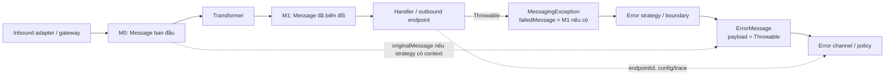
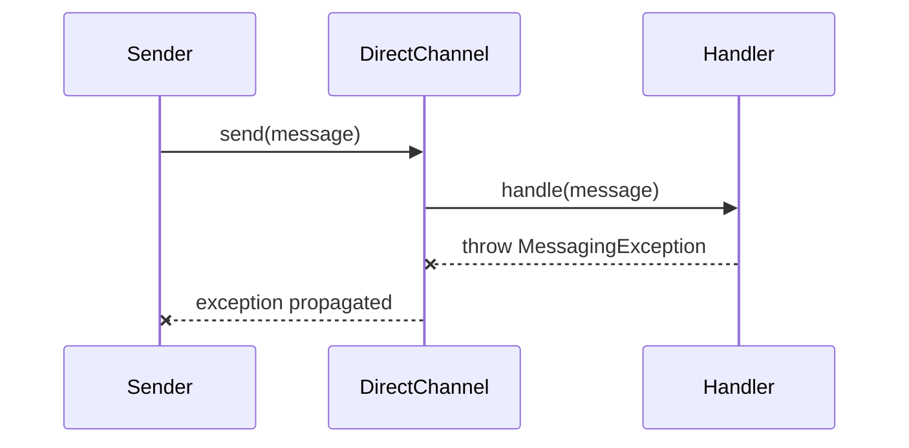
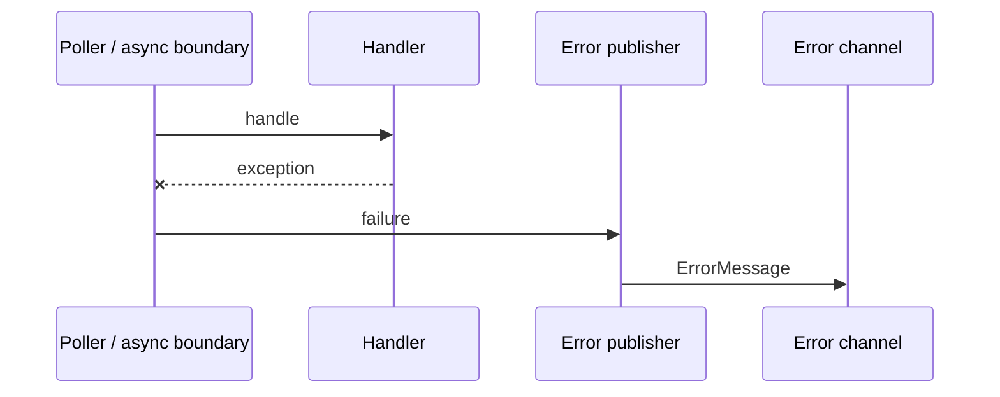
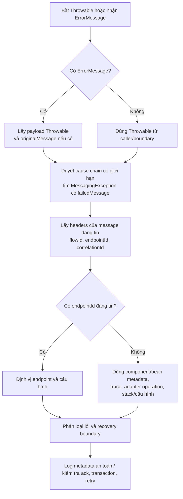
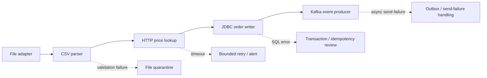

# failedMessage và failedEndpoint: Truy vết message và endpoint gây lỗi trong Spring Integration Adapters

> **Chương:** Error handling  
> **Module:** `SPRING_INTEGRATION_ADAPTERS`  
> **Bối cảnh:** Kết nối hệ thống ngoài vào Spring Integration qua inbound/outbound adapter, gateway, poller và `MessageChannel`; xử lý file, SFTP, HTTP, JMS, AMQP, Kafka và cơ sở dữ liệu.  
> **Mục tiêu:** Phân tích đúng message bị lỗi bằng `MessagingException.getFailedMessage()`, phân biệt với `ErrorMessage.getOriginalMessage()`, và truy vết **endpoint gây lỗi (failed endpoint)** bằng dữ kiện có thể kiểm chứng thay vì giả định một trường luôn tồn tại. Từ đó quyết định retry, rollback, quarantine/DLQ, phản hồi lỗi và giám sát an toàn.

## 1. Bài toán: Biết lỗi gì thôi chưa đủ

Một ứng dụng có luồng xử lý đơn hàng:

```text
SFTP inbound -> file parser -> validate -> HTTP enrichment -> JDBC writer -> Kafka outbound
```

Nếu monitor chỉ ghi `IllegalArgumentException` hoặc `MessageHandlingException`, đội vận hành khó biết:

- **Dữ liệu nào bị lỗi?** File, bản ghi, message hay request nào?
- **Lỗi ở bước nào?** Parse, validation, HTTP call, JDBC insert hay Kafka send callback?
- **Lỗi xuất hiện trước hay sau khi chuyển đổi payload?** Một file có thể thành object rồi thành JSON.
- **Có side effect trước đó chưa?** Có thể database đã commit trước khi Kafka gửi thất bại.
- **Ai chịu trách nhiệm xử lý?** SFTP owner, hệ thống HTTP, DBA, team Kafka?
- **Có thể retry an toàn không?** Retry từ đầu flow có thể nhân đôi giao dịch.
- **Người dùng hay broker cần phản hồi gì?** HTTP 4xx/5xx, JMS rollback, AMQP requeue, Kafka offset/DLT, file quarantine.

Spring Integration cung cấp các mảnh ngữ cảnh quan trọng như `MessagingException.getFailedMessage()` và `ErrorMessage.getOriginalMessage()`. Việc xác định **failed endpoint** cần kết hợp thông tin cấu hình, trace/correlation và ngữ cảnh do ứng dụng gắn một cách đáng tin.

**Điểm mấu chốt:** `failedMessage` là API có thật của `org.springframework.messaging.MessagingException`. Cụm `failedEndpoint` trong tiêu đề được dùng theo nghĩa **endpoint gây lỗi cần truy tìm**; **không nên giả định** mọi `ErrorMessage` hay `MessagingException` có sẵn phương thức `getFailedEndpoint()` hoặc header chuẩn tên `failedEndpoint`.

## 2. Bốn tầng ngữ cảnh lỗi

| Tầng | Câu hỏi | Dữ liệu kỹ thuật điển hình |
|---|---|---|
| **Throwable** | Lỗi gì xảy ra? | Kiểu exception, cause chain, thông báo đã khử nhạy cảm |
| **Failed message** | Message ở điểm lỗi là gì? | `MessagingException.getFailedMessage()` |
| **Original/input message** | Message nào nằm ở ranh giới được error strategy biết? | `ErrorMessage.getOriginalMessage()` nếu được cung cấp |
| **Failed endpoint** | Component cụ thể nào thất bại? | Endpoint ID, flow ID, bean/config source, trace/span, transport metadata |

Thêm tầng thứ năm khi vận hành: **outcome**. Đã rollback, retry, quarantine, nacked, commit offset hay chuyển sang DLQ chưa? Có `failedMessage` và `failedEndpoint` mà không biết outcome vẫn chưa đủ để khẳng định một message đã được xử lý.

### 2.1. Vị trí của chúng trong pipeline



Sơ đồ là **một trường hợp minh họa**, không phải hợp đồng cho mọi adapter:

- `failedMessage` có thể là `M1` vì lỗi xảy ra sau transformer.
- `originalMessage` có thể là `M0` nếu error strategy đã có tham chiếu này.
- Nếu lỗi xảy ra **trước khi tạo được Message**, một hoặc cả hai giá trị có thể không có.
- Endpoint ID có thể phải lấy từ metadata do ứng dụng bổ sung; không nhất thiết xuất hiện trong `Throwable`.

## 3. Những lớp và API thực sự tồn tại

| Khái niệm | API/kiểu | Ghi nhớ |
|---|---|---|
| Message nghiệp vụ | `org.springframework.messaging.Message<T>` | Payload và headers |
| Exception ngữ cảnh message | `org.springframework.messaging.MessagingException` | Có `getFailedMessage()`, kết quả có thể null |
| Lỗi xử lý message | `org.springframework.messaging.MessageHandlingException` | Kế thừa `MessagingException` |
| Lỗi truyền message | `org.springframework.messaging.MessageDeliveryException` | Cũng có thể mang failed message |
| Thông điệp lỗi | `org.springframework.messaging.support.ErrorMessage` | Kế thừa `GenericMessage<Throwable>` |
| Payload của ErrorMessage | `error.getPayload()` | Một `Throwable`, không mặc định luôn là `MessagingException` |
| Message ban đầu của ErrorMessage | `error.getOriginalMessage()` | Có thể null; khác failed message |
| Header điều hướng lỗi | `MessageHeaders.ERROR_CHANNEL` | Thường là `errorChannel`; là destination, không phải endpoint đã lỗi |
| Tên endpoint/component | Bean ID hoặc ID do ứng dụng đặt | Phải kiểm tra cấu hình và nơi lỗi phát sinh |

**Không có một object “IntegrationError” duy nhất chứa đủ các trường trên trong mọi luồng.** Bên gửi, component, cơ chế retry và error strategy quyết định phần ngữ cảnh nào được tạo và giữ.

### 3.1. Xem đúng cấu trúc `ErrorMessage`

```text
ErrorMessage
  |
  +-- payload: Throwable
  |     +-- cause: Throwable? ...
  |     +-- failedMessage: Message<?>?    [khi Throwable là MessagingException]
  |
  +-- originalMessage: Message<?>?       [thuộc ErrorMessage]
  |
  +-- headers: MessageHeaders            [headers của ErrorMessage]
```

`failedMessage` **không** phải trường cố định của `ErrorMessage` ở cấp ngoài. Nó được truy cập **qua exception payload** khi payload là `MessagingException` (hoặc exception phù hợp ở cause chain).

## 4. `failedMessage` thực sự là message nào?

`MessagingException#getFailedMessage()` trả về message được liên kết với exception khi exception được tạo. Với một `MessageHandlingException` do framework bọc quanh lỗi handler, đó thường là **message tới handler đang thất bại**.

Ví dụ pipeline:

```text
M0: payload=File("/orders/batch-18.csv")
       |
       v
transform File -> OrderBatch
       |
       v
M1: payload=OrderBatch(batchId="batch-18", orders=[...])
       |
       v
JDBC writer throws DataIntegrityViolationException
       |
       v
MessageHandlingException(failedMessage=M1, cause=...)
```

Nếu nhìn `failedMessage` rồi khẳng định nó luôn là **file gốc**, đó là sai. Nó có thể chứa **payload đã chuyển đổi**, với headers được chuyển tiếp/copy theo từng transformer.

### 4.1. Những điều `failedMessage` không tự bảo đảm

- Không phải luôn tồn tại.
- Không nhất thiết là message được inbound adapter tạo đầu tiên.
- Không chắc chứa đầy đủ headers trước transformer, splitter hoặc router.
- Không có nghĩa người gửi đã bị nack hoặc transaction rollback.
- Không chứng minh lỗi ở chính message đó, thay vì ở phụ thuộc bên ngoài.
- Không đồng nghĩa payload còn có thể replay từ đầu flow.
- Không được mặc định an toàn để serialize toàn bộ ra logs hoặc DLQ.

### 4.2. Khi exception gốc không phải `MessagingException`

Một `IOException` do remote server, `SQLException`, `TimeoutException` hoặc exception ứng dụng thuần Java có thể xuất hiện trước khi framework wrap, hoặc được một handler truyền trực tiếp. Khi đó không nên gọi `getFailedMessage()` trên mọi `Throwable`. Hãy kiểm tra kiểu và nguyên nhân trước.

## 5. `originalMessage` khác `failedMessage` thế nào?

`ErrorMessage#getOriginalMessage()` trả về message ban đầu tại điểm mà **ErrorMessage được tạo** nếu nhà tạo có cung cấp. Nguồn có thể là error strategy nhận được input message trong context.

| Thuộc tính | `failedMessage` | `originalMessage` |
|---|---|---|
| Nằm ở đâu? | `MessagingException` | `ErrorMessage` |
| Ý nghĩa | Message liên kết với lỗi xử lý | Message đầu vào được giữ tại điểm tạo error message |
| Có thể null? | Có | Có |
| Sau transformer | Có thể là message đã transform | Có thể là message sớm hơn |
| Có phải message nhận từ broker/file ban đầu? | Không bảo đảm | Không bảo đảm |
| Có phải nguồn an toàn để replay? | Không tự bảo đảm | Không tự bảo đảm |
| Có sẵn cho exception đồng bộ không được publish? | Có thể trong exception | Không có ErrorMessage nếu chưa được tạo |

Một `ErrorMessage` hoàn toàn hợp lệ có thể được tạo chỉ bằng `new ErrorMessage(exception)` và **không có** original message.

### 5.1. Tình huống khác nhau

```text
A. Parse CSV thất bại ngay tại handler:
   failedMessage: Message<File> hoặc Message<String> tùy luồng
   originalMessage: có thể là cùng message nếu strategy biết đầu vào

B. Validation lỗi sau transformer:
   failedMessage: Message<OrderBatch>
   originalMessage: có thể là Message<File> hoặc message ban đầu của boundary

C. SFTP connection failed trong receive():
   failedMessage: có thể null
   originalMessage: có thể null

D. Kafka outbound producer callback failed sau send():
   callback/error path: phụ thuộc adapter, có thể có record/source metadata
   failedMessage/originalMessage: phải kiểm tra cơ chế phát lỗi cụ thể
```

**Hãy test chính các giá trị này tại boundary thật**, thay vì thiết kế recovery dựa trên giả định “ít nhất một trong hai luôn có”.

## 6. `failedEndpoint`: Đặt đúng nghĩa, không bịa API

Một endpoint trong Spring Integration là thành phần ứng dụng kết nối message vào handler hoặc adapter, ví dụ service activator, transformer, inbound polling consumer, message-driven adapter, gateway, outbound adapter.

**Failed endpoint** theo cách gọi thực hành là **endpoint đang xử lý khi lỗi phát sinh** hoặc endpoint chịu trách nhiệm cho thao tác thất bại. Đây là câu hỏi chẩn đoán, không mặc nhiên là một property chính thức của mọi exception.

| Cách gọi | Có thể dùng? | Cảnh báo |
|---|---|---|
| `failedMessage` | **Có** qua `MessagingException.getFailedMessage()` | Có thể null |
| `originalMessage` | **Có** qua `ErrorMessage.getOriginalMessage()` | Có thể null |
| `failedEndpoint` | **Nên hiểu là thông tin cần xác định** | Không mặc định có `getFailedEndpoint()` |
| `app.failedEndpointId` | **Có thể tự thiết kế** header/metadata nội bộ | Không phải header chuẩn Spring Integration |
| `componentId`/`endpointId` | ID do cấu hình endpoint cung cấp | Có thể thiếu hoặc không trùng bean xử lý thật |
| `bean definition resource/source` | Thông tin hỗ trợ định vị cấu hình của một số MessageHandlingException | Phụ thuộc version và loại component |
| `trace/span` | Ngữ cảnh quan sát nếu đã instrument | Không tự giải thích transaction outcome |

### 6.1. Endpoint “lỗi” có thể có nhiều lớp

Một flow gọi HTTP outbound gateway:

```text
IntegrationFlow id=paymentsFlow
  -> service activator id=validatePayment
  -> HTTP outbound gateway id=bankHttpGateway
       -> underlying HTTP client
            -> java.net.SocketTimeoutException
```

Khi timeout, **nguyên nhân gốc** ở HTTP client/network; **endpoint bị tác động** ở Spring Integration là `bankHttpGateway`; **flow sở hữu** là `paymentsFlow`. Không nên gộp cả ba thành một trường duy nhất thiếu ngữ nghĩa.

### 6.2. Bộ trường nên thống nhất

```text
flowId               = paymentsFlow
endpointId           = bankHttpGateway
operation            = http.post.payment
dependency           = bank-api
exceptionType        = ResourceAccessException
rootCauseType        = SocketTimeoutException
correlationId        = corr-5901
sourceMessageRef     = restricted-ref-451
recoveryPolicy       = payment-http-retry-v3
```

Các trường trên là **error contract do ứng dụng định nghĩa**, không phải phần bắt buộc của một `ErrorMessage`.

## 7. Đồng bộ và bất đồng bộ quyết định có thấy ErrorMessage không

### 7.1. `DirectChannel` đồng bộ



Khi một handler đồng bộ ném lỗi, exception thường **propagate tới caller**. Không có `ErrorMessage` nếu không có cơ chế nào bắt và publish. Caller có thể kiểm tra `MessagingException.getFailedMessage()` nếu đúng kiểu exception và gateway không unwrap trước đó.

### 7.2. Poller hoặc boundary bất đồng bộ



Một poller hoặc task executor có thể dùng `MessagePublishingErrorHandler` để publish. `ErrorMessage` lúc đó có payload Throwable; mức độ đủ context tùy exception và error strategy.

### 7.3. Gateway đồng bộ

Một messaging gateway thường có thể **unwrap exception** cho caller theo hợp đồng giao diện. Vì vậy, việc bắt `MessagingException` ở caller không luôn giữ được failed message nếu exception đã được chuyển thành nguyên nhân khác. Muốn xử lý theo ngữ cảnh, cần thiết kế **gateway error channel/exception contract** rõ và test.

**Quy tắc:** trước khi hỏi `failedMessage` hoặc `failedEndpoint` có gì, xác định **ai đang bắt exception và có ErrorMessage hay chưa**.

## 8. Luồng chẩn đoán thực tế



**Thứ tự quan trọng:** tìm failed message từ exception payload trước, originalMessage là ngữ cảnh bổ sung. Không cố ép mọi lỗi phải có một message, vì lỗi nhận kết nối/credential có thể xảy ra **trước message creation**.

## 9. Java: Trích xuất failedMessage an toàn

Đoạn dưới minh họa cách xử lý một `ErrorMessage` bằng API thông dụng của Spring Messaging, có kiểm tra null và cause chain.

```java
import java.util.Collections;
import java.util.IdentityHashMap;
import java.util.Set;

import org.springframework.messaging.Message;
import org.springframework.messaging.MessagingException;
import org.springframework.messaging.support.ErrorMessage;

public final class FailedMessageInspector {

    private FailedMessageInspector() {}

    /**
     * Có thể trả null khi lỗi xảy ra trước khi tồn tại Message.
     * Giới hạn chiều sâu và chống vòng lặp Throwable tự tham chiếu.
     */
    public static Message<?> findFailedMessage(Throwable error) {
        if (error == null) {
            return null;
        }

        Set<Throwable> visited =
                Collections.newSetFromMap(new IdentityHashMap<>());
        Throwable current = error;

        for (int depth = 0; current != null && depth < 24; depth++) {
            if (!visited.add(current)) {
                break;
            }

            if (current instanceof MessagingException messaging) {
                Message<?> failed = messaging.getFailedMessage();
                if (failed != null) {
                    return failed;
                }
            }
            current = current.getCause();
        }
        return null;
    }

    public static Message<?> chooseAvailableMessage(ErrorMessage error) {
        Message<?> failed = findFailedMessage(error.getPayload());
        if (failed != null) {
            return failed;
        }

        // Đây là dữ liệu bổ sung, không luôn là failedMessage.
        return error.getOriginalMessage();
    }
}
```

**Lưu ý:** fallback sang `originalMessage` giúp điều tra có dữ kiện, nhưng **không được gắn nhãn nó là failedMessage** khi không có bằng chứng. Một envelope tốt nên giữ **hai trường riêng** hoặc ghi rõ trường nào đã dùng.

### 9.1. Tránh làm lộ thông tin khi debug

Đừng viết:

```java
// KHÔNG nên dùng cho production logs:
log.error("ErrorMessage: {}", errorMessage);
log.error("failedMessage: {}", failedMessage);
```

`toString()` của Message/exception có thể kéo theo payload và headers chứa PII, authorization token, nội dung file hoặc các thuộc tính nhạy cảm.

Nên ghi mã sự kiện, flow/endpoint ID, class lỗi, correlation ID đã kiểm tra và **tham chiếu** tới dữ liệu gốc trong kho có quyền.

## 10. Java: Lấy metadata từ failed message và original message

Một handler có thể đọc an toàn các trường cho phép, không serialize payload:

```java
import org.springframework.messaging.Message;
import org.springframework.messaging.MessagingException;
import org.springframework.messaging.support.ErrorMessage;

public final class ErrorContextExtractor {

    public record ErrorContext(
            String exceptionType,
            String flowId,
            String endpointId,
            String correlationId,
            boolean hasFailedMessage,
            boolean hasOriginalMessage) {
    }

    public static ErrorContext inspect(ErrorMessage error) {
        Message<?> failed =
                FailedMessageInspector.findFailedMessage(error.getPayload());
        Message<?> original = error.getOriginalMessage();

        // Ưu tiên message tại điểm lỗi để lấy metadata.
        Message<?> selected = (failed != null) ? failed : original;

        String flowId = headerAsString(selected, "app.flowId");
        String endpointId = headerAsString(selected, "app.endpointId");
        String correlationId = headerAsString(
                selected, "app.correlationId");

        return new ErrorContext(
                error.getPayload().getClass().getSimpleName(),
                flowId,
                endpointId,
                correlationId,
                failed != null,
                original != null);
    }

    private static String headerAsString(Message<?> message, String name) {
        if (message == null) {
            return null;
        }
        Object value = message.getHeaders().get(name);
        return (value instanceof String str) ? str : null;
    }
}
```

Các header `app.flowId`, `app.endpointId` và `app.correlationId` là **quy ước của ứng dụng**. Chúng không tồn tại mặc định trong mọi message Spring Integration.

### 10.1. Trường hợp metadata bị mất

Một custom transformer có thể tạo `new GenericMessage<>(payload)` mà không chuyển tiếp các headers cần thiết. Khi lỗi xảy ra downstream, `failedMessage` vẫn có nhưng không còn flow/endpoint context.

Cần:

- Dùng cơ chế transformer/`MessageBuilder` giữ headers hợp lý khi phù hợp.
- Test correlation ID sau mỗi bước biến đổi.
- Không tự copy bearer token và headers nhạy cảm qua mọi ranh giới.
- Bổ sung endpoint identity **tại boundary đáng tin** thay vì dựa vào client header.
- Khi cần, duy trì context bằng trace/span hoặc registry riêng.

## 11. Cách gắn endpoint ID không bị giả mạo

Có thể enrichment ở đầu một flow hoặc ngay trước endpoint quan trọng:

```text
Trusted adapter
  -> headerEnricher(app.flowId="ordersFlow")
  -> headerEnricher(app.endpointId="ordersCsvParser")
  -> parse CSV
  -> headerEnricher(app.endpointId="ordersJdbcWriter")
  -> JDBC write
```

**Cảnh báo:** gắn `app.endpointId` một lần ở đầu flow **không cho biết downstream endpoint thật sự thất bại**. Nếu muốn field mô tả chính xác, cập nhật metadata ở từng ranh giới quan trọng hoặc dùng tracing/instrumentation có endpoint identity.

### 11.1. Tránh tin inbound headers

HTTP, JMS, AMQP và Kafka đều có thể nhận metadata do nguồn bên ngoài quyết định. Nếu client gửi `app.endpointId=paymentsWriter`, hệ thống không được tin đây là lỗi của writer.

Biện pháp:

1. Whitelist/loại header nội bộ khi nhận từ bên ngoài.
2. Tạo correlation ID từ nguồn đáng tin hoặc validate trước khi dùng.
3. Gắn flow/endpoint ID từ cấu hình sau inbound adapter.
4. Không cho external source quyết định `errorChannel`, DLQ hoặc tenant routing bằng header không xác thực.
5. Đối chiếu thông tin với endpoint registry/log được bảo vệ khi điều tra.

### 11.2. Khi lỗi xảy ra trước enrichment

SFTP connect, HTTP request parsing hoặc broker listener setup có thể lỗi trước khi message được tạo. Khi đó cần **adapter ID, connection factory/client ID, resource key và operational logs** của endpoint, thay vì mong có `app.endpointId` trên message chưa tồn tại.

## 12. Bean name, cấu hình và “configuration source”

Spring Integration có thể cung cấp thêm thông tin vị trí cấu hình trong mô tả một số lỗi `MessageHandlingException`, tùy phiên bản và thành phần. Tài liệu Spring Integration mô tả việc đính kèm **BeanDefinition resource/source** cho các exception xử lý message từ framework ở những phiên bản phù hợp, giúp tìm bean hoặc khai báo đã tạo endpoint.

Cần phân biệt:

- **Bean definition source/resource:** nơi endpoint được khai báo, ví dụ `@Configuration` class hoặc `@Bean` method, hoặc XML config.
- **Endpoint bean name/ID:** tên một endpoint trong application context.
- **Handler/component name:** có thể khác endpoint bean.
- **Flow ID:** nhóm logic gồm nhiều endpoint.
- **Root cause:** lỗi thật như HTTP timeout, SQL constraint, SFTP auth failure.

### 12.1. Không parse stack trace thành “chuẩn”

Một stack trace có thể gồm proxy/AOP, retry advice, message dispatcher và nhiều lớp Spring. Tên method trong stack trace **không phải một API ổn định để làm khóa routing lỗi**. Dùng nó như bằng chứng phụ khi điều tra, không làm cơ sở duy nhất để chọn DLQ hay owner.

Nếu tên endpoint thực sự quan trọng cho observability, chủ động thiết kế **endpoint ID/trace attribution** và kiểm thử sau refactor.

### 12.2. Flow đã được chuyển qua nhiều endpoint

Khi lỗi JDBC xảy ra trong `ordersJdbcWriter`, field `app.endpointId` từ transformer cũ có thể vẫn là `ordersCsvParser` nếu không được cập nhật. Vì vậy:

- Ưu tiên metadata từ **boundary đang bắt lỗi**.
- Bổ sung span attribute hoặc endpoint-scoped handler logging.
- Xem cause chain và nguồn cấu hình để đối chiếu.
- Chỉ kết luận endpoint khi đủ chứng cứ; nếu không, ghi `unknown`.

## 13. Java DSL: Ví dụ một file flow có lỗi ở parser

Ví dụ minh họa một file inbound adapter, poller và một endpoint parser có định danh rõ. Tùy phiên bản Spring Integration và cách tạo handler, cần kiểm tra API Java DSL trước khi dùng production.

```java
import java.io.File;
import java.time.Duration;

import org.springframework.context.annotation.Bean;
import org.springframework.context.annotation.Configuration;
import org.springframework.integration.channel.DirectChannel;
import org.springframework.integration.dsl.IntegrationFlow;
import org.springframework.integration.dsl.Pollers;
import org.springframework.integration.file.dsl.Files;
import org.springframework.messaging.MessageChannel;

@Configuration
class OrdersFlowConfiguration {

    @Bean("ordersErrors")
    MessageChannel ordersErrors() {
        return new DirectChannel();
    }

    @Bean
    IntegrationFlow ordersFileFlow(OrdersCsvParser parser) {
        return IntegrationFlow
            .from(
                Files.inboundAdapter(new File("/var/app/orders/in"))
                    .patternFilter("*.csv"),
                endpoint -> endpoint.poller(
                    Pollers.fixedDelay(Duration.ofSeconds(2))
                        .maxMessagesPerPoll(5)
                        .errorChannel("ordersErrors")
                )
            )
            .enrichHeaders(h -> h.header("app.flowId", "ordersFileFlow"))
            .enrichHeaders(h -> h.header(
                    "app.endpointId", "ordersFileFlow.csvParser"))
            .handle(File.class, (file, headers) -> {
                parser.parse(file);
                return null; // Terminal handler
            })
            .get();
    }
}

interface OrdersCsvParser {
    void parse(File file);
}
```

Điểm quan trọng:

- Parser chạy trong **polling task**; exception phát sinh trong scope đó có thể được poller error handler publish tới `ordersErrors`.
- `app.endpointId` là metadata do ứng dụng định nghĩa; không phải property `failedEndpoint` do framework tự tạo.
- Nếu lỗi phát sinh **tại file inbound source trước enrichment**, metadata này có thể không tồn tại.
- Parser thành công trả `null` là kết thúc xử lý; **không tự archive file**.
- File accept-once/filter, transaction DB, checksum, duplicate và quarantine cần cấu hình riêng.

### 13.1. Đưa ErrorMessage vào handler

```java
import org.springframework.integration.annotation.ServiceActivator;
import org.springframework.messaging.Message;
import org.springframework.messaging.support.ErrorMessage;
import org.springframework.stereotype.Component;

@Component
class OrdersFailureHandler {

    private final OrdersFailureStore store;

    OrdersFailureHandler(OrdersFailureStore store) {
        this.store = store;
    }

    @ServiceActivator(inputChannel = "ordersErrors")
    public void handle(ErrorMessage error) {
        ErrorContextExtractor.ErrorContext ctx =
                ErrorContextExtractor.inspect(error);

        Message<?> failed =
                FailedMessageInspector.findFailedMessage(error.getPayload());

        store.record(
                ctx.flowId(),
                ctx.endpointId(),
                ctx.correlationId(),
                ctx.exceptionType(),
                failed != null
        );
    }
}

interface OrdersFailureStore {
    void record(String flowId, String endpointId,
                String correlationId, String errorType,
                boolean hasFailedMessage);
}
```

Mẫu này chỉ minh họa **trích xuất và lưu metadata**; chưa có retry, quarantine hoặc transaction semantics. Một app thực tế nên xác minh việc Spring Integration chọn đúng method endpoint bằng integration test của phiên bản dùng.

### 13.2. Lỗi của chính handler lỗi

Nếu `store.record(...)` thất bại, không được coi “đã log” là hoàn tất. Phải có recovery/fallback phù hợp với poller và cơ chế dữ liệu bền vững; tránh vòng lặp error channel vô hạn.

## 14. Lỗi tại inbound source: Có thể chưa có failedMessage

Không phải sự cố nào trong flow cũng có một message.

| Nguồn | Lỗi trước message | Ngữ cảnh còn có thể dùng |
|---|---|---|
| File inbound | Thư mục không đọc được, permission denied | Directory, bean ID, polling task, error time |
| SFTP inbound | Auth failure, handshake timeout, remote listing failure | Session factory, remote host ref, poller ID |
| HTTP inbound | Parse request hoặc mapping chưa tạo message | Request ID, gateway ID, status, trusted access log |
| JMS inbound | Connection/session/listener startup failure | Connection factory, destination, listener container |
| AMQP inbound | Channel/consumer/broker setup failure | Queue, consumer/container ID, connection |
| Kafka inbound | Consumer authentication/assignment/deserializer failure | Topic/partition nếu có, group/client, listener |
| JDBC poller | Query/connection thất bại trước khi có row | Datasource ref, query ID, poller |
| Kafka outbound | Broker acknowledgement lỗi sau send | Callback, record metadata, producer client ID |

Với loại lỗi này, **không có message để gán cho `failedMessage` là điều có thể bình thường**. Thiết kế diagnostic envelope phải chấp nhận `null` hoặc field vắng mặt, đồng thời lưu context từ adapter/poller.

### 14.1. SFTP case cụ thể

Một SFTP poller gọi `list(remoteDirectory)`, server trả authentication failure. Không hề có `Message<File>` được tạo. Handler lỗi cần ghi:

```json
{
  "flowId": "inventorySftpFlow",
  "endpointId": "inventorySftpInbound",
  "operation": "sftp.list",
  "exceptionType": "AuthenticationFailure",
  "hasFailedMessage": false,
  "remoteLocationRef": "sftp-warehouse-prod",
  "recoveryDecision": "escalate-credentials"
}
```

Các tên là minh họa. Không log password, private key hoặc nguyên URI chứa credential.

## 15. Lỗi sau transformation: failedMessage và originalMessage khác nhau

Ví dụ message được chuyển nhiều bước:

```text
Inbound:
  Message<File>              id=M0

After parse:
  Message<OrderBatch>        id=M1

After enrichment:
  Message<OrderBatchV2>      id=M2

JDBC writer:
  exception with failedMessage=M2

Error strategy:
  ErrorMessage.originalMessage=M0 nếu có input context tương ứng
```

Sự khác nhau giúp chẩn đoán:

- **M2** có gì khiến JDBC lỗi?
- **M0** lấy từ file nào?
- **M1** đã được chuẩn hóa ra sao?
- Endpoint nào đã mutate headers/payload?
- Có side effect trong bước parse/enrichment không?

**Đừng tự kỳ vọng giữ đủ M0, M1, M2 trong `ErrorMessage`.** Nếu cần lineage nhiều bước, thiết kế trace/step event có giới hạn hoặc payload reference ở kho riêng. Không copy toàn bộ payload qua mỗi endpoint chỉ để debug.

### 15.1. Splitter/Aggregator

Khi một file chia thành 500 row messages, `failedMessage` có thể là **một row**. Replay file gốc từ `originalMessage` có thể xử lý lại cả 499 row đã thành công. Cần group/sequence/correlation, idempotency và recovery scope.

### 15.2. Router và publish–subscribe

Một message có thể đi nhiều nhánh. Nếu branch B lỗi, không nên quy lỗi cho tất cả subscribers hoặc replay cả flow nếu A đã có side effect. Cần branch/handler ID và xử lý riêng theo outcome.

## 16. Gateway và HTTP: failedMessage không tự tạo error response

Với HTTP inbound gateway hoặc Spring Integration messaging gateway, exception đồng bộ có thể được ném lại lên caller hoặc xử lý qua error channel được cấu hình.

| Vấn đề | Cần làm rõ |
|---|---|
| `failedMessage` có headers nào? | Thông tin request ở điểm lỗi; không chắc có HTTP response status |
| `originalMessage` có không? | Phụ thuộc error strategy/gateway |
| Endpoint lỗi là inbound hay outbound HTTP? | Dùng gateway ID và trace/span để phân biệt |
| Client sẽ nhận gì? | HTTP status + error body hợp lệ theo contract |
| Có timeout? | Request/reply timeout và downstream timeout khác nhau |
| Có retry? | Phân biệt lỗi 400/401/403/429/5xx và idempotency |

### 16.1. Không trả trực tiếp exception message

Một `MessageHandlingException` có thể chứa SQL, URL nội bộ, tên file và giá trị dữ liệu nhạy cảm. HTTP response không nên lấy `error.getPayload().toString()` làm body.

Thiết kế có thể trả:

```json
{
  "errorCode": "PAYMENT_UPSTREAM_UNAVAILABLE",
  "message": "Dịch vụ hiện chưa sẵn sàng",
  "correlationId": "corr-5901"
}
```

Status HTTP tương ứng dựa trên lỗi và contract API. `failedMessage`/failed endpoint phục vụ nội bộ; client nhận thông tin an toàn và đủ xử lý.

### 16.2. Synchronous gateway có thể unwrap

Spring Integration gateway thường unwrap một số exception theo giao diện method. Do đó caller bắt được `SocketTimeoutException` hoặc lỗi nghiệp vụ mà **không còn trực tiếp giữ `MessagingException`**. Nếu muốn dùng failed message cho audit, xử lý tại boundary có context trước khi unwrap hoặc cấu hình error flow phù hợp.

## 17. JMS: failedMessage không quyết định acknowledgement

Một JMS inbound adapter có thể xử lý record thanh toán. Exception trong handler có thể mang `failedMessage`, nhưng **không thể từ đó suy ra broker sẽ redeliver**.

Cần kiểm tra:

1. Listener/container có dùng transaction không?
2. Exception còn được propagate tới container hay đã được error handler “xử lý”?
3. Message đã được ack/commit khi nào?
4. Retry advice hoặc broker redelivery có đang áp dụng?
5. DLQ gắn với destination nào?
6. `JMSMessageID`, correlation ID và delivery count được trích xuất tin cậy không?
7. Có side effect DB/HTTP trước khi thất bại không?

### 17.1. Ví dụ kết luận sai

```text
ErrorMessage.payload = MessageHandlingException
failedMessage.headers["jms_messageId"] = "ID:..."
errorHandler: log + return
```

Kết quả này **không chứng minh** transaction rollback. Nếu container coi exception đã được xử lý, message có thể bị ack/commit tùy cấu hình. Nếu cần redelivery, thiết kế phải giữ exception tại đúng transaction boundary hoặc sử dụng recovery mechanism được tích hợp đúng.

### 17.2. Khi replay

Một `failedMessage` có thể chứa payload của JMS message đã chuyển đổi; không nhất thiết giữ toàn bộ broker metadata. Replay bằng gửi lại một message mới có thể không giữ cùng broker identity hay thứ tự. Cần idempotency key, transaction và cơ chế DLQ/replay có kiểm soát.

## 18. AMQP: biết endpoint rồi còn phải biết ack/nack

Với AMQP, message có thể đi qua listener container, adapter, channel, service activator và output. Lỗi không chỉ là exception class mà còn liên quan:

- Queue/consumer nào nhận?
- Delivery tag và ack mode thuộc scope nào?
- Handler lỗi đã làm gì: rethrow, nack, requeue, reject, publish DLQ?
- Có retry budget và dead-letter exchange?
- Có duplicate do redelivery?
- Metadata routing key có chứa thông tin nhạy cảm không?

**Không dùng raw delivery tag của phiên kết nối cũ như một khóa replay lâu dài**; cần business ID/correlation ID phù hợp.

Một header tự tạo `app.endpointId` có thể giúp quy về `billingAmqpConsumer`, nhưng không thay thế broker/container logs để xác nhận ack/nack.

## 19. Kafka: consumer failed record khác producer send failure

### 19.1. Consumer

Trong Kafka inbound, lỗi có thể phát sinh tại:

- Poll/authentication/assignment.
- Deserialize trước khi message Spring được tạo.
- Transformer/handler sau khi adapter tạo Message.
- Commit offset hoặc seek/retry/DLT.
- Database/HTTP side effect trong consumer flow.

Nếu lỗi deserialize xảy ra trước Message, `failedMessage` có thể vắng mặt. Nếu handler lỗi sau adapter, có thể có Message mang source record headers. Đánh giá đúng **topic, partition, offset, consumer group** từ adapter context, không đoán từ payload.

**Một `ErrorMessage` không quyết định offset đã commit hay chưa.** Phải kiểm tra adapter/container, error strategy và transaction/retry policy.

### 19.2. Producer

Outbound Kafka có thể gửi bất đồng bộ; exception từ send callback đến **sau** khi handler ban đầu trả về. Failed endpoint khi đó là **producer operation/callback path**, không nhất thiết là service activator cuối cùng trong stack ban đầu.

Các cơ chế success/failure channel/callback phụ thuộc Spring Integration Kafka adapter và phiên bản. Một lỗi producer **không tự đảm bảo** xuất hiện ở global `errorChannel`.

### 19.3. Tránh replay toàn bộ flow

Nếu DB đã commit nhưng Kafka publish thất bại, retry từ file/SFTP đầu vào có thể nhân đôi DB. Cần transactional outbox, idempotency hoặc reconciliation. `failedMessage` chỉ cung cấp dữ liệu để điều tra, **không tự chọn được điểm replay an toàn**.

## 20. JDBC và database: exception có context nhưng không rollback hộ bạn

Một JDBC outbound adapter hoặc service activator có thể ném `DataIntegrityViolationException`, `SQLException` hoặc lỗi timeout. Spring Integration có thể bọc nó vào `MessagingException` với failed message, nhưng:

- Transaction đã bắt đầu ở đâu?
- Có auto-commit hoặc commit phần nào trước lỗi?
- Poller đã đánh dấu row `PROCESSING` hay `DONE` chưa?
- Retry có thể tạo duplicate insert không?
- Database save có side effects ngoài transaction không?
- Có hàng đợi outbox hoặc lease để phục hồi không?

### 20.1. Phân biệt endpoint và root cause

```text
flowId = ordersFileFlow
endpointId = ordersJdbcWriter
rootCause = duplicate key constraint
failedMessage = OrderBatch(batchId=..., ...)
```

Lỗi phát sinh ở DB constraint, nhưng endpoint đang chịu trách nhiệm là JDBC writer. Biện pháp có thể là đánh dấu duplicate đã xử lý (nếu an toàn), quarantine dữ liệu xấu hoặc sửa idempotency; không nên mặc định retry vô hạn.

### 20.2. Polling database

Nếu lỗi xảy ra khi `SELECT` trước khi tạo row message, failed message có thể null. Debug lúc đó dựa vào datasource/query ID, poller task và timestamp. Nếu row đã claim rồi handler lỗi, phải xem lease/transaction để tránh hàng bị kẹt.

## 21. Error channel, error strategy, retry advice và recovery callback

Các khái niệm hay bị trộn:

| Thành phần | Nhiệm vụ | Không tự làm |
|---|---|---|
| `ErrorMessageStrategy` | Tạo `ErrorMessage` từ Throwable và context | Quyết định rollback broker |
| `DefaultErrorMessageStrategy` | Có thể gắn request message làm original khi context cung cấp | Bảo đảm original luôn có |
| `MessagePublishingErrorHandler` | Publish exception tới error channel trong các boundary hỗ trợ | Bắt mọi exception đồng bộ ở mọi nơi |
| `ErrorMessagePublisher` | Hỗ trợ publish error message | Biến channel thành DLQ bền vững |
| `RequestHandlerRetryAdvice` | Retry handler trong phạm vi advice | Retry giao dịch nhiều hệ thống một cách atomic |
| `ErrorMessageSendingRecoverer` | Gửi lỗi tới error channel khi recovery callback chạy | Tự xác định mọi side effect đã rollback |
| `ExpressionEvaluatingRequestHandlerAdvice` | Có thể phát failureChannel hoặc evaluation result | Cho mọi Throwable sẵn failed endpoint |
| Broker DLT/DLQ | Lưu message lỗi theo cấu hình broker | Bảo đảm replay không trùng side effects |
| Quarantine store | Giữ data/payload reference để xử lý | Tự xác định định danh người dùng và retention |

### 21.1. Error strategy và `originalMessage`

Tài liệu Spring Integration mô tả error strategy có thể nhận `requestMessage` qua context với key `ErrorMessageUtils.INPUT_MESSAGE_CONTEXT_KEY`; `DefaultErrorMessageStrategy` sử dụng context đó để tạo ErrorMessage có originalMessage.

Điều này lý giải vì sao **cùng một handler ném exception** nhưng khi error publisher khác nhau, có nơi bạn thấy original message, có nơi không.

Không nên tạo code phụ thuộc rằng originalMessage luôn giống inbound message ở đầu toàn bộ pipeline; chính **vị trí strategy được gọi** quyết định “original”.

### 21.2. Advice failure message

Với `ExpressionEvaluatingRequestHandlerAdvice`, một failure channel có thể nhận `ErrorMessage` chứa subtype của `MessagingException` có thêm `evaluationResult`. Khi xử lý, cần phân biệt:

- Exception dùng để phân loại nguyên nhân.
- `failedMessage` của advice là message tại handler/advice.
- `evaluationResult` là giá trị do biểu thức tính, **không phải luôn một endpoint ID**.
- Hành vi trap/rethrow exception tùy advice config.

## 22. Chuẩn hóa error envelope, tránh phụ thuộc đối tượng Java

Một error handler có thể tạo record riêng để monitoring hoặc recovery:

```json
{
  "failureId": "fail-7021",
  "flowId": "ordersFileFlow",
  "endpointId": "ordersFileFlow.csvParser",
  "endpointSource": "trusted-flow-metadata",
  "boundary": "file-poller",
  "exceptionType": "MessageHandlingException",
  "rootCauseType": "InvalidCsvSchemaException",
  "failedMessagePresent": true,
  "originalMessagePresent": true,
  "sourceMessageRef": "restricted-ref-301",
  "correlationId": "corr-5901",
  "firstFailedAt": "2026-11-23T09:10:00Z",
  "attempt": 1,
  "recoveryDecision": "quarantine",
  "policyVersion": "orders-errors-v4"
}
```

Đây là **schema nội bộ minh họa**; Spring Integration không tự xuất đúng JSON này.

### 22.1. Ghi provenance để tránh “chẩn đoán giả”

`endpointSource` có thể mang:
 
- `explicit-endpoint-metadata`: endpoint được ứng dụng gắn và kiểm chứng.
- `adapter-callback`: producer/listener callback biết endpoint phát sinh.
- `span-attribute`: tracing do framework/instrumentation ghi.
- `exception-bean-source`: nguồn cấu hình của exception.
- `heuristic-stacktrace`: suy đoán; cần nhãn độ tin cậy thấp.
- `unknown`: chưa đủ bằng chứng.

Không nâng một giá trị suy đoán từ stack trace thành **confirmed endpoint** chỉ vì nó trông giống tên handler.

### 22.2. Không nhúng toàn bộ message vào envelope

Payload có thể chứa PII, chi tiết đơn hàng, token hoặc file binary. Hãy lưu một `payloadReference` với quyền truy cập, mã hóa, TTL và retention thích hợp nếu cần recovery; metrics/log nên chỉ thấy metadata.

## 23. Retry: failedMessage không phải vé replay miễn phí

Muốn replay an toàn, cần biết:

1. **Nguồn message:** file/SFTP, HTTP request, JMS delivery, AMQP delivery, Kafka record hay DB row.
2. **Endpoint hỏng:** lỗi parsing hay outbound side effect?
3. **Đã xử lý thành công bước nào?** DB commit, HTTP POST, file move, Kafka ack.
4. **Có transaction hoặc idempotency key?**
5. **Payload lưu ở đâu?** Input message reference, quarantine store, broker DLQ.
6. **Có source version/schema không?**
7. **Số lần retry và deadline còn lại?**
8. **Khi recovery không thành công sẽ xảy ra gì?**

### 23.1. Ví dụ sai

```text
on ErrorMessage:
    Message<?> m = exception.getFailedMessage();
    inputChannel.send(m);
```

Code ý tưởng trên dễ tạo **retry vô hạn**, nhảy vào sai bước, mất broker ack semantics hoặc thực hiện lại side effect đã commit.

### 23.2. Cách tốt hơn

```text
classify failure
  -> transient? bounded retry ở đúng boundary
  -> permanent? quarantine/DLQ với source reference
  -> unknown? alert + evidence + owner
  -> khi replay: idempotency check, target outcome check, attempt cap
```

Đối với JMS/AMQP/Kafka, ưu tiên phối hợp với cơ chế broker/container khi nó phù hợp transaction và offset model. Với file/SFTP/JDBC, cần state/lease/filter và workflow replay rõ.

## 24. Giữ headers qua transformer nhưng không lan truyền secrets

Khi tạo message mới thủ công, chỉ copy headers phù hợp:

```java
import org.springframework.messaging.Message;
import org.springframework.messaging.support.MessageBuilder;

Message<String> transformed = MessageBuilder
    .withPayload("normalized-order")
    .setHeader("app.flowId", "ordersFileFlow")
    .setHeader("app.endpointId", "ordersFileFlow.transformer")
    .setHeader("app.correlationId", "corr-5901")
    .build();
```

Nếu dựa trên một message đã có, có thể dùng `MessageBuilder.fromMessage(...)` trong phạm vi kiểu/phiên bản phù hợp; khi tạo payload loại khác, đánh giá cách giữ headers theo contract.

**Không copy vô điều kiện**:
 
- `Authorization`, session cookie, bearer token.
- Raw HTTP headers của client.
- Trường `errorChannel` hoặc `replyChannel` từ nguồn không đáng tin.
- PII hoặc thông tin tenant chưa được xác minh.
- Các header có đối tượng Java không serializable khi đi qua durable queue.

### 24.1. Headers và identity của message

Một message mới có thể nhận `MessageHeaders.ID` mới. Do đó **message ID của M0 không luôn bằng message ID của M1**. Dùng một **correlation ID nội bộ đáng tin** để theo dõi chuỗi, nhưng vẫn lưu message ID tại bước lỗi khi cần phân biệt hai message.

### 24.2. Sau splitter

Nếu một order batch tách ra nhiều item, nên giữ `batchId` hoặc correlation ID và sequence metadata cần thiết; **không replay nguyên batch** chỉ vì một item bị lỗi khi các item khác đã thành công.

## 25. Logging, metrics và tracing cho failed endpoint

Một observability record nên trả lời:

- Flow nào bị lỗi?
- Endpoint nào bị lỗi và bằng chứng từ đâu?
- Thời điểm nào, attempt thứ mấy?
- Có failed message không, có original message không?
- Lỗi thuộc lớp nào, dependency nào?
- Retry/rollback/nack/commit/quarantine ra sao?
- Có ảnh hưởng tới latency/SLA hoặc backlog không?

### 25.1. Metric minh họa

| Metric | Nhãn ít cardinality | Tránh |
|---|---|---|
| `integration_failures_total` | `flowId`, `endpointClass`, `errorCode` | `personId`, email, raw exception |
| `failed_message_missing_total` | `flowId`, `boundary` | Payload bytes |
| `endpoint_attribution_unknown_total` | `flowId`, `transport` | IP/file path duy nhất |
| `error_handler_failures_total` | `flowId`, `errorPolicy` | Token hoặc stack trace làm label |
| `retry_exhausted_total` | `flowId`, `category` | Message ID làm label |
| `dlq_backlog_count` | `source`, `ownerTeam` | Dữ liệu nghiệp vụ nhạy cảm |
| `replay_success_total` | `flowId`, `policyVersion` | Correlation ID làm label |

Tên metric này do ứng dụng định nghĩa; chúng không mặc định xuất hiện trong Spring Integration.

### 25.2. Tracing và spans

Với Micrometer/OpenTelemetry hoặc quan sát tương đương, có thể instrument span theo endpoint để xác định lỗi xảy ra ở `ordersCsvParser` hoặc `ordersJdbcWriter`. Tuy nhiên:

- Tracing có thể bị sampling nên không đủ bằng chứng cho mọi message.
- Đừng gửi payload/PII/token làm span attribute.
- Một async callback có thể không còn context của thread đầu nếu chưa propagate.
- Cần liên kết trace/span với source record và outcome thực tế.
- Tên bean có thể thay khi refactor, nên sử dụng tên semantic ổn định khi cần metrics.

## 26. Kiểm thử đơn vị: tự tạo ErrorMessage có đủ hai message

Ví dụ kiểm thử pure Spring Messaging không cần khởi động broker:

```java
import static org.junit.jupiter.api.Assertions.*;

import org.junit.jupiter.api.Test;
import org.springframework.messaging.Message;
import org.springframework.messaging.MessageHandlingException;
import org.springframework.messaging.support.ErrorMessage;
import org.springframework.messaging.support.MessageBuilder;

class FailedMessageInspectorTest {

    @Test
    void keepsFailedAndOriginalDistinct() {
        Message<String> original = MessageBuilder
                .withPayload("raw-order")
                .setHeader("app.flowId", "ordersFlow")
                .build();

        Message<String> transformed = MessageBuilder
                .withPayload("normalized-order")
                .setHeader("app.endpointId", "ordersWriter")
                .build();

        MessageHandlingException exception =
                new MessageHandlingException(
                        transformed, "JDBC failed",
                        new IllegalStateException("constraint")
                );

        ErrorMessage error = new ErrorMessage(exception, original);

        assertSame(transformed,
                FailedMessageInspector.findFailedMessage(
                        error.getPayload()));
        assertSame(original, error.getOriginalMessage());
    }

    @Test
    void handlesErrorWithoutFailedMessage() {
        ErrorMessage error = new ErrorMessage(
                new IllegalStateException("source unavailable"));

        assertNull(FailedMessageInspector.findFailedMessage(
                error.getPayload()));
        assertNull(error.getOriginalMessage());
    }

    @Test
    void findsNestedMessagingException() {
        Message<String> failed =
                MessageBuilder.withPayload("item-42").build();

        RuntimeException wrapped = new RuntimeException(
                "wrapper",
                new MessageHandlingException(
                        failed, new IllegalArgumentException("invalid")));

        assertSame(failed,
                FailedMessageInspector.findFailedMessage(wrapped));
    }
}
```

Bài test kiểm tra **logic extract** và API Spring Messaging. Nó **không chứng minh** adapter/poller thực tế sẽ đưa lỗi vào `errorChannel` hay exception nào được wrap. Đó là phạm vi integration test.

## 27. Integration test: phải tạo lỗi ở đúng endpoint

Một bài test Spring Integration tốt cần tạo lỗi từ **flow thật**:

1. Khởi động context có poller/file adapter, handler và `ordersErrors`.
2. Đưa vào một file test có nội dung không hợp lệ.
3. Để poller nhận file và handler ném exception.
4. Chờ error handler ghi metadata bằng cơ chế test đồng bộ/await hợp lý.
5. Assert `ErrorMessage.getPayload()` là Throwable.
6. Kiểm tra `failedMessage` có hoặc không theo boundary của phiên bản và luồng.
7. Kiểm tra `originalMessage` riêng, không ép hai giá trị bằng nhau.
8. Assert `app.flowId`/`app.endpointId` nếu đã gắn đúng; nếu lỗi trước enrichment thì xác nhận fallback.
9. Assert không rò raw payload/token qua log.
10. Kiểm tra quarantine/retry/transaction outcome chứ không chỉ số event lỗi.

### 27.1. Ma trận lỗi cần thử

| Trường hợp | Thông tin có thể có | Bằng chứng bổ sung |
|---|---|---|
| Handler ném lỗi đồng bộ trên DirectChannel | Exception với failedMessage | Caller có nhận exception không |
| Poller parse file lỗi | ErrorMessage, failedMessage có thể có | File lifecycle/quarantine |
| SFTP auth failure trước message | Throwable, không có failedMessage | Session/remote endpoint config |
| Transformer tạo payload mới rồi handler lỗi | Failed vs original có thể khác | Source reference/trace |
| Splitter một item lỗi | Failed item | Group/sequence/correlation |
| HTTP gateway outbound timeout | MessagingException hoặc exception đã unwrap | Response/status/timeout |
| JMS handler lỗi | Failed message | Container transaction/ack, broker redelivery |
| AMQP lỗi payload | Message có thể được tạo | Nack/requeue/DLQ behavior |
| Kafka deserializer lỗi | Có thể không có Spring Message | Topic/partition/offset từ container |
| Kafka producer async failure | Callback/failure path | Producer confirmation |
| JDBC query lỗi trước row | Không có failedMessage | DataSource/poller/query ID |
| Error handler thất bại | Secondary exception | Fallback, không mất message âm thầm |
| Header bị giả mạo | app.endpointId sai nếu không overwrite | Inbound header policy |
| Custom transformer làm mất headers | Failed message không có flowId | Regression cho propagation |
| Multiple subscribers | Một nhánh lỗi | Nhánh nào có side effect |
| Process restart giữa retry | Message phục hồi từ source hoặc store | Durability/idempotency |

## 28. Tình huống thực tế: File → HTTP → JDBC → Kafka

Giả sử một hệ thống xử lý mỗi file đơn hàng:



### 28.1. Bốn lần lỗi với ngữ cảnh khác nhau

| Trường hợp | failedMessage | failed endpoint theo chẩn đoán | Recovery phù hợp |
|---|---|---|---|
| CSV thiếu header | `Message<File>` hoặc `Message<String>` tùy parser | `ordersCsvParser` | Quarantine, báo người gửi |
| HTTP timeout | `Message<OrderBatch>` nếu đã wrap | `priceHttpGateway` | Retry có giới hạn, timeout policy |
| JDBC duplicate key | Message đã enrich | `ordersJdbcWriter` | Idempotency hoặc business conflict |
| Kafka callback lỗi | Có thể nằm ở producer failure path | `ordersKafkaProducer` | Outbox/reconciliation, không replay DB mù quáng |

Các cột là **mô hình cần kiểm thử**, không cam kết framework luôn tạo đúng message/endpoint ID như bảng.

### 28.2. Sai lầm phổ biến

Nếu mọi exception đều retry lại `File` từ đầu:

- HTTP lookup có thể bị gọi lại nhiều lần.
- Database có thể insert trùng hoặc gặp conflict.
- Kafka event có thể được gửi lặp.
- Filter accept-once có thể ngăn file được poll lại.
- Message ID/correlation có thể thay đổi.

**Cách làm:** mỗi boundary có chính sách retry và idempotency rõ; error envelope chỉ ra **bước lỗi, payload reference, source ID, transaction outcome** và owner để xử lý.

## 29. Troubleshooting khi không tìm thấy failedMessage hoặc endpoint

### 29.1. Không thấy `failedMessage`

Kiểm tra theo thứ tự:

1. Có đúng `ErrorMessage` hay chỉ là Throwable đồng bộ?
2. Payload Throwable có phải `MessagingException` không?
3. Có wrapper/cause chain chứa MessagingException không?
4. Lỗi xảy ra trước khi adapter tạo Message không?
5. Có một custom error publisher tạo `new ErrorMessage(rawException)` không?
6. Có dùng `ErrorMessageStrategy` với context đầu vào không?
7. Adapter/gateway có unwrap exception không?
8. Có logic đã biến đổi exception làm mất context không?

**Không sửa lỗi bằng cách ép một `GenericMessage<>("unknown")` giả làm failedMessage**. Nếu không có message, ghi rõ `hasFailedMessage=false` và bổ sung operational context tin cậy.

### 29.2. Có failedMessage nhưng không thấy endpoint ID

1. Có gắn `app.endpointId` thật không hay chỉ tưởng framework sẽ gắn?
2. Header có bị mất sau custom transformer?
3. Endpoint ID được gắn ở đúng ranh giới trước lỗi chưa?
4. Có phải lỗi xảy ra trước enrichment?
5. Có ID từ configuration source/bean hoặc trace/span không?
6. Có nhầm tên flow với endpoint trực tiếp?
7. Có adapter callback xác định operation riêng không?
8. Có header giả từ nguồn ngoài làm nhiễu kết quả không?

**Không coi `failedMessage.getHeaders().get("failedEndpoint")` là API chuẩn chỉ vì có một ví dụ nội bộ sử dụng tên ấy.** Phải kiểm tra contract ứng dụng.

### 29.3. Có ErrorMessage nhưng transaction không rollback

Đây là lỗi **error-boundary semantics**, không phải thiếu failedMessage. Xác định ai đã catch exception, có suppress/rethrow không, listener/container đã ack/commit chưa, transaction scope bao phủ nguồn/đích nào và recovery có bền vững không.

### 29.4. ErrorMessage chỉ chứa exception message

Nếu thông tin đầu vào chỉ có cause chain, dùng adapter/poller metadata để truy nguồn. Đừng log full Throwable như giải pháp mặc định; thông báo exception có thể chứa payload hoặc secret.

## 30. Những anti-pattern cần tránh

**“`failedEndpoint` luôn là thuộc tính của ErrorMessage.”** Sai: endpoint thường cần truy vết qua metadata nội bộ, cấu hình, trace hoặc source.

**“`getFailedMessage()` luôn trả message đầu vào.”** Sai: đó thường là message ở điểm lỗi, có thể sau transformer hoặc không có.

**“`getOriginalMessage()` luôn khác `getFailedMessage()`.”** Không đúng: tùy context, hai tham chiếu có thể trùng, khác hoặc vắng mặt.

**“Exception message đủ để biết endpoint.”** Không ổn: thông báo lỗi có thể chung chung, không ổn định và chứa dữ liệu nhạy cảm.

**“Log raw `ErrorMessage` là cách debug nhanh nhất.”** Có thể lộ toàn bộ failed payload, headers và secret.

**“Nếu không có failedMessage thì hệ thống đang lỗi framework.”** Lỗi SFTP/JDBC trước khi tạo Message là tình huống hợp lệ.

**“Có failedMessage thì retry bằng cách gửi lại vào input channel.”** Có thể phát sinh side effect trùng hoặc phá transaction/broker semantics.

**“Private error channel đồng nghĩa failed endpoint chính xác.”** Channel có thể chỉ cho biết **flow owner**, chưa biết endpoint nào trong flow.

**“Header `app.endpointId` từ HTTP client là đáng tin.”** Có thể bị giả mạo; endpoint identity phải gắn tại boundary tin cậy.

**“Bean ID, flow ID và root cause là một.”** Chúng mô tả các tầng khác nhau.

**“Sửa lỗi bằng cách copy mọi headers qua mọi message.”** Có thể lây token/PII hoặc internal routing headers sang hệ thống đích.

**“Kafka send method trả thành công nghĩa là broker đã xác nhận.”** Với producer bất đồng bộ, lỗi có thể tới callback sau đó.

**“Error handler không throw nghĩa là broker sẽ redeliver.”** Cần kiểm tra ack/transaction từng transport.

**“Có stack trace thì endpoint ID sẽ không bao giờ sai.”** Refactor/proxy/async và nhiều handler cùng stack có thể làm attribution sai.

**“Cứ có ErrorMessage thì đã hoàn thành error handling.”** Cần quyết định recovery, retry, DLQ/quarantine, acknowledgement và theo dõi.

## 31. Checklist thiết kế và vận hành

| Câu hỏi | Điều kiện hoặc bằng chứng |
|---|---|
| Xác định flow, endpoint và transport? | Flow registry, bean IDs và diagram |
| Có phân biệt failedMessage và originalMessage? | Unit test 2 message khác nhau |
| Có xử lý failedMessage null? | Pre-message failure test |
| Có duyệt cause chain an toàn? | Bounded traversal, no cycles |
| Không giả định có `getFailedEndpoint()`? | API đúng phiên bản, contract rõ |
| Có endpoint ID từ nguồn đáng tin? | Internal enrichment/tracing/config |
| ID gắn đúng trước endpoint có thể lỗi? | Per-boundary assertion |
| Có source context khi lỗi trước Message? | Poller, adapter/client ID |
| Có khác biệt sync/async? | DirectChannel và poller/Executor tests |
| Gateway có xử lý lỗi/reply/status đúng? | HTTP/gateway error tests |
| JMS ack/rollback đúng? | Container redelivery evidence |
| AMQP nack/requeue/DLQ đúng? | Broker test |
| Kafka consumer offset đúng? | Offset/retry/DLT tests |
| Kafka producer failure được theo dõi? | Callback/channel confirmation |
| JDBC rollback và idempotency? | Transaction/duplicate tests |
| File/SFTP có quarantine/replay? | Filter/metadata/file lifecycle |
| Có correlation xuyên transformer/splitter? | Trace và header test |
| Không để external header điều khiển routing? | Header sanitization test |
| Error metadata không lộ PII/secret? | Log redaction review |
| Metrics không có cardinality vô hạn? | Label schema review |
| Retry có giới hạn và đúng boundary? | Backoff/idempotency tests |
| Có quyết định bảo toàn message khi recovery lỗi? | Fail-safe test |
| Có evidence outcome thay vì chỉ error message? | Ack/commit/quarantine confirmation |
| Có retention của payload references? | DLQ/quarantine lifecycle policy |
| Có test trên adapter thật, không chỉ mock ErrorMessage? | Integration tests |
| Có kiểm tra phiên bản API/Javadoc hiện dùng? | Dependency versions và review |
| Có runbook và owner cho lỗi chưa xác định? | Alert, escalation, review |

## 32. Bài thực hành: Điều tra hai lỗi cùng kiểu nhưng khác endpoint

### 32.1. Đề bài

Có hai `IllegalStateException` trong cùng `ordersFlow`:

- **Case A:** Parser ném `IllegalStateException` vì một trường CSV thiếu.
- **Case B:** HTTP client ném `IllegalStateException` do trạng thái kết nối không hợp lệ.

Một error handler nhận hai `ErrorMessage`; cả hai có root cause kiểu giống nhau. Cần phân loại để không retry Case A vô hạn và không quarantine Case B sai chính sách.

### 32.2. Bộ dữ kiện giả định

```json
[
  {
    "case": "A",
    "failedMessagePresent": true,
    "failedPayloadType": "File",
    "flowId": "ordersFlow",
    "endpointId": "ordersCsvParser",
    "rootCause": "IllegalStateException",
    "recoveryDecision": "quarantine"
  },
  {
    "case": "B",
    "failedMessagePresent": true,
    "failedPayloadType": "OrderBatch",
    "flowId": "ordersFlow",
    "endpointId": "ordersPriceHttpGateway",
    "rootCause": "IllegalStateException",
    "recoveryDecision": "bounded-retry"
  }
]
```

Các trường endpoint/recovery là **metadata ứng dụng hoặc kết luận đã được xác minh**, không phải thuộc tính tự phát sinh của Spring Messaging.

### 32.3. Yêu cầu người học

1. Chỉ ra vì sao **root cause type** không đủ để chọn recovery.
2. Giải thích vì sao `failedMessage` A và B có payload type khác nhau.
3. Thiết kế nơi gắn `endpointId` để không nhầm parser và HTTP gateway.
4. Xử lý nếu Case B lỗi trước khi tạo Message và `failedMessage=null`.
5. Với Case B, xác định retry chỉ quanh HTTP call hay replay toàn flow.
6. Giả sử HTTP đã tạo đơn hàng từ xa trước timeout, cần idempotency key và reconciliation ra sao?
7. Thiết kế error envelope có `endpointSource` và `recoveryOutcome`.
8. Kiểm thử log không chứa raw CSV, token hoặc HTTP Authorization header.
9. Tạo integration test từ endpoint thực thay vì manually gửi ErrorMessage.
10. Xác định khi nào nên báo operator do không đủ evidence để quy đúng failed endpoint.

### 32.4. Gợi ý lời giải

Case A là dữ liệu không hợp lệ; xử lý bằng quarantine và thông báo nguồn dữ liệu. Case B có thể transient nhưng **không đủ căn cứ chỉ từ class lỗi**: cần xem request thực tế, status/timeout, tính idempotent và bên đích có xử lý thành công một phần hay chưa. Nếu không đủ thông tin, ghi `unknown` và không retry mù quáng.

## 33. Ghi nhớ

**`failedMessage`** là ngữ cảnh message tại điểm phát sinh lỗi, có thể lấy từ `MessagingException.getFailedMessage()` khi ngoại lệ thuộc loại phù hợp. **`originalMessage`** là tham chiếu đầu vào có thể được giữ trong `ErrorMessage.getOriginalMessage()`. Hai đối tượng **không phải lúc nào cũng tồn tại hoặc giống nhau**, đặc biệt khi flow có transformer, splitter, gateway và lỗi từ adapter trước khi tạo Message.

**`failedEndpoint`** được dùng như khái niệm chẩn đoán: xác định **endpoint nào thực sự thất bại**. Không được giả định framework cấp sẵn một trường/header chung tên `failedEndpoint`. Thay vào đó, sử dụng ID và context được gắn từ điểm đáng tin, thông tin bean/configuration, trace/span và callback/metadata của adapter, rồi phân biệt endpoint phát lỗi với root cause và flow owner.

Cuối cùng, **debug lỗi không thay thế xử lý lỗi**. Với file/SFTP cần biết lifecycle và quarantine; với HTTP cần error response; với JMS/AMQP cần ack/rollback/DLQ; với Kafka cần consumer offset và producer confirmation; với JDBC cần transaction và idempotency. Chỉ kết luận recovery hoàn tất khi đã xác minh **outcome thực tế ở source/target**, không chỉ khi nhận được một `ErrorMessage`.

### Tài liệu tham khảo

- [Spring Integration Reference — Error Handling](https://docs.spring.io/spring-integration/reference/error-handling.html): lỗi đồng bộ/bất đồng bộ, errorChannel, ErrorMessageStrategy và thông tin nguồn cấu hình.
- [Spring Integration Reference — Messaging Gateways](https://docs.spring.io/spring-integration/reference/gateway.html): failedMessage của MessagingException và cách gateway unwrap/route exception.
- [Spring Integration Reference — Adding Behavior to Endpoints](https://docs.spring.io/spring-integration/reference/handler-advice.html): retry và ExpressionEvaluatingRequestHandlerAdvice.
- [Spring Framework API — MessagingException](https://docs.spring.io/spring-framework/docs/current/javadoc-api/org/springframework/messaging/MessagingException.html): `getFailedMessage()`.
- [Spring Framework API — MessageHandlingException](https://docs.spring.io/spring-framework/docs/current/javadoc-api/org/springframework/messaging/MessageHandlingException.html): exception trong xử lý message.
- [Spring Framework API — ErrorMessage](https://docs.spring.io/spring-framework/docs/current/javadoc-api/org/springframework/messaging/support/ErrorMessage.html): `getOriginalMessage()` và Throwable payload.
- [Spring Integration Reference — Java DSL](https://docs.spring.io/spring-integration/reference/dsl.html): cấu hình IntegrationFlow, poller, endpoint và handler.
- [Spring Integration Reference — File](https://docs.spring.io/spring-integration/reference/file.html), [SFTP](https://docs.spring.io/spring-integration/reference/sftp.html), [HTTP](https://docs.spring.io/spring-integration/reference/http.html), [JMS](https://docs.spring.io/spring-integration/reference/jms.html), [AMQP](https://docs.spring.io/spring-integration/reference/amqp.html), [Kafka](https://docs.spring.io/spring-integration/reference/kafka.html) và [JDBC](https://docs.spring.io/spring-integration/reference/jdbc.html): cơ chế adapter và ranh giới lỗi theo transport.

> **Lưu ý áp dụng:** Bài minh họa một phương pháp chẩn đoán và thiết kế; API DSL, việc wrap exception, lỗi tại polling adapter và callback producer có thể khác theo phiên bản Spring Integration/Spring Framework cùng cấu hình endpoint. Khi đưa vào dự án thực tế, phải kiểm tra Javadoc của dependency đang dùng và xác nhận bằng integration tests tại đúng boundary.
