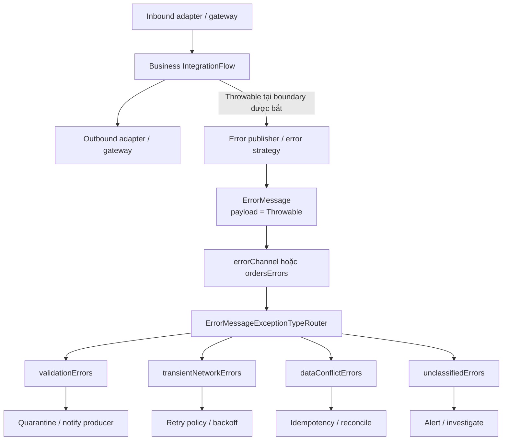
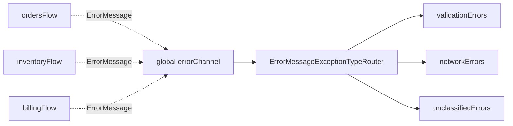
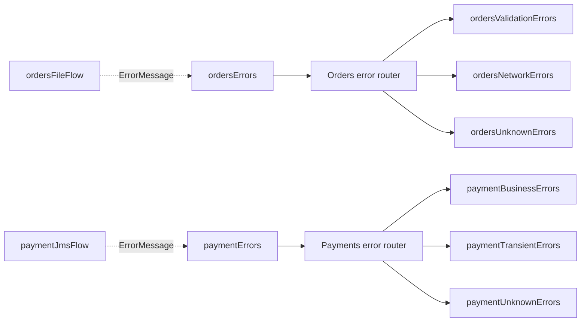
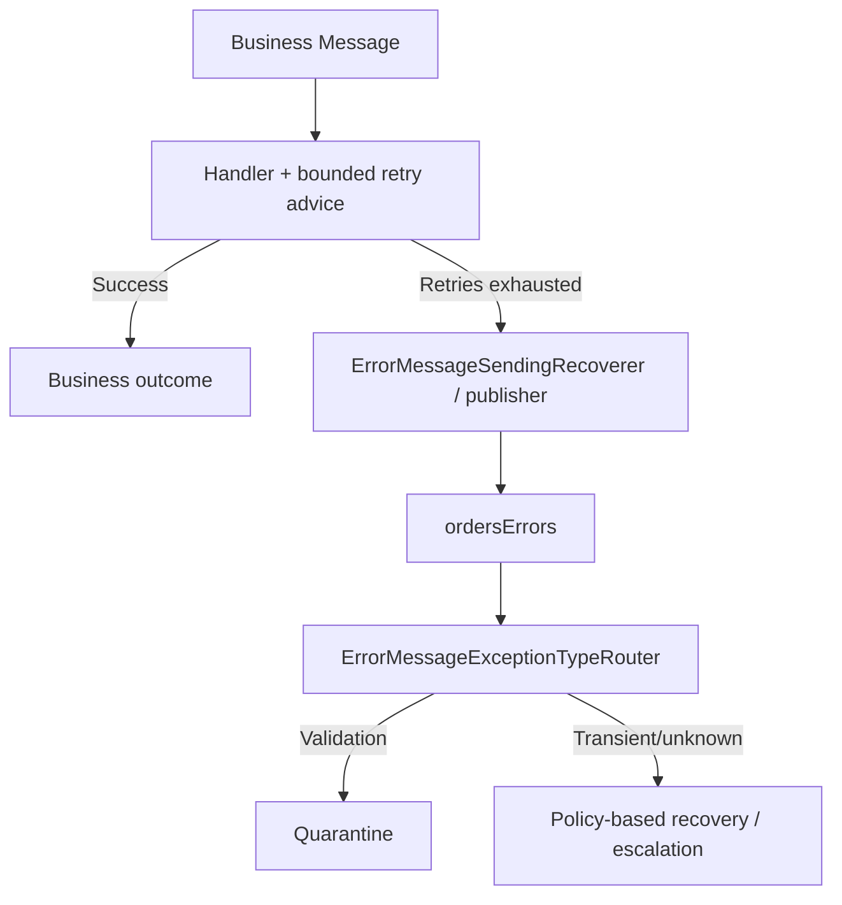

# ErrorMessageExceptionTypeRouter: Định tuyến lỗi theo loại exception trong Spring Integration Adapters

> **Chương:** Error handling  
> **Module:** `SPRING_INTEGRATION_ADAPTERS`  
> **Bối cảnh:** Tích hợp hệ thống ngoài bằng inbound/outbound adapter, gateway, poller, `MessageChannel` và các luồng file, SFTP, HTTP, JMS, AMQP, Kafka, JDBC/database.  
> **Mục tiêu:** Dùng `ErrorMessageExceptionTypeRouter` để chuyển `ErrorMessage` đến các kênh xử lý theo **loại exception trong cause chain**, sau đó phối hợp với retry, transaction, acknowledgement, DLQ/quarantine, monitoring và vòng đời kết nối đúng từng adapter.

## 1. Bài toán: Một error channel nhưng nhiều nguyên nhân

Trong một ứng dụng Spring Integration, nhiều endpoint có thể cùng phát sinh lỗi:

- File inbound adapter đọc CSV và parser ném `IllegalArgumentException` vì thiếu cột.
- SFTP inbound poller gặp `IOException` hoặc lỗi xác thực.
- HTTP outbound gateway gọi đối tác bị timeout.
- JMS listener xử lý event trùng dẫn đến lỗi kiểm tra dữ liệu.
- AMQP consumer nhận JSON không hợp lệ.
- Kafka producer thất bại trong callback gửi bất đồng bộ.
- JDBC outbound handler gặp `DataIntegrityViolationException` hoặc phụ thuộc database không sẵn sàng.

Nếu mọi lỗi được đưa vào một handler chung chỉ ghi stack trace, ứng dụng không có **chính sách phục hồi theo nguyên nhân**. Retry sai schema vô hạn sẽ không giúp ích; đưa tất cả timeout vào quarantine ngay thì giảm tính sẵn sàng; nuốt exception JMS có thể làm thay đổi ack/rollback ngoài mong muốn.

**`ErrorMessageExceptionTypeRouter`** giải quyết một phần bài toán: khi đã có một message mang `Throwable`, router chọn **destination channel** dựa trên ánh xạ giữa **loại exception** và **channel**. Nó được thiết kế riêng cho lỗi, khác với router chọn channel theo loại payload nghiệp vụ.

Ví dụ mong muốn:

```text
ordersErrors
    |
    v
ErrorMessageExceptionTypeRouter
    |-- IllegalArgumentException --------> validationErrors
    |-- SocketTimeoutException ----------> transientNetworkErrors
    |-- DataIntegrityViolationException -> dataConflictErrors
    \-- Không có mapping ---------------> unclassifiedErrors
```

**Giới hạn quan trọng:** router chỉ **định tuyến message đã được đưa tới nó**. Nó không tự bắt mọi exception ở tất cả thread, không tạo transaction, không retry, không xác nhận offset hay ack broker.

## 2. Kết quả học tập

Sau bài này, người học có thể:

1. Mô tả vị trí của `ErrorMessageExceptionTypeRouter` trong kiến trúc Spring Integration.
2. Phân biệt `ErrorMessage`, `Throwable`, `MessagingException.getFailedMessage()` và `ErrorMessage.getOriginalMessage()`.
3. Hiểu sự khác biệt giữa routing theo **cause chain** và routing theo loại payload.
4. Thiết lập Java DSL `routeByException`, mapping và `defaultOutputChannel`.
5. Giải thích vì sao **thứ tự mapping** cần kiểm thử khi cấu hình loại exception chồng lấn.
6. Kết nối router vào `errorChannel` toàn cục hoặc error channel riêng theo flow.
7. Chọn recovery policy phù hợp cho file/SFTP/HTTP/JMS/AMQP/Kafka/JDBC.
8. Kiểm thử đúng đường phát lỗi đồng bộ, bất đồng bộ, poller và callback.
9. Tránh làm lộ PII, token, key và payload trong các error handlers.
10. Chứng minh message đã được xử lý đúng bằng **bằng chứng outcome ở nguồn và đích**.

## 3. Router nằm ở đâu trong luồng xử lý lỗi?



Có **ba trách nhiệm khác nhau**:

- **Error publication:** exception nào trở thành `ErrorMessage`, ở thread nào và gửi tới channel nào?
- **Error routing:** dựa trên loại Throwable/cause để chọn kênh tiếp theo.
- **Recovery/outcome:** handler đích làm gì với message gốc, transaction, broker acknowledgement, quarantine và cảnh báo?

Một lỗi đồng bộ trên `DirectChannel` có thể **ném trực tiếp về caller**. Nếu không có error publisher hoặc gateway/poller boundary phù hợp, router **không nhận được bất kỳ ErrorMessage nào** để định tuyến. Đây là lý do bài này không thể chỉ tập trung vào một câu lệnh `routeByException`.

## 4. API và lớp nền tảng

| Thành phần | Package/khái niệm | Vai trò |
|---|---|---|
| `ErrorMessageExceptionTypeRouter` | `org.springframework.integration.router` | Router chọn channel theo exception/cause |
| `AbstractMappingMessageRouter` | Lớp cha | Quản lý channel mappings, default output, ánh xạ tên channel |
| `Message<?>` | `org.springframework.messaging` | Hợp đồng payload + headers |
| `ErrorMessage` | `org.springframework.messaging.support` | Message có payload là `Throwable` |
| `MessagingException` | `org.springframework.messaging` | Exception có thể mang `failedMessage` |
| `MessageHandlingException` | Spring Messaging | Một loại `MessagingException` khi xử lý message |
| `ErrorMessageStrategy` | Spring Integration | Tạo error message từ exception và context |
| `MessagePublishingErrorHandler` | Spring Integration | Publish lỗi qua `MessageChannel` trong boundary được hỗ trợ |
| `MessageHeaders.ERROR_CHANNEL` | Spring Messaging | Header chỉ destination error channel, không phải loại lỗi |
| `IntegrationFlow` | Java DSL | Nối router với các inbound và error handlers |
| `MessageChannel` | Spring Messaging | Đường nhận message nghiệp vụ hoặc lỗi |

Theo Spring Integration Reference, router được dùng với các **message có payload là `Throwable`** và chọn loại dựa trên **exception causes**. Nó cũng cho phép ánh xạ theo lớp cha để khỏi khai báo mọi subclass. Vì vậy, không nên kết luận router chỉ xem `error.getPayload().getClass()`.

### 4.1. Không có “phép biến đổi” message nghiệp vụ mặc định

`ErrorMessageExceptionTypeRouter` không có nhiệm vụ biến payload của một `ErrorMessage` thành record nghiệp vụ mới. Channel nhận tiếp thường thấy **message lỗi đang được route**, rồi handler bên dưới mới quyết định chuyển sang quarantine record, retry command hoặc HTTP reply nếu cần.

Nếu muốn chuẩn hóa error envelope JSON, hãy làm ở **recovery flow** và giữ nguyên bằng chứng cần thiết; không giả định router tự thêm trường `errorCode`, `attempt` hay `flowId`.

## 5. So sánh với `PayloadTypeRouter`

| Đặc điểm | `PayloadTypeRouter` | `ErrorMessageExceptionTypeRouter` |
|---|---|---|
| Đối tượng cần phân loại | Loại Java của payload thông thường | Loại của Throwable trong error message |
| Ví dụ | `OrderCreated`, `InventoryUpdated` | `IllegalArgumentException`, `SocketTimeoutException` |
| Có xét cause chain? | Không theo ý nghĩa exception chain | **Có** |
| Xét subclass? | Có thể ánh xạ theo hệ phân cấp loại | Có thể ánh xạ theo lớp cha của Throwable |
| Mục tiêu | Routing nghiệp vụ theo kiểu object | Routing chính sách xử lý lỗi |
| Tự retry/rollback? | Không | Không |
| Điều kiện đầu vào | Message mang payload nghiệp vụ | Message có payload là Throwable |

```text
Business payload:
  Message<OrderCreated>
     |
     v
  PayloadTypeRouter

Error payload:
  ErrorMessage(
      MessageHandlingException(
          cause = SocketTimeoutException
      )
  )
     |
     v
  ErrorMessageExceptionTypeRouter
```

Nếu đưa `ErrorMessage` vào `PayloadTypeRouter` với mapping cho `SocketTimeoutException`, router theo payload đơn thuần có thể chỉ thấy lớp exception bọc ngoài, chứ **không dùng cùng thuật toán duyệt cause** của router dành cho lỗi.

## 6. Cause chain: Bài học trung tâm của router

Spring Integration thường bọc lỗi handler vào `MessageHandlingException`. Bên trong có thể có ngoại lệ nghiệp vụ hoặc phụ thuộc:

```text
MessageHandlingException
  caused by ResourceAccessException
    caused by SocketTimeoutException
```

Một router chỉ xem outer exception sẽ phân mọi lỗi ở handler vào một nhóm. `ErrorMessageExceptionTypeRouter` xem **chuỗi nguyên nhân** để tìm mapping theo exception type. Theo tài liệu chính thức, thuật toán tìm **nguyên nhân phù hợp cụ thể nhất có mapping**, dùng kiểm tra loại tương thích như `mappingClass.isInstance(cause)`.

Ví dụ cấu hình ánh xạ `SocketTimeoutException` tới `transientNetworkErrors` có thể nhận một `ErrorMessage` dù lớp ngoài là `MessageHandlingException`.

### 6.1. “Cụ thể nhất” không có nghĩa luôn là nguyên nhân sâu nhất

Một cause chain có thể gồm nhiều lớp, và một số lớp không có mapping. Điểm chọn phải dựa trên những **mapping đã cấu hình**, hệ phân cấp class và logic router của phiên bản sử dụng.

Nếu có cả `IOException` và `SocketTimeoutException`, hoặc `RuntimeException` và `IllegalArgumentException`, **cần kiểm thử kết quả**. Đừng viết một bộ quy tắc tưởng tượng rằng router luôn ưu tiên mapping của subclass theo mọi thứ tự khai báo.

### 6.2. Ngoại lệ không có cause

```java
new IllegalArgumentException("missing orderId");
```

Router vẫn có thể khớp loại exception bên ngoài nếu đã khai báo mapping. Không cần có `getCause() != null` mới hoạt động.

### 6.3. Chuỗi nguyên nhân do ứng dụng tạo

```java
throw new IllegalStateException(
    "Cannot import order batch",
    new java.net.SocketTimeoutException("supplier timeout")
);
```

Nếu route theo nguyên nhân mạng, luồng có thể được xử lý như lỗi transient. Nhưng nội dung cause không thay thế việc phân tích **đã có side effect hay chưa**, đặc biệt với HTTP POST, DB hoặc broker.

## 7. Thứ tự ánh xạ quan trọng khi loại exception chồng lấn

**Lưu ý từ tài liệu Spring Integration:** thứ tự cấu hình channel mappings có thể ảnh hưởng kết quả với loại exception chồng lấn. Tài liệu chính thức nêu ví dụ `IllegalArgumentException` và `RuntimeException`, nhấn mạnh không được bỏ qua thứ tự.

Ví dụ hai mapping liên quan kế thừa:

```text
IllegalArgumentException extends RuntimeException

Mapping A: RuntimeException       -> genericRuntimeErrors
Mapping B: IllegalArgumentException -> validationErrors
```

Trực giác “subclass chắc chắn luôn thắng” **không phải một hợp đồng đủ để thay integration test**. Khi cần phân biệt hai loại, hãy chạy test với đúng tổ hợp, thứ tự và phiên bản framework đã chọn; không suy từ tên class.

### 7.1. Cách giảm mơ hồ

- Ưu tiên các mapping **ít chồng lấn** theo rủi ro và nghiệp vụ.
- Sử dụng `defaultOutputChannel` cho **unclassified error** thay vì một mapping quá rộng cho `Throwable`.
- Nếu phải dùng mapping lớp cha, ghi rõ thứ tự, kỳ vọng và test regression.
- Không gán mọi `RuntimeException` vào “retryable” vì validation, bug và authorization cũng có thể là RuntimeException.
- Test cả exception **bọc ngoài**, exception **trực tiếp** và exception **có cause nhiều tầng**.
- Khi nâng cấp Spring Integration, chạy lại test precedence và routing.

### 7.2. Ví dụ test matrix bắt buộc

| Throwable/cause | Mapping liên quan | Kỳ vọng cần xác minh |
|---|---|---|
| `IllegalArgumentException` | Chính loại này | `validationErrors` |
| `NullPointerException` | Chính loại này hoặc default | `bugErrors` hoặc default theo cấu hình |
| `SocketTimeoutException` | Chính loại này | `transientNetworkErrors` |
| `MessageHandlingException → SocketTimeoutException` | Mapping cause | `transientNetworkErrors` |
| `IllegalArgumentException` | Cả `RuntimeException` và `IllegalArgumentException` | Kết quả theo thứ tự đã test |
| `SQLException` | Không mapping | `unclassifiedErrors` |
| `Exception` thuần không được khai báo | Không mapping | Default hoặc chính sách fail rõ |

Phải xác nhận rằng **message chỉ được xử lý ở đích mong muốn** trong bối cảnh router và endpoint đang dùng. Trường hợp fan-out hoặc nhiều subscribers cần test thêm hành vi cụ thể.

## 8. Java DSL: ví dụ chính thức với `routeByException`

Spring Integration Reference cung cấp cú pháp Java DSL:

```java
@Bean
IntegrationFlow errorsByTypeFlow() {
    return f -> f.routeByException(r -> r
            .channelMapping(IllegalArgumentException.class,
                    "validationErrors")
            .channelMapping(NullPointerException.class,
                    "bugErrors")
            .defaultOutputChannel("unclassifiedErrors"));
}
```

Đây là **cấu hình router**, nhưng đoạn ngắn trên chưa chỉ ra source error channel và các downstream consumers. Trong một ứng dụng thực, cần nối flow vào channel nhận `ErrorMessage` và định nghĩa những channel đích.

### 8.1. Cấu hình hoàn chỉnh hơn: channel nguồn và mapping

```java
import java.net.SocketTimeoutException;

import org.springframework.context.annotation.Bean;
import org.springframework.context.annotation.Configuration;
import org.springframework.integration.channel.DirectChannel;
import org.springframework.integration.dsl.IntegrationFlow;
import org.springframework.messaging.MessageChannel;

@Configuration
class OrderErrorRoutingConfiguration {

    @Bean("ordersErrors")
    MessageChannel ordersErrors() {
        return new DirectChannel();
    }

    @Bean("validationErrors")
    MessageChannel validationErrors() {
        return new DirectChannel();
    }

    @Bean("transientNetworkErrors")
    MessageChannel transientNetworkErrors() {
        return new DirectChannel();
    }

    @Bean("unclassifiedErrors")
    MessageChannel unclassifiedErrors() {
        return new DirectChannel();
    }

    @Bean
    IntegrationFlow ordersErrorRouterFlow() {
        return IntegrationFlow.from("ordersErrors")
            .routeByException(r -> r
                .channelMapping(
                    IllegalArgumentException.class, "validationErrors")
                .channelMapping(
                    SocketTimeoutException.class, "transientNetworkErrors")
                .defaultOutputChannel("unclassifiedErrors"))
            .get();
    }
}
```

**Ý nghĩa:**

1. `ordersErrors` là kênh đầu vào của error router. Endpoint/poller/gateway phải **thực sự publish** lỗi vào đây.
2. `channelMapping` nhận một loại Throwable và tên channel đích.
3. `defaultOutputChannel` xử lý lỗi chưa có mapping; **không âm thầm bỏ** lỗi.
4. Các channel dùng `DirectChannel` để minh họa; chúng không tự bền vững qua restart.
5. Đoạn này chưa có consumers, retry, transaction, quarantine hoặc logging; những phần đó được bổ sung riêng.
6. Đối chiếu API Java DSL với dependency Spring Integration của dự án; code theo mẫu reference, không giả định mọi version giống nhau hoàn toàn.

### 8.2. Nối handler riêng cho từng nhánh

```java
import org.springframework.integration.annotation.ServiceActivator;
import org.springframework.messaging.support.ErrorMessage;
import org.springframework.stereotype.Component;

@Component
class OrderErrorHandlers {

    private final OrderFailureService failures;

    OrderErrorHandlers(OrderFailureService failures) {
        this.failures = failures;
    }

    @ServiceActivator(inputChannel = "validationErrors")
    public void validation(ErrorMessage error) {
        failures.quarantineInvalidOrder(error);
    }

    @ServiceActivator(inputChannel = "transientNetworkErrors")
    public void network(ErrorMessage error) {
        failures.scheduleControlledRetry(error);
    }

    @ServiceActivator(inputChannel = "unclassifiedErrors")
    public void unknown(ErrorMessage error) {
        failures.recordAndEscalate(error);
    }
}

interface OrderFailureService {
    void quarantineInvalidOrder(ErrorMessage error);
    void scheduleControlledRetry(ErrorMessage error);
    void recordAndEscalate(ErrorMessage error);
}
```

Các methods `quarantineInvalidOrder`, `scheduleControlledRetry` và `recordAndEscalate` là **hợp đồng ứng dụng cần cài đặt**. Trong production, không nên truyền raw ErrorMessage sang log hoặc external monitor. Những method này phải xác định **nơi lưu dữ liệu lỗi, điều kiện retry, idempotency, thời hạn và bảo mật**.

## 9. Java DSL: Một error router dùng chung hay tách theo flow?

Có hai mẫu kiến trúc.

### 9.1. Mẫu A: Router chung sau global `errorChannel`



Ưu điểm: tập trung policy kỹ thuật và metric lỗi chung. Nhược điểm: không tự phân biệt owner, tenant và quy tắc recovery của từng flow. `SocketTimeoutException` ở payment và SFTP có thể cần hành động hoàn toàn khác nhau.

### 9.2. Mẫu B: Router trong private error flow



Ưu điểm: policy, retry/DLQ và quyền đọc error payload theo owner; test tách biệt. Chi phí: nhiều bean/channel, cần chuẩn hóa error contract và tránh duplication vô ích.

**Gợi ý:** nếu hai flow có transaction, dữ liệu nhạy cảm, quy tắc retry hoặc on-call khác nhau, hãy cân nhắc tách. Nếu cùng chính sách và không có ranh giới khác, một router chung có thể đủ.

### 9.3. Tránh routing theo header `flowId` từ nguồn ngoài

Không để HTTP client hoặc message broker tự điều khiển nhánh lỗi bằng header không được kiểm tra. Channel nguồn và owner phải xuất phát từ cấu hình endpoint hoặc metadata nội bộ đáng tin; nếu dùng tenant ID, phải xác minh tenant với connection/principal thực.

## 10. XML DSL: `exception-type-router`

Với cấu hình XML của Spring Integration, tài liệu chính thức hỗ trợ:

```xml
<int:exception-type-router
        input-channel="ordersErrors"
        default-output-channel="unclassifiedErrors">
    <int:mapping
            exception-type="java.lang.IllegalArgumentException"
            channel="validationErrors"/>
    <int:mapping
            exception-type="java.lang.NullPointerException"
            channel="bugErrors"/>
</int:exception-type-router>

<int:channel id="ordersErrors"/>
<int:channel id="validationErrors"/>
<int:channel id="bugErrors"/>
<int:channel id="unclassifiedErrors"/>
```

Đây là **trích yếu cấu hình namespace**: cần XML namespaces/schema, bean context và consumers để thành cấu hình ứng dụng hoàn chỉnh. Dùng đúng thuộc tính `exception-type`, không thay bằng tên exception text tự tạo.

### 10.1. Khi mapping sai class name

Từ Spring Integration 4.3, tài liệu nêu router tải các mapping classes trong giai đoạn initialization nhằm **fail-fast** nếu có class không tồn tại. Đây là lý do cần test context startup sau refactor hoặc thay dependencies, thay vì phát hiện router sai chỉ ở production.

## 11. Cấu hình programmatic và quản lý mapping

`ErrorMessageExceptionTypeRouter` kế thừa các API quản lý mapping như `setChannelMapping(String, String)` và `setChannelMappings(Map<String,String>)` từ router base, cùng hỗ trợ quản lý mapping ở runtime tùy cấu hình.

Ví dụ minh họa về API instance:

```java
import org.springframework.integration.router.ErrorMessageExceptionTypeRouter;

ErrorMessageExceptionTypeRouter router =
        new ErrorMessageExceptionTypeRouter();

router.setChannelMapping(
        IllegalArgumentException.class.getName(),
        "validationErrors");

router.setChannelMapping(
        java.net.SocketTimeoutException.class.getName(),
        "transientNetworkErrors");
```

Đây chỉ là **khâu tạo/mapping router**, chưa đăng ký bean, khởi tạo lifecycle, gắn `inputChannel` hay subscribers. Trong ứng dụng Java DSL thông thường, `routeByException` rõ và dễ kiểm thử hơn.

### 11.1. Không đổi mapping runtime tùy tiện

Các mapping là **chính sách recovery**. Thay đổi chúng trong production có thể khiến poison message bị retry, lỗi kết nối bị quarantine hoặc lỗi nghiệp vụ bị đưa nhầm owner.

Nếu tổ chức cho phép thay mapping qua quản trị/Control Bus:

- Có owner, phê duyệt và audit thay đổi.
- Có bộ test cho exception hierarchy/cause chain.
- Ghi version của routing policy trong event/metrics.
- Có rollback và cảnh báo khi error distribution đổi đột ngột.
- Không nhận class/channel mapping từ payload message của khách hàng.

## 12. ErrorMessage có thể mang những gì?

`ErrorMessage` có payload là `Throwable`. Exception thường có cause chain; một `MessagingException` có thể giữ `failedMessage`.

```text
ErrorMessage
  payload: Throwable
     MessageHandlingException
       failedMessage?: Message<?>
       cause -> SocketTimeoutException
  headers: MessageHeaders
  originalMessage?: Message<?>
```

**Đừng nhầm ba thứ**:

- `ErrorMessage.getPayload()`: exception đang được route.
- `MessagingException.getFailedMessage()`: message tại điểm lỗi nếu exception cung cấp.
- `ErrorMessage.getOriginalMessage()`: message đầu vào được error strategy giữ nếu có.

Router định tuyến theo **Throwable type/cause**, không phân tích nghiệp vụ `orderId`, `tenantId` hoặc raw CSV để chọn mapping.

### 12.1. Khi failed message vắng mặt

Lỗi SFTP connect, JDBC polling query hoặc Kafka deserialization có thể xảy ra **trước khi tạo Spring Message**. Router vẫn có thể xử lý Throwable được publish, nhưng recovery handler phải chấp nhận `failedMessage==null` và dùng context từ poller/adapter.

### 12.2. Khi failed message đã biến đổi

Nếu flow biến `File` thành `OrderBatch` rồi lỗi JDBC, `getFailedMessage()` có thể chứa `Message<OrderBatch>`, không phải file gốc. Không tự replay đầu vào file từ payload ấy hoặc giả định có đủ source metadata để di chuyển file.

## 13. Vì sao route theo loại exception không đủ cho quyết định retry?

Một exception type mô tả **biểu hiện kỹ thuật**, không luôn mô tả **tính an toàn khi thực hiện lại**.

```text
SocketTimeoutException
  A. HTTP GET đọc danh mục:
       retry có thể an toàn theo contract

  B. HTTP POST tạo thanh toán:
       server có thể đã nhận và commit trước timeout
       retry mù quáng có nguy cơ tạo giao dịch trùng
```

Cùng loại timeout nhưng side effect khác nhau. Router có thể đưa cả hai tới nhánh “transient”, song **handler nhánh đó còn phải đánh giá operation, idempotency key, retry budget và transaction outcome**.

### 13.1. Taxonomy gợi ý

| Exception/cause | Gợi ý phân loại ban đầu | Phải kiểm tra trước recovery |
|---|---|---|
| `IllegalArgumentException` do schema | Validation/permanent | Có đúng là input invalid hay bug code? |
| `SocketTimeoutException` | Network/transient | Downstream có xử lý thành công một phần không? |
| `ConnectException` | Kết nối chưa thiết lập | Credentials, dependency và retry budget |
| `DataIntegrityViolationException` | Conflict/data | Duplicate hợp lệ hay mất idempotency? |
| `AuthenticationException` từ adapter | Credential/config | Không retry nóng nếu secret sai |
| `AccessDeniedException` | Authorization | Có quyền cấp sai hay policy sai? |
| `NullPointerException` | Bug hoặc state lỗi | Không mặc định retry vô hạn |
| `MessagingException` không có mapping sâu hơn | Unknown | Điều tra cause, owner và nguồn |
| `Error`/`OutOfMemoryError` | Runtime/system failure | Không cố coi như message lỗi nghiệp vụ thông thường |

**Không đưa `Throwable.class` làm “retry tất cả” một cách tùy tiện.** Có thể dùng `defaultOutputChannel` để alert lỗi chưa phân loại, bảo toàn context và quyết định tiếp.

## 14. Tách router với retry advice

Có hai vị trí thiết kế retry khác nhau:

1. **Trước router:** `RequestHandlerRetryAdvice` retry handler có giới hạn. Khi hết retry, recovery callback có thể publish ErrorMessage để router phân loại và xử lý cuối.
2. **Sau router:** router chuyển lỗi tới một recovery flow có scheduler/quarantine/reference rồi workflow có điều kiện phát lệnh xử lý lại.



Đừng xây hai tầng retry độc lập **đều vô hạn**: retry advice nhiều lần cộng broker redelivery nhiều lần cộng replay sau router có thể làm số lần xử lý tăng không kiểm soát.

### 14.1. Một câu hỏi cần trả lời

Khi router đã nhận ErrorMessage, exception ở handler đã **được bắt và publish**. Tùy boundary, message nguồn có thể đã được ack/commit, vẫn trong transaction hoặc đang chờ broker retry. Vì vậy, error flow **không thể mặc định sửa transaction outcome bằng cách rethrow tùy ý**; phải nắm rõ cơ chế adapter/container.

## 15. Global `errorChannel` và private error channel

Spring Integration có cơ chế lỗi toàn cục thường mang bean name `errorChannel`. Trong nhiều boundary bất đồng bộ, khi request message không chỉ định `errorChannel` và không có endpoint-specific handling, framework có thể publish lỗi tới global channel.

Một số hệ thống đặt router tại đây để phân loại theo Throwable. Tuy nhiên:

- Lỗi đồng bộ trên `DirectChannel` thường ném về caller.
- Poller có error handler và chính sách routing riêng.
- Message-driven adapter có thể dùng container/broker error handling.
- Callback Kafka outbound có failure channel riêng theo cấu hình.
- Gateway có thể đưa lỗi trở lại caller hoặc tạo phản hồi lỗi qua error flow.

**Router không quyết định chính nó được gọi ở đâu.** Phải kiểm tra kênh nguồn cho từng endpoint và cấu hình error handling tương ứng.

### 15.1. Phạm vi của `MessageHeaders.ERROR_CHANNEL`

Header `errorChannel` chỉ địa chỉ lỗi có thể được error publisher sử dụng. Header này **không bảo đảm** mọi exception sẽ biến thành ErrorMessage; cũng không quyết định loại exception nào được route sau đó.

Không để nguồn ngoài tự khai header để chuyển lỗi tới handler của flow/tenant khác. Dùng boundary đáng tin để set/overwrite routing metadata.

### 15.2. Giám sát lỗi lọt global

Nếu flow đã có `ordersErrors` riêng nhưng lỗi lại xuất hiện ở global `errorChannel`, cần kiểm tra:

- Poller/adapter chưa được gắn error channel đúng.
- Lỗi xảy ra trước message creation và không còn header.
- Message headers bị transformer/custom code làm mất.
- Error handler sử dụng default channel khác.
- Gateway hoặc producer callback có cơ chế riêng.
- Bean name không khớp hoặc subscriber chưa đăng ký.

Đặt metric/cảnh báo “unrouted errors” để phát hiện, thay vì cho lỗi đi một đường mặc định không owner.

## 16. Poller, file và SFTP: routing lỗi trước và sau message

### 16.1. File inbound

File inbound adapter thường poll thư mục rồi tạo `Message<File>` hoặc kiểu payload theo cấu hình. Lỗi có thể ở:

- Directory unreadable (trước khi tạo message).
- File đang được ghi dở.
- CSV schema không hợp lệ.
- Transformer parse lỗi.
- Database write lỗi sau khi parse.
- Move/archive/quarantine file lỗi.
- Metadata store/accept-once không cho nhận lại file.

Nếu parser ném `IllegalArgumentException`, router có thể đưa tới `validationErrors`; nhưng để quarantine cần biết **path file gốc**, đảm bảo file đã hoàn tất, permission và trạng thái filter. Router không tự di chuyển file hoặc reset accept-once filter.

### 16.2. SFTP inbound

SFTP thêm network/session và remote state:

| Error | Cause type có thể gặp | Recovery hợp lý |
|---|---|---|
| Server timeout khi listing | `IOException` hoặc subtype theo client | Backoff, cảnh báo hạ tầng |
| Authentication failure | Adapter/client-specific exception | Kiểm tra secret, không retry nóng |
| File không tồn tại | Remote state/race | Đối chiếu listing, idempotency |
| Content parse invalid | `IllegalArgumentException` nghiệp vụ | Quarantine và báo người gửi |
| Partial download | I/O failure | Temp file/atomic rename và kiểm tra file |
| Destination permission denied | Security/I/O exception | Escalate owner |

**Lỗi SFTP connect có thể không có `failedMessage`**, vì message chưa được sinh. Router vẫn phân loại theo cause nếu exception được publish tới nó.

### 16.3. Test bắt buộc

Tạo lỗi thật trong **polling task**, không chỉ gửi `new ErrorMessage(...)` trực tiếp vào router. Xác nhận error channel được gọi và file/SFTP state sau lỗi đúng policy.

## 17. HTTP gateway: Exception type router không tự tạo response

HTTP inbound/outbound gateway hoạt động trong hệ sinh thái request–reply hoặc fire-and-forget theo cấu hình. Từ góc độ HTTP, khách hàng cần **status code và body** đúng contract; còn router là cơ chế nội bộ.

| Lỗi HTTP | Phân loại ban đầu | Điều cần quyết định |
|---|---|---|
| Request invalid | Validation | 400/4xx tương ứng, không tiết lộ nội bộ |
| Unauthorized/forbidden | Authentication/authorization | 401/403 theo semantics |
| Downstream 429 | Rate limit | Backoff, `Retry-After` nếu áp dụng |
| Connection timeout | Transient/network | Có idempotency và deadline không? |
| Downstream 5xx | Dependency failure | Retry có giới hạn, circuit breaker |
| Business conflict | Domain | 409 hoặc response nghiệp vụ phù hợp |
| Unknown internal error | Unexpected | 500/5xx, correlation ID và alert |

**Không phải mọi 4xx là permanent** và không phải mọi 5xx đều retry an toàn. Router theo exception class thường chỉ là tầng đầu; handler phải biết HTTP method, status, request idempotency và giao thức bên nhận.

### 17.1. Synchronous gateway

Exception từ handler đồng bộ có thể propagate trực tiếp tới gateway caller, hoặc gateway xử lý qua error channel theo cấu hình. Nếu muốn dùng router để tạo error response, thiết kế flow chuyển ErrorMessage thành payload reply và status đúng.

Một recovery handler chỉ log rồi trả `void` có thể khiến HTTP caller nhận timeout hoặc response không mong muốn. **Không xem việc gửi ErrorMessage thành HTTP response đã hoàn tất.**

### 17.2. Outbound HTTP timeout sau side effect

HTTP POST có thể đã thành công ở server nhưng client timeout trước khi nhận response. `SocketTimeoutException` không đủ kết luận giao dịch thất bại hoàn toàn. Cần idempotency key, lookup outcome hoặc reconciliation trước retry.

## 18. JMS: router không thay transaction/acknowledgement

JMS inbound adapter/message-driven endpoint có thể sử dụng transaction và broker redelivery. Trước khi xử lý một `ErrorMessage` từ JMS, cần biết:

1. Listener có session transacted hay không?
2. Container đã ack, commit hoặc rollback khi nào?
3. Exception có được propagate tới listener boundary hay đã được error publisher bắt?
4. Retry advice ở handler có bao phủ transaction như kỳ vọng không?
5. Broker có redelivery policy và DLQ không?
6. Tại thời điểm failure, DB/HTTP side effect có thể đã hoàn tất không?
7. Có `JMSMessageID`, correlation ID và delivery count không?

### 18.1. Tình huống nguy hiểm

```text
JMS listener -> payment service -> exception
    -> ErrorMessage
    -> ErrorMessageExceptionTypeRouter
    -> paymentErrors handler: log và return
```

**Không thể kết luận** JMS đã rollback chỉ vì có ErrorMessage. Nếu error đã được “handle” theo ngữ nghĩa của adapter/container, broker có thể coi delivery hoàn tất. Hành vi phải kiểm chứng với **ack/transaction configuration** và integration test.

### 18.2. DLQ theo loại lỗi

Một lỗi validation cố định có thể đưa tới broker DLQ sau quy trình phù hợp; lỗi network transient có thể redeliver. Router giúp phân loại, nhưng **quyết định ack/nack phải được truyền và thực thi ở đúng boundary**; không suy rằng một `DirectChannel` downstream tự nack broker.

## 19. AMQP: phân loại exception nhưng phải giữ đúng requeue policy

AMQP inbound có các tình huống:

- Deserialization/parsing error.
- Authentication/authorization với broker.
- Connection reset.
- Handler nghiệp vụ không hợp lệ.
- Database outage.
- Publish confirm hoặc return failure ở outbound.

`ErrorMessageExceptionTypeRouter` có thể chia theo exception type khi Spring Integration đã publish ErrorMessage. Tuy nhiên:

- Listener/container quyết định ack/reject/requeue theo cấu hình.
- Một message luôn lỗi có thể trở thành **poison message** và bị requeue vô hạn.
- DLX/DLQ/TTL và retry count do broker/application phối hợp.
- Manual ack đòi rõ ai là owner của ack.
- Publish failure không luôn xuất hiện cùng error path với inbound message.

### 19.1. Thứ tự xử lý phù hợp

1. Phân loại lỗi ở boundary.
2. Xác định transient/permanent có căn cứ.
3. Áp retry budget và DLQ đúng với ack mode.
4. Giữ correlation/resource reference có quyền.
5. Alert khi DLQ tăng hoặc recovery handler lỗi.
6. Khi replay, dùng idempotency key để tránh side effect trùng.

Đừng chỉ cấu hình channel mapping rồi cho rằng message AMQP đã được bảo toàn.

## 20. Kafka: Consumer và producer có đường lỗi khác nhau

### 20.1. Kafka inbound consumer

Một lỗi có thể xảy ra **trước khi tạo Spring Message**: broker auth, assignment hoặc deserializer. Lỗi trong business handler sau adapter có thể tạo MessagingException/ErrorMessage tùy cấu hình.

Router có thể định tuyến loại exception đã publish, nhưng **không tự commit offset, seek, retry hay đưa vào DLT**. Các hành vi này nằm ở adapter, listener/container và Kafka error strategy.

Cần biết `topic`, `partition`, `offset`, `consumerGroup`, retry policy và liệu record đã bị xử lý phần nào.

### 20.2. Kafka outbound producer

Producer send có thể bất đồng bộ. Lời gọi send trả về chưa đủ chứng minh broker đã xác nhận. Lỗi trong callback/producer confirmation có thể được đưa tới **send-failure channel** của adapter khi được cấu hình.

Nếu router subscribe nhầm global `errorChannel` nhưng failure đi tới `kafkaSendFailures`, router không bao giờ thấy lỗi đó. Hãy nối đúng producer failure path vào classifier nếu cần.

### 20.3. Cẩn thận với side effects

Nếu DB đã commit nhưng Kafka publish thất bại, retry lại file/JMS message từ đầu có thể gây insert trùng. Transactional outbox, idempotency hoặc reconciliation thường cần thiết để đạt kết quả nghiệp vụ đáng tin, không phải một exception router.

## 21. JDBC/database: Định tuyến đúng mà vẫn có thể mất dữ liệu

Trong luồng database, exception có thể đến từ:

- Connection unavailable.
- Polling query lỗi trước khi có row.
- Constraint violation.
- Optimistic locking conflict.
- Transaction commit failure.
- Database deadlock/lock timeout.
- Writer commit một phần hoặc upstream đã đánh dấu `DONE` sai.

Một số lỗi cùng loại `DataAccessException` nhưng có tính phục hồi khác nhau. Router có thể phân theo subtype, tuy nhiên cần kiểm tra **transaction boundary và trạng thái row**.

### 21.1. State machine minh họa

```text
NEW
  -> CLAIMED
  -> PROCESSING
       |-> DONE
       |-> RETRY_WAIT
       \-> QUARANTINED
```

Nếu poller đã đánh dấu `DONE` trước khi router nhận lỗi, việc route đúng `transientNetworkErrors` cũng **không tự sửa được row bị mất**. Thiết kế nên có lease/lock, idempotency và kiểm tra outcome.

### 21.2. Database uniqueness conflict

`DataIntegrityViolationException` có thể là:

- Duplicate event đã xử lý thành công: có thể coi là idempotent success sau đối soát.
- Dữ liệu nghiệp vụ không hợp lệ: quarantine.
- Bug hoặc schema mismatch: alert và sửa code.
- Một race condition: retry theo chiến lược concurrency.

Không hard-code mọi DataIntegrityViolationException thành “drop” hoặc “retry”; cần domain check trong handler.

## 22. Error handlers phải biết và bảo vệ message gốc

`ErrorMessage.getPayload()` là Throwable; `MessagingException.getFailedMessage()` có thể chứa Message tại handler lỗi; `ErrorMessage.getOriginalMessage()` có thể có context gốc.

Ví dụ trích xuất an toàn:

```java
import org.springframework.messaging.Message;
import org.springframework.messaging.MessagingException;
import org.springframework.messaging.support.ErrorMessage;

final class ErrorContext {

    private ErrorContext() {}

    static Message<?> failedMessage(ErrorMessage error) {
        Throwable current = error.getPayload();

        // Mã minh họa; production nên chặn cause cycle và giới hạn depth.
        for (int depth = 0; current != null && depth < 16; depth++) {
            if (current instanceof MessagingException me
                    && me.getFailedMessage() != null) {
                return me.getFailedMessage();
            }
            current = current.getCause();
        }
        return null;
    }

    static Message<?> originalMessage(ErrorMessage error) {
        return error.getOriginalMessage();
    }
}
```

**Cần lưu ý:** Router phân loại Throwable, không cần parse failedMessage để quyết định class mapping. Nhưng downstream handler có thể cần message reference để quarantine/recovery. Nếu không có, phải dùng context từ adapter hoặc error strategy, không tự tạo payload giả.

### 22.1. Privacy và secret

Đừng log `error.toString()` hoặc `failedMessage.toString()` vì có thể chứa:

- File path hoặc nội dung CSV chứa dữ liệu cá nhân.
- Raw HTTP request/response body.
- JMS/AMQP message body chứa dữ liệu thanh toán.
- Kafka headers và payload.
- SQL parameters, email, ID cá nhân.
- Bearer token, session cookie, API key hoặc password.

Thay bằng metadata lỗi, ID đã kiểm tra, reference tới vùng lưu có ACL, thời hạn và audit. Không dùng raw exception message làm label cho metrics.

## 23. Không thể thay thế router bằng String matching tùy tiện

Một anti-pattern thường gặp:

```java
if (error.getMessage().contains("timeout")) {
    retry();
} else if (error.getMessage().contains("invalid")) {
    quarantine();
}
```

Vấn đề:

- Exception message phụ thuộc ngôn ngữ, version thư viện và môi trường.
- Message có thể chứa dữ liệu không tin cậy, client có thể điều khiển chuỗi.
- Một cause bị bọc mất, outer message không có từ “timeout”.
- Thông báo của JDBC/HTTP thay đổi theo driver/provider.
- String matching không phân biệt lỗi tạm thời với **side effect đã xảy ra**.

Dùng `ErrorMessageExceptionTypeRouter` để chọn kênh theo class/cause; dùng **domain policy** và dữ kiện nguồn đáng tin trong handler để quyết định outcome. Với lỗi thuộc thư viện có class chung, có thể tạo một **custom exception có type nghiệp vụ rõ** ở boundary phù hợp thay vì phân loại bằng text.

### 23.1. Custom exception cho nghiệp vụ

```java
public class InvalidOrderSchemaException
        extends IllegalArgumentException {

    public InvalidOrderSchemaException(String message) {
        super(message);
    }
}
```

Sau đó mapping `InvalidOrderSchemaException.class` đến channel validation. Đừng đưa chi tiết PII vào exception message. Nếu một handler bọc exception mới, phải **giữ cause** để router còn thấy loại gốc:

```java
throw new IllegalStateException(
        "Order import failed",
        new InvalidOrderSchemaException("Missing required field"));
```

Đây chỉ là minh họa về cause chain; trong ứng dụng thật nên sử dụng kiểu exception phù hợp ngữ nghĩa và giữ thông tin an toàn.

## 24. Unclassified và unknown errors: Đường dự phòng bắt buộc

`defaultOutputChannel("unclassifiedErrors")` là một phần quan trọng trong cấu hình. Nó giúp những loại exception không có mapping vẫn có owner để điều tra.

Unclassified error handler nên:

- Ghi mã failure và context tối thiểu.
- Không log raw payload hoặc toàn bộ secret.
- Giữ reference có thể điều tra nếu policy cho phép.
- Alert owner kỹ thuật và xác định mức rủi ro.
- Xác định message nguồn có đã ack/commit/đã ghi DB chưa.
- Quản lý retry có điều kiện, tránh hot loop.
- Sau khi root cause rõ, bổ sung mapping hoặc cập nhật chính sách và tests.

**Không dùng `nullChannel` làm default chỉ để hết cảnh báo.** Đây là hành động cố ý bỏ message có thể khiến mất dữ liệu; nếu dùng phải có lý do nghiệp vụ và bằng chứng hoàn tất xử lý ở source.

### 24.1. Khi không có subscriber

Nếu channel đích không có consumer, lỗi có thể tiếp tục phát sinh hoặc bị xử lý khác theo channel/config. Kiểm thử startup và health/readiness cho router, channels và handlers, không chỉ test bean tồn tại.

### 24.2. Khi chính error handler lỗi

Quarantine store có thể unavailable. Phải có fallback và transaction/fail-safe tương ứng nguồn:

- JMS/AMQP có thể cần rollback/nack.
- Kafka có thể cần không commit offset hoặc chuyển DLT theo cấu hình.
- File có thể cần giữ source, tránh đánh dấu processed sai.
- HTTP cần trả lỗi đúng contract.
- Recovery store cần retry có giới hạn hoặc dừng flow để tránh mất message.

Một router thành công **không bảo đảm** các handler đích hoạt động thành công.

## 25. DLQ, quarantine và error channel không phải một

| Thành phần | Chức năng | Bền vững mặc định? | Tự thực hiện retry? |
|---|---|---|---|
| `ErrorMessageExceptionTypeRouter` | Chọn channel theo exception type | Không | Không |
| `DirectChannel` | Chuyển message đồng bộ | Không | Không |
| `PublishSubscribeChannel` | Phát cho các subscribers | Không mặc định | Không |
| `QueueChannel` | Đệm message | Tùy message store/config | Không mặc định |
| JMS/AMQP DLQ | Lưu message lỗi theo broker policy | Theo cấu hình broker | Có thể replay theo workflow, không tự |
| Kafka DLT | Topic chứa record lỗi | Theo Kafka retention/ack policy | Không tự bảo đảm xử lý thành công |
| Quarantine store | Lưu payload/reference lỗi cần con người xử lý | Theo storage | Không |
| Retry scheduler | Quản lý retry budget và lịch | Theo implementation | Có, theo chính sách |
| Audit/metrics | Quan sát và giải thích quyết định | Theo backend | Không |

Nếu error router đưa một `ErrorMessage` sang `validationErrors` mà downstream handler chỉ log rồi kết thúc, message nguồn có thể bị đánh dấu hoàn tất dù chưa được lưu an toàn hoặc trả lời đúng. Đây là lỗi thiết kế recovery, không phải lỗi mapping.

### 25.1. Idempotency khi replay

Trước khi replay, hỏi:

1. Đã tạo object/file/DB row nào?
2. Đã gửi HTTP POST/Kafka event chưa?
3. Có idempotency key hoặc source ID ổn định không?
4. Có cần giữ thứ tự (Kafka partition, JMS order) không?
5. Retry budget còn bao nhiêu?
6. Đã thay đổi schema hoặc policy từ lúc lỗi chưa?
7. Có đủ quyền và retention để lấy payload gốc không?

## 26. Kiểm thử đơn vị routing theo exception type

Có hai lớp kiểm thử: **route classifier** và **adapter error publication**. Kiểm thử thứ nhất có thể gửi `ErrorMessage` trực tiếp vào channel đầu vào của router; thứ hai phải gây lỗi tại poller/adapter thực tế.

### 26.1. Ví dụ ý tưởng test với `QueueChannel`

```java
import static org.junit.jupiter.api.Assertions.*;

import java.net.SocketTimeoutException;

import org.junit.jupiter.api.Test;
import org.springframework.beans.factory.annotation.Autowired;
import org.springframework.boot.test.context.SpringBootTest;
import org.springframework.integration.channel.QueueChannel;
import org.springframework.messaging.Message;
import org.springframework.messaging.MessageChannel;
import org.springframework.messaging.support.ErrorMessage;

@SpringBootTest
class ErrorRouterIntegrationTest {

    @Autowired
    MessageChannel ordersErrors;

    @Autowired
    QueueChannel validationErrors;

    @Autowired
    QueueChannel transientNetworkErrors;

    @Autowired
    QueueChannel unclassifiedErrors;

    @Test
    void mapsValidationError() {
        ordersErrors.send(
            new ErrorMessage(new IllegalArgumentException("bad schema")));

        Message<?> result = validationErrors.receive(1_000);
        assertNotNull(result);
        assertTrue(result.getPayload() instanceof Throwable);
    }

    @Test
    void mapsNestedNetworkCause() {
        RuntimeException wrapped =
            new RuntimeException("wrapped", new SocketTimeoutException());

        ordersErrors.send(new ErrorMessage(wrapped));

        Message<?> result = transientNetworkErrors.receive(1_000);
        assertNotNull(result);
    }

    @Test
    void defaultsForUnmappedException() {
        ordersErrors.send(new ErrorMessage(new UnsupportedOperationException()));

        assertNotNull(unclassifiedErrors.receive(1_000));
    }
}
```

**Lưu ý quan trọng:** trong ví dụ Java DSL ở Mục 8, channel đích được khai báo `DirectChannel`. Để chạy test dùng `QueueChannel.receive(...)` như trên, cấu hình test phải **thay thế các output channels bằng QueueChannel**, hoặc dùng `@ServiceActivator` test consumers/latch để bắt message. Đoạn trên minh họa assertion với **test configuration có QueueChannel**, không phải chạy nguyên xi cạnh cấu hình `DirectChannel` ở Mục 8.

### 26.2. Kiểm tra output không bị route chéo

Nếu có nhiều QueueChannel trong test, cần assert:

- `validationErrors` nhận đúng event.
- `transientNetworkErrors` không nhận event validation.
- `unclassifiedErrors` chỉ nhận event không mapping.
- Không còn messages tồn đọng từ test khác: dùng fixture/context isolation.
- Khi mapping overlap, kết quả đúng thứ tự policy đã xác nhận.
- Payload/error context vẫn có thể được đọc downstream mà không bị thay bằng string.

## 27. Integration test thực: Router chỉ là tầng sau của error publication

Một test thực tế cho `ordersFileFlow`:

1. Khởi động context với file inbound adapter, poller, parser, `ordersErrors` và router.
2. Đặt file CSV thiếu header bắt buộc vào thư mục đầu vào test.
3. Đợi **poller thực** đọc file, parser ném `InvalidOrderSchemaException` hoặc `IllegalArgumentException`.
4. Xác nhận exception được publish tới `ordersErrors`.
5. Xác nhận router đưa sang `validationErrors`.
6. Kiểm tra quarantine file/reference được ghi bền vững và **không đánh dấu success**.
7. Xác nhận không có retry vô hạn và không xử lý trùng file.
8. Kiểm tra metrics/log không chứa raw CSV hoặc token.
9. Lặp lại với **IOException trước Message creation**.
10. Ghi chép loại exception/cause thực tế được Spring Integration của phiên bản này phát ra.

Một test chỉ thực hiện `ordersErrors.send(new ErrorMessage(...))` chứng minh **mapping**, không chứng minh poller, gateway hoặc broker thật có gửi lỗi tới channel.

### 27.1. Ma trận lỗi cần thử

| Test | Lỗi phát sinh | Phải xác minh |
|---|---|---|
| DirectChannel handler throw | Synchronous exception | Caller nhận exception nếu không có error publisher |
| File parser | Invalid CSV | Validation route và file quarantine |
| SFTP connect | Timeout trước message | Cause route và handling khi failedMessage null |
| HTTP outbound | 429 hoặc timeout | Response/retry có idempotency |
| JMS listener | Handler throw | Broker ack/rollback/DLQ đúng cấu hình |
| AMQP poison message | Deserializer/validation | Không requeue vô hạn |
| Kafka inbound | Deserialize trước message | Container handling, offset và DLT |
| Kafka outbound | Producer async callback | Send-failure path tới classifier nếu cấu hình |
| JDBC write | Duplicate key | Conflict route và không ghi trùng |
| Mapping overlap | RuntimeException vs IllegalArgumentException | Thứ tự theo policy đã kiểm thử |
| Unmapped exception | UnsupportedOperationException | Default channel nhận và alert |
| Error handler fails | Quarantine storage unavailable | Fallback/fail-safe |
| Missing subscriber | Channel đích bị bỏ handler | Health/test phát hiện |
| Malicious header | Client gửi errorChannel giả | Header không điều khiển internal routing |
| Raw secret in payload | Token test giả | Không xuất ra logs/metrics |
| Process crash | Sau router trước quarantine | Message recoverability theo source policy |
| Retry same key | Message được gửi lại | Idempotency và outcome chính xác |

### 27.2. Test sau nâng cấp thư viện

Sau khi nâng Spring Integration, phải chạy ít nhất:

- DSL configuration startup.
- Class resolution trong channel mappings.
- Thứ tự matching với superclass và nested causes.
- ErrorChannel → router → handler pipeline.
- Poller và message-driven adapter exception propagation.
- Producer callback/failure channel.
- Retry, ack và transaction outcome.
- Error channel behavior khi không subscriber.

## 28. Observability: Chỉ số theo exception và flow

Một hệ thống sản xuất cần nhìn thấy **phân bố lỗi theo loại** lẫn **owner của từng flow**.

| Metric minh họa | Label nên giới hạn | Ý nghĩa |
|---|---|---|
| `integration_errors_total` | flow, exceptionCategory, target | Lượng lỗi đã ghi nhận |
| `error_router_routes_total` | router, destination, category | Distribution theo channel |
| `unclassified_errors_total` | flow, transport | Lỗi không có mapping |
| `retry_exhausted_total` | flow, policyVersion | Retry budget đã hết |
| `quarantine_pending_total` | flow, ownerTeam | Backlog chờ xử lý |
| `dlq_backlog_count` | source, consumerGroup | DLQ/DLT tồn đọng |
| `error_handler_failures_total` | flow, handlerType | Lỗi ở recovery |
| `message_redelivery_total` | broker, flow | Redelivery tăng |
| `failed_source_reconciliation_total` | adapter, outcome | Mất đồng bộ nguồn/đích |
| `error_channel_unrouted_total` | flow, boundary | Lỗi không qua channel kỳ vọng |

Tên metric **không phải metric mặc định Spring tự tạo**. Có thể dùng Micrometer hoặc hệ observability phù hợp; phải thống nhất thẻ và tránh high-cardinality.

Không đưa `messageId` duy nhất, `personId`, email, file path, tenant-private key hoặc raw exception message làm metric label. Với vụ việc cụ thể, sử dụng trace/correlation ID và restricted audit log.

### 28.1. Alert thiết thực

- `unclassifiedErrors` tăng đột ngột sau deploy.
- Timeout tăng nhưng retry luôn hết ngân sách.
- Quarantine/DLQ không được xử lý theo SLA.
- Error handler hoặc recovery storage không khả dụng.
- Kafka producer có failure callback không owner.
- Lỗi đã được định tuyến nhưng source still active/inflight và bị xử lý lặp.
- Một flow phát nhiều error events vào global channel thay vì private channel.

## 29. Bảo mật khi định tuyến ErrorMessage

Một `ErrorMessage` có thể chứa:

- Exception class/cause và stack trace.
- `failedMessage` với payload đã chuyển đổi.
- `originalMessage` hoặc dữ liệu nguồn.
- Headers: identity, correlation, credential, tenant, routing.
- File/object reference, database query parameters.

**Không mặc định chuyển toàn bộ ErrorMessage tới hệ thống bên thứ ba** chỉ vì đã phân loại xong. Mọi channel và handler cần có purpose, ACL, retention và privacy boundary.

### 29.1. Dữ liệu nên ghi

```json
{
  "failureId": "fail-order-801",
  "flowId": "ordersFileFlow",
  "exceptionCategory": "validation",
  "exceptionClass": "InvalidOrderSchemaException",
  "destination": "validationErrors",
  "correlationId": "corr-801",
  "sourceRef": "restricted-order-ref-801",
  "attempt": 1,
  "recoveryState": "quarantined",
  "policyVersion": "order-errors-v5"
}
```

Đây là **hợp đồng ứng dụng tự định nghĩa**, không phải format `ErrorMessageExceptionTypeRouter` phát ra.

### 29.2. Dữ liệu không nên log trực tiếp

- Bearer token, API key, session cookie, Basic auth.
- Recovery code, private key, SFTP password.
- Nội dung tài khoản ngân hàng/thanh toán cá nhân.
- Raw HTTP/JMS/AMQP/Kafka payload không cần thiết.
- SQL statement chứa giá trị PII thực.
- Stack trace ở dashboard mở rộng nếu chứa địa chỉ nội bộ hoặc secret.

### 29.3. Cô lập tenant và role

Router theo exception type **không tự cách ly tenant**. Nếu order của tenant A và B cùng vào `validationErrors`, storage và dashboard downstream vẫn phải giới hạn quyền theo tenant thực. Không tin `tenantId` từ header không xác thực.

## 30. Runbook: Khi router chuyển sai loại lỗi

### 30.1. Lỗi validation lại vào transient channel

1. Xác nhận exception gốc, cause chain và outer wrapper.
2. Kiểm tra có mapping superclass chồng lấn không.
3. Kiểm tra thứ tự cấu hình và policy version.
4. Test lại một `ErrorMessage` có cùng cause chain.
5. Xem exception thực sự do parser ném hay do một dependency timeout bên trong.
6. Nếu cần, tạo custom exception phù hợp và bảo toàn cause.
7. Chỉ khôi phục message nguồn sau khi xác nhận idempotency.

### 30.2. Lỗi có trong global `errorChannel` nhưng router không nhận

1. Kiểm tra router subscribe đúng error channel chưa.
2. Kiểm tra poller/gateway/adapter đã publish vào channel nào.
3. Xem lỗi xảy ra đồng bộ và đã propagate về caller chưa.
4. Kiểm tra channel subscription, bean names, application context.
5. Xem message headers `errorChannel` có bị mất hoặc bị giả không.
6. Test lỗi tại endpoint thật thay vì gửi ErrorMessage thủ công.

### 30.3. Lỗi không có mapping

1. Xác nhận `unclassifiedErrors` nhận được.
2. Lấy exception class và cause an toàn.
3. Xem rủi ro nghiệp vụ và tác động đã xảy ra.
4. Phân loại transient/permanent/unknown, có owner và deadline.
5. Quyết định có thêm mapping hay xử lý bằng general recovery.
6. Bổ sung unit + integration tests cho loại lỗi mới.

### 30.4. Đã route nhưng message vẫn bị mất hoặc nhân đôi

1. Kiểm tra bên nào đã ack/commit.
2. Xem error handler đã persist recovery state chưa.
3. Xem retry advice, broker redelivery và scheduler có chồng lấn không.
4. Kiểm tra key idempotency và side effects đã commit.
5. Xác nhận trạng thái thực tế tại DB/broker/file/HTTP/SaaS.
6. Sửa transaction/recovery policy, không chỉ thay mapping.

## 31. Những anti-pattern thường gặp

**“Router tự bắt mọi exception của ứng dụng.”** Sai: phải có ErrorMessage được publish tới input channel.

**“Router chỉ xem Throwable bên ngoài.”** Sai: thiết kế của nó có xét cause chain theo reference.

**“Cứ khai báo subclass là chắc chắn luôn được ưu tiên.”** Không được dựa vào phỏng đoán khi mappings chồng lấn; tài liệu nhấn mạnh thứ tự, nên cần test.

**“Mapping `RuntimeException` là đủ cho tất cả retry.”** RuntimeException gồm validation, bug và nhiều lỗi không thể retry an toàn.

**“Không cần default channel vì lỗi nào cũng biết trước.”** Lỗi mới sẽ xuất hiện; nên có nhánh không phân loại và owner.

**“Có route sang retryErrors là đã retry.”** Router chỉ đưa message tới channel; recovery handler phải triển khai retry rõ ràng.

**“Router quyết định JMS rollback hoặc Kafka commit.”** Ack/transaction/offset nằm ở adapter/container và broker.

**“`ErrorMessage.getOriginalMessage()` luôn có payload gốc.”** Không đúng khi lỗi trước message hoặc error strategy không cung cấp.

**“`failedMessage` có nghĩa được replay từ đầu.”** Nó có thể là message sau transformer hoặc sau một side effect.

**“ErrorMessage type router giống PayloadTypeRouter.”** Chúng khác ở cách đánh giá cause chain.

**“Cứ gặp SocketTimeoutException thì HTTP POST chưa thành công.”** Server có thể đã xử lý trước khi client timeout.

**“Lỗi DataIntegrityViolationException cứ quarantine.”** Có thể là duplicate đã xử lý, cần domain/idempotency check.

**“Một channel cho mọi flow là an toàn vì đã route theo class.”** Không phân biệt owner/tenant/transaction nếu không thiết kế thêm.

**“In nguyên ErrorMessage giúp debug.”** Có thể tiết lộ PII, token và payload.

**“DLQ tự xử lý replay đúng.”** DLQ là nơi giữ message lỗi; replay cần policy, schema/version và idempotency.

**“Không có subscriber thì lỗi chắc chắn được lưu.”** Phụ thuộc loại channel và cấu hình; cần startup/test/monitoring.

**“Test gửi ErrorMessage trực tiếp chứng minh broker rollback đúng.”** Nó chỉ test router, không test adapter/source boundary.

## 32. Checklist triển khai `ErrorMessageExceptionTypeRouter`

| Câu hỏi | Bằng chứng kiểm tra |
|---|---|
| Đã xác định nguồn lỗi và thread/boundary? | Sơ đồ flow, poller/gateway/adapter config |
| Đã tạo ErrorMessage tại boundary thích hợp? | Integration test lỗi thực |
| Router subscribe đúng input error channel? | Bean/config test |
| Có mapping theo exception type cụ thể? | Java DSL/XML/bean config |
| Có `defaultOutputChannel`? | Test unmapped exception |
| Có test cause chain và wrapper? | Nested exception test |
| Có test subclass/superclass overlap? | Ordered mapping test |
| Có version và owner của routing policy? | Config/operations |
| Có downstream handler cho mọi channel đích? | Startup/consumer test |
| Có tránh mapping Throwable/RuntimeException quá rộng? | Policy review |
| Có phân biệt validation/network/data conflict/bug? | Error taxonomy |
| Có retry budget, backoff, timeout? | Retry tests |
| Có phân biệt retry advice và broker retry? | Ack/transaction diagram |
| File/SFTP có quarantine và accept-once handling? | File lifecycle tests |
| HTTP gateway có status/reply hợp lệ? | Contract tests |
| JMS có rollback/ack đúng? | Broker redelivery test |
| AMQP có nack/requeue/DLQ đúng? | Listener integration test |
| Kafka inbound có offset/DLT đúng? | Consumer tests |
| Kafka outbound có callback/failure channel? | Producer failure test |
| JDBC có transaction/idempotency? | Duplicate/rollback tests |
| Có xử lý failedMessage/originalMessage null? | Pre-message failure test |
| Có error handler fail-safe khi storage lỗi? | Fault-injection test |
| Có bảo vệ routing headers/tenant? | Header injection test |
| Có tránh log payload/secret? | Redaction and metrics review |
| Có observability theo flow/category? | Metrics and alerts |
| Có owner cho unclassified errors? | On-call/runbook |
| Có retention cho DLQ/quarantine/recovery records? | Data lifecycle policy |
| Có test restart/replay? | Durability tests |
| Có retest khi nâng cấp Spring Integration? | CI regression suite |
| Có bằng chứng outcome thực tế? | Source/target confirmation |

## 33. Bài thực hành tổng hợp: Routing ba loại lỗi trong hai adapters

### 33.1. Đề bài

Một ứng dụng có:

- `ordersFileFlow`: file CSV → parser → HTTP pricing → JDBC store.
- `paymentsJmsFlow`: JMS event → validate → payment API.

Mục tiêu:

1. CSV thiếu `orderId` vào `validationErrors`.
2. Pricing HTTP bị `SocketTimeoutException` vào `transientNetworkErrors`.
3. JDBC duplicate key vào `dataConflictErrors` nếu có mapping phù hợp.
4. Mọi lỗi chưa biết vào `unclassifiedErrors`.
5. Mỗi error record có owner và metadata, không chứa raw PII.
6. JMS rollback hoặc recovery phải được test riêng với container.
7. Không replay payment API khi chưa có idempotency.

### 33.2. Danh sách message lỗi thử

```text
E1: ErrorMessage(IllegalArgumentException("missing orderId"))
E2: ErrorMessage(MessageHandlingException(
        cause=SocketTimeoutException("read timed out")))
E3: ErrorMessage(DataIntegrityViolationException("duplicate key"))
E4: ErrorMessage(UnsupportedOperationException("unknown operation"))
```

`E3` cần thêm mapping thích hợp nếu muốn channel riêng; nếu không có, nó phải vào `defaultOutputChannel`.

### 33.3. Kiểm thử kỳ vọng

| Test | Expected channel | Chưa thể kết luận chỉ từ route |
|---|---|---|
| E1 | `validationErrors` | File đã được quarantine chưa? |
| E2 | `transientNetworkErrors` | HTTP phía server đã commit chưa? |
| E3 | `dataConflictErrors` nếu được mapping | Duplicate có phải idempotent success? |
| E4 | `unclassifiedErrors` | Có thể replay an toàn không? |

### 33.4. Câu hỏi nâng cao

1. Tại sao router có thể chọn `SocketTimeoutException` dù ErrorMessage payload bên ngoài là `MessageHandlingException`?
2. Điều gì thay đổi khi thêm mapping `RuntimeException` cùng `IllegalArgumentException`?
3. Tại sao cần test thứ tự mapping sau upgrade?
4. Vì sao dùng `defaultOutputChannel` thay vì bỏ lỗi chưa biết?
5. Nếu JMS đã ack trước khi error handler lưu quarantine, router có khôi phục được message không?
6. Với HTTP POST timeout, dựa trên thông tin nào để retry an toàn?
7. Nếu SFTP authentication failed trước khi có Message, handler tìm source metadata ở đâu?
8. Có thể dùng `error.getPayload().toString()` làm metrics label không?
9. Khi Kafka producer callback lỗi sau DB commit, nên replay từ đâu?
10. Cần quan sát gì để chứng minh mỗi error branch thật sự xử lý đúng nghiệp vụ?

**Gợi ý đáp án:** chọn channel bằng cause mapping, sau đó xử lý recovery theo source boundary, operation và idempotency. Routing không thay thế acknowledgement, transaction, lưu trữ bền vững hoặc kiểm toán.

## 34. Ghi nhớ

**`ErrorMessageExceptionTypeRouter`** là router chuyên dụng của Spring Integration dành cho những message có payload là `Throwable`. Nó sử dụng **exception cause chain** và mappings theo loại class hoặc superclass để chọn **error channel phù hợp**; vì thế hữu ích khi muốn phân tách lỗi validation, network, database và lỗi chưa phân loại.

Cấu hình điển hình dùng Java DSL `routeByException(r -> r.channelMapping(...).defaultOutputChannel(...))` hoặc XML `exception-type-router`. **Thứ tự mapping có thể quan trọng** khi loại exception chồng lấn, nên cần test theo phiên bản framework thay vì chỉ suy luận từ kế thừa Java.

Để dùng đúng với **Spring Integration Adapters**, trước hết phải bảo đảm adapter/poller/gateway/producer callback **thực sự publish ErrorMessage** tới router; rồi mới quyết định retry, quarantine, DLQ, rollback, ack và outcome theo file/SFTP/HTTP/JMS/AMQP/Kafka/JDBC. Lỗi đồng bộ có thể propagate trực tiếp; một số lỗi kết nối xảy ra trước khi có failed message.

Câu hỏi chốt cho mọi thiết kế là: **“Exception nào được publish từ boundary nào, router gửi tới channel nào, và ta đã có bằng chứng transaction/message thực sự được xử lý đúng sau lỗi chưa?”**

### Tài liệu tham khảo

- [Spring Integration Reference — Router Implementations / Routing and Error Handling](https://docs.spring.io/spring-integration/reference/router/implementations.html): `ErrorMessageExceptionTypeRouter`, cause chain, superclass mappings, thứ tự cấu hình, Java DSL và XML.
- [Spring Integration API — ErrorMessageExceptionTypeRouter](https://docs.spring.io/spring-integration/docs/6.5.0/api/org/springframework/integration/router/ErrorMessageExceptionTypeRouter.html): API, inheritance và mô tả class.
- [Spring Integration Reference — Error Handling](https://docs.spring.io/spring-integration/reference/error-handling.html): `errorChannel`, lỗi sync/async, poller, ErrorMessageStrategy và MessagePublishingErrorHandler.
- [Spring Integration Reference — Java DSL](https://docs.spring.io/spring-integration/reference/dsl.html): tích hợp router, channel và endpoint vào IntegrationFlow.
- [Spring Integration Reference — Handler Advice](https://docs.spring.io/spring-integration/reference/handler-advice.html): retry advice, recovery và các ranh giới handler.
- [Spring Framework API — ErrorMessage](https://docs.spring.io/spring-framework/docs/current/javadoc-api/org/springframework/messaging/support/ErrorMessage.html) và [MessagingException](https://docs.spring.io/spring-framework/docs/current/javadoc-api/org/springframework/messaging/MessagingException.html): Throwable payload, `originalMessage` và `failedMessage`.
- [Spring Integration Reference — File](https://docs.spring.io/spring-integration/reference/file.html), [SFTP](https://docs.spring.io/spring-integration/reference/sftp.html), [HTTP](https://docs.spring.io/spring-integration/reference/http.html), [JMS](https://docs.spring.io/spring-integration/reference/jms.html), [AMQP](https://docs.spring.io/spring-integration/reference/amqp.html), [Kafka](https://docs.spring.io/spring-integration/reference/kafka.html), [JDBC](https://docs.spring.io/spring-integration/reference/jdbc.html): đặc điểm adapter và đường xử lý lỗi theo transport.

> **Lưu ý áp dụng:** Các ví dụ học thuật sử dụng API của hệ sinh thái Spring Integration/Spring Messaging; phương thức DSL, version router, exception wrapping, transaction và error propagation cần được xác nhận bằng dependency thực tế và integration tests. STEP 4 chỉ soạn và lưu nội dung, không thay thế Content QA chuyên sâu hoặc chạy project.
