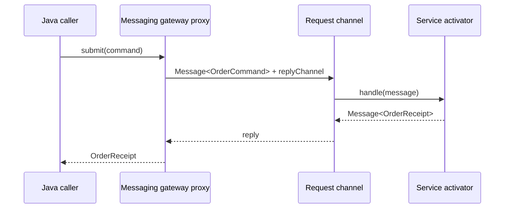
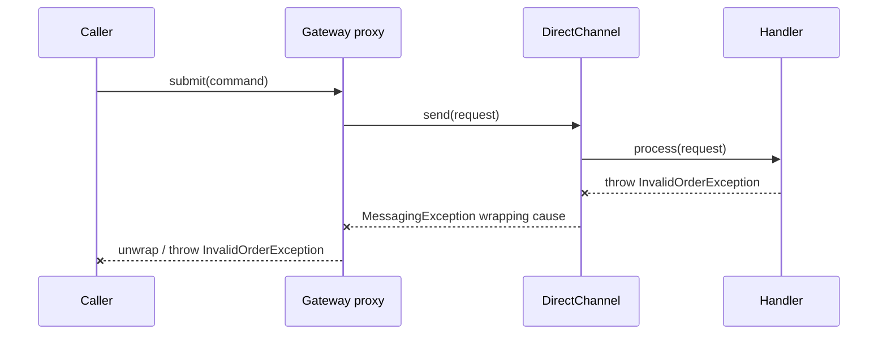
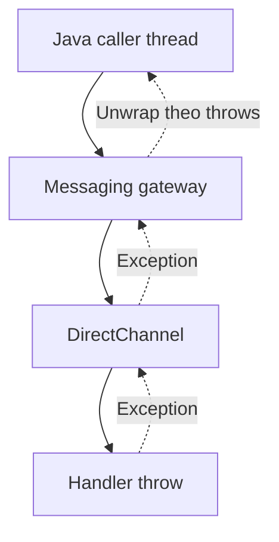
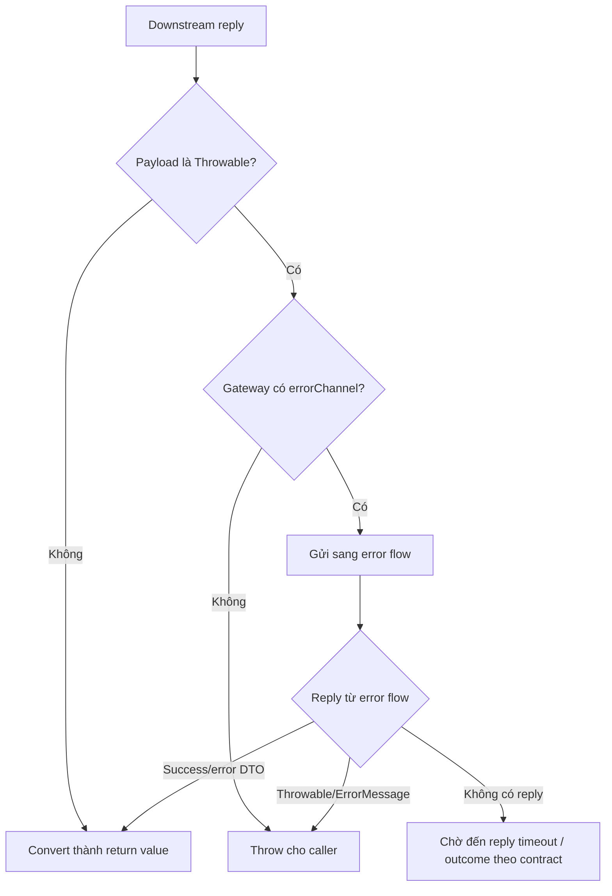
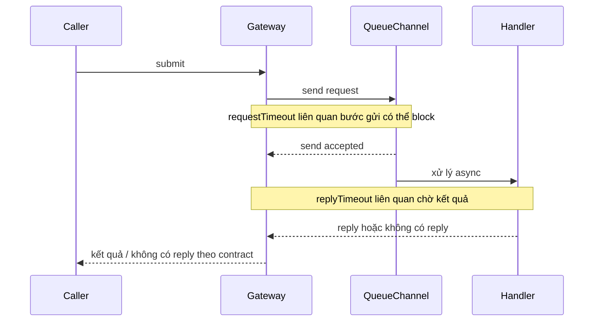
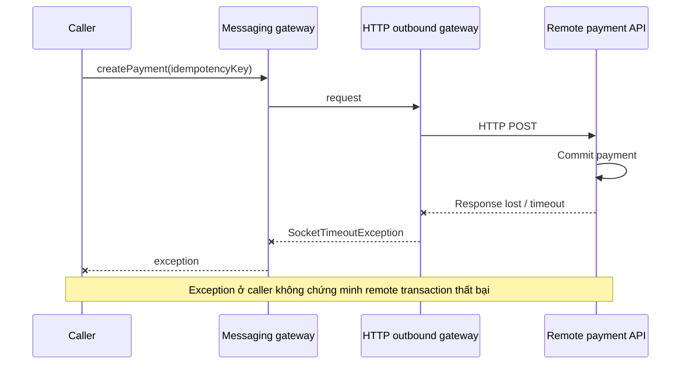

# Gateway ném lỗi về caller trong Spring Integration Adapters

> **Chương:** Error handling  
> **Module:** `SPRING_INTEGRATION_ADAPTERS`  
> **Bối cảnh:** Kết nối hệ thống ngoài bằng inbound/outbound adapter, gateway, poller và `MessageChannel`; xử lý các luồng file, SFTP, HTTP, JMS, AMQP, Kafka và cơ sở dữ liệu.  
> **Trọng tâm:** Hiểu **khi nào một messaging gateway ném exception trở lại caller**, khi nào lỗi được gửi qua `errorChannel` hoặc phản hồi như dữ liệu, và điều này ảnh hưởng thế nào tới timeout, transaction, broker acknowledgment, retry và bảo toàn message.

## 1. Vì sao cần hiểu “Gateway ném lỗi về caller”?

Một messaging gateway làm cho hệ thống message-driven trông như một lời gọi Java thông thường:

```java
OrderReceipt receipt = ordersGateway.submit(command);
```

Caller không cần biết phía sau là `DirectChannel`, một service activator, HTTP outbound gateway, JDBC writer hay một luồng gọi tới JMS/Kafka. Nhưng khi handler lỗi, sự trừu tượng ấy tạo ra những câu hỏi khó:

- Phương thức `submit()` có ném `IllegalArgumentException`, `MessagingException` hay một exception khác?
- Có cần cấu hình `errorChannel` mới trả lỗi về caller không?
- Một lỗi sau `ExecutorChannel` có quay về được thread đang chờ không?
- Timeout chờ **reply** có đồng nghĩa hệ thống đích chắc chắn không xử lý yêu cầu không?
- Nếu handler trả `Throwable` như một payload, gateway sẽ trả object hay ném lỗi?
- Cấu hình error flow chỉ ghi log rồi không trả reply sẽ khiến caller nhìn thấy gì?
- Exception được trả về caller có làm JMS rollback, Kafka không commit offset hoặc file tự retry không?
- Một phương thức gateway trả `void`, `Future<T>` hay `Mono<T>` khác phương thức synchronous ở điểm nào?

**Mục tiêu bài học:** chọn một **hợp đồng lỗi rõ ràng** ở ranh giới caller–gateway, kiểm chứng bằng test, đồng thời không nhầm **lỗi Java** với **outcome thực tế của hệ thống ngoài**.

## 2. Gateway trong Spring Integration là gì?

Spring Integration hỗ trợ mô hình **Messaging Gateway**: đưa một giao diện Java/POJI ra trước hệ thống message và tạo proxy từ `GatewayProxyFactoryBean`, thường thông qua `@MessagingGateway` và `@Gateway`.

Ví dụ:

```java
@MessagingGateway
public interface OrdersGateway {

    @Gateway(requestChannel = "ordersRequestChannel")
    OrderReceipt submit(OrderCommand command);
}
```

Ở mức logic:



Gateway chịu trách nhiệm chuyển lời gọi method thành request message và xử lý reply thành return value. Nó **không mặc định** là HTTP endpoint hay message broker; nó là ranh giới Java-method-to-message. HTTP inbound/outbound gateway và các adapter có semantics giao thức riêng, được phân biệt ở những mục sau.

### 2.1. Hai từ “gateway” cần phân biệt

| Loại | Caller là ai? | Lỗi được nhìn thấy ở đâu? |
|---|---|---|
| **Messaging interface gateway** | Java method caller | Exception Java, reply value, `Future`/`Mono` |
| **HTTP inbound gateway** | HTTP client | HTTP status, body, kết nối/timeout |
| **HTTP outbound gateway** | Thành phần trong integration flow | Exception hoặc reply message từ HTTP client/response |
| **JMS/AMQP outbound gateway** | Flow gửi request rồi chờ response | Timeout/reply theo messaging protocol và container |
| **Kafka adapter/gateway pattern** | Producer/consumer flow | Ack/callback, offset, reply correlation tùy cấu hình |
| **File/SFTP inbound/outbound adapter** | Poller hoặc flow owner | Lỗi I/O, file lifecycle; không phải POJI request–reply mặc định |

Một câu “gateway ném lỗi cho caller” có nghĩa chính xác nhất đối với **messaging interface gateway**. Khi nói về HTTP/JMS hoặc Kafka, phải xét thêm **giao thức và endpoint cụ thể**.

## 3. Hành vi mặc định: Downstream exception được đưa về caller

Tài liệu chính thức Spring Integration mô tả: với một **messaging gateway** không cấu hình error flow để chuyển lỗi thành reply khác, lỗi từ downstream thường được **rethrow cho caller**, và framework có thể **unwrap** ngoại lệ đã được bọc trong `MessagingException`.

Một đường đi điển hình:



**Điểm quan trọng:**

1. Handler ném lỗi nghiệp vụ hoặc hạ tầng.
2. Framework có thể bọc lỗi vào một `MessagingException` có `failedMessage`.
3. Gateway xem cause chain và **quy tắc throws clause** của method.
4. Caller nhận exception theo hợp đồng đã khai báo và cơ chế unwrap.
5. Không cần tự thêm `errorChannel` chỉ để được ném lỗi về caller theo đường mặc định.

### 3.1. “Rethrow as is” có nghĩa gì trong thực tế?

Câu mô tả cấp cao “lỗi được ném lại” **không có nghĩa class mà caller thấy luôn là class Throwable ngoài cùng** trong Spring Integration. Lớp bọc `MessagingException` được dùng để giữ message context, trong khi gateway có logic unwrap để trả exception nghiệp vụ nếu phù hợp.

Vì thế, cần test **cả kiểu exception lẫn cause và failed message** nếu caller cần chẩn đoán chính xác.

## 4. `MessagingException` và `failedMessage`

`org.springframework.messaging.MessagingException` mang thông tin lỗi messaging; `getFailedMessage()` trả về `Message<?>` được liên kết với lỗi nếu có. Những subtype thường gặp gồm `MessageHandlingException` và `MessageDeliveryException`.

Ví dụ:

```text
MessageHandlingException:
  failedMessage:
    payload: OrderCommand(orderId="o-104")
    headers:
      id: ...
      correlationId: ...
  cause:
    InvalidOrderException("missing customer reference")
```

Khi gateway unwrap và ném `InvalidOrderException` ra caller, **caller không nhất thiết còn nhìn thấy ngay `failedMessage`**. Nếu cần chẩn đoán bằng message context, xem phương thức gateway khai báo `throws` ở phần tiếp theo.

### 4.1. Không hiểu sai failedMessage

- Nó không bắt buộc tồn tại với mọi Throwable.
- Nó là message tại điểm lỗi, **không luôn là request đầu tiên**.
- Sau transformer/splitter, payload có thể đã đổi dạng.
- Nó có thể chứa PII, token hoặc header nội bộ; không nên ghi nguyên ra log.
- Nó không chứng minh message được rollback, retry, nack hoặc quarantine.
- Nếu lỗi xảy ra trước message creation, có thể chỉ có exception và endpoint metadata.

### 4.2. ErrorMessage lại là một đối tượng khác

`org.springframework.messaging.support.ErrorMessage` có payload `Throwable` và có thể có `getOriginalMessage()`. Không nên đánh đồng:

| Thành phần | Lấy từ đâu? | Ý nghĩa |
|---|---|---|
| `MessagingException.getFailedMessage()` | Exception | Message ở điểm thất bại khi được cung cấp |
| `ErrorMessage.getOriginalMessage()` | Error message | Input message mà error strategy giữ nếu có |
| `ErrorMessage.getPayload()` | Error message | Throwable được xử lý/route |
| `MessageHeaders.ERROR_CHANNEL` | Header của request | Nơi gửi lỗi trong những boundary hỗ trợ |
| `replyChannel` | Header/request–reply mechanism | Nơi gateway chờ reply |

Nếu default path ném exception trực tiếp, **không nhất thiết từng tồn tại một ErrorMessage** trên `errorChannel`.

## 5. `throws` clause của method gateway thay đổi kiểu exception được thấy

Spring Integration cho phép khai báo `throws` ở interface gateway để ảnh hưởng việc tìm exception phù hợp trong **cause chain**.

Ví dụ một giao diện muốn caller thấy `MessagingException`:

```java
import org.springframework.integration.annotation.Gateway;
import org.springframework.integration.annotation.MessagingGateway;
import org.springframework.messaging.MessagingException;

@MessagingGateway
public interface DiagnosticOrdersGateway {

    @Gateway(requestChannel = "ordersRequestChannel")
    OrderReceipt submit(OrderCommand command)
            throws MessagingException;
}
```

Tài liệu chính thức nêu cách khai báo `throws MessagingException` để nhận cả ngữ cảnh của lỗi messaging thay vì luôn unwrap về exception nghiệp vụ.

### 5.1. Giao diện không có `throws`

```java
@MessagingGateway
public interface OrdersGateway {
    @Gateway(requestChannel = "ordersRequestChannel")
    OrderReceipt submit(OrderCommand command);
}
```

Nếu handler ném `InvalidOrderException extends RuntimeException`, gateway thường unwrap và ném exception phù hợp trở lại caller. Khi không có clause phù hợp, tài liệu mô tả gateway duyệt cause chain tìm `RuntimeException` không phải `MessagingException`; nếu không tìm thấy, nó có thể ném `MessagingException`.

### 5.2. Khai báo checked exception cụ thể

```java
@MessagingGateway
public interface DocumentGateway {

    @Gateway(requestChannel = "documentRequestChannel")
    StoredDocument store(DocumentRequest request)
            throws DocumentRejectedException;
}
```

Khi cause chain có `DocumentRejectedException` và chữ ký cho phép, gateway có thể tiếp tục unwrap để đưa exception phù hợp ra caller theo quy tắc framework. Không nên tuyên bố mọi checked exception sẽ tự đi qua interface nếu chưa test đúng tầng bọc và signature.

### 5.3. Không nên lạm dụng `throws Throwable`

Việc khai báo một clause quá rộng có thể làm code gọi khó phân biệt lỗi có thể phục hồi và lỗi kỹ thuật, cũng như phụ thuộc quá mức vào cơ chế nội bộ. Một hợp đồng rõ như `throws DocumentRejectedException` hoặc một runtime domain exception thường dễ vận hành hơn; chỉ khai báo `MessagingException` nếu caller thực sự cần `failedMessage` và metadata.

## 6. Java DSL: Một flow làm gateway ném exception

Ví dụ tự chứa theo cách cấu hình thông dụng ở Spring Integration. Mã minh họa Java hiện đại (record), cần đối chiếu phiên bản Spring Boot/Spring Integration và Java của dự án trước khi chạy.

### 6.1. Domain contract

```java
public record OrderCommand(String orderId, int quantity) {}

public record OrderReceipt(String orderId, String status) {}

public class InvalidOrderException extends RuntimeException {
    public InvalidOrderException(String message) {
        super(message);
    }
}
```

### 6.2. Interface gateway

```java
import org.springframework.integration.annotation.Gateway;
import org.springframework.integration.annotation.MessagingGateway;

@MessagingGateway
public interface OrdersGateway {

    @Gateway(
        requestChannel = "ordersRequestChannel",
        requestTimeout = 1000,
        replyTimeout = 5000)
    OrderReceipt submit(OrderCommand command);
}
```

Các giá trị timeout ở ví dụ tính theo đơn vị cấu hình mà annotation hỗ trợ (thường là milliseconds); phải xem contract API/phiên bản sử dụng. Không nên dựa hoàn toàn vào default timeout mà không tài liệu hóa.

### 6.3. Handler và IntegrationFlow

```java
import org.springframework.context.annotation.Bean;
import org.springframework.context.annotation.Configuration;
import org.springframework.integration.config.EnableIntegration;
import org.springframework.integration.config.IntegrationComponentScan;
import org.springframework.integration.dsl.IntegrationFlow;

@Configuration
@EnableIntegration
@IntegrationComponentScan
class OrdersIntegrationConfiguration {

    @Bean
    IntegrationFlow ordersFlow() {
        return IntegrationFlow.from("ordersRequestChannel")
            .handle(OrderCommand.class, (cmd, headers) -> {
                if (cmd.quantity() <= 0) {
                    throw new InvalidOrderException(
                        "Quantity must be positive");
                }
                return new OrderReceipt(cmd.orderId(), "ACCEPTED");
            })
            .get();
    }
}
```

Khi caller gọi:

```java
try {
    OrderReceipt receipt =
            gateway.submit(new OrderCommand("o-104", 0));
} catch (InvalidOrderException ex) {
    // Caller xử lý lỗi hợp đồng nghiệp vụ.
    // Không lấy ex.getMessage() trả thẳng ra API công khai.
}
```

Với flow đồng bộ như trên, exception từ handler được truyền qua gateway để caller nhận. Không cần cấu hình global `errorChannel` cho đường này chỉ nhằm đưa lỗi về caller.

### 6.4. Các giả định của ví dụ

- Component scan đăng ký đúng `@MessagingGateway`.
- Channel request gắn với đúng flow.
- Không có một `ExecutorChannel` hoặc `QueueChannel` chen giữa mà thay đổi cách truyền lỗi.
- Không có `errorChannel` của gateway làm biến đổi exception thành reply.
- Không có advice đã catch và recover exception trước khi gateway thấy.
- Classpath có Spring Integration DSL và dependencies tương ứng.

Đây là ví dụ để học ngữ nghĩa lỗi; một ứng dụng production cần test với cấu hình thật và policies riêng.

## 7. Lỗi đồng bộ: `DirectChannel` trả lỗi trong cùng call stack

`DirectChannel` thường gọi subscriber trong thread đang gửi message. Nếu handler ném exception, caller trên cùng call stack có thể nhận lỗi.



### 7.1. Khi nào caller nhận ngay?

- Gateway method thực thi đồng bộ.
- Message đi qua các endpoint xử lý trong cùng thread hoặc có cơ chế chuyển lỗi quay về.
- Handler không bị một interceptor/advice error recovery nuốt lỗi.
- Không cấu hình error channel biến đổi lỗi thành reply value.
- Gateway không bị một wrapper ở caller xử lý lại exception.

**Không phải vì sử dụng Spring Integration thì mọi exception được publish tới global `errorChannel`.** Với đường đồng bộ, cách propagate gần với một lời gọi Java thông thường.

### 7.2. Không nhầm với gửi trực tiếp tới channel

Nếu code ứng dụng gọi:

```java
requestChannel.send(message);
```

thì nó đang sử dụng `MessageChannel` chứ **không phải** gọi gateway interface. Lỗi từ `DirectChannel` có thể ném lại caller của `send()`; quy tắc unwrap đặc thù của gateway không nhất thiết được áp dụng giống hệt.

## 8. Gateway `errorChannel`: Chuyển lỗi thành reply hoặc xử lý riêng

Ngoài default throw, messaging gateway có thể được cấu hình **error channel riêng**. Khi gateway bắt downstream error theo cơ chế hỗ trợ, lỗi được đưa vào **error flow**, từ đó có thể:

- Chuyển exception thành **error reply DTO**.
- Route theo `ErrorMessageExceptionTypeRouter`.
- Audit/alert rồi vẫn trả exception.
- Phân loại lỗi theo policy và quyết định có thể trả value hay không.

Tài liệu Spring Integration có ví dụ XML:

```xml
<int:gateway
    id="sampleGateway"
    service-interface="example.OrdersGateway"
    default-request-channel="ordersRequestChannel"
    error-channel="orderGatewayErrors"/>

<int:transformer
    input-channel="orderGatewayErrors"
    ref="orderErrorTransformer"
    method="toErrorReply"/>
```

`toErrorReply` trả một payload phù hợp hợp đồng caller; **không đơn giản log rồi quên reply**.

### 8.1. Annotation `@MessagingGateway(errorChannel = ...)`

```java
@MessagingGateway(errorChannel = "orderGatewayErrors")
public interface SafeOrdersGateway {

    @Gateway(
        requestChannel = "ordersRequestChannel",
        replyTimeout = 5000)
    OrderOutcome submit(OrderCommand command);
}
```

Nếu error flow chuyển lỗi thành một `OrderOutcome` hợp lệ và reply quay lại gateway, caller có thể nhận **giá trị** thay vì exception. Đây là **thay đổi hợp đồng**, không chỉ thêm nơi log.

### 8.2. Định nghĩa contract trước khi chọn cách xử lý

| Hợp đồng caller | Thiết kế |
|---|---|
| `submit()` ném exception khi thất bại | Default propagation; chỉ catch/convert ở boundary có chủ đích |
| `submit()` trả `OrderOutcome` có status lỗi | Error flow chuyển exception thành value hợp lệ |
| `submit()` trả `Result<T>` | Cần thống nhất success/error value semantics |
| API HTTP trả status+body | HTTP gateway/controller mapping riêng |
| `Future<OrderReceipt>` | Lỗi trở thành exceptional completion/`ExecutionException` |
| `void` one-way | Không có giá trị reply để caller biết hậu quả async |

Không để method return type nói “OrderReceipt” nhưng error flow lại trả String “ERROR” rồi trông chờ converter xử lý ngầm; dễ phát sinh lỗi chuyển kiểu mới.

## 9. Throwable trong reply: Không phải dữ liệu trả về bình thường

Một điểm dễ bỏ sót trong tài liệu gateway: **nếu downstream trả `ErrorMessage` hoặc một message có payload là `Throwable`, gateway coi đó là lỗi**.

- Nếu không cấu hình gateway error channel, Throwable có thể được ném về caller.
- Nếu có error channel, Throwable có thể được đưa tới error flow.
- Nếu error flow trả tiếp một `ErrorMessage` hoặc message có payload Throwable, gateway có thể ném Throwable cho caller.



**Ví dụ:** Nếu handler trả `new IllegalStateException("...")` như payload để caller xem thông tin lỗi, messaging gateway không nhất thiết coi đó là “giá trị hợp lệ” của method; nó có cơ chế xử lý Throwable như lỗi.

### 9.1. Nếu thực sự muốn trả thông tin lỗi như dữ liệu

Định nghĩa DTO:

```java
public record OrderOutcome(
        boolean success,
        String code,
        String orderId,
        String message) {

    public static OrderOutcome rejected(String orderId) {
        return new OrderOutcome(
                false, "ORDER_REJECTED",
                orderId, "Đơn hàng không hợp lệ");
    }
}
```

Giá trị này là **payload nghiệp vụ**, không phải Throwable. Caller cần đọc `success` và `code` theo contract. Không sao chép stack trace hoặc raw exception message vào DTO trả cho bên ngoài.

## 10. Error flow trả DTO: Thiết kế có chủ đích

Một handler error channel có thể chuyển `Throwable` sang `OrderOutcome`.

Ví dụ annotation minh họa:

```java
import org.springframework.integration.annotation.Transformer;
import org.springframework.messaging.MessagingException;
import org.springframework.stereotype.Component;

@Component
class OrderErrorTransformer {

    @Transformer(inputChannel = "orderGatewayErrors")
    public OrderOutcome toErrorReply(Throwable failure) {

        // Ghi metadata an toàn ở một service chuyên trách nếu cần.
        // Không tiết lộ stack trace hay raw failedMessage.
        String code = "ORDER_PROCESSING_FAILED";

        Throwable cursor = failure;
        for (int depth = 0; cursor != null && depth < 16; depth++) {
            if (cursor instanceof InvalidOrderException) {
                code = "ORDER_INVALID";
                break;
            }
            cursor = cursor.getCause();
        }

        return new OrderOutcome(
            false, code, null,
            "Không thể xử lý đơn hàng tại thời điểm này");
    }
}
```

Đây là minh họa cho biến đổi lỗi thành value, không phải một error policy hoàn chỉnh. Một implementation production nên:

- Kiểm soát cause cycle/depth.
- Cất metadata cần thiết vào audit store có quyền.
- Chọn status/error code phù hợp.
- Không biến sự cố hạ tầng thành “nghiệp vụ đã hoàn tất”.
- Kiểm thử rằng reply đi **về đúng gateway invocation** khi nhiều caller đồng thời.
- Xác định idempotency và transaction outcome trước khi nói “thử lại an toàn”.

### 10.1. Lưu ý đặc biệt: error flow cũng có thể ném lỗi

Nếu transformer trong error flow ném tiếp exception, caller có thể nhận exception mới. Điều đó có thể che mất nguyên nhân ban đầu nếu không có evidence. Thiết kế fallback có kiểm soát, log correlation ID và giữ cause phù hợp.

### 10.2. Đừng dùng null như “lỗi đã xử lý”

Nếu error flow không sinh reply trong một gateway đồng bộ, caller có thể **chờ tới reply timeout** hoặc nhận kết quả vắng mặt theo contract. Một logger không trả reply không tương đương “throw cho caller ngay”.

## 11. Error flow muốn giữ nguyên exception cho caller

Đôi khi cần audit nhưng vẫn cho caller thấy lỗi. Có thể:

1. Giữ default propagation, để caller ở Java boundary ghi audit một cách có giới hạn.
2. Cấu hình error channel nếu cần phân loại/routing và **trả Throwable/ErrorMessage** theo hành vi mà gateway hỗ trợ.
3. Dùng wrapper/domain exception phù hợp contract nhưng bảo toàn nguyên nhân trong internal evidence.

```text
gateway
  -> business flow
  -> error channel
  -> classify + audit metadata
  -> error reply as Throwable
  -> gateway throws to caller
```

Điểm cần kiểm tra: có thể phát sinh lỗi ở chính audit/quarantine handler; thứ tự thao tác ảnh hưởng kết quả và dữ liệu gốc. Không khẳng định rethrow đồng nghĩa JMS rollback hay Kafka offset được giữ nếu transaction boundary ở bên khác.

### 11.1. Khi nào nên để nguyên default throw?

- Caller có khả năng xử lý exception trực tiếp.
- Không cần biến error thành DTO.
- Muốn giữ call stack đơn giản, giảm số channel và publisher.
- Có rõ transactional/ack boundary và chưa crossing async handoff gây mất propagation.

**Không tạo error flow riêng chỉ để ném lại đúng exception như default** trừ khi có nhu cầu thiết thực như audit, phân loại, cảnh báo hay redaction.

## 12. `void` gateway: Không có reply value để truyền lỗi hậu xử lý

Một gateway method trả `void` thường là one-way, nhưng cần phân biệt hai trường hợp:

**Synchronous send:** lỗi khi gửi hoặc xử lý tức thời trong cùng call stack vẫn có thể ảnh hưởng method call tùy gateway và downstream.

**Asynchronous handoff:** khi method đã trả, lỗi xảy ra ở executor, queue, broker hoặc callback không thể “quay ngược thời gian” để ném Java exception trên caller thread đã kết thúc.

```java
@MessagingGateway(errorChannel = "notificationErrors")
interface NotificationGateway {
    @Gateway(requestChannel = "notificationRequests")
    void dispatch(NotificationCommand command);
}
```

Ở các phiên bản Spring Integration hiện đại, cấu hình `errorChannel` cho `void` gateway có thể đặt errorChannel header để downstream async errors tìm đúng đường. Nhưng caller vẫn **không có return value hoặc Future để quan sát kết quả về sau**.

### 12.1. Không lạm dụng fire-and-forget cho nghiệp vụ cần xác nhận

Nếu phải chứng minh email, thanh toán, Kafka message hoặc database update đã được hệ thống đích xác nhận, đừng chỉ dùng method `void` và coi không ném exception là thành công cuối cùng. Hãy cân nhắc `Future<Void>`, `CompletableFuture<T>`, callback/idempotency hoặc reconciliation.

## 13. `@Async void`: Ngoại lệ không tự được ném lại cho caller

Với một method `@Async void`, caller nhận quyền điều khiển trước khi công việc hoàn tất. Tài liệu Spring Integration nêu rõ downstream exceptions **không được propagate trở lại caller như lời gọi Java đồng bộ**.

```java
@MessagingGateway
interface AsyncNotificationGateway {

    @Gateway(requestChannel = "notificationRequests")
    @Async
    void dispatchAsync(NotificationCommand command);
}
```

Điều này không có nghĩa lỗi bị bỏ mặc: cần có error channel, executor error handling, audit/alert và cơ chế retry phù hợp. Nhưng không viết:

```java
try {
    gateway.dispatchAsync(command);
} catch (RuntimeException ex) {
    // Không thể trông chờ bắt mọi lỗi phát sinh sau khi method đã trả.
}
```

### 13.1. Với yêu cầu quan sát completion

Theo Spring Integration hiện đại, có thể dùng các kiểu return async phù hợp như `Future<Void>` hoặc `Mono<Void>` theo phiên bản và executor configuration, để completion/exception thể hiện qua async result. Không thay `void` bằng `Future<Void>` rồi mặc định mọi trường hợp không cần xác minh API/flow reply.

## 14. `Future<T>` và `CompletableFuture<T>`: Lỗi được thấy khi quan sát kết quả

Gateway interface có thể trả `Future<OrderReceipt>` hoặc `CompletableFuture<OrderReceipt>`. Trong mode phù hợp, phương thức trả ngay một future; lỗi downstream sẽ biểu hiện khi future hoàn thành thất bại.

```java
@MessagingGateway
interface AsyncOrdersGateway {

    @Gateway(requestChannel = "ordersRequestChannel")
    CompletableFuture<OrderReceipt> submitAsync(OrderCommand command);
}
```

Caller có thể quan sát:

```java
CompletableFuture<OrderReceipt> future =
        gateway.submitAsync(new OrderCommand("o-104", 0));

future.whenComplete((receipt, failure) -> {
    if (failure != null) {
        // Xử lý failure, có thể là wrapper của exception gốc.
        // Không log raw payload/message.
    } else {
        // Xác nhận kết quả nghiệp vụ từ reply.
    }
});
```

Với `Future#get()`, caller thường nhận `ExecutionException` bọc nguyên nhân; với `CompletableFuture#join()` thường là `CompletionException`. Đó là **wrapper của Java async API**, khác với `MessagingException` tại boundary Spring Integration.

### 14.1. Hai chế độ cần phân biệt

Tài liệu Spring Integration mô tả:

- Khi gateway sử dụng `AsyncTaskExecutor` và return type được hỗ trợ, execution có thể diễn ra trên executor và future trở về caller.
- Khi chủ động vô hiệu gateway async executor, downstream có thể trả một **future payload**; contract và threading khác.
- Phiên bản mới hơn có thêm async gateway operator trong Java DSL; phải đọc docs phiên bản cụ thể.

Không coi mọi `CompletableFuture` đều chứng minh gateway tự tạo thread hoặc downstream broker đã xác nhận.

### 14.2. Hạn chế khi bỏ qua Future

Nếu caller không quan sát completion, một failure sau async send có thể chỉ còn trong logs/error channel. Cần owner cho callback, tracing, timeout và retry budget.

## 15. `Mono<T>` và xử lý reactive

Trong gateway interface sử dụng `Mono<T>`, execution có thể phụ thuộc việc subscribe thay vì được khởi chạy ngay tại method call, theo cấu hình reactive/adapter.

```java
@MessagingGateway
interface ReactiveOrdersGateway {
    @Gateway(requestChannel = "ordersRequestChannel")
    Mono<OrderReceipt> submit(OrderCommand command);
}
```

Caller nên xử lý:

```java
gateway.submit(command)
    .doOnError(error -> {
        // Telemetry/alert giới hạn; không nuốt lỗi không chủ đích.
    })
    .onErrorResume(error ->
        Mono.error(new OrderProcessingUnavailableException(
            "Đơn hàng chưa xử lý xong", error)));
```

Đây là minh họa về cách **giữ failure trong reactive pipeline**; trong code thực, tránh duplicate wrapping và kiểm tra type/cancellation. Với `Mono`, exception không nhất thiết được ném ngay bởi lời gọi `submit()`; nó có thể xuất hiện khi subscription xử lý.

### 15.1. Cancellation và timeout

Nếu subscriber cancel hoặc timeout trước khi downstream hoàn tất, upstream hay hệ thống ngoài **không tự động rollback**. Cần timeout, idempotency, cancel semantics và reconciliation ở đúng layer.

## 16. Request timeout khác reply timeout

Spring Integration gateway phân biệt:

- **`requestTimeout`:** giới hạn thời gian gửi request **khi hoạt động gửi có thể block**, ví dụ bounded `QueueChannel` đầy.
- **`replyTimeout`:** giới hạn thời gian gateway chờ một reply phù hợp với request.

Hai loại timeout **không chứng minh cùng một sự kiện**.



### 16.1. `replyTimeout` không nhất thiết ném timeout exception

Tài liệu mô tả gateway có thể **trả `null` khi chờ reply hết thời gian**, tùy method contract và cấu hình. Không tự mặc định “reply timeout = ném `TimeoutException`”.

Nếu ứng dụng yêu cầu **fail-fast** và không cho phép null, cần:

- Thiết kế outcome type rõ và xử lý `null`.
- Xác định các downstream endpoint có `requiresReply` hoặc filter rejection behavior khi phù hợp.
- Có gateway/error policy diễn giải tình huống no-reply.
- Thêm contract tests để caller không nhầm no-reply với success.

### 16.2. Không dùng mặc định timeout một cách mù quáng

Default timeout có thể khác theo Spring Integration version hoặc cách khai báo. Hãy cấu hình rõ request/reply timeout và kiểm tra giới hạn đó khi deploy. Tránh thời gian chờ vô hạn cho API/thread pool có SLA ngắn.

## 17. No reply: Lỗi logic, filter hoặc async branch mất response

Một gateway request–reply thường chờ một kết quả, nhưng message flow có thể:

- Bị filter loại và không phát discard reply.
- Rơi vào `nullChannel` hoặc handler trả `null`.
- Bị router đưa sang channel không có reply.
- Đến một service activator one-way.
- Kẹt trong queue, executor hoặc external gateway.
- Exception đã bị log/nuốt mà không trả reply.
- Aggregator chờ đủ correlation group chưa kết thúc.
- Một async callback hoàn thành nhưng replyChannel đã hết hạn.

### 17.1. Phân biệt bốn kết quả

| Kết quả | Caller quan sát |
|---|---|
| Handler thành công và trả reply | Giá trị phù hợp method |
| Handler ném exception mặc định | Exception được gateway propagate/unwrap |
| Handler/error flow trả Throwable | Gateway xử lý như lỗi, có thể ném |
| Không có reply | Chờ, timeout hoặc null theo contract |

**Đừng biến “không có exception” thành “đã thành công”** khi gateway có thể trả null hoặc method là void.

### 17.2. Các flag hỗ trợ

Một số endpoint hỗ trợ `requiresReply` để coi không có reply là lỗi, và một số filter có `throwExceptionOnRejection`/tùy chọn tương ứng để tránh âm thầm loại message. Tên API và nơi đặt option phụ thuộc endpoint/phiên bản; phải test flow thật.

## 18. ExecutorChannel, QueueChannel và ranh giới thread

Chuyển từ `DirectChannel` sang `ExecutorChannel` hoặc `QueueChannel` làm thay đổi cách exception lan truyền:

- `ExecutorChannel` thường chuyển execution sang executor khác.
- `QueueChannel` có thể đệm message và consumer xử lý ở thời điểm khác.
- Caller ban đầu có thể đã rời call stack khi handler ném.
- Cơ chế error publication dựa trên `errorChannel` header hoặc global fallback có thể được sử dụng.
- Gateway request–reply có thể chờ một reply hoặc một Throwable reply để nhận lỗi, nhưng không có bảo đảm **mọi loại async failure** sẽ được đưa về caller.

### 18.1. Async error publisher và errorChannel header

Trong một số async boundaries, `MessagePublishingErrorHandler` tạo `ErrorMessage` từ exception, dùng request header `MessageHeaders.ERROR_CHANNEL` nếu phù hợp, hoặc global `errorChannel`. Một gateway cần đặc biệt chú ý:

- Header `replyChannel` có còn được giữ qua các bước không?
- Error có đi vào đúng error channel/gateway reply handler không?
- Có producer callback xảy ra sau gateway đã timeout không?
- Có subscriber nào biến ErrorMessage thành Throwable reply không?
- Tại sao có lỗi ở global channel nhưng caller lại chỉ thấy null?
- Có một lỗi ở subscriber khác bị mất do PublishSubscribe fan-out không?

### 18.2. Không tin điều khiển routing từ client

Không cho HTTP/JMS/Kafka headers do bên ngoài tự tạo quyết định `errorChannel` hoặc `replyChannel` nội bộ. Luồng nhập nên whitelist và override headers điều khiển bằng cấu hình tin cậy.

## 19. `@MessagingGateway`, `@Gateway` và Java DSL gateway

Có nhiều cách cấu hình messaging gateway:

| Cách | Điểm chính |
|---|---|
| `@MessagingGateway` | Tạo proxy dựa trên interface, default request/reply/error config |
| `@Gateway` trên method | Điều chỉnh request channel, reply timeout, headers và method-specific contract |
| XML `<int:gateway>` | Khai báo service-interface, request/reply/error channels và method overrides |
| Java DSL `gateway()` operator | Gọi subflow/gateway endpoint trong IntegrationFlow; có tùy chọn riêng theo version |
| `GatewayProxyFactoryBean` | Thành phần tạo proxy ở cấp thấp, cần lifecycle/context chuẩn |

**Lưu ý:** Không phải bất cứ handler trong DSL mang tên “gateway” đều có chính xác cùng contract như một `@MessagingGateway` interface ở Java caller. Để khẳng định exception propagation, phải biết **ai đang chờ reply** và **gateway boundary nào** phát sinh.

### 19.1. Interface gateway được đăng ký thế nào?

Tài liệu nêu `@IntegrationComponentScan` hỗ trợ tìm các interface gateway và tạo proxy; `@ComponentScan` thông thường không tạo proxy từ một interface có `@MessagingGateway` trong mọi trường hợp.

Sau khi cấu hình, test application context có đúng bean gateway và gọi được request channel; không chỉ compile interface.

### 19.2. Method headers và dữ liệu riêng tư

`@Header`/`@GatewayHeader` cho phép thêm context. Đừng gắn bearer token, raw password hoặc toàn bộ HTTP headers vào các trường hợp không cần. Khi hệ thống ghi `failedMessage`, headers ấy có thể xuất hiện trong exception.

## 20. Gateway trả lỗi và ranh giới HTTP inbound

Một **HTTP inbound gateway** nhận request từ HTTP client. Khi downstream lỗi, ngoài việc ném exception trong Spring, hệ thống phải có hợp đồng **HTTP status + body**.

Ví dụ tình huống:

```text
HTTP client
   -> HTTP inbound gateway
      -> validate
      -> JDBC write (throws)
      -> error handling
   <- HTTP response (status/body)
```

**Không phải cứ ném `IllegalArgumentException` là HTTP client tự nhận 400 đúng nghiệp vụ.** Cần mapping exception–status ở tầng HTTP hoặc error response flow, có thể thông qua cơ chế hỗ trợ của inbound gateway/Spring Web.

### 20.1. Bảng phản hồi tham khảo

| Tình huống | Cách phân loại HTTP tham khảo |
|---|---|
| Dữ liệu không hợp lệ | 400/4xx tùy API contract |
| Thiếu xác thực | 401 phù hợp |
| Không có quyền | 403 phù hợp |
| Tài nguyên không tồn tại | 404 hoặc mapping được phê duyệt |
| Xung đột business state | 409 khi đúng semantics |
| Rate limit | 429, cân nhắc `Retry-After` |
| Phụ thuộc tạm unavailable | 503 hoặc status phù hợp |
| Gateway timeout | 504 hoặc status phù hợp vị trí lỗi |
| Lỗi nội bộ không phân loại | 500 |

Status thực tế phải theo lớp HTTP và contract API, không chọn chỉ dựa vào class ngoại lệ chung.

### 20.2. Response an toàn

```json
{
  "errorCode": "ORDER_PROCESSING_FAILED",
  "message": "Không thể hoàn tất yêu cầu",
  "correlationId": "corr-591"
}
```

Không trả `MessagingException.toString()`, stack trace, raw SQL, SFTP credentials hoặc payload chứa dữ liệu cá nhân cho client. Trên môi trường vận hành, giữ evidence ở kho bảo vệ với quyền và retention.

## 21. HTTP outbound gateway: Exception có thể không mô tả outcome phía server

HTTP outbound gateway gửi request sang hệ thống ngoài. Những lỗi thường thấy:

- Connection refused, DNS/TLS lỗi.
- Read timeout hoặc connection reset.
- 4xx/5xx được client chuyển thành exception tùy error handler.
- Deserialize response lỗi.
- Response body không hợp lệ.
- Timeout sau khi remote server **đã thực hiện side effect**.

### 21.1. Bẫy HTTP POST timeout



Caller nhận exception, nhưng phải kiểm tra **idempotency key, payment status API, reconciliation hoặc outbox** trước khi retry. Không xem “gateway ném lỗi” là phép rollback xuyên mạng.

### 21.2. 4xx không phải một nhóm duy nhất

- `400` do validation thường cần sửa payload.
- `401/403` có thể là credential/config/policy.
- `409` có thể là conflict hoặc duplicate được xử lý.
- `429` có thể retry theo quota và `Retry-After`.
- `5xx` có thể transient nhưng không luôn an toàn để retry side effect.

Router theo exception class là điểm bắt đầu, không thay thế logic operation-specific.

## 22. File inbound và SFTP: Caller thật có thể là poller

Với file/SFTP inbound **polling adapter**, không có một Java method caller `gateway.submit()` theo mô hình client request–reply mặc định. **Poller** thường là bên phát message vào flow.

```text
Scheduled poller
   -> File/SFTP inbound adapter
   -> handler
   -> exception
   -> poller error handler / error channel
```

Nếu handler ném lỗi trong polling task, exception có thể được bắt và publish dưới dạng `ErrorMessage` tới channel được poller cấu hình. Nó **không tự đi tới một Java caller bên ngoài**.

### 22.1. Vì sao phải phân biệt?

- File đã qua accept-once filter có thể không được poll lại.
- SFTP connect failure xảy ra trước khi tạo `Message<File>`.
- File chuyển archive/quarantine không tự rollback.
- Error handler có thể thiếu original file message.
- Retry lại toàn bộ file có thể nhân đôi DB write đã commit.

### 22.2. Khi file flow gọi một gateway bên trong

Một file poller có thể gọi `ordersGateway.submit(...)` từ service activator. Gateway có thể ném exception **về chính thread của poller**, rồi poller mới quyết định publish qua `ordersErrors`. Vì vậy cần xác định **caller thực sự** trước khi nói lỗi đi đâu.

## 23. JMS: Java gateway exception khác broker rollback

JMS có message-driven listener hoặc outbound gateway. Một gateway interface có thể ném exception về caller Java, nhưng JMS broker chỉ rollback/redeliver khi **transaction/listener boundary** xử lý lỗi theo cấu hình.

| Trường hợp | Caller nhìn thấy | JMS quyết định |
|---|---|---|
| Java gateway gọi xử lý trong cùng thread | Exception khi handler ném | Chỉ rollback nếu transaction liên quan được đánh dấu phù hợp |
| JMS listener nhận message rồi gọi gateway | Listener có thể nhận exception | Container quyết định ack/rollback theo cấu hình |
| Gateway error flow trả DTO thay vì ném | Caller thấy DTO | Container có thể coi việc xử lý thành công nếu không còn lỗi |
| JMS outbound gateway chờ response | Có thể nhận reply/timeout/error | Request/reply correlation và broker transactions khác nhau |
| Async error đã publish | Có thể không về caller ban đầu | Cần xác nhận redelivery/DLQ bằng test |

### 23.1. Nguy cơ “nuốt exception”

Nếu trước đây handler ném exception để listener rollback, sau đó thêm `@MessagingGateway(errorChannel=...)` chuyển lỗi thành `OrderOutcome(success=false)`, listener có thể **không còn nhận Throwable**, làm thay đổi commit behavior.

Vì vậy, trước khi chuyển **throw → value**, hãy test:

- Listener transaction và acknowledge mode.
- Broker redelivery count.
- DLQ destination khi exhausted.
- Idempotency khi xử lý lại.
- Tính bền vững của recovery record.

### 23.2. Không giả định transaction xuyên HTTP + JMS + DB

Một local JMS transaction hoặc DB transaction không tự bao phủ HTTP call. Nếu remote side effect đã xảy ra, cần outbox, saga/compensation hoặc reconciliation phù hợp.

## 24. AMQP: Gateway error và ack/nack

AMQP inbound adapter có listener container; outbound gateway có request/reply protocol/correlation tùy module. Java gateway exception và AMQP ack không phải một thứ.

Câu hỏi cần kiểm tra:

1. Listener dùng auto-ack hay manual-ack?
2. Exception có được propagate tới container không?
3. Nếu error handler chuyển sang DTO, consumer sẽ nack/requeue nữa không?
4. Broker có dead-letter exchange và retry budget không?
5. Lỗi parse poison message có bị requeue vô hạn không?
6. Reply từ outbound gateway có timeout/correlation đúng không?
7. Có publisher confirm cho bước publish và error callback không?
8. Recovery handler lỗi thì message được giữ bằng cách nào?

Một `ErrorMessage` trên private channel **không tự ack/nack**. Hãy test nguồn AMQP thật hoặc test container với cấu hình tương đương.

## 25. Kafka: Offset và callback không tuân theo exception của POJI một cách tự động

Kafka có hai đường lỗi khác nhau:

**Inbound consumer:** Listener nhận record, transform và xử lý. Lỗi có thể dẫn tới seek/retry/DLT hoặc commit offset tùy adapter/container.

**Outbound producer:** Handler gửi record, producer callback có thể phát lỗi **sau khi lời gọi gửi ban đầu trả về**.

### 25.1. Nếu Java gateway gọi Kafka outbound adapter

```text
Java caller -> messaging gateway -> Kafka outbound adapter
                                  |
                                  +-- send handed to producer
                                         |
                                         +-- async broker confirmation/failure later
```

Không khẳng định gateway method không ném exception đồng nghĩa Kafka broker đã commit. Cần xác định adapter sync/async mode, send timeout, success/failure channel, callback và confirmation.

### 25.2. Nếu Kafka listener gọi Java gateway

Caller của gateway là **Kafka listener thread**, không phải người gửi Kafka record. Việc exception được ném tới listener có giúp giữ offset hay không phụ thuộc listener container/error handling và chính sách ack.

### 25.3. Idempotency và outbox

Một DB insert thành công rồi Kafka publish lỗi có thể được giải quyết bằng transactional outbox hoặc job đối soát. Retry toàn bộ gateway không có idempotency có thể gây duplicate. Gateway không tạo “exactly once xuyên mọi hệ thống” chỉ bằng exception propagation.

## 26. JDBC/database: Transaction cần bao phủ thao tác thật

Trong flow:

```text
gateway -> validate -> JDBC writer -> reply
```

nếu JDBC handler ném exception trong transaction chưa commit, transaction manager có thể rollback theo propagation/rollback rules. Nhưng **không mặc định** bởi vì gateway ném exception:

- Có transaction manager được cấu hình không?
- Transaction bắt đầu trước hay sau gateway?
- Channel có đổi thread không?
- Có commit trước khi exception từ step khác xuất hiện không?
- Có external side effect không nằm trong transaction không?
- Exception có bị biến thành DTO và làm transaction coi là success không?

### 26.1. Cẩn thận với `@Transactional` và async

Spring transaction thường gắn với execution context/thread. Nếu gateway request chuyển qua `ExecutorChannel`, transaction ở caller thread **không tự chảy qua một executor khác**. Cần transaction boundary ở worker và/hoặc cơ chế phối hợp được thiết kế riêng.

### 26.2. Duplicate key không đồng nghĩa thất bại cuối cùng

`DataIntegrityViolationException` có thể do duplicate event đã được xử lý, hoặc do dữ liệu không hợp lệ. Caller nên xử lý dựa trên **domain idempotency key và trạng thái DB**, không chỉ type exception.

### 26.3. Database poller không có Java caller liên tục

Khi JDBC inbound poller đọc `status=NEW` rồi gọi gateway, caller có thể là task của poller. Gateway exception có thể quay về task này, nhưng chiến lược claim/lease/retry row phải do pipeline kiểm soát để tránh hàng bị kẹt hoặc xử lý hai lần.

## 27. Retry: Caller retry gateway hay downstream retry advice?

Hai mô hình thường gặp:

**Caller retry:**

```text
Java caller -> gateway -> downstream -> exception
Java caller -> retry gateway -> downstream -> ...
```

**Handler retry:**

```text
Java caller -> gateway -> handler + RequestHandlerRetryAdvice
                                      | retry bounded
                                      | exhausted -> exception/recoverer
                             -> caller
```

Cần quyết định **một chiến lược retry chính**, không cộng dồn retry ở caller, gateway advice, broker redelivery và batch replay mà không có ngân sách tổng thể.

### 27.1. Những thông số phải có

- Loại lỗi được retry: transient/permanent/unknown.
- Max attempts và tổng deadline.
- Backoff/jitter phù hợp.
- Request và reply timeout.
- Idempotency key/operation.
- Transaction và trạng thái nguồn/đích.
- Khi exhausted: DLQ/quarantine, response hay exception?
- Phạm vi dữ liệu/log/PII trong recovery record.

### 27.2. Khi retry thất bại nhưng remote đã commit

Ví dụ HTTP timeout sau POST hoặc Kafka broker confirmation mất: caller cần **query outcome** thay vì tạo lại side effect. Exception làm phát hiện trạng thái không chắc chắn; không biến trạng thái đó thành “giao dịch chắc chắn thất bại”.

## 28. `ErrorMessageExceptionTypeRouter` và lỗi trả về caller

Trong error flow có thể dùng `ErrorMessageExceptionTypeRouter` để phân loại:

```text
gateway
  -> business handler throws
  -> gateway error channel
  -> ErrorMessageExceptionTypeRouter
        |-- ValidationException -> create validation response
        |-- NetworkException    -> create unavailable response
        |-- unknown             -> return Throwable / escalation
```

Router **chọn channel**, không tự ném exception hay tạo reply DTO. Để caller thấy đúng kết quả, mỗi nhánh phải:

- Trả một object hợp lệ theo method contract.
- Hoặc trả Throwable/ErrorMessage theo semantics gateway.
- Hoặc có chủ đích không reply và hiểu ảnh hưởng timeout/one-way.
- Hoặc propagate exception qua boundary phù hợp.

### 28.1. Không dùng mapping chung quá rộng

`RuntimeException` bao gồm validation, lỗi lập trình và lỗi phụ thuộc. Nếu route mọi RuntimeException vào retry, hệ thống có thể retry lỗi vĩnh viễn và gây hot loop. Nên phân loại có cause chain, ngữ cảnh operation và default/unclassified owner.

## 29. Cách chọn hợp đồng caller: Exception hay kết quả lỗi?

| Bối cảnh | Gợi ý | Vì sao |
|---|---|---|
| Internal Java service, synchronous processing | Ném domain exception rõ khi thất bại | Caller xử lý trực tiếp, stack đơn giản |
| External-facing HTTP API | Chuyển lỗi thành HTTP status + safe DTO | Hợp đồng giao thức, không tiết lộ nội bộ |
| Async command có kết quả về sau | Future/CompletionStage/Mono khi phù hợp | Caller quan sát completion thay vì giả success |
| Fire-and-forget telemetry | `void` + monitoring/DLQ | Không có reply; cần owner cho async failure |
| JMS/AMQP consumer có transaction | Ưu tiên contract tương thích ack/rollback | Không nuốt lỗi vô tình |
| File/SFTP polling | Error channel của poller + quarantine/replay | Poller là caller, file không có broker rollback |
| DB write có transaction | Throw phù hợp rollback, kết hợp idempotency | Xử lý đúng transaction outcome |
| Payment request có side effect từ xa | Exception + state query/idempotency | Exception không chắc remote thất bại |

**Không có lựa chọn tốt nhất cho mọi flow.** Chọn dựa trên người nhận, khả năng phục hồi, khả năng quan sát và ranh giới transaction.

## 30. Truy vết lỗi về đúng gateway invocation

Khi có nhiều caller đồng thời, cần giữ **correlation** để ErrorMessage/reply không nhầm sang invocation khác.

Các trường cần xác định:

| Thông tin | Mục đích |
|---|---|
| `flowId` | Biết luồng chịu trách nhiệm |
| `gatewayMethod` | Hợp đồng API nào được gọi |
| `correlationId` | Liên kết request/reply/error theo invocation |
| `messageId` | Theo dõi Message tại từng bước |
| `endpointId` | Định vị handler/adapter thất bại |
| `sourceRef` | Tìm file/record/broker message khi cần |
| `attempt` | Số lần thử trong chính sách |
| `policyVersion` | Giải thích quyết định retry/recover |
| `replyOutcome` | Success, error reply, exception, no-reply |
| `targetConfirmation` | Hệ thống đích có xác nhận side effect không |

Không tin correlation ID do client gửi nếu chưa xác minh/sanitize. Gateway và error flow phải bảo vệ `replyChannel`/`errorChannel` header nội bộ khỏi giả mạo hoặc tiết lộ qua hệ thống bên ngoài.

### 30.1. Không copy mọi header vào external message

Header mang reply channel có thể chứa tham chiếu nội bộ không serializable; nếu qua broker/JSON, chỉ copy những metadata được phép. Đừng xuất toàn bộ Spring Message headers ra JMS/Kafka/HTTP mà không có header mapper an toàn.

## 31. Kiểm thử mặc định gateway ném lỗi

### 31.1. Kiểm thử đơn vị/Integration test dùng Spring context

Với cấu hình ở Mục 6, có thể dùng JUnit:

```java
import static org.junit.jupiter.api.Assertions.*;

import org.junit.jupiter.api.Test;
import org.springframework.beans.factory.annotation.Autowired;
import org.springframework.boot.test.context.SpringBootTest;

@SpringBootTest
class OrdersGatewayFailureTest {

    @Autowired
    OrdersGateway gateway;

    @Test
    void invalidOrderExceptionReturnsToCaller() {
        InvalidOrderException failure = assertThrows(
            InvalidOrderException.class,
            () -> gateway.submit(new OrderCommand("o-104", 0))
        );

        assertNotNull(failure);
    }

    @Test
    void validOrderProducesReply() {
        OrderReceipt receipt =
            gateway.submit(new OrderCommand("o-105", 2));

        assertEquals("ACCEPTED", receipt.status());
    }
}
```

Test này xác minh contract throw trong một flow đồng bộ có cấu hình tương ứng. Không suy ra từ đó rằng mọi gateway/adapter bất đồng bộ trong ứng dụng đều propagate giống nhau.

### 31.2. Test `throws MessagingException`

Với giao diện diagnostic trong Mục 5, cần kiểm tra caller có nhận được `MessagingException` và `getFailedMessage()` theo phiên bản/cấu hình, thay vì chỉ assert một nested cause tồn tại.

### 31.3. Test error channel biến thành reply

Nếu cấu hình `@MessagingGateway(errorChannel = "orderGatewayErrors")`:

1. Gây lỗi handler thực tế.
2. Xác nhận error flow được gọi.
3. Xác nhận `OrderOutcome(success=false)` quay về gateway.
4. Không có Throwable bị ném ngoài ý muốn.
5. Không có một call khác nhận nhầm error reply.
6. Nếu error flow thất bại, caller thấy kết quả và timeout theo contract đã quy định.
7. Assert raw failed message/stack trace không xuất hiện trong result/log công khai.

## 32. Ma trận tích hợp cần test khi có async và external adapters

| Trường hợp | Tín hiệu cần tạo | Điều phải quan sát |
|---|---|---|
| `DirectChannel` handler throw | Runtime domain exception | Caller nhận đúng type/cause |
| `throws MessagingException` | Handler throw với message context | Caller có failedMessage khi framework cung cấp |
| Gateway errorChannel → DTO | Validation failure | Caller nhận DTO, không còn exception |
| Error flow → Throwable | Failure | Caller nhận exception theo contract |
| Error flow không reply | Handler chỉ log | Reply timeout/null theo version/contract |
| Filter loại message | Reject | RequiresReply/throwOnRejection hoặc no-reply được xử lý |
| `ExecutorChannel` | Async handler throw | Error publishing/reply/future outcome |
| `QueueChannel` đầy | Gửi bị block | Request timeout behavior |
| `QueueChannel` không có consumer | Không reply | Reply timeout, tránh treo vô hạn |
| `@Async void` | Downstream failure | Caller không catch được lỗi xảy ra sau method return |
| `Future<OrderReceipt>` | Async failure | Future completes exceptionally |
| `Mono<OrderReceipt>` | Reactive failure | Error signal khi subscribe |
| HTTP inbound | Validation/timeout | Status/body an toàn |
| HTTP outbound POST | Timeout sau remote commit | Idempotency/reconcile trước retry |
| File/SFTP poller | Parse, connect fail | Poller errorChannel/quarantine/replay |
| JMS inbound | Exception / value recovery | Redelivery/ack/transaction behavior |
| AMQP inbound | Permanent error | Nack/DLQ không loop |
| Kafka inbound | Deserialize, handler failure | Offset/seek/DLT behavior |
| Kafka outbound | Producer callback failure | Send-failure channel/confirmation |
| JDBC write | Constraint/timeout | Transaction, idempotency, committed state |
| Recovery handler fail | Quarantine storage unavailable | Không mất message im lặng |
| Concurrent gateways | Nhiều request lỗi khác nhau | Correlation/reply isolation |
| Spoofed errorChannel header | Request từ bên ngoài | Routing nội bộ không bị chiếm |
| Secret in failedMessage | Token giả trong payload/header | No leak to logs/metrics |
| Replay after timeout | Request cùng idempotency key | Không tạo side effect trùng |

Một phép thử **tự gửi `ErrorMessage` vào error channel** chỉ chứng minh handler channel, **không chứng minh** gateway thật bắt và đưa exception vào đó. Cần integration test ở boundary thật.

## 33. Quan sát lỗi gateway mà không làm lộ dữ liệu

Những thông tin hữu ích cho monitoring:

- Số request gateway theo method/flow.
- Số lỗi được throw cho caller theo loại.
- Số error reply DTO được trả.
- Số timeout gửi và timeout chờ reply.
- Số call có `null`/no-reply ngoài mong đợi.
- Số future exceptionally completed.
- Số error flow lỗi hoặc không subscriber.
- Retry exhausted, DLQ/quarantine backlog.
- Độ trễ xác nhận từ hệ thống ngoài.
- Số side effects được đối soát sau timeout.

### 33.1. Metric mẫu

| Metric minh họa | Nhãn nên dùng |
|---|---|
| `gateway_invocations_total` | gateway, method, outcome |
| `gateway_thrown_exceptions_total` | gateway, exceptionCategory |
| `gateway_error_replies_total` | gateway, errorCode |
| `gateway_reply_timeout_total` | gateway, transport |
| `gateway_no_reply_total` | gateway, flow |
| `gateway_async_failed_total` | gateway, completionType |
| `gateway_error_handler_failures_total` | gateway, handler |
| `gateway_reconciliation_pending_total` | downstream, operation |
| `broker_redelivery_total` | flow, broker |
| `quarantine_pending_total` | flow, ownerTeam |

Tên metric là thiết kế ứng dụng, **không phải metric framework mặc định bảo đảm có sẵn**.

### 33.2. Dữ liệu không nên ghi vào metric label/log rộng

Không dùng email, person ID, raw order payload, API key, session cookie, token, đường dẫn file duy nhất hoặc full exception message làm metric label. Với điều tra riêng, dùng correlation ID trong log phân quyền và evidence reference với retention phù hợp.

## 34. Troubleshooting: Caller không nhận được exception như dự kiến

### 34.1. Caller chỉ thấy `null`

Kiểm tra:

1. Business handler có trả reply không?
2. Filter/router có drop message không?
3. Error flow có chỉ log rồi không trả reply?
4. `replyTimeout` là bao nhiêu?
5. Có async channel khiến reply đến muộn không?
6. Caller method có return type phù hợp response không?
7. Có requiresReply hoặc reject-to-exception policy khi phù hợp không?
8. Có lỗi routing `replyChannel` header không?

**Đừng chỉ tăng timeout:** phải tìm nguyên nhân mất reply.

### 34.2. Caller thấy `MessagingException` thay vì domain exception

Kiểm tra:

- Method có khai báo `throws MessagingException` không?
- Cause chain có RuntimeException khác không?
- Có checked exception mà signature không cho phép không?
- Có converter/advice ném exception wrapper mới không?
- Framework version có thay đổi unwrap không?
- Có custom gateway proxy hoặc RequestReplyExchanger không?

### 34.3. Caller không catch được lỗi async

Kiểm tra method trả `void`, `Future` hay `Mono`; khi nào task chạy, ai observe completion, có error channel, callback, subscription và exception handler không. Nếu caller đã rời thread, catch block đồng bộ không thể bắt lỗi phát sinh sau.

### 34.4. Có ErrorMessage ở global channel nhưng caller timeout

Có thể async error đi vào global `errorChannel` thay vì gateway-specific error channel/reply path. Kiểm tra request header, publisher, endpoint config, thread boundary và correlation. Bổ sung integration test chứng minh lỗi quay về đúng caller.

### 34.5. Caller nhận lỗi nhưng message đã bị ack

Đây là bài toán transaction/ack boundary. Kiểm tra listener container, commit, ErrorMessage publisher đã catch exception, error flow có chuyển thành DTO không và message source có redelivery thật không.

### 34.6. Caller timeout nhưng remote side effect đã xảy ra

Dùng idempotency key và reconciliation để xem DB/HTTP/Kafka/partner đã áp dụng transaction chưa. Không retry mù quáng toàn flow.

## 35. Các anti-pattern thường gặp

**“Gateway chỉ dùng để gửi, exception luôn vào global errorChannel.”** Sai với default synchronous gateway; downstream exception có thể propagate về Java caller.

**“Gateway luôn ném `MessagingException` bên ngoài.”** Gateway có logic unwrap theo cause và `throws` clause.

**“Khai báo `throws Exception` chắc giữ toàn bộ failedMessage.”** Cần hiểu chính xác gateway unwrap và khai báo loại phù hợp; `throws MessagingException` là trường hợp tài liệu nhấn mạnh.

**“Có errorChannel thì lỗi vẫn tự ném ngay cho caller như cũ.”** Error flow có thể biến Throwable thành reply DTO hoặc không tạo reply.

**“Error flow chỉ ghi log là caller đã biết lỗi.”** Caller có thể chờ đến timeout hoặc nhận no-reply; logging không phải reply.

**“Trả Throwable như payload nghĩa là caller sẽ nhận một object lỗi bình thường.”** Gateway có cơ chế coi Throwable reply là lỗi.

**“replyTimeout chắc chắn ném TimeoutException.”** Tài liệu mô tả có trường hợp trả `null`; phải test contract.

**“requestTimeout và replyTimeout giống nhau.”** Một cái giới hạn gửi khi block, một cái giới hạn chờ reply.

**“`@Async void` downstream lỗi vẫn catch được tại caller.”** Caller thread đã trả về và không thể catch lỗi phát sinh sau.

**“Future trả về nghĩa là side effect đã hoàn tất.”** Chỉ có khi completion/result được quan sát và nguồn đích xác nhận.

**“Mono được tạo là đã chạy.”** Reactive execution có thể chờ subscribe theo cấu hình.

**“Gateway exception là DB/JMS/Kafka chắc chắn rollback.”** Phải xem transaction/ack/offset boundary.

**“HTTP timeout chứng minh remote chưa commit.”** Có thể side effect đã hoàn tất trước khi response bị mất.

**“Nuốt exception chuyển thành DTO không ảnh hưởng broker.”** Có thể thay đổi redelivery vì listener không còn nhận Throwable.

**“Đọc raw failedMessage ra log là vô hại.”** Payload/header có thể chứa PII và credential.

**“Một test gọi router trực tiếp đủ chứng minh gateway propagation.”** Phải gây lỗi ở flow/adapter thật.

**“Tăng timeout là cách xử lý mất reply.”** Có thể che bug filter, router, header hoặc deadlock.

## 36. Checklist trước khi thiết kế gateway exception contract

| Câu hỏi | Bằng chứng hoặc quyết định |
|---|---|
| Đây là interface gateway hay HTTP/broker gateway? | Component/contract cụ thể |
| Caller là Java thread, poller hay broker listener? | Call graph, thread boundary |
| Method trả value, void, Future hay Mono? | Interface signature |
| Downstream có DirectChannel hay async boundary? | Flow diagram/config |
| Default có errorChannel không? | Gateway annotation/XML/DSL |
| Muốn throw exception hay trả error DTO? | API contract và consumer tests |
| `throws` clause đã phản ánh yêu cầu chẩn đoán? | MessagingException/domain exception test |
| Có cần failedMessage context? | Phân quyền và không log raw payload |
| Error flow có reply hợp lệ khi cần? | Test error transformation |
| Trả Throwable/ErrorMessage có được xử lý đúng? | Test propagation |
| Có nguy cơ no-reply từ filter/handler? | `requiresReply`/reject policy khi áp dụng |
| Có requestTimeout rõ? | Channel send/block test |
| Có replyTimeout rõ? | No-reply test, null handling |
| Caller async có observe completion? | Future/Mono callbacks/subscriptions |
| Có phân biệt timeout với remote commit? | Idempotency/reconciliation |
| Có retry budget và backoff? | Retry tests/metrics |
| Có ngăn retry nhiều tầng? | Caller/broker/advice review |
| Có giữ transaction/ack semantics khi catch? | JMS/AMQP/Kafka tests |
| JDBC có transaction đúng thread? | Commit/rollback test |
| File/SFTP có quarantine và replay? | Filter/file lifecycle test |
| Kafka outbound có send confirmation? | Callback/channel test |
| HTTP inbound có status/error body rõ? | Contract test |
| Có correlation ID đáng tin? | Concurrent request test |
| Không cho external header điều khiển replyChannel? | Header mapping/security tests |
| Error handler fail có fallback? | Fault injection |
| Không lộ PII/secret qua exception/metrics? | Redaction tests |
| Có owner cho lỗi không phân loại? | Runbook, escalation |
| Có bằng chứng outcome tại nguồn/đích? | Target confirmation |
| Có test sau nâng cấp Spring Integration? | Gateway regression suite |

## 37. Bài thực hành tổng hợp: Ba caller, một luồng lỗi

### 37.1. Đề bài

Một ứng dụng xử lý đơn hàng qua flow:

```text
OrdersGateway.submit
  -> validate order
  -> HTTP pricing
  -> JDBC persist
  -> Kafka publish
  -> OrderReceipt
```

Có ba cách gọi:

- **Caller A:** Java service gọi `OrderReceipt submit()` đồng bộ.
- **Caller B:** HTTP API dùng gateway để trả response.
- **Caller C:** Kafka consumer gọi gateway khi nhận `OrderCreated`.

Ba lỗi mô phỏng:

1. `InvalidOrderException` do quantity âm.
2. `SocketTimeoutException` khi HTTP pricing call.
3. Kafka producer callback thất bại sau khi JDBC commit.

### 37.2. Kỳ vọng theo caller

| Case | Caller A | Caller B | Caller C |
|---|---|---|---|
| 1: Validation | Bắt domain exception hoặc error DTO theo contract | 4xx + body an toàn | Xem có nên reject/DLT thay vì retry vô hạn |
| 2: Pricing timeout | Exception/timeout rồi reconciliation nếu có side effect | 5xx phù hợp và correlation | Retry theo policy/idempotency, offset handling |
| 3: Producer async fail | Có thể không thấy ngay nếu send async | Không tuyên bố đã publish nếu cần confirmation | Không commit/rewind tùy container, cần outbox |

### 37.3. Yêu cầu triển khai

1. Tạo một gateway mặc định ném lỗi và test `InvalidOrderException`.
2. Tạo một gateway khác có `errorChannel`, convert lỗi validation thành `OrderOutcome`; test caller nhận value.
3. Thiết kế test một error flow không reply; xác nhận timeout/null theo contract.
4. Thiết kế một `Future<OrderReceipt>` gateway và assert exceptional completion.
5. Xác định nếu Kafka send async lỗi, làm sao phát hiện/ghi outcome.
6. Xác định transaction DB và khả năng duplicate khi retry.
7. Gắn correlation ID từ boundary đáng tin.
8. Log error category mà không ghi raw payload/token.
9. Phân biệt caller Java, HTTP response và broker ack.
10. Có một test fault injection khiến error handler lỗi để xác nhận fallback.

### 37.4. Câu hỏi tự kiểm tra

1. Tại sao gateway mặc định có thể ném domain exception thay vì `MessagingException`?
2. Khi nào nên khai báo `throws MessagingException`?
3. Tại sao một Throwable reply không luôn là giá trị bình thường?
4. Nếu error flow chỉ log, Java caller chờ gì?
5. `requestTimeout` có ý nghĩa khi gửi vào `DirectChannel` không block không?
6. Vì sao `replyTimeout` không chứng minh remote chưa xử lý?
7. Khi nào caller bắt exception của `Future`?
8. Vì sao `@Async void` không phù hợp nếu bắt buộc có xác nhận?
9. Điều gì có thể thay đổi ở JMS nếu exception được biến thành DTO?
10. Kafka producer callback thất bại sau DB commit nên khắc phục ra sao?

**Gợi ý:** tách ba câu hỏi **“Gateway trả lỗi gì?”**, **“Source có ack/commit gì?”** và **“Remote side effect đã thực sự xảy ra chưa?”**. Ba câu trả lời này có thể khác nhau.

## 38. Ghi nhớ

Với **messaging gateway interface**, lỗi downstream thường được đưa trở lại caller theo **hành vi mặc định**. Framework có thể bọc exception vào `MessagingException` để giữ `failedMessage`, rồi **unwrap** theo `throws` clause và cause chain. Nếu caller cần ngữ cảnh message, có thể khai báo `throws MessagingException` theo tài liệu và xác minh bằng test.

Khi cấu hình **gateway error channel**, hợp đồng có thể đổi từ **throw exception** sang **error reply DTO**, hoặc trở lại throw nếu error flow trả `Throwable`/`ErrorMessage`. Nếu không có reply, caller có thể timeout hoặc thấy `null`; **log lỗi không thay thế reply**.

Khi luồng có **ExecutorChannel, QueueChannel, `@Async void`, `Future` hoặc `Mono`**, lỗi có thể xuất hiện sau khi lời gọi ban đầu kết thúc. Cần quan sát completion, correlation, timeout và error publisher. Đặc biệt, việc gateway ném lỗi **không chứng minh** message broker đã rollback, Kafka offset chưa commit, file được replay hoặc HTTP server chưa thực hiện side effect.

Trước khi đóng một sự cố, hãy trả lời đủ: **“Caller thấy gì?”**, **“Giao dịch/message nguồn ở trạng thái nào?”**, **“Hệ thống đích đã làm gì?”** và **“Có thể retry mà không nhân đôi side effect không?”**.

### Tài liệu tham khảo

- [Spring Integration Reference — Messaging Gateways](https://docs.spring.io/spring-integration/reference/gateway.html): default error propagation, `MessagingException` unwrap, `throws` clause, error-channel, Throwable reply, Future/Mono và gateway timeouts.
- [Spring Integration Reference — Error Handling](https://docs.spring.io/spring-integration/reference/error-handling.html): `ErrorMessage`, `errorChannel`, sync/async boundaries và MessagePublishingErrorHandler.
- [Spring Integration Reference — Messaging Channels](https://docs.spring.io/spring-integration/reference/channel.html): DirectChannel, ExecutorChannel, QueueChannel và thread boundary.
- [Spring Integration Reference — Java DSL](https://docs.spring.io/spring-integration/reference/dsl.html): cấu hình IntegrationFlow và gateway endpoints.
- [Spring Integration Reference — Handler Advice](https://docs.spring.io/spring-integration/reference/handler-advice.html): retry advice và error recovery.
- [Spring Framework API — MessagingException](https://docs.spring.io/spring-framework/docs/current/javadoc-api/org/springframework/messaging/MessagingException.html) và [ErrorMessage](https://docs.spring.io/spring-framework/docs/current/javadoc-api/org/springframework/messaging/support/ErrorMessage.html): failedMessage và originalMessage.
- [Spring Integration Reference — HTTP](https://docs.spring.io/spring-integration/reference/http.html), [File](https://docs.spring.io/spring-integration/reference/file.html), [SFTP](https://docs.spring.io/spring-integration/reference/sftp.html), [JMS](https://docs.spring.io/spring-integration/reference/jms.html), [AMQP](https://docs.spring.io/spring-integration/reference/amqp.html), [Kafka](https://docs.spring.io/spring-integration/reference/kafka.html) và [JDBC](https://docs.spring.io/spring-integration/reference/jdbc.html): ngữ nghĩa và đường xử lý lỗi từng adapter.

> **Lưu ý phiên bản:** Những ví dụ Java và hành vi gateway được trình bày theo tài liệu Spring Integration/Spring Messaging; một số overload, timeout mặc định và semantics gateway async khác theo phiên bản. Cần xác minh API, thread boundary và kết quả của adapter thật bằng integration tests. STEP 4 tạo nội dung bài học, chưa thay thế Content QA chuyên sâu hoặc chạy build dự án.
