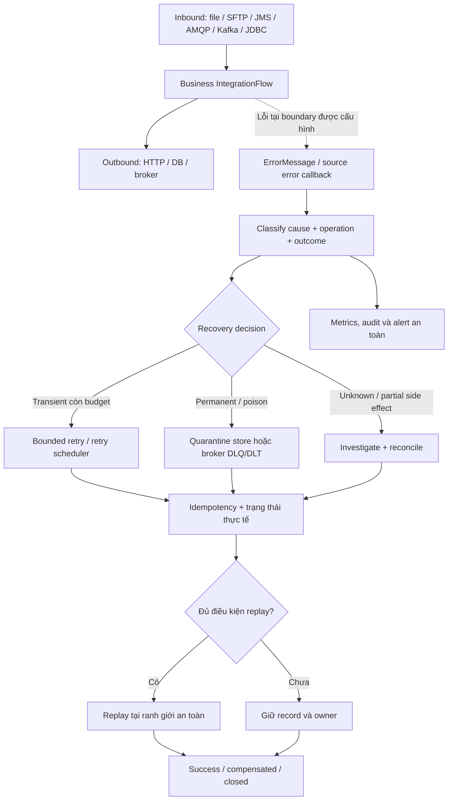
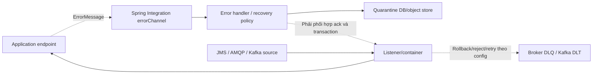
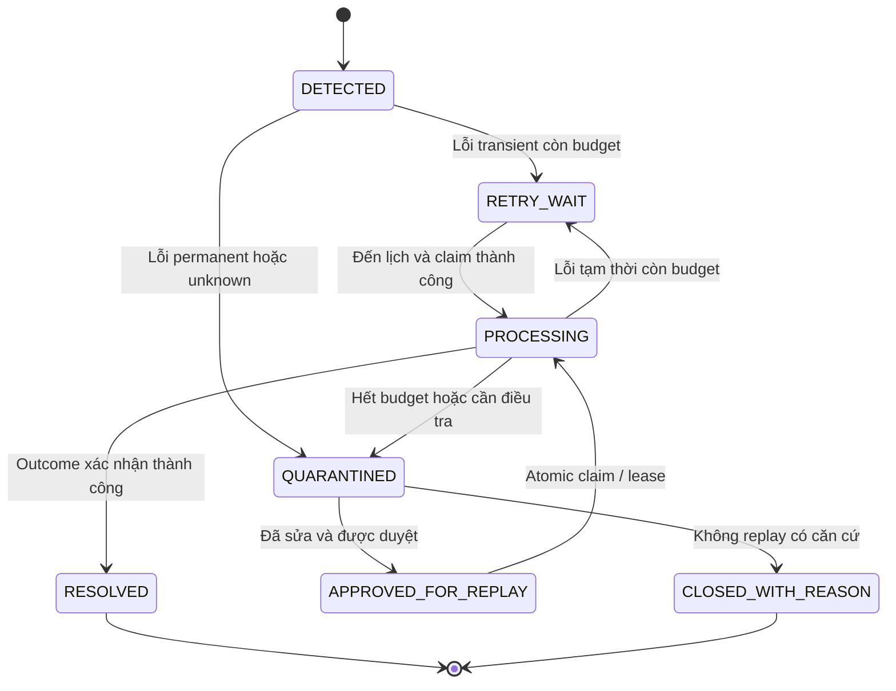
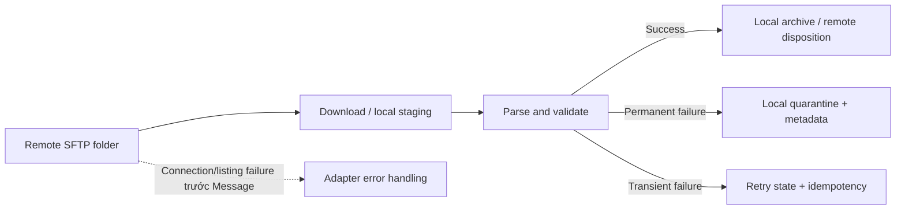
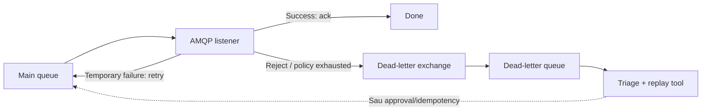
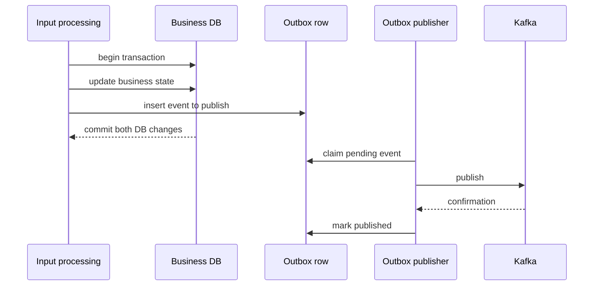
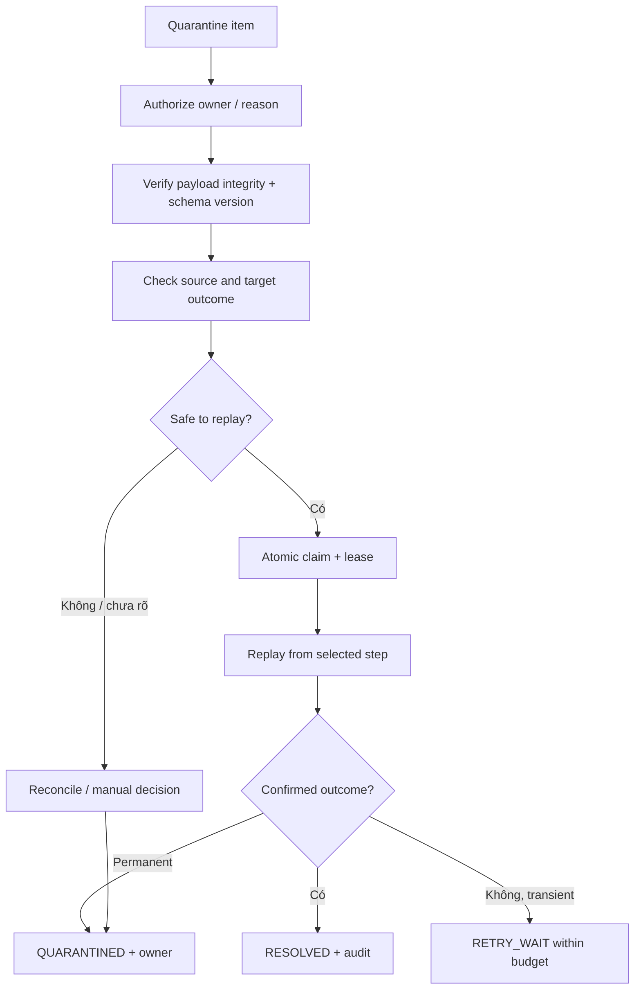
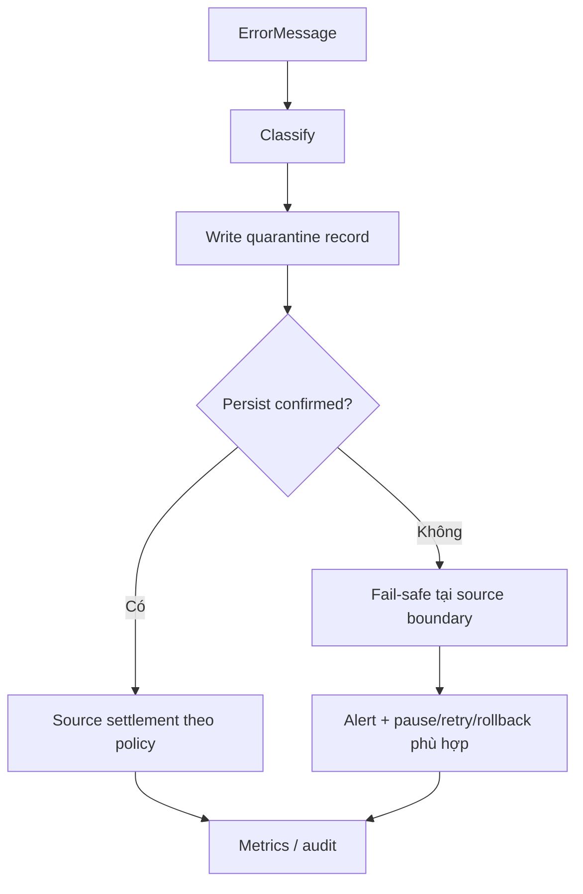
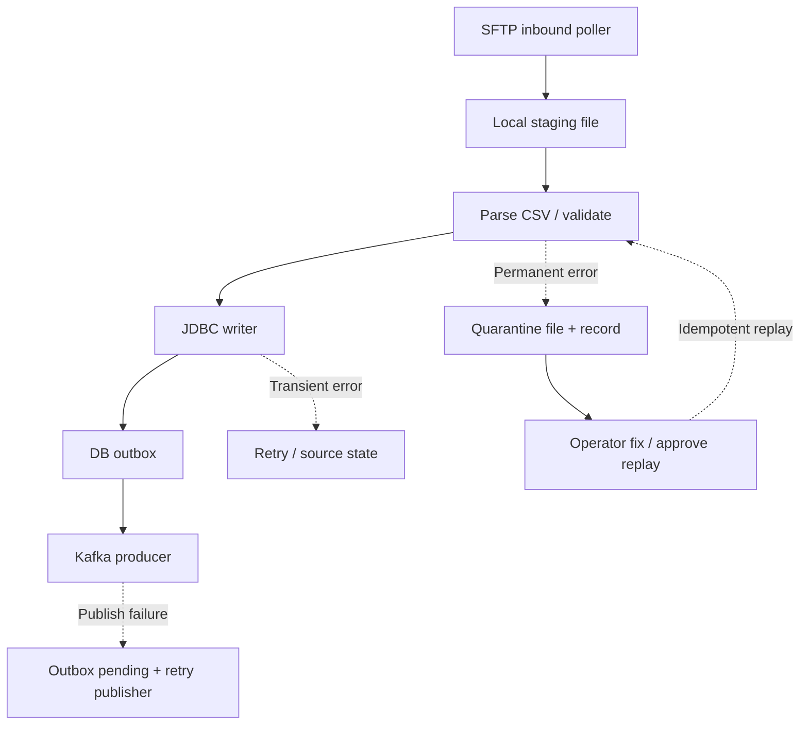

# Dead-letter channel và quarantine trong Spring Integration Adapters

> **Chương:** Error handling  
> **Module:** `SPRING_INTEGRATION_ADAPTERS`  
> **Bối cảnh:** Kết nối hệ thống ngoài vào Spring Integration bằng inbound/outbound adapter, gateway, poller và `MessageChannel`; triển khai luồng trao đổi qua **file, SFTP, HTTP, JMS, AMQP, Kafka và cơ sở dữ liệu**.  
> **Mục tiêu:** Phân biệt **error channel, dead-letter channel, broker DLQ/Kafka DLT và quarantine**, thiết kế cơ chế giữ và xử lý lại message hỏng **an toàn, có bằng chứng, có giới hạn retry**, đồng thời tránh mất message hoặc phát sinh side effect trùng khi một adapter thất bại.

## 1. Vì sao không thể chỉ “log exception rồi bỏ qua”?

Một integration flow có thể lấy dữ liệu từ SFTP, chuyển đổi CSV thành đơn hàng, ghi database và phát event ra Kafka. Chỉ cần một khâu lỗi, hệ thống phải quyết định **message có còn cần xử lý không, giữ ở đâu, ai chịu trách nhiệm và tiếp tục từ bước nào**.

Ví dụ:

```text
SFTP poller -> parse CSV -> validate -> JDBC writer -> Kafka outbound
                                  |
                                  +-- invalid schema
                                  +-- database timeout
                                  +-- Kafka producer failure
```

Ba lỗi không nên dùng chung cách phục hồi:

- **CSV sai schema:** bản ghi có thể không bao giờ hợp lệ nếu không sửa dữ liệu. Retry ngay vô hạn chỉ làm nóng CPU và ngập log.
- **Database timeout:** có thể tạm thời; retry có kiểm soát hoặc chờ phụ thuộc phục hồi, đồng thời xác minh transaction.
- **Kafka publish lỗi sau JDBC commit:** gửi lại toàn bộ file từ đầu có thể ghi trùng database; cần outbox/đối soát thay vì replay mù quáng.

Nếu handler chỉ ghi `log.error(...)` và trả thành công, adapter có thể coi message đã hoàn tất, tùy transaction/ack semantics. Khi ấy message **có thể bị mất đối với nghiệp vụ** dù có một dòng log.

Một giải pháp tốt cần kết hợp:

1. **Nhận diện và phân loại lỗi** theo cause, operation, mức độ phục hồi.
2. **Giữ thông tin đủ để tái xử lý hoặc kết luận** mà không lộ dữ liệu nhạy cảm.
3. **Duy trì outcome chính xác** của nguồn: file filter, broker ack, Kafka offset, row state.
4. **Có owner, SLA, retry budget, replay và audit** cho mọi lỗi chưa được giải quyết.
5. **Xác minh idempotency và side effect** trước mỗi thao tác xử lý lại.

## 2. Định nghĩa: Error channel, dead-letter channel, DLQ/DLT và quarantine

Các khái niệm thường bị dùng lẫn nhau:

| Khái niệm | Bản chất | Khi nào dùng? | Không tự bảo đảm |
|---|---|---|---|
| **`errorChannel`** | `MessageChannel` mang `ErrorMessage` trong Spring Integration | Thu nhận lỗi từ endpoint/poller/async publisher phù hợp | Bền vững, retry, rollback |
| **Private error channel** | Channel lỗi được cấu hình cho một flow/endpoint | Tách trách nhiệm lỗi, owner và quyền truy cập | Tenant isolation hoặc lưu bền vững nếu chỉ đặt tên |
| **Dead-letter channel** | Tên **kiến trúc nội bộ** cho channel nhận message không thể tiếp tục xử lý theo policy | Route lỗi cuối cùng tới một handler có khả năng lưu giữ | Không phải một broker DLQ tự động |
| **JMS/AMQP DLQ** | Queue tại broker cho delivery thất bại theo chính sách | Redelivery exhausted, reject/dead-letter | Tự sửa payload hoặc tự replay đúng |
| **AMQP DLX** | Dead-letter exchange định tuyến message bị dead-letter tới queue khác | Xác định nơi message đi sau reject/TTL/limit | Tự tạo một queue đích nếu không cấu hình |
| **Kafka DLT** | Dead-letter topic để chứa record lỗi | Lỗi consume/deserialize/processing theo chính sách | Tự commit offset hoặc đạt exactly-once xuyên DB |
| **Quarantine** | Vùng lưu tách biệt và có kiểm soát cho payload/file/record cần điều tra | Poison data, dữ liệu sai, lỗi khó tự khôi phục | Là một API có sẵn của Spring Integration |
| **Retry store/scheduler** | Nơi theo dõi message chờ thử lại, thời gian và attempt | Lỗi transient cần backoff, tránh hot loop | Tránh trùng nếu thiếu idempotency |
| **Audit/incident log** | Metadata và bằng chứng chẩn đoán | Observability, kiểm toán, điều tra | Đủ dữ liệu để replay |

**Quan trọng:** Một `DirectChannel` tên `deadLetterChannel` **không trở thành durable DLQ** chỉ vì tên gọi. Nếu process chết trước khi subscriber xử lý và ghi nhận bền vững, dữ liệu lỗi trên channel trong bộ nhớ có thể không còn.

### 2.1. “Dead-letter” không nhất thiết là “vứt bỏ”

Dead-letter có nghĩa message đã **rời đường xử lý bình thường** theo quy tắc thất bại. Nhiệm vụ tiếp theo thường là điều tra, sửa dữ liệu/cấu hình, replay, bù trừ hoặc đóng với căn cứ. Không nên xây “dead-letter sink” bằng cách gửi mọi thứ tới `nullChannel` rồi tuyên bố hoàn tất.

### 2.2. Quarantine không đồng nghĩa retry queue

Quarantine ưu tiên **cách ly để điều tra và hạn chế tác hại**. Một retry queue/scheduler ưu tiên **thời điểm thử lại**. Với dữ liệu không hợp lệ, quarantine thường phù hợp hơn; với timeout có khả năng khôi phục, retry có budget có thể là bước trước khi chuyển sang quarantine.

## 3. Cấu trúc tổng thể của một failure pipeline



Sơ đồ này là **mẫu kiến trúc**, không phải tính năng một lệnh của Spring Integration. Mỗi adapter có thể phát lỗi bằng cơ chế khác: synchronous exception, error channel, listener/container error handler, producer callback hoặc trạng thái lưu trong database.

### 3.1. Ba điểm dừng phải phân biệt

- **Error observed:** đã thấy Throwable/response failure.
- **Message safely retained:** đã ghi bản ghi recovery hoặc có broker delivery/DLQ được bảo toàn theo chính sách.
- **Business outcome resolved:** đã xác minh thành công, loại bỏ với căn cứ, bù trừ hoặc đóng sau đánh giá.

Chỉ mốc thứ hai mới cho biết có đường phục hồi, và chỉ mốc thứ ba mới cho phép xác nhận nghiệp vụ đã được giải quyết.

## 4. Thứ tự quyết định: Retry, dead-letter hay quarantine?

Không nên route chỉ theo tên exception:

| Điều kiện | Ví dụ | Hướng ưu tiên |
|---|---|---|
| Dữ liệu sai, không tự sửa | CSV thiếu `orderId`, JSON schema invalid | Quarantine, thông báo người gửi |
| Lỗi phụ thuộc tạm thời | DB connection timeout, HTTP 503 | Retry có giới hạn, backoff/jitter |
| Credential hoặc quyền sai | SFTP auth failure, HTTP 403 | Dừng hot retry, kiểm tra cấu hình/secret |
| Bị rate limit | HTTP 429 | Retry theo chính sách provider, deadline |
| Lỗi code hoặc invariant | `NullPointerException`, impossible state | Alert, quarantine khi cần, ưu tiên sửa code |
| Lỗi xử lý không rõ side effect | HTTP POST timeout, Kafka send ambiguous | Reconcile trước khi retry |
| Poison broker message | Payload luôn gây parse exception | DLQ/DLT theo cơ chế container/broker |
| Quá nhiều retry | Lỗi transient không phục hồi trong budget | DLQ/quarantine với lịch đánh giá |
| Lỗi chính error handler | Không ghi được quarantine database | Fail-safe/rollback hoặc dừng nguồn theo policy |
| Vi phạm bảo mật dữ liệu | Payload chứa secret hoặc field sai | Cách ly, hạn chế người đọc và điều tra incident |

**Transient hay permanent không phải thuộc tính bất biến của một Java class.** `SocketTimeoutException` có thể tạm thời, nhưng một HTTP POST đã thực hiện thành công ở server trước timeout thì replay cũng có thể tạo side effect trùng.

### 4.1. Chấp nhận trạng thái “unknown”

Nếu không có thông tin để biết bản ghi đã được commit hay broker đã nhận message chưa, ghi `unknownOutcome` và điều tra/đối soát. Đừng ép mọi lỗi vào “failed” hoặc “success” chỉ để dashboard đẹp.

## 5. `ErrorMessage` và dữ liệu cần giữ

`org.springframework.messaging.support.ErrorMessage` có payload là `Throwable`. `MessagingException` trong cause chain có thể mang `getFailedMessage()`; ErrorMessage có thể mang `getOriginalMessage()` nếu error publisher biết input message.

```text
ErrorMessage
  payload: Throwable
    type: MessageHandlingException hoặc loại khác
    cause: root cause
    failedMessage?: Message<?>   nếu Throwable/MessagingException có
  originalMessage?: Message<?>   nếu strategy có dữ liệu đầu vào
  headers: MessageHeaders
```

Không có bảo đảm lỗi SFTP connect, JDBC query trước row, Kafka deserialization hoặc broker connection failure sẽ có `failedMessage`. Khi đó cần metadata nguồn như adapter ID, polling task, destination, timestamp hoặc callback context.

### 5.1. Nguyên tắc lưu dữ liệu lỗi

| Trường | Nên giữ? | Cân nhắc |
|---|---|---|
| `failureId`, `flowId` | Có | Định danh vụ việc và owner |
| `messageId`, `correlationId` | Khi có | Truy vết và tránh nhầm source |
| `sourceType`, `sourceRef` | Có giới hạn | Đường dẫn có thể nhạy cảm |
| `errorCode`, `exceptionClass` | Có | Dùng mã ổn định; tránh full message |
| `attempt`, `firstFailedAt` | Có | Retry budget, SLA |
| `policyVersion` | Có | Biết logic xử lý đã áp dụng |
| `transactionOutcome` | Có | Commit, rollback, unknown cần phân biệt |
| `payloadReference` | Khi cần replay | Kho riêng, mã hóa, ACL, retention |
| `payloadHash/checksum` | Khi cần xác minh toàn vẹn | Hash không tự ẩn danh |
| `ownerTeam`, `nextAction` | Có | Không tạo backlog vô chủ |
| Full raw payload | Chỉ khi thực sự cần | Không nhúng vào metric/ticket |
| Bearer token/secret | Không | Revoke/rotate nếu lộ, chỉ giữ metadata |

**Không ghi toàn bộ `errorMessage.toString()` vào log công khai**: Throwable, failedMessage và headers có thể kéo theo PII, credential hoặc dữ liệu thanh toán.

## 6. Spring Integration `errorChannel` khác broker DLQ

Spring Integration có cơ chế `errorChannel` ở tầng application messaging. Broker DLQ/DLT tồn tại ở tầng transport/storage; chúng giải quyết các vấn đề có giao nhau nhưng không tương đương.



Một ứng dụng có thể **dùng cả hai**:
 
- Lỗi nghiệp vụ được phân loại ở error channel để audit/quarantine.
- Khi message cần broker redelivery, exception được propagate tại đúng boundary.
- Sau khi hết redelivery, broker chuyển sang DLQ theo policy.
- Worker quản trị xử lý DLQ có thể tạo record quarantine riêng với owner và trạng thái.
- Cần tránh **hai nơi lưu không nhất quán** hoặc duplicate replay cùng một message.

### 6.1. Không gộp lỗi hạ tầng và lỗi payload

Nếu broker không kết nối được, có thể **chưa có một delivery** để gửi DLQ. Đây là lỗi connection/runtime; một failure record có thể được tạo ở monitoring/quarantine, nhưng không nên giả định “broker tự dead-letter message chưa nhận”.

## 7. Dead-letter channel nội bộ: Một design pattern, không phải kiểu Java mặc định

Trong nội bộ Spring Integration, có thể tạo một `MessageChannel` đặt tên `ordersDeadLetterInput` làm điểm nhận **error events đã hết retry**. Consumer phía sau ghi quarantine record vào kho bền vững.

```text
ordersErrors
    -> classify / bounded retry exhausted
        -> ordersDeadLetterInput
            -> persist quarantine record + payload reference
            -> metrics / alert / audit
```

**Mức độ bền vững phụ thuộc việc ghi phía sau**, không phụ thuộc tên channel. `DirectChannel` truyền đồng bộ, `QueueChannel` có thể cần cấu hình `MessageStore` để bền vững, và các channel khác có semantics riêng.

### 7.1. Tại sao nên có tên riêng?

- Tách người chịu trách nhiệm lỗi từ `ordersFileFlow` và `paymentJmsFlow`.
- Dễ định nghĩa ACL, data classification, retention riêng.
- Cảnh báo chính xác backlog/quarantine theo luồng.
- Không để một flow thanh toán bị xử lý bằng chính sách lỗi SFTP.
- Có điểm nối audit và recovery workflow thống nhất.

Nhưng nếu mọi luồng cùng chia sẻ một recovery service, vẫn cần kiểm soát **namespace, tenant, source type, idempotency và owner**; không chỉ dựa trên tên channel.

## 8. Chọn channel và tính bền vững

| Loại channel | Đặc tính | Thích hợp | Cần kiểm chứng |
|---|---|---|---|
| `DirectChannel` | Subscriber chạy đồng bộ; không lưu bền vững mặc định | Đẩy lỗi tức thời tới quarantine writer | Writer throw, caller/error publisher xử lý ra sao |
| `PublishSubscribeChannel` | Fan-out tới nhiều subscribers | Audit/metrics/recovery tách biệt | Một subscriber lỗi có ảnh hưởng các subscriber khác không |
| `ExecutorChannel` | Chuyển qua thread executor | Cần tách latency của failure handler | Task rejection, async loss, transaction context |
| `QueueChannel` | Đệm message | Backpressure, tách producer/consumer | Capacity, persistence, consumers, restart |
| `QueueChannel` với persistent `MessageStore` | Có thể giữ lỗi qua restart | Durability theo storage | Transaction, serialization, retention, failover |
| Broker DLQ/DLT | Storage của source transport | Redelivery exhausted, poison messages | Ack/offset, retention, replay, ownership |
| Quarantine DB/object store | Lưu reference/payload có schema riêng | Điều tra, sửa và replay có audit | Atomicity, mã hóa, ACL, state machine |

**Không mặc định** một channel trong JVM cung cấp bảo đảm exactly-once hay atomic commit với database + broker. Có thể cần transaction/outbox/inbox để nối các ranh giới.

### 8.1. Lưu ý về `PublishSubscribeChannel`

Nếu một subscriber ghi quarantine còn một subscriber chỉ ghi metric, việc metric lỗi không nên khiến quarantine bị coi thất bại hay ngược lại nếu chính sách không mong muốn. Chọn mode đồng bộ/bất đồng bộ, thứ tự subscriber và error handling dựa trên nhu cầu thực; kiểm thử với fault injection.

## 9. Java DSL: Định nghĩa channel lỗi riêng cho file flow

Ví dụ dưới đây minh họa một flow đọc file qua poller, gửi exception của polling task tới `ordersErrors`. Nó **chưa** cam kết file được lưu quarantine hay transaction được rollback.

```java
import java.io.File;
import java.time.Duration;

import org.springframework.context.annotation.Bean;
import org.springframework.context.annotation.Configuration;
import org.springframework.integration.channel.DirectChannel;
import org.springframework.integration.dsl.IntegrationFlow;
import org.springframework.integration.dsl.Pollers;
import org.springframework.integration.file.dsl.Files;
import org.springframework.messaging.MessageChannel;

@Configuration
class OrderFileIntegrationConfig {

    @Bean("ordersErrors")
    MessageChannel ordersErrors() {
        return new DirectChannel();
    }

    @Bean("ordersDeadLetterInput")
    MessageChannel ordersDeadLetterInput() {
        return new DirectChannel();
    }

    @Bean
    IntegrationFlow ordersFileFlow(OrderFileProcessor processor) {
        return IntegrationFlow
            .from(
                Files.inboundAdapter(new File("/var/app/orders/in"))
                     .patternFilter("*.csv"),
                endpoint -> endpoint.poller(
                    Pollers.fixedDelay(Duration.ofSeconds(2))
                        .maxMessagesPerPoll(5)
                        .errorChannel("ordersErrors")
                ))
            .handle(File.class, (file, headers) -> {
                processor.process(file); // có thể ném exception
                return null;             // terminal handler
            })
            .get();
    }
}

interface OrderFileProcessor {
    void process(File file);
}
```

### 9.1. Giải thích đúng

- File inbound adapter là **polling source**.
- `Pollers.fixedDelay(...)` điều khiển nhịp nhận.
- `errorChannel("ordersErrors")` cấu hình đường lỗi tại **poller boundary** hỗ trợ, không phải chỉ đặt tên channel rồi framework tự tìm.
- `ordersDeadLetterInput` là channel **do ứng dụng đặt tên**.
- `return null` kết thúc flow sau xử lý; không tự xóa, archive hay chuyển file.
- Nếu exception phát sinh ở điểm **trước khi tạo Message**, ErrorMessage có thể không có file payload.

Cấu hình thực tế cần kiểm tra Spring Integration version, file filter, file completion, metadata store, retry, transactions và cách error publisher hoạt động.

### 9.2. Đừng khởi tạo hai nơi “xử lý lỗi cuối” mà không thống nhất

Nếu poller tự ghi lỗi vào `ordersErrors`, còn handler lại đưa vào `ordersDeadLetterInput`, định nghĩa rõ điểm nào **classify** và điểm nào **persist**. Tránh cả hai nơi đều ghi một bản quarantine khiến replay trùng.

## 10. Java: Router phân loại lỗi rồi chuyển tới quarantine

Có thể dùng `ErrorMessageExceptionTypeRouter` thông qua Java DSL `routeByException` để phân kênh theo exception/cause.

```java
import java.net.SocketTimeoutException;

import org.springframework.context.annotation.Bean;
import org.springframework.context.annotation.Configuration;
import org.springframework.integration.dsl.IntegrationFlow;

@Configuration
class OrderErrorRoutingConfig {

    @Bean
    IntegrationFlow ordersErrorRouterFlow() {
        return IntegrationFlow.from("ordersErrors")
            .routeByException(r -> r
                .channelMapping(
                    InvalidOrderSchemaException.class,
                    "ordersDeadLetterInput")
                .channelMapping(
                    SocketTimeoutException.class,
                    "ordersRetryDecisionInput")
                .defaultOutputChannel("ordersUnclassifiedErrors"))
            .get();
    }
}

// Domain exception riêng, để phân biệt dữ liệu lỗi với timeout.
class InvalidOrderSchemaException extends RuntimeException {
    InvalidOrderSchemaException(String message) {
        super(message);
    }
}
```

Ví dụ yêu cầu **định nghĩa thêm channel và subscriber** cho `ordersRetryDecisionInput`, `ordersUnclassifiedErrors` và `ordersDeadLetterInput` trước khi chạy thật.

### 10.1. Khi mapping superclass chồng lấn

Mapping `RuntimeException.class` cùng `InvalidOrderSchemaException.class` hoặc `IOException.class` cùng `SocketTimeoutException.class` có thể phụ thuộc **thứ tự mapping và thuật toán của phiên bản**. Nên viết test cho đúng cause chain/ordering, không mặc định subclass luôn thắng.

### 10.2. Chỉ route không phải retry

`ordersRetryDecisionInput` chỉ nhận lỗi được phân loại. Subscriber phải xác định **retry budget, backoff, idempotency, side effect và source ack policy**. Không thể “retry” bằng việc gửi ngược `ErrorMessage` nguyên vẹn vào business channel rồi hy vọng mọi thứ tự khôi phục.

## 11. Java: Handler giữ failure record bền vững

Một handler có thể nhận `ErrorMessage` và gọi service ghi quarantine:

```java
import org.springframework.integration.annotation.ServiceActivator;
import org.springframework.messaging.MessagingException;
import org.springframework.messaging.Message;
import org.springframework.messaging.support.ErrorMessage;
import org.springframework.stereotype.Component;

@Component
class OrdersQuarantineHandler {

    private final OrdersQuarantineService quarantine;

    OrdersQuarantineHandler(OrdersQuarantineService quarantine) {
        this.quarantine = quarantine;
    }

    @ServiceActivator(inputChannel = "ordersDeadLetterInput")
    public void onFailure(ErrorMessage error) {
        Message<?> failed = null;
        Throwable cause = error.getPayload();

        for (int depth = 0; cause != null && depth < 16; depth++) {
            if (cause instanceof MessagingException messaging
                    && messaging.getFailedMessage() != null) {
                failed = messaging.getFailedMessage();
                break;
            }
            cause = cause.getCause();
        }

        Message<?> original = error.getOriginalMessage();

        // Phải persist metadata và payload reference ở kho có ACL.
        // Không log raw Throwable/Message hoặc tự coi đây là broker DLQ.
        quarantine.persistFailure(
            "ordersFileFlow",
            error.getPayload(),
            failed,
            original
        );
    }
}

interface OrdersQuarantineService {
    void persistFailure(
        String flowId,
        Throwable failure,
        Message<?> failedMessage,
        Message<?> originalMessage);
}
```

**Vì sao không ghi `new QuarantineRecord(error.toString())`?** Vì raw ErrorMessage có thể chứa payload/headers và thông tin nhạy cảm, còn một exception message có thể chứa PII, SQL parameters hoặc token.

### 11.1. Hàm persist cần làm những gì?

- Gán `failureId` ổn định và idempotency key theo source.
- Xác định `sourceType`, `sourceRef`, tenant và operation từ context tin cậy.
- Tạo **payload reference** đến file/object/record riêng có quyền; không nhân bản vô hạn.
- Lưu cause category, thời gian, version, attempt và recovery status.
- Ghi audit và người chịu trách nhiệm.
- Trả xác nhận **đã persist bền vững**, hoặc ném lỗi để boundary quyết định fail-safe.
- Ghi nhận chính xác **ack/commit outcome** nếu xác định được; không tự điền `committed` khi chưa kiểm chứng.

Mã trên **không tự chạy đầy đủ** vì service và các channel phụ là contract ứng dụng. Khi triển khai, cần xác định transaction và cách xử lý failure của chính quarantine writer.

## 12. Quarantine record: Đừng để kho lỗi thành “data lake không kiểm soát”

Một failure record có thể dùng schema như sau:

```json
{
  "failureId": "fail-orders-8842",
  "flowId": "ordersFileFlow",
  "sourceType": "file",
  "sourceRef": "inbound/orders/batch-22.csv",
  "sourceVersion": "sha256:restricted-checksum-ref",
  "tenantId": "tenant-a",
  "errorCode": "CSV_MISSING_REQUIRED_COLUMN",
  "exceptionClass": "InvalidOrderSchemaException",
  "firstFailedAt": "2026-11-23T08:15:00Z",
  "lastAttemptAt": "2026-11-23T08:15:00Z",
  "attempts": 1,
  "retryBudget": 3,
  "status": "QUARANTINED",
  "payloadStoreRef": "restricted-store/fail-orders-8842",
  "sourceOutcome": "unknown",
  "targetOutcome": "not-attempted",
  "policyVersion": "order-errors-v4",
  "ownerTeam": "order-platform",
  "nextReviewAt": "2026-11-24T03:00:00Z"
}
```

Đây là **hợp đồng dữ liệu minh họa**, không phải schema mặc định của Spring Integration, Kafka hay JMS.

### 12.1. Các trường bắt buộc theo ngữ cảnh

| Trường | Vì sao cần? |
|---|---|
| `failureId` | Tham chiếu duy nhất cho case, không phải business message ID |
| `sourceRef` và scope | Tìm đúng file/broker record/row, tránh nhầm tenant |
| `idempotencyKey` khi có | Tránh xử lý trùng qua restart/retry |
| `errorCode` | Quyết định recovery ổn định |
| `attempts` và timestamps | Ngăn hot loop và biết tuổi backlog |
| `sourceOutcome` / `targetOutcome` | Tránh đánh đồng “đã route” với “đã commit” |
| `status` | Luồng xử lý/quyền claim khi replay |
| `payloadStoreRef` | Xác định dữ liệu có thể khôi phục |
| `schemaVersion` / `policyVersion` | Xử lý payload cũ sau nâng cấp |
| `ownerTeam` | Tránh dead-letter vô chủ |
| `retentionPolicyRef` | Không giữ dữ liệu vô thời hạn |
| `securityClassification` | Giới hạn quyền đọc/export |

Nếu record chứa dữ liệu cá nhân, `failureId` và `sourceRef` vẫn có thể là dữ liệu liên kết với cá nhân. Hash không tự động ẩn danh.

## 13. Vòng đời một quarantine item

Một quarantine item nên có state machine có thể kiểm chứng, không chỉ cờ boolean `isDeadLetter`.



### 13.1. Không được bỏ qua transition có kiểm soát

- `DETECTED` chưa đồng nghĩa record đã **persist**.
- `RETRY_WAIT` cần deadline và owner/worker.
- `APPROVED_FOR_REPLAY` phải kiểm tra permission, payload integrity và source state.
- `PROCESSING` cần lease/lock để hai workers không xử lý cùng failure.
- `RESOLVED` phải có bằng chứng outcome thực tế ở đích.
- `CLOSED_WITH_REASON` cần reason code và người phê duyệt khi phù hợp.

Nếu một nguồn broker đang giữ bản gốc để redelivery, quarantine store không nhất thiết cần giữ full payload lần nữa. Phải biết **bản nào là source of truth** cho replay.

### 13.2. Không tự cấp phát lại attempt budget

Khi di chuyển message giữa retry scheduler và DLQ, giữ **attempt gốc** hoặc tổng attempt của policy. Nếu mỗi lần đẩy vào channel mới lại đặt `attempt=0`, poison message có thể lặp vô hạn qua nhiều tầng.

## 14. Retry budget, exponential backoff và jitter

Với lỗi transient, có thể dùng `RequestHandlerRetryAdvice`, retry của listener/broker hoặc scheduler riêng. Không cần dùng đồng thời tất cả nếu thiếu ngân sách tổng.

```text
Attempt 1: initial processing
Attempt 2: wait/backoff
Attempt 3: wait/backoff with jitter
Attempt 4: optional per policy
Exhausted: dead-letter / quarantine + alert
```

Giá trị trên là minh họa; SLA và hợp đồng upstream/downstream quyết định deadline thực tế.

### 14.1. Hai sai lầm đối lập

**Retry mọi thứ:** lỗi permanent không tự sửa, gây vòng lặp, queue lag, chiếm worker.

**Quarantine mọi thứ ngay:** timeout mạng ngắn có thể phục hồi; tăng chi phí điều tra thủ công và thời gian xử lý.

### 14.2. Tổng ngân sách qua nhiều tầng

Giả sử caller retry ba lần, advice retry bốn lần mỗi call, broker redelivery năm lần. Trong trường hợp xấu, hệ thống có thể thực hiện **nhiều chục lần thao tác nghiệp vụ**, thậm chí tăng theo phép nhân các tầng. Phải thiết kế tổng attempt/deadline và kiểm soát side effects.

### 14.3. Nên có phân loại unknown

Nếu một HTTP POST timeout sau khi server có thể đã commit, “retryable theo exception type” không có nghĩa **an toàn để retry**. Có thể cần trạng thái `PENDING_RECONCILIATION` trước khi đưa vào retry scheduler.

## 15. Idempotency là điều kiện trước khi replay

**At-least-once delivery** và retry làm message có thể được xử lý nhiều lần. Một integration flow cần định nghĩa identity của **hành động nghiệp vụ**, không chỉ UUID mới mỗi lần retry.

```text
Source event ID: order-created-718
Business idempotency key: tenant-a/order-718/create
Processing step: jdbc.insertOrder
Target outcome: committed | rolled-back | unknown
```

### 15.1. Các khóa tùy nguồn

| Nguồn | Idempotency key cân nhắc |
|---|---|
| File | Checksum + source namespace + business batch ID |
| SFTP | Remote file ID/path + version/checksum + tenant |
| HTTP | Idempotency-Key/client request ID được xác thực + operation |
| JMS | Business event ID; `JMSMessageID` hỗ trợ điều tra nhưng có thể đổi khi republish |
| AMQP | Business event ID; delivery tag chỉ gắn với channel delivery hiện hành |
| Kafka | Topic/partition/offset cho source position; business event ID cho side effect xuyên lần publish |
| Database | Row business key + version + operation |
| Quarantine replay | Failure ID + source key + target action, không phát key mới tùy tiện |

### 15.2. Đừng hiểu nhầm Kafka offset

`topic + partition + offset` định danh vị trí một record trong một log cụ thể, nhưng không tự chống duplicate business effect nếu cùng event được republish sang offset mới hoặc topic khác. Dùng **business key** cho idempotency nghiệp vụ.

### 15.3. Lưu trạng thái bước đã thành công

Nếu pipeline `DB insert → Kafka publish` đã ghi DB thành công và chỉ Kafka fail, retry từ đầu có thể tạo duplicate. Có thể dùng **transactional outbox** để giữ sự kiện chưa publish, hoặc một recovery record xác định **chỉ cần gửi Kafka** sau khi kiểm tra outcome.

## 16. Source acknowledgement và điểm nào có thể coi là “handled”?

Câu hỏi quan trọng nhất sau khi route lỗi:

> Sau khi error handler ghi quarantine xong, hệ thống nguồn **đã làm gì** với message gốc?

| Nguồn | Tín hiệu hoàn tất | Bẫy |
|---|---|---|
| File | Accept-once/filter, archive/quarantine move | Không có broker rollback; file có thể không được poll lại |
| SFTP | Listing/download marker, remote rename/delete | Remote file và local staging có trạng thái khác nhau |
| HTTP inbound | Response HTTP trả về client | Client retry có thể trùng request |
| JMS | Session commit/ack hoặc rollback | Error handler nuốt lỗi có thể làm thay đổi redelivery |
| AMQP | Ack/nack/reject và requeue policy | Requeue vô hạn poison message |
| Kafka inbound | Offset commit/retry/seek/DLT | Route ErrorMessage không tự quyết định offset |
| Kafka outbound | Producer acknowledgement/callback | Send accepted không đồng nghĩa broker confirmed |
| JDBC poller | Commit row state/lease | Row `DONE` trước xử lý có thể mất |
| Quarantine writer | Durable write confirmation | Log/metric thành công không thay thế persist |

### 16.1. Điều kiện fail-safe

Nếu **quarantine store unavailable**, không được âm thầm trả “handled” khi message nguồn chưa có đường phục hồi. Tùy adapter, cần:

- Propagate exception để listener/broker rollback hoặc retry.
- Không commit/ack offset nếu framework và transaction policy hỗ trợ lựa chọn đó.
- Dừng/giảm polling để bảo toàn file/row source.
- Chuyển sang nơi lưu dự phòng được quản trị (không chỉ buffer RAM vô hạn).
- Alert kèm source ID và trạng thái chưa xác định.

**Không có một lệnh chung** ở Spring Integration error handler tự động đưa mọi nguồn về trạng thái ban đầu.

## 17. File adapter: Dead-letter thường là di chuyển/ghi trạng thái file

Với file inbound adapter, dữ liệu lỗi có thể tồn tại như file trên filesystem. Một thiết kế quarantine thực tế thường:

1. Đảm bảo source file **đã ghi hoàn chỉnh** (ready marker, atomic rename hoặc age filter khi thích hợp).
2. Đọc bằng file adapter và parse/validate.
3. Phân biệt lỗi permanent (schema) và transient (DB/network).
4. Khi permanent, ghi metadata rồi **di chuyển file có kiểm soát** tới thư mục quarantine; xác nhận move.
5. Khi transient, retry có budget, không đánh dấu file thành công.
6. Khi thành công, archive/xóa theo retention riêng.
7. Kiểm tra không có hai process cùng xử lý file.
8. Cho phép replay có approval và checksum/idempotency.

```text
/in/orders/incoming/batch-22.csv
             |
             +-- success --> /in/orders/archive/...
             |
             +-- invalid --> /in/orders/quarantine/batch-22.csv
             |
             +-- transient --> retry state / giữ source có kiểm soát
```

### 17.1. `AcceptOnceFileListFilter` và metadata

Một file đã được adapter nhận có thể bị **accept-once filter** ghi nhận, nên sau handler thất bại **không tự xuất hiện lại ở lần poll tiếp theo**. Cần thiết kế filter/metadata store và recovery từ đầu, không coi exception = rollback filter.

### 17.2. Di chuyển không nguyên tử giữa mọi volume

Trên cùng filesystem có thể có atomic rename phù hợp; khác volume hoặc remote storage có thể không. Nếu copy rồi delete, phải kiểm chứng checksum, đích đã ghi thành công và xử lý tình huống crash giữa hai bước để tránh **mất file hoặc tạo hai bản cùng được replay**.

### 17.3. File có dữ liệu cá nhân

Quarantine directory phải hạn chế người dùng, mã hóa khi phù hợp, retention và cleanup; không lưu bản lỗi vĩnh viễn chỉ vì file “không xử lý được”.

## 18. SFTP: Phân biệt remote source với local quarantine

SFTP inbound thường có hai miền trạng thái:

- **Remote:** file gốc, folder, rename/permissions, connector session.
- **Local:** file đã tải, temp suffix/staging, filter và data processor.



### 18.1. Khi SFTP connect thất bại trước khi có message

Có thể **chưa tồn tại failedMessage hoặc file payload** để đưa vào dead-letter channel. Điều tra dựa trên session factory, host alias, operation, thời gian và exception cause. Không tạo một record giả “file đã vào DLQ” nếu chưa từng nhận file.

### 18.2. Bẫy download lặp

Nếu remote file vẫn tồn tại và connector restart, file có thể được tải lại. Cần persistent metadata filter, checksum, business batch key hoặc quy trình remote move để tránh xử lý trùng. Đồng thời kiểm tra file remote có thể bị sửa cùng path — chỉ path không đủ xác định version.

### 18.3. Credential và lỗi permission

SFTP auth/permission failure thường cần điều tra cấu hình/secret, không retry nóng vô hạn. Không ghi username+password hoặc private key vào failure payload, nhất là khi thông báo lỗi chứa remote URI có credential.

## 19. HTTP gateway: “Dead letter” là mô hình nghiệp vụ, không phải HTTP status

HTTP không có DLQ bản địa giống message broker. Với inbound/outbound HTTP gateway:

- Caller cần **status code và response** theo contract.
- Error handler nội bộ có thể ghi record pending/quarantine để xử lý hậu sự cố.
- Client retry cần idempotency key và deadline.
- Timeout không chứng minh remote side effect đã thất bại.
- Một request bị từ chối validation không nhất thiết cần lưu full payload trong quarantine nếu có thể trả 4xx rõ ràng.

### 19.1. Inbound HTTP

| Lỗi | Phản hồi cân nhắc | Có cần quarantine? |
|---|---|---|
| JSON/field invalid | 400/4xx thích hợp | Có thể chỉ ghi metadata, không giữ raw body |
| Unauthorized/forbidden | 401/403 | Thường ưu tiên security audit; tránh giữ secret |
| Rate limit | 429 | Thường không lưu full request |
| Internal dependency unavailable | 503/5xx | Có thể cần retry work item nếu nghiệp vụ async |
| Conflict/duplicate request | 409 hoặc idempotent success | Đối soát trước khi tạo dead letter |
| Timeout sau remote commit | Không thể suy outcome chỉ từ timeout | Có thể cần pending reconciliation |

### 19.2. Outbound HTTP POST

Một payment API có thể đã tạo giao dịch trước khi client nhận `SocketTimeoutException`. Nếu ghi quarantine “FAILED” rồi replay POST mà không kiểm tra trạng thái, hệ thống có thể tạo double charge. Record nên lưu `UNKNOWN_REMOTE_OUTCOME`, operation ID và bước **lookup/reconciliation**.

### 19.3. Gateway error channel không tự trả HTTP status

Spring Integration gateway error flow có thể chuyển exception thành reply; cần map status/body rõ ở HTTP boundary. Nếu error handler chỉ log rồi không reply, caller có thể timeout hoặc nhận kết quả không mong đợi. Quarantine và phản hồi client là **hai trách nhiệm riêng**.

## 20. JMS: Broker redelivery, DLQ và trách nhiệm container

Với JMS inbound, message delivery chịu ảnh hưởng của **session transaction và acknowledgment mode**. Một broker có thể hỗ trợ redelivery policy và dead-letter destination, nhưng cách kích hoạt phụ thuộc provider/container.

### 20.1. Hai mô hình xử lý cần phân biệt

**Mô hình A — Broker quản lý retry/DLQ**

```text
JMS queue -> listener/handler
               |
               +-- success -> ack/commit
               |
               +-- failure propagates -> rollback
                                            -> redelivery
                                            -> provider DLQ when exhausted
```

**Mô hình B — Ứng dụng ghi quarantine có chủ đích**

```text
JMS queue -> handler
              -> classify permanent error
              -> persist durable quarantine (within verified transaction strategy)
              -> then settle source delivery consistently
```

Không thể suy ra cơ chế B tự atomic với JMS chỉ vì cả hai xảy ra trong một Java method. Nếu phải có tính nhất quán liên tài nguyên, cần cấu hình transaction phù hợp, outbox/inbox hoặc quy trình reconciliation.

### 20.2. Khi error flow đã “nuốt” exception

Nếu exception được bắt và chuyển thành ErrorMessage rồi handler lỗi trả thành công, listener/container có thể **không nhìn thấy exception** để rollback, tùy cấu hình adapter. Vì vậy phải test:

- Lỗi trước commit khiến redelivery hay không?
- Message có bị ack sau khi chỉ ghi log không?
- Khi quarantine store thất bại, nguồn còn giữ message không?
- Sau hết retry, message có thực sự nằm trong provider DLQ không?
- `JMSMessageID`/delivery count có còn đủ để tìm nguồn?
- Replay từ DLQ có dùng lại business idempotency key không?

### 20.3. Broker DLQ không có nghĩa xóa dữ liệu nguồn

Một message có thể vẫn tồn tại trong broker DLQ sau khi application “đóng case”; cần retention, purge và audit theo source owner. Không để DLQ thành kho chứa dữ liệu cá nhân không giới hạn.

## 21. AMQP: Dead-letter exchange, dead-letter queue và requeue

Trong RabbitMQ/AMQP, dead-letter thường được thực hiện thông qua **dead-letter exchange (DLX)** và các queue được cấu hình để nhận message dead-letter. Một message có thể được dead-letter khi bị reject/nack không requeue, hết TTL hoặc gặp giới hạn queue theo cơ chế của broker.



Đây là mô hình cơ bản: điều kiện dead-letter và route thực tế phải được cấu hình đúng ở RabbitMQ/AMQP container.

### 21.1. `x-dead-letter-exchange` và routing

Ví dụ queue policy/arguments có thể chỉ định dead-letter exchange và dead-letter routing key:

```yaml
queue: orders.processing
arguments:
  x-dead-letter-exchange: orders.dlx
  x-dead-letter-routing-key: orders.failed
```

Đây là **cấu hình minh họa**, không phải YAML application properties có thể chạy trực tiếp. Cần khai báo exchange, binding và queue đích hoặc broker policies thực tế.

### 21.2. Không requeue poison message vô hạn

Nếu consumer liên tục reject/requeue một JSON sai schema, message có thể trở lại ngay và chiếm worker. Hãy chọn **bounded retry** hoặc broker-managed retry với cơ chế dead-letter cuối cùng. Cân nhắc TTL queue/retry topology, dead-letter cycles và version của broker; không dùng lại chính queue xử lý với chính sách tạo vòng lặp vô hạn.

### 21.3. Manual ack: Ai chịu trách nhiệm?

Với manual ack, cần bảo đảm chỉ đúng consumer/session có quyền ack/nack một delivery còn hiệu lực. Không lưu delivery tag làm khóa replay lâu dài; dùng business event ID hoặc idempotency key ổn định hơn.

Một `ErrorMessage` được route vào Spring `errorChannel` **không tự phát** RabbitMQ `basicNack`. Việc chuyển message đến DLQ do listener/container và broker phối hợp theo ack/requeue policy.

## 22. Kafka: Dead-letter topic, consumer offset và producer callback

Kafka dùng **topic** thay vì queue kiểu JMS/RabbitMQ. Một **dead-letter topic (DLT)** chứa record lỗi theo chính sách consumer/recovery được cấu hình; Kafka broker **không tự quyết định mọi message có exception phải sang DLT**.

### 22.1. Kafka consumer flow

```text
Kafka topic orders.events
  -> Spring Integration Kafka inbound adapter / listener
      -> transform / handler
          -> success: offset progression theo policy
          -> failure: retry/seek/recoverer theo config
              -> dead-letter topic khi policy chọn
```

Spring Kafka có các thành phần như `DefaultErrorHandler` và `DeadLetterPublishingRecoverer` trong bối cảnh listener/container phù hợp. Chúng **không nên bị coi là chức năng sẵn có của mọi `MessageChannel` Spring Integration**; cần xem adapter, listener mode và Spring Kafka version.

### 22.2. Offset và dữ liệu trong DLT

Khi ghi DLT, cần xác định:

- Record nguồn thuộc `topic`, `partition`, `offset` và consumer group nào?
- Lỗi thuộc deserialize, validation hay business handler?
- Producer ghi DLT đã được broker xác nhận chưa?
- Source offset được commit/seek theo chiến lược nào?
- Có thể DLT publish thành công nhưng source offset chưa commit, dẫn tới hai bản không?
- Sau khi replay DLT, consumer có xử lý lại một business event cũ đã có side effect không?

**Một ErrorMessage từ error channel không tự commit hoặc giữ offset.** Thành công của route cũng không chứng minh DLT record đã được broker nhận.

### 22.3. Kafka producer outbound

Nếu một flow thực hiện `JDBC write → Kafka publish`, outbound Kafka send có thể bất đồng bộ; failure callback đến sau khi handler trả về. Spring Integration Kafka outbound adapter có các cơ chế success/failure channel hoặc callback theo cấu hình/phiên bản.

Khi producer failure xảy ra, quarantine có thể chứa **outbox row hoặc event reference chưa được publish**, chứ không replay từ đầu file/JMS message. Đừng đánh đồng “send được gọi” với “broker đã xác nhận”.

### 22.4. DLT retention và schema evolution

DLT có thể giữ dữ liệu lâu hơn topic chính. Khi replay một message cũ, serializer/schema hoặc chính sách dữ liệu có thể đã đổi; cần version, converter/migration có kiểm soát và kiểm tra mục đích/retention. DLT không phải vùng lưu trữ vô hạn mặc định.

## 23. JDBC/database: Quarantine row, claim, lease và transaction

Với JDBC inbound poller hoặc outbound handler, lỗi thường liên quan **transaction và trạng thái row**.

Ví dụ state:

```text
NEW -> CLAIMED -> PROCESSING -> DONE
                  |               ^
                  +-> RETRY_WAIT --+
                  |
                  +-> QUARANTINED
```

Nếu poller đánh dấu `DONE` trước khi downstream thành công, lỗi xảy ra sau đó có thể khiến message **biến mất khỏi truy vấn NEW**, mặc dù dead-letter channel đã nhận một notification.

### 23.1. Thiết kế bảng recovery tối thiểu

```sql
CREATE TABLE integration_failure (
    failure_id        VARCHAR(100) PRIMARY KEY,
    flow_id           VARCHAR(100) NOT NULL,
    source_ref        VARCHAR(300) NOT NULL,
    idempotency_key   VARCHAR(300),
    error_code        VARCHAR(100) NOT NULL,
    status            VARCHAR(40) NOT NULL,
    attempt_count     INTEGER NOT NULL,
    next_attempt_at   TIMESTAMP NULL,
    lease_until       TIMESTAMP NULL,
    payload_store_ref VARCHAR(500),
    policy_version    VARCHAR(100),
    created_at        TIMESTAMP NOT NULL,
    updated_at        TIMESTAMP NOT NULL
);
```

DDL là ví dụ khái niệm, chưa có index, tenant partition, schema migration, constraint state transition hoặc loại timestamp chuẩn cho một database cụ thể. Trong production cần bổ sung **tenant scope, ACL, encryption, retention và partition/index** theo tải.

### 23.2. Claim atomically, không dựa vào SELECT rồi UPDATE

Hai workers có thể cùng đọc `status=RETRY_WAIT` và đồng thời replay. Nên dùng locking/version hoặc thao tác `UPDATE ... WHERE status=...` có kiểm tra số row affected; nếu cần lease, có thời hạn và cơ chế khôi phục sau worker crash.

### 23.3. Quarantine và business transaction

Nếu có thể, ghi business state và recovery state trong **cùng transaction database** để nhất quán. Nhưng khi message nguồn là Kafka/JMS hoặc đích là HTTP/SFTP, không tự giả định DB transaction bao phủ các nguồn/đích ấy. Phải thiết kế thêm cơ chế commit, inbox/outbox hoặc reconciliation.

## 24. Outbox, inbox và transaction boundary

Nhiều hệ thống không thể atomic commit cùng lúc **database + Kafka + HTTP + file** chỉ bằng `@Transactional`.

### 24.1. Transactional outbox



Outbox giúp tránh tình huống DB business commit nhưng event hoàn toàn bị quên; publisher có thể retry **chỉ bước publish**. Tuy nhiên publisher vẫn có thể gửi lặp khi acknowledgement/DB status update mơ hồ, nên consumer cần idempotency.

### 24.2. Inbox/deduplication

Với nguồn at-least-once, có thể lưu `processedEventId` trong cùng transaction với business update. Khi source gửi lại, xử lý nhận ra event đã hoàn tất và không làm lại side effect.

### 24.3. Chọn recovery point

Quarantine record nên chỉ rõ:

```json
{
  "sourceEventId": "order-719",
  "lastConfirmedStep": "jdbc-committed",
  "failedStep": "kafka-publish",
  "targetOutcome": "unknown",
  "replayFrom": "outbox-publisher",
  "mustReconcileBeforeReplay": true
}
```

Đây là **schema ứng dụng**, không tự do Spring Integration tạo. Nó bảo vệ khỏi thao tác dễ sai “gửi lại toàn bộ source event”.

## 25. Bảo vệ dữ liệu cá nhân và secrets trong DLQ/quarantine

DLQ/quarantine có thể chứa **payload mà luồng thành công thường không giữ lâu**, thậm chí dữ liệu nhạy cảm. Vì vậy nó là một storage cần chính sách privacy/security riêng.

### 25.1. Bốn lớp bảo vệ

1. **Access:** người xem metadata có thể nhiều hơn người đọc raw payload; dùng RBAC/ABAC và audit.
2. **At rest/in transit:** mã hóa và secret management phù hợp với hệ thống lưu; không nhúng khóa giải mã vào error record.
3. **Retention:** thời hạn theo mục đích recovery, nghĩa vụ giữ và độ nhạy; dỡ legal hold đúng phạm vi.
4. **Disclosure:** không chuyển full payload sang ticket, email alert, Slack-like channel hoặc dashboard rộng.

### 25.2. Dữ liệu không nên gửi vào error analytics

- Authorization header, bearer token, refresh token, session cookie.
- SFTP password/private key, database credentials.
- Hồ sơ khách hàng và dữ liệu thanh toán thô không cần thiết.
- Tài liệu xác minh/giấy tờ.
- SQL statement chứa parameters nhạy cảm.
- Exception text dài có thể lộ request body.
- Header được nguồn bên ngoài cung cấp chưa qua kiểm tra.

### 25.3. Lưu reference thay vì raw payload

Một `QuarantineRecord` có thể giữ `payloadStoreRef` trỏ tới object được mã hóa/quản lý access; dashboard chỉ hiển thị `failureId`, mã lỗi, tuổi, trạng thái và owner.

**Hash checksum không tự biến payload thành dữ liệu vô danh**, đặc biệt nếu bản gốc vẫn tồn tại hoặc ID có thể tra ngược.

### 25.4. Quy trình xóa

Khi item được xử lý xong hoặc hết hạn theo policy, cần xử lý cả **payload, record metadata, backup, DLQ/DLT bản gốc và các bản export điều tra** trong phạm vi nghĩa vụ và khả năng kỹ thuật. Không để một failure record trở thành lý do lưu mọi dữ liệu vô hạn.

## 26. Replay: Một thao tác có rủi ro, không phải nút “Gửi lại” đơn giản

Replay cần quyền và kiểm tra điều kiện:



### 26.1. Các bước trước replay

1. Xác minh **ai yêu cầu** replay, có quyền theo scope/tenant không.
2. Xác định source message, schema/version, business ID và dữ liệu có còn hợp lệ.
3. Xem lỗi gốc đã được sửa chưa, ví dụ field mapping, code, permission.
4. Đối chiếu DB/HTTP/Kafka/source để biết thao tác nào đã thành công.
5. Chọn **replay point nhỏ nhất an toàn**, không mặc định từ đầu flow.
6. Đặt idempotency key, tổng attempt budget và deadline.
7. Claim record atomically, tránh hai operators đồng thời.
8. Ghi audit người thực hiện, lý do, policy và target confirmation.
9. Theo dõi sau replay và đóng chỉ khi outcome được xác nhận.

### 26.2. Có trường hợp không replay

Không replay khi:
 
- Dữ liệu vi phạm chính sách hoặc không còn được phép xử lý.
- Một bản ghi đã tạo side effect và replay có thể gây hại.
- Khóa/credential đã bị thu hồi và thao tác không còn hợp lệ.
- Bản gốc bị lỗi không thể sửa hoặc đã hết retention hợp lệ.
- Chủ sở hữu nghiệp vụ quyết định reject/cancel có căn cứ.

**Đóng case có lý do** không giống bỏ record âm thầm; giữ metadata phù hợp cho audit và giới hạn bản sao nhạy cảm.

## 27. Thiết kế Replay API và giao diện vận hành

Một API quản trị có thể nhận **failureId và quyết định**, không cần nhận raw payload lại từ browser.

```http
POST /admin/integration-failures/fail-orders-8842/replay HTTP/1.1
Content-Type: application/json
Authorization: Bearer <redacted>

{
  "reasonCode": "UPSTREAM_SCHEMA_CORRECTED",
  "expectedVersion": 3,
  "requestedStep": "csv-parser"
}
```

Đây là API **minh họa**, không phải Spring Integration endpoint tự tạo. Quản lý quyền phải thực hiện trên server, gắn principal được xác thực với tenant và owner; không dựa vào `tenantId` do caller tự khai.

### 27.1. Phản hồi nên thể hiện accepted khác completed

```json
{
  "failureId": "fail-orders-8842",
  "replayRequestId": "replay-2991",
  "status": "ACCEPTED",
  "idempotencyKeyRef": "order-719/import"
}
```

`ACCEPTED` nghĩa replay request đã được ghi/chấp nhận xử lý, **không có nghĩa business step đã thành công**. Cần status endpoint hoặc notification để xem `RESOLVED` và target confirmation.

### 27.2. API phải chống replay lặp do client retry

Dùng optimistic version/lease, idempotency key cho replay request, và bảo vệ state transition. Nếu operator bấm replay hai lần hoặc trình duyệt retry sau timeout, hệ thống không nên xử lý một item hai lần không có kiểm soát.

## 28. Routing bằng exception type và ranh giới hợp đồng message

`ErrorMessageExceptionTypeRouter` có thể dùng để tách lỗi theo class/cause, nhưng classification chỉ là **bước đầu**.

| Exception | Nhánh ban đầu | Cần hỏi thêm |
|---|---|---|
| `InvalidOrderSchemaException` | `validationDeadLetters` | Payload đã đủ để sửa? Đã qua file filter? |
| `SocketTimeoutException` | `transientFailures` | Side effect downstream có thể đã xảy ra? |
| `DataIntegrityViolationException` | `dataConflictFailures` | Duplicate hợp lệ hay dữ liệu sai? |
| `AccessDeniedException` | `securityReviewFailures` | Quyền nào sai, có retry nóng không? |
| `NullPointerException` | `unclassifiedFailures` | Bug nào, có thể fail-safe không? |
| Lỗi không mapping | `unclassifiedFailures` | Có owner, alert, evidence không? |

**Lưu ý matching:** khi mapping superclass và subclass chồng lấn, thứ tự cấu hình và behavior router theo phiên bản cần kiểm thử. Không route tất cả `RuntimeException` về `retry`.

### 28.1. Bảo toàn `failedMessage` và `originalMessage` đúng nghĩa

- `MessagingException.getFailedMessage()` thường là message tại điểm thất bại; có thể đã transform.
- `ErrorMessage.getOriginalMessage()` có thể chứa input của error strategy, không luôn là message tại source ban đầu.
- Cả hai có thể `null`.
- Không tự ép một message vào `deadLetterChannel` khi chưa rõ đó là full payload có thể replay.

### 28.2. Ngăn routing bằng header giả

Không cho HTTP/JMS/AMQP/Kafka client tự quyết định `errorChannel`, `replyChannel` hoặc tenant recovery partition bằng header không được kiểm tra. Các channel nội bộ phải được cấu hình bởi nguồn đáng tin, header mapping cần allowlist/override.

## 29. Observability: Theo dõi backlog và vòng đời lỗi

Nếu chỉ có metric `errors_total`, đội vận hành không biết còn bao nhiêu message cần xử lý.

| Metric minh họa | Câu hỏi trả lời |
|---|---|
| `integration_failures_total{flow,errorCode}` | Flow và loại lỗi nào tăng? |
| `dead_lettered_total{source,reason}` | Bao nhiêu message rời đường xử lý bình thường? |
| `quarantine_items_current{flow,status}` | Có bao nhiêu item đang tồn đọng? |
| `quarantine_oldest_age_seconds{flow}` | Lỗi lâu nhất chưa được giải quyết bao lâu? |
| `retry_attempts_total{flow,category}` | Có hot retry không? |
| `retry_exhausted_total{flow}` | Bao nhiêu lỗi hết budget? |
| `replay_requests_total{flow,outcome}` | Replay được yêu cầu/kết thúc thế nào? |
| `replay_duplicate_prevented_total{flow}` | Idempotency/lease chặn bao nhiêu replay trùng? |
| `quarantine_persist_failures_total{flow}` | Recovery store có gặp sự cố? |
| `unrouted_errors_total{flow}` | Có lỗi không được route như mong đợi? |
| `broker_dlq_backlog_count{source}` | DLQ/DLT đang tích tụ? |
| `unknown_outcome_current{flow}` | Có bao nhiêu case cần reconciliation? |
| `retention_overdue_items{store}` | Quarantine giữ quá hạn? |

Đây là **tên metric do ứng dụng thiết kế**, không phải mọi metric có sẵn trong Spring Integration/Micrometer.

### 29.1. Tránh high-cardinality và PII trong metric

Không đưa `email`, `personId`, message ID duy nhất, raw file path, exception message hoặc token vào labels. Dùng flow, category, owner, source; khi cần điều tra từng case thì truy theo failure ID trong log phân quyền.

### 29.2. Những cảnh báo cần có

- DLQ/quarantine không có owner hoặc có item quá SLA.
- Poison message tăng nhanh sau deploy.
- Error handler/quarantine store thất bại.
- Source lag hoặc broker redelivery tăng trong khi retry không tiến triển.
- Pending reconciliation tăng sau timeout HTTP/Kafka.
- Item đã `RESOLVED` nhưng lại xuất hiện với cùng key.
- Retry policy bị thay đổi hoặc hết budget trên nhiều flow.
- Lỗi phải ở private channel lại xuất hiện ở global `errorChannel`.

## 30. Lỗi trong chính dead-letter pipeline

Điều gì xảy ra nếu **quarantine writer cũng lỗi**?



### 30.1. Không dùng một kho lỗi làm điểm lỗi đơn duy nhất

Nếu business DB và quarantine DB dùng cùng một cluster đang outage, không thể bảo đảm persist quarantine trong lúc DB lỗi. Có thể cần broker durability, nguồn giữ lại file, một journal dự phòng hoặc dừng ingestion để tránh mất.

### 30.2. Khi error handler được gọi trong thread đồng bộ

Với `DirectChannel`, exception từ subscriber ghi quarantine có thể quay về publisher của ErrorMessage. Hành vi cuối cùng tùy **poller error handler/adapter**: không được giả định exception mới sẽ tự kích hoạt broker rollback chính xác.

### 30.3. Khi error handler chạy bất đồng bộ

Với `ExecutorChannel` hoặc một task executor khác, publisher có thể đã trả thành công trước khi persist fail. Phải có **kho trung gian bền vững** hoặc source retention nếu không muốn mất message. Một async queue trong bộ nhớ không tự giải quyết durability.

## 31. Kiểm thử: Tách unit test router với integration test source

Có hai cấp test bổ sung nhau:

**Unit/router test:** tạo `ErrorMessage` và xác nhận mapper/router đưa đến channel đúng.

**Integration test:** gây lỗi **tại adapter, poller, gateway, broker container hoặc producer callback thật** rồi kiểm tra source settlement, quarantine và outcome.

### 31.1. Ma trận test bắt buộc

| Test | Lỗi được tiêm | Kết quả cần chứng minh |
|---|---|---|
| Invalid CSV | Thiếu field bắt buộc | Quarantine một lần, không hot loop |
| File accept-once | Parse lỗi sau filter | Replay có chủ đích, không mất file |
| File copy crash | Crash sau copy trước delete | Không replay hai bản hoặc mất source |
| SFTP connect | Credential/timeout trước Message | Có error context dù failedMessage null |
| SFTP partial download | Ngắt kết nối khi tải | Không parse file chưa hoàn chỉnh |
| HTTP inbound | Validation lỗi | Response 4xx phù hợp, không full body vào log |
| HTTP POST timeout | Remote đã commit nhưng reply mất | Reconciliation/idempotency trước retry |
| JMS handler fail | Lỗi trước commit | Redelivery/rollback theo cấu hình |
| JMS quarantine fail | DB quarantine unavailable | Message không bị ack mất âm thầm |
| AMQP poison | JSON sai luôn | DLQ, không requeue vô hạn |
| AMQP manual ack | Nack/ack decision | Đúng delivery, không double ack |
| Kafka deserialize | Lỗi trước Spring Message | Container recovery/record context |
| Kafka DLT publish fail | Broker lỗi tại recoverer | Offset/DLT behavior fail-safe đã test |
| Kafka producer callback | Async send failure | Theo dõi failure channel/outbox |
| JDBC row claim | Hai workers tranh cùng row | Chỉ một worker replay |
| JDBC timeout | Transaction không commit | Row state khôi phục và retry an toàn |
| Router overlap | Mapping class cha/con | Đúng mapping policy theo version |
| Null failedMessage | Lỗi nguồn trước Message | Handler null-safe |
| Quarantine store failure | Lỗi ghi recovery record | Có fallback/rollback/pause |
| Crash after persist | Khởi động lại | Không duplicate side effect |
| Duplicate replay click | Hai request cùng failure ID | Lease/idempotency chặn trùng |
| Sensitive payload | Token giả trong failed message | Không xuất ở log/metrics/alert |
| Multi-tenant | Replay tenant khác | Authorization từ chối |
| Retention expiration | Hết hạn theo policy | Dữ liệu và bản sao được xử lý đúng |

**Pass của một unit test ErrorMessage router không đồng nghĩa pass JMS rollback hoặc Kafka offset test.** Phải kiểm tra cả source và target trạng thái thật.

### 31.2. Lỗi không xác định cần test rõ

Khi thiếu chứng cứ đã commit, hệ thống phải lưu `UNKNOWN`/`PENDING_RECONCILIATION` và có owner. Không được thay bằng `FAILED` rồi tự replay trước khi kiểm tra side effect.

## 32. Diễn tập fault injection và phục hồi sau restart

Một bài diễn tập có thể thực hiện trong môi trường test:

1. Chuẩn bị một source event có **business idempotency key** ổn định.
2. Cấu hình service xử lý, retry policy và quarantine store.
3. Gây lỗi validation vĩnh viễn; xác nhận chuyển quarantine.
4. Gây lỗi DB timeout; xác nhận retry có giới hạn/backoff.
5. Kill process sau khi quarantine persist nhưng trước khi source settlement.
6. Restart, xác nhận source replay không tạo duplicate quarantine hoặc business effect.
7. Kill process ngay sau DB commit nhưng trước Kafka confirmation.
8. Xem outbox/reconciliation có phát hiện pending publish không.
9. Giả lỗi quarantine storage unavailable; quan sát fail-safe.
10. Kiểm tra metrics, audit, retention và quyền xem payload.

### 32.1. Các kết quả cần đối soát

```text
sourceReceivedCount
  = businessResolvedCount
  + activeRetryCount
  + quarantinedCount
  + pendingInvestigationCount
  + exceptions reconciled by explicit evidence
```

Biểu thức trên chỉ là **ý tưởng kế toán trạng thái**, không phải công thức luôn đúng khi batch split, fan-out hoặc message bị duplicate. Với những trường hợp đó cần đơn vị đếm nhất quán và bảng đối chiếu theo business event ID.

### 32.2. “Không mất message” phải được định nghĩa

Thế nào là mất phụ thuộc nguồn và contract:
 
- File gốc biến mất, không có archive/quarantine record.
- JMS/AMQP ack trước khi business effect/quarantine bền vững.
- Kafka source offset tiến qua record lỗi nhưng DLT/outbox không chứa bản thay thế.
- JDBC row `DONE` nhưng downstream chưa thành công.
- HTTP client nhận accepted nhưng không có work item hoặc confirmation.

## 33. Case study: SFTP CSV → JDBC → Kafka

Giả sử mỗi ngày có một file `orders-YYYYMMDD.csv` từ SFTP, ứng dụng parse thành đơn hàng, ghi PostgreSQL, phát Kafka event.



### 33.1. Quyết định theo từng lỗi

| Kịch bản | Kết quả phù hợp |
|---|---|
| File chưa ghi xong | Không parse; chờ ready marker/file ổn định |
| CSV thiếu cột | Quarantine file và lỗi validation, thông báo upstream |
| JDBC timeout trước commit | Retry có giới hạn, đảm bảo transaction và row state |
| JDBC duplicate order | Đối soát idempotency, không mặc định insert lần nữa |
| DB commit nhưng Kafka không nhận | Outbox pending, chỉ retry publish |
| SFTP connection timeout trước khi download | Alert/connect retry; không giả có file đã quarantine |
| Operator replay file đã xử lý một phần | Kiểm tra từng order key/step, không ghi duplicate |
| Quarantine store unavailable | Fail-safe giữ nguồn, không đánh dấu success |

### 33.2. Đánh giá kết quả cuối

Chỉ đóng batch khi biết:
 
- Số file/source events đã nhận.
- Số order records thành công và business ID tương ứng.
- Bản ghi nào đang retry/quarantine.
- Outbox event nào đã được Kafka xác nhận.
- Bản nào không được replay vì đã có kết quả.
- Mọi file/payload lỗi được bảo vệ và có retention.
- Người chịu trách nhiệm cho lỗi chưa giải quyết.

## 34. Runbook vận hành: Khi dead-letter backlog tăng

### 34.1. Bước triage

1. Xác định **nguồn**: file/SFTP, JMS, AMQP, Kafka, HTTP hay JDBC.
2. Đọc error categories và thời điểm bắt đầu, kiểm tra thay đổi deploy/config.
3. Tách poison payload khỏi lỗi hạ tầng tạm thời.
4. Kiểm tra broker/consumer lag, source ack/offset và quarantine store.
5. Xác nhận có **lỗi trong chính recovery pipeline** không.
6. Xác định privacy/security classification của payload.
7. Gán owner và deadline cho backlog chưa có người xử lý.
8. Chỉ bật replay sau khi xác minh nguyên nhân đã sửa và side effect.
9. Theo dõi số item resolved và business outcome, không chỉ số lượng message đã rời DLQ.

### 34.2. Khi source và quarantine không khớp

- Nếu source ghi đã ack nhưng quarantine không có record: điều tra nguy cơ mất message.
- Nếu quarantine có record nhưng source vẫn redeliver: kiểm tra idempotency và hai nguồn lưu.
- Nếu source Kafka offset đã commit nhưng DLT publish chưa được xác nhận: kiểm tra recoverer/transaction và khả năng mất record.
- Nếu file đã move quarantine nhưng metadata record không có: reconcile file store bằng checksum/reference.
- Nếu HTTP accepted nhưng không có work item: tạo incident và tìm dựa trên request idempotency key.

### 34.3. Khi lỗi tăng sau schema migration

Kiểm tra version của message, schema reader/converter, backward compatibility, policy thay đổi và đối tượng đã xử lý. Không replay payload cũ bằng schema mới nếu có thể thay đổi ý nghĩa nghiệp vụ mà chưa đánh giá.

## 35. Anti-pattern: Những cách triển khai gây mất dữ liệu

**“Tạo `deadLetterChannel` là đã có DLQ.”** Một channel tên hay không tự lưu message qua restart.

**“Bất kỳ Throwable nào cũng retry.”** Lỗi validation, auth hoặc bug có thể không phục hồi khi thử lại.

**“Ghi log xong là message handled.”** Có thể khiến source ack/commit mà không có bản lưu bền vững.

**“Quarantine cần copy mọi payload vào dashboard.”** Có thể tạo kho PII/secret ngoài kiểm soát.

**“ErrorMessage luôn có originalMessage.”** Lỗi kết nối trước message creation có thể không có.

**“SCIM/HTTP/JMS/Kafka đều có DLQ giống nhau.”** Mỗi transport có error/ack/storage semantics riêng.

**“AMQP requeue liên tục sẽ tự phục hồi.”** Poison message có thể lặp mãi và khóa worker.

**“Kafka broker tự dead-letter mọi lỗi consumer.”** Cần container/recoverer/DLT cấu hình đúng.

**“Kafka send method trả về là publish success.”** Với async producer còn cần confirmation/callback.

**“JMS listener có ErrorMessage tức là đã rollback.”** Phải kiểm tra exception propagation và transaction.

**“File đã lỗi sẽ tự xuất hiện ở poll kế tiếp.”** Accept-once filter có thể đã đánh dấu.

**“Outbox không cần idempotency.”** Sender có thể publish lại sau acknowledgement mơ hồ.

**“Replay mọi lỗi từ đầu flow.”** Có thể nhân đôi DB, payment hoặc event.

**“DLQ/DLT có thể giữ mãi vì phục vụ audit.”** Dữ liệu lỗi cần retention, ACL và cleanup.

**“Xóa bản ghi lỗi là đã xóa dữ liệu.”** Payload có thể còn trong broker, object store, export và backup.

**“Khi không có log truy cập thì chắc chưa có side effect.”** Thiếu evidence phải được ghi là unknown.

**“Error handler lỗi sẽ tự quay về source.”** Phụ thuộc vào channel, poller, container và transaction.

**“Đếm số item rời DLQ là KPI success.”** Cần xác nhận business outcome và tránh duplicate.

## 36. Checklist trước khi đưa vào production

| Câu hỏi | Bằng chứng hoặc phép kiểm |
|---|---|
| Có định nghĩa từng flow và owner? | Flow inventory, on-call |
| Có tách error channel và DLQ/quarantine? | Diagram, channel config |
| Có biết exception phát sinh sync hay async? | Boundary tests |
| Poller/adapter đã route lỗi vào channel mong đợi? | Integration tests |
| Có phân loại transient/permanent/unknown? | Error taxonomy |
| Có retry budget và backoff? | Retry config và test exhausted |
| Có owner cho unclassified errors? | Alert/runbook |
| Có default route không bỏ lỗi âm thầm? | Router test |
| Có xác định tính bền vững của dead-letter store? | Restart/crash test |
| Có schema quarantine với source reference? | Record contract |
| Có payload integrity và version? | Checksum + schema controls |
| Có giới hạn PII/secrets trong logs? | Redaction tests |
| Có quyền xem raw payload riêng? | ACL/RBAC/ABAC và audit |
| Có retention/deletion của quarantine? | Schedule và cleanup evidence |
| Có phân biệt ack/rollback/offset? | Adapter-specific test |
| JMS có broker redelivery/DLQ đúng? | Container/broker confirmation |
| AMQP có DLX/DLQ bindings đúng? | Broker topology test |
| Kafka có DLT và offset semantics đúng? | Consumer/recoverer test |
| Kafka producer có failure callback? | Confirmation test |
| File accept-once có replay policy? | File lifecycle test |
| SFTP có remote/local reconciliation? | Download/restart test |
| HTTP POST timeout có idempotency/reconcile? | Remote outcome test |
| JDBC claim/lease ngăn worker trùng? | Concurrency test |
| Có outbox khi DB + broker cần phối hợp? | Crash-after-commit test |
| Có source/business idempotency key? | Duplicate replay test |
| Có bước operator approval khi replay nhạy cảm? | Authorization workflow |
| Có atomic claim và version guard cho replay? | Concurrent requests |
| Có xử lý schema evolution trước replay? | Version migration tests |
| Quarantine store lỗi có fail-safe? | Fault injection |
| Có metrics về backlog age và unknown outcome? | Dashboard/alerts |
| Có giới hạn cardinality metric labels? | Observability review |
| Có kiểm tra tenant isolation? | Cross-tenant negative test |
| Có audit/reason cho việc đóng không replay? | Closure records |
| Có theo dõi retention của broker DLQ/DLT? | Broker/topic policies |
| Có reconciliation xác nhận business outcome? | Source/target confirmation |
| Có diễn tập restart giữa persist và commit? | Recovery drill |

## 37. Bài thực hành tổng hợp: Thiết kế dead-letter và quarantine đa adapter

### 37.1. Đề bài

Một ứng dụng Spring Boot + Spring Integration chạy:

- **Flow A:** nhận CSV từ SFTP, kiểm tra schema, lưu PostgreSQL.
- **Flow B:** nhận payment event từ JMS, gọi HTTP payment API.
- **Flow C:** nhận inventory event từ Kafka, ghi database rồi phát Kafka event.
- **Flow D:** nhận stock event từ AMQP, cập nhật inventory.

Các lỗi giả định:

1. SFTP CSV thiếu cột `orderId`.
2. Database timeout trong Flow A.
3. Payment API trả timeout sau khi **có thể đã ghi giao dịch**.
4. JMS message chứa JSON sai định dạng.
5. Kafka consumer nhận record không deserialize được.
6. Kafka producer trả failure callback sau DB commit.
7. AMQP poison message bị requeue lặp.
8. Quarantine writer không thể kết nối database.
9. Hai operator cùng bấm replay một failure.
10. Một payload lỗi chứa bearer token test giả.

### 37.2. Thiết kế cần nộp

- Sơ đồ business flow và error boundary theo từng adapter.
- Lỗi nào đi retry, DLQ/DLT, quarantine hay pending reconciliation.
- Vị trí error channel và điều kiện tạo `ErrorMessage`.
- Source acknowledgement/transaction/offset policy.
- Quarantine schema, owner, retention, PII protection.
- Idempotency key và replay point an toàn.
- Cơ chế xử lý khi recovery pipeline thất bại.
- Test matrix cho crash/restart và operator replay.
- Metrics/cảnh báo backlog, tuổi và trạng thái.
- Runbook xử lý thủ công một item.

### 37.3. Bảng gợi ý

| Lỗi | Quyết định phù hợp | Cần chứng minh |
|---|---|---|
| CSV sai schema | Quarantine file | File đã chuyển/lưu, không bị poll trùng |
| DB timeout | Retry có budget | Transaction/row state nhất quán |
| Payment POST timeout | Pending reconciliation | Không double charge |
| JMS JSON poison | Provider/container DLQ hoặc durable quarantine | Broker không ack mất record |
| Kafka deserialize | Container DLT khi cấu hình | Offset/DLT outcome |
| Producer callback fail | Outbox pending | Không ghi lại business DB vô ích |
| AMQP requeue loop | Bounded retry → DLQ | Không hot loop |
| Quarantine writer fail | Fail-safe nguồn | Có bản gốc để phục hồi |
| Replay song song | Atomic claim/lease | Một consumer thực thi |
| Payload có test token | Redaction/ACL | Không xuất ra log/metric |

### 37.4. Câu hỏi thảo luận

1. Vì sao một `DirectChannel` tên `deadLetterChannel` không đủ làm DLQ?
2. Khi nào nên cho broker xử lý redelivery, khi nào nên ghi quarantine?
3. Nếu `errorChannel` handler trả thành công, JMS chắc chắn rollback không?
4. Vì sao Kafka DLT publish và source offset phải được kiểm tra cùng nhau?
5. Khi HTTP POST timeout, làm sao biết có nên retry?
6. Tại sao file accept-once cần quy trình replay riêng?
7. Nếu một QuarantineRecord có payloadRef, quyền nào cần để operator tải dữ liệu?
8. Khi deploy schema mới, cần làm gì với message trong DLT cũ?
9. Nếu process crash sau quarantine persist nhưng trước source ack, tránh duplicate thế nào?
10. Khi nào có thể đóng item mà không replay?

**Gợi ý:** luôn phân biệt **đường phát lỗi**, **nơi giữ lỗi bền vững**, **source settlement** và **business outcome đã được xác nhận**.

## 38. Ghi nhớ

**Dead-letter channel và quarantine** là những thành phần quan trọng của một chiến lược xử lý lỗi có khả năng phục hồi, nhưng không thể đánh đồng chúng với `errorChannel` của Spring Integration hay broker DLQ/Kafka DLT. `errorChannel` chuyển `ErrorMessage` tới handler thích hợp; **dead-letter channel nội bộ** chỉ là một hướng routing nếu ứng dụng định nghĩa; còn **DLQ/DLT/quarantine store** cần bền vững, có quyền truy cập, retention và workflow xử lý lại.

Với **file/SFTP**, chú ý accept-once filter, file lifecycle và remote/local reconciliation. Với **HTTP**, lỗi phải có response contract và idempotency cho thao tác có side effect. Với **JMS/AMQP**, phải kiểm soát ack, rollback, redelivery và DLQ theo container/broker. Với **Kafka**, cần kiểm tra offset, DLT và producer confirmation; với **JDBC**, cần transaction, claim/lease, outbox hoặc inbox khi phối hợp nhiều hệ thống.

Quarantine tốt phải trả lời: **source nào, lỗi gì, dữ liệu ở đâu, ai chịu trách nhiệm, đã thử bao nhiêu lần, trạng thái nguồn/đích ra sao, có an toàn để replay không và khi nào được xóa**. Một item chỉ được coi là hoàn tất khi có **bằng chứng outcome nghiệp vụ** hoặc quyết định đóng hợp lệ, không phải khi router nhận được ErrorMessage.

### Tài liệu tham khảo

- [Spring Integration Reference — Error Handling](https://docs.spring.io/spring-integration/reference/error-handling.html): `ErrorMessage`, global/private error channel và cơ chế publish.
- [Spring Integration Reference — Messaging Channels](https://docs.spring.io/spring-integration/reference/channel.html): `DirectChannel`, `QueueChannel`, `PublishSubscribeChannel`, `ExecutorChannel` và lưu trữ message.
- [Spring Integration Reference — Router Implementations](https://docs.spring.io/spring-integration/reference/router/implementations.html): `ErrorMessageExceptionTypeRouter` và routing theo exception type.
- [Spring Integration Reference — Handler Advice](https://docs.spring.io/spring-integration/reference/handler-advice.html): retry advice và recovery.
- [Spring Integration Reference — File](https://docs.spring.io/spring-integration/reference/file.html), [SFTP](https://docs.spring.io/spring-integration/reference/sftp.html), [HTTP](https://docs.spring.io/spring-integration/reference/http.html), [JMS](https://docs.spring.io/spring-integration/reference/jms.html), [AMQP](https://docs.spring.io/spring-integration/reference/amqp.html), [Kafka](https://docs.spring.io/spring-integration/reference/kafka.html) và [JDBC](https://docs.spring.io/spring-integration/reference/jdbc.html): đặc tính adapter và lỗi theo transport.
- [Spring for Apache Kafka Reference — Handling Exceptions](https://docs.spring.io/spring-kafka/reference/kafka/annotation-error-handling.html): listener error handler, DLT và `DeadLetterPublishingRecoverer` trong các cấu hình phù hợp.
- [RabbitMQ Documentation — Dead Letter Exchanges](https://www.rabbitmq.com/docs/dlx): dead-letter conditions, exchange, routing và broker policies.
- [OWASP Logging Cheat Sheet](https://cheatsheetseries.owasp.org/cheatsheets/Logging_Cheat_Sheet.html): kiểm soát dữ liệu nhạy cảm và an toàn của logs.

> **Lưu ý áp dụng:** Các ví dụ Java DSL, topology broker và DDL có mục đích học tập, chưa phải cấu hình production hoàn chỉnh. Hãy đối chiếu phiên bản Spring Integration, Spring Kafka, Spring AMQP/JMS, driver database và broker đang dùng; kiểm tra ack/transaction, durable storage, idempotency và replay bằng integration tests tại đúng boundary. STEP 4 chỉ ghi bài học, chưa chạy build hoặc Content QA chuyên sâu.
