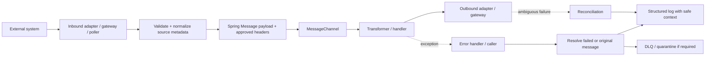
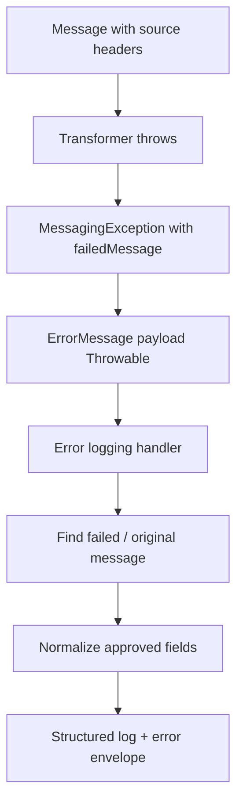
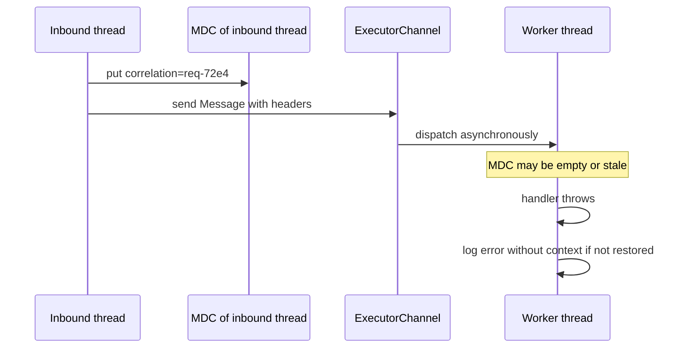
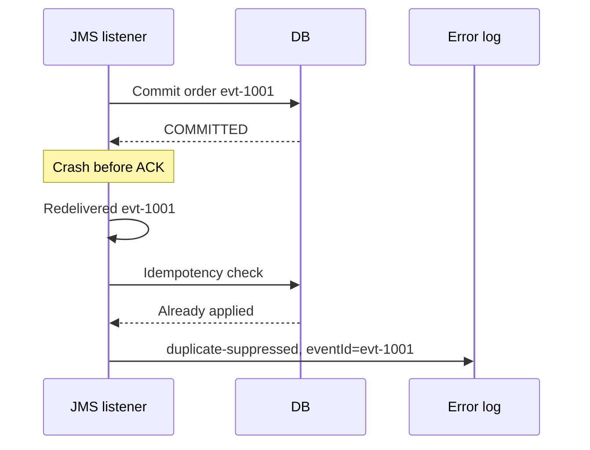

# Logging lỗi không làm mất ngữ cảnh trong Spring Integration Adapters

Trong một ứng dụng tích hợp, câu log **“Failed to process message”** thường chưa đủ để điều tra. Khi dữ liệu đi từ file hoặc SFTP qua `MessageChannel`, được chuyển đổi JSON/XML, ghi database rồi gửi đến HTTP, JMS, AMQP hoặc Kafka, lỗi có thể xảy ra tại bất kỳ bước nào. Nếu log chỉ có stack trace mà thiếu **nguồn message, correlation ID, event ID, bước xử lý, trạng thái retry và mức độ chắc chắn của kết quả**, đội vận hành khó trả lời: lỗi của đối tác nào, bản ghi nào đang ảnh hưởng, đã commit nghiệp vụ chưa, có thể replay hay sẽ tạo tác động trùng?

Bài học **“Logging lỗi không làm mất ngữ cảnh”** thuộc chương **Error handling** của module **SPRING_INTEGRATION_ADAPTERS**. Mục tiêu là thiết kế logging có cấu trúc, đủ bằng chứng để nối **inbound/outbound adapter, gateway, poller và MessageChannel**, giữ được ngữ cảnh qua **thread bất đồng bộ và ranh giới transport**, đồng thời không làm lộ thông tin nhạy cảm. Một hệ thống đáng tin cần log được **sự kiện lỗi và quyết định xử lý** chứ không chỉ một exception class.

> **Nguyên tắc trung tâm:** Ngữ cảnh nghiệp vụ phải có **nguồn dữ liệu bền vững** (message headers đã xác minh, event envelope, transaction metadata hoặc context riêng), còn **MDC là bản sao tạm trong thread để làm giàu log**. Không dùng MDC làm kho ngữ cảnh duy nhất, không tin mọi header do client tự khai và không sao chép toàn bộ payload/headers vào log.

## 1. Mục tiêu học tập

Sau bài này, người học có thể:

1. Nêu rõ những trường log tối thiểu để phân tích lỗi tích hợp theo **source, event, correlation, stage, outcome và retry**.
2. Phân biệt **payload**, **Spring Message headers**, **SLF4J MDC**, **trace/span context**, **transport metadata** và **error envelope**.
3. Giải thích nguyên nhân mất context khi dùng `ExecutorChannel`, poller, task scheduler, Kafka/JMS/AMQP listener hoặc HTTP gateway.
4. Viết một handler lỗi đọc `ErrorMessage`, `MessagingException.getFailedMessage()` và `originalMessage` khi chúng tồn tại.
5. Tạo các log events có cấu trúc và **reason codes ổn định**, thay vì phụ thuộc vào exception message.
6. Tự quản lý MDC trong `try/finally` để không rò context giữa các request dùng lại thread pool.
7. Hiểu lúc nào dùng `TaskDecorator`/tracing instrumentation và khi nào phải xây lại context từ message.
8. Bảo toàn ngữ cảnh khi conversion, routing, retry, dead-letter, quarantine, replay hoặc outcome chưa rõ.
9. Thiết kế logging theo từng adapter: **file, SFTP, HTTP, JMS, AMQP, Kafka và JDBC/database**.
10. Kiểm thử trường hợp thiếu header, header sai kiểu, redelivery, nhiều thread, multi-tenant và secret redaction.

## 2. “Không làm mất ngữ cảnh” cụ thể nghĩa là gì?

Ngữ cảnh trong logging là dữ liệu giúp giải thích **sự kiện đang xảy ra gắn với yêu cầu, nguồn và tiến trình nào**.

Ví dụ một Kafka consumer gặp lỗi khi chuyển JSON thành DTO:

```text
Log nghèo ngữ cảnh:
ERROR Conversion failed: InvalidFormatException

Log có ngữ cảnh:
event=integration.message.failed
source=kafka-orders
stage=payload-validation
correlationId=req-72e4
eventId=evt-1001
topic=orders.v1
partition=3
offset=48102
schemaVersion=v2
reason=INVALID_ORDER_AMOUNT
attempt=2
outcome=NOT_APPLIED_CONFIRMED
```

Sự khác biệt không nằm ở số lượng ký tự của thông báo lỗi mà ở **khả năng nối log với bằng chứng nguồn và quyết định vận hành**.

### 2.1. Những câu hỏi một bản ghi lỗi tốt phải hỗ trợ

- **What:** lỗi nào, ở stage nào, với loại operation nào?
- **Where:** adapter, endpoint, channel và external dependency nào?
- **Which:** event ID, command ID hoặc file/batch/row nào?
- **Who/Scope:** producer và tenant **đã xác minh** nào chịu ảnh hưởng?
- **When:** thời điểm lỗi, thời gian xử lý, deadline và độ tuổi bản ghi?
- **Why:** reason code ổn định, exception category, contract version?
- **Then what:** retry, reject, DLQ, pause consumer hay reconcile?
- **Did it apply:** business commit đã xác nhận, không xảy ra hay còn **UNKNOWN**?

Đừng tạo một message log chỉ chứa mọi thông tin tình cờ có sẵn. Chọn các trường có **nghĩa rõ, được chuẩn hóa và được phép lưu**.

## 3. Sáu nơi có thể chứa “context”

| Nơi chứa | Ví dụ | Vòng đời | Lưu ý |
| --- | --- | --- | --- |
| **Payload / domain envelope** | `eventId`, `orderId`, `schemaVersion` | Cùng event | Có thể chứa PII; chỉ đọc những trường đã được parse và validate. |
| **Spring `MessageHeaders`** | `correlationId`, `sourceSystem`, `contentType` | Theo từng `Message<?>` | Có thể thay đổi qua endpoint, không tự lan qua mọi transport. |
| **Transport metadata** | Kafka topic/partition/offset, JMS message ID, SFTP filename | Theo adapter/broker | Tên/kiểu và thời điểm có metadata khác nhau. |
| **SLF4J MDC** | `correlationId`, `flowId`, `stage` | Theo thread | Không phải storage bền; dễ mất hoặc rò qua thread pool. |
| **Trace/span context** | Trace ID, span ID, parent relationship | Qua instrumentation và propagation | Không đồng nghĩa business event ID; sampling có thể loại trace. |
| **Error envelope/audit store** | `failureId`, `reasonCode`, `outcome`, `payloadRef` | Bền qua DLQ/replay | Cần schema, retention, quyền xem và idempotency. |

### 3.1. Một quy tắc thiết kế hữu ích

**Message headers/domain envelope là nơi mang context theo message**, **tracing context nối các hoạt động**, **MDC giúp log trong một thread đọc được context**, còn **error envelope lưu bằng chứng cần thiết sau khi lỗi xảy ra**.

Nếu một handler dựa duy nhất vào `MDC.get("eventId")` thì khi message đi qua executor, listener hoặc task scheduler, giá trị có thể mất; tệ hơn, một thread được tái sử dụng có thể chứa **giá trị của message trước** nếu không dọn đúng cách.

## 4. Dòng chảy context từ adapter đến error logging



Lỗi có thể xảy ra **trước khi inbound adapter tạo được Spring Message**. Khi đó context đến từ adapter/listener và transport; không thể bắt buộc mọi lỗi phải có `failedMessage`.

### 4.1. Nguồn thông tin đáng tin được tạo tại ingress

Ví dụ HTTP client gửi header `X-Tenant-ID: tenant-b`, nhưng principal đã xác thực thuộc tenant A. Logging và authorization cần dùng **verified tenant context** từ gateway/security layer; không tự gán tenant B chỉ vì client đã khai.

Tương tự, topic Kafka/queue JMS có thể được chọn từ connector configuration; các trường `sourceSystem` do producer đưa vào cần được ràng buộc với identity của producer. **Log sai nguồn** làm triage sai và có thể mở đường cho tấn công giả mạo.

## 5. Thiết kế log schema trước khi viết code

Một schema logging chuẩn giúp tìm kiếm cross-adapter và tạo dashboard ổn định.

| Trường | Ví dụ | Ý nghĩa |
| --- | --- | --- |
| `event` | `integration.message.failed` | Tên sự kiện logging, không phải exception type. |
| `timestamp` | UTC ISO-8601 | Thời điểm ghi log. |
| `service` | `spring-integration-adapters` | Service phát log. |
| `environment` | `prod` | Môi trường vận hành. |
| `flow` | `orders-import` | Flow được quản trị. |
| `adapter` | `kafka-inbound` | Loại adapter/endpoint. |
| `stage` | `transform-json` | Bước bị lỗi. |
| `eventId` | `evt-1001` | Một logical event. |
| `correlationId` | `req-72e4` | Nối một quy trình nhiều hop. |
| `traceId` / `spanId` | IDs theo tracing implementation | Liên kết với distributed trace. |
| `sourceSystem` | `partner-a` | Nguồn đã kiểm tra. |
| `tenantScope` | `tenant-a` hoặc mã scope cho phép log | Không dùng cho authorization dựa vào log. |
| `schemaVersion` | `order-v2` | Diễn giải payload/contract. |
| `reasonCode` | `INVALID_ORDER_AMOUNT` | Mã lỗi ổn định phục vụ routing/metrics. |
| `failureStage` | `VALIDATION` | Định vị tầng phát sinh. |
| `retryAttempt` | 2 | Lần thử hiện tại nếu biết chính xác. |
| `retryable` | false | Quyết định theo policy, không phải thuộc tính exception bất biến. |
| `outcome` | `UNKNOWN` | Mức chắc chắn business effect. |
| `failureId` | `fail-00981` | Liên kết audit/DLQ. |
| `durationMs` | 87 | Thời gian ở một stage đã được đo. |

Không có yêu cầu mọi log phải chứa đủ các trường. **Success log**, **error log** và **audit event** có nhu cầu khác nhau. Trong mọi trường hợp, trường không biết nên được biểu diễn như **unknown/absent**, không bịa giá trị “hợp lý”.

### 5.1. JSON log minh họa

```json
{
  "timestamp": "2026-11-23T08:50:12.421Z",
  "level": "ERROR",
  "event": "integration.message.failed",
  "service": "spring-integration-adapters",
  "flow": "orders-import",
  "adapter": "kafka-inbound",
  "stage": "transform-json",
  "sourceSystem": "partner-a",
  "correlationId": "req-72e4",
  "eventId": "evt-1001",
  "schemaVersion": "order-v2",
  "reasonCode": "INVALID_ORDER_AMOUNT",
  "retryAttempt": 2,
  "outcome": "NOT_APPLIED_CONFIRMED",
  "failureId": "fail-00981",
  "exceptionType": "InvalidFormatException"
}
```

Đây là **dữ liệu minh họa**, không phải output có sẵn mặc định của Spring Integration. Kế hoạch logging phải đi kèm cấu hình encoder/appender thực tế, quyền truy cập, indexing và retention.

## 6. Correlation ID, event ID và trace ID không giống nhau

### 6.1. Correlation ID

Nối nhiều bước của một yêu cầu/quy trình:

```text
HTTP request
  correlationId=req-72e4
    -> validation
    -> DB transaction
    -> publish Kafka
    -> consumer
```

Một correlation ID có thể bao trùm **nhiều sự kiện**.

### 6.2. Event/command ID

Định danh **một logical event hoặc ý định nghiệp vụ**. Nó cần ổn định qua retry và replay khi cùng ý định được phát lại. Có thể dùng làm thành phần của idempotency key cùng tenant/source/operation.

### 6.3. Trace ID và span ID

Tracing ID liên kết các hoạt động theo distributed tracing. Một trace có thể có nhiều span; span ID thay đổi giữa các bước. Trace có thể bị sampling hoặc không propagate qua một số broker/adapter. Vì vậy:

- **Không dùng trace ID thay business event ID.**
- **Không dùng correlation ID mặc nhiên làm idempotency key.**
- **Không kỳ vọng log luôn có trace ID**, nhất là với message đã lưu trong DLQ lâu ngày và replay dưới context mới.
- Nếu replay sinh trace mới, vẫn giữ **originalEventId** và liên kết **replayRunId/failureId**.

### 6.4. ID do client gửi cần validate

Một client có thể đặt correlation ID rất dài, chứa newline hoặc ký tự điều khiển. Cần giới hạn chiều dài, charset, trust level và cách hiển thị trước khi đưa vào log. Không sử dụng correlation ID để mở quyền tenant hay quyết định destination.

## 7. MDC là gì và giới hạn của nó?

**Mapped Diagnostic Context (MDC)** của SLF4J/Logback cho phép thêm key/value vào context logging của thread đang thực thi:

```java
import org.slf4j.MDC;

MDC.put("correlationId", "req-72e4");
MDC.put("eventId", "evt-1001");
```

Một logging layout/structured encoder **được cấu hình để xuất MDC** có thể tự đưa các field vào mỗi bản ghi log phát ra trong cùng thread.

MDC giúp không phải lặp các field ở từng lời gọi `log.info(...)`, nhưng **không phải message metadata store**:

- Không tự bảo toàn qua serialization sang Kafka/JMS/HTTP.
- Không tự được truyền qua executor thread.
- Không được mặc định dọn sạch khi thread quay lại pool nếu application không quản lý.
- Không nên chứa object payload, secret, cookie hay header map thô.
- Không phải bằng chứng một business transaction đã commit.

### 7.1. Rò MDC nghiêm trọng thế nào?

```text
Worker thread-1 xử lý tenant-A:
  MDC[tenantScope] = tenant-A
  handler throws, code quên clear

Worker thread-1 xử lý tenant-B:
  application không set context mới
  logs vẫn hiện tenant-A
```

Đây không chỉ là lỗi quan sát; log có thể **gắn dữ liệu của tenant B với tenant A**, dẫn tới triage sai hoặc rủi ro bảo mật. Vì vậy dùng **try/finally và restore context trước đó**.

## 8. Java: scope MDC an toàn bằng try/finally

Ví dụ tiện ích cho một scope message, dùng Java 17 và SLF4J:

```java
import java.util.HashMap;
import java.util.Map;
import org.slf4j.MDC;

public final class MessageLogScope implements AutoCloseable {

    private final Map<String, String> previous;

    private MessageLogScope(Map<String, String> fields) {
        this.previous = MDC.getCopyOfContextMap();

        Map<String, String> next = previous == null
            ? new HashMap<>()
            : new HashMap<>(previous);

        // 'fields' phải là allowlist đã được validate trước.
        next.putAll(fields);
        MDC.setContextMap(next);
    }

    public static MessageLogScope open(Map<String, String> fields) {
        return new MessageLogScope(fields);
    }

    @Override
    public void close() {
        if (previous == null) {
            MDC.clear();
        } else {
            MDC.setContextMap(previous);
        }
    }
}
```

Dùng:

```java
try (MessageLogScope scope = MessageLogScope.open(Map.of(
        "flow", "orders-import",
        "eventId", safeEventId,
        "correlationId", safeCorrelationId))) {

    log.info("event=integration.processing.started");
    orderHandler.handle(message);

} // Restore MDC cũ kể cả khi handler ném exception
```

### 8.1. Những lưu ý khi đưa vào production

1. `Map.of(...)` không cho key/value null; nếu một ID vắng mặt, **bỏ trường đó** hoặc có quy ước `unknown` an toàn, không truyền null.
2. `fields` phải qua **validation, độ dài tối đa và allowlist**.
3. Việc restore là an toàn hơn `MDC.clear()` trần khi code chạy bên trong một scope MDC cha (ví dụ HTTP request filter).
4. Mặc dù restore giúp tránh rò scope mới, cần kiểm tra cả các interceptor/handler khác có ghi vào MDC ngoài scope này.
5. Nếu muốn dùng `MDC.putCloseable` cho từng key, phải hiểu semantics khi key đã tồn tại trước đó; lưu/restore toàn bộ context sẽ rõ hơn.
6. Bản ghi lỗi phát ra **sau khi đóng scope** sẽ không còn MDC của message; lúc đó cần explicit fields hoặc mở scope mới từ message/error envelope.

## 9. Hình thành context từ message, không từ MDC cũ

Một cách tiếp cận tốt là tạo **IntegrationLogContext** từ dữ liệu đáng tin.

```java
public record IntegrationLogContext(
    String flow,
    String adapter,
    String stage,
    String correlationId,
    String eventId,
    String sourceSystem,
    String schemaVersion
) {}
```

Không nên ép kiểu tùy tiện:

```java
// Nguy hiểm nếu Kafka/JMS header mapper trả byte[] thay vì String:
String eventId =
    (String) message.getHeaders().get("eventId");
```

Thay vào đó, chọn quy tắc cụ thể:

```java
import java.util.regex.Pattern;

public final class SafeHeaderValues {

    private static final Pattern SAFE_ID =
        Pattern.compile("[A-Za-z0-9._:-]{1,128}");

    private SafeHeaderValues() {}

    public static String id(Object raw) {
        if (!(raw instanceof String value)) {
            return null;
        }

        return SAFE_ID.matcher(value).matches()
            ? value : null;
    }
}
```

**Chú ý:** cách trên **từ chối** byte[] header chưa chuẩn hóa, không tự giải mã ngẫu nhiên. Với Kafka, nếu contract quy định event ID là UTF-8 bytes trong record header, hãy decode **tại adapter boundary** bằng converter nghiêm ngặt rồi truyền vào canonical `MessageHeaders`. Đừng gọi `byteArray.toString()`.

### 9.1. Verified source vs claimed source

Nếu mã nguồn gửi `sourceSystem=trusted-partner` nhưng transport authentication cho biết đó là một producer khác, log phải dùng **nguồn đã xác minh** hoặc ghi hai trường tách biệt `claimedSource`/`verifiedSource` với quyền xem phù hợp. Không tự “tin vì log đã ghi”.

## 10. Transformer lỗi: giữ failedMessage để logger có ngữ cảnh

Một transformer có thể trả payload mới, hoặc tạo `Message<?>` mới. Khi lỗi xảy ra, nếu exception có tham chiếu message thất bại thì error handler có thêm nguồn context.

Ví dụ:

```java
import com.fasterxml.jackson.core.JsonProcessingException;
import com.fasterxml.jackson.databind.ObjectMapper;
import org.springframework.integration.annotation.Transformer;
import org.springframework.messaging.Message;
import org.springframework.messaging.MessageHandlingException;
import org.springframework.stereotype.Component;

@Component
public class OrderDecoder {

    private final ObjectMapper mapper;

    public OrderDecoder(ObjectMapper mapper) {
        this.mapper = mapper;
    }

    @Transformer(
        inputChannel = "rawOrdersChannel",
        outputChannel = "parsedOrdersChannel"
    )
    public OrderCreated decode(Message<byte[]> input) {
        try {
            return mapper.readValue(
                input.getPayload(),
                OrderCreated.class
            );
        } catch (JsonProcessingException ex) {
            throw new MessageHandlingException(
                input, "ORDER_JSON_DECODE_FAILED", ex
            );
        }
    }
}
```

### 10.1. Vì sao không log exception rồi trả success giả?

Một anti-pattern:

```java
try {
    return parse(payload);
} catch (Exception ex) {
    log.error("Parse failed", ex);
    return new OrderCreated(...placeholder...);
}
```

Handler phía sau có thể coi placeholder là đơn hàng hợp lệ. Logging là **tín hiệu quan sát**, không thay thế việc thông báo lỗi bằng exception/result kiểu an toàn.

### 10.2. Một lỗi có thể được log nhiều lần

Nếu transformer log ERROR, gateway log ERROR, error handler log ERROR và DLQ publisher log ERROR cùng một exception, hệ thống sinh **log storm** nhưng không tăng bằng chứng. Nên phân công:

- Tại **nơi phát hiện**: ghi reason code/diagnostic có giới hạn, hoặc ném exception có context.
- Tại **error boundary chịu trách nhiệm**: phát structured error log chính.
- Tại **retry/DLQ decision**: ghi một event quyết định xử lý.
- Khi **đã verified/reconciled**: ghi outcome/audit event.

Không cần in stack trace tại mọi tầng.

## 11. ErrorMessage và headers của message thất bại

Trong Spring Messaging, `org.springframework.messaging.support.ErrorMessage` thường chứa `Throwable` trong payload. Bản thân error message có **headers riêng**, không tự động là bản sao của headers ở message đã thất bại.

Khi payload là `MessagingException`, có thể tìm `getFailedMessage()`. Một số error messages cũng giữ `getOriginalMessage()`.



**Lưu ý:** không bảo đảm mọi exception đều có failedMessage. Đặc biệt lỗi xảy ra trước khi deserializer/adapter tạo Spring Message cần **adapter-specific error context**.

## 12. Java: truy tìm failed/original message qua cause-chain

Lỗi có thể bị framework wrap nhiều lần. Một tiện ích nhỏ có thể tìm message gần nhất có sẵn, với giới hạn để tránh lặp hoặc chain bất thường:

```java
import java.util.Collections;
import java.util.IdentityHashMap;
import java.util.Set;
import org.springframework.messaging.Message;
import org.springframework.messaging.MessagingException;
import org.springframework.messaging.support.ErrorMessage;

public final class FailedMessageResolver {

    private FailedMessageResolver() {}

    public static Message<?> resolve(ErrorMessage error) {
        if (error == null) {
            return null;
        }

        Set<Throwable> seen =
            Collections.newSetFromMap(new IdentityHashMap<>());

        Throwable current = error.getPayload();
        int depth = 0;

        while (current != null
                && depth++ < 16
                && seen.add(current)) {

            if (current instanceof MessagingException messagingException
                    && messagingException.getFailedMessage() != null) {
                return messagingException.getFailedMessage();
            }

            current = current.getCause();
        }

        return error.getOriginalMessage();
    }
}
```

### 12.1. Resolver không làm gì?

- Không khẳng định message tìm được là **ingress message đầu tiên**; nó có thể là message ở một stage sau transform.
- Không suy source/tenant từ exception message.
- Không tạo failed message giả khi lỗi pre-deserialization.
- Không tự đi đọc raw payload ngoài kho có phân quyền.
- Không bảo đảm error handler đã được đăng ký vào error channel đúng cách.

Nếu có nhiều message ở các tầng, nên lưu riêng `originalEventId`, `originalMessageId` và `failedStageMessageId` khi cần, không dùng chung một nhãn mơ hồ.

## 13. Java: error handler log một sự kiện có cấu trúc

Ví dụ Spring Integration error handler cho một **channel lỗi riêng**. Nó ưu tiên metadata đã được chuẩn hóa tại ingress, từ chối in raw payload, và đánh dấu khi thiếu lineage.

```java
import org.slf4j.Logger;
import org.slf4j.LoggerFactory;
import org.springframework.integration.annotation.ServiceActivator;
import org.springframework.messaging.Message;
import org.springframework.messaging.support.ErrorMessage;
import org.springframework.stereotype.Component;

@Component
public class OrderErrorLogger {

    private static final Logger log =
        LoggerFactory.getLogger(OrderErrorLogger.class);

    @ServiceActivator(inputChannel = "ordersErrorChannel")
    public void onError(ErrorMessage error) {
        Message<?> failed = FailedMessageResolver.resolve(error);

        String eventId = id(failed, "eventId");
        String correlation = id(failed, "correlationId");
        String source = id(failed, "verifiedSource");
        String schema = id(failed, "schemaVersion");

        Throwable cause = error.getPayload();

        // Những tên field được thể hiện trong message pattern.
        // Structured JSON encoder cần cấu hình riêng để thành JSON fields.
        log.error(
            "event=integration.message.failed flow={} stage={} " +
            "eventId={} correlationId={} sourceSystem={} " +
            "schemaVersion={} reasonCode={} exceptionType={} " +
            "lineageMissing={}",
            "orders-import",
            "transform-json",
            eventId, correlation, source, schema,
            "ORDER_JSON_DECODE_FAILED",
            cause.getClass().getSimpleName(),
            failed == null
        );

        // Policy retry/DLQ/ACK xử lý ở thành phần được chỉ định riêng.
        // Logger này không tự xác nhận nguồn hoặc coi log là durable capture.
    }

    private static String id(Message<?> message, String headerName) {
        if (message == null) {
            return null;
        }
        return SafeHeaderValues.id(
            message.getHeaders().get(headerName)
        );
    }
}
```

**Ý nghĩa:** lỗi có metadata để tìm kiếm mà không làm rò raw payload. Nhưng đây là **log text có key=value**, không tự trở thành JSON có các field riêng trong mọi logging backend. Để có JSON thực, cần cấu hình structured encoder hoặc API logging structured phù hợp với stack.

### 13.1. Không luôn đính kèm Throwable vào log công khai

Nhiều hệ thống gọi:

```java
log.error("Conversion failed", cause);
```

Có thể hữu ích trong logger nội bộ được bảo vệ, nhưng exception message, stack trace và suppressed exceptions có thể chứa URI, SQL literal, request body hoặc token. Với log đi vào một hệ thống truy cập rộng, ưu tiên **reason code + exception type + error reference**; stack trace chi tiết chỉ ở vùng bảo mật theo chính sách và có redaction/retention.

### 13.2. Tại sao chỉ log không đủ để xử lý lỗi?

Nếu một message đã bị loại trước ACK, logger không đảm bảo được:

- DLQ publish đã bền.
- Database transaction đã rollback hay commit.
- HTTP caller nhận status đúng.
- Kafka offset đã commit.
- SFTP file đã archive/quarantine.
- Business operation chưa được áp dụng.

Log và error handling là **hai trách nhiệm khác nhau**; log giúp giải thích quyết định, không thay thế cơ chế quyết định đó.

## 14. SLF4J placeholders và structured logging

Có nhiều hình thức log:

### 14.1. Free text khó truy vấn

```java
log.error("Could not process order " + orderId
    + " from " + source + " because " + ex.getMessage());
```

Rủi ro:

- Chuỗi message thay đổi theo exception.
- Có thể lộ payload, ID nhạy cảm hoặc ký tự xuống dòng.
- Khó thống kê reason code.
- Việc nối chuỗi có thể tốn chi phí ngay cả khi level bị tắt.

### 14.2. Parameterized logging

```java
log.warn(
    "event=integration.retry.decision adapter={} reason={} attempt={}",
    adapter, reasonCode, attempt
);
```

Ưu điểm là các thành phần tách rõ và không cần nối chuỗi thủ công, nhưng **để truy vấn fields thực sự** cần parser/encoder phù hợp.

### 14.3. Native structured fields

Một số stack hỗ trợ fluent SLF4J API, key-value pairs hoặc JSON encoder. Ví dụ theo API SLF4J 2.x:

```java
log.atError()
    .addKeyValue("event", "integration.message.failed")
    .addKeyValue("flow", "orders-import")
    .addKeyValue("eventId", eventId)
    .addKeyValue("correlationId", correlationId)
    .addKeyValue("reasonCode", reasonCode)
    .log("Order conversion failed");
```

**Không nên khẳng định các key-value pairs tự xuất thành JSON** nếu backend/layout chưa hỗ trợ. Với một số layout, chúng có thể được render thành text hoặc bỏ qua. Cần kiểm thử log output thật sau cấu hình logging backend.

## 15. Structured JSON output và Logback/Spring Boot

Spring Boot có thể được cấu hình để xuất log có cấu trúc qua logging backend phù hợp. Tùy **phiên bản Spring Boot, SLF4J/Logback và encoder**, cách khai báo JSON, MDC và key-value pairs khác nhau.

Quy tắc cấu hình:

1. Chọn **một schema log** đã được quản trị.
2. Cấu hình encoder/layout phát JSON mỗi dòng với những field đã cho phép.
3. Đưa trace/span IDs từ instrumentation khi có.
4. Giới hạn và sanitize MDC fields.
5. Đảm bảo `exceptionType`/`reasonCode` tách khỏi raw exception message.
6. Thiết lập redaction ở cả **application layer** và pipeline thu thập log.
7. Kiểm tra index mappings/cardinality, thời gian lưu và quyền truy cập.
8. Kiểm thử log thực sự parse được, không chỉ test Java logger có được gọi.

### 15.1. Một JSON event kỳ vọng

```json
{
  "timestamp": "2026-11-23T09:20:40.123Z",
  "level": "WARN",
  "event": "integration.retry.decision",
  "flow": "sftp-orders",
  "adapter": "sftp-inbound",
  "correlationId": "batch-2026-42",
  "eventId": "file-record-108",
  "reasonCode": "REMOTE_READ_TIMEOUT",
  "attempt": 2,
  "decision": "RETRY_WITH_BACKOFF",
  "retryDelayMs": 2000
}
```

Đây là mục tiêu đầu ra minh họa; không phải tất cả các trường được tự động sinh bởi Spring Integration.

## 16. Thread hop: tại sao MDC biến mất?

Một `DirectChannel` thường dispatch handler đồng bộ trên thread gọi. Nếu chuyển qua `ExecutorChannel` hoặc một executor khác, handler có thể chạy trên thread mới:



**MDC là thread-local**, còn `Message<?>` đi qua channel mang context theo message. Phải chọn cách tái tạo context cho thread worker. Hai hướng:

- **Preferred cho message processing:** mở scope MDC **từ MessageHeaders đã chuẩn hóa** khi handler bắt đầu, rồi restore trong finally.
- **Hỗ trợ cho những task cùng call chain:** dùng task decorator/context propagation instrumentation để chuyển context sang executor một cách có kiểm soát.

Không được mặc định **MDC sẽ tự động đi cùng MessageChannel** qua mọi async boundary.

## 17. TaskDecorator cho executor: tiện ích và giới hạn

Với một Spring `ThreadPoolTaskExecutor` có hỗ trợ `TaskDecorator`, có thể sao chép MDC khi task được nộp.

```java
import java.util.Map;
import org.slf4j.MDC;
import org.springframework.core.task.TaskDecorator;

public final class MdcTaskDecorator implements TaskDecorator {

    @Override
    public Runnable decorate(Runnable task) {
        // Capture tại thời điểm nộp task.
        Map<String, String> submittingContext =
            MDC.getCopyOfContextMap();

        return () -> {
            // Worker thread có thể đã chạy task khác.
            Map<String, String> oldWorkerContext =
                MDC.getCopyOfContextMap();

            try {
                if (submittingContext == null) {
                    MDC.clear();
                } else {
                    MDC.setContextMap(submittingContext);
                }

                task.run();
            } finally {
                if (oldWorkerContext == null) {
                    MDC.clear();
                } else {
                    MDC.setContextMap(oldWorkerContext);
                }
            }
        };
    }
}
```

Ví dụ tạo executor:

```java
import org.springframework.context.annotation.Bean;
import org.springframework.context.annotation.Configuration;
import org.springframework.scheduling.concurrent.ThreadPoolTaskExecutor;

@Configuration
public class IntegrationExecutorConfig {

    @Bean
    public ThreadPoolTaskExecutor integrationExecutor() {
        ThreadPoolTaskExecutor executor =
            new ThreadPoolTaskExecutor();

        executor.setCorePoolSize(4);
        executor.setMaxPoolSize(8);
        executor.setQueueCapacity(200);
        executor.setThreadNamePrefix("integration-");
        executor.setTaskDecorator(new MdcTaskDecorator());
        executor.initialize();
        return executor;
    }
}
```

### 17.1. Những giới hạn bắt buộc hiểu

1. Decorator chỉ tác động tới **task thực sự dùng executor đó**.
2. Không tự lan context qua broker, HTTP, SFTP, JVM khác hoặc task scheduler khác.
3. Nếu một message được nộp từ thread đã chứa MDC sai/stale, decorator cũng có thể copy **context sai**.
4. Nếu executor queue tasks quá lâu, context được chụp từ lúc submit có thể không còn phù hợp với quyền mới; dùng message verified metadata làm nguồn chính.
5. Không đặt credential vào MDC chỉ vì nó có thể propagate.
6. Nếu dùng tracing/observability context propagation framework, cần tránh **hai cơ chế ghi/restore context xung đột**; kiểm thử theo phiên bản và cấu hình.

**TaskDecorator là cơ chế hỗ trợ, không thay thế việc đọc event/correlation từ headers.**

## 18. Scheduled poller: không có incoming HTTP request để thừa kế context

Một SFTP/file/JDBC poller có thể được kích hoạt bởi `TaskScheduler`, không có HTTP request cha. Không nên kỳ vọng MDC của thread tạo bean hoặc thread cấu hình sẽ tồn tại khi poll chạy.

Luồng đáng tin:

```text
TaskScheduler triggers poll
  -> message source returns file/row
  -> inbound adapter creates Message
  -> attach verified source + event/batch ID
  -> MessageChannel
  -> handler opens MDC scope from Message
  -> success/error log with same context
  -> handler closes MDC scope
```

### 18.1. Source không trả message

Khi poll tìm thấy **không có dữ liệu**, không nhất thiết có event ID. Một log source-level có thể ghi `adapter=sftp-inbound`, `pollRunId`, `durationMs` và `itemsFound=0`. **Đừng bịa event ID** cho lượt poll rỗng hoặc dùng lại ID của message trước.

### 18.2. Poller lỗi trước khi tạo Message

Nếu SFTP listing timeout hoặc JDBC query fail, lỗi gắn với **poll attempt**, không nhất thiết một event cụ thể. Tạo `pollRunId` riêng, lấy endpoint/source từ cấu hình và báo `eventIdUnavailable=true` khi cần.

## 19. Header preservation khi transformer tạo message mới

Một transformer có thể đổi payload từ `byte[]` → `String` → DTO. Nếu trả về một `Message<?>` mới chỉ chứa payload, các custom headers cần thiết có thể mất theo cách endpoint được cấu hình.

Ví dụ minh họa tạo header allowlist nội bộ:

```java
Message<OrderCreated> converted = MessageBuilder
    .withPayload(order)
    .setHeader(
        "correlationId",
        input.getHeaders().get("correlationId")
    )
    .setHeader(
        "eventId",
        input.getHeaders().get("eventId")
    )
    .setHeader(
        "verifiedSource",
        input.getHeaders().get("verifiedSource")
    )
    .setHeader(
        "originalMessageId",
        String.valueOf(input.getHeaders().getId())
    )
    .build();
```

### 19.1. Vì sao không copy mọi header?

- `replyChannel` và `errorChannel` có thể là đối tượng điều phối nội bộ.
- `contentType` gắn với **wire bytes** có thể không còn đúng với DTO.
- Transport headers có thể không serialize được khi sang broker khác.
- HTTP `Authorization` hoặc session/cookie có thể làm lộ secret.
- `tenantId` do client khai chưa chắc là tenant đã xác minh.

Trong **vùng tin cậy** có thể dùng `copyHeaders(...)` theo chính sách rồi loại các header không phù hợp; tại **trust boundary**, nên dùng allowlist chuẩn hóa.

## 20. Error logging ở đâu để không bị nhân log?

Một pipeline:

```text
Inbound adapter
  -> Transformer
  -> DB handler
  -> HTTP outbound gateway
  -> Error handler
  -> DLQ/quarantine
```

Nên đặt **ownership** cho từng loại log:

| Điểm | Log phù hợp | Điều nên tránh |
| --- | --- | --- |
| Inbound boundary | Accepted/rejected và metadata đã xác minh. | Log full payload/token trên mọi request. |
| Transformer | Conversion reason code khi cần chẩn đoán. | Lặp ERROR stack trace mà boundary sẽ log. |
| Business handler | Domain rejection/result, transaction stage. | Gọi mọi business rejection là system outage. |
| Outbound gateway | Dependency, request identity, latency, status/unknown outcome. | Ghi “failed” khi chỉ biết timeout. |
| Error handler | Một structured error event chính, quyết định retry/DLQ. | Mất event/correlation, log raw ErrorMessage.toString(). |
| DLQ publisher | Capture success/failure, failure ID, destination đã phê duyệt. | Coi DLQ publish success là business success. |
| Replay dispatcher | Approval, replay run/attempt và result. | Sinh event ID mới hoặc làm giả success. |

Một message có thể có nhiều log **khác loại**: started, failed, retry scheduled, dead-lettered, verified. Không nên tạo hàng loạt bản ghi ERROR trùng nhau mà không tăng thông tin.

## 21. HTTP inbound gateway: log lỗi mà không phản chiếu bí mật

HTTP gateway nhận request có metadata như method, route, content type, client-generated request ID và security principal. Khi bước chuyển đổi/handler thất bại, cần nối log với request nhưng không được log toàn bộ HTTP headers.

### 21.1. Hợp đồng log HTTP

| Dữ liệu | Nên làm | Không nên làm |
| --- | --- | --- |
| HTTP route | Log route template như `/api/orders/{id}` khi có thể. | Log raw URL chứa token/query PII. |
| Request ID | Validate external ID hoặc tạo internal request ID. | Tin một ID có ký tự điều khiển/độ dài vô hạn. |
| Authentication | Log mã định danh đã được phép theo chính sách. | Log Authorization bearer token, cookies hoặc API key. |
| Tenant | Lấy từ principal/context đã xác minh. | Tin `X-Tenant-ID` do client tự khai làm authority. |
| Content-Type | Ghi media type/charset đã parse. | In nguyên request body để “giúp debug”. |
| Status | Log response code và exception class/reason. | Gọi mọi `5xx` là chắc chắn không có side effect. |
| Duration | Đo tại gateway/handler. | Suy từ timestamp của một dòng log duy nhất. |

### 21.2. Đường đồng bộ có thể không phát ErrorMessage

```text
POST /orders
  -> HTTP inbound gateway
  -> DirectChannel
  -> transformer / business handler throws
  -> exception propagates to gateway/caller
  -> HTTP error mapping
```

Một lỗi ở đường đồng bộ có thể được báo về caller mà **không tự động gửi vào global errorChannel**. Vì vậy, ghi log ở nơi có quyền sở hữu response/error mapping, rồi bảo toàn `correlationId` vào safe response:

```json
{
  "code": "ORDER_PAYLOAD_INVALID",
  "requestId": "req-72e4",
  "message": "Request payload does not match the contract"
}
```

Không gửi stack trace, tên bảng, token hoặc nội dung request thô về client.

### 21.3. Outbound HTTP timeout: không kết luận tác động thất bại

Khi outbound gateway POST tới payment/booking API và timeout, log:

```text
event=integration.outbound.unknown
stage=http-outbound
operation=capture-payment
commandId=cmd-42
providerReference=pay-42
reasonCode=HTTP_RESPONSE_TIMEOUT
outcome=UNKNOWN
decision=RECONCILE_OR_RETRY_SAME_KEY
```

Không log `outcome=FAILED` nếu chưa có bằng chứng provider không commit. Nếu retry, giữ **cùng idempotency key** khi provider hỗ trợ; không dùng retryAttempt ID làm business command ID mới.

## 22. JMS: logging qua TextMessage, BytesMessage và redelivery

JMS listener/adapter có thể chuyển `TextMessage` hoặc `BytesMessage` thành Spring Message với headers/properties được map theo cấu hình.

Các trường thường cần:

- Verified producer/application/queue.
- Business `eventId` và `correlationId` theo contract.
- JMS destination và JMSMessageID **nếu quan sát được**.
- Redelivery flag/delivery count khi provider có và mapper cho phép.
- Message type, converter stage và error reason.
- Transaction/ACK outcome, nếu endpoint có chứng cứ xác nhận.

### 22.1. JMSMessageID khác eventId

Broker có thể cấp JMSMessageID khác khi một event được republish. `eventId` nghiệp vụ nên giữ ổn định qua retry/replay, để ứng dụng dedup đúng. Log cả hai khi hữu ích nhưng đừng thay tên chúng cho nhau.

### 22.2. Redelivery sau DB commit



Log tốt sẽ phân biệt `businessEffect=ALREADY_APPLIED` với `transportDelivery=REDELIVERED`. Việc một listener được gọi nhiều lần **không nhất thiết là lỗi** nếu business effect chỉ thực thi một lần.

### 22.3. Lỗi converter trước Integration flow

Nếu JMS message converter thất bại trước khi tạo được `Message<?>`, không thể tìm `failedMessage` trong Integration theo cách thông thường. Lúc đó dùng error strategy/listener context của JMS provider/container, với những metadata thực sự khả dụng. Ghi `eventIdMissing=true` nếu chưa đọc được event ID.

## 23. AMQP/RabbitMQ: log đủ routing nhưng không để header phình to

AMQP thường có exchange, routing key, queue, consumer tag, delivery tag và properties như content type/encoding. Spring AMQP adapter/converter có thể chuyển metadata này sang Spring Message với những tên và kiểu khác nhau.

### 23.1. Metadata hữu ích

| Trường | Công dụng | Giới hạn |
| --- | --- | --- |
| Queue/exchange alias | Khoanh vùng consumer và routing. | Không tự coi queue name là tenant đã xác thực. |
| Routing key | Tìm tuyến phát message. | Sanitize, không để text không kiểm soát thành metric label. |
| Broker delivery/requeue metadata | Biết message bị giao lại. | Không thay event ID. |
| Content type/encoding | Chọn đúng decoder. | Có thể không khớp body, vẫn phải validate. |
| DLX/DLQ destination | Theo dõi chuyển vùng lỗi. | Chỉ destination do config quản trị. |
| Business event ID | Idempotency/correlation. | Cần stable qua republish. |

### 23.2. Requeue loop

Một JSON sai schema được NACK/requeue liên tục có thể tạo hàng ngàn lỗi giống nhau. Không khắc phục bằng cách log stack trace mỗi lần. Cần:

- Bounded retry và phân loại permanent.
- Log một sự kiện `integration.message.deadlettered` với attempt count và reason.
- DLQ theo broker policy.
- Chỉ replay sau khi root cause đã được xử lý.
- Một cảnh báo backlog/oldest age thay vì flood mọi log cấp ERROR.

### 23.3. Dead-letter metadata không thay business lineage

Broker có thể gắn metadata như lịch sử dead-letter. Điều đó hữu ích để điều tra nhưng không nên copy/ngầm tích lũy mọi header qua nhiều lần replay. Tạo **canonical error envelope** và giữ event ID gốc.

## 24. Kafka: deserializer, topic-partition-offset và logging có ngữ cảnh

Một Kafka consumer có record:

```text
topic=orders.v1
partition=3
offset=48102
key=ORD-42
headers: eventId=evt-1001, correlationId=req-72e4
value=byte[] JSON
```

Khi vào Spring Integration, các header có thể được map sang Spring Message. Nhưng lỗi có thể xảy ra ở hai tầng:

1. **Kafka deserializer/listener layer**: value/key không deserialize được; Spring Message chưa được tạo.
2. **Integration transformer/handler**: Spring Message đã có; exception có thể chứa failedMessage.

### 24.1. Đừng đợi Integration error channel để xử lý mọi lỗi Kafka

Với lỗi key/value deserialization, cần Kafka-specific error handling theo listener/container, có thể sử dụng các thành phần của **Spring Kafka** theo phiên bản/cấu hình. Phải kiểm tra chúng thực sự lấy được **topic, partition, offset, headers** ở giai đoạn lỗi; không tự tạo dữ liệu giả.

### 24.2. Kafka record headers có thể là byte[]

Ví dụ không an toàn:

```java
String correlation =
    (String) message.getHeaders().get("correlationId");
```

Nếu mapper giữ byte[] nguyên bản, cast sẽ ném exception ngay trong error logger. Cần chuẩn hóa tại Kafka adapter boundary theo hợp đồng charset và kiểu, hoặc đọc có kiểm tra kiểu rõ ràng như `SafeHeaderValues.id(...)` rồi đánh dấu context missing.

### 24.3. Offset không phải business event ID

Bộ ba `topic + partition + offset` xác định **vị trí record trong Kafka log**, không phải logical event identity xuyên DLT/replay. Khi republish vào dead-letter topic, offset thay đổi. Giữ `originalTopic`, `originalPartition`, `originalOffset` dưới metadata chuyên biệt và `originalEventId` ổn định.

### 24.4. Commit offset không đồng nghĩa business commit

```text
Kafka record consumed
 -> DB transaction COMMIT
 -> process crash before offset commit
 -> record delivered again
```

Structured log có thể phân biệt:

```json
{
  "event": "integration.duplicate.suppressed",
  "adapter": "kafka-inbound",
  "eventId": "evt-1001",
  "originalTopic": "orders.v1",
  "originalPartition": 3,
  "originalOffset": 48102,
  "reasonCode": "ALREADY_APPLIED",
  "businessEffectAdditional": false
}
```

Chỉ ghi `businessEffectAdditional=false` khi có bằng chứng từ dedup/transaction. Đừng suy luận chỉ vì nhận lại cùng offset.

## 25. File và SFTP: log tên, đường đi, batch theo chính sách

File/SFTP inbound adapter thường phát hiện dữ liệu bằng poller. Lỗi có thể xảy ra ở giai đoạn:

- List remote directory.
- Acquire SFTP session hoặc download.
- Chờ file readiness.
- Đọc local file/stream.
- Decode charset và parse CSV/XML/JSON.
- Validate từng record.
- Commit nghiệp vụ.
- Archive/quarantine hoặc update metadata store.

### 25.1. Đơn vị context cần rõ

| Cấp | Metadata gợi ý | Khi nào có |
| --- | --- | --- |
| Poll attempt | `pollRunId`, connector, directory alias, duration | Ngay cả khi không có file. |
| File/batch | `batchId`, source ID, sanitized file reference, checksum, file size | Khi phát hiện/tải file. |
| Record | `recordId`, record index, schema version, source batch | Sau khi parser xác định record. |
| Business effect | `commandId`, transaction ID/domain result | Khi xử lý/commit. |
| Quarantine | `failureId`, payload reference, reason code, state | Sau khi lưu lỗi bền. |

**Không dùng raw remote path hoặc filename không tin cậy làm trực tiếp log field không giới hạn, link truy cập hoặc đường dẫn ghi local.** Cần canonicalize/sanitize và tách storage key với display metadata.

### 25.2. File đọc lại sau restart

```text
File: orders-2026-11-23.csv
  -> 999 records committed
  -> process crashes before archive
  -> poller sees file again
```

Log chỉ có “import started” và “import error” sẽ không đủ. Nên có batch ID, record-level identity, checkpoint, count processed/skipped và outcome. Replay toàn file chỉ an toàn nếu bản ghi đã commit được dedup; nếu không, cần chọn record-level replay/quarantine theo contract.

### 25.3. CSV physical line khác logical record

CSV quoted field có thể chứa newline. Nếu parser báo record 71 thì không nên tự đổi thành “dòng 71” khi không có mapping chính xác. Log đúng **logical record index từ parser**, và chỉ thêm physical line nếu parser cung cấp bằng chứng.

### 25.4. SFTP session failure trước message

Khi không download được file, chưa có event ID. Log:

```text
event=integration.poll.failed
adapter=sftp-inbound
sourceSystem=verified-partner-a
pollRunId=poll-2026-82
stage=remote-list
reasonCode=SFTP_SESSION_TIMEOUT
eventIdUnavailable=true
decision=RETRY_POLL_WITH_BACKOFF
```

Đừng tái sử dụng event ID của file trước trong MDC của thread scheduler.

## 26. JDBC/database: log row key và transaction stage

Một JDBC polling adapter có thể đọc bảng integration outbox. Khi row mapper/parser báo lỗi, context nên có:

- Database source alias và query/flow ID đã quản trị.
- Row ID/event ID và schema version.
- Lease/claim attempt nếu nhiều poller.
- Transaction stage: before commit, committed, rollback, unknown.
- Outcome của side effect.
- Retry/quarantine state.

Không log nguyên SQL với bind parameters chứa PII hoặc secret. Với một số JDBC driver, exception message có thể chứa SQL literal hoặc connection string; cần redaction khi cho phép stack traces.

### 26.1. Lỗi query trước khi lấy được row

Nếu database connection timeout **trước khi có row**, không có eventId. Log `pollRunId`, datasource alias, query category, connection pool state và timeout, không cố gắn lỗi vào một row giả.

### 26.2. Lỗi sau commit, trước checkpoint

Nếu một row đã tác động nghiệp vụ nhưng trạng thái `PROCESSED` chưa được ghi hoặc poller chưa ack, lần sau có thể đọc lại. Log cần nối hai lần bằng **stable event ID** và chỉ đánh `DUPLICATE_SUPPRESSED` sau khi dedup check có bằng chứng.

### 26.3. Transactional inbox/outbox

Một bảng unique key dùng để chống duplicate trong cùng DB transaction là bằng chứng hữu ích. Logging nên tách:

```text
event=integration.business.applied       // first apply committed
event=integration.duplicate.suppressed  // repeated delivery, no extra apply
event=integration.outbox.publish.unknown // outbound ACK not known
```

“Đã ghi DB thành công” **không** tự chứng minh broker cũng đã nhận event; cần log ở từng boundary.

## 27. Khi không có Message<?>: error context tối thiểu nào còn giữ được?

Có những lỗi phát sinh trước khi Spring Integration tạo `Message<?>`:

- HTTP parser không đọc được body.
- Kafka key/value deserializer thất bại.
- JMS/AMQP message converter lỗi.
- SFTP session/listing timeout.
- File reader không mở được file.
- JDBC query/row mapping gặp exception trước khi phát message.

Khi đó, error handler phải lấy context từ những đối tượng **thực sự đã tồn tại** ở tầng adapter.

### 27.1. Fallback strategy

1. Lấy verified source/connector identity từ cấu hình adapter hoặc security layer.
2. Lấy transport locator đang có (topic/partition/offset, queue, file, row, request ID).
3. Tạo `failureId`/`pollRunId` của lần thất bại.
4. Ghi `eventIdPresent=false` hoặc `lineageMissing=true` khi không có event ID.
5. Không suy tenant/event ID từ exception message.
6. Chuyển cho adapter-level error strategy hoặc quarantine theo policy.
7. Nếu không thể lưu message lỗi, ghi **captureFailed** và bảo toàn cơ chế redelivery/terminal alert phù hợp.

### 27.2. Missing context là tín hiệu đáng đo

Một hệ thống có thể tạo metric:

```text
integration_error_context_missing_total{
  adapter="kafka",
  missing_field="eventId",
  failure_stage="deserialization"
}
```

Nó giúp phát hiện mapping và instrumentations thiếu. Nhưng **không biến event ID giá trị động thành metric label**, vì cardinality cao và nguy cơ rò dữ liệu.

## 28. Retry, redelivery và log không gây hiểu lầm

Một message bị xử lý ba lần có thể tạo các events:

```text
attempt=1 event=integration.processing.failed   reason=DEPENDENCY_TIMEOUT
attempt=1 event=integration.retry.scheduled     backoffMs=1000

attempt=2 event=integration.processing.failed   reason=DEPENDENCY_TIMEOUT
attempt=2 event=integration.retry.scheduled     backoffMs=2000

attempt=3 event=integration.processing.failed   reason=DEPENDENCY_TIMEOUT
attempt=3 event=integration.deadletter.created  failureId=fail-88
```

Không nên in **cùng một stack trace đầy đủ ba lần tại năm tầng**. Chọn:

- Debug/traces có sampling cho bước chi tiết.
- Một structured failure event cho mỗi attempt khi cần chính sách.
- Một decision event cho retry/dead-letter.
- Một alert khi vượt threshold, không phải một alert mỗi lần retry.
- Một outcome event khi đã verified/reconciled.

### 28.1. Attempt count phải có nguồn rõ

Attempt có thể đến từ Spring Retry, broker redelivery, HTTP client retries hoặc replay generation. Các số này **không đồng nghĩa**:

```text
brokerDeliveryAttempt = 2
handlerRetryAttempt   = 3
httpClientAttempt     = 2
manualReplayRun       = 1
```

Nếu lồng nhau, một message có thể tạo nhiều outbound calls. Không cộng mọi attempt vào một trường tên chung mà thiếu định nghĩa.

### 28.2. Outcome khác exception

Một lỗi timeout sau HTTP POST có thể là **UNKNOWN**. Log `integration.outbound.unknown` và quyết định `RECONCILE`. Không báo `FAILED_NOT_APPLIED` chỉ vì caller nhìn thấy exception.

## 29. DLQ/quarantine logging: đóng vòng truy vết nhưng không lộ dữ liệu

Khi kết thúc retry và đưa message vào DLQ/DLT/quarantine, error logging phải nối:

```text
originalEventId=evt-1001
correlationId=req-72e4
failureId=fail-88
sourceSystem=partner-a
adapter=kafka-inbound
reasonCode=INVALID_SCHEMA
retryAttempt=3
deadLetterDestination=orders-v1-dlt-alias
captureStatus=CONFIRMED
businessOutcome=NOT_APPLIED_CONFIRMED
```

Nội dung này cần tách khỏi **payload raw**. Nếu cần giữ bytes để replay, lưu ở kho quarantine có encryption, retention, phân quyền, integrity hash và audit.

### 29.1. Đừng log “dead-letter succeeded” quá sớm

Publish DLT có thể thành công, nhưng ứng dụng crash trước khi commit source offset. DLT record có thể xuất hiện hai lần. Ngược lại, nếu source ACK trước khi DLT capture bền và publish lỗi, có thể mất message.

Nên ghi:

- `deadLetterPublishAttempted` ở thời điểm gửi.
- `deadLetterCaptureConfirmed` khi có bằng chứng phù hợp.
- `sourceCommit/ackOutcome` theo policy adapter.
- `businessOutcome` độc lập với việc capture.
- `failureId` và identity ổn định để dedup record lỗi nếu cần.

### 29.2. Replay cũng phải có ngữ cảnh riêng

```json
{
  "event": "integration.replay.dispatched",
  "originalEventId": "evt-1001",
  "originalFailureId": "fail-88",
  "replayRunId": "replay-2026-42",
  "replayAttempt": 1,
  "schemaVersion": "v1",
  "sourceSystem": "partner-a",
  "dispatchStatus": "BROKER_ACKNOWLEDGED",
  "businessOutcome": "PENDING_VERIFICATION"
}
```

**Replay run ID không thay thế business event ID.** Đánh `VERIFIED` chỉ khi outcome nghiệp vụ được chứng minh theo contract, không phải chỉ nhận được ACK từ broker trong một pipeline còn xử lý bất đồng bộ.

## 30. Distributed tracing qua HTTP/broker và logging

Distributed tracing giúp thấy quan hệ giữa các service, message handlers và outbound calls. Hệ thống có thể dùng **Micrometer Observation/Tracing** và các chuẩn propagation tương ứng (ví dụ OpenTelemetry/W3C Trace Context), tùy phiên bản thư viện và instrumentation.

### 30.1. Không coi tracing tự động đầy đủ ở mọi adapter

Cần kiểm tra thực tế:

- HTTP client/server có tạo và propagate trace context không?
- Kafka/JMS/AMQP adapter có đọc/ghi propagation headers theo instrumentations đang dùng không?
- Handler chạy trên executor có mang trace context theo không?
- Source file/SFTP/JDBC poller không có trace cha: trace mới được tạo từ đâu?
- Replay từ DLT sau nhiều ngày có nên link tới trace cũ bằng business metadata không?
- Tracing sampling có làm mất một số span không?

Một event ID trong message vẫn là nguồn nhận diện bền hơn so với một trace/span có thể không được lấy mẫu hoặc bị cắt retention.

### 30.2. Không tự chọn traceparent từ nguồn chưa tin

Trace context có thể do upstream cung cấp, nhưng phải tuân thủ trust boundary, format/length và chính sách nhận external trace. Không cho trace header tùy ý thay thế verified tenant, auth principal hoặc business correlation.

### 30.3. Trace mới khi replay

Một replay run thường là **hoạt động vận hành mới**. Có thể tạo trace mới và ghi `originalEventId`, `replayRunId`, `failureId` hoặc span links theo framework. Không cần dùng lại trace ID cũ để giả vờ cùng một request đang tiếp tục sau nhiều ngày.

## 31. Logging theo vòng đời kết nối

Một lỗi liên quan tới kết nối không nhất thiết là lỗi của event.

| Connection stage | Ví dụ | Context nên có |
| --- | --- | --- |
| Acquire | Không lấy được SFTP session/DB connection | Adapter, endpoint, pool alias, pollRunId, timeout. |
| Authenticate | HTTP 401/JMS credential từ chối | Source/endpoint, reason code; không log secret. |
| Send | Kafka publish thất bại, AMQP confirm timeout | Event/command ID, destination alias, attempt, outcome. |
| Receive | Connection reset trước body đầy đủ | Transport locator nếu có, stage, retry policy. |
| Reconnect | Broker hoặc SFTP session được thiết lập lại | Connection lifecycle event, duration, source alias. |
| Shutdown/drain | Poller/consumer dừng trong deploy | Endpoint, in-flight count, checkpoint/ack status khi đo được. |

### 31.1. Đừng nhân log cho mỗi reconnect attempt

Một dependency outage có thể kích hoạt hàng nghìn reconnect attempts. Cần:

- Rate-limit hoặc sample **connection attempt logs**.
- Giữ **counter/timer metrics** không mất số đếm.
- Một sự kiện **state transition**: `UP → DEGRADED → DOWN → RECOVERING → UP`.
- Cảnh báo dựa trên thời gian lỗi/impact.
- Không che mất lỗi lạ hoặc thay đổi reason code đột ngột.

## 32. Quy tắc log levels và flood control

| Level | Ví dụ hợp lý | Cảnh báo |
| --- | --- | --- |
| DEBUG/TRACE | Chi tiết step/serializer trong môi trường được phép. | Có thể lộ payload; cần tắt/giới hạn ở prod. |
| INFO | Một stage được xác nhận, kết nối hồi phục, replay verified. | Không log từng successful poll rỗng ở lưu lượng lớn. |
| WARN | Retry scheduled, transient dependency problem, one-off malformed message đã cách ly. | Không spam WARN mỗi milliseconds. |
| ERROR | DLQ capture failure, business effect unknown kéo dài, terminal incident, data loss risk. | Không coi mọi validation error là outage. |

Các mức trên là gợi ý; severity cụ thể phụ thuộc SLO và quy ước tổ chức.

### 32.1. Sampling và rate limiting không làm mất audit

Có thể sampling log kỹ thuật lặp lại, nhưng:

- Audit của replay/approval/privileged action thường yêu cầu đầy đủ.
- Metric counters phải giữ tổng số events/attempts.
- Terminal dead-letter capture errors phải được cảnh báo.
- Sampling không thể được dùng để che sự cố dữ liệu nhạy cảm hoặc mất giao dịch.

Khi ghi hàng triệu records, log một bản ghi “đã nhận từng file/record” có thể quá đắt; thay bằng **batch summaries**, aggregate metrics và trace có kiểm soát, vẫn giữ failure records quan trọng.

## 33. Security và privacy: bảo toàn ngữ cảnh không phải bảo toàn bí mật

Error logging thường là nơi dữ liệu không mong muốn bị in ra nhiều nhất, do exception có thể chứa input, headers, SQL hoặc body.

### 33.1. Các trường mặc định không log

- Password, API key, bearer token, refresh token, cookie/session ID.
- HTTP Authorization header.
- Raw payment card/personal identifiers không cần thiết cho điều tra.
- Nội dung file SFTP chứa dữ liệu cá nhân.
- Full Kafka/JMS/AMQP message bodies khi chưa được phê duyệt.
- SQL bind parameters chứa email/địa chỉ.
- Connection URL có embedded credentials.
- Raw exception `toString()` hoặc `Message<?>.toString()` khi payload có thể chứa secret.

### 33.2. Sanitization và giới hạn field

Một safe logging pipeline nên:

1. Chỉ trích **allowlist metadata**; không duyệt toàn bộ request headers.
2. Validate value type trước khi chuyển thành String.
3. Giới hạn độ dài và loại ký tự điều khiển/newline.
4. Tách trusted source/tenant khỏi client-claimed fields.
5. Loại hoặc pseudonymize PII theo chính sách.
6. Không sử dụng raw user-supplied values làm metric labels.
7. Bảo vệ log transport, storage, truy cập, retention và xóa.
8. Kiểm tra stack trace/exception chain có thể chứa secret.
9. Ghi nhận truy cập logs/audit của operator.
10. Áp dụng cùng chính sách cho logs, traces, DLQ metadata và alerts.

### 33.3. Log injection

Một filename có ký tự xuống dòng có thể tạo **log forging** nếu ghép trực tiếp vào text log. Structured JSON encoder có escaping sẽ hữu ích nhưng vẫn cần validate length/type; không dùng nó để biện minh cho việc đưa untrusted payload thẳng vào log.

### 33.4. Tách audit khỏi diagnostic log

- **Diagnostic logs:** hỗ trợ debug, có thể sampling và retention ngắn.
- **Operational events:** theo dõi retry, DLQ, recovery, có schema ổn định.
- **Audit trail:** ghi hành vi có trách nhiệm pháp lý/nghiệp vụ, cần integrity, access control và retention riêng.

Đừng coi một dòng log ERROR ở stdout là hệ thống audit bền vững.

## 34. Ví dụ handler nghiệp vụ vừa log vừa bảo toàn context

Đoạn Java minh họa cách mở MDC theo message, ném exception chứa failed message và **không dựa vào MDC ở error handler thread khác**.

```java
import java.util.HashMap;
import java.util.Map;
import org.slf4j.Logger;
import org.slf4j.LoggerFactory;
import org.springframework.dao.DataAccessException;
import org.springframework.integration.annotation.ServiceActivator;
import org.springframework.messaging.Message;
import org.springframework.messaging.MessageHandlingException;
import org.springframework.stereotype.Component;

@Component
public class OrderPersistenceHandler {

    private static final Logger log =
        LoggerFactory.getLogger(OrderPersistenceHandler.class);

    private final OrderRepository repository;

    public OrderPersistenceHandler(OrderRepository repository) {
        this.repository = repository;
    }

    @ServiceActivator(inputChannel = "parsedOrdersChannel")
    public void handle(Message<OrderCreated> input) {
        Map<String, String> fields = new HashMap<>();
        String correlationId = SafeHeaderValues.id(
            input.getHeaders().get("correlationId")
        );
        String eventId = SafeHeaderValues.id(
            input.getHeaders().get("eventId")
        );

        fields.put("stage", "persist-order");
        fields.put("flow", "orders-import");

        if (correlationId != null) {
            fields.put("correlationId", correlationId);
        }
        if (eventId != null) {
            fields.put("eventId", eventId);
        }

        try (MessageLogScope scope =
                 MessageLogScope.open(fields)) {
            try {
                repository.save(input.getPayload());
                log.info("event=integration.stage.completed");

            } catch (DataAccessException ex) {
                log.warn(
                    "event=integration.stage.failed " +
                    "reasonCode=ORDER_DB_WRITE_FAILED " +
                    "exceptionType={}",
                    ex.getClass().getSimpleName()
                );

                throw new MessageHandlingException(
                    input,
                    "ORDER_DB_WRITE_FAILED",
                    ex
                );
            }
        }
    }
}
```

Để self-contained về data contract, một DTO có thể là:

```java
public record OrderCreated(
    String eventId,
    String orderId,
    long amountCents
) {}
```

`OrderRepository` là abstraction nghiệp vụ của ứng dụng, không phải API mặc định của Spring Integration. Trong production, cần transaction, idempotency và rollback semantics thật. Nếu DB save đã commit rồi exception xảy ra ở downstream, không được log `NOT_APPLIED` khi chưa kiểm tra.

### 34.1. Error handler không lấy MDC từ handler trước

Trong ví dụ này, `MessageLogScope` được đóng khi handler kết thúc, kể cả khi ném exception. Nếu error handler chạy ở thread khác hoặc sau scope, nó phải đọc `failedMessage` hoặc error envelope để tạo log mới.

Đó là **thiết kế đúng**: không giữ MDC bẩn để “bảo toàn” correlation.

## 35. Unit test: MDC phải được restore sau success và exception

Kiểm thử kỹ thuật căn bản:

```java
import static org.junit.jupiter.api.Assertions.*;

import java.util.Map;
import org.junit.jupiter.api.AfterEach;
import org.junit.jupiter.api.Test;
import org.slf4j.MDC;

class MessageLogScopeTest {

    @AfterEach
    void cleanup() {
        MDC.clear();
    }

    @Test
    void restoresParentContextAfterSuccess() {
        MDC.put("correlationId", "parent");

        try (MessageLogScope scope =
                 MessageLogScope.open(Map.of(
                     "correlationId", "event-42",
                     "stage", "transform"))) {
            assertEquals(
                "event-42", MDC.get("correlationId")
            );
            assertEquals("transform", MDC.get("stage"));
        }

        assertEquals("parent", MDC.get("correlationId"));
        assertNull(MDC.get("stage"));
    }

    @Test
    void restoresContextWhenHandlerFails() {
        assertThrows(IllegalStateException.class, () -> {
            try (MessageLogScope scope =
                     MessageLogScope.open(Map.of(
                         "correlationId", "event-42"))) {
                throw new IllegalStateException("failure");
            }
        });

        assertNull(MDC.get("correlationId"));
    }
}
```

### 35.1. Test context trước/sau async boundary

Một integration test nên cấu hình `ExecutorChannel` hoặc endpoint bất đồng bộ thực tế, gửi hai messages với `eventId` khác nhau liên tục qua **cùng worker thread**, rồi xác nhận:

- Handler nhận đúng headers.
- Log fields tương ứng đúng message ở mỗi lần.
- MDC không còn event ID của message trước sau khi scope đóng.
- Một message thiếu correlation không “mượn” correlation của message khác.
- Exceptions vẫn vào error path có ngữ cảnh phù hợp.
- TaskDecorator chỉ ảnh hưởng executor được cấu hình.

Không nên chỉ kiểm tra thread name hoặc số lần handler chạy. Mục tiêu là **không cross-contaminate log giữa các message**.

## 36. Unit test: lấy ngữ cảnh từ ErrorMessage

```java
import static org.junit.jupiter.api.Assertions.*;

import java.util.Map;
import org.junit.jupiter.api.Test;
import org.springframework.messaging.Message;
import org.springframework.messaging.MessageHandlingException;
import org.springframework.messaging.support.ErrorMessage;
import org.springframework.messaging.support.MessageBuilder;

class FailedMessageResolverTest {

    @Test
    void extractsOriginalFromNestedMessagingException() {
        Message<byte[]> original = MessageBuilder
            .withPayload(new byte[] { 1, 2, 3 })
            .setHeader("eventId", "evt-1001")
            .setHeader("correlationId", "req-72e4")
            .build();

        MessageHandlingException inner =
            new MessageHandlingException(
                original, "INVALID_JSON",
                new IllegalArgumentException("malformed")
            );

        RuntimeException outer =
            new RuntimeException("wrapper", inner);

        ErrorMessage error = new ErrorMessage(
            outer, Map.of("errorStage", "parse"), original
        );

        Message<?> failed = FailedMessageResolver.resolve(error);

        assertSame(original, failed);
        assertEquals(
            "evt-1001", failed.getHeaders().get("eventId")
        );
    }

    @Test
    void returnsNullWhenNoEvidenceOfOriginalMessage() {
        ErrorMessage error = new ErrorMessage(
            new IllegalStateException("failure without source")
        );

        assertNull(FailedMessageResolver.resolve(error));
    }
}
```

Test trên chứng minh logic resolver, không chứng minh auto-routing error channel, broker ACK hoặc logging backend đã emit JSON. Các phần đó cần integration tests.

## 37. Ma trận kiểm thử xuyên các adapter

| Flow | Failure injection | Context phải còn | Kiểm tra thêm |
| --- | --- | --- | --- |
| HTTP inbound | Invalid JSON | Validated request ID, route, reason code | Response không lộ exception/token. |
| HTTP outbound | Timeout sau commit bên đích | Command ID, provider reference, outcome UNKNOWN | Không tự kết luận NOT_APPLIED. |
| File inbound | Parse CSV lỗi record N | Batch ID, file reference, record ID | Không log file raw, không replay trùng. |
| SFTP poller | Remote session timeout | Connector/pollRunId, failure stage | Không bịa event ID. |
| SFTP file | Download xong nhưng parse lỗi | File checksum, schema version | Quarantine có reference. |
| JMS TextMessage | Business validation failure | EventId, correlation, JMS location | Redelivery & ACK được kiểm chứng. |
| JMS BytesMessage | Converter fail trước Message | Transport metadata khả dụng | Không đòi failedMessage không tồn tại. |
| AMQP | NACK/requeue loop | Broker routing, event ID, attempt | Cảnh báo và DLQ, tránh log storm. |
| Kafka | JSON transformer fail | Topic/partition/offset + event ID | DLT publish/offset commit behavior. |
| Kafka | Deserializer fail | Metadata từ listener layer | Không giả dựng Spring headers. |
| JDBC | Row payload JSON sai | Row/event ID, datasource, schema | Quarantine và row claim. |
| JDBC | Query timeout trước row | PollRunId + datasource alias | Không log event ID cũ. |
| ExecutorChannel | Two messages on same worker | Mỗi message có đúng correlation | MDC cleared/restored. |
| Gateway sync | Handler exception | Request correlation, reason | Exception lên caller; không mặc định errorChannel. |
| DLQ publisher | Publish failure | Original failureId/eventId | Terminal alert, không ACK sai. |
| Replay | Same event after 7 days | Original event ID, replay run ID | Business dedup/ordering và outcome. |

### 37.1. Negative tests bắt buộc

- Header correlation có byte[] sai type.
- Header chứa newline, NUL, Unicode điều khiển, chuỗi hàng MB.
- Header `tenantId` không khớp security principal.
- `ErrorMessage` chỉ có Throwable, không có failed/original message.
- Cause-chain lồng nhau hoặc có lỗi không được dự kiến.
- Một handler lỗi lại ném exception khi logging.
- Log encoder JSON không parse được hoặc field bị thiếu.
- MDC từ message trước còn lưu khi thread pool tái sử dụng.
- DLQ record chứa credential qua message header copy.
- Hai retry layers log cùng attempt với nhãn không phân biệt.
- Inbound file không có event ID trước khi parse.
- Replay có trace mới nhưng cần liên kết original event.

## 38. Metrics, logs và traces bổ sung nhau thế nào?

### 38.1. Metrics cho xu hướng và cảnh báo

Các metric gợi ý:

| Metric | Mục đích |
| --- | --- |
| `integration_failures_total{adapter,stage,reason}` | Tỷ lệ lỗi theo loại nguồn/bước. |
| `integration_error_context_missing_total{field,adapter}` | Mất metadata quan trọng. |
| `integration_retry_attempts_total{adapter,reason}` | Retry rate và nguy cơ storm. |
| `integration_deadletter_created_total{adapter,reason}` | Số bản ghi lỗi được cách ly. |
| `integration_deadletter_capture_failed_total` | Thất bại trong việc lưu lỗi. |
| `integration_ambiguous_outcome_total{dependency}` | Số operation chưa rõ side effect. |
| `integration_duplicate_suppressed_total{flow}` | Bảo vệ hiệu ứng nghiệp vụ. |
| `integration_handler_duration_seconds{flow}` | Latency và saturation. |
| `integration_source_backlog{adapter}` | Backlog nguồn. |
| `integration_log_export_dropped_total` | Log pipeline có thất thoát theo collector khi có số đo. |

Những tên metric chỉ là đề xuất thiết kế, không được mặc định Spring Integration phát sinh tự động.

### 38.2. Logs để điều tra chi tiết

Logs lưu event/correlation/failure IDs, reason code, stage, outcome và lựa chọn retry/DLQ, với cấu trúc rõ và quyền truy cập. Thực hiện search theo business event ID, sau đó nối với broker locator và trace ID khi có.

### 38.3. Traces để quan sát đường đi

Traces hỗ trợ xác định latency và mối quan hệ giữa các spans. Sampling/retention có thể khác logs. **Audit và business idempotency không được phụ thuộc hoàn toàn vào một sampled trace**.

### 38.4. Không dùng high-cardinality metric labels

Không gắn các giá trị như `eventId`, `orderId`, `correlationId`, raw URL, filename tùy ý hoặc full exception message vào metric labels. Dùng reason/adapter/stage có allowlist, còn chi tiết nằm trong logs bảo vệ.

## 39. Runbook: log lỗi thiếu correlation sau deploy

**Tình huống:** Sau một release, dashboard báo Kafka parse failures nhưng error logs mất `correlationId`.

1. **Xác định phạm vi:** adapter/topic, deployment version, consumer group, thời điểm bắt đầu lỗi.
2. **Lấy một event ID/locator an toàn:** topic/partition/offset hoặc failureId từ DLT, không tải raw payload trừ khi cần và được phép.
3. **Kiểm tra ingress headers:** consumer adapter đã map `correlationId` thành String hay byte[]? Header có hợp đồng charset không?
4. **Kiểm tra transformer:** message đầu ra có giữ context không, có tạo `MessageBuilder.withPayload(...)` làm mất custom header không?
5. **Kiểm tra error path:** logger đọc failed/original message hay chỉ đọc headers của `ErrorMessage`?
6. **Kiểm tra thread boundary:** dùng ExecutorChannel/task executor mới không có MDC propagation?
7. **Kiểm tra scope:** lỗi có nằm trong một stage mà MDC đã được restore trước khi log không? Nếu có, error handler phải tái tạo context từ Message.
8. **Kiểm tra validation:** giá trị có bị từ chối vì type/length/format không? Nếu thế cần log “invalid-context-field”, không gán bừa.
9. **Kiểm tra log encoder/collector:** app phát field nhưng pipeline index không nhận hay thực sự thiếu từ nguồn?
10. **Thực hiện fix tại nguồn:** adapter normalization, header propagation, failed-message resolver, MDC scope hoặc encoder mapping.
11. **Test hồi quy:** Kafka byte[] headers, two messages in same executor thread, exception before Spring Message.
12. **Đo kết quả:** metric context missing giảm, correlation được nối đúng theo quyền và không còn cross-tenant contamination.
13. **Ghi nguyên nhân và owner:** ai thay config/mapper, evidence trước-sau, rollback/release version.

**Không sửa bằng cách copy mọi header ra logs**, vì có thể làm lộ token và làm sai trust boundary.

## 40. Anti-pattern thường gặp

| Anti-pattern | Hậu quả | Cách cải thiện |
| --- | --- | --- |
| `log.error("Failed", ex)` ở mọi tầng | Log storm, khó tìm reason chính. | Ownership cho error event và retry decision. |
| Chỉ có exception message | Không biết source/event/stage. | Structured fields + correlation/event IDs. |
| Chỉ dựa vào MDC từ HTTP thread | Mất context ở poller/executor. | Message context + MDC scopes tại handler. |
| Không clear MDC sau lỗi | Context tenant/request trước rò sang request sau. | Try/finally và restore previous map. |
| Dùng trace ID làm business idempotency key | Không bền qua replay, sai scope. | Stable event/command ID theo contract. |
| Chỉ đọc `ErrorMessage.getHeaders()` | Bỏ sót failed message context. | Truy `MessagingException.getFailedMessage()` và original message. |
| Giả định mọi lỗi có `failedMessage` | Null hoặc lineage bịa đặt. | Adapter-level error handling + missing-context flag. |
| Copy raw headers vào MDC/log | Lộ tokens, internal channel objects. | Header allowlist, typing, redaction. |
| Cast Kafka header thành String | ClassCastException trong error handler. | Typed normalization tại ingress. |
| Log raw message `toString()` | Có thể lộ toàn bộ payload. | Metadata tối thiểu, reference có bảo vệ. |
| Log filename/path không sanitize | Log forging, PII/path leak. | Safe identifiers, length/control-character checks. |
| Gọi mọi timeout là FAILED | Dẫn tới replay side effect trùng. | UNKNOWN + reconciliation. |
| Log ACK là business success | Downstream có thể chưa xử lý. | Phân biệt transport và business outcomes. |
| Retry không ghi attempt scope | Khó thấy retry amplification. | Separate broker/handler/client attempts. |
| Tạo metric label theo event ID | Cardinality bùng nổ. | Dùng logs/traces cho IDs. |
| Lấy client tenant header làm authority | Dễ nhầm hoặc vượt quyền. | Verified source/security principal. |
| Sampling audit của replay | Thiếu bằng chứng thay đổi production. | Audit bền riêng, logging kỹ thuật có sampling. |
| Debug tăng log raw payload toàn cluster | Chi phí và lộ dữ liệu. | Targeted temporary diagnostics có phê duyệt. |

## 41. Bài tập và câu hỏi tình huống

### Bài 1 — MDC biến mất sau ExecutorChannel

HTTP gateway thêm `correlationId=req-72e4` trong MDC. Sau khi gửi sang ExecutorChannel, handler log không thấy ID.

**Câu hỏi:** Có nên truyền thẳng MDC qua mọi hệ thống?

**Gợi ý:** MDC là thread-local. Dùng MessageHeaders/domain context được chuẩn hóa, tái tạo MDC trong handler hoặc task decorator ở executor phù hợp; không coi MDC là protocol message.

### Bài 2 — MDC rò sang tenant khác

Một executor xử lý event tenant A, ném lỗi và bỏ qua `MDC.clear()`. Event tenant B tiếp theo bị log là tenant A.

**Câu hỏi:** Sửa thế nào để không làm mất MDC scope cha?

**Gợi ý:** Snapshot previous MDC, mở scope, restore trong finally/AutoCloseable; kiểm thử thread reuse và nested scopes.

### Bài 3 — ErrorMessage không có eventId

Một error handler đọc `error.getHeaders().get("eventId")` và nhận null, nhưng input message có eventId.

**Câu hỏi:** Nguồn metadata nào nên được xét?

**Gợi ý:** Kiểm tra `MessagingException.getFailedMessage()` hoặc original message khi có. Đừng mặc định ErrorMessage headers là bản sao source headers.

### Bài 4 — Kafka deserializer lỗi

Record Kafka bị lỗi trước khi Spring Message xuất hiện. Handler trong Integration log `eventId=unknown`.

**Câu hỏi:** Có thể làm gì tốt hơn?

**Gợi ý:** Adapter/listener error context lưu topic/partition/offset, verified source và reason, ghi nhận eventId missing. Không tạo event ID giả rồi nối nhầm giao dịch.

### Bài 5 — SFTP timeout trước download

Một poller mở kết nối SFTP thất bại; log chỉ có stack trace, không biết connector nào.

**Câu hỏi:** Context nào luôn có thể bổ sung ở tầng poller?

**Gợi ý:** Connector ID, partner config alias, pollRunId, stage acquire/list, timeout, duration, retry policy; không buộc phải có filename khi chưa listing.

### Bài 6 — JMS redelivery sau DB commit

Handler nhận cùng event lần hai vì ACK chưa tới broker. Log gọi lần hai là ERROR “duplicate request”.

**Câu hỏi:** Điều gì cần phân biệt?

**Gợi ý:** Duplicate delivery khác duplicate business effect. Ghi eventId, broker attempt, idempotency outcome và ACK status, không báo incident khi dedup xử lý đúng.

### Bài 7 — HTTP Authorization xuất hiện trong DLQ

Một error logger copy nguyên `MessageHeaders` và publish thành JSON vào DLQ có nhiều người đọc.

**Câu hỏi:** Phải chỉnh ở đâu?

**Gợi ý:** Tại trust boundary dùng allowlist, bỏ secret/internal framework headers, chuẩn hóa error envelope, kiểm soát quyền xem và đánh giá hậu quả dữ liệu đã bị lộ.

### Bài 8 — Kafka offset được dùng làm eventId

Sau khi replay từ DLT, offset mới khác offset gốc. Dedup không nhận ra cùng event và xử lý thêm.

**Câu hỏi:** Thiết kế identity nào đúng hơn?

**Gợi ý:** Business event ID ổn định; source locator topic/partition/offset chỉ dùng để điều tra và đọc lại record.

### Bài 9 — Log ngầm kết luận payment thất bại

Một HTTP POST timeout sau khi provider capture tiền. Ứng dụng ghi `paymentFailed=true` và tự gửi lại bằng key mới.

**Câu hỏi:** Sai ở đâu?

**Gợi ý:** Timeout là ambiguous outcome. Log UNKNOWN và status lookup/retry cùng provider idempotency key nếu được bảo đảm, tránh double capture.

### Bài 10 — Alert storm trong RabbitMQ

Một poison message được requeue 100 lần/giây, mỗi lần ghi stack trace và gửi alert.

**Câu hỏi:** Giải quyết cả logging và xử lý lỗi thế nào?

**Gợi ý:** Permanent failure detection, bounded retry/DLQ, rate limit diagnostic logs, aggregate metric và một incident alert có owner.

### Bài 11 — Context có trace ID nhưng không có event ID

Một trace mới được tạo khi replay từ DLQ sau 10 ngày. Người vận hành không nối lại được message gốc.

**Câu hỏi:** Cần thêm metadata nào?

**Gợi ý:** `originalEventId`, `failureId`, `replayRunId`, schema version, source và business outcome. Trace là liên kết hoạt động, không phải toàn bộ lịch sử nghiệp vụ.

### Bài 12 — Structured JSON log không xuất fields

Ứng dụng gọi `log.atError().addKeyValue(...).log(...)` nhưng collector chỉ thấy một trường `message`.

**Câu hỏi:** Java API có vấn đề hay encoder?

**Gợi ý:** Kiểm tra SLF4J/backend version, JSON layout/encoder và key-value field mapping; test dòng JSON output thật, không suy chỉ từ code.

## 42. Checklist production

- [ ] Mỗi flow có owner cho log tại inbound, transform, business, outbound và error boundary.
- [ ] Có schema log chuẩn với event, stage, adapter, reasonCode và outcome.
- [ ] `correlationId` và `eventId` có nghĩa riêng, nguồn và validation rõ.
- [ ] Verified tenant/source được phân biệt với header client tự khai.
- [ ] Không phụ thuộc MDC làm nguồn dữ liệu duy nhất.
- [ ] MDC được mở bằng scope và restore/clear đúng trong finally.
- [ ] Có test thread pool reuse, exception và nested MDC scopes.
- [ ] Executor/task scheduler/tracing propagation được kiểm thử theo cấu hình thực.
- [ ] Spring Message giữ các headers nghiệp vụ cần thiết qua transformer/router.
- [ ] ErrorMessage handler dùng failed/original message khi có, đánh dấu thiếu khi không có.
- [ ] Adapter-level errors trước khi tạo Message vẫn có connector/pollRunId/locator.
- [ ] HTTP request/response logs không lộ Authorization/cookie/body nhạy cảm.
- [ ] JMS delivery/ACK và event ID nghiệp vụ được phân biệt.
- [ ] AMQP routing/requeue/dead-letter logs không gây storm.
- [ ] Kafka topic/partition/offset không bị dùng như business event ID toàn cục.
- [ ] File/SFTP batch/record metadata có kiểm soát path, readiness và idempotency.
- [ ] JDBC transaction/claim/error stage được ghi theo bằng chứng.
- [ ] Retry attempt có scope rõ; không lẫn broker/client/handler/replay count.
- [ ] Timeout của side-effectful operation được phân loại UNKNOWN khi cần.
- [ ] DLQ/quarantine ghi failureId, event ID và capture status đúng.
- [ ] Replay giữ identity gốc, có replayRunId và business outcome verification.
- [ ] Structured JSON encoder thực sự xuất field, không chỉ chuỗi key=value.
- [ ] Logs, metrics và traces được nối nhưng không nhầm vai trò.
- [ ] Không gắn dynamic event IDs/filenames/full URL thành metric labels.
- [ ] Có log sampling/rate limiting phù hợp nhưng không làm mất audit bắt buộc.
- [ ] Log pipeline/collector có retention, encryption, RBAC và cảnh báo drop.
- [ ] Exception/stack trace/payload/headers được redaction theo chính sách.
- [ ] Có runbook điều tra mất correlation và cross-tenant MDC contamination.
- [ ] Có integration tests trên HTTP/JMS/AMQP/Kafka/file/SFTP/JDBC.
- [ ] Có dashboard theo dõi context missing, DLQ, retries, ambiguous outcomes.
- [ ] Mọi quyết định khắc phục replay/rollback có actor, time và evidence.

## 43. Ghi nhớ

**Logging lỗi không làm mất ngữ cảnh** là thiết kế để mỗi lỗi tích hợp có thể được nối chính xác với **source, event, correlation, stage, schema, retry và outcome**, kể cả khi dữ liệu đi qua **nhiều adapter, message channels, threads, brokers và lần replay**.

Ba lớp cần luôn phân biệt:

1. **Dữ liệu ngữ cảnh theo message**: header/domain envelope đã chuẩn hóa và xác minh; sống qua retry/replay khi được bảo toàn theo contract.
2. **MDC/tracing context**: giúp log/spans ở một thread/call chain có metadata, nhưng không phải storage bền và không tự lan qua mọi boundary.
3. **Error envelope/audit**: ghi bền lý do, trạng thái, quyết định và tham chiếu cần thiết để vận hành DLQ/reconciliation.

Ở Spring Integration, `ErrorMessage` và `MessagingException.getFailedMessage()` có thể giúp tìm lại input lỗi, nhưng không phải lúc nào message đó tồn tại. **HTTP gateway**, **JMS/AMQP/Kafka listener**, **file/SFTP poller** và **JDBC adapter** có những thời điểm phát sinh lỗi khác nhau; ngữ cảnh logging phải được thiết kế tại **đúng tầng**.

**Năm câu hỏi để tự kiểm tra:**

1. **Nếu lỗi xảy ra ở đây, tôi còn biết event/source/flow/stage nào không, hay chỉ có stack trace?**
2. **Nếu handler chạy trên thread khác, MDC có đúng và được dọn sạch không?**
3. **Nếu request timeout hoặc message bị redeliver, log có phân biệt UNKNOWN/RETRIED/ALREADY_APPLIED không?**
4. **Nếu error flow không có failedMessage, có ghi rõ phần thiếu thay vì suy đoán hay không?**
5. **Các log fields có đủ để điều tra nhưng không làm lộ secret, PII, channel objects hoặc metadata giả mạo không?**

Một hệ thống integration đáng tin không cần log toàn bộ dữ liệu, mà cần **đúng metadata, đúng thời điểm, đúng trách nhiệm và đúng ranh giới bảo mật**. Khi đó việc phát hiện lỗi, xử lý retry, cách ly DLQ và replay mới có cơ sở kiểm chứng mà không đánh mất ngữ cảnh.
