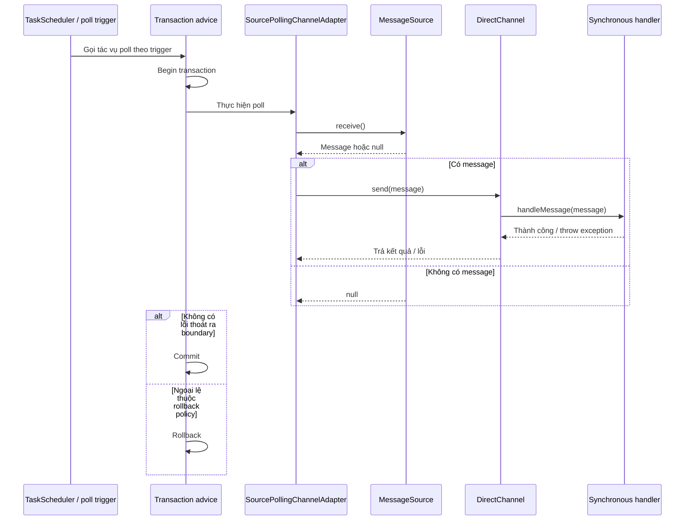
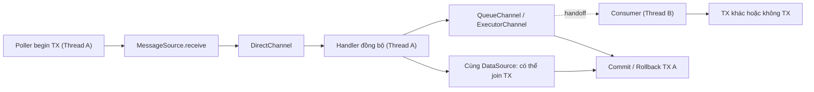
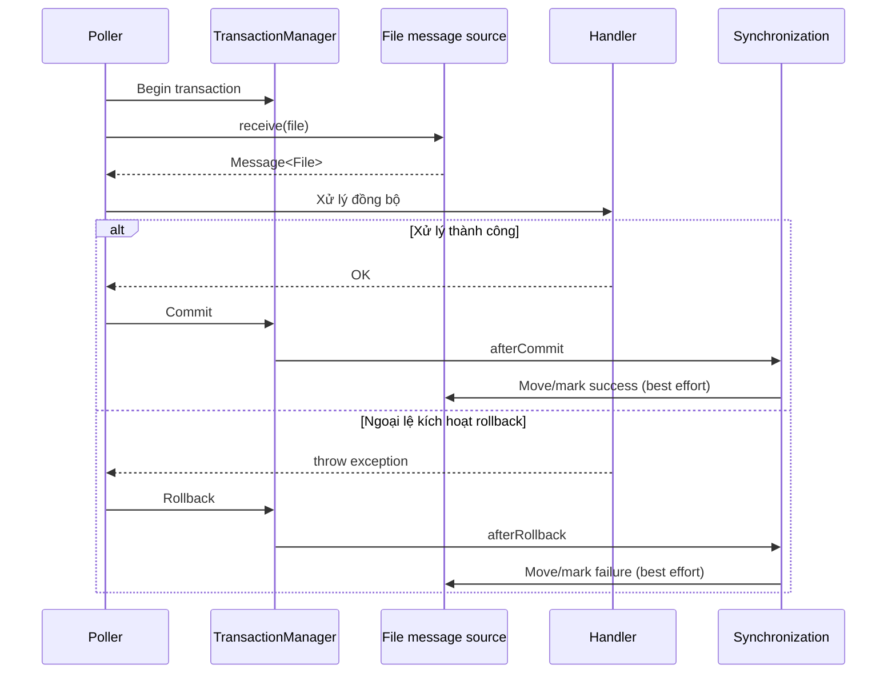
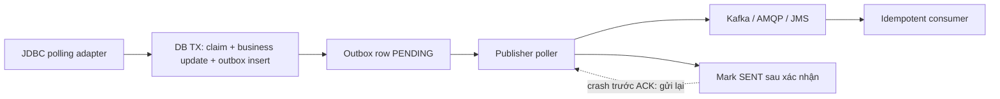

# Transaction advice cho polling adapter trong Spring Integration

## 1. Bài toán: poll được message chưa chắc đã xử lý an toàn

Một ứng dụng tích hợp thường xuyên lấy dữ liệu từ nơi bên ngoài: đọc bản ghi mới trong cơ sở dữ liệu, quét thư mục file, đồng bộ SFTP, nhận thông điệp từ broker hoặc lấy các công việc chờ xử lý trong `QueueChannel`. Nếu tiến trình lỗi giữa chừng, hệ thống cần trả lời được:

- Dữ liệu đầu vào đã bị đánh dấu là xử lý chưa?
- Phần công việc đã thay đổi trong database có được hoàn tác không?
- Message có được nhận lại không, hay bị mất vĩnh viễn?
- Nếu một hệ thống khác đã nhận dữ liệu rồi thì rollback local có thu hồi được tác động ở bên kia không?

**Transaction advice cho polling adapter** là cách sử dụng cơ chế transaction của Spring bao quanh thao tác **poll/receive-and-forward** do poller khởi phát. Khi tài nguyên tham gia hỗ trợ transaction, những thay đổi phù hợp có thể **commit cùng nhau** nếu luồng thành công hoặc **rollback** nếu lỗi được truyền ra đúng transaction boundary.

Đây là một nội dung thuộc chương **Transactions** của module **SPRING_INTEGRATION_ADAPTERS**: kết nối hệ thống ngoài qua inbound/outbound adapter, gateway, poller và `MessageChannel`, với các giao thức file, SFTP, HTTP, JMS, AMQP, Kafka và cơ sở dữ liệu. Trọng tâm bài học không chỉ là thêm `transactional()`, mà là hiểu **phạm vi hiệu lực thực tế** khi nhiều hệ thống và nhiều thread cùng tham gia.

### Ví dụ nhanh

Ứng dụng poll bảng `inbound_order`:

1. Lấy các đơn `NEW`.
2. Đánh dấu chúng là `CLAIMED` để lần poll kế tiếp không lấy lại.
3. Chuyển payload vào kênh xử lý.
4. Handler lưu thêm dữ liệu nghiệp vụ.

Nếu bước 4 ném ngoại lệ **trước khi transaction commit**, một poller với transaction advice và luồng đồng bộ có thể rollback cả cập nhật trạng thái lẫn thay đổi database của handler, miễn là chúng dùng tài nguyên được cùng transaction manager quản lý.

Ngược lại, nếu bước 3 gửi sang `ExecutorChannel` hoặc broker ngoài, sự thành công của việc chuyển giao **không đồng nghĩa** handler cuối đã hoàn tất. Transaction ban đầu có thể commit trước khi lỗi ở phía nhận xảy ra.

### Mục tiêu học tập

Sau bài này, bạn có thể:

1. Phân biệt `SourcePollingChannelAdapter`, `PollingConsumer`, `MessageSource`, `PollerMetadata` và `MessageChannel`.
2. Cấu hình transaction advice cho poller bằng XML hoặc Java DSL.
3. Xác định transaction boundary theo thread, channel, transaction manager và tài nguyên được bảo vệ.
4. Dự đoán hành vi commit/rollback/retry với JDBC, File, SFTP, JMS, AMQP, Kafka và HTTP.
5. Sử dụng transaction synchronization, idempotency và outbox khi không có giao dịch phân tán.
6. Viết kịch bản kiểm thử chứng minh không mất message, không tăng quyền xử lý sai và không tạo side effect trùng ngoài dự kiến.

## 2. Cơ chế polling trong Spring Integration

### 2.1 Inbound adapter và polling consumer

Một **inbound channel adapter dạng polling** dùng `SourcePollingChannelAdapter` để theo lịch gọi `MessageSource.receive()` và phát message nhận được vào một channel. Ví dụ: JDBC inbound adapter chạy `SELECT`, file inbound adapter quét thư mục hoặc SFTP inbound adapter đọc những file đã đồng bộ theo cấu hình.

Một **polling consumer** dùng `PollingConsumer` để lấy message từ một `PollableChannel`, sau đó gọi handler. Ví dụ: một `QueueChannel` được kết nối tới service activator thông qua poller.

| Thành phần | Vai trò | Ví dụ |
|---|---|---|
| `MessageSource<T>` | Cung cấp message khi gọi `receive()` | JDBC polling source, file reading source |
| `SourcePollingChannelAdapter` | Chủ động gọi source theo lịch và gửi tới channel | Inbound JDBC/File/SFTP |
| `PollableChannel` | Lưu/đưa message cho consumer chủ động nhận | `QueueChannel` |
| `PollingConsumer` | Lấy message từ channel rồi gọi `MessageHandler` | Service activator đọc queue |
| `PollerMetadata` | Trigger, số lần receive, timeout, advice và chính sách polling | Fixed delay + transactional advice |
| `DirectChannel` | Gọi subscriber **đồng bộ trong thread hiện tại** | Handler cùng tham gia transaction của poller khi đủ điều kiện |
| `ExecutorChannel` | Chuyển xử lý sang executor/thread khác | Thread-bound transaction không tự đi theo |
| `QueueChannel` | Tách bước gửi/nhận qua hàng đợi nội bộ | Poller ở đầu nhận mở đơn vị công việc mới |

**Không phải mọi adapter đều cần poller.** HTTP inbound gateway là request-driven; nhiều JMS/AMQP/Kafka inbound endpoint là message-driven qua listener container. Cấu hình transaction ở **poller** chỉ có tác dụng ở nơi thực sự tồn tại một poller.

### 2.2 Poller chạy như thế nào?



Sơ đồ mô tả luồng tổng quát. Transaction advice được gắn với quá trình poll; hiệu lực rollback phụ thuộc exception, `TransactionAttribute`, tài nguyên đã enlist, đặc điểm channel và cấu hình endpoint cụ thể.

### 2.3 Poll trigger không phải transaction

`fixed-delay`, `fixed-rate` hay `cron` xác định **khi nào** poll; chúng không tự tạo transaction. `maxMessagesPerPoll` xác định **số lần thử nhận** trong một lượt trigger, không phải tự động quy định batch DB hay số row của truy vấn.

Với `SourcePollingChannelAdapter`, khi không cấu hình rõ, `maxMessagesPerPoll` thường mặc định là **1**. Với `PollingConsumer`, default được tài liệu mô tả là **-1**, nghĩa là tiếp tục thử nhận tới khi nguồn trả `null` hoặc điều kiện dừng. Cấu hình này ảnh hưởng tải, mức độ công việc và độ trễ shutdown, nhưng không nên suy đoán rằng `maxMessagesPerPoll=10` chính là “một transaction cho 10 message”. Hãy xác định transaction boundary từ cách endpoint và advice được triển khai, rồi chứng minh bằng integration test.

## 3. Vì sao gắn transaction advice ở poller?

### 3.1 Transaction bao cả bước receive

Đặt `@Transactional` trên một handler downstream có thể bảo vệ các thao tác database **của handler**, nhưng nó **không tự động** bao bọc `MessageSource.receive()`. Nếu source thực hiện `SELECT` và `UPDATE` để đánh dấu bản ghi đã nhận, ta thường muốn bắt đầu transaction **trước** khi receive.

Poller transaction advice làm đúng việc này: sử dụng Spring `TransactionInterceptor` để tạo/join transaction quanh thao tác poll và các thành phần downstream đồng bộ còn nằm trong transaction scope.

### 3.2 Transaction manager phải quản lý tài nguyên phù hợp

Ví dụ:

- JDBC sử dụng `DataSourceTransactionManager` hoặc `JdbcTransactionManager` gắn với đúng `DataSource`.
- JPA cần `JpaTransactionManager` và `EntityManagerFactory` phù hợp.
- JMS/AMQP có cơ chế transaction/acknowledgment riêng theo listener/broker và transaction manager được sản phẩm hỗ trợ.
- Nhiều file system, SFTP và HTTP không hỗ trợ rollback thật theo transaction JDBC.

**Chỉ có tên `transactionManager` trong cấu hình chưa chứng minh mọi tài nguyên được enlist.** Hai kết nối database khác nhau, một lần ghi file và một HTTP POST không tự trở thành giao dịch nguyên tử chỉ vì một interceptor.

### 3.3 Advice chain và thứ tự

Poller cho phép dùng một **AOP advice chain** gồm transaction interceptor, retry advice, logging, metrics hoặc kiểm soát poll. Thứ tự chain có thể quyết định:

- Retry diễn ra **trong cùng transaction** hay mỗi lần thử có transaction mới.
- Ngoại lệ được rethrow hay bị một advice/handler xử lý và coi là thành công.
- Thời gian quan sát của tracing bao gồm cả transaction begin/commit hay chỉ handler.

Với XML namespace, khi cấu hình `<int:advice-chain>` thì **không khai báo đồng thời** `<int:transactional>` bên dưới cùng poller; đưa `TransactionInterceptor` đã cấu hình như một advice vào chain. Việc dùng advice transaction ở poller phải được phân biệt với **request-handler advice** gắn riêng vào `MessageHandler`, vốn có thể không bao trùm việc đọc source.

## 4. Ranh giới transaction theo channel và thread

Spring transaction theo kiểu thông thường gắn context với **thread hiện tại**. Vì vậy cách nối các `MessageChannel` quyết định handler có cùng transaction hay không.



### 4.1 Trường hợp `DirectChannel`

Khi message đi qua `DirectChannel`, subscriber thường chạy ngay trong thread đang poll. Nếu handler sử dụng cùng transactional resource, thao tác receive, mark, xử lý và cập nhật DB có thể nằm trong một transaction. Một exception được ném lên đúng ranh giới transaction có thể khiến các thay đổi DB đó rollback.

### 4.2 Trường hợp `QueueChannel` hoặc `ExecutorChannel`

Khi gửi message sang queue nội bộ hay executor, **thread boundary bị cắt**. Sender thành công khi handoff đáp ứng hợp đồng channel; transaction của poller có thể commit tại đó. Worker ở thread khác sau này ném exception **không thể tự động rollback giao dịch đã commit** của poller.

Một `QueueChannel` dùng `MessageStore` có transaction riêng hoặc một channel được backing bằng JMS có thể tạo bước giao nhận bền vững khi cấu hình đúng, nhưng đó không phải bằng chứng một DB transaction liên tục bao trùm mọi thread.

### 4.3 Trường hợp bất đồng bộ trong handler

`CompletableFuture`, Reactor, tự tạo thread hoặc gọi HTTP async cũng tách đường thực thi. Handler trả về thành công trước khi tác vụ nền hoàn tất có thể khiến poller commit quá sớm. **Không thiết kế tính đúng đắn bằng kỳ vọng ThreadLocal transaction tự lan truyền qua async.**

### 4.4 Bảng dự đoán kết quả

| Topology | Lỗi xảy ra ở đâu | DB update của source có rollback không? |
|---|---|---|
| JDBC source → DirectChannel → DB handler dùng cùng TX | Handler ném exception trước commit | Có thể rollback nếu ngoại lệ kích hoạt rollback |
| JDBC source → ExecutorChannel → DB handler | Handler thread khác lỗi sau handoff | Không tự rollback transaction nguồn đã commit |
| JDBC source → DirectChannel → HTTP outbound | HTTP phía xa nhận rồi local throw lỗi | DB có thể rollback; HTTP side effect **không** rollback |
| File source → DirectChannel → handler lỗi | Poller có JDBC TX | Chỉ tài nguyên tham gia JDBC TX rollback; việc đọc/di chuyển file không mặc nhiên đảo ngược |
| PollingConsumer lấy `QueueChannel` → handler | Handler lỗi | Hành vi requeue/redelivery tùy MessageStore/transaction strategy và cấu hình cụ thể |

## 5. Cấu hình XML: transaction advice với JDBC inbound adapter

Với JDBC inbound adapter, Spring Integration hỗ trợ `SELECT` lấy tập row và một `UPDATE` đánh dấu row đã lấy để lần poll sau không chọn lại. Khi dùng poller có transaction manager đúng `DataSource`, `SELECT` và `UPDATE` có thể nằm trong cùng transaction.

### 5.1 Schema tối giản

```sql
CREATE TABLE inbound_order (
    id BIGINT PRIMARY KEY,
    external_ref VARCHAR(100) NOT NULL UNIQUE,
    payload VARCHAR(2000) NOT NULL,
    status VARCHAR(24) NOT NULL
);

INSERT INTO inbound_order(id, external_ref, payload, status)
VALUES (101, 'order-101', '{"amount": 150}', 'NEW');
```

Ví dụ dưới đây dùng XML namespace Spring Integration làm **đoạn cấu hình minh họa**; ứng dụng thực tế cần khai báo namespace, schema và các bean đầy đủ:

```xml
<!-- ordersTxManager phải quản lý đúng dataSource của JDBC adapter. -->
<bean id="ordersTxManager"
      class="org.springframework.jdbc.datasource.DataSourceTransactionManager">
    <constructor-arg ref="dataSource"/>
</bean>

<int:channel id="ordersToHandle"/>

<int-jdbc:inbound-channel-adapter
        id="ordersPoller"
        data-source="dataSource"
        channel="ordersToHandle"
        query="SELECT id, external_ref, payload
               FROM inbound_order WHERE status = 'NEW'"
        update="UPDATE inbound_order
                SET status = 'CLAIMED'
                WHERE id IN (:id)">
    <int:poller fixed-delay="2000" max-messages-per-poll="1">
        <int:transactional
                transaction-manager="ordersTxManager"
                propagation="REQUIRED"
                isolation="READ_COMMITTED"/>
    </int:poller>
</int-jdbc:inbound-channel-adapter>

<int:service-activator
        input-channel="ordersToHandle"
        ref="orderHandler"
        method="handle"/>
```

Trong ví dụ, source trả về **một message có payload dạng danh sách row** (thường là `List<Map<String,Object>>` nếu dùng mapper mặc định), không phải một message cho mỗi row. Named parameter `:id` trong `UPDATE` được lấy từ các row có cột `id` theo quy ước của JDBC inbound adapter.

**Kết quả kỳ vọng trong trường hợp đồng bộ:**

1. Poller mở DB transaction.
2. `SELECT` đọc row `NEW`, `UPDATE` đánh dấu `CLAIMED`.
3. Message đi vào `ordersToHandle` là `DirectChannel` mặc định; `orderHandler` được gọi cùng thread.
4. Nếu handler cập nhật **cùng DataSource** và hoàn thành, các thay đổi có thể commit đồng thời.
5. Nếu handler ném exception phù hợp rollback rule, transaction rollback: row vẫn ở `NEW` để poll lại, các thay đổi DB cùng transaction cũng được đảo ngược.

Điều **không** được suy ra: thông điệp đã được đưa đến hệ thống ngoài, gửi email hoặc gọi HTTP là được rollback theo. Những side effect đó nằm ngoài khả năng của `DataSourceTransactionManager`.

### 5.2 Quy tắc rollback của Spring

Trong Spring transaction thông thường, `RuntimeException` và `Error` kích hoạt rollback theo cấu hình mặc định; checked exception không mặc nhiên rollback nếu chưa cấu hình rule phù hợp. Điều này ảnh hưởng trực tiếp tới poller: một handler nuốt lỗi rồi trả về bình thường có thể khiến poller **commit**, dù nghiệp vụ thực tế thất bại.

Nếu cần rollback cho loại exception khác, phải cấu hình transaction attributes thích hợp. Không dựa vào số lần log `ERROR` để suy ra đã rollback.

## 6. Cấu hình Java DSL và nơi đặt advice

Spring Integration Java DSL cho phép cấu hình poller tại inbound endpoint. Ví dụ dưới đây minh họa API thường dùng của Spring Integration hiện đại; cần khai báo imports, beans và chọn phiên bản dependency tương thích với dự án:

```java
@Configuration
@EnableIntegration
class JdbcPollingFlowConfig {

    @Bean
    PlatformTransactionManager ordersTxManager(DataSource dataSource) {
        return new DataSourceTransactionManager(dataSource);
    }

    @Bean
    IntegrationFlow ordersInbound(
            DataSource dataSource,
            PlatformTransactionManager ordersTxManager,
            OrderHandler orderHandler) {

        return IntegrationFlow
            .from(Jdbc.inboundAdapter(dataSource)
                    .selectQuery("SELECT id, external_ref, payload "
                               + "FROM inbound_order WHERE status = 'NEW'")
                    .updateSql("UPDATE inbound_order SET status = 'CLAIMED' "
                             + "WHERE id IN (:id)"),
                endpoint -> endpoint.poller(
                    Pollers.fixedDelay(Duration.ofSeconds(2))
                        .maxMessagesPerPoll(1)
                        .transactional(ordersTxManager)))
            .handle(orderHandler, "handle")
            .get();
    }
}
```

`OrderHandler.handle` trong ví dụ cần chấp nhận payload kiểu danh sách hoặc message như cấu hình thực tế. Để chứng minh tính nguyên tử, trong integration test hãy dùng cùng DataSource cho cả adapter và handler, cố ý ném exception và đọc lại trạng thái DB.

### 6.1 `PollerMetadata` và `TransactionInterceptor` tường minh

Khi cần thêm logging, retry hoặc kiểm soát order của advice, có thể tạo một `TransactionInterceptor` với `TransactionAttributeSource` phù hợp rồi gắn vào advice chain của poller. Đây là hướng kiểm soát chính xác những rule như propagation, isolation, timeout và rollback.

```text
PollerSpec / PollerMetadata
  └── advice chain
        ├── metrics / tracing advice
        ├── transaction advice (TransactionInterceptor)
        └── các advice bổ sung đã được kiểm thử
             └── poll receive -> channel -> synchronous handler
```

**Không trộn lẫn một transaction advice với một retry advice mà chưa kiểm tra order.** Retry bên trong transaction đã đánh dấu rollback-only có thể không commit được; retry bao ngoài transaction có thể tạo transaction mới mỗi lần. Với outbound side effect không transaction, cả hai còn có nguy cơ gửi trùng. Quy trình retry cần dựa trên idempotency và failure policy.

## 7. Điều chỉnh poller: trigger, batch, timeout và concurrency

### 7.1 Fixed delay so với fixed rate

- `fixed-delay`: khoảng chờ sau khi lượt trước kết thúc; hữu ích khi muốn tránh poll liên tiếp nếu xử lý lâu.
- `fixed-rate`: cố gắng theo nhịp thời gian định sẵn; khi xử lý chậm và task executor/concurrency thay đổi, cần giám sát backlog và việc chồng lấn.
- `cron`: phù hợp lịch định kỳ theo giờ/ngày.

Một transaction mở qua thời gian xử lý dài có thể giữ connection, lock và làm giảm throughput. Nên ưu tiên đơn vị công việc nhỏ, timeout có cân nhắc và không gọi mạng bên ngoài quá lâu trong DB transaction nếu có lựa chọn kiến trúc tốt hơn.

### 7.2 `maxMessagesPerPoll` khác `maxRows`

Với JDBC inbound adapter:

- `maxMessagesPerPoll` kiểm **số lần poll/`receive()`** mỗi lượt scheduler.
- `maxRows` giới hạn **số row trong một lần `SELECT`** theo cấu hình adapter.
- Một lần `receive()` thường trả **một message chứa danh sách row**.

Nếu `maxRows=100` và `maxMessagesPerPoll=2`, không thể mặc định kết luận có chính xác 200 message; còn phụ thuộc số hàng chọn được, câu `UPDATE`, transaction và dữ liệu sẵn có. Đối với hiệu năng lớn, nên hạn chế result set trong SQL theo cú pháp vendor và thiết kế claim/locking rõ ràng.

### 7.3 Concurrency và đa instance

Hai poller cùng chọn `status='NEW'` có thể đọc trùng nếu cách lock/claim chưa đúng. Transaction advice **không tự tạo cơ chế phân phối công việc độc quyền** giữa nhiều instance.

Cần xem xét:

- Khóa row hoặc cú pháp `FOR UPDATE SKIP LOCKED` ở database hỗ trợ; mỗi vendor có semantics riêng.
- Cập nhật trạng thái có điều kiện hoặc compare-and-set.
- Một thiết kế lease/claim có thời hạn và reclaim khi consumer chết.
- Unique constraint/idempotency key để ngăn duplicate business effect.
- Giới hạn số connection đang giữ transaction và thời gian xử lý.

### 7.4 Task executor và thread

Poller có thể sử dụng `TaskExecutor` để điều phối công việc, nhưng transaction vẫn gắn với thread thực hiện poll. Bất kỳ handoff downstream sang thread khác đều cần được xem như **ranh giới giao dịch mới**. Đừng cho rằng cấu hình `taskExecutor` làm transaction trở nên phân tán.

### 7.5 Poller chạy mà không có message

Source có thể trả `null`, nghĩa là không có message tại thời điểm poll. Đây không phải lỗi cần retry. Giám sát `receive null` khác với exception, backoff do nguồn lỗi và request timeout. Cấu hình `maxMessagesPerPoll` vô hạn với source luôn trả non-null có thể gây vòng xử lý kéo dài; cần tính tới lifecycle shutdown, backpressure và capacity.

## 8. Transaction synchronization: hành động sau commit/rollback

Không phải mọi thao tác có thể rollback thật. Với file inbound adapter, tổ chức thường muốn chuyển file sang `success/` sau khi xử lý và chuyển sang `failed/` khi lỗi. Spring Integration hỗ trợ **transaction synchronization** với callback như `beforeCommit`, `afterCommit`, `afterRollback`.

### 8.1 Ý tưởng



### 8.2 Cấu hình minh họa với file adapter

```xml
<bean id="pseudoTxManager"
      class="org.springframework.integration.transaction.PseudoTransactionManager"/>

<int-file:inbound-channel-adapter
        id="filesIn"
        directory="/data/incoming"
        channel="filesToHandle">
    <int:poller fixed-delay="5000" max-messages-per-poll="1">
        <int:transactional transaction-manager="pseudoTxManager"
                           synchronization-factory="fileSyncFactory"/>
    </int:poller>
</int-file:inbound-channel-adapter>

<int:transaction-synchronization-factory id="fileSyncFactory">
    <int:after-commit expression="payload.renameTo(
        new java.io.File('/data/processed/' + payload.name))"/>
    <int:after-rollback expression="payload.renameTo(
        new java.io.File('/data/failed/' + payload.name))"/>
</int:transaction-synchronization-factory>
```

Đây là một cấu hình giáo dục dùng để thể hiện callback; cần điều chỉnh đường dẫn, filter, bean names, quyền filesystem và cơ chế chuyển file trước khi triển khai. `renameTo()` có thể trả `false` do lỗi quyền hoặc khác filesystem; callback **không biến thao tác di chuyển file thành transaction nguyên tử**. Ngoài ra, chuyển file sau rollback sang `failed` có thể không phải cách phù hợp nếu muốn retry tự động.

### 8.3 `PseudoTransactionManager` có giới hạn gì?

`PseudoTransactionManager` chỉ tạo bối cảnh cho callbacks thành công/thất bại. Nó **không rollback** file, FTP/SFTP, HTTP hoặc những side effect không có transaction manager thực. Dùng `afterCommit` để chuyển file giúp đồng bộ quy trình, nhưng nếu move thất bại sau khi database đã commit, **DB không thể quay lại trạng thái chưa xử lý** chỉ vì callback lỗi.

### 8.4 Hậu quả của lỗi trong callback

- `beforeCommit` có thể ảnh hưởng tới quyết định commit và có thể khiến transaction rollback nếu ném lỗi phù hợp.
- `afterCommit` chạy khi commit đã xảy ra; lỗi ở đây thường đòi **reconciliation**, không rollback DB đã commit.
- `afterRollback` dành cho cleanup/quarantine/ghi trạng thái lỗi; bản thân callback cũng có thể thất bại.

Vì thế cần audit riêng, retry, xử lý idempotent và một job đối soát file chưa được chuyển hoặc chưa được xác nhận.

## 9. Nguồn File và SFTP: đừng nhầm đồng bộ thao tác với transaction

### 9.1 File adapter

Một file có thể bị nhìn thấy khi bên ngoài đang ghi dở; transaction advice không làm file xuất hiện thành một snapshot hoàn chỉnh. Thiết kế tốt nên:

- Bên ghi tạo file tạm rồi **rename atomically khi filesystem hỗ trợ** vào thư mục ingest; không phụ thuộc poller nhận biết được file đang ghi dở.
- Dùng file filter, metadata store và persistent accept-once phù hợp với restart.
- Xác định khi nào file bị coi là đã nhận, đã xử lý, hoặc được phép poll lại.
- Quản lý lỗi đọc, lỗi parse, lỗi ghi DB và lỗi chuyển thư mục như những trạng thái riêng.
- Dùng content hash, tên file + version hoặc business ID để phát hiện message trùng.

### 9.2 SFTP

SFTP inbound thường có bước đồng bộ file từ remote xuống local trước khi local file reading/poll. Việc tải, rename hoặc xóa file **trên máy SFTP** không tham gia DB transaction JDBC.

Ví dụ: ứng dụng tải `invoice.csv`, ghi invoice vào DB, rồi kết nối SFTP mất khi đổi tên file nguồn. DB có thể đã commit nhưng remote vẫn còn file; lần poll sau file có thể được tải lại. Đây là **at-least-once processing** thực tế, cần idempotency ở DB hoặc một manifest/ledger đủ bền vững.

### 9.3 HTTP và REST

Outbound HTTP gateway gửi POST ra dịch vụ khác có thể tạo side effect trước khi trả timeout. Nếu transaction DB local rollback, phía remote không tự rollback. Nên cân nhắc:

- `Idempotency-Key` ổn định ở API hỗ trợ.
- Outbox để tách DB commit khỏi HTTP delivery.
- Retry với backoff/jitter và phân loại lỗi có thể retry.
- Query trạng thái từ remote khi timeout không rõ đã nhận hay chưa.
- Saga/compensation cho quy trình nhiều hệ thống nếu có nghiệp vụ đảo thao tác.

**Không gọi HTTP trong DB transaction rồi tuyên bố “exactly once”.** Transaction của một DataSource không thể bảo đảm nguyên tử với một API độc lập.

## 10. JMS, AMQP và Kafka: transaction của poller khác transaction của broker

### 10.1 JMS

JMS hỗ trợ session có transaction, acknowledgment và cơ chế redelivery tùy broker/client/container. Nhưng cần phân biệt:

- **Message-driven inbound JMS** thường dựa trên listener container, không phải `SourcePollingChannelAdapter` với poller mặc định.
- **PollingConsumer** đọc `QueueChannel` là một kiểu khác với broker listener đang quản lý JMS session.
- JMS transaction có thể rollback việc consume/send trong **JMS session** được hỗ trợ.
- Một JDBC transaction được mở quanh poller **không tự điều khiển JMS acknowledgment** trên một connection/session khác.

Ví dụ: database đã commit `status='DONE'` nhưng JMS publish thất bại, hoặc JMS message đã ack trong khi JDBC handler rollback. Nếu muốn một bước xử lý không mất dữ liệu giữa DB và broker, cần thiết kế transactional resource thích hợp (ví dụ XA/JTA khi thật sự cần và mọi tài nguyên hỗ trợ), **transactional outbox**, hoặc cơ chế retry/idempotency.

### 10.2 AMQP / RabbitMQ

AMQP adapter có thể dùng listener container và các chế độ acknowledgment như auto/manual tùy framework và cấu hình. Nếu có broker transaction, tính chất atomic áp dụng trong phạm vi channel/broker được hỗ trợ, không khiến transaction DB bất kỳ tự được bao gồm.

Những trạng thái phải kiểm:

- Message đã được ack/nack hoặc requeue khi handler ném exception?
- Broker có redeliver sau consumer crash?
- Handler có thực hiện DB commit trước khi ack?
- Queue có DLQ, retry policy, TTL và cơ chế phát hiện poison message?
- Có dùng publisher confirms hoặc transaction thích hợp cho outbound message?

Không dùng `afterCommit` của DB làm bằng chứng broker đã nhận message thành công trừ khi có xác nhận và lưu trạng thái publish phù hợp. Nếu gửi broker thất bại **sau** khi DB commit, cần retry ngoài transaction gốc.

### 10.3 Kafka

Kafka có cơ chế consumer offsets và producer transactions với phạm vi được hỗ trợ. Nhưng **poller transaction advice không tự phối hợp** database transaction, Kafka consumer offset và HTTP request thành một global ACID transaction.

Ví dụ luồng Kafka inbound dùng listener container của Spring Kafka/Spring Integration nên có configuration về ack mode, error handler, container transaction manager và producer transaction theo sản phẩm; không thể thay thế tất cả bằng `Pollers.fixedDelay(...).transactional(dataSourceTxManager)`.

Khi offset được commit sớm nhưng DB thất bại, message có thể bị bỏ sót. Khi DB commit nhưng offset chưa commit, message có thể được đọc lại. Thiết kế thường cần:

- Business key và idempotent processing.
- Upsert/unique constraints tại DB.
- Offset/ack hợp với transaction scope thật.
- Retry và dead-letter topic cho message lỗi bền vững.
- Theo dõi lag, rebalance và các trường hợp gửi lại.

### 10.4 Ma trận theo adapter

| Adapter / transport | Poller transaction có ích nhất ở đâu? | Transaction thật cần xác minh | Side effect chưa chắc rollback |
|---|---|---|---|
| **JDBC inbound** | Bao `SELECT` + `UPDATE` và downstream DB đồng bộ | Cùng `DataSource` và transaction manager | Broker/HTTP call đã gửi |
| **JPA inbound** | Bao đọc/đánh dấu/xóa entity theo cấu hình | `JpaTransactionManager`/Persistence Context | API ngoài DB |
| **File inbound** | Tổ chức callbacks khi luồng hoàn tất | Nếu có DB downstream thì DB transaction; file không ACID theo đó | Read/move/delete file |
| **SFTP inbound** | Đồng bộ trạng thái local và hành động thành công/lỗi | Tài nguyên local thực sự tham gia transaction | Remote download/rename/delete |
| **JMS** | Poller chỉ khi dùng kiểu endpoint thực sự polling; listener có TX khác | JMS session/local tx hoặc JTA khi được hỗ trợ | Database khác nếu không phối hợp |
| **AMQP** | Cần xem adapter/listener và ack strategy | Broker channel/transaction/ack tùy cấu hình | HTTP/DB không được enlist |
| **Kafka** | Nhiều luồng dùng message-driven container, không phải poller advice | Producer transaction, offset, container integration | Database, SFTP, HTTP |
| **HTTP outbound** | Có thể gọi từ luồng poll được bọc DB TX | Chỉ phần tài nguyên local trong TX | Side effect tại dịch vụ HTTP |

**Lưu ý:** các cột mô tả ranh giới tổng quát; cấu hình version, broker, listener container và transactional resource thực tế mới quyết định chính xác rollback/ack.

## 11. Khi nào nên dùng outbox thay vì cố kéo dài transaction?

Giả sử người dùng yêu cầu: “Sau khi poll một đơn hàng, cập nhật DB và gửi sự kiện Kafka/AMQP, tuyệt đối không mất đơn và không gửi trùng”. Một transaction local quanh poller không đủ để bảo đảm hai hệ thống commit cùng lúc.

### 11.1 Transactional outbox

Thay vì vừa ghi DB vừa publish broker trong cùng lời gọi handler:

1. Trong **một DB transaction**, đọc/claim công việc, cập nhật nghiệp vụ và ghi một dòng **outbox event**.
2. Commit transaction DB.
3. Một publisher độc lập poll outbox và gửi message tới broker.
4. Chỉ đánh dấu outbox đã gửi khi nhận được xác nhận thích hợp.
5. Nếu crash xảy ra giữa publish và cập nhật `SENT`, publisher có thể gửi lại; consumer phải **idempotent**.



### 11.2 Schema minh họa

```sql
CREATE TABLE integration_outbox (
    event_id VARCHAR(80) PRIMARY KEY,
    aggregate_id VARCHAR(80) NOT NULL,
    event_type VARCHAR(80) NOT NULL,
    payload VARCHAR(4000) NOT NULL,
    state VARCHAR(20) NOT NULL,
    attempt_count INTEGER NOT NULL DEFAULT 0
);

CREATE TABLE processed_message (
    consumer_name VARCHAR(100) NOT NULL,
    event_id VARCHAR(80) NOT NULL,
    processed_at TIMESTAMP NOT NULL,
    PRIMARY KEY (consumer_name, event_id)
);
```

`event_id` ổn định giúp consumer phát hiện xử lý lặp. Cần thiết kế khóa theo phạm vi tenant/aggregate nếu hệ thống multi-tenant. `processed_message` và cập nhật nghiệp vụ ở consumer lý tưởng nên cùng một DB transaction để duplicate check có ý nghĩa.

### 11.3 Thứ tự lỗi và hành vi kỳ vọng

| Thời điểm crash | Trạng thái có thể thấy | Thiết kế cần xử lý |
|---|---|---|
| Trước DB commit | Claim/outbox chưa commit | DB rollback, poll lại |
| Sau DB commit, trước publish | Outbox PENDING còn tồn tại | Publisher đọc lại và gửi |
| Broker nhận, trước ACK tới publisher | Không biết đã publish hay chưa | Retry có thể gửi trùng; consumer idempotent |
| Sau ACK broker, trước mark outbox SENT | Broker đã có event, DB còn PENDING | Gửi lại an toàn theo `event_id` |
| Sau mark SENT | Publisher đã ghi trạng thái hoàn tất | Duy trì audit, retention, reconciliation |

Điểm cốt lõi là **không để một khoảng trống làm mất sự kiện**. Outbox thường cung cấp **at-least-once delivery** chứ không hứa **exactly once end-to-end** khi hệ thống và side effect độc lập.

## 12. Hợp đồng message và xử lý lỗi có chủ đích

### 12.1 Phân loại lỗi trước khi quyết định rollback

| Loại lỗi | Ví dụ | Hướng xử lý |
|---|---|---|
| **Transient** | DB deadlock, timeout mạng, broker tạm lỗi | Rollback phù hợp, retry có backoff/jitter |
| **Permanent / validation** | JSON sai schema, thiếu trường bắt buộc | Quarantine/DLQ, không retry vô hạn |
| **Duplicate** | Event ID đã xử lý | Bỏ qua an toàn hoặc trả kết quả cũ, có audit |
| **Unknown outcome** | HTTP timeout sau khi remote đã nhận | Query trạng thái hoặc retry bằng idempotency key |
| **Resource unavailable** | SFTP server down, DB pool cạn | Circuit breaker, giới hạn polling, alert |
| **Poison message** | Một bản ghi luôn làm handler ném lỗi | Chính sách attempt count, DLQ và can thiệp |

### 12.2 Ngoại lệ phải tới đúng transaction boundary

Một bẫy phổ biến:

```java
void handle(Order order) {
    try {
        remoteGateway.send(order);
    } catch (Exception ex) {
        log.warn("Gửi lỗi, để xử lý sau", ex);
        // Hàm trả về bình thường: poller có thể COMMIT!
    }
}
```

Nếu nghiệp vụ yêu cầu **không được commit** khi gửi thất bại, handler phải ném lại lỗi phù hợp hoặc ghi một trạng thái pending bền vững trong transaction, thay vì chỉ log. Nếu tác vụ gửi remote không thể rollback, lựa chọn vững hơn thường là outbox chứ không phải mở DB transaction bao HTTP call.

### 12.3 Error channel không phải rollback tự động

`errorChannel` nhận `ErrorMessage` để xử lý lỗi trong Spring Integration. Nhưng cần kiểm **lỗi được bắt và xử lý tại đâu**:

- Exception thoát ra khỏi luồng synchronous trong phạm vi `TransactionInterceptor`: có cơ hội rollback theo rule.
- Exception được một advice/handler bắt, chuyển thành kết quả “thành công” trước khi transaction advice thấy lỗi: transaction có thể commit.
- Exception xảy ra sau khi handoff sang executor/queue: transaction gốc có thể đã commit; error channel phía consumer không làm rollback nó.

Spring Integration có hỗ trợ bảo lưu thông tin message nguồn trong lỗi của polling endpoint khi dùng transaction advice và transaction synchronization phù hợp. Tuy nhiên, cách `failedMessage` xuất hiện, thời điểm log và loại exception phụ thuộc đường lỗi cụ thể; cần kiểm trong integration test theo version đang dùng.

### 12.4 Thứ tự retry và transaction

```text
Phương án A (thường mong muốn cho retry DB):
Retry advice [mỗi lần thử có thể tạo một TX mới nếu cấu hình đúng]
    -> Transaction advice
        -> poll/handle

Phương án B (cần cân nhắc):
Transaction advice
    -> Retry advice
        -> poll/handle
```

Trong phương án B, khi resource đã đánh dấu transaction rollback-only, những lần retry tiếp theo có thể không thể commit trong cùng transaction. Trong phương án A, một request đã gửi ra ngoài trước khi rollback có thể bị gửi lại nhiều lần. Vì vậy **cả hai** đều cần hiểu semantics, giới hạn retry và idempotency.

### 12.5 DLQ, quarantine và reprocess

Một poison message không nên làm poller xử lý vô tận cùng một row/file với nhịp 1 giây. Có thể dùng:

- Trạng thái `FAILED` hoặc `QUARANTINED` có lý do/attempt count trong nguồn bền vững.
- DLQ đối với broker khi được hỗ trợ.
- Kênh reprocess được kiểm soát và có khả năng ghi nhận operator.
- Dữ liệu đầu vào và schema version để có thể xử lý lại sau khi sửa lỗi.

Một callback `afterRollback` có thể hỗ trợ chuyển file lỗi, nhưng nếu muốn retry tự động phải định nghĩa rõ **khi nào** chỉ retry và **khi nào** quarantine. Đừng vừa đánh dấu lỗi vĩnh viễn vừa kỳ vọng poller tự nhận lại file.

## 13. Ví dụ hành vi: bốn lần poll của một đơn hàng

Xét một hệ thống có JDBC inbound adapter, handler đồng bộ dùng cùng DB và một bước gửi broker bên ngoài:

| Lần thử | Sự kiện | DB transaction | Hệ quả cần quan tâm |
|---|---|---|---|
| #1 | `SELECT` trả đơn 101; handler kiểm dữ liệu sai | Rollback | Đơn có thể vẫn `NEW`; cần phân loại poison message |
| #2 | Dữ liệu hợp lệ; DB lưu ledger; broker nhận event; handler throw do timeout | Rollback DB | Broker có thể đã nhận; retry dễ tạo duplicate event |
| #3 | Poll lại đơn 101; broker nhận trùng event ID | Commit sau xử lý | Consumer dùng `event_id` để idempotent |
| #4 | Không còn đơn NEW | Không nhận message | Poll không phải lỗi; không tạo giao dịch nghiệp vụ mới |

Nếu tách broker publish thành outbox, lần #2 không còn side effect gửi broker bên trong DB transaction. Khi DB commit xong, publisher độc lập sẽ gửi; sự cố ở publisher được xử lý bằng retry và deduplication.

### 13.1 At-most-once, at-least-once, effectively-once

- **At-most-once:** có thể mất message khi lỗi; tránh duplicate nhưng không bảo đảm delivery.
- **At-least-once:** message có thể được gửi/đọc lại; handler phải idempotent.
- **Effectively-once ở mức nghiệp vụ:** dù delivery có thể trùng, unique constraint/idempotency đảm bảo business effect chỉ được thực hiện một lần trong phạm vi đã thiết kế.
- **Exactly-once end-to-end:** tuyên bố này đòi định nghĩa rõ phạm vi; transaction của một DB hoặc một Kafka broker không tự bao trùm SFTP, HTTP, JMS, DB khác và hệ thống SaaS.

## 14. Thiết kế kiểm thử transaction advice

Một bộ kiểm thử đáng tin cậy cần dùng **database thật hoặc môi trường tích hợp tương đương**, MessageChannel/adapter đã cấu hình thực và các điểm fault injection kiểm soát được. Unit test chỉ gọi handler sẽ không chứng minh `MessageSource.receive()` nằm trong transaction.

### 14.1 Ma trận kiểm thử cốt lõi

| Tình huống | Kỳ vọng | Bằng chứng |
|---|---|---|
| Poll JDBC và handler thành công | Row được claim/processed theo policy | DB readback, log commit |
| Handler ném `RuntimeException` trong DirectChannel | Cập nhật DB cùng transaction rollback | Row vẫn `NEW` hoặc desired state, không có ledger |
| Handler ném checked exception | Hành vi đúng rollback rules đã khai báo | Transaction outcome và exception trace |
| Handler bắt lỗi rồi trả bình thường | Poller có thể commit; kiểm để tránh lỗi logic | DB state, cảnh báo nghiệp vụ |
| Handler qua ExecutorChannel, worker lỗi | DB TX nguồn có thể đã commit | Timeline thread IDs, row state, error channel |
| DB update thành công, HTTP timeout | Remote outcome có thể không rõ | Idempotency key và remote readback |
| SFTP file đã tải nhưng DB rollback | File không tự bị xóa/di chuyển ngược | Local/remote file state và metadata store |
| Transaction synchronization `afterCommit` lỗi | DB đã commit; cleanup có thể chưa xong | DB state, retry/reconciliation queue |
| Hai poller đồng thời cùng một row | Không double business effect | Unique key, claimed row owner, load test |
| Broker redelivery sau consumer crash | Không duplicate business effect | Processed-message ledger |
| Poll không có message | Không phát message hay tăng lỗi giả | Receive-null metrics |
| Database down hoặc cạn pool | Poller degrade, alert và retry có giới hạn | Error rate, connections, backoff |

### 14.2 Một bài test tích hợp với JDBC

Chuẩn bị bảng `inbound_order` và `order_ledger`. Thiết lập một handler test cố ý ném exception sau khi đã ghi vào `order_ledger`:

```java
// Mã phác thảo kiểm thử, không phải một test class đầy đủ.
void handle(List<Map<String, Object>> rows) {
    for (Map<String, Object> row : rows) {
        Long id = ((Number) row.get("id")).longValue();
        jdbcTemplate.update(
            "INSERT INTO order_ledger(order_id, state) VALUES (?, ?)",
            id, "ACCEPTED"
        );
    }
    throw new IllegalStateException("Fault injection: handler failed");
}
```

Khi handler chạy đồng bộ cùng transaction manager và DataSource, kiểm:

```sql
-- Sau rollback:
SELECT status FROM inbound_order WHERE id = 101;
-- Kỳ vọng: NEW

SELECT COUNT(*) FROM order_ledger WHERE order_id = 101;
-- Kỳ vọng: 0
```

Sau đó bỏ exception và poll lại, kỳ vọng transaction thành công theo chính sách. **Không dùng một JUnit test method bọc sẵn `@Transactional` rồi kết luận poller có transaction**, bởi test transaction của JUnit/Spring Test có thể che sai sót cấu hình thực. Nếu có fixture setup transaction, hãy kiểm commit/rollback độc lập với transaction đó.

### 14.3 Test khác biệt giữa `DirectChannel` và `ExecutorChannel`

1. Dùng flow `JDBC source → DirectChannel → handler ném lỗi`, kiểm rollback.
2. Thay bằng `JDBC source → ExecutorChannel → handler ném lỗi muộn`.
3. Ghi `thread name`, `transaction active`, DB state và thời điểm handler throw.
4. Xác minh chính xác điểm handoff/commit; không gán lỗi downstream cho transaction đã đóng.

Trong Java/Spring, có thể quan sát context để **chẩn đoán**:

```java
boolean txActive =
    TransactionSynchronizationManager.isActualTransactionActive();
String threadName = Thread.currentThread().getName();
// Ghi vào log với correlationId; không log token hay mật khẩu.
```

`txActive=true` là bằng chứng có transaction context tại vị trí được đo, **chưa chứng minh** một resource cụ thể đã enlist, có khả năng rollback hoặc sẽ rollback đúng rule.

### 14.4 Test restart và concurrent claim

Chạy hai instance poller trên cùng database và cố ý kill một instance ở nhiều thời điểm: trước claim, sau claim, trong handler, sau commit, trước publish. Đối soát không có công việc mất vĩnh viễn, không có stale lease và không có business effect trùng. Với worker dùng lease, kiểm cơ chế expiry/reclaim và tránh cướp công việc đang xử lý hợp lệ.

## 15. Quan sát và vận hành polling transaction

### 15.1 Metrics hữu ích

| Metric / tín hiệu | Dùng để phát hiện |
|---|---|
| `poll.invocations`, `poll.empty` | Tần suất poll và mức nguồn không có dữ liệu |
| `poll.receive.duration` | Độ trễ `MessageSource.receive()` |
| `tx.commit.count`, `tx.rollback.count` | Tỷ lệ transaction thành công/thất bại |
| `tx.duration.p95/p99` | Transaction dài gây giữ connection/lock |
| `db.lock.wait`, `deadlocks` | Tranh chấp claim/scan |
| `pool.active`, `pool.pending` | DataSource connection pool cạn |
| `integration.errorChannel.events` | Lỗi theo message/correlation |
| `retry.attempts`, `dlq.depth` | Lỗi lặp và poison messages |
| `outbox.pending.age`, `outbox.publish.failures` | Sự kiện chưa xuất bản, ack mơ hồ |
| `broker.redeliveries` / consumer lag | Xử lý lặp hoặc chậm từ broker |
| `file.quarantine.count`, `sftp.sync.failures` | File lỗi, remote retry |
| `idempotency.duplicate.detected` | Số lần trùng được ngăn |

Tên metric trong bảng chỉ là **gợi ý thiết kế**, không phải metric mặc định có sẵn trong mọi phiên bản Spring Integration/Micrometer. Khi triển khai, cần đặt tên, label, cardinality và retention theo conventions hệ thống.

### 15.2 Logging và correlation

Gắn `messageId`, `correlationId`, source record ID hoặc external event ID để lần theo:

```text
pollId=2026-11-23T01:00:00Z-17
sourceType=JDBC
sourceId=101
txResult=ROLLED_BACK
attempt=2
errorClass=TransientDatabaseException
businessEventId=order-101-accepted
```

Không log toàn bộ file nhạy cảm, bearer token, password, credential SFTP hoặc payload có dữ liệu cá nhân không cần thiết. Correlation giúp đối soát DB row, outbox event, broker delivery và handler outcome.

### 15.3 Runbook khi rollback tăng đột biến

1. Xác định lỗi đến từ source, handler, broker, filesystem, DB pool hay timeout.
2. Kiểm `TransactionInterceptor` có thực sự gắn vào đúng poller endpoint.
3. Kiểm DataSource/transaction manager, resource participation và transaction timeout.
4. Tìm poison messages, giới hạn retry, tránh một bản ghi khóa toàn luồng.
5. Kiểm backlog/outbox, DLQ, trạng thái file/SFTP và idempotency ledger.
6. Nếu cần tạm dừng poller, áp dụng lifecycle control của endpoint; tránh kill giữa transaction nếu có phương án dừng an toàn.
7. Sau khôi phục, đọc lại trạng thái nguồn/đích và kiểm các event outcome chưa rõ.

## 16. Anti-pattern thường gặp

**“Có `@Transactional` trên service activator thì JDBC receive tự được rollback.”** Handler transaction không tự bao `MessageSource.receive()`; muốn cả receive nằm trong scope phải cấu hình đúng polling transaction.

**“Mọi adapter đều hỗ trợ transaction như database.”** File, SFTP và HTTP không tham gia DB transaction theo mặc định.

**“Gửi vào `ExecutorChannel` vẫn còn trong transaction của poller.”** Thread boundary làm đứt transaction thông thường; cần handoff bền vững và transaction riêng.

**“`maxMessagesPerPoll=100` bảo đảm một transaction cho 100 row.”** Đây là số lần receive/polling task; không đồng nghĩa JDBC max rows hoặc một atomic batch theo giả định.

**“Thêm retry advice là tự hết mất message.”** Retry ngoài transaction có thể tạo duplicate; retry trong transaction rollback-only có thể vô dụng. Cần xác định order và idempotency.

**“Handler bắt exception rồi log WARN là sẽ rollback.”** Nếu exception không tới interceptor, transaction có thể commit.

**“`afterCommit` gửi Kafka nghĩa là publish được đảm bảo.”** DB đã commit trước; callback publish có thể thất bại. Outbox phù hợp hơn khi cần đảm bảo eventual delivery.

**“`PseudoTransactionManager` có thể rollback việc di chuyển file.”** Nó chỉ cung cấp callbacks, không biến filesystem hay SFTP thành ACID resource.

**“Một transaction manager làm được DB + JMS + HTTP.”** Cần xác định resource và cơ chế coordination thực sự; HTTP side effect không tham gia XA thông thường.

**“Đặt isolation cao nhất cho mọi poller là an toàn nhất.”** Có thể gây lock contention, deadlock và giảm throughput; chọn isolation theo yêu cầu claim/consistency và database vendor.

**“Không cần idempotency vì có rollback.”** Crash sau publish nhưng trước commit hoặc ack có thể khiến side effect lặp.

**“Poller health chỉ cần xem scheduler còn chạy.”** Cần đo source receive, backlog, tx outcome và hoàn thành ở đích.

## 17. Checklist trước khi đưa vào production

### Ranh giới transaction

- [ ] Đã xác nhận endpoint dùng `SourcePollingChannelAdapter` hoặc `PollingConsumer` và poller thực sự?
- [ ] Advice được gắn đúng poller, không chỉ handler downstream?
- [ ] Transaction manager quản lý đúng `DataSource` hoặc transactional resource?
- [ ] Biết rõ nơi nào là `DirectChannel` và nơi nào tách sang thread/queue/executor?
- [ ] Có rollback policy cho các exception quan trọng; không vô tình swallow lỗi?
- [ ] Có timeout, isolation và transaction duration phù hợp tải?

### Độ tin cậy của message

- [ ] Source claim/lock bảo vệ khi nhiều poller hoặc nhiều instance chạy song song?
- [ ] Có durable retry/DLQ/quarantine cho lỗi tạm thời và lỗi vĩnh viễn?
- [ ] Có idempotency key/unique constraint cho mọi side effect có thể thực hiện lại?
- [ ] Có transactional outbox hoặc giải pháp tương đương khi DB và broker/HTTP cần phối hợp?
- [ ] File/SFTP move, rename, delete có cơ chế đối soát khi callback thất bại?
- [ ] Acknowledgment/offset và broker transaction được kiểm theo container cụ thể?

### Vận hành và kiểm thử

- [ ] Đã thử handler exception và chứng minh JDBC row/ledger rollback?
- [ ] Đã thử khác biệt `DirectChannel` với `ExecutorChannel`?
- [ ] Đã thử crash ở các điểm trước/sau DB commit và broker publish?
- [ ] Đã thử poison message và idempotent redelivery?
- [ ] Có metrics commit/rollback, backlog, lock wait và duplicate detection?
- [ ] Có runbook dừng poller, reprocess và đối soát outcome không rõ?

## 18. Bài tập tình huống

### Tình huống A — Đơn bị nhận lại nhưng không mất dữ liệu

Poller JDBC lấy row `NEW`, chuyển sang `DirectChannel` rồi handler ghi `order_ledger` và ném `RuntimeException`. Cả adapter và handler dùng cùng DataSource.

**Câu hỏi:** Transaction advice cần đặt ở đâu? Sau rollback, trạng thái row và ledger như thế nào? Điều gì thay đổi nếu handler bắt exception rồi trả bình thường?

*Gợi ý:* Poller `TransactionInterceptor`, `DataSourceTransactionManager`, cùng thread và rollback rules.

### Tình huống B — Gửi Kafka thành công nhưng DB rollback

Một handler gửi Kafka event, sau đó ghi DB gặp deadlock và rollback. Lần poll tiếp theo gửi lại event.

**Câu hỏi:** Vì sao DB rollback không làm broker “quên” event? Thiết kế outbox và consumer idempotency ra sao?

*Gợi ý:* Two independent resources, unknown outcome, stable event ID, commit outbox trước publish.

### Tình huống C — `ExecutorChannel` làm thay đổi kết quả

Một flow trước đây dùng `DirectChannel` và rollback đúng. Để tăng throughput, team đổi sang `ExecutorChannel`; kể từ đó row JDBC bị đánh dấu `CLAIMED` dù handler thread khác lỗi.

**Câu hỏi:** Phân tích transaction boundary và đề xuất cách giao việc bền vững, retry hoặc sử dụng queue có transaction store.

*Gợi ý:* Handoff thành công không có nghĩa xử lý cuối thành công; chọn outbox/queue/lease và idempotency.

### Tình huống D — SFTP gửi lại file sau timeout

Ứng dụng poll SFTP tải `daily.csv`, ghi 300 row vào database và commit. Khi rename file trên remote, kết nối bị đứt. Lần poll sau hệ thống đọc lại file.

**Câu hỏi:** `PseudoTransactionManager` có ngăn được duplicate không? Đề xuất business key, persistent metadata, reconciliation và retry strategy.

*Gợi ý:* Nontransactional remote operation, at-least-once delivery, unique constraint và file status ledger.

### Tình huống E — Poller chạy đồng thời trên hai node

Hai instance cùng `SELECT status='NEW'` và phát hiện cùng một bản ghi. Cả hai đều có `@Transactional`.

**Câu hỏi:** Vì sao annotation/transaction advice chưa chắc ngăn duplicate? Thiết kế claim atomically hoặc row lock ra sao, và cần kiểm thử race condition nào?

*Gợi ý:* Isolation, lock semantics của DB vendor, conditional update, stable business key.

### Tình huống F — Advice chain thay đổi rollback

Một retry advice được thêm vào poller và vô tình nuốt exception sau khi retry đủ lần. Trong database, row bị đánh dấu `CLAIMED` mặc dù handler cuối chưa hoàn tất.

**Câu hỏi:** Advice order và exception propagation ảnh hưởng commit ra sao? Cần đo và sửa bằng cách nào?

*Gợi ý:* Transaction interceptor, rollback-only, error channel, DLQ và test commit outcome.

## 19. Tóm tắt mô hình quyết định

Khi muốn thêm `transactional()` cho một polling adapter, hãy hỏi theo thứ tự:

1. **Nguồn gì?** `MessageSource` đọc JDBC/JPA, file/SFTP hay pollable channel? Endpoint có thật sự dùng poller?
2. **Muốn rollback tài nguyên nào?** Database, JMS session hay chỉ cần callback đổi tên file? Transaction manager có hỗ trợ tài nguyên đó?
3. **Boundary ở đâu?** Downstream còn cùng thread qua `DirectChannel`, hay đã đi sang executor, queue, broker, HTTP?
4. **Lỗi có truyền về đúng interceptor?** Retry, error channel hoặc handler có che lỗi trước commit không?
5. **Sau crash có thể lặp không?** Nếu có, cần idempotency, outbox hoặc reconciliation thay vì dựa vào rollback.
6. **Đã kiểm thử chưa?** Cần chứng minh bằng DB state, broker acknowledgment, file status và audit, không chỉ bằng log “poll success”.

## 20. Điều cần ghi nhớ

**Transaction advice cho polling adapter** đặt ranh giới transaction **trước lúc poll nhận message**, cho phép một số tài nguyên như JDBC/JPA tham gia vào cùng đơn vị công việc với xử lý downstream đồng bộ. Sức mạnh của cơ chế nằm ở việc **biết chính xác transaction bảo vệ được gì**: cùng thread, cùng transactional resource và exception truyền đúng rollback rule. File, SFTP, HTTP, broker và async handoff không tự tham gia cùng transaction database. Với các bước qua nhiều hệ thống, thiết kế bền vững thường dựa trên **idempotency, durable queue, transactional outbox, transaction synchronization và kiểm thử lỗi có chủ đích** thay vì hứa hẹn rollback xuyên mọi adapter.

## Tài liệu tham khảo

- Spring Integration Reference — [Transaction Support](https://docs.spring.io/spring-integration/reference/transactions.html): poller transaction, transaction boundary, synchronization và pseudo transaction.
- Spring Integration Reference — [Message Endpoints](https://docs.spring.io/spring-integration/reference/endpoint.html): poller, advice chain, task executor, transaction configuration.
- Spring Integration Reference — [Channel Adapter](https://docs.spring.io/spring-integration/reference/channel-adapter.html): inbound polling và `maxMessagesPerPoll`.
- Spring Integration Reference — [JDBC Inbound Channel Adapter](https://docs.spring.io/spring-integration/reference/jdbc/inbound-channel-adapter.html): `SELECT`/`UPDATE` trong transaction, `maxRows` so với `maxMessagesPerPoll`.

Các ví dụ được dùng để giải thích cơ chế; trước khi đưa vào dự án cụ thể, hãy đối chiếu chữ ký API và hành vi chi tiết với **phiên bản Spring Integration, Spring Framework, database và broker đang sử dụng**.
