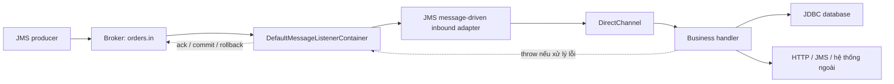
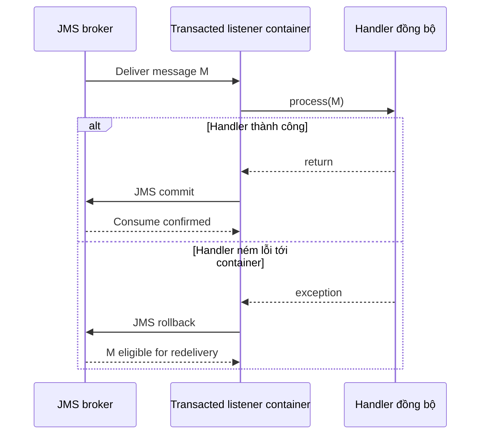
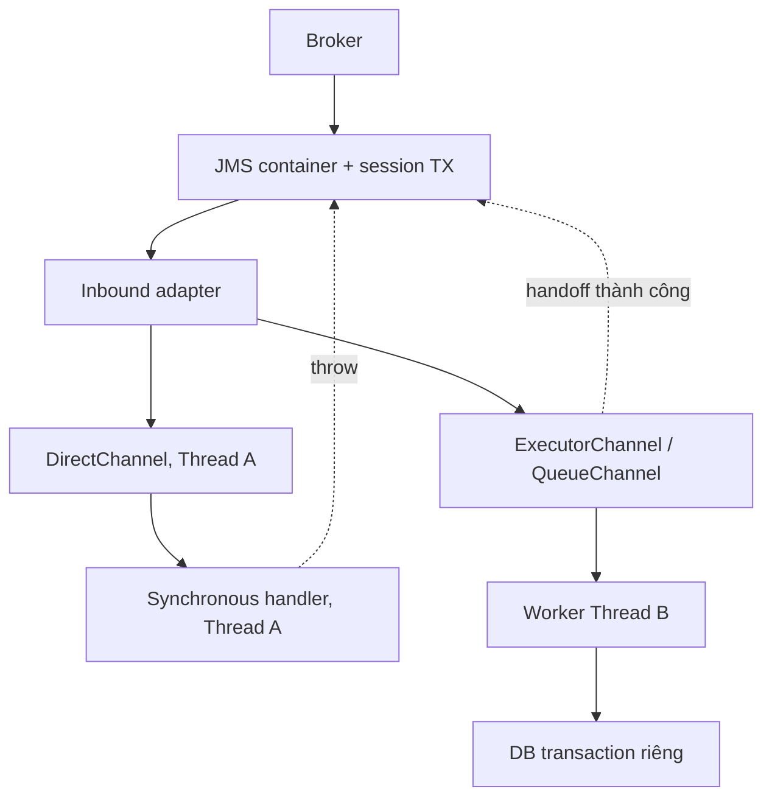
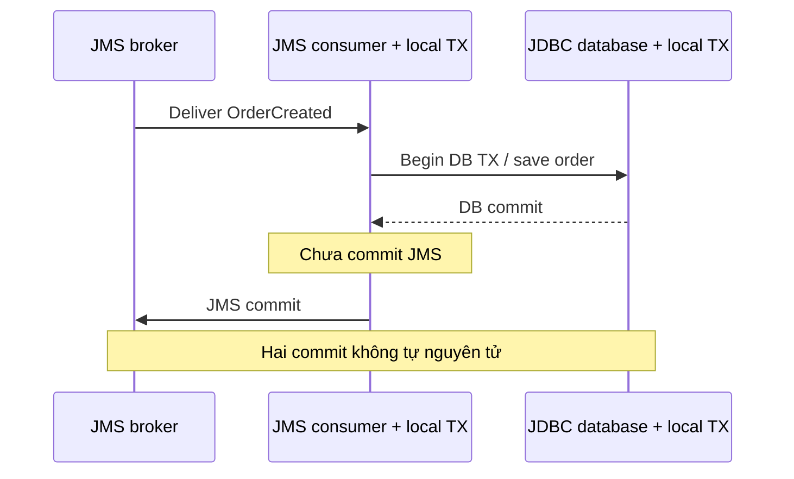
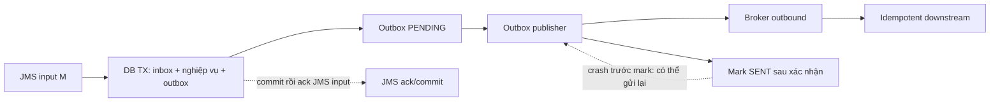

# JMS transaction và acknowledgment trong Spring Integration Adapters

## 1. Vì sao nhận JMS message chưa có nghĩa đã xử lý xong?

Trong một ứng dụng tích hợp, broker có thể giao message thành công nhưng hệ thống đích chưa hoàn thành công việc. Ví dụ, queue `orders.in` chứa một yêu cầu xử lý đơn hàng. Spring Integration nhận yêu cầu qua JMS inbound adapter, đưa vào `MessageChannel` rồi service activator ghi vào database. Nếu tiến trình gặp lỗi ngay sau khi ghi DB, cần trả lời:

- Broker đã coi message được tiêu thụ chưa?
- Consumer đã `acknowledge` hay JMS session đã `commit`?
- DB đã commit hay rollback?
- Message có thể được broker giao lại không?
- Nếu được giao lại, nghiệp vụ có bị thực hiện hai lần không?

**Acknowledgment** là cơ chế xác nhận tiêu thụ message trong JMS. **JMS transaction** tổ chức các thao tác nhận/gửi trong phạm vi session được quản lý thành một đơn vị commit/rollback. Khi flow còn liên quan đến database, HTTP, File, SFTP, AMQP hoặc Kafka, phải xác định ranh giới transaction của mỗi tài nguyên, thay vì mặc định chúng cùng commit.

Bài này thuộc chương **Transactions** của module **SPRING_INTEGRATION_ADAPTERS**: sử dụng inbound/outbound adapter, gateway, poller và `MessageChannel` để kết nối các hệ thống bên ngoài; quản lý hợp đồng message, lỗi và vòng đời kết nối.

### Mục tiêu học tập

1. Phân biệt các chế độ JMS `AUTO_ACKNOWLEDGE`, `CLIENT_ACKNOWLEDGE`, `DUPS_OK_ACKNOWLEDGE` và `SESSION_TRANSACTED`.
2. Hiểu commit, rollback, recover, redelivery, duplicate và DLQ trong JMS.
3. Cấu hình message-driven JMS inbound adapter với listener container có transaction.
4. Phân tích ảnh hưởng của `DirectChannel`, `QueueChannel`, `ExecutorChannel` và `errorChannel`.
5. Phân biệt JMS local transaction, JDBC transaction, XA/JTA và transactional outbox.
6. Kiểm thử các điểm lỗi để chứng minh không mất message và không tạo side effect trùng ngoài phạm vi cho phép.

## 2. Những sự kiện khác nhau trong vòng đời một message

| Sự kiện | Chủ thể | Ý nghĩa | Chưa chứng minh |
|---|---|---|---|
| Producer gửi message | JMS producer / outbound adapter | Thực hiện gửi tới destination qua API và delivery policy | Consumer đã xử lý nghiệp vụ |
| Broker giao message | JMS provider | Message được đưa tới consumer/session | Database handler đã commit |
| Application xử lý | Listener / Spring Integration handler | Validation, biến đổi và side effects đã được gọi | Broker đã nhận ack hoặc các hệ thống xa đã commit |
| Consumer acknowledge | Session, container hoặc client | Xác nhận tiêu thụ theo chế độ ack | Tất cả side effects ngoài JMS đã hoàn tất |
| JMS transaction commit | Transacted JMS session hoặc transaction manager | Chốt nhận/gửi trong phạm vi transaction JMS | JDBC, HTTP, Kafka tự động commit nguyên tử |

Một JMS producer có thể gửi thành công, broker đã nhận, nhưng consumer chưa chạy. Một consumer cũng có thể nhận rồi acknowledge quá sớm, sau đó ghi database thất bại và mất khả năng nhận lại công việc. **Thời điểm ack/commit so với thời điểm side effect thành công là vấn đề trung tâm.**

### 2.1 Message identity và idempotency

`JMSMessageID` giúp truy vết message do provider gán. `JMSCorrelationID` thường dùng liên kết request–reply. Nhưng khi producer retry một event nghiệp vụ, event ấy có thể trở thành message JMS mới với ID khác. Vì thế, hãy phát hành **businessEventId/idempotency key ổn định** từ hệ thống nguồn để consumer phát hiện side effect lặp, thay vì chỉ dựa vào `JMSMessageID`.

## 3. JMS Session, listener container và message-driven adapter

Trong JMS API truyền thống:

- **Connection** đại diện kết nối tới JMS provider.
- **Session** là phạm vi logic của receive, send, acknowledgment và local transaction.
- **Destination** có thể là queue hoặc topic.
- **MessageProducer / MessageConsumer** gửi và nhận.
- **MessageListener** xử lý callback bất đồng bộ.

Spring JMS cung cấp listener container như `DefaultMessageListenerContainer` để quản lý connection/session, consumer, concurrency và recovery. Spring Integration đặt thêm **JMS inbound/outbound adapters và gateways** để chuyển message từ broker sang mô hình `Message<?>` / `MessageChannel`.

`JMSContext` trong JMS 2.x là một API đơn giản hóa kết hợp một số vai trò connection và session. Ứng dụng Spring hiện đại có thể dùng các package `jakarta.jms`, trong khi dự án cũ dùng `javax.jms`. Cần nhất quán hệ sinh thái dependency; không tự trộn hai package.

### 3.1 Sơ đồ luồng nhận



Mũi tên từ handler về container chỉ thể hiện **exception truyền đồng bộ**; nếu handler chuyển việc sang thread khác, kết quả lỗi không tự quay về transaction ban đầu.

### 3.2 Queue và topic

Với **queue**, các consumer cùng queue thường cạnh tranh nhận message. Với **topic**, mỗi subscription phù hợp nhận message theo mô hình publish/subscribe; durable subscription có thể giữ message theo hợp đồng provider trong thời gian subscriber offline. Transaction/acknowledgment thuộc phạm vi session/subscription tương ứng, không phải một transaction chung cho tất cả subscribers.

## 4. Bốn chế độ acknowledgment của JMS

| Chế độ | Ai điều phối acknowledgment? | Hậu quả cần lưu ý |
|---|---|---|
| `Session.AUTO_ACKNOWLEDGE` | Session/provider hoặc container tự ack | Đơn giản nhưng thời điểm ack có thể không bảo vệ lỗi nghiệp vụ sau delivery |
| `Session.CLIENT_ACKNOWLEDGE` | Client gọi `message.acknowledge()`, hoặc container thực hiện thay | Ack có tính **cộng dồn trên session**, không nhất thiết per-message |
| `Session.DUPS_OK_ACKNOWLEDGE` | Provider được phép trì hoãn ack | Có thể nhận trùng để đổi lấy hiệu năng |
| `Session.SESSION_TRANSACTED` | `commit()` / `rollback()` | Ack là kết quả của transaction, không dùng quy tắc ack thường như session không transaction |

### 4.1 AUTO_ACKNOWLEDGE: đừng hiểu thành “sau DB commit”

AUTO_ACKNOWLEDGE tuân theo hợp đồng JMS và cách container thực thi. Chẳng hạn, `DefaultMessageListenerContainer` ở chế độ AUTO_ACKNOWLEDGE có hành vi acknowledge **trước khi listener thực thi** trong cấu hình phổ biến của Spring; vì vậy exception ở listener có thể không gây redelivery. Một container khác có thể có thời điểm và bảo đảm khác. **Không suy rằng AUTO_ACKNOWLEDGE bảo vệ xử lý nghiệp vụ quan trọng** chỉ vì service activator có `@Transactional`.

### 4.2 CLIENT_ACKNOWLEDGE: ack có thể bao nhiều message

Với session không transaction, gọi `acknowledge()` trên một message theo chế độ client acknowledgment có thể xác nhận **tất cả message đã được session tiêu thụ tới thời điểm đó**. Ví dụ session nhận A rồi B, sau đó gọi `B.acknowledge()`: A có thể đồng thời được xác nhận. Không giả định đây là per-message ack độc lập như một số API khác, trừ khi dùng extension provider được kiểm thử.

Listener container của Spring có thể xử lý việc acknowledge thay cho listener; cách triển khai phải được xác minh theo container, version và broker.

### 4.3 DUPS_OK_ACKNOWLEDGE

Provider được phép trì hoãn ack. Khi lỗi xuất hiện, duplicate delivery có thể xảy ra. Hệ thống cần idempotency; không lựa chọn chế độ này nếu nghiệp vụ giả định một event chắc chắn chỉ xử lý đúng một lần.

### 4.4 SESSION_TRANSACTED: ack bằng commit/rollback

Với một JMS Session đã mở local transaction:

1. Consumer nhận message trong phạm vi session.
2. Listener/handler chạy; có thể có các thao tác gửi JMS khác trong cùng transaction/session hợp lệ.
3. `commit()` chốt thao tác nhận/gửi được transaction quản lý.
4. `rollback()` không chốt thao tác nhận/gửi; broker có thể giao lại message theo redelivery policy.

**Phạm vi bảo đảm là JMS session**, không phải tất cả side effects. JDBC dùng một DataSource độc lập, file rename, HTTP POST hoặc gửi Kafka không tự rollback cùng JMS session.

### 4.5 So sánh hành vi bằng một timeline



Thứ tự retry/redelivery, thời gian chờ, số lần thử và DLQ phụ thuộc broker/provider. Nếu handler đã commit DB riêng trước khi JMS rollback, redelivery vẫn có thể tạo duplicate DB effect.

## 5. Redelivery và xử lý message bị lặp

### 5.1 Các điểm dễ gây redelivery

- Listener ném exception được container xem là lỗi cần rollback.
- Consumer crash trước khi commit/ack.
- Broker hoặc kết nối mạng mất trong khi kết quả commit/ack chưa rõ.
- Session được recover/rollback theo quy trình provider.
- Producer tự gửi lại một business event sau timeout.

`JMSRedelivered` là tín hiệu provider đánh dấu delivery lại; `JMSXDeliveryCount` có thể hỗ trợ đo attempts tùy hợp đồng/version/provider. Nhưng một producer gửi message **mới** chứa cùng business event có thể không mang cờ redelivered. Nên phân biệt **broker redelivery** với **business duplicate**.

```text
businessEventId = purchase-2026-00127
JMSMessageID    = ID:broker:example-0001
JMSRedelivered  = true
deliveryCount   = 3   # minh họa nếu provider cung cấp
```

### 5.2 Poison message và dead-letter queue

Nếu một payload sai schema khiến listener lỗi vĩnh viễn, rollback có thể làm message được giao lại liên tục. Do đó cần:

- Phân loại transient và permanent errors.
- Backoff/redelivery delay, max attempts và dead-letter destination theo broker.
- Ghi event ID, exception class, attempts, correlation để điều tra.
- Quy trình sửa dữ liệu và reprocess có kiểm soát.
- Thay vì retry vô hạn, đưa poison message tới DLQ/quarantine có trách nhiệm vận hành.

Không có một cấu hình DLQ duy nhất đúng cho mọi JMS provider; cách thiết lập policy có thể nằm tại broker, listener container hoặc error flow.

## 6. Listener container là biên giao dịch quan trọng

`DefaultMessageListenerContainer` (DMLC) có thể quản lý listener bất đồng bộ, connection/session, scaling concurrency và recovery. Các cấu hình cần xem xét:

- `connectionFactory`, `destinationName` hoặc destination resolver.
- `sessionTransacted` hay `transactionManager` khi dùng transaction.
- `sessionAcknowledgeMode` khi dùng session không transaction.
- `concurrentConsumers` và `maxConcurrentConsumers`.
- Recovery interval/backoff và cache level.
- Error handling và cách exception quay về container.

### 6.1 Cấu hình local JMS session transaction

Ví dụ dưới đây thể hiện bean listener container; Spring Integration endpoint cần gắn listener tương ứng. Không chủ động đăng ký một listener khác trên cùng container nếu endpoint sẽ quản lý nó.

```java
@Bean
DefaultMessageListenerContainer ordersJmsContainer(ConnectionFactory cf) {
    DefaultMessageListenerContainer container =
        new DefaultMessageListenerContainer();
    container.setConnectionFactory(cf);
    container.setDestinationName("orders.in");
    container.setSessionTransacted(true);
    container.setConcurrentConsumers(1);
    container.setMaxConcurrentConsumers(4);
    return container;
}
```

Khi `sessionTransacted=true`, container điều phối commit/rollback JMS session theo kết quả listener; nó **không** tự mở một transaction database phù hợp.

### 6.2 Dùng `JmsTransactionManager` khi cần Spring transaction abstraction

`JmsTransactionManager` quản lý local JMS transaction thông qua một `ConnectionFactory`:

```java
@Bean
JmsTransactionManager jmsTransactionManager(ConnectionFactory connectionFactory) {
    return new JmsTransactionManager(connectionFactory);
}

// Một lựa chọn khi cấu hình container theo hỗ trợ của Spring JMS:
container.setTransactionManager(jmsTransactionManager);
```

Hai lựa chọn `setSessionTransacted(true)` và gắn transaction manager cần được quyết định theo yêu cầu cụ thể và hợp đồng của container. **Không ghép hai manager rồi suy thành XA.** `JmsTransactionManager` không enlist JDBC transaction của một DataSource khác thành một giao dịch atomic.

### 6.3 AUTO_ACKNOWLEDGE của DMLC có rủi ro gì?

Nếu message đã được acknowledged trước callback và sau đó handler ghi database thất bại, broker có thể không giao lại message. Vì vậy nên dùng **local transacted JMS session** hoặc một hợp đồng ack/recovery được kiểm thử rõ ràng khi xử lý không được phép mất dữ liệu. Độ an toàn còn phụ thuộc cách lỗi đi qua Spring Integration flow.

## 7. Spring Integration JMS adapter và gateway

### 7.1 Message-driven inbound channel adapter

Message-driven inbound adapter chuyển JMS message thành Spring Integration `Message<?>` và phát vào một `MessageChannel`. Ở kiến trúc phổ biến, **listener container nhận message theo cơ chế message-driven**, không phải `SourcePollingChannelAdapter` chạy theo `Pollers.fixedDelay(...)`.

```text
JMS queue orders.in
    -> DefaultMessageListenerContainer (session transacted)
    -> Spring Integration message-driven inbound channel adapter
    -> DirectChannel
    -> service activator
```

Nếu handler trong cùng call stack ném exception và lỗi truyền về container, JMS session có thể rollback/redeliver. Nếu lỗi bị một error flow xử lý mà không tái ném, container có thể coi việc xử lý thành công.

### 7.2 Outbound channel adapter

Outbound adapter lấy Spring message rồi gửi tới JMS destination. Thành công của `send` không đồng nghĩa consumer cuối đã hoàn thành. Nếu outbound send tham gia một JMS transaction đang hoạt động theo cấu hình hỗ trợ, message được chốt khi transaction commit; không đồng nghĩa JDBC/HTTP phía ngoài cũng commit.

### 7.3 Inbound và outbound gateway

Gateway hỗ trợ request/reply qua JMS correlation và reply destination. Cần kiểm:

- `JMSCorrelationID` / `JMSReplyTo` có được ánh xạ đúng?
- Gateway timeout nghĩa là business request chắc chắn chưa chạy? **Không**.
- Reply có được phát sau khi nghiệp vụ đã xử lý xong hay chỉ sau handoff?
- Khi client retry vì timeout, có business idempotency key ngăn xử lý lặp?
- Có những session/transaction riêng nào cho request receive và reply send?

Gateway không tạo global distributed transaction cho hai ứng dụng độc lập chỉ nhờ correlation ID.

### 7.4 Khi nào poller transaction advice liên quan JMS?

Một số endpoint thực sự polling một JMS source hoặc một `PollableChannel` có thể cấu hình poller advice. Nhưng **message-driven JMS adapter** thường dựa trên listener container. Cơ chế transaction quanh `SourcePollingChannelAdapter.receive()` không thể áp máy móc lên listener container: phải đặt transaction đúng nơi message được nhận.

## 8. Ranh giới theo MessageChannel: cùng thread hay chuyển giao?



### 8.1 `DirectChannel`

`DirectChannel` gọi subscriber đồng bộ trong thread hiện tại. Khi handler ném exception ra ngoài và không có tầng trung gian nuốt lỗi, container nhận được lỗi và có thể rollback JMS local transaction.

**Giới hạn:** nếu handler đã commit JDBC độc lập rồi mới ném lỗi, JMS rollback **không** đảo ngược DB commit. Cần idempotent DB operation để redelivery không tạo trùng.

### 8.2 `ExecutorChannel`

Khi chuyển sang executor, thread của listener có thể hoàn tất việc giao message trước khi worker thật sự xử lý. JMS session có thể commit/ack; exception phát sinh sau đó **không thể rollback JMS transaction đã đóng**.

### 8.3 `QueueChannel`

`QueueChannel` tách việc gửi và nhận. Một queue lưu trong RAM có thể mất dữ liệu khi process chết; một MessageStore bền vững có transaction và recovery riêng theo thiết kế. Việc JMS input được ack chỉ chứng minh đã bàn giao theo hợp đồng channel, **không chứng minh business handler downstream hoàn tất**.

### 8.4 `errorChannel`

Spring Integration có thể đưa lỗi vào `ErrorMessage` để điều phối xử lý. Cần xác định lỗi có được **rethrow về listener container** hay đã bị coi là xử lý xong. Log `ERROR` hay việc có `ErrorMessage` **không tự bảo đảm rollback**.

- Muốn broker redelivery: lỗi phải đến đúng rollback boundary và đáp ứng rollback policy.
- Muốn quarantine/đánh dấu lỗi vĩnh viễn: lưu bằng chứng bền vững rồi commit/ack theo thiết kế.
- Nếu xử lý lỗi ở thread async: transaction nhận JMS ban đầu có thể đã hoàn thành.

### 8.5 Context transaction không tự lan qua thread

Spring transaction context thông thường gắn với thread thực thi. `CompletableFuture`, executor, queue hay consumer bên ngoài cần transaction và retry riêng. Không giả định Spring tự truyền local JMS session qua một `ExecutorChannel`.

## 9. Ví dụ Spring Integration Java DSL với JMS transacted inbound

Mẫu sau minh họa cấu trúc flow khi sử dụng message-driven inbound adapter và listener container đã có `sessionTransacted=true`. Cú pháp bean/import và builder cần được đối chiếu với **phiên bản Spring Integration đang dùng**; ví dụ không phải một dự án hoàn chỉnh.

```java
@Configuration
@EnableIntegration
class IncomingOrdersIntegrationConfig {

    @Bean
    DefaultMessageListenerContainer ordersContainer(ConnectionFactory cf) {
        DefaultMessageListenerContainer c =
            new DefaultMessageListenerContainer();
        c.setConnectionFactory(cf);
        c.setDestinationName("orders.in");
        c.setSessionTransacted(true);
        c.setConcurrentConsumers(1);
        return c;
    }

    @Bean
    IntegrationFlow ordersFlow(DefaultMessageListenerContainer ordersContainer,
                               OrderHandler handler) {
        return IntegrationFlow
            .from(Jms.messageDrivenChannelAdapter(ordersContainer))
            .handle(handler, "handle")
            .get();
    }
}
```

Ở cấu trúc này, điều cần xác minh bằng test:

1. Endpoint JMS thực sự dùng **container transacted** đã khai báo.
2. Handler thực sự chạy đồng bộ trên tuyến nhận.
3. Khi handler throw, exception **không bị nuốt bởi error flow** trước khi quay về DMLC.
4. Broker redeliver message theo policy sau rollback.
5. Khi xử lý thành công, message được commit và không còn được phát lại như một delivery chưa xác nhận.

Kết quả của số 4 và 5 còn phụ thuộc việc có crash đúng ranh giới commit hoặc broker mất kết nối. Không gán kết quả integration test trên một broker cho tất cả JMS provider.

### 9.1 Chuyển đổi JMS Message sang Spring Message

Spring Integration có cơ chế `MessageConverter` / header mapper chuyển JMS payload và metadata sang Spring `Message<?>`. Lỗi parse hoặc chuyển đổi có thể phát sinh **trước khi service activator được gọi**. Vì vậy hãy kiểm:

- Payload là `TextMessage`, `BytesMessage`, `ObjectMessage` hay kiểu khác; có hợp đồng schema rõ?
- Content type, encoding, schema version và size giới hạn thế nào?
- Header nào được ánh xạ, header nào phải được kiểm từ nguồn tin cậy?
- Dữ liệu có chứa bearer token, mật khẩu hoặc thông tin nhạy cảm không được log?
- Converter throw exception thì container rollback, route error hay commit?

Tránh deserialize đối tượng không tin cậy bằng cơ chế không giới hạn class/type. Với message từ hệ thống ngoài, nên ưu tiên định dạng có schema, validation và giới hạn kích thước phù hợp.

### 9.2 Dùng channel tường minh để thấy boundary

```java
// Fragment Java DSL minh họa (cần imports và beans phù hợp).
return IntegrationFlow
    .from(Jms.messageDrivenChannelAdapter(ordersContainer))
    .channel(MessageChannels.direct("orders.input"))
    .handle(orderValidationHandler, "validate")
    .handle(orderHandler, "handle")
    .get();
```

Đoạn trên dùng `DirectChannel` và handler đồng bộ. Nếu thay channel thành `ExecutorChannel`, giả định “exception ở handler sẽ rollback JMS receive” không còn đúng trong trường hợp thông thường. Những thành phần bất đồng bộ khác trong flow cũng cần được đánh giá tương tự.

## 10. JMS transaction có bảo vệ JDBC transaction không?

**Không tự động.** Đây là điểm quan trọng nhất khi kết nối JMS với database.

Giả sử consumer nhận `OrderCreated` từ JMS và ghi database:



### 10.1 Hai giao dịch local khác nhau

`JmsTransactionManager` quản lý JMS transaction. `DataSourceTransactionManager` (hoặc `JdbcTransactionManager`) quản lý transaction của một DataSource. Nếu handler có `@Transactional` cho JDBC, database và broker vẫn là **hai tài nguyên độc lập** trừ khi có cơ chế điều phối XA/JTA thật sự.

| Kịch bản | Trạng thái DB | Trạng thái JMS | Hậu quả |
|---|---|---|---|
| Handler lỗi trước DB commit; JMS rollback | DB rollback | Message có thể redeliver | Có thể thử lại an toàn nếu chưa có side effect khác |
| DB commit; process chết trước JMS commit | DB đã lưu | JMS chưa chắc hoàn tất, có thể redeliver | **Duplicate DB effect** nếu handler không idempotent |
| JMS commit rồi ghi DB ngoài transaction, DB lỗi | DB chưa lưu | Broker có thể coi message đã tiêu thụ | Nguy cơ **mất công việc** |
| DB commit; JMS commit thành công | DB đã lưu | Message được xác nhận | Thành công theo hai scope, cần audit |
| Lỗi mạng khi gửi JMS commit | DB có thể đã commit | JMS outcome chưa rõ với client | Phải chịu được redelivery, kiểm broker |

Không chọn thứ tự commit đơn thuần rồi tuyên bố giải quyết tuyệt đối cả message loss lẫn duplicate. Phải quyết định cơ chế xử lý sự cố giữa hai commit.

### 10.2 `@Transactional` không đủ để tạo distributed transaction

`@Transactional(transactionManager = "dbTransactionManager")` ở service xử lý DB. Nó không biến JMS Session thành XA participant. Ngược lại, `@Transactional(transactionManager = "jmsTransactionManager")` không bảo vệ mọi cập nhật JDBC.

Trong dự án có nhiều `PlatformTransactionManager`, hãy xác định **tên manager**, propagation và thứ tự interceptor rõ ràng. Nếu một flow có transaction ở nhiều tầng, kiểm thử bằng kết quả ở broker/DB thay vì chỉ quan sát `TransactionSynchronizationManager.isActualTransactionActive()`.

## 11. XA/JTA và sự khác biệt với JMS local transaction

**JTA/XA** có thể điều phối một global transaction với nhiều tài nguyên hỗ trợ XA (ví dụ JMS provider có XA connection factory và database có XA DataSource) thông qua transaction coordinator. Khi được cấu hình chính xác, coordinator có thể dùng mô hình hai pha commit cho các XA participants.

Điều kiện cần xét:

1. JMS provider và database **thực sự hỗ trợ XA** theo phiên bản/driver đang dùng.
2. Có transaction coordinator đáng tin cậy, recovery log bền vững và cơ chế phục hồi in-doubt transaction.
3. Listener container tham gia JTA transaction, connection/session và JDBC connection được enlist đúng.
4. Timeout, crash recovery, heuristic outcome và lỗi mạng được quan sát/diễn tập.
5. Độ trễ và lock giữ lâu là chấp nhận được.

**Không phải mọi hệ thống ngoài đều hỗ trợ XA.** HTTP, SFTP và nhiều API cloud/SaaS không có giao dịch toàn cục chung với DB. Kafka có transaction của Kafka trong phạm vi của nó nhưng không tự trở thành tài nguyên XA của một transaction Spring JMS/JDBC chỉ vì cùng ứng dụng.

### 11.1 Khi nào cân nhắc XA?

Khi cần nguyên tử giữa JMS nhận/gửi và database, công nghệ hỗ trợ XA, vận hành coordinator được và yêu cầu consistency đủ mạnh, XA có thể là một lựa chọn. Nhưng khả năng phục hồi phức tạp và chi phí vận hành khiến nhiều đội ưu tiên **local transaction + idempotency/outbox** khi có thể.

### 11.2 Vì sao “best effort 1-phase commit” không phải atomic?

Một thiết kế có thể commit hai resource theo thứ tự cố định và kỳ vọng đa số trường hợp thành công. Đây là một tối ưu thực dụng cho một số hệ thống, nhưng có **cửa sổ lỗi giữa hai commit**. Nếu tài liệu thiết kế cho phép cửa sổ đó, phải công bố giả định, cơ chế retry, phát hiện inconsistency và quy trình reconciliation; không mô tả như XA.

## 12. Inbox idempotency khi JMS có thể redeliver

Đối với at-least-once delivery, **idempotency ở tầng nghiệp vụ** là tuyến phòng vệ quan trọng.

### 12.1 Ý tưởng

Mỗi event có `businessEventId` do producer cấp ổn định. Consumer lưu một “đã xử lý” ledger cùng transaction với business update. Khi nhận lại event, nếu ID đã tồn tại, consumer không thực hiện side effect lần nữa.

```sql
CREATE TABLE processed_inbox (
    consumer_name VARCHAR(80) NOT NULL,
    business_event_id VARCHAR(120) NOT NULL,
    processed_at TIMESTAMP NOT NULL,
    PRIMARY KEY (consumer_name, business_event_id)
);

CREATE TABLE purchase_accounting (
    purchase_id VARCHAR(80) PRIMARY KEY,
    total_amount DECIMAL(18, 2) NOT NULL,
    state VARCHAR(32) NOT NULL
);
```

Unique constraint giúp bảo vệ cả khi có nhiều consumer tranh chấp cùng event. **Chỉ kiểm SELECT rồi INSERT hai bước không có khóa/constraint atomic** có thể gặp race condition.

### 12.2 Pseudocode Java dùng DB transaction

```java
@Service
class PurchaseConsumer {
    private final InboxRepository inbox;
    private final PurchaseRepository purchases;

    @Transactional(transactionManager = "dbTransactionManager")
    public void handle(PurchaseCreated event) {
        // tryInsertIfAbsent phải atomic, dựa trên unique constraint
        // và ngữ nghĩa upsert phù hợp database cụ thể.
        boolean firstTime =
            inbox.tryInsertIfAbsent("purchase-consumer", event.eventId());
        if (!firstTime) {
            return; // event đã xử lý trước đó
        }

        purchases.applyBusinessUpdate(event);
        // Cả inbox record và business update cùng commit hoặc rollback.
    }
}
```

`tryInsertIfAbsent` là **API giả định** của repository, không phải method mặc định của Spring Data. Cách triển khai cần tương thích database (ví dụ insert-if-not-exists/upsert có điều kiện), xử lý duplicate key và concurrent attempts đúng.

Nếu crash sau khi DB commit nhưng trước JMS commit, broker có thể giao lại event. Lần nhận sau nhìn thấy ledger và bỏ qua side effect, sau đó hoàn tất JMS transaction. Nếu DB rollback, ledger cũng rollback nên lần nhận tiếp theo vẫn có thể xử lý thật.

### 12.3 Giới hạn của inbox ledger

Inbox chỉ bảo vệ những side effect **nằm trong cùng transaction** với ledger. Nếu handler đã gọi HTTP hoặc gửi email trước khi ledger commit, crash có thể khiến các thao tác đó lặp. Cần idempotency ở hệ thống xa, outbox hoặc workflow compensation.

## 13. Transactional outbox khi consumer cần gửi message khác

Ví dụ JMS consumer xử lý đơn, ghi database và phải gửi sự kiện `OrderAccepted` tới JMS/AMQP/Kafka. Nếu gửi trực tiếp trong DB transaction, event có thể được broker nhận rồi DB rollback. Outbox là một cách tách hai bước nhưng giữ trạng thái cần gửi trong DB bền vững.

### 13.1 Luồng outbox

1. Consumer nhận JMS message M.
2. Trong **một DB transaction**, ghi thay đổi nghiệp vụ, inbox dedupe và một outbox row.
3. DB commit.
4. JMS consumer commit/ack M (vẫn có khả năng redelivery nếu crash trước bước này; inbox xử lý).
5. Một publisher độc lập đọc outbox và gửi tới broker.
6. Sau broker send confirmation phù hợp, publisher đánh dấu row `SENT`.
7. Nếu publisher crash sau send nhưng trước mark SENT, publisher có thể gửi lại; downstream consumer tiếp tục dedupe.



### 13.2 Schema minh họa

```sql
CREATE TABLE integration_outbox (
    event_id VARCHAR(120) PRIMARY KEY,
    destination VARCHAR(160) NOT NULL,
    payload VARCHAR(4000) NOT NULL,
    state VARCHAR(24) NOT NULL,
    attempt_count INTEGER NOT NULL DEFAULT 0
);
```

Outbox bảo đảm **ý định gửi được lưu bền vững cùng DB update** và có đường phát lại; nó thường cung cấp at-least-once delivery, không phải exactly-once end-to-end. Để xử lý crash/unknown send outcome, cần consumer idempotency, publisher lease/claim, retry và reconciliation.

### 13.3 Vì sao `afterCommit` không thay thế outbox?

Một callback gửi JMS **sau DB commit** có thể thất bại hoặc ứng dụng chết trước khi gọi callback. Khi đó DB đã lưu nhưng không còn một bản ghi bền vững để biết event chưa được gửi. Outbox ghi dữ liệu `PENDING` **trước commit** nên publisher có thể phục hồi sau restart.

## 14. Acknowledgment ở outbound và request/reply gateway

### 14.1 Outbound producer: “send success” có các mức ý nghĩa khác nhau

`JmsTemplate.send` hoặc outbound adapter có thể trả về sau khi provider thực hiện send theo hợp đồng và transaction hiện hành; delivery mode, TTL, broker persistence và transaction commit đều có ảnh hưởng. Điều này không phải xác nhận rằng consumer đã xử lý nghiệp vụ. Nếu muốn đảm bảo kết quả nghiệp vụ, cần acknowledgment **ở tầng ứng dụng**, reply message, event trạng thái hoặc query API downstream.

### 14.2 Gateway timeout không đồng nghĩa request thất bại

Ví dụ client gửi yêu cầu thanh toán qua JMS outbound gateway rồi chờ 5 giây. Server đã ghi thanh toán vào DB nhưng reply đến sau 6 giây. Client thấy timeout và retry; server có thể xử lý thanh toán lần thứ hai nếu không có idempotency key.

Giải pháp:

- Gắn `requestId`/business key ổn định xuyên retry.
- Đặt timeout và correlation theo nghiệp vụ.
- Khi timeout, coi kết quả là **unknown** cho tới khi đối chiếu.
- Consumer xử lý idempotently và có thể trả lại kết quả cũ của cùng request.
- Quản lý late reply, temporary reply destination và resource cleanup theo cấu hình gateway.

### 14.3 Reply destination và transaction boundaries

Một flow request/reply có thể sử dụng nhiều session: session nhận request, session gửi reply, session ở client chờ reply. Không mặc định chúng cùng một local transaction. Nếu cần atomic receive+send trong broker, phải xác minh chúng thực sự tham gia cùng transacted JMS session/transaction theo công nghệ; nếu reply phụ thuộc JDBC phải xem lại mục XA/outbox.

## 15. Lỗi và retry: rollback ở đâu, commit ở đâu?

### 15.1 Phân loại lỗi

| Loại | Ví dụ | Chính sách gợi ý |
|---|---|---|
| Transient dependency failure | DB timeout, temporary connection loss | Rollback JMS, broker redelivery có delay và giới hạn |
| Validation/permanent failure | JSON sai schema, thiếu field bắt buộc | Quarantine/DLQ có audit; tránh lặp vô hạn |
| Duplicate event | eventId đã có trong inbox ledger | No-op an toàn và hoàn tất ack |
| Unknown remote outcome | HTTP timeout sau POST | Query trạng thái hoặc retry idempotent |
| Downstream async failure | Worker lỗi sau QueueChannel handoff | Retry ở worker queue, không kỳ vọng JMS input rollback |
| Resource/configuration error | Credential, TLS, destination không hợp lệ | Alert và sửa cấu hình; không retry dày vô hạn |

### 15.2 Lỗi có được truyền về container?

```java
void handle(OrderEvent event) {
    try {
        saveOrder(event);
    } catch (Exception ex) {
        log.warn("Order processing failed", ex);
        // Trả về bình thường -> listener có thể coi thành công
        // và JMS transaction có thể COMMIT.
    }
}
```

Nếu muốn broker redelivery, cần để lỗi truyền lên đúng listener container hoặc đánh dấu rollback theo hợp đồng framework. Nếu muốn **commit và quarantine** vì lỗi dữ liệu vĩnh viễn, phải lưu bằng chứng/đường xử lý tiếp theo bền vững trước khi trả kết quả thành công.

### 15.3 Retry ở listener, broker và ứng dụng có thể chồng nhau

Một broker có max attempts 5, trong khi listener có retry advice 3 lần và một outbound HTTP client retry 4 lần. Một business event có thể gây số thao tác tới HTTP lớn hơn nhiều so với tưởng tượng. Cần có **retry budget tổng**, phân biệt retries trong một delivery và redeliveries từ broker, cùng giới hạn thời gian cuối.

Nên:

- Dùng backoff/jitter, circuit breaker cho dependency lỗi.
- Dừng lỗi permanent tại DLQ/quarantine.
- Giữ idempotency key qua tất cả lần retry.
- Theo dõi retry attempts theo event ID và nơi khởi phát.
- Không xóa/trả thành công chỉ vì vượt số lần thử nếu chưa lưu trạng thái xử lý lỗi và chủ sở hữu.

## 16. Concurrency, prefetch, ordering và backpressure

### 16.1 DMLC concurrent consumers

`concurrentConsumers` và `maxConcurrentConsumers` giúp tăng số consumer. Khi tăng concurrency, message có thể được xử lý song song, dẫn tới thay đổi thứ tự **hoàn thành nghiệp vụ**, ngay cả khi broker có quy tắc order cho queue.

Nếu yêu cầu “các event của một aggregate phải xử lý đúng thứ tự”, cân nhắc:

- Partition/key theo aggregate hoặc JMS message group theo hỗ trợ provider.
- Sequence/version trong business event và cơ chế reorder/reject stale.
- Concurrency phù hợp với throughput và ordering requirement.
- Idempotency, timeout và xử lý trùng khi rebalance/recovery.

### 16.2 Prefetch và delivery chưa xử lý

Broker có thể prefetch nhiều message cho consumer. Điều này ảnh hưởng fairness, memory footprint, thời gian message chờ và phân phối khi một consumer chậm. **Prefetch không đồng nghĩa message đã được commit/ack**, nhưng phải hiểu provider semantics để đo backlog và redelivery.

### 16.3 Backpressure và DLQ

Khi DB chậm hoặc lỗi, để consumer liên tục nhận rồi rollback có thể tạo vòng redelivery nóng và tăng tải. Cần giới hạn concurrency, điều chỉnh retry/redelivery delay, circuit breaker, monitoring backlog và nếu cần tạm dừng listener container theo runbook. Không tăng concurrency vô hạn để “xử lý hết queue” khi bottleneck là DB.

## 17. JMS khác File, SFTP, HTTP, AMQP và Kafka về transaction thế nào?

Mục tiêu module Spring Integration Adapters là kết nối nhiều hệ thống. JMS có local session transaction, nhưng các hệ thống khác dùng hợp đồng riêng. Một message có thể đi qua nhiều adapter và **không tồn tại một commit/rollback duy nhất** cho tất cả.

| Nguồn/đích | Cơ chế xác nhận/thành công điển hình | Điểm cần kiểm khi lỗi |
|---|---|---|
| **JMS inbound** | Session ack hoặc commit/rollback; provider redelivery | Listener exception có thực sự rollback không, DLQ policy ra sao? |
| **JMS outbound** | Producer send + JMS transaction nếu có | Message đã được broker chấp nhận/chốt chưa, consumer đã xử lý chưa? |
| **JDBC** | Local DB transaction commit/rollback | Có cùng transaction manager và connection/DB scope không? |
| **File** | File tồn tại, đã đọc, đã move/rename/delete | Filesystem không tham gia JMS transaction; crash để lại trạng thái nào? |
| **SFTP** | Download/upload/rename trên máy xa | Remote operation không tự rollback với JMS/DB |
| **HTTP** | HTTP response và idempotency hợp đồng API | Timeout có thể che kết quả đã thành công ở server |
| **AMQP** | Broker ack/nack/requeue/confirm hoặc transaction theo sản phẩm | Ack semantics khác JMS; không dùng nhầm JMS CLIENT_ACKNOWLEDGE |
| **Kafka** | Consumer offset, producer transaction, listener/container transaction | Offset và Kafka transaction không tự phối hợp DB/JMS toàn cục |

Ví dụ luồng `JMS inbound → HTTP outbound gateway → JDBC write`:

1. Consumer nhận JMS message trong local JMS transaction.
2. HTTP server đã xử lý POST, nhưng client thấy timeout.
3. Handler ném exception; JMS rollback, broker redeliver.
4. Handler gọi lại HTTP, có thể tạo tác động nghiệp vụ trùng.

**Hướng khắc phục:** xác định idempotency key cho API xa, kiểm kết quả khi timeout, hoặc tách việc gọi remote qua outbox/workflow có trạng thái bền vững. Không cố giải quyết bằng cách tăng JMS timeout hay bật một annotation transaction duy nhất.

### 17.1 Các transaction khác trong Spring Integration

Transaction advice gắn cho **poller** thường bao quanh một tác vụ poll/receive. JMS message-driven adapter thường được điều phối bởi **listener container**. Spring Integration `TransactionSynchronizationFactory` hoặc pseudo transaction có thể tổ chức callback sau xử lý với File/SFTP nhưng **không biến file hay HTTP thành JMS XA resource**. Luôn chọn transaction boundary dựa trên **loại endpoint thực tế**.

## 18. Kiểm thử JMS transaction và acknowledgment

### 18.1 Vì sao unit test không đủ?

Một unit test gọi trực tiếp `OrderHandler.handle(...)` có thể chứng minh business logic đúng nhưng không kiểm:

- Listener container có transacted session hay không.
- Message đã ack trước hay sau handler.
- Lỗi có được error flow nuốt trước khi trở về JMS listener.
- Broker redelivery sau rollback/crash.
- JDBC commit độc lập và duplicate effect khi message giao lại.
- DLQ, prefetch, reconnection và ordering khi có nhiều consumer.

Để kiểm thật, nên dùng **JMS broker thực ở môi trường thử** (chẳng hạn một broker tương thích JMS chạy bằng container test) cùng database và cấu hình adapter gần production. Hạn chế can thiệp trực tiếp production; bảo đảm test isolation, credential và cách cleanup.

### 18.2 Ma trận kiểm thử bắt buộc

| Kịch bản | Kết quả mong đợi | Bằng chứng |
|---|---|---|
| Handler đồng bộ thành công | JMS message commit/ack; nghiệp vụ ghi đúng | Broker queue state, DB readback |
| Handler ném exception với transacted listener | JMS rollback, message eligible for redelivery | Delivery attempts, listener error, broker state |
| AUTO_ACKNOWLEDGE với DMLC và handler lỗi | Hiểu rõ thời điểm ack; không giả định redelivery | Broker consumption và message loss test |
| CLIENT_ACKNOWLEDGE nhiều message cùng session | Acknowledgment theo session semantics | Delivery/ack observation |
| Handler nuốt exception | JMS có thể commit; test phát hiện lệch kỳ vọng | Event state, listener outcome |
| DirectChannel đổi thành ExecutorChannel | JMS input có thể commit trước async failure | Timeline 2 thread, broker, DB |
| DB commit, crash trước JMS commit | Message có thể được giao lại; DB không double update | Inbox unique key, DB rows |
| JMS commit trước một DB write ngoài TX | Phát hiện nguy cơ mất công việc | Fault injection, reconciliation |
| Message validation lỗi vĩnh viễn | DLQ/quarantine sau budget | Queue depth, attempts, error record |
| Retry transient DB outage | Backoff hợp lý, không spin nóng | Retry timestamps, DB load |
| Outbox publish xong, crash trước mark SENT | Có thể gửi lại nhưng consumer dedupe | Outbox row, broker event ID |
| Gateway request timeout, reply đến muộn | Không thực hiện giao dịch hai lần | Correlation, idempotency ledger |
| Consumer crash giữa xử lý | Khởi động lại và phục hồi đúng | Broker redelivery, process restart |
| Broker network partition | Container reconnect, không giả định commit thành công | Recovery logs, duplicate handling |
| Multi-consumer cùng aggregate | Không vi phạm yêu cầu ordering | Sequence, group key, business state |
| DLQ reprocess | Truy vết và xử lý lại không nhân đôi side effect | Reprocess audit, inbox/readback |

### 18.3 Bài thử tích hợp quan trọng: DB commit rồi JMS rollback

Đây là tình huống thường bị bỏ qua. Tạo một message `OrderCreated(eventId=E100)` và xử lý:

1. Handler ghi đơn và event ledger vào DB trong một database transaction.
2. Để DB commit.
3. Inject lỗi khiến listener không hoàn tất JMS transaction (hoặc mô phỏng crash tại cửa sổ trước JMS commit).
4. Broker giao lại E100.
5. Consumer nhận lần hai nhưng `processed_inbox` đã có E100, do đó không ghi đơn thêm lần nữa.
6. JMS receive được commit ở lần hai.

**Tiêu chí PASS:** một business event chỉ tạo đúng **một business effect**, trong khi có thể nhận hai JMS deliveries. Nếu test chỉ đếm số lần handler được gọi và đòi đúng một lần, test không phản ánh đúng đặc tính at-least-once.

### 18.4 Pseudocode kiểm thử kiểu JUnit

```java
// Pseudocode hợp đồng: TestJmsHarness, BrokerProbe và OrderProbe
// là abstraction do dự án tự triển khai; không phải API JUnit/Spring mặc định.
@Test
void redeliveryDoesNotDuplicateBusinessEffect() {
    String eventId = "purchase-test-100";
    harness.sendOrder(eventId);
    harness.failAfterDbCommitBeforeJmsCommit(eventId);

    harness.awaitRedelivery(eventId, testDeadline);
    harness.allowConsumerToFinish(eventId);

    assertEquals(1, orders.countByEventId(eventId));
    assertTrue(inbox.contains(eventId));
    assertTrue(broker.noUnsettledDelivery(eventId));
}
```

Một test runner thực tế phải chứng minh **thời điểm injection**: nếu lỗi xảy ra trước DB commit, test trên không kiểm được duplicate-after-commit. Hãy lưu transaction traces và broker confirmations để phân biệt. Không chạy fault injection vào queue production nếu chưa được phê duyệt.

### 18.5 Kiểm thử with crash/restart

Kill/restart consumer trong môi trường thử ở các giai đoạn:

- Trước khi listener nhận message.
- Sau khi broker delivery nhưng trước business update.
- Sau DB commit nhưng trước JMS commit.
- Sau JMS commit nhưng trước khi client biết kết quả.
- Trong khi broker connection bị ngắt.
- Khi callback xử lý lỗi hoặc chuyển DLQ.

Kiểm lại queue/DB/outbox sau restart. Ghi các outcome “success”, “rollback”, “redelivered”, “unknown” tách biệt. Một listener report thành công từ log không đủ để chứng minh broker đã commit nếu connection lỗi ngay sau đó.

## 19. Observability: đo đúng trạng thái nhận và xử lý

### 19.1 Metrics gợi ý

| Nhóm | Chỉ số | Ý nghĩa |
|---|---|---|
| Broker | Queue depth, oldest message age | Backlog và độ trễ giao việc |
| Delivery | Rate received/redelivered, attempts | Retry storm, poison message |
| Transaction | JMS commit/rollback count, commit latency | Ranh giới xử lý message |
| Handler | Success/failure rate, duration p95/p99 | Lỗi nghiệp vụ hoặc xử lý chậm |
| Database | TX commit/rollback, lock wait, deadlock | Mâu thuẫn hoặc nghẽn DB |
| Error flow | DLQ depth, rejected/quarantined count | Message không xử lý được |
| Idempotency | Duplicate detected, suppressed side effects | Hiệu quả bảo vệ khi redelivery |
| Outbox | Pending count/oldest age, send attempts | Sự kiện đã lưu nhưng chưa xuất |
| Connectivity | JMS connection failures/recovery time | Sự cố broker hoặc network |
| Resource | Concurrent consumers, session count, pool usage | Rò connection/session hoặc overload |

Tên metrics là **gợi ý thiết kế**, không phải tất cả đều có sẵn mặc định ở mọi phiên bản Spring Integration, Micrometer hay broker.

### 19.2 Trace/correlation

Một event nên có tuyến truy vết:

```text
traceId=trace-1290
businessEventId=purchase-2026-00127
jmsMessageId=ID:broker:000A
jmsRedelivered=true
deliveryAttempt=2
listenerContainer=ordersJmsContainer
handlerOutcome=SUCCESS
dbOutcome=COMMITTED
jmsOutcome=COMMITTED
outboxEventId=purchase-2026-00127-accepted
```

Không ghi payload thô chứa dữ liệu cá nhân nhạy cảm, bearer token, password, broker credential hoặc secret key trong log. Khi broker/session trả **unknown outcome**, hãy ghi trạng thái chưa xác định thay vì tự đổi thành `COMMITTED`.

### 19.3 Phân biệt ACK với “business success”

Monitoring có thể thấy queue depth giảm, nhưng doanh thu/order state vẫn sai vì:

- AUTO_ACK đã tiêu thụ message dù handler lỗi.
- JMS input đã commit khi công việc mới được bàn giao cho ExecutorChannel.
- Handler trả về bình thường dù chỉ ghi một log lỗi.
- DB transaction ở downstream thất bại độc lập.

Vì vậy đo cả **broker delivery settlement** và **business outcome** ở database/target. Với nhiều hệ thống, thêm reconciliation định kỳ và cảnh báo chênh lệch.

## 20. Runbook khi JMS redelivery hoặc mất message bất thường

### Giai đoạn A — Phát hiện và phân loại

1. Kiểm JMS connection, destination, listener container, session transaction mode và broker availability.
2. So sánh queue depth, redelivery count, DLQ và log handler.
3. Xác định message chỉ bị nhận lại hay business event bị gửi trùng từ producer.
4. Xác định transaction manager nào đang bảo vệ JDBC và JMS.
5. Phân loại lỗi: converter, validation, DB, HTTP/SFTP, broker commit hoặc connection recovery.

### Giai đoạn B — Ngăn lỗi lan rộng

1. Nếu một poison message gây retry nóng, dùng policy delay/DLQ hoặc tạm dừng consumer theo runbook.
2. Giữ nguồn dữ liệu và audit; không xóa queue/DLQ chỉ để dashboard xanh.
3. Giảm concurrency nếu DB cạn pool/deadlock, hoặc tách traffic theo destination.
4. Với unknown outcome, kiểm ledger và broker state trước khi chủ động gửi lại.
5. Không tắt transaction/ack safety để giảm queue depth bằng mọi giá.

### Giai đoạn C — Khôi phục

1. Sửa nguyên nhân: cấu hình, schema converter, credential, network, downstream availability.
2. Xác minh handler đồng bộ có ném lỗi tới đúng listener boundary.
3. Kiểm idempotency ledger, outbox pending và nguồn dữ liệu đã xử lý.
4. Mở lại consumer có giới hạn; theo dõi commit/rollback, attempts và backlog.
5. Reprocess DLQ có chọn lọc sau sửa lỗi, giữ event ID và audit.

### Giai đoạn D — Đối soát

1. So sánh business events được phát với business effects đã lưu.
2. Tìm event chưa xử lý, bị xử lý trùng hoặc có outcome chưa rõ.
3. Kiểm mọi outbox event `PENDING` có owner và retry.
4. Báo cáo residual backlog, thời gian khắc phục và rủi ro còn lại.
5. Bổ sung integration regression test cho đúng điểm lỗi đã gặp.

## 21. Những anti-pattern cần tránh

**“AUTO_ACKNOWLEDGE luôn ack sau khi handler commit DB.”** Thời điểm ack phụ thuộc JMS/container. Với DMLC, AUTO_ACK có thể không redeliver khi listener lỗi; phải kiểm cấu hình thực tế.

**“CLIENT_ACKNOWLEDGE tương đương ack từng message độc lập.”** JMS client acknowledge truyền thống có tính cộng dồn theo session.

**“Có `sessionTransacted=true` là database cũng rollback.”** Local JMS session không enlist JDBC tự động.

**“Dùng `@Transactional` ở handler là đủ bảo vệ cả broker lẫn DB.”** Cần chỉ định manager, thread boundary và coordination strategy rõ.

**“Gửi vào ExecutorChannel vẫn giữ JMS transaction đến hết worker.”** Handoff async có thể khiến listener commit trước khi worker thất bại.

**“Message được ack có nghĩa order đã xử lý xong.”** Ack chỉ là sự kiện JMS; phải kiểm business state riêng.

**“Một lần broker redelivery là lỗi thiết kế.”** Redelivery có thể là recovery hợp lệ sau crash; lỗi là side effect không idempotent.

**“Tăng max retry vô hạn để không mất message.”** Poison messages gây retry storm và tắc queue; cần DLQ/quarantine.

**“JMSMessageID đủ để chống mọi duplicate.”** Producer retry có thể phát message mới với JMSMessageID mới nhưng cùng business event.

**“JMS gateway timeout nghĩa là bên kia không làm gì.”** Reply đến muộn hoặc mất kết nối có thể che business effect đã commit.

**“Dùng XA giải quyết được HTTP/SFTP bất kỳ.”** Tài nguyên phải hỗ trợ XA và tham gia transaction coordinator; phần lớn external API không có hợp đồng như vậy.

**“Gửi JMS trong afterCommit callback bảo đảm không mất event.”** App có thể chết sau DB commit trước callback; outbox là một giải pháp bền vững hơn.

**“DLQ có message rồi là xong.”** DLQ cần owner, lịch xử lý lại, tiêu chí sửa dữ liệu, retention và audit.

## 22. Checklist thiết kế JMS adapter có transaction

### Transaction và acknowledgment

- [ ] Đã xác định inbound endpoint là **message-driven JMS** hay polling JMS thật?
- [ ] Đã chọn `sessionTransacted` / `transactionManager` hoặc acknowledge mode có chủ đích?
- [ ] Đã xác minh listener container và broker version thực tế?
- [ ] Đã kiểm khi handler throw thì listener nhận lỗi và JMS rollback/redelivery đúng policy?
- [ ] Đã phân biệt JMS Session transaction với JDBC transaction?
- [ ] Đã đánh giá XA/JTA hoặc local transaction + idempotency/outbox khi dùng nhiều tài nguyên?

### MessageChannel và side effects

- [ ] Flow có chuyển từ DirectChannel sang ExecutorChannel/QueueChannel không?
- [ ] Có kiểm điểm handoff và thời điểm ack/commit trước downstream processing?
- [ ] Có businessEventId/idempotency key ổn định?
- [ ] Inbox ledger và business update có atomic trong DB không?
- [ ] Mọi HTTP/File/SFTP/Kafka/AMQP side effects đều có retry/reconciliation phù hợp?
- [ ] Request/reply gateway có xử lý timeout và late reply không?

### Error handling và vận hành

- [ ] Có retry budget, backoff và DLQ/quarantine cho poison message?
- [ ] Error flow có giữ đúng exception propagation khi cần rollback không?
- [ ] Đã thử crash sau DB commit trước JMS commit?
- [ ] Đã thử consumer restart, broker outage và unknown ack outcome?
- [ ] Có metrics redelivery/rollback, queue age, duplicate detection và outbox age?
- [ ] Có runbook reprocess DLQ, tạm dừng consumer và đối soát business effect?

## 23. Bài tập tình huống

### Tình huống A — AUTO_ACK gây mất công việc

Spring Integration JMS inbound adapter dùng DMLC ở AUTO_ACKNOWLEDGE. Service activator ném exception do database down. Broker queue đã giảm nhưng database không có order.

**Câu hỏi:** Phân tích thời điểm ack; vì sao `@Transactional` của handler không đủ? Cần thay đổi cấu hình listener và test nào để chứng minh redelivery?

*Gợi ý:* DMLC ack policy, `sessionTransacted=true`, exception propagation và broker readback.

### Tình huống B — DB đã commit nhưng JMS nhận lại

Handler nhận E101, ghi business record vào DB rồi tiến trình chết trước JMS commit. Sau restart, broker giao lại E101.

**Câu hỏi:** Đây là lỗi nào giữa hai commit? Thiết kế inbox idempotency ra sao để không nhân đôi business effect?

*Gợi ý:* Business event ID, DB unique constraint, cùng DB transaction cho inbox và business update.

### Tình huống C — ExecutorChannel làm thay đổi rollback

Flow ban đầu là `JMS inbound → DirectChannel → handler`. Để tăng throughput, team đổi thành `JMS inbound → ExecutorChannel → handler`. Một lỗi ở handler không còn làm broker redeliver.

**Câu hỏi:** Ranh giới nào đã thay đổi? Nếu cần xử lý async bền vững, nên chọn handoff nào và quản lý transaction mới ra sao?

*Gợi ý:* Listener thread kết thúc sớm, persistent queue/outbox, worker riêng, DLQ và idempotency.

### Tình huống D — CLIENT_ACKNOWLEDGE không phải per-message

Một consumer session nhận A và B, sau đó application gọi `acknowledge()` trên B, tưởng chỉ B được ack. Application crash trước khi xử lý A.

**Câu hỏi:** Giải thích nguy cơ. Cách chọn chế độ và session/thread boundaries để không nhầm hợp đồng ack?

*Gợi ý:* Cumulative acknowledgment, transacted session, kiểm provider/container.

### Tình huống E — Gateway timeout dẫn đến thanh toán đôi

JMS gateway gửi `charge(paymentId=P55)`. Server ghi DB thành công nhưng reply chậm; client timeout rồi retry. Hai yêu cầu có thể cùng thực hiện charge.

**Câu hỏi:** Vì sao timeout là unknown outcome, không phải lỗi chưa xử lý? Cần business key, correlation và cơ chế trả lại kết quả cũ như thế nào?

*Gợi ý:* Stable paymentId, idempotent command handling, inbox ledger và response lookup.

### Tình huống F — Retry chồng retry làm quá tải broker và HTTP

Broker redeliver 5 lần, listener advice retry 3 lần và HTTP client retry 4 lần. API xa đang chậm và mỗi lần thử tạo một request mới.

**Câu hỏi:** Thiết kế retry budget, backoff, DLQ và idempotency cho toàn luồng để không tạo bão request.

*Gợi ý:* Phân biệt delivery attempt với application retry, tránh nested retries quá mức, circuit breaker và persistent failure state.

### Tình huống G — Outbox event bị gửi lại

Publisher gửi `OrderAccepted` tới JMS thành công nhưng crash trước khi đánh dấu outbox SENT. Sau restart, publisher đọc lại cùng row.

**Câu hỏi:** Có được phép publish lại không? Cần điều kiện gì ở consumer để không xử lý hai lần?

*Gợi ý:* At-least-once, event_id ổn định, inbox ledger và unique constraint.

## 24. Mô hình ra quyết định khi cấu hình JMS transaction

Khi thiết kế Spring Integration JMS flow, hãy lần lượt hỏi:

1. **Endpoint nào nhận message?** Message-driven listener container hay polling JMS source? Đặt transaction đúng endpoint.
2. **Muốn xác nhận lúc nào?** Khi broker delivery, khi handler đồng bộ hoàn tất hay khi async worker xử lý thành công? Không thể chọn ack policy nếu chưa biết điều này.
3. **Tài nguyên nào cần atomic?** Chỉ JMS send/receive, chỉ JDBC, hay cả hai? Local JMS transaction không tự bảo vệ JDBC.
4. **MessageChannel nào đang dùng?** DirectChannel giữ call stack; ExecutorChannel/QueueChannel làm thay đổi transaction boundary.
5. **Điều gì xảy ra sau crash?** DB commit trước JMS commit, JMS commit trước DB update, broker timeout, reply đến muộn, outbox gửi trùng.
6. **Có idempotency và trạng thái lỗi bền vững chưa?** Business event ID, unique constraint, inbox, outbox, DLQ và reconciliation.
7. **Đã chứng minh bằng integration test chưa?** Cần broker + DB thật hoặc tương đương, fault injection, audit và kết quả đọc lại từ nguồn/đích.

## 25. Điều cần ghi nhớ

**JMS transaction và acknowledgment** quyết định khi nào một consumer được coi là đã tiêu thụ message và khi nào broker có thể giao lại nó. Trong **Spring Integration Adapters**, listener container là nơi quan trọng để cấu hình local JMS transaction; kết quả tiếp tục phụ thuộc việc lỗi có truyền qua `DirectChannel` về container hay đã rẽ sang `QueueChannel`/`ExecutorChannel`. **JMS commit không đồng nghĩa JDBC/HTTP/Kafka cùng commit**. Thiết kế đáng tin cậy không dựa vào một lời hứa “exactly once” chung chung, mà dựa trên **transaction boundary minh bạch, idempotency, outbox/inbox, retry có giới hạn, DLQ, kiểm thử crash và đối soát kết quả nghiệp vụ**.

## Tài liệu tham khảo định hướng

- Spring Framework — JMS: listener containers, `DefaultMessageListenerContainer`, `JmsTransactionManager` và transaction management.
- Spring Integration Reference — JMS Support: message-driven inbound channel adapter, outbound adapter, inbound/outbound gateway, message conversion và error handling.
- Jakarta Messaging / JMS Specification — session acknowledge modes, local transactions, redelivery và message headers.
- Spring Integration Reference — Message Channels và Error Handling: `DirectChannel`, `ExecutorChannel`, `QueueChannel` và `ErrorMessage`.
- Spring Framework — Transaction Management: local resource transactions, propagation, rollback semantics và JTA/XA.

Mọi code fragment trong bài mang tính hướng dẫn. Trước khi triển khai, hãy đối chiếu **phiên bản Spring Integration, Spring Framework, Jakarta JMS, broker, JDBC driver và cấu hình listener thực tế**; những điểm khác nhau về acknowledgment, converter, redelivery và resource enlistment phải được xác minh bằng test end-to-end.
