# Kafka transaction và offset trong Spring Integration Adapters

> **Chương:** Transactions  
> **Module:** `SPRING_INTEGRATION_ADAPTERS`  
> **Ngữ cảnh:** Kết nối hệ thống ngoài bằng inbound/outbound adapter, gateway, poller và `MessageChannel`; thực hành file, SFTP, HTTP, JMS, AMQP, Kafka và JDBC/database, đồng thời xử lý lỗi và vòng đời kết nối.  
> **Mục tiêu:** Hiểu Kafka **consumer position**, **committed offset**, **producer transaction**, `sendOffsetsToTransaction` và **exactly-once semantics (EOS) trong phạm vi Kafka**; cấu hình đúng Spring Kafka/Spring Integration; thiết kế commit, rollback, retry, DLT, idempotency và đối soát các side effect nằm ngoài Kafka.

## 1. Tình huống khởi đầu: Một record nhưng hai kết quả

Một integration service nhận record trên topic `orders.in`, chuẩn hóa đơn hàng rồi phát sang `orders.validated`:

```text
orders.in                  Spring Integration                  orders.validated
  record offset 104   -->  consume -> validate -> transform  -->  event
                               |
                               +--> consumer group offset commit
```

Nếu tiến trình bị kill **sau khi gửi output nhưng trước khi commit consumer offset**, Kafka sẽ phát lại record đầu vào khi consumer khởi động lại. Một output event thứ hai có thể xuất hiện. Ngược lại, nếu commit offset trước khi output được broker xác nhận, tiến trình chết có thể làm mất output nghiệp vụ.

Kafka transactions giải quyết **một lớp** của vấn đề bằng cách cho phép ghi các record đầu ra và tiến độ offset của consumer **trong cùng một Kafka transaction**. Nếu transaction bị abort, các output records của transaction đó không hiện với `read_committed` consumer, đồng thời offset không được commit như một phần của transaction ấy.

Nhưng nếu luồng đã **gọi HTTP POST thanh toán** hoặc **commit JDBC row** trước đó, Kafka rollback **không hoàn tác** thao tác đã xảy ra trong những hệ thống này.

### 1.1. Câu hỏi cần trả lời trước khi viết code

1. Record đang ở `topic/partition/offset` nào?
2. Consumer group nào sở hữu committed offset?
3. Ai quyết định offset: Kafka consumer tự commit, listener container, hay Kafka transaction?
4. Output là Kafka record hay một external side effect?
5. Lỗi phát sinh trước send, trong callback, khi commit transaction, hay sau khi ghi database?
6. Khi retry, làm sao tránh phát sinh side effect trùng?
7. Khi poison record không thể xử lý, ai đưa vào DLT và ai quyết định offset source?
8. Spring Integration flow có chuyển thread giữa inbound và outbound không?
9. Consumer downstream có dùng `isolation.level=read_committed` không?
10. Việc test “đã gửi thành công” đã kiểm chứng broker commit và offset hay mới chỉ kiểm tra method return?

## 2. Từ vựng: Offset, position, committed offset và transaction

| Khái niệm | Ý nghĩa chính xác | Điều thường bị hiểu sai |
|---|---|---|
| `topic` | Luồng log có các partitions | Không phải một queue đơn có thứ tự toàn cục |
| `partition` | Log có thứ tự riêng | Thứ tự giữa các partition không được bảo đảm |
| `offset` | Vị trí record **trong một partition** | Không phải số thứ tự nghiệp vụ toàn hệ thống |
| `consumer position` | Offset của record **tiếp theo sẽ fetch/consume** trong phiên consumer | Không nhất thiết đã xử lý hay commit |
| `committed offset` | Offset **tiếp theo** mà consumer group có thể đọc sau restart/rebalance | Không phải offset của record cuối đã commit |
| `consumer group` | Nhóm chia partition assignments và committed offsets | Hai group khác nhau có tiến độ riêng |
| `auto commit` | Consumer tự commit position định kỳ theo config | Không tự đảm bảo business handler đã thành công |
| `listener container ack` | Spring Kafka quyết định khi nào commit, theo `AckMode` nếu không dùng transaction | Không đồng nghĩa business external transaction đã commit |
| `Kafka producer transaction` | Nhóm writes và/hoặc offsets tham gia một Kafka transaction | Không phải distributed transaction với mọi adapter |
| `transactional.id` | Danh tính producer transaction phục vụ fencing và recovery | Không phải correlation ID của message |
| `producer idempotence` | Giảm duplicate do retry send tại producer | Không chống duplicate từ app xử lý lại business event |
| `read_committed` | Consumer chỉ thấy committed transactional records và nontransactional records | Không lọc mọi business duplicate |
| `read_uncommitted` | Consumer có thể thấy cả aborted transactional records | Không thích hợp cho nơi cần quan sát output EOS |

### 2.1. Offset luôn gắn partition và group

```text
Topic: orders.in
Partition: 0
Records: [100] [101] [102] [103] [104] [105] ...

Group "order-validation" committed offset = 104
   => sau recovery, group thường tiếp tục từ offset 104

Group "audit-reader" committed offset = 102
   => group thứ hai có vị trí độc lập
```

Nếu đã xử lý record ở offset `103` và commit đúng tiến độ, **giá trị commit là `104`**, không phải `103`. Đây là quy ước offset “next record to consume”. Cần rất thận trọng nếu tự thao tác offset APIs.

## 3. Poll position không đồng nghĩa processing thành công

`KafkaConsumer.poll()` có thể đưa một batch vào bộ nhớ và đẩy **position** tiến lên trước khi business handler hoàn tất.

Ví dụ:

```text
poll() trả các record offset 200, 201, 202, 203
consumer position sau fetch: 204
business handler mới hoàn thành: 200, 201
committed group offset hiện tại: 200 (hoặc mốc cũ)
```

Lúc này:

- `position=204` **không chứng minh** bốn record đã xử lý.
- Nếu commit offset `204` quá sớm, record `202` và `203` có thể bị skip sau crash.
- Nếu vẫn giữ committed offset cũ, sau crash các record có thể được đọc lại.
- Spring Kafka listener container có logic commit và seek/recovery riêng; tránh tự commit bằng raw consumer trừ khi thực sự quản lý lifecycle đúng.

### 3.1. Thứ tự “đã nhận → đã xử lý → đã xác nhận”

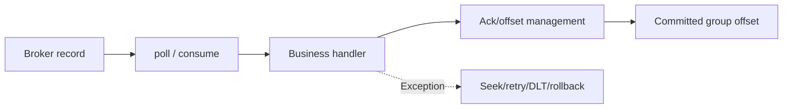

Một message source trong Spring Integration có thể được poll bằng `SourcePollingChannelAdapter`; cơ chế commit của nó **không mặc nhiên giống** listener container record-driven. Cần xác nhận bạn đang dùng `KafkaMessageDrivenChannelAdapter` hay `KafkaMessageSource`.

## 4. Ba lớp bảo đảm phải phân biệt

| Lớp | Cam kết khả thi | Chưa đủ để khẳng định |
|---|---|---|
| Producer retry với idempotence | Giảm duplicate do producer retry cùng phiên/protocol theo Kafka | Business handler không bao giờ gửi event trùng |
| Consumer manual/container offset commit | Kiểm soát vị trí resume của group | Atomic với Kafka output |
| Kafka transaction + offsets | Atomic visibility của Kafka outputs và tiến độ consumer offsets khi áp dụng đúng | Atomic với JDBC, HTTP, SFTP, JMS/AMQP |
| Business idempotency | Hạn chế thực hiện lặp cùng thao tác nghiệp vụ | Không thay thế mọi transaction/ordering guarantees |

### 4.1. At-most-once, at-least-once, EOS trong một bảng

| Mô hình | Tình huống | Rủi ro |
|---|---|---|
| **At-most-once** | Commit source offset trước khi chắc side effect thành công | Có thể mất xử lý |
| **At-least-once** | Chỉ commit sau xử lý, retry khi crash | Có thể duplicate side effect |
| **Kafka EOS** | Kafka output records + source offsets commit atomically trong Kafka transaction | Vẫn có thể duplicate ở code và external DB/HTTP |
| **Business effectively-once** | At-least-once + idempotency/dedup/outbox và đối soát | Cần mô hình dữ liệu/chi phí vận hành |

**Không có một thuộc tính Spring Boot biến mọi HTTP/JDBC/JMS/Kafka operation thành exactly-once end-to-end.**

## 5. Commit offset khi không dùng Kafka transaction

Trong Spring Kafka, listener container thường quản lý offset khi `enable.auto.commit=false`. Các chế độ `AckMode` phổ biến:

| `AckMode` | Ý tưởng | Lưu ý |
|---|---|---|
| `RECORD` | Sau mỗi record được listener xử lý thành công, container commit offset của record | Không tự rollback HTTP/DB |
| `BATCH` | Khi các records của lần `poll()` được xử lý, container commit | Đây là default `AckMode` của container theo docs |
| `TIME` | Theo mốc thời gian và hoàn thành batch của lần poll | Có thể commit theo nhóm thay vì ngay từng record |
| `COUNT` | Theo số record và hoàn thành batch | Cần hiểu replay phạm vi batch |
| `COUNT_TIME` | Kết hợp count/time | Thời gian/đếm không mang tính business transaction |
| `MANUAL` | Listener gọi `acknowledge()`; commit theo semantics tương tự batch | Phải giữ đúng reference đến Acknowledgment |
| `MANUAL_IMMEDIATE` | Listener gọi ack và container có thể commit ngay theo điều kiện thread | Commit policy phụ thuộc đúng invocation/thread |

Các semantics trên chủ yếu mô tả **non-transactional containers**. Khi cấu hình container Kafka transactions, offsets được **đưa vào Kafka transaction** và có semantics tương ứng record/batch; không nên cộng thêm một cơ chế commit độc lập.

### 5.1. Vì sao thường đặt `enable.auto.commit=false`

```yaml
spring:
  kafka:
    consumer:
      enable-auto-commit: false
```

Đây là một cấu hình quan trọng khi để Spring Kafka container quản lý commit. Trong các phiên bản Spring Kafka hiện đại, container thường đặt `enable.auto.commit=false` trừ khi được cấu hình rõ khác; **không nên dựa vào ngầm định** mà không kiểm tra effective consumer properties.

### 5.2. Auto-commit không hiểu business success

Consumer auto-commit dựa trên vị trí consumption. Nếu application fetch xong rồi crash trước khi hoàn tất DB write, auto-commit đã có thể tiến qua record. Với các luồng xử lý quan trọng, hãy chọn container-managed ack hoặc transaction phù hợp và kiểm thử failure timing.

## 6. Kafka producer transaction gồm những gì?

Kafka producer transaction cho phép nhóm các thao tác producer write và (với consume–transform–produce) thêm **offsets đã xử lý** vào cùng transaction.

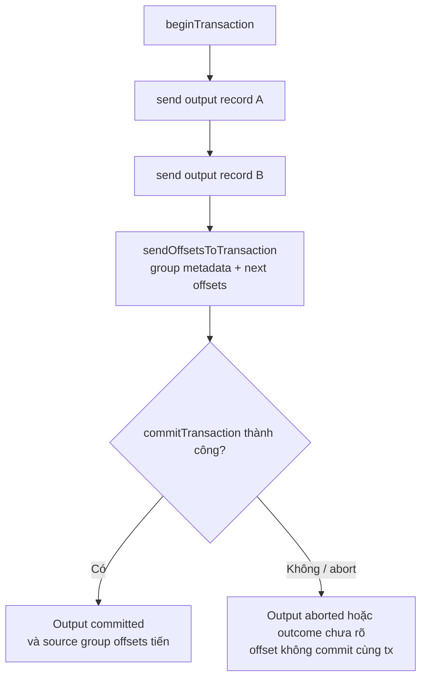

Dữ liệu được ghi vào Kafka log và trạng thái transaction được broker điều phối. `read_committed` consumers nhìn thấy những records đã commit; records trong aborted transactions bị ẩn với nhóm consumer đó.

### 6.1. Kafka transaction không phải JDBC transaction

`KafkaTransactionManager` quản lý giao dịch của **Kafka producer**. `DataSourceTransactionManager` quản lý giao dịch của database. Việc có cả hai manager không làm cho chúng tự thành **một giao dịch nguyên tử giữa Kafka và database**.

### 6.2. Transaction không sửa nghiệp vụ không idempotent

Nếu handler gọi HTTP API tạo payment hai lần trước khi xuất Kafka event, Kafka có thể commit duy nhất một event nhưng payment vẫn tạo hai lần. EOS bảo vệ **Kafka output + offset**, không khử side effect của mọi code chạy giữa consume và commit.

## 7. `transactional.id`, producer ID và fencing

Kafka broker dùng `transactional.id` để nhận diện một logical transactional producer qua nhiều phiên và có cơ chế **fence** producer phiên cũ khi một instance mới cùng identity giành quyền phù hợp.

Các nguyên tắc:

- `transactional.id` phải **ổn định trong phạm vi logical producer** nhưng không bị hai instance đang hoạt động tranh dùng không chủ đích.
- Với Spring Kafka, thường cấu hình `transactionIdPrefix` trên `DefaultKafkaProducerFactory`. Factory tạo các `transactional.id` từ prefix và suffix.
- Trong hệ chạy nhiều app instances, **prefix phải riêng cho từng instance** theo tài liệu Spring Kafka.
- Khi instance cũ tiếp tục commit sau khi bị fence, có thể gặp `ProducerFencedException`; không xem đây là lỗi transient thông thường được retry vô hạn.
- Producer idle quá lâu có thể gặp vấn đề hết hạn transactional id; Spring Kafka hỗ trợ `maxAge` cho producer factory trong các phiên bản phù hợp để xoay producer trước hạn.
- Transactional producer cache phải được sizing theo concurrency và số transaction đồng thời; không giả định một producer có thể đồng thời dùng cho mọi thread.

### 7.1. Ví dụ naming

```text
Pod A -> transaction-id-prefix: orders-worker-a-
        -> transactional.id: orders-worker-a-0
Pod B -> transaction-id-prefix: orders-worker-b-
        -> transactional.id: orders-worker-b-0
```

Tên ở trên minh họa. Với Kubernetes, việc gán identity cần đảm bảo **duy nhất và đúng vòng đời** qua restart, rollout/canary và autoscaling; tránh dùng một prefix chung cho mọi pod.

### 7.2. Phân biệt consumer group ID với transactional ID

| Trường | Dùng cho |
|---|---|
| `group.id` | Phân chia partition và lưu committed offsets của consumer group |
| `client.id` | Nhận diện client cho metrics/tracing |
| `transactional.id` | Nhận diện transactional producer, hỗ trợ recovery/fencing |
| Business `eventId` | Deduplication/idempotency ở mức nghiệp vụ |
| Spring `correlationId` | Theo dõi request/reply và xử lý lỗi |

Không dùng `transactional.id` làm customer ID hoặc business event ID.

## 8. `read_committed`: Consumer nhìn thấy gì sau transaction?

Kafka consumer có property `isolation.level`:

```properties
isolation.level=read_committed
```

Đối với records được **transactional producer** ghi, `read_committed` chỉ trả các records thuộc transaction đã commit; records bị abort không được đưa tới application. Records không được ghi trong transaction vẫn có thể đọc bình thường.

Ngược lại, `read_uncommitted` có thể đọc cả records thuộc aborted transactions, nên downstream vẫn có thể thấy output mà upstream tưởng đã rollback.

### 8.1. Last Stable Offset (LSO)

`read_committed` không nhất thiết fetch tới high watermark ngay, vì transaction còn mở có thể chặn việc hiển thị các records sau vị trí đầu của transaction chưa kết thúc.

```text
Kafka log:
[100 committed] [101 TX open] [102 normal] [103 TX committed]

read_committed consumer:
  chỉ đi tới Last Stable Offset thích hợp
  -> có thể tạm thời chưa thấy 102, 103 dù broker đã có bytes
```

Điều này quan trọng khi giám sát lag/latency: một transaction mở lâu hoặc producer bị treo có thể làm output không hiện với `read_committed` consumer.

### 8.2. `read_committed` không lọc business duplicates

Hai transactions khác nhau đều commit cùng business event `order-1001` thì downstream vẫn có thể nhận hai records hợp lệ. Cần event ID/idempotency để ngăn double processing nếu ứng dụng có thể publish trùng ở tầng nghiệp vụ.

## 9. Consume–Transform–Produce theo transaction: Đường thành công

Với Spring Kafka transactional listener container, một vòng xử lý có thể như sau:

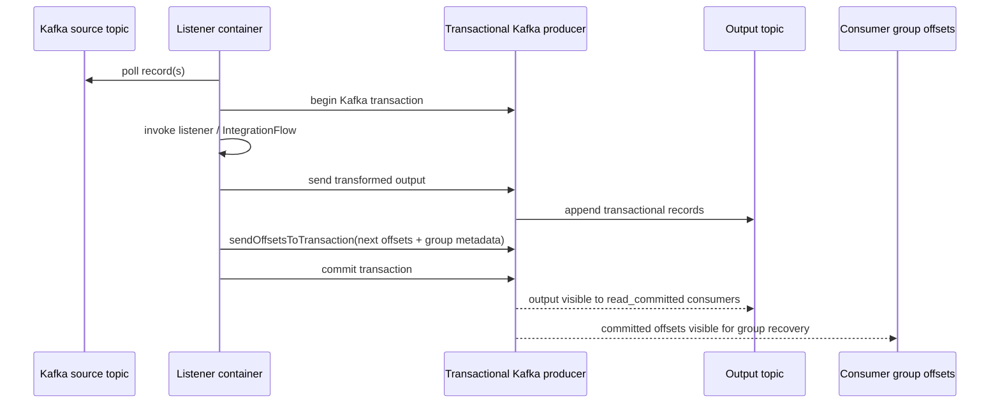

Đây là **mô hình ý nghĩa**, không mô tả mọi lời gọi nội bộ theo đúng thứ tự thread và network.

Điểm mấu chốt:

1. Container mở Kafka transaction khi được gắn `KafkaAwareTransactionManager`/Kafka transaction manager phù hợp.
2. Code xử lý gửi output qua `KafkaTemplate` có **cùng producer factory** với transaction manager.
3. Listener hoàn tất thành công, container đưa **next offsets** vào transaction.
4. Transaction commit làm Kafka output và source offset progression được xác nhận cùng nhau.
5. Downstream consumers muốn không thấy aborted output cần dùng `read_committed`.

### 9.1. Chỉ trong phạm vi Kafka

Kafka docs/Spring Kafka gọi đây là EOS cho luồng **read → process → write trong Kafka**. Bản thân “read” và “process” vẫn có thể diễn ra hơn một lần khi hệ thống crash/rebalance; output Kafka và offsets được commit atomically nên kết quả Kafka có thể nhất quán. Một câu lệnh gửi email trong handler **không nằm trong transaction này**.

## 10. Failure timeline: Crash ở mỗi điểm sẽ thế nào?

| Điểm xảy ra crash | Kafka output | Committed source offsets | Hành động cần tính |
|---|---|---|---|
| Trước khi xử lý input | Không có output mới | Không tiến | Source sẽ tiếp tục theo committed position |
| Sau transform, trước send | Không có output từ transaction | Không tiến | Input được xử lý lại |
| Sau `send()` vào transaction, trước commit | Có thể ghi vào log nhưng transaction chưa commit/abort | Không tiến cùng transaction | `read_committed` không thấy output chưa commit; sau recovery có thể abort/fence |
| Sau `sendOffsetsToTransaction()`, trước commit | Output và offsets chưa committed atomically | Không nhìn như đã commit | Transaction phải commit hoặc abort, không tự xem method call đã xong |
| Commit thành công | Output committed | Offset tiến cùng transaction | Consumer group resume sau input |
| Commit response mất, outcome chưa chắc | Chưa thể kết luận chỉ từ client timeout | Chưa thể kết luận chỉ từ timeout | Reconcile transaction/offset/output, tránh replay bên ngoài bừa bãi |
| Sau Kafka commit nhưng trước ghi external audit | Kafka đã commit | Đã tiến | Audit có thể thiếu; cần outbox/đối soát nếu audit bắt buộc |

### 10.1. Kafka transaction không có nghĩa callback trễ là vô hại

Nếu code xử lý `send()` bất đồng bộ rồi trả trước khi các future/callback thực sự được kiểm tra, lỗi có thể biểu hiện ở thời điểm commit hoặc callback theo adapter. Đừng tự coi một `CompletableFuture` đã tạo là broker confirmation.

### 10.2. Transaction abort và replay

Khi listener ném exception khiến transaction rollback, Spring Kafka container có thể reposition consumer bằng seek để những records chưa được xử lý thành công được fetch lại. **Không tự gọi `seek()` tùy tiện từ error handler trong thread khác**, vì container quản lý assignment và recovery.

## 11. Spring Boot: Cấu hình producer transaction và consumer isolation

Một cấu hình mẫu cho luồng Kafka-in → Kafka-out:

```yaml
spring:
  kafka:
    bootstrap-servers: localhost:9092
    consumer:
      group-id: orders-transformer
      enable-auto-commit: false
      properties:
        isolation.level: read_committed
    producer:
      transaction-id-prefix: orders-transformer-instance-a-
      properties:
        acks: all
    listener:
      type: single
```

**Giải thích:**

- `transaction-id-prefix` là đòn bẩy Spring Boot để cấu hình transactional producer factory/Kafka transaction manager theo dòng Boot/Spring Kafka hỗ trợ.
- `group-id` xác định consumer group xử lý input; không phải transaction ID.
- `enable-auto-commit=false` để container quyết định offset theo transaction; không tạo một luồng commit tự phát song song.
- `isolation.level=read_committed` ở consumer giúp không xử lý aborted transactional input.
- `acks=all` giúp producer yêu cầu replica acknowledgement phù hợp policy; không thay thế transaction.
- `listener.type=single` minh họa record listener; tên property/behavior cần đối chiếu với phiên bản Boot đang dùng.
- Mỗi **running instance** cần prefix riêng, không sao chép `instance-a` cho mọi pod.
- TLS/SASL/ACL, topic creation và broker settings phải cấu hình riêng theo môi trường.

### 11.1. Không chỉ đặt prefix rồi tin đã có EOS

Sau khi cấu hình, cần xác minh listener container **thật sự có transaction manager**, KafkaTemplate dùng **cùng producer factory**, và downstream flows **không phá thread/transaction boundary**. Cấu hình thủ công có thể override Boot defaults.

### 11.2. Không hard-code local broker production

`localhost:9092` chỉ là ví dụ. Production cần secret management, TLS/SASL, authorized topic/group/transactional IDs và health/readiness phù hợp; không ghi credential vào log của error handling.

## 12. `KafkaTemplate.executeInTransaction`: Producer-only transaction

Khi một service không phải đang xử lý Kafka input mà chỉ cần gửi **nhiều output records atomically trong Kafka**, có thể dùng `KafkaTemplate.executeInTransaction`:

```java
import org.springframework.kafka.core.KafkaTemplate;
import org.springframework.stereotype.Service;

@Service
public class OrderEventsPublisher {

    private final KafkaTemplate<String, String> kafka;

    public OrderEventsPublisher(KafkaTemplate<String, String> kafka) {
        this.kafka = kafka;
    }

    public void publishPair(String orderId, String validatedJson,
                            String auditJson) {
        kafka.executeInTransaction(template -> {
            template.send("orders.validated", orderId, validatedJson);
            template.send("orders.audit", orderId, auditJson);
            return null;
        });
    }
}
```

Nếu callback thực thi bình thường và transaction commit thành công, hai Kafka sends thuộc cùng transaction. Nếu callback ném lỗi, transaction bị rollback/abort theo API.

**Không suy rằng phương thức này tự commit source consumer offsets.** Nó là **producer-only local transaction** trừ khi ứng dụng thực hiện consumer-initiated coordination phù hợp. Khi gọi `executeInTransaction` bên trong một transaction khác, Spring Kafka mô tả việc tạo transaction Kafka riêng; không dùng để “tự nối” vào transaction container theo ý muốn.

### 12.1. Mẫu trên không phải distributed transaction

Nếu trước đó gọi `jdbcTemplate.update(...)` đã commit, `executeInTransaction` thất bại **không rollback DB**. Nếu sự nhất quán DB↔Kafka là mục tiêu, xem phần outbox và transaction synchronization.

### 12.2. Có cần `flush()`?

Không nên chèn `flush()` sau mỗi send chỉ để cảm thấy an toàn: nó ảnh hưởng throughput và không thay thế commit. Hãy dựa vào transaction commit, send result và broker acknowledgement theo contract. Với producer asynchronous adapter, xác minh callback/sync settings trước khi caller tuyên bố success.

## 13. Spring Kafka transactional listener: Ví dụ tối giản

Đây là ví dụ **listener do Spring Kafka container sở hữu**, minh họa mô hình transaction Kafka-in → Kafka-out. Trong module Spring Integration, nó cũng giúp hiểu cơ chế mà `KafkaMessageDrivenChannelAdapter` dùng ở bên dưới.

```java
import org.springframework.kafka.annotation.KafkaListener;
import org.springframework.kafka.core.KafkaTemplate;
import org.springframework.stereotype.Component;

@Component
public class OrderValidationListener {

    private final KafkaTemplate<String, String> template;

    public OrderValidationListener(
            KafkaTemplate<String, String> template) {
        this.template = template;
    }

    @KafkaListener(
        topics = "orders.in",
        groupId = "orders-transformer")
    public void handle(String input) {
        String normalized = normalizeAndValidate(input);

        // Khi listener container đã bật Kafka transactions và
        // KafkaTemplate dùng đúng ProducerFactory, send này tham gia tx.
        template.send("orders.validated", normalized);
    }

    private String normalizeAndValidate(String input) {
        if (input == null || input.isBlank()) {
            throw new IllegalArgumentException("Empty order event");
        }
        return input.trim();
    }
}
```

**Điều kiện để có EOS scope đúng:**

1. Container listener được cấu hình với Kafka transaction manager thích hợp.
2. ProducerFactory support transactions; KafkaTemplate dùng cùng factory.
3. Listener exception **được ném ra container**, không bị nuốt ở một handler.
4. Consumer offset được container đưa vào Kafka transaction khi xử lý thành công.
5. Topic input và output nằm trong broker/cluster topology cho phép transaction.
6. Consumers yêu cầu atomic visibility dùng `read_committed`.
7. Không có side effect DB/HTTP mà ta lầm tưởng rollback theo Kafka.
8. Không tách xử lý output sang một executor ngoài transaction rồi trả success sớm.

Một `@KafkaListener` method tự nó **không bật Kafka transactions**; cấu hình container và producer mới quyết định.

## 14. Spring Integration: `KafkaMessageDrivenChannelAdapter` và listener container

Spring Integration không thay thế Kafka consumer container. `KafkaMessageDrivenChannelAdapter` dùng `KafkaMessageListenerContainer` hoặc `ConcurrentMessageListenerContainer` của Spring Kafka, chuyển records thành Spring Messaging `Message<?>` và đưa vào `IntegrationFlow`.

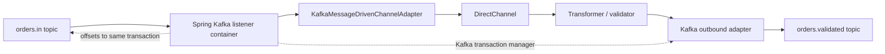

Để đạt transactional Kafka read–process–write, **đường từ listener đến outbound producer cần nằm trong execution/transaction boundary có hiệu lực**. `DirectChannel` giúp giữ xử lý đồng bộ cùng call stack; thay bằng `ExecutorChannel` mà không thiết kế transaction propagation sẽ phá giả định đó.

### 14.1. Java DSL mẫu: Message-driven inbound

```java
import org.springframework.context.annotation.Bean;
import org.springframework.context.annotation.Configuration;
import org.springframework.integration.dsl.IntegrationFlow;
import org.springframework.integration.kafka.dsl.Kafka;
import org.springframework.integration.kafka.inbound.KafkaMessageDrivenChannelAdapter;
import org.springframework.kafka.core.ConsumerFactory;

@Configuration(proxyBeanMethods = false)
class OrdersKafkaInboundFlow {

    @Bean
    IntegrationFlow ordersKafkaFlow(ConsumerFactory<String, String> cf,
                                    OrderMessageHandler handler) {
        return IntegrationFlow
            .from(Kafka.messageDrivenChannelAdapter(
                cf,
                KafkaMessageDrivenChannelAdapter.ListenerMode.record,
                "orders.in"))
            .handle(String.class, (payload, headers) -> {
                handler.process(payload);
                return null;
            })
            .get();
    }
}

interface OrderMessageHandler {
    void process(String payload);
}
```

Đây là **ví dụ inbound + handler**, không phải một EOS flow hoàn chỉnh: đoạn code chưa cấu hình transactional listener container, Kafka outbound producer, DLT hay assertions. Nếu `handler.process()` phát output bằng KafkaTemplate trên cùng transaction đúng cách, có thể xây tiếp mô hình Kafka-in → Kafka-out; cần test transaction thực tế.

### 14.2. Cấu hình listener container phải thống nhất

Có thể tạo container từ `ConcurrentKafkaListenerContainerFactory` đã được cấu hình transaction manager, hoặc cấu hình container trực tiếp theo phiên bản. Không nên tạo một instance khác hoàn toàn với factory Boot rồi mong `spring.kafka.producer.transaction-id-prefix` tự được gắn vào listener container đó.

### 14.3. Error publisher của adapter

Spring Integration message-driven adapter có các tùy chọn error channel/recovery callback. Một lỗi chuyển thành `ErrorMessage` cho error flow **không đồng nghĩa container sẽ rollback**. Nếu error handler nhận và nuốt exception trong khi listener xem là xử lý thành công, offsets có thể tiến theo policy. Phải test đúng kênh lỗi và sự kiện transaction.

## 15. Pollable `KafkaMessageSource` khác message-driven Kafka adapter

Spring Integration có `KafkaMessageSource` cho inbound **polling adapter**:

```java
@Bean
IntegrationFlow pollableKafkaFlow(
        ConsumerFactory<String, String> consumerFactory) {
    return IntegrationFlow
        .from(Kafka.inboundChannelAdapter(
                    consumerFactory, new ConsumerProperties("orders.in")),
              endpoint -> endpoint.poller(Pollers.fixedDelay(1000)))
        .handle(String.class, (payload, headers) -> {
            // Minh họa xử lý đồng bộ.
            return null;
        })
        .get();
}
```

Đây là ví dụ DSL cần import `Kafka`, `ConsumerProperties` và `Pollers` phù hợp version. Nó **không tự trở thành consumer-initiated Kafka transaction** chỉ vì cùng nằm trong Spring Integration.

### 15.1. Những khác biệt quan trọng

| Đặc điểm | Message-driven | Pollable KafkaMessageSource |
|---|---|---|
| Ai poll? | Kafka listener container | `SourcePollingChannelAdapter`/poller |
| Thread và lifecycle | Container listener threads | Scheduled poller thread(s) |
| Offset/ack | Container AckMode/transaction policy | Source ack factory/consumer properties và poller processing policy |
| Error path | Listener/container + adapter recovery | Poller error handler/errorChannel |
| EOS read→write | Cấu hình transactional listener container có hỗ trợ trực tiếp | Không được giả định tương đương, cần thiết kế và test riêng |
| Poll interval | Container polling loop | Poller schedule và Kafka `max.poll.interval.ms` phải phối hợp |
| Batch handling | Listener record/batch mode | `allowMultiFetch` và source semantics riêng |

Spring Integration reference lưu ý nếu source poll được nhiều records, **tất cả records phải được xử lý và poll trở lại kịp trước `max.poll.interval.ms`** để tránh rebalance.

### 15.2. Không trộn hai mô hình ack

Khi đang dùng Kafka listener container transaction, không tự gọi consumer `commitSync()` ở handler vì thấy một header `offset`. Khi đang dùng KafkaMessageSource, không mượn cấu hình `AckMode.RECORD` của listener container để suy ra source đã commit lúc nào.

## 16. Kafka headers trong Spring Integration: Đừng nhầm source offset với output offset

Spring Integration Kafka adapter ánh xạ Kafka metadata sang Spring Message headers tùy converter và phiên bản. Thường quan tâm:

- Received topic, partition, key, offset.
- Timestamp và group/client metadata khi có.
- `Acknowledgment` hoặc consumer object trong một số mode/cấu hình.
- Headers do producer dùng để chọn outbound topic, key, partition.
- Correlation ID/request-reply metadata của gateway.
- Delivery-attempt/error metadata khi được container cung cấp.

### 16.1. Record mode và batch mode

Trong `record mode`, mỗi message thường ứng với một Kafka `ConsumerRecord`; ở `batch mode`, payload có thể là danh sách và một số received headers trở thành **danh sách các giá trị** tương ứng.

Đừng ép `headers.get(KafkaHeaders.OFFSET)` thành `Long` trong mọi mode, vì batch hoặc header naming/version có thể khác. Kiểm tra API thực tế của version và converter.

### 16.2. Không cho external headers điều khiển offset/transaction

Một Kafka record có headers do producer gửi. Nếu ứng dụng chấp nhận các header như `app.offsetToCommit` hay `transactional.id` từ nguồn không tin cậy, nó có thể làm sai recovery/tenant routing. Offset source phải đến từ consumer/container metadata và group assignment đáng tin.

## 17. Kafka outbound adapter: Send async và xác nhận transaction

Một `KafkaProducerMessageHandler` trong Spring Integration gọi producer qua `KafkaTemplate`. Đầu ra có thể thành công hoặc thất bại bất đồng bộ tùy cấu hình send.

Theo Spring Integration reference, outbound Kafka handler hỗ trợ các đường như:

- `sendSuccessChannel` khi có confirmation thành công.
- `sendFailureChannel` với `ErrorMessage` chứa `KafkaSendFailureException` khi send thất bại.
- `sync` và các cấu hình timeout để chờ kết quả trong handler khi phù hợp.
- `futuresChannel`/future correlation trong một số chế độ batch và phiên bản.

**Gửi `KafkaTemplate.send()` không có nghĩa broker đã commit transaction ngay.** Spring Kafka transaction commit là boundary riêng và có thể phát hiện một send failure muộn.

### 17.1. Khi listener container đang giữ Kafka transaction

Nếu muốn exception producer ảnh hưởng rollback, cần bảo đảm lỗi phát sinh **trước khi listener return/transaction commit**, hoặc được xử lý đúng trong transaction boundary. Một callback chạy sau khi handler đã trả về có thể khiến logic bên ngoài tưởng đã hoàn tất; kiểm tra `sync`/future behavior ở adapter và test với broker thật.

### 17.2. `sendFailureChannel` không phải Kafka DLT

Failure channel là một Spring `MessageChannel` để quan sát/định tuyến lỗi gửi. DLT là Kafka topic được ghi bằng producer/recoverer có policy và broker acknowledgement riêng. Đừng gọi sendFailureChannel là DLT hoặc coi việc nhận `ErrorMessage` là offset đã rollback.

## 18. Thread boundary: Vì sao `DirectChannel` quan trọng?

Một Kafka transaction quản lý producer liên kết với execution context/thread theo cách Spring transaction synchronization. Với một flow:

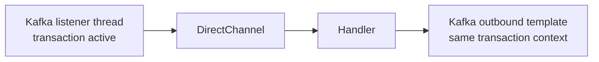

Đây là kiểu flow dễ kiểm soát transaction hơn. Nếu thêm `ExecutorChannel`:

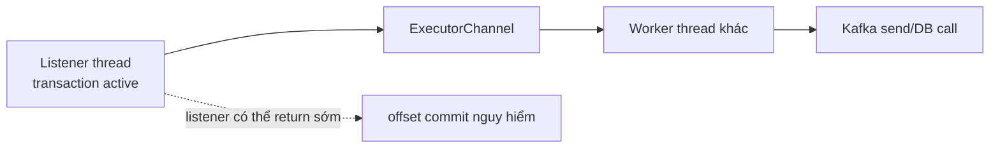

Không mặc định transaction context theo thread tự động được truyền qua executor. Nếu listener return và container commit offset trước khi worker hoàn tất, có thể **mất xử lý** hoặc tạo send ngoài transaction.

### 18.1. Những thành phần cũng có thể phá giả định

- `QueueChannel` và consumer riêng.
- `PublishSubscribeChannel` với executor.
- `@Async` service method.
- `CompletableFuture.supplyAsync`.
- HTTP/JMS/AMQP async callback.
- Reactive chains với subscription/execution khác thread khi không có transaction model phù hợp.

**Cách thiết kế:** nếu cần asynchronous decoupling, coi đó là một **durable messaging boundary riêng** với transaction/retry/idempotency độc lập, thay vì kéo một Kafka transaction tưởng tượng qua các thread.

## 19. Rebalance, partition assignment và offset recovery

Khi consumer group rebalance, partition được chuyển sang instance khác. Một consumer mới thường resume từ **committed group offset**, không phải position của thread cũ chưa commit.

### 19.1. Các nguồn gây rebalance

- Rolling deploy hoặc autoscaling.
- Instance crash/long GC pause.
- `max.poll.interval.ms` bị vượt do handler block quá lâu.
- Broker/network problems.
- Topic partition count thay đổi.
- Membership/assignment strategy đổi.

### 19.2. Điều phải kiểm chứng

| Tình huống | Câu hỏi |
|---|---|
| Handler đang xử lý khi mất partition | Transaction/offset có abort hoặc xử lý lại không? |
| Consumer mới nhận partition | Nó resume từ offset nào? |
| Worker cũ vẫn gọi external HTTP | Có tạo side effect sau khi partition bị thu hồi không? |
| Producer cũ bị fence | Có `ProducerFencedException` và recovery đúng không? |
| Batch đã fetch nhiều records | Records nào chưa xử lý sẽ được đọc lại? |
| DLT/retry đang tiến hành | Có duplicate event sau rebalance không? |

`max.poll.interval.ms` cần phù hợp với xử lý thực tế. Không tăng vô hạn để che một handler block chờ HTTP: giới hạn request timeout, pause/backoff hoặc tách durable stage.

### 19.3. Kafka transaction giúp gì ở đây?

Kafka transactional offsets và producer fencing hỗ trợ giữ Kafka output/offset consistency khi ownership thay đổi, nhưng không bù trừ một HTTP POST hoặc database transaction đã commit bởi worker cũ.

## 20. Batch listener: Offset, rollback và poison record trong batch

Một Kafka listener có thể xử lý record mode hoặc batch mode.

```text
Record mode:
  listener(record 300) -> success -> xử lý offset theo transaction
  listener(record 301) -> exception -> abort/replay theo policy

Batch mode:
  listener([300, 301, 302, 303])
      300 success
      301 success
      302 fails
      303 chưa xử lý
  -> container có thể rollback/replay cả batch nếu không có thông tin lỗi chi tiết
```

Với transactional batch listener, Spring Kafka reference giải thích **default after-rollback processor thường replay cả batch** vì container không biết chính xác record nào gây lỗi.

### 20.1. Rủi ro với side effect ngoài Kafka

Giả sử batch gồm 100 records, mỗi record ghi database trước khi phát Kafka event:

- 99 dòng đã commit theo các DB transaction riêng.
- Record thứ 100 lỗi.
- Kafka transaction abort khiến output Kafka không hiển thị với `read_committed`.
- Batch input được xử lý lại.
- 99 DB writes cũ không được Kafka transaction hoàn tác, có thể ghi trùng.

Vì vậy batch processing thường cần **DB transaction phù hợp hoặc business idempotency**, và phương án record-aware recovery khi yêu cầu.

### 20.2. Khi nào dùng `BatchListenerFailedException`?

Trong các cấu hình/version hỗ trợ, Spring Kafka có `BatchListenerFailedException` để cung cấp index/record lỗi cho cơ chế error handling. Tuy nhiên **không suy rằng mọi transactional batch listener tự động skip duy nhất record lỗi**. Hãy kiểm tra listener adapter, error handler/after-rollback processor, loại batch và version.

### 20.3. Đừng tự commit “offset cuối batch” ngay khi vừa đọc

Commit offset sau record cuối của batch chỉ hợp lệ khi toàn bộ các records phải được coi là đã xử lý hoặc đã được recover an toàn theo contract. Một error handler chỉ ghi log không đủ xác nhận.

## 21. Transaction rollback, `AfterRollbackProcessor` và DLT

Trong Spring Kafka:

- Khi **transactional listener** ném exception, container có thể abort Kafka transaction.
- Sau rollback, `DefaultAfterRollbackProcessor` có thể dùng seek để consumer nhận lại records chưa hoàn tất.
- Một recoverer có thể đưa **poison record** tới dead-letter topic (DLT) theo policy được cấu hình.
- Với container **không sử dụng transactions**, `DefaultErrorHandler` là công cụ phổ biến xử lý retry/seek/recover.
- Nếu dùng custom error handler cho transactional container và muốn rollback, nó cần **ném exception**, không return bình thường sau khi đã xử lý một phần.

### 21.1. Sơ đồ lỗi và phục hồi

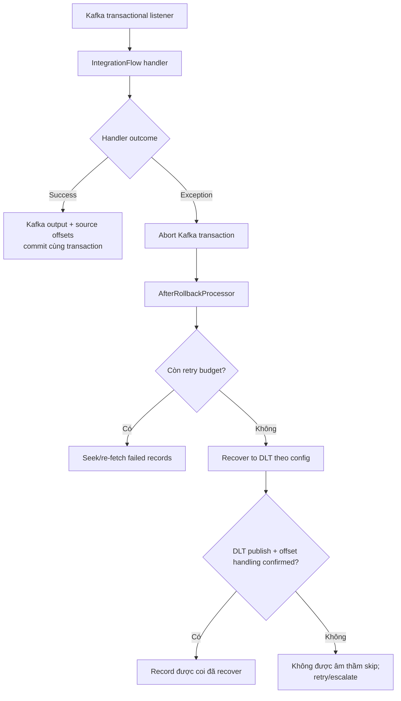

**DLT không phải một quyền năng tự động của `errorChannel`.** Một DLT publish cũng có thể thất bại vì ACL, broker unavailable, serializer hoặc producer transaction.

### 21.2. Recover trong transaction mới

Spring Kafka hỗ trợ một số cấu hình để `DefaultAfterRollbackProcessor` recovery DLT chạy trong transaction mới, rồi commit offset của record đã recover trong transaction đó, nếu có thiết lập recoverer, KafkaTemplate và `commitRecovered` tương ứng.

Điều này giúp phối hợp **DLT output + tiến độ offset** ở tầng Kafka, nhưng cần đọc đúng API và version. Không copy code cho `DefaultErrorHandler.commitRecovered` từ nontransactional container sang after-rollback processor rồi mặc định semantics giống nhau.

### 21.3. Non-blocking retries và transactions

Theo Spring Kafka transaction reference, **non-blocking retry topics không kết hợp với container transactions theo cùng đường rollback**: khi listener ném exception, cơ chế có thể commit transaction hiện hành và forward record tới retryable topic theo chiến lược. Nếu chọn retry topics, phải thiết kế lại assumptions và test rõ source offset/retry topic/DLT.

### 21.4. Khi nào nên quarantine thay vì retry?

- JSON/schema không hợp lệ sau khi deserialize.
- Business invariant vĩnh viễn không thể sửa qua backoff.
- Record sai tenant/không có quyền.
- Số attempt vượt giới hạn.
- External side effect có outcome chưa biết và cần manual reconciliation.

Quarantine cần payload reference có ACL, retention và owner, không phải mặc định ghi toàn bộ raw Kafka record ra dashboard.

## 22. Spring Integration `errorChannel` không tự quyết định Kafka offset

Trong Spring Integration, lỗi ở handler có thể:

- Được ném trực tiếp về caller cùng thread.
- Được một `MessagePublishingErrorHandler` chuyển thành `ErrorMessage`.
- Đi qua private/global `errorChannel`.
- Được một recovery callback nhận và biến thành một kết quả khác.
- Bị ignore hoặc transform thành business reply nếu ứng dụng chọn.

**Kafka listener container chỉ biết outcome thông qua đường exception/callback mà nó thực sự nhận**. Nếu error handler bắt exception và return như thành công, container có thể đưa offset vào transaction và commit theo cấu hình, dù nghiệp vụ chưa hoàn tất.

### 22.1. Minh họa hành vi nguy hiểm

```java
public void process(String payload) {
    try {
        callRemotePayment(payload);
    } catch (RuntimeException ex) {
        // NGUY HIỂM nếu thiếu recovery store và muốn broker redeliver:
        log.warn("Payment failed");
        return; // Container có thể coi là success.
    }
}
```

Nếu cần retry từ source Kafka, phải để exception **tới đúng container error handling boundary** hoặc thực hiện recovery bền vững trước khi coi record handled.

### 22.2. Một error flow chỉ lưu metrics không phải durable recovery

```text
Kafka listener -> IntegrationFlow -> handler fails
                                   -> errorChannel
                                      -> metrics counter
                                      -> return
```

Số error đã tăng, nhưng không có bằng chứng DLT/quarantine/DB side effect. Hãy thêm điều kiện **durable persistence** và xác nhận source settlement trước khi đánh dấu nghiệp vụ giải quyết xong.

### 22.3. `failedMessage` và `originalMessage` có thể thiếu

`MessagingException.getFailedMessage()` có thể cho biết message ở điểm lỗi. `ErrorMessage.getOriginalMessage()` có thể giữ input của error strategy. Tuy nhiên lỗi deserialization, connection hoặc poll trước khi tạo Spring Message có thể **không có payload gốc**. Dùng Kafka source metadata/consumer error strategy đúng thay vì tự tạo giả một message để skip offset.

## 23. Kafka + JDBC: Hai giao dịch khác nhau

Một service có thể thực hiện:

```text
Kafka consume -> validate -> JDBC update -> Kafka publish
```

Ta có ít nhất **hai resource managers**: database và Kafka. Spring Kafka hỗ trợ transaction synchronization/chaining theo cấu hình, nhưng không tạo ra **một ACID transaction xuyên hai hệ thống** nếu không có distributed protocol phù hợp.

### 23.1. Commit DB trước, Kafka sau

Trong một mô hình Spring transaction synchronization được hỗ trợ, nếu database transaction là transaction chính và KafkaTemplate tham gia transaction được đồng bộ, trình tự commit có thể là:

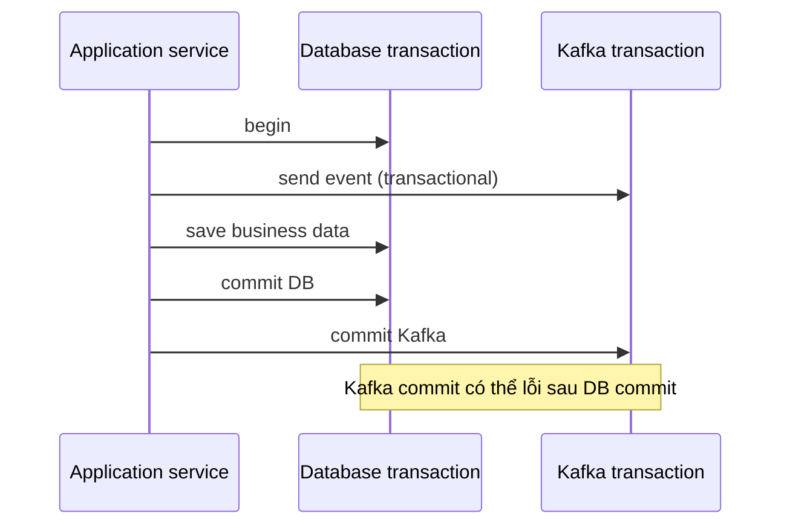

Spring Kafka reference lưu ý từ các phiên bản được nêu, nếu commit thứ cấp đã fail sau primary commit, exception được ném lên caller để application xử lý bù trừ/khắc phục.

### 23.2. Kafka trước, DB sau

Có thể sắp xếp transaction boundaries khác theo thiết kế, nhưng khi Kafka commit xong và DB commit thất bại, consumer Kafka downstream có thể đã nhận event không tương ứng một business DB row đã commit.

**Đảo thứ tự commit chỉ đổi loại inconsistency có thể gặp, không loại bỏ hoàn toàn.**

### 23.3. Ví dụ transaction synchronization định hướng

```java
import org.springframework.kafka.core.KafkaTemplate;
import org.springframework.stereotype.Service;
import org.springframework.transaction.annotation.Transactional;

@Service
class OrderWriterService {

    private final OrderRepository repository;
    private final KafkaTemplate<String, String> template;

    OrderWriterService(OrderRepository repository,
                       KafkaTemplate<String, String> template) {
        this.repository = repository;
        this.template = template;
    }

    @Transactional("transactionManager")
    public void saveAndPublish(String id, String eventJson) {
        // Giả định transactionManager ở đây là DB manager,
        // KafkaTemplate được cấu hình transaction capable và
        // transaction synchronization đúng.
        repository.store(id);
        template.send("orders.validated", id, eventJson);
    }
}

interface OrderRepository {
    void store(String id);
}
```

Đoạn mã **không tự thiết lập** Kafka transaction manager hoặc synchronization; nó là ví dụ nơi hai resource cùng xuất hiện. Phải kiểm tra bean `transactionManager` cụ thể, KafkaTemplate/ProducerFactory, commit order và failure tests trước khi dùng.

### 23.4. Tại sao `@Transactional` dễ gây hiểu lầm?

Nếu `@Transactional` chọn `DataSourceTransactionManager`, nó quản lý DB. Nếu chọn `KafkaTransactionManager`, nó quản lý Kafka producer. Nếu chạy qua `@Async`/`ExecutorChannel`, transaction context của thread caller không tự đi theo.

Không ghi “`@Transactional` giúp exactly once giữa DB và Kafka” nếu chưa xác định resource manager và giới hạn.

## 24. Transactional outbox: Giải pháp khi DB và Kafka phải nhất quán nghiệp vụ

Nếu nghiệp vụ bắt buộc **DB commit thành công thì phải có event để phát về sau**, transactional outbox thường phù hợp hơn cách dual-write không có recovery.

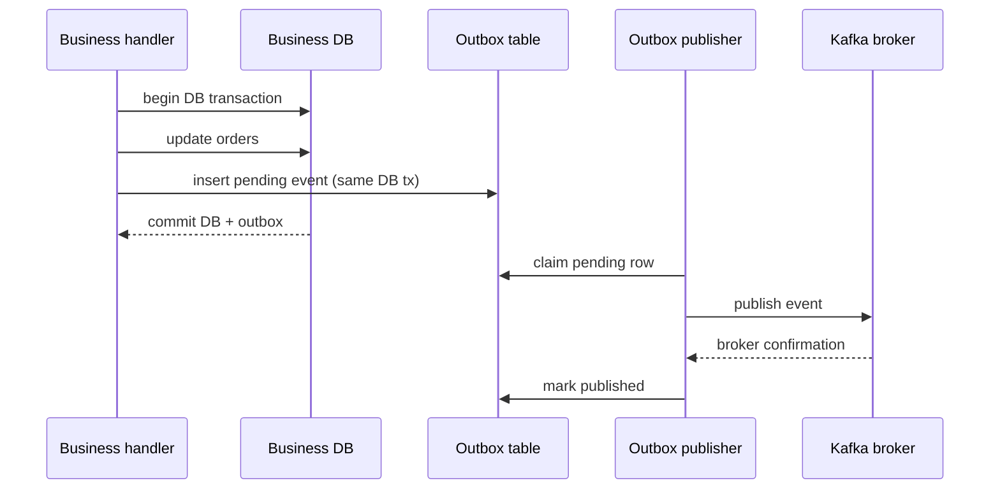

**Ưu điểm:** thao tác nghiệp vụ và cam kết “cần phát Kafka event” cùng transaction database. Nếu Kafka outage, outbox row vẫn còn.

**Giới hạn:** publisher có thể publish thành công nhưng crash trước khi mark outbox row `PUBLISHED`, dẫn đến gửi lại. Vì vậy consumer vẫn phải idempotent; outbox không tự đảm bảo đúng một lần theo nghĩa không có duplicate trong mọi trường hợp.

### 24.1. DDL minh họa

```sql
CREATE TABLE order_outbox (
    event_id         VARCHAR(100) PRIMARY KEY,
    aggregate_id     VARCHAR(100) NOT NULL,
    payload_ref      VARCHAR(500) NOT NULL,
    status           VARCHAR(30) NOT NULL,
    attempt_count    INTEGER NOT NULL DEFAULT 0,
    next_attempt_at  TIMESTAMP NULL,
    created_at       TIMESTAMP NOT NULL,
    updated_at       TIMESTAMP NOT NULL
);
```

Đây là schema **minh họa**: cần tenant scope, indexes, transaction isolation, leasing, retention, payload encryption và migration theo DB.

### 24.2. Replay từ đâu khi Kafka publish thất bại?

Khi DB đã commit mà Kafka outbound adapter lỗi, hãy retry **outbox publisher**, không replay toàn bộ HTTP/JMS/SFTP/Kafka source event từ đầu. Chọn bước nhỏ nhất có thể lặp an toàn.

### 24.3. Outbox và Kafka transaction phối hợp được không?

Có thể cho outbox publisher dùng Kafka producer transaction để nhóm nhiều output Kafka records. Nhưng outbox DB status update và Kafka commit vẫn là hai resources; cần idempotent processing và reconciliation.

## 25. Inbox/deduplication: Bảo vệ side effect khi Kafka input bị replay

Khi consumer xử lý Kafka record rồi cập nhật JDBC hoặc gọi API, có thể lưu business event ID đã xử lý:

```sql
CREATE TABLE processed_event (
    consumer_name   VARCHAR(100) NOT NULL,
    event_id        VARCHAR(150) NOT NULL,
    processed_at    TIMESTAMP NOT NULL,
    PRIMARY KEY (consumer_name, event_id)
);
```

Trong một **DB transaction**:
 
1. Kiểm tra/insert `processed_event` theo unique key.
2. Chỉ cập nhật business tables nếu event chưa xử lý.
3. Commit DB transaction.
4. Để container tiến offset theo contract; nếu crash trước offset commit, event bị đọc lại nhưng DB dedup chặn side effect trùng.

### 25.1. Đừng chỉ dựa vào offset làm business ID

`topic/partition/offset` định danh **record vị trí cụ thể**, nhưng cùng business event có thể được republish sang offset mới hoặc topic khác. Dùng `eventId` hoặc business idempotency key để bảo vệ thao tác nghiệp vụ.

### 25.2. Khi event không có ID

Có thể thiết kế deterministic key từ source ID, aggregate/version và operation. Hash của payload có thể hỗ trợ integrity, nhưng không phải luôn là business identity (hai events khác nhau có payload bằng nhau; payload thay đổi format/whitespace).

### 25.3. Khi replay DLT

Giữ nguyên business event ID, source metadata và retry lineage. Nếu replay DLT tạo event ID mới tùy tiện, dedup có thể không nhận ra cùng thao tác đã xử lý một phần.

## 26. Các adapter ngoài Kafka: Transaction boundary không tự lan truyền

Module `SPRING_INTEGRATION_ADAPTERS` thường kết hợp nhiều adapters. Bảng sau giúp xác định phần nào Kafka transaction **không** kiểm soát:

| Thành phần | Có thể tham gia Kafka transaction trực tiếp? | Cách bảo đảm riêng |
|---|---|---|
| Kafka outbound cùng ProducerFactory | **Có**, theo transaction context và config | Kafka transaction commit + confirmation |
| Consumer group offsets | **Có**, nếu container đưa offsets vào transaction đúng | `sendOffsetsToTransaction`/container EOS |
| JDBC/database | **Không trực tiếp** | DB transaction + outbox/inbox/dedup |
| HTTP outbound POST | **Không** | Idempotency key + status reconciliation |
| SFTP file move/download | **Không** | Staging/atomic rename khi được hỗ trợ, checksum, metadata |
| Local file archive/quarantine | **Không** | Filesystem operations + state journal/compensation |
| JMS queue transaction | **Không** | JMS session transaction, ack/rollback/DLQ |
| AMQP broker channel | **Không** | Ack/nack, publisher confirms, DLX/DLQ |
| External SaaS API | **Không** | Operation ID, retry budget, compensation hoặc saga |

### 26.1. File/SFTP → Kafka

Một file poller có thể tạo Kafka records trong một producer transaction, nhưng Kafka rollback không làm file đã di chuyển về source folder. File accept-once filter và remote/local staging cần state machine riêng.

### 26.2. JMS/AMQP → Kafka

Kafka transaction không commit/rollback JMS/AMQP delivery. Nếu code nhận JMS message rồi phát Kafka, phải xác định transaction/ack ở **hai brokers**; dùng outbox/inbox, idempotency hoặc một integration design có recovery bền vững.

### 26.3. HTTP → Kafka

Nếu HTTP inbound gateway nhận request rồi publish Kafka, người dùng cần biết API trả **accepted** hay **durably committed** theo contract. Kafka producer transaction không làm HTTP client được “rollback” hoặc thu hồi request.

### 26.4. JDBC poller → Kafka

Một JDBC inbound adapter lấy row đã claim rồi gửi Kafka: transaction Kafka không tự trả row về `NEW` khi publish fail. Cần lease/row status/outbox publisher và có thể ghi pending state trong cùng DB transaction với source mark.

## 27. DLT, retry topics và poison loops: Quyết định offset có chủ

Một invalid record không thể được retry vô hạn. Cần **quy tắc cuối cùng** cho việc source consumer tiến qua record.

```text
input record
   -> listener attempt 1
   -> retry/backoff ...
   -> exhausted
   -> DLT publish / quarantine persist
   -> confirm durable recovery
   -> commit/advance source offset theo đúng model
```

Nếu DLT publish fail nhưng source offset vẫn commit, message có thể bị mất nghiệp vụ. Nếu DLT publish success nhưng source offset không commit, message có thể được xử lý lại, tạo DLT duplicate; cần idempotency và xác minh recovery transaction.

### 27.1. Không tự gắn nhãn tất cả exception là retryable

Deserialization, schema mismatch, authorization và bug code thường không giải quyết bằng retry nóng. Timeouts có thể transient nhưng side effect outcome phải được kiểm tra.

### 27.2. Retry budget nhiều tầng

Tránh cộng dồn retry listener/container, Spring Integration `RequestHandlerRetryAdvice`, Kafka retry topics, caller retries và replay operator mà không có tổng attempt/deadline. Một poison message có thể bị thử hàng trăm lần khi từng layer đều reset counter.

### 27.3. Điều kiện để skip record

Chỉ skip/commit past record khi đã có hành động recovery được **xác nhận** theo policy: DLT/quarantine persisted, business reject có audit và owner, hoặc xử lý idempotent success. “Không có exception” không đủ nếu handler nuốt lỗi.

## 28. `seek()`, manual commits, pause/resume và quyền của container

Kafka consumer APIs hỗ trợ `seek`, `commitSync`, `commitAsync`, `pause` và `resume`, nhưng trong Spring Kafka/Spring Integration, listener container sở hữu một phần lớn lifecycle của consumer.

### 28.1. Không tự seek từ callback không thuộc consumer thread

KafkaConsumer **không thread-safe**; không gọi seek/commit từ arbitrary executor hoặc HTTP callback. Spring Kafka có cơ chế `ConsumerSeekAware`, error handlers, after-rollback processors và container APIs để tương tác đúng boundary.

### 28.2. Manual ack trong nontransactional listener

```java
import org.springframework.kafka.annotation.KafkaListener;
import org.springframework.kafka.support.Acknowledgment;
import org.springframework.stereotype.Component;

@Component
class ManualAckConsumer {

    @KafkaListener(
        topics = "orders.in",
        groupId = "orders-manual-group",
        containerFactory = "manualAckFactory")
    void listen(String event, Acknowledgment acknowledgment) {
        handle(event);

        // Chỉ đúng khi containerFactory dùng AckMode.MANUAL
        // hoặc MANUAL_IMMEDIATE và handle thành công theo policy.
        acknowledgment.acknowledge();
    }

    void handle(String event) {
        // business logic
    }
}
```

`manualAckFactory` là **bean cần cấu hình riêng**, không tự tồn tại chỉ vì method nhận `Acknowledgment`.

**Không copy mẫu này vào transactional listener rồi vừa `acknowledge()` vừa `commitSync()` vô điều kiện.** Khi bật Kafka transactions, container sẽ đưa offsets vào transaction với semantics tương ứng listener mode.

### 28.3. Chênh lệch giữa `commitSync` và `commitAsync`

Ở nontransactional container, `syncCommits` có thể điều khiển consumer commit đồng bộ hoặc bất đồng bộ. Một async callback thất bại có thể báo commit problem; phải có monitoring, không suy “đã request commit” là broker đã ghi committed offset.

### 28.4. Pause không phải rollback

Pause consumer làm dừng fetch cho partition hoặc container theo API, nhưng không undo những records đã được fetch, không rollback DB và không commit offset hộ application.

## 29. Kafka request–reply gateway và transactional offset

Spring Integration hỗ trợ Kafka **inbound/outbound gateways** theo request–reply, nhưng phải phân biệt:

- Producer gửi request record.
- Consumer xử lý request và gửi reply record.
- Reply consumer đọc topic, correlation và timeout.
- Consumer source offset của request/reply có thể thuộc **những consumer groups khác nhau**.
- Timeout phía caller không khẳng định remote handler chưa xử lý.

### 29.1. “Gateway timeout” không có nghĩa Kafka transaction abort

Một outbound gateway có thể chờ reply lâu hơn send acknowledgement. Khi caller timeout, request đã có thể được commit tới request topic và remote consumer đang xử lý. Retry request với ID mới có thể tạo duplicate operation.

### 29.2. Transaction scope theo từng stage

```text
Stage A: API caller -> Kafka request topic
Stage B: Kafka request listener -> business logic -> reply topic
Stage C: Reply consumer -> correlation -> Java/HTTP response
```

Mỗi stage có transaction/ack và timeout riêng. Không có một Kafka transaction chạy xuyên network, hai listener containers và toàn bộ thời gian HTTP client chờ response.

### 29.3. Thiết kế request–reply an toàn

- Giữ correlation/request ID ổn định.
- Dùng business idempotency key.
- Phân biệt accepted/published/processed/completed.
- Cấu hình timeout và DLT cho request/reply consumer.
- Lưu trạng thái bất định và hỗ trợ lookup/reconciliation.
- Xác minh offset của request consumer và reply consumer độc lập.

## 30. Hiệu năng, timeout và giới hạn transaction

Kafka transactions có chi phí thêm cho producer state, commit/abort và latency. Những cấu hình cần cân nhắc gồm:

| Tham số | Tác động và nguy cơ |
|---|---|
| `transaction.timeout.ms` | Transaction quá lâu có thể bị broker abort; phải phù hợp broker maximum |
| `max.poll.interval.ms` | Consumer bị rebalance nếu xử lý quá lâu giữa polls |
| `max.poll.records` | Batch càng lớn càng tăng xử lý tối đa trước poll tiếp theo |
| Producer transaction cache size | Thiếu transactional producers khi concurrency cao |
| `transactional.id` prefix | Phải duy nhất theo instance; fencing nếu trùng |
| `transactional.id.expiration.ms` | Idle producer có thể cần refresh/maxAge |
| `isolation.level` | Downstream visibility và LSO latency |
| `acks` và replication | Durability của producer writes |
| `delivery.timeout.ms` | Deadline producer send; cần phối hợp transaction timeout |
| `max.block.ms` | Có thể ảnh hưởng chờ metadata hoặc buffer capacity |
| `concurrency` | Nhiều listener threads/transactions, cần sizing producers |
| `pollTimeout` | Ảnh hưởng nhịp poll, nack/backoff resolution |

### 30.1. Producer cache exhaustion

Spring Kafka có thể cache transactional producers. Nếu không đủ producers cho concurrency/nested transactions, ứng dụng có thể gặp `NoProducerAvailableException` theo version/config. Không chữa bằng cách retry tight loop; cần sizing cache/throughput và backoff.

### 30.2. Chậm vì transaction còn mở

`read_committed` consumer có thể bị chặn hiển thị records sau một transaction mở lâu. Quan sát last stable offset và transaction duration, không chỉ CPU hay số records trong topic.

### 30.3. Tối ưu an toàn

- Giữ transaction ngắn, hạn chế HTTP chậm bên trong Kafka transaction.
- Dùng bounded timeouts và circuit breaker cho external calls.
- Đo throughput và transaction abort/commit rates.
- Sizing `max.poll.records` và concurrency theo workload.
- Không chia sẻ cùng prefix giữa app instances.
- Kiểm tra transaction semantics sau scaling và rebalance.

## 31. Observability: Ba nhóm chỉ số phải theo dõi

**Nhóm 1 — Input consumer**

- Consumer lag/committed offset theo group và partition.
- Rebalance/revoke events.
- Poll processing duration.
- Retry/redelivery count.
- DLT backlog và tuổi record.
- Number of skipped/recovered records có evidence.

**Nhóm 2 — Producer transaction**

- Transaction begin/commit/abort/failure count.
- Transaction duration.
- Producer fencing và `NoProducerAvailableException`.
- Send timeout, delivery acknowledgement failures.
- Output record rate và `read_committed` visibility latency.
- Producer cache utilization.

**Nhóm 3 — Business outcome**

- Số business event IDs processed, duplicate prevented.
- DB outbox pending/oldest age.
- Unknown external side-effect outcomes.
- HTTP idempotency conflicts/reconciliation pending.
- Quarantine persistence failures.
- Mismatch giữa source progressed và output confirmed.

### 31.1. Metric name chỉ là minh họa

```text
kafka_tx_commit_total{flow,outcome}
kafka_tx_abort_total{flow,category}
kafka_consumer_rebalances_total{group}
kafka_dlt_backlog_count{topic}
outbox_pending_count{flow}
business_event_duplicate_prevented_total{flow}
unknown_side_effect_outcomes_count{operation}
```

Các tên trên **không phải tất cả là metrics mặc định của Spring Kafka/Micrometer**. Kết nối metrics thực tế cần dựa trên framework binding và instrumentation đang dùng.

### 31.2. Lag thấp không chứng minh exactly-once

Một consumer có thể commit source offset nhanh nhưng mất output Kafka hoặc thiếu DB side effect nếu cấu hình sai. Phải đối chiếu **input event IDs, committed offsets, output event IDs và business state**.

### 31.3. Không dùng ID cá nhân làm metric label

Tránh email, raw payload, Kafka record key nhạy cảm, request URL có token, transaction ID duy nhất hoặc stack trace làm labels. Dùng flow/transport/error category với cardinality được kiểm soát.

## 32. Bảo mật và quyền truy cập trong Kafka transactional flow

Kafka transactions là cơ chế consistency, không thay thế authentication, authorization hoặc bảo vệ dữ liệu.

### 32.1. Những quyền có thể cần

Tùy broker/ACL model, ứng dụng có thể cần quyền:

- Đọc source topics/group.
- Ghi output topics và transactional IDs.
- Gửi output và commit offsets theo transaction đúng group.
- Ghi DLT/retry topics khi recovery.
- Truy cập Schema Registry hoặc encryption keys nếu dùng.
- Đọc/gửi các audit/metrics endpoints được cấp quyền.

Thiếu quyền có thể biểu hiện như exception producer, commit failure hoặc listener không start; không sửa bằng cách cấp wildcard trên toàn broker.

### 32.2. Không log raw event để debug transaction

`ErrorMessage`, failedMessage, record headers, exception cause và Kafka topic keys có thể chứa PII, business secrets hoặc credentials. Chỉ log metadata cần thiết, correlation ID đáng tin, error category và masked source reference.

### 32.3. Tenant isolation

Một Kafka group có thể xử lý events của nhiều tenants. Idempotency key và outbox/inbox primary keys phải có **tenant scope** khi cần. Không để client-provided header quyết định cross-tenant offset/recovery routing.

### 32.4. DLT retention

DLT có thể giữ payload nhạy cảm lâu hơn topic chính. Cần ACL, encryption, retention, audit, secure replay và chính sách xóa/giữ hợp pháp. Không đồng nhất “Kafka đã commit DLT” với “được phép giữ payload vô hạn”.

## 33. Kiểm thử cơ chế transaction bằng môi trường có Kafka thật

Một unit test thuần:

```java
// Chỉ kiểm tra transform; KHÔNG chứng minh Kafka EOS.
assertEquals("OK:123", transform("123"));
```

không thể xác nhận transaction commit/abort hay offset tiến cùng Kafka output. Cần integration tests dùng **Kafka broker test container/EmbeddedKafka phù hợp** và cấu hình producer/consumer tương đương production.

### 33.1. Kiến trúc test

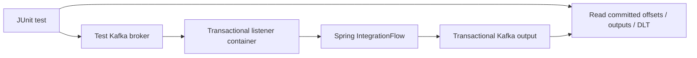

### 33.2. Các điều phải assert

1. Consumer `read_committed` thấy committed output khi input thành công.
2. Với exception trước commit, `read_committed` không thấy aborted output.
3. Input source group offset không tiến qua failed record khi transaction bị rollback theo policy.
4. Consumer reprocess record sau restart/seek một cách đúng.
5. Không có output trùng không mong muốn dưới kịch bản crash/rebalance.
6. DLT records được publish và source offset settlement theo policy.
7. `transactional.id` trùng gây fencing được phát hiện và xử lý.
8. Consumer offset group chính xác theo partition, không nhầm next offset.
9. Manual/async channel không làm mất exception trước container return.
10. DB/HTTP side effects có idempotency hoặc outbox như thiết kế.

### 33.3. Pseudocode kiểm tra aborted records

```text
Given consumer C_in group G, input record R
When listener sends output O then throws before tx commit
Then:
  - consumer C_out with isolation.level=read_committed does not see O
  - group G offset does not include failed R as successful tx commit
  - recovery path redelivers R or publishes DLT according to configured policy
```

Dù không thấy `O`, cần chắc chắn nó bị abort, không chỉ vì test timeout quá ngắn hoặc consumer bị lag.

### 33.4. So sánh với `read_uncommitted`

Có thể tạo thêm consumer `read_uncommitted` để quan sát record từ aborted transaction trong môi trường test, nhằm chứng minh khác biệt isolation. Không dùng consumer này cho nghiệp vụ cần EOS visibility.

## 34. Fault injection: Bảng thời điểm crash cần kiểm tra

| Fault | Inject ở đâu | Kỳ vọng Kafka | Kỳ vọng ngoài Kafka |
|---|---|---|---|
| Throw trước output send | Handler | Transaction abort, offset không tiến theo tx | Không có side effect hoặc có compensation |
| Throw sau send trước commit | Listener | Output không visible với read_committed | DB/HTTP nếu đã xảy ra phải được phát hiện |
| Kill sau `sendOffsetsToTransaction` | Container/producer | Output+offset không tách thành một nửa committed | External status phải được đối soát |
| Kill sau Kafka commit | Process | Output+offset committed | Audit/DB có thể thiếu nếu lưu sau commit |
| Broker tạm không available | Producer send/commit | Failure/abort/retry theo policy | Không tự replay HTTP POST |
| Transactional.id conflict | Two pods | Producer fencing, transaction failure | Dừng và sửa identity, không hot loop |
| Kafka input poison record | Deserializer/handler | Retry/DLT/skip theo config | Quarantine có ACL |
| DLT publish failure | Recoverer | Không skip mất input theo policy | Alert và giữ recoverability |
| Rebalance trong xử lý | Listener | New owner resume từ committed offset | Old worker phải tránh side effect trùng |
| ExecutorChannel async failure | Worker thread | Transaction có thể đã commit sai nếu listener return sớm | Điều chỉnh durable boundary |
| DB commit thành công, Kafka commit lỗi | Transaction sync | Output có thể thiếu | Outbox/reconciliation cần bù |
| Kafka commit thành công, DB commit lỗi | Reverse ordering | Output có thể đã visible | Inconsistency cần bù/đối soát |
| Client HTTP timeout sau POST | External service | Kafka transaction độc lập | Kiểm tra idempotency/outcome |
| Process restart với outbox row pending | Outbox publisher | Có thể gửi lại | Consumer business dedup |
| `read_committed` lag cao | Producer tx kéo dài | LSO visibility bị giữ | Kiểm tra transaction duration |

### 34.1. Không khẳng định kết quả mà không có broker evidence

Một test kỳ vọng Kafka output “không có” phải quan sát đủ thời gian, kiểm tra transaction state/callbacks và last stable offset. Một test nói “offset đã rollback” phải đo committed offset của **đúng group/partition**, không chỉ consumer position.

## 35. Case study: Kafka → JDBC → Kafka trong hệ thống đơn hàng

**Đề bài:** Topic `orders.in` chứa sự kiện tạo đơn hàng. Ứng dụng ghi đơn vào PostgreSQL và phát `orders.accepted`. Khi app crash, muốn tránh duplicate và không mất output.

### 35.1. Thiết kế ngây thơ

```text
Kafka record offset 50
  -> JDBC INSERT committed
  -> Kafka send() called
  -> app crash
  -> source offset chưa commit
  -> input offset 50 được đọc lại
  -> INSERT duplicate hoặc event sent twice
```

Kafka producer transaction có thể giữ output và source offset nhất quán, nhưng DB INSERT đã commit không nằm trong Kafka transaction.

### 35.2. Thiết kế dùng inbox + outbox

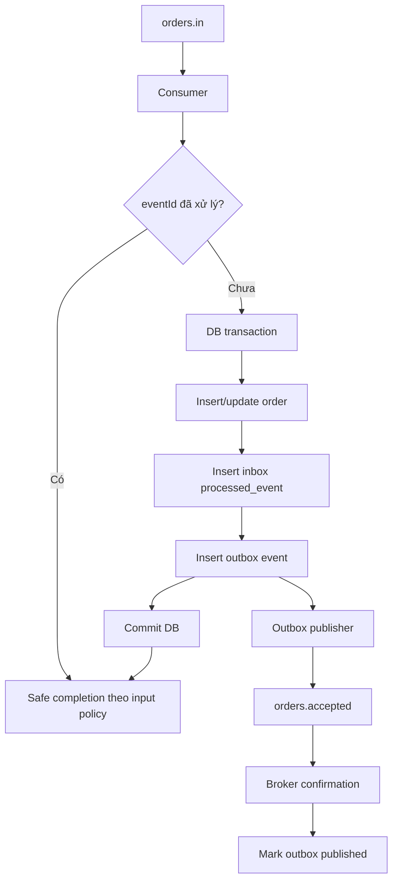

### 35.3. Bốn crash points

| Điểm crash | Điều cần xảy ra |
|---|---|
| Trước DB commit | DB transaction rollback, source retry |
| Sau DB commit trước source offset commit | Source retry, inbox dedup phát hiện đã xử lý |
| Sau Kafka publish trước mark outbox sent | Outbox retry có thể gửi lại; consumers phải idempotent |
| Sau mọi commit | Source group và business state thống nhất theo evidence |

### 35.4. Khi chỉ Kafka-in → Kafka-out

Nếu **không có DB/HTTP external effects**, transactional listener container với KafkaTemplate cùng factory và source offsets sent to transaction có thể là mô hình gọn hơn. Không thêm outbox database chỉ vì mọi flow đều “phải có” outbox.

## 36. Troubleshooting: Khi offset hoặc transaction hành xử bất thường

### 36.1. Output trùng nhưng offset “đã commit”

- Input event có được publish trùng với business ID khác không?
- Có một producer bên ngoài transaction không?
- Consumer downstream đang `read_uncommitted` không?
- Có `ExecutorChannel` khiến send chạy ngoài listener transaction không?
- Có callback gửi lại message sau timeout không?
- Có outbox publisher retry sau ack ambiguity không?

### 36.2. Committed offset tiến dù xử lý lỗi

- Exception có bị catch và return bình thường?
- Có `enable.auto.commit=true` không?
- Listener container transactional thực sự không?
- Error handler `isAckAfterHandle` hoặc recovered policy có đánh dấu handled không?
- DLT/quarantine đã persist thành công chưa?
- Có nhầm consumer position với committed offset không?

### 36.3. `ProducerFencedException`

- Hai instances có dùng chung `transactional.id` prefix/suffix không?
- Identity/fencing xảy ra vì restart/rollout hay idle expiration?
- ProducerFactory maxAge/transactional.id expiration cấu hình ra sao?
- Có cần tái tạo producer sau fencing và dừng transaction hiện tại?
- Có được retry vô hạn với cùng producer bị fence không? **Không.**

### 36.4. `read_committed` consumer bị lag nhưng broker có records

- Có open transaction kéo dài làm LSO không tiến?
- Producer transaction timeout/abort chưa xử lý?
- Consumer group assignment/rebalance hay poll interval problem?
- Có records bị abort và đang được consumer filter hợp lệ?
- Có lag ở một partition cụ thể không?

### 36.5. `NoProducerAvailableException`

- Producer cache capacity đủ cho concurrency/nested transactions không?
- Có bị tạo quá nhiều transaction đồng thời không?
- Transaction lifecycle có bị giữ vì external API quá lâu không?
- Có backoff và alert thay vì tight retry không?

### 36.6. DLT có record nhưng input vẫn lặp

- DLT publish đã xác nhận chưa?
- Offset source đã commit theo recoverer/transaction policy chưa?
- Rebalance xảy ra giữa DLT write và commit không?
- Có nhiều consumer groups cùng đọc input không?
- DLT record có business ID để dedup không?

### 36.7. Spring Integration errorChannel nhận lỗi nhưng Kafka không retry

- Error channel handler có nuốt exception không?
- Adapter recovery callback đã được gắn thế nào?
- Container error/after-rollback processor có thấy exception không?
- `KafkaMessageSource` poller hay message-driven listener?
- Có channel async làm listener return sớm không?

## 37. Các anti-pattern cần tránh

**“Commit offset nghĩa là business side effect đã thành công.”** Không: nó chỉ là tiến độ consumer group trong Kafka.

**“Offset của record cuối và committed offset là một.”** Commit mang ý nghĩa next offset.

**“`read_committed` tự lọc mọi duplicate.”** Nó lọc aborted transactional records, không lọc duplicate business events hợp lệ.

**“`enable.idempotence=true` nghĩa là end-to-end exactly once.”** Producer retry idempotence không ngăn handler chạy lại.

**“Chỉ cần `@Transactional` là Kafka + DB cùng atomic.”** Cần biết transaction manager và resource boundaries.

**“Kafka rollback sẽ hoàn tác JDBC/HTTP.”** Không.

**“Kafka listener tự có EOS nếu dùng KafkaTemplate.”** Cần transaction-capable producer, container config và offset-to-tx.

**“`KafkaTemplate.executeInTransaction` tự commit input offset.”** Không mặc định; nó là producer-only transaction.

**“Gửi record output xong thì commit source offset ngay.”** Có thể gặp producer failure/abort.

**“Cho `ExecutorChannel` vào giữa mà vẫn giữ Kafka transaction.”** Thread boundary có thể phá transaction context.

**“Manual `commitSync()` là cách sửa mọi vấn đề offset.”** Có thể xung đột container, nhất là transactional listener.

**“ErrorMessage xuất hiện nghĩa là Kafka rollback.”** Error publication và container outcome khác nhau.

**“Handler log lỗi rồi return thì record sẽ retry.”** Có thể được coi là success và commit.

**“Batch listener lỗi một item thì Kafka luôn replay một item.”** Default transactional recovery có thể replay cả batch.

**“DLT write và offset source luôn atomic.”** Chỉ khi recoverer/transaction semantics được cấu hình đúng và xác minh.

**“Hai pods dùng chung transaction-id-prefix cho tiện.”** Có thể gây producer fencing.

**“Transaction mở lâu không ảnh hưởng consumer.”** Có thể giữ LSO, gây lag và timeout.

**“Kafka offset bảo vệ duplicate payment.”** HTTP side effects cần idempotency/reconciliation.

**“Retry caller, listener, advice, DLT và outbox có thể độc lập vô hạn.”** Có thể tạo exponential retry storm.

**“Topic, partition, offset là business event identity toàn cục.”** Republish tạo offset mới; business ID khác.

**“Sửa lỗi bằng cách tăng transaction timeout mãi.”** Có thể che handler blocking và chặn read_committed visibility.

**“Chỉ cần unit test mock KafkaTemplate để chứng minh EOS.”** Cần broker và failure/commit tests.

## 38. Checklist áp dụng trong production

| Câu hỏi | Bằng chứng cần có |
|---|---|
| Xác định source topic/group/partition? | Consumer topology |
| Phân biệt position/committed offset? | Commit test theo partition |
| Container có `enable.auto.commit=false`? | Effective properties |
| `AckMode` phù hợp listener mode? | Container configuration |
| Có transaction manager đúng loại? | `KafkaTransactionManager`/`KafkaAwareTransactionManager` |
| ProducerFactory hỗ trợ transaction? | Transaction capable configuration |
| KafkaTemplate dùng cùng factory? | Bean wiring test |
| Transactional ID unique mỗi instance? | Deployment identity policy |
| Có fencing/restart behavior? | Integration/fault tests |
| `read_committed` trên downstream cần EOS? | Consumer effective properties |
| Có output + offsets cùng transaction? | Crash-before-commit test |
| Không tự manual commit xung đột? | Code review/commit observation |
| Không cắt thread boundary ngoài thiết kế? | Flow diagram/async tests |
| KafkaMessageDrivenChannelAdapter dùng container đúng? | Bean wiring |
| KafkaMessageSource được xử lý theo semantics riêng? | Poller/ack tests |
| Batch failure behavior rõ? | Batch rollback test |
| AfterRollbackProcessor/DLT cấu hình đúng? | Poison record test |
| DLT write thất bại không skip mất input? | Recoverer fault test |
| Retry budget có giới hạn? | Retry/age metrics |
| Có idempotency key? | Duplicate event test |
| JDBC side effects có transaction + inbox/outbox? | DB crash test |
| HTTP POST có reconciliation? | Timeout-after-remote-commit test |
| File/SFTP state có riêng? | Filter/staging/rename tests |
| JMS/AMQP ack không bị suy từ Kafka offset? | Broker tests |
| Producer send failure được theo dõi? | Callback/failure channel |
| Có không-trùng transactional.id khi scale? | Multi-instance test |
| Có metrics transaction abort/commit, LSO, lag? | Dashboard |
| Có ACL cho group/topic/transactional.id? | Security review |
| DLT/quarantine có retention và phân quyền? | Data governance |
| Có chạy restart/rebalance tests? | Fault-injection suite |
| Có rollback plan khi deploy sai config? | Runbook |
| Có kiểm tra version Spring Kafka/Integration? | Dependency compatibility |
| Đã chứng minh outcome nghiệp vụ? | Source/output/DB reconciliation |

## 39. Bài thực hành tự đánh giá và tổng kết

### 39.1. Đề bài

Xây một hệ thống xử lý `orders.in` theo hai biến thể:

- **Biến thể A:** Kafka input → validate → Kafka output `orders.validated`; không có side effect ngoài Kafka.
- **Biến thể B:** Kafka input → JDBC order write → Kafka output, có thêm HTTP callback trong một số trường hợp.

Thực hiện:

1. Cấu hình Kafka producer transactions, prefix riêng theo instance.
2. Tạo listener container transaction-aware và Spring Integration message-driven adapter.
3. Đặt `enable.auto.commit=false`, xác định record/batch mode.
4. Cho consumer đọc output với `read_committed`.
5. Inject lỗi **sau send và trước transaction commit**.
6. Kiểm tra output aborted không hiện và source offset chưa tiến như một commit thành công.
7. Inject process kill sau Kafka transaction commit.
8. Với biến thể B, chứng minh DB commit không tự rollback theo Kafka abort.
9. Thêm inbox/outbox hoặc idempotency/reconciliation cho DB/HTTP.
10. Tạo poison record và kiểm thử after-rollback/DLT policy.
11. Test restart, rebalance, duplicate business event, producer fencing.
12. Đưa kết quả vào một bảng source offsets, output event IDs và business state.

### 39.2. Kết quả mong đợi

| Tiêu chí | Biến thể A | Biến thể B |
|---|---|---|
| Kafka output + source offsets atomic | Có khi cấu hình transaction đúng | Có cho phần Kafka trong transaction |
| DB commit rollback cùng Kafka | Không có DB | **Không tự động** |
| HTTP callback idempotent | Không áp dụng | Bắt buộc nếu có side effect |
| Input reprocessing có thể xảy ra | Có | Có |
| Output Kafka aborted visible với read_committed | Không | Không trong phạm vi transaction |
| Business duplicate được bảo vệ | Theo Kafka EOS + business key khi cần | Cần inbox/outbox/idempotency |
| Lỗi vĩnh viễn | Retry/DLT theo policy | DLT + DB/HTTP reconciliation |
| Evidence test | Topic/partition/offset/transaction | Kafka + DB + remote outcome |

### 39.3. Ghi nhớ

**Kafka offset** là vị trí tiến độ trong một **partition của consumer group**; committed offset nói **record kế tiếp để đọc**, không phải bằng chứng tự thân rằng mọi business side effect đã hoàn tất. `AckMode`, auto-commit và container-managed transactional commit là những cơ chế khác nhau.

**Kafka producer transaction** cho phép atomic commit Kafka outputs và **source consumer offsets** trong consume–transform–produce khi Spring Kafka listener container, transactional producer factory và KafkaTemplate được cấu hình đúng. `read_committed` giúp downstream không thấy các aborted transactional records. Producer fencing, unique `transactional.id` và giới hạn thread/transaction scope là phần quan trọng của tính nhất quán này.

**Exactly-once trong Kafka không phải distributed transaction cho JDBC/HTTP/JMS/AMQP/file/SFTP.** Ngoài Kafka, cần thiết kế business idempotency, outbox/inbox, ack/commit theo nguồn và reconciliation. Error channel hay DLT chỉ có ý nghĩa khi outcome recovery và source offset được xác minh.

Câu hỏi quyết định là: **“Kafka output records và source offsets được commit cùng nhau chưa; ngoài Kafka đã có side effect nào xảy ra và đã có cơ chế chống lặp/đối soát chưa?”**

### Tài liệu tham khảo

- [Spring Kafka Reference — Exactly Once Semantics](https://docs.spring.io/spring-kafka/reference/kafka/exactly-once.html): container transaction, `sendOffsetsToTransaction`, EOS V2 và giới hạn Kafka.
- [Spring Kafka Reference — Transactions](https://docs.spring.io/spring-kafka/reference/kafka/transactions.html): `KafkaTransactionManager`, producer factory, transaction ID prefix, `KafkaTemplate.executeInTransaction`, synchronization với JDBC.
- [Spring Kafka Reference — Message Listener Containers](https://docs.spring.io/spring-kafka/reference/kafka/receiving-messages/message-listener-container.html): container `AckMode`, auto-commit, manual ack, transactional offsets.
- [Spring Kafka Reference — Handling Exceptions](https://docs.spring.io/spring-kafka/reference/kafka/annotation-error-handling.html): `CommonErrorHandler`, `DefaultErrorHandler`, `AfterRollbackProcessor`, DLT recovery.
- [Spring Integration Reference — Kafka Support](https://docs.spring.io/spring-integration/reference/kafka.html): `KafkaMessageDrivenChannelAdapter`, `KafkaMessageSource`, Kafka outbound/gateway, error channels và headers.
- [Spring Integration Reference — Transaction Support](https://docs.spring.io/spring-integration/reference/transactions.html): transactions ở integration flows, threading và synchronization.
- [Spring Integration Reference — Messaging Channels](https://docs.spring.io/spring-integration/reference/channel.html): `DirectChannel`, `ExecutorChannel` và queue boundaries.
- [Apache Kafka Documentation — Consumer Config](https://kafka.apache.org/documentation/#consumerconfigs): `enable.auto.commit`, `isolation.level`, `max.poll.interval.ms` và offset.
- [Apache Kafka Documentation — Producer Config](https://kafka.apache.org/documentation/#producerconfigs): `transactional.id`, `transaction.timeout.ms`, `acks` và idempotence.

> **Lưu ý áp dụng:** Các ví dụ minh họa bản chất kỹ thuật; API cụ thể và auto-configuration khác nhau giữa Spring Kafka 3.x/4.x, Spring Integration và Spring Boot tương ứng. Khi triển khai, kiểm tra dependency/version, Kafka broker compatibility, producer/container wiring, transaction boundaries và test bằng Kafka thật. Đây là nội dung **STEP 4**, chưa phải kết quả build hoặc Content QA chuyên môn.
