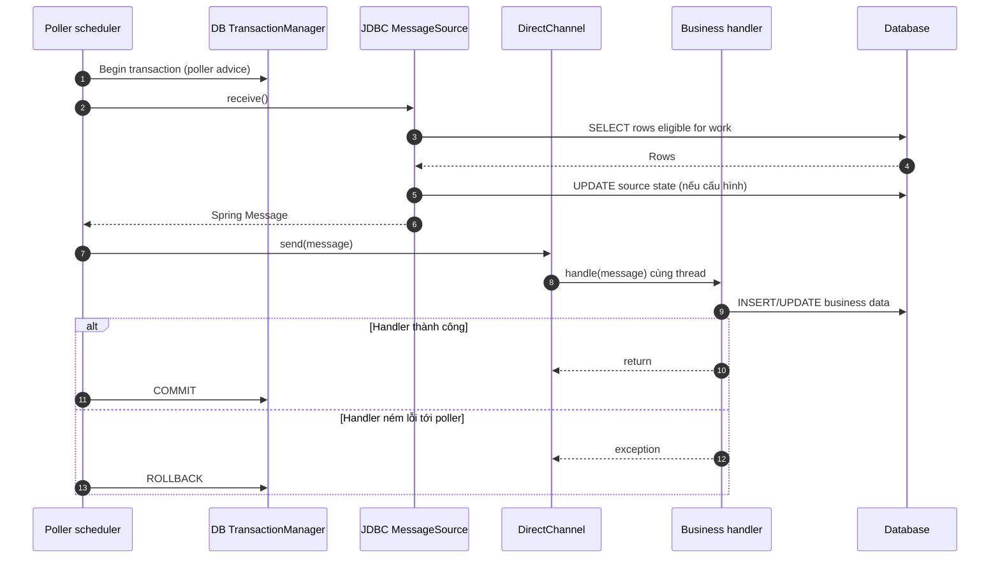
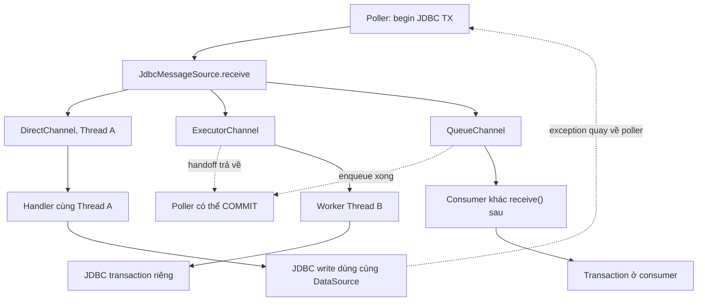
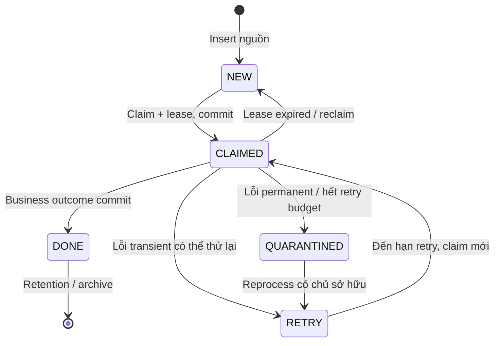
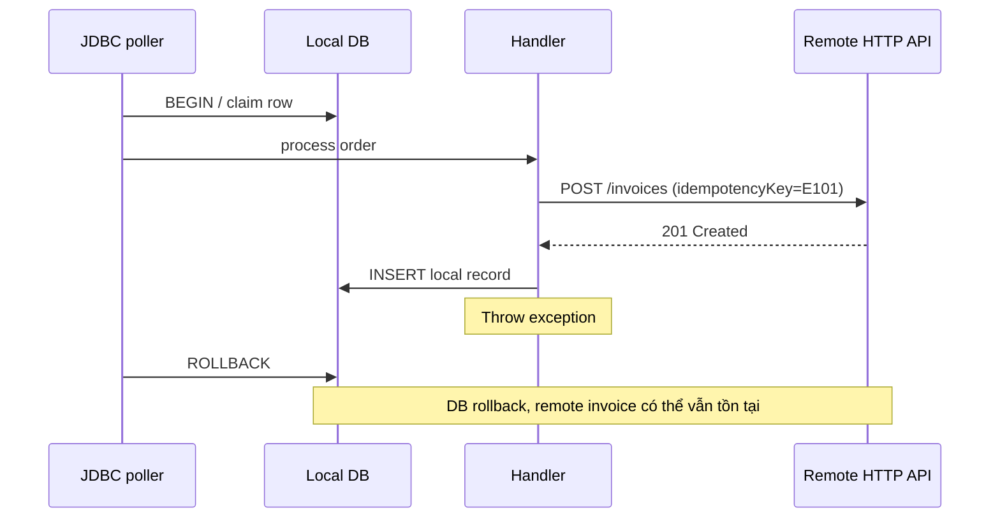
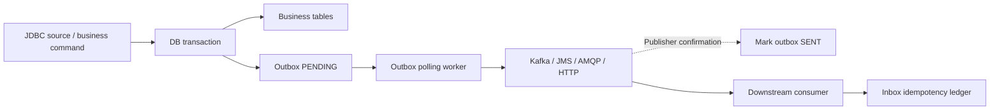
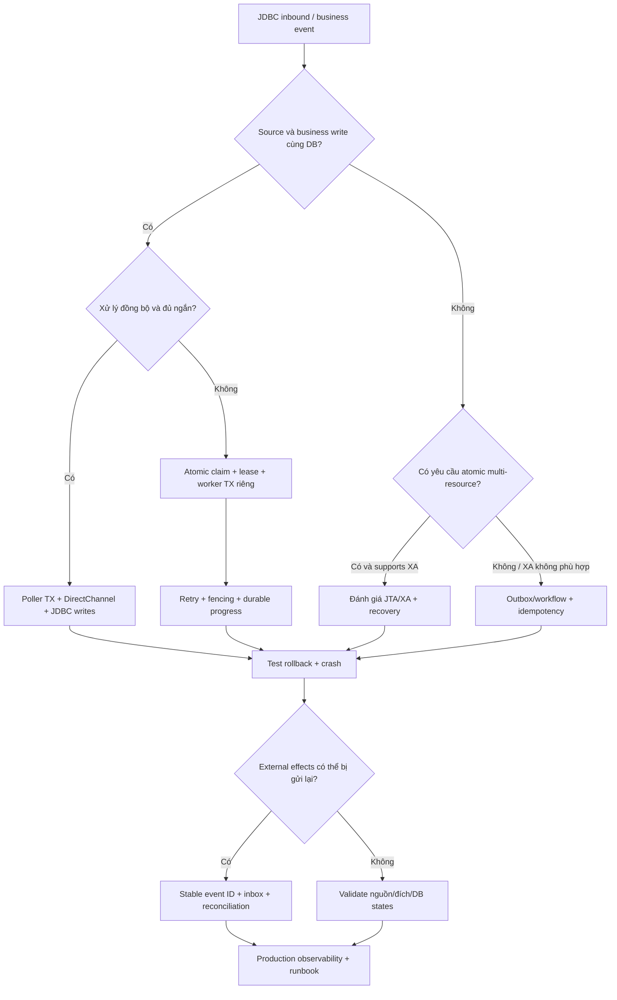

# JDBC transaction boundary trong Spring Integration Adapters

## 1. Bài toán: dữ liệu được đọc rồi, nhưng công việc đã hoàn tất chưa?

Giả sử bảng `integration_inbox` lưu những yêu cầu chưa xử lý. Mỗi giây, Spring Integration **JDBC inbound channel adapter** truy vấn các hàng có `status = 'NEW'`, đánh dấu đã nhận, rồi gửi kết quả qua `MessageChannel` tới một service activator. Handler kiểm tra nghiệp vụ, ghi bảng `purchase_order` và phát sự kiện sang Kafka.

Nếu handler ném exception ngay sau khi ghi đơn, điều gì phải xảy ra?

- Hàng nguồn có trở lại `NEW` để poll lần sau xử lý không?
- Bản ghi `purchase_order` có rollback cùng hàng nguồn không?
- Kafka đã nhận event có rollback theo database không?
- Khi worker đã chuyển việc sang thread khác, transaction của poller còn hiệu lực không?
- Nếu hai instance poll cùng một hàng, liệu mỗi hàng có chỉ được một instance xử lý không?

Đó là những câu hỏi về **JDBC transaction boundary**: thời điểm transaction bắt đầu, những thao tác JDBC nào thực sự thuộc transaction, lúc nào commit/rollback và những hoạt động nào **nằm ngoài** phạm vi đó.

Bài thuộc chương **Transactions** của module **SPRING_INTEGRATION_ADAPTERS**, tập trung kết nối hệ thống bên ngoài bằng **inbound/outbound adapter, gateway, poller và `MessageChannel`**. Bên cạnh JDBC, chúng ta sẽ so sánh với File, SFTP, HTTP, JMS, AMQP và Kafka để thấy vì sao một transaction cục bộ không bảo đảm toàn bộ chuỗi tích hợp được commit nguyên tử.

### Mục tiêu học tập

Sau bài này, bạn có thể:

1. Chỉ ra ranh giới của transaction khi JDBC inbound adapter được kích hoạt bởi poller.
2. Phân biệt `TransactionInterceptor` ở poller và `@Transactional` ở handler.
3. Giải thích vì sao `DirectChannel` thường giữ transaction context trong khi `ExecutorChannel`, `QueueChannel` và callback bất đồng bộ có thể tách ranh giới.
4. Thiết kế SQL claim, locking, isolation, retry và idempotency cho hệ thống nhiều worker.
5. Dùng `DataSourceTransactionManager` hoặc `JdbcTransactionManager` đúng `DataSource`, không nhầm với JMS/Kafka transaction.
6. Xử lý các cửa sổ lỗi khi JDBC phối hợp với outbound HTTP/JMS/AMQP/Kafka/File/SFTP.
7. Kiểm thử rollback bằng **database readback, fault injection, crash/restart** và kết quả nghiệp vụ, không chỉ bằng exception.

## 2. Transaction boundary nghĩa là gì?

Một JDBC transaction là tập thao tác trên tài nguyên database được quản lý bởi một transaction manager/connection, với outcome **commit** hoặc **rollback**. Trong Spring, nhiều thao tác JDBC có thể dùng cùng transaction khi:

- Một transaction được mở trước các thao tác cần bảo vệ.
- Các thành phần dùng `DataSource` và transaction manager thích hợp, có kết nối được bind vào transaction hiện tại.
- Các lời gọi thực thi trong phạm vi transaction, thường cùng thread đối với transaction imperative của Spring.
- Không có thao tác dùng kết nối/transaction độc lập làm phá vỡ atomicity đã giả định.

**Commit** làm các thay đổi JDBC hợp lệ trở nên bền vững theo hợp đồng của database. **Rollback** không chốt các thay đổi trong transaction chưa commit. Cả hai **không** hoàn tác một HTTP POST đã thực hiện, file đã đổi tên trên SFTP, hoặc message đã được broker nhận trong một transaction độc lập.

### 2.1 Ranh giới là phạm vi, không phải annotation

`@Transactional` là một cách khai báo transaction qua Spring proxy/interceptor, nhưng không tự xác định mọi thao tác nằm trong phạm vi:

- `@Transactional` trên **handler** có thể chỉ bao quanh handler, **không bao** bước adapter đã `SELECT`/`UPDATE` trước đó.
- `TransactionInterceptor` đặt trên **poller** có thể bắt đầu transaction **trước khi source nhận dữ liệu** và kéo dài qua handler đồng bộ.
- Một method `REQUIRES_NEW` mở transaction mới độc lập với transaction đang chạy.
- Một lời gọi qua executor/new thread không tự thừa hưởng transaction JDBC được bind vào thread ban đầu.

Vì vậy, câu hỏi đúng không phải “có `@Transactional` không?”, mà là “**transaction bắt đầu trước thao tác nào, dùng connection nào, và kết thúc sau thao tác nào?**”.

### 2.2 Bốn mốc xử lý một hàng

| Mốc | Thao tác | Trạng thái nếu gặp lỗi |
|---|---|---|
| A | Poller mở transaction nếu có advice | Chưa đọc dữ liệu |
| B | JDBC inbound `SELECT` và có thể `UPDATE` source | Có thể rollback source update nếu cùng transaction |
| C | Handler đồng bộ ghi business tables | Có thể rollback cùng source nếu đúng DataSource/transaction |
| D | Handler trả về; poller transaction commit | Các thay đổi JDBC mới được chốt |

Nếu không có transaction bao trùm B–D, source có thể được đánh dấu đã lấy **trước** khi handler hoàn tất. Khi handler lỗi, nguy cơ mất công việc xuất hiện vì source không còn đủ điều kiện để poll lại.

## 3. Spring Integration đặt transaction ở những lớp nào?

### 3.1 Các thành phần cần nhận diện

- **`JdbcMessageSource` / JDBC inbound channel adapter:** truy vấn database để nhận dữ liệu theo lịch; có thể thực hiện câu update sau select tùy cấu hình.
- **`SourcePollingChannelAdapter`:** endpoint định kỳ gọi `MessageSource.receive()` rồi gửi Spring message vào output channel.
- **`PollerMetadata`:** cấu hình trigger, `maxMessagesPerPoll`, task scheduler, advice chain và các thuộc tính polling.
- **`TransactionInterceptor`:** advice có thể bao quanh lượt poll theo transaction manager.
- **`MessageChannel`:** kết nối các endpoint/handlers; channel type quyết định đồng bộ hay chuyển giao.
- **Service activator/transformer/router/filter:** thực hiện xử lý dữ liệu sau khi nhận message.
- **JDBC outbound channel adapter/gateway:** thực hiện truy vấn/cập nhật JDBC từ Spring message theo cấu hình.
- **`PlatformTransactionManager`:** điều phối begin/commit/rollback cho tài nguyên được hỗ trợ.

Không phải endpoint nào cũng là poller. Một **JMS message-driven inbound adapter** thường do listener container quản lý việc nhận/ack, còn JDBC inbound adapter là nguồn polling. Không gắn transaction advice vào sai loại endpoint rồi kỳ vọng chung một kết quả.

### 3.2 Luồng JDBC inbound đồng bộ



Sơ đồ thể hiện **khả năng** dùng cùng transaction, không phải bảo đảm tự động của mọi JDBC inbound adapter. Cần cấu hình transaction advice đúng chỗ, đúng `DataSource` và kiểm đường exception không bị swallow.

### 3.3 Nếu transaction chỉ bắt đầu ở handler?

```text
T0: JDBC source SELECT / UPDATE status='CLAIMED'  -- có thể commit riêng
T1: DirectChannel gửi message
T2: @Transactional handler mở DB transaction
T3: handler ghi business row
T4: handler throw -> rollback handler transaction
T5: source row vẫn CLAIMED -> có thể mất công việc
```

**Đây là lý do cần test claim + business update cùng rollback**, không chỉ test `@Transactional` của service.

## 4. Các transaction manager trong bài

| Manager/cơ chế | Phạm vi thường gặp | Điều không tự bảo vệ |
|---|---|---|
| `DataSourceTransactionManager` | Một JDBC `DataSource` | JMS/Kafka/HTTP/SFTP hoặc DB khác |
| `JdbcTransactionManager` | JDBC local transaction, tích hợp dịch exception theo khả năng Spring version | Tài nguyên ngoài JDBC |
| `JpaTransactionManager` | Persistence context/JPA + DB theo cấu hình; JDBC tham gia cần đúng datasource/connection | Không tự thành XA nhiều broker |
| `JmsTransactionManager` | Local JMS session/connection | JDBC transaction của DB độc lập |
| `KafkaTransactionManager` (theo Spring Kafka) | Kafka producer transaction trong phạm vi hỗ trợ | Database và HTTP không tự enlist |
| JTA/XA coordinator | Global transaction với những resource **thực sự hỗ trợ/enlist XA** | API ngoài XA, filesystem hoặc SFTP |

Trong ví dụ JDBC thuần, chọn manager trỏ tới **cùng DataSource** mà `JdbcTemplate`, message source và handler dùng. Không ghép nhiều manager rồi nghĩ hệ thống tự có distributed transaction.

### 4.1 Transaction context thường gắn với thread

Spring imperative transaction thường dùng các resource/thread bindings. Khi một handler được gọi đồng bộ qua `DirectChannel`, nó có thể dùng transaction đang active. Khi flow chuyển sang `ExecutorChannel`, `QueueChannel` hoặc `@Async`, worker ở thread khác không tự có cùng connection transaction.

Không truyền một JDBC `Connection` đang mở qua thread như cách giữ transaction xuyên executor. Thay vào đó, thiết kế **mốc giao việc bền vững** và transaction mới ở worker.

## 5. Các trường hợp JDBC inbound: đọc, nhận diện và đánh dấu

### 5.1 Chỉ SELECT không tự có “đã xử lý”

Nếu inbound adapter chỉ chạy:

```sql
SELECT id, business_key, payload
FROM integration_inbox
WHERE status = 'NEW';
```

và không có cơ chế claim/update/filter phù hợp, cùng row có thể được trả về nhiều lần ở các lượt poll kế tiếp. Với nhiều instance, hai pollers có thể lấy cùng dữ liệu. Điều này có thể chấp nhận nếu downstream xử lý idempotently, nhưng không được mặc định mỗi row chỉ nhận một lần.

### 5.2 SELECT rồi UPDATE không tự là atomic claim trong mọi topology

Một luồng hay được mô tả:

```sql
-- Bước đọc:
SELECT id, business_key, payload
FROM integration_inbox
WHERE status = 'NEW'
ORDER BY id;

-- Bước đánh dấu, sau khi chọn row:
UPDATE integration_inbox
SET status = 'CLAIMED'
WHERE id = :id;
```

Nếu hai worker cùng SELECT trước khi một bên UPDATE, chúng có thể thấy cùng row. **Có transaction không tự loại bỏ mọi race**: isolation level, locking, predicate update và cách claim phải được thiết kế phù hợp database.

### 5.3 Ghi đúng ý nghĩa của trạng thái

| Trạng thái minh họa | Ý nghĩa | Không đồng nghĩa |
|---|---|---|
| `NEW` | Có thể được lấy để xử lý | Chưa từng được nhìn thấy |
| `CLAIMED` | Một worker/transaction đã nhận quyền xử lý | Business handler đã hoàn tất |
| `DONE` | Hoàn tất theo contract đã định | Consumer hệ thống ngoài cũng hoàn tất |
| `RETRY` | Có thể thử lại theo lịch | Nên retry ngay vô hạn |
| `QUARANTINED` | Lỗi cần xử lý hoặc phê duyệt đặc biệt | Có thể xóa ngay |

Trong một inbound adapter, câu `UPDATE` cấu hình ở source có thể dùng làm “received/claimed”. **Không đặt `DONE` ngay tại bước receive** nếu DONE được định nghĩa là đã hoàn tất toàn bộ nghiệp vụ. Cần phân biệt claim transaction, business transaction và outcome ở đích.

### 5.4 Một lần poll có thể nhận cả batch

Nhiều cấu hình JDBC inbound có thể nhận **một Spring message chứa danh sách các row**. Vì vậy:

- `maxMessagesPerPoll=1` nghĩa là số lần gọi `receive()` trong chu kỳ theo poller policy, **không phải một row**.
- `maxRows` hoặc SQL limit ảnh hưởng số row trả về trong một receive theo adapter/query.
- Một exception ở handler xử lý cả batch có thể làm rollback toàn batch trong **cùng transaction** nếu đúng boundary, nhưng tác động ra hệ thống ngoài có thể không rollback.

Không đưa giả định “mỗi poll = một row” vào retry/monitoring nếu chưa đọc payload type và test thực tế.

## 6. Ví dụ có thể kiểm chứng: một DB transaction bao claim và ghi nghiệp vụ

### 6.1 Chuẩn bị schema và dữ liệu

Ví dụ SQL dưới đây nhằm minh họa bằng một database hỗ trợ identity column. Cú pháp cụ thể cần điều chỉnh theo DB vendor/version.

```sql
CREATE TABLE integration_inbox (
    id           BIGINT PRIMARY KEY,
    event_id     VARCHAR(120) NOT NULL UNIQUE,
    payload      VARCHAR(4000) NOT NULL,
    status       VARCHAR(24) NOT NULL
);

CREATE TABLE purchase_order (
    order_id     BIGINT PRIMARY KEY,
    source_event VARCHAR(120) NOT NULL UNIQUE,
    total_amount DECIMAL(18, 2) NOT NULL,
    state        VARCHAR(24) NOT NULL
);

INSERT INTO integration_inbox(id, event_id, payload, status)
VALUES (101, 'event-101', '{"orderId":1001,"total":250000}', 'NEW');
```

`event_id` là business idempotency key ổn định qua retry. Unique constraint giúp phát hiện business duplicate khi worker nhận lại message. Database transaction và unique key giải quyết **hai bài toán khác nhau**: atomicity của lần xử lý và việc chống tác động trùng giữa các lần xử lý.

### 6.2 Cấu hình transaction manager

```java
@Configuration
class DatabaseTransactionConfig {

    @Bean("orderTxManager")
    PlatformTransactionManager orderTxManager(
            @Qualifier("orderDataSource") DataSource dataSource) {
        return new DataSourceTransactionManager(dataSource);
    }

    // Cấu hình JdbcTemplate, JdbcMessageSource và handler đều
    // dùng orderDataSource; không minh họa toàn bộ beans ở đây.
}
```

Nếu dự án có nhiều DataSource, hãy chỉ rõ tên manager trong advice và bean JDBC. Nếu một thành phần dùng `DriverManager.getConnection(...)` tự tạo connection khác, nó có thể **không tham gia transaction** do Spring đang quản lý.

### 6.3 Poller transaction advice + DirectChannel (XML minh họa)

```xml
<int:channel id="ordersInput"/>

<int-jdbc:inbound-channel-adapter
    id="ordersJdbcInbound"
    data-source="orderDataSource"
    channel="ordersInput"
    query="SELECT id, event_id, payload
           FROM integration_inbox
           WHERE status = 'NEW'"
    update="UPDATE integration_inbox
            SET status = 'CLAIMED'
            WHERE id IN (:id)">
    <int:poller fixed-delay="1000"
                max-messages-per-poll="1">
        <int:transactional
            transaction-manager="orderTxManager"
            propagation="REQUIRED"/>
    </int:poller>
</int-jdbc:inbound-channel-adapter>

<int:service-activator
    input-channel="ordersInput"
    ref="orderHandler"
    method="handle"/>
```

Đây là cấu trúc **minh họa**, chưa bao gồm khai báo namespace, DataSource, handler bean và các lựa chọn về SQL parameter binding. Cơ chế map `:id` từ selected rows vào update parameters phụ thuộc contract JDBC inbound adapter/version; cần kiểm với schema và adapter thực tế. Nếu endpoint dùng SQL theo kiểu khác, hãy bảo toàn nguyên lý **transaction bắt đầu trước receive và chỉ commit sau xử lý đồng bộ**.

### 6.4 Handler JDBC đồng bộ

```java
@Component("orderHandler")
class OrderHandler {
    private final JdbcTemplate jdbc;
    private final AtomicBoolean shouldFail = new AtomicBoolean(false);

    OrderHandler(@Qualifier("orderJdbcTemplate") JdbcTemplate jdbc) {
        this.jdbc = jdbc;
    }

    public void handle(List<Map<String, Object>> rows) {
        for (Map<String, Object> row : rows) {
            long sourceId = ((Number) row.get("id")).longValue();
            String eventId = (String) row.get("event_id");

            jdbc.update(
                "INSERT INTO purchase_order " +
                "(order_id, source_event, total_amount, state) " +
                "VALUES (?, ?, ?, 'CREATED')",
                sourceId, eventId, new BigDecimal("250000")
            );
        }
        if (shouldFail.get()) {
            throw new IllegalStateException("TEST_AFTER_JDBC_WRITE");
        }
    }

    void setShouldFail(boolean fail) {
        shouldFail.set(fail);
    }
}
```

Đoạn mã được giản lược để tập trung transaction, cần imports/beans và validation nghiệp vụ trước khi dùng thực tế. `orderJdbcTemplate` phải trỏ tới **cùng DataSource** với poller transaction. Handler nhận danh sách row, không giả định JDBC inbound source tự split mỗi row thành một Spring message.

### 6.5 Expected result khi handler lỗi

Đặt `shouldFail = true` trong môi trường thử, cho poller nhận row và chờ rollback hoàn tất. Đọc lại bảng **bằng kết nối/transaction độc lập**:

```sql
SELECT status FROM integration_inbox WHERE id = 101;
-- Kỳ vọng: NEW

SELECT COUNT(*) FROM purchase_order WHERE source_event = 'event-101';
-- Kỳ vọng: 0
```

Hai kết quả trên là bằng chứng source claim và business write đã rollback cùng. Nếu chỉ ledger rollback nhưng row nguồn vẫn `CLAIMED`, hãy kiểm advice có bao bước `receive()` không, handler có chạy cùng thread không, và source/handler có sử dụng cùng `DataSource` hay không.

### 6.6 Expected result khi handler thành công

Đặt `shouldFail = false` và poll lại:

```sql
SELECT status FROM integration_inbox WHERE id = 101;
-- Kỳ vọng: CLAIMED theo cấu hình minh họa

SELECT COUNT(*) FROM purchase_order WHERE source_event = 'event-101';
-- Kỳ vọng: 1
```

Lúc này `CLAIMED` được **commit** cùng business row, nhưng tên trạng thái chưa phản ánh “đã làm xong” nếu contract nghiệp vụ muốn `DONE`. Có thể thêm một cập nhật `DONE` ở cuối handler trong cùng DB transaction. Khi đó cần phân biệt rõ **claim tạm thời** và **business completion** trong state machine.

### 6.7 Vì sao không nên chỉ gọi handler trong unit test?

```java
assertThrows(IllegalStateException.class,
    () -> handler.handle(testRows));
```

Đoạn này chỉ chứng minh handler ném exception. Nó **không** thực thi JDBC `MessageSource.receive()`, poller advice hay Spring transaction manager. Để khẳng định JDBC transaction boundary, phải chạy endpoint với những bean/configuration đang được dùng ở runtime.

## 7. DirectChannel, ExecutorChannel và QueueChannel quyết định phạm vi transaction

Trong Spring Integration, channel không chỉ là đường nối logic; nó quyết định việc xử lý diễn ra **trong cùng call stack** hay **được bàn giao cho bộ phận khác**.



### 7.1 `DirectChannel`: đồng bộ và có thể truyền exception

`DirectChannel` dispatch đến subscriber trong thread của sender. Với poller mở JDBC transaction, handler trên cùng call stack có thể tham gia transaction đó nếu dùng tài nguyên tương thích.

Ví dụ:

```text
Poller Thread A:
  BEGIN DB TX
  JDBC source SELECT/UPDATE
  DirectChannel.send()
    -> transformer
    -> service activator JDBC INSERT
    -> throw IllegalStateException
  ROLLBACK DB TX
```

Điều kiện quan trọng:

- Transaction advice phải bao bước nguồn nhận dữ liệu.
- Transformer/handler không tự kết thúc transaction hoặc chuyển thread.
- Lỗi không bị catch rồi trả về success.
- Những JDBC write cần rollback thuộc cùng transaction/tài nguyên.

Việc một handler có annotation `@Transactional(propagation = REQUIRED)` thường khiến nó join transaction đang active, nhưng chỉ khi được gọi qua Spring proxy/advice phù hợp và manager trỏ đúng resource. Không dựa vào tên annotation mà bỏ qua test.

### 7.2 `ExecutorChannel`: bàn giao không phải hoàn thành

`ExecutorChannel` gửi công việc sang `TaskExecutor`. Trong trường hợp thông thường, poller chỉ biết executor đã nhận yêu cầu chạy handler, chứ chưa biết handler có thành công hay không:

```text
Thread A (poller):            Thread B (worker):
BEGIN DB TX
source UPDATE CLAIMED
ExecutorChannel.send()
return from send()
COMMIT TX A
                              handler starts
                              handler DB INSERT
                              handler throws
                              TX B rollback (nếu có)
```

**Kết quả:** source đã `CLAIMED` và commit, trong khi nghiệp vụ ở worker B thất bại. Đổi channel để tăng throughput có thể làm mất khả năng source re-poll nếu không có durable retry/lease.

Giải pháp phải thay đổi **hợp đồng giao việc**:

- Dùng trạng thái `CLAIMED` với lease/expiry và worker recovery, không coi claim là DONE.
- Hoặc lưu vào queue bền vững có transaction và retry riêng.
- Worker có transaction của nó, idempotency và error state.
- Không chờ transaction JDBC của poller “kéo dài qua thread” bằng cách giữ connection mở hoặc block vô hạn.

### 7.3 `QueueChannel`: enqueue có thể thành công trước business processing

`QueueChannel` giữ message để consumer sau đó poll. Nếu dùng queue in-memory, tiến trình chết có thể mất message dù JDBC source đã commit claim. Nếu dùng persistent `MessageStore`, cần kiểm transaction quản lý store và cách consumer xử lý retry/redelivery.

**Bài test bắt buộc:** source đã enqueue rồi process crash trước khi consumer xử lý; sau restart còn một đường để xử lý hàng nguồn hoặc message store. Việc `QueueChannel.send()` trả thành công **không đủ** chứng minh dữ liệu bền vững.

### 7.4 `PublishSubscribeChannel` và nhiều subscriber

Với publish-subscribe đồng bộ, một sender có thể gọi nhiều subscribers; khi một subscriber lỗi, kết quả propagation tùy dispatcher/config. Những side effect ở subscriber trước đó có thể đã commit ở transaction riêng hoặc gửi ra ngoài.

Không dùng một transaction JDBC duy nhất như “atomic fan-out” nếu nhiều subscriber giao tiếp hệ thống khác. Nếu một subscriber chạy qua executor, giao dịch của source và subscriber đó càng phải được phân tích riêng.

### 7.5 `FluxMessageChannel` và reactive flows

Các boundary reactive/asynchronous có mô hình context và transaction khác với Spring imperative thread-bound transaction. Đừng giả định một `DataSourceTransactionManager` ở poller imperative tự quản lý mọi thao tác reactive. Với R2DBC, Spring dùng cơ chế transaction reactive và `R2dbcTransactionManager` thích hợp; đây **không phải** một JDBC transaction kéo dài xuyên reactor.

Khi một ứng dụng pha trộn JDBC và reactive flow, cần xác định ai hoàn tất subscription/processing và khi nào source được commit. Nếu không có durable handoff, một callback thất bại muộn có thể không ảnh hưởng transaction đã đóng.

## 8. Poller advice và `@Transactional`: cùng tên “transaction” nhưng đặt khác vị trí

### 8.1 Poller transaction advice

Ví dụ cấu hình Java DSL (mẫu cấu trúc, API chi tiết cần đối chiếu phiên bản đang dùng):

```java
@Bean
IntegrationFlow jdbcOrderFlow(
        DataSource orderDataSource,
        @Qualifier("orderTxManager") PlatformTransactionManager tx,
        OrderHandler orderHandler) {

    return IntegrationFlow
        .from(
            Jdbc.inboundAdapter(orderDataSource)
                .selectQuery(
                    "SELECT id, event_id, payload " +
                    "FROM integration_inbox WHERE status='NEW'"
                )
                .updateSql(
                    "UPDATE integration_inbox " +
                    "SET status='CLAIMED' WHERE id IN (:id)"
                )
                .maxRows(10),
            endpoint -> endpoint.poller(
                Pollers.fixedDelay(Duration.ofSeconds(1))
                    .maxMessagesPerPoll(1)
                    .transactional(tx)
            )
        )
        .channel(MessageChannels.direct("ordersInput"))
        .handle(orderHandler, "handle")
        .get();
}
```

Đây là **code skeleton**: imports, bean names, source SQL parameter binding và chữ ký Java DSL có thể khác theo target Spring Integration version. Cần chỉnh theo version rồi chạy context/integration test. **Điểm trọng tâm:** poller transaction advice được áp trước `receive()` và xử lý đồng bộ qua `DirectChannel`.

### 8.2 `@Transactional` chỉ đặt trên service

```java
@Transactional(transactionManager = "orderTxManager")
public void handle(List<Map<String, Object>> rows) {
    // Ghi purchase_order.
}
```

Nếu poller không có transaction advice, source `SELECT`/`UPDATE` có thể đã commit trước khi lời gọi handler bắt đầu. Annotation của handler không thể quay lại mở rộng scope cho hành động đã diễn ra.

Khi đó cần một trong những hướng rõ ràng:

- Bọc **cả poll + handler** bằng transaction advice phù hợp.
- Chuyển logic receive/claim + business update vào **một application service** có transaction bao hai bước được chủ động gọi.
- Thiết kế source claim bền vững + lease/retry khi business processing là async, thay vì kỳ vọng atomicity trong một transaction dài.

### 8.3 Proxy, self-invocation và rollback rules

Những bẫy có thể làm một annotation “có vẻ đúng” nhưng không có tác dụng dự kiến:

- **Self-invocation:** phương thức cùng bean tự gọi phương thức annotated có thể bypass proxy trong proxy-based transaction management.
- **Non-proxied instance:** tạo service bằng `new` thay vì Spring quản lý.
- **Sai manager:** có nhiều bean `PlatformTransactionManager` nhưng không chỉ định manager.
- **Checked exceptions:** rollback mặc định thường áp dụng cho unchecked exceptions; checked exception cần `rollbackFor` hoặc rule tương ứng.
- **Catching/swallowing:** error handler bắt exception rồi return bình thường, transaction interceptor không nhận tín hiệu rollback.
- **`REQUIRES_NEW`:** inner transaction có thể commit ngay cả khi poller transaction rollback.
- **`NOT_SUPPORTED`:** một khối xử lý có thể tạm ngừng transaction hiện hành.

Không thay đổi propagation để giải quyết “transaction bị dài” mà bỏ qua tính đúng đắn. Phải đặt invariant rồi mới chọn propagation.

### 8.4 Retry advice đặt bên trong hay ngoài transaction?

Một chuỗi advice có thể mang hai cách hiểu:

```text
Retry advice
  -> Transaction advice
      -> poll + process
        mỗi attempt có thể mở TX mới

Transaction advice
  -> Retry advice
      -> poll + process
        các retries có thể dùng một TX đã rollback-only
```

Đây là hai **mô hình thứ tự**, không khẳng định mọi version Spring Integration tạo advice chain đúng như hình nếu cấu hình không rõ. Trong production, hãy log/trace transaction IDs, rollback-only status và actual attempts để kiểm.

Với deadlock hoặc transient failure, retry một transaction mới có thể hữu ích. Nhưng nếu attempt trước đã gọi HTTP hoặc broker ở ngoài JDBC transaction, việc retry có thể **lặp side effect**. Luôn dùng event ID/idempotency.

## 9. Isolation, locking và cạnh tranh giữa nhiều poller

### 9.1 Transaction không tự giải quyết duplicate claim

Giả sử worker A và B đều chạy:

```sql
SELECT id FROM integration_inbox WHERE status='NEW';
```

Cả hai có thể nhìn thấy row 101 theo cách isolation/locking của DB. Sau đó một worker update và worker còn lại cũng cố update; kết quả phụ thuộc điều kiện update, lock, isolation và transaction boundary. **Không lấy sự tồn tại của `@Transactional` làm bằng chứng “mỗi row chỉ claim được một lần”.**

### 9.2 Conditional UPDATE

Một cơ chế claim có thể cập nhật có điều kiện:

```sql
UPDATE integration_inbox
SET status='CLAIMED'
WHERE id = :id
  AND status='NEW';
```

Nếu số row updated = 0, có thể worker khác đã claim hoặc state đã đổi. Tuy nhiên nếu bản thân flow đã SELECT row rồi gửi payload đi trước khi chắc mình thắng claim, vẫn có nguy cơ duplicate processing. Phải thiết kế thao tác **atomic claim + return row** hoặc kiểm outcome **trước khi dispatch**.

### 9.3 PostgreSQL: claim batch bằng `FOR UPDATE SKIP LOCKED`

Với workload queue-like trên PostgreSQL, có thể dùng row-level lock để phân chia công việc giữa workers. Ví dụ SQL tham khảo:

```sql
-- Ví dụ PostgreSQL; chạy trong transaction ngắn.
WITH candidates AS (
    SELECT id
    FROM integration_inbox
    WHERE status = 'NEW'
    ORDER BY id
    FOR UPDATE SKIP LOCKED
    LIMIT :batch_size
)
UPDATE integration_inbox AS src
SET status = 'CLAIMED'
FROM candidates AS c
WHERE src.id = c.id
RETURNING src.id, src.event_id, src.payload;
```

Khi nhiều worker claim cùng lúc, `SKIP LOCKED` giúp bỏ qua những row đang bị lock bởi transaction khác. Nhưng:

- Cú pháp phụ thuộc PostgreSQL, **không áp thẳng** cho mọi DB vendor.
- `ORDER BY` + `SKIP LOCKED` không có nghĩa mọi row sẽ được xử lý đúng thứ tự tuyệt đối.
- Nếu transaction claim **commit trước business handler**, cần lease/reclaim hoặc state machine đáng tin cậy khi worker chết.
- Nếu giữ lock/transaction mở **trong lúc gọi API xa**, có thể gây lock contention và cạn DB pool.
- Khi rollback, claim được hoàn tác, nhưng side effects ngoài DB không tự hoàn tác.

### 9.4 Transaction dài hay transaction ngắn?

Hai thiết kế phổ biến:

| Phương án | Điểm mạnh | Điểm yếu |
|---|---|---|
| **Một transaction poll + handler đồng bộ** | Source claim và business JDBC write commit/rollback cùng | Lock/connection giữ qua toàn handler, khó scale nếu xử lý chậm |
| **Transaction claim ngắn + worker async** | Giảm lock duration, scale worker linh hoạt | Cần lease/reclaim, idempotency, durable progress và transaction riêng cho worker |

Chọn theo nhu cầu **atomicity**, throughput, thời gian xử lý và topology. Với handler chỉ ghi DB nhanh, một transaction đồng bộ có thể đơn giản. Với HTTP/SFTP chậm, giao dịch dài không phải giải pháp tốt; nên tách thành workflow/outbox.

### 9.5 Optimistic locking, version và ordering

Có thể thêm `version` và update có điều kiện:

```sql
UPDATE integration_inbox
SET status='CLAIMED',
    version=version+1
WHERE id = :id
  AND version = :expected_version
  AND status='NEW';
```

Chỉ worker update thành công mới được quyền dispatch. Nếu cần xử lý event của cùng aggregate theo thứ tự, dùng business `aggregate_version`, partition/claim sequencing và consumer gap detection. **Transaction isolation không thay thế domain ordering contract.**

### 9.6 Một số mức isolation

| Isolation | Điểm cần xem | Không nên suy |
|---|---|---|
| `READ_COMMITTED` | Query chỉ thấy dữ liệu đã commit theo hợp đồng DB | Mọi cạnh tranh SELECT/UPDATE được loại bỏ |
| `REPEATABLE_READ` | Snapshot/consistent reads theo DB vendor | Không còn deadlock hoặc duplicate work |
| `SERIALIZABLE` | DB cố bảo đảm kết quả như serial execution | Không cần retry serialization failures |

MVCC, row locks, phantom và snapshot semantics khác giữa PostgreSQL, MySQL, SQL Server, Oracle. Thiết kế phải được **thử trên database/version thực tế**, không chỉ trên H2/in-memory DB rồi suy chung.

## 10. Lease và cơ chế khôi phục khi claim commit trước lúc xử lý xong

Một flow xử lý bất đồng bộ thường cần transaction claim ngắn, rồi xử lý nghiệp vụ ở thread/service khác. Khi đó một hàng `CLAIMED` có thể bị kẹt nếu worker chết. **Lease** mô tả quyền sở hữu có thời hạn giúp reclaim công việc sau crash.

### 10.1 State machine đề xuất



Lưu ý: khi claim **chưa commit**, rollback transaction có thể đưa row về trạng thái trước đó mà không cần chuyển state chủ động. State machine trên thể hiện các **state đã commit** ở mô hình transaction ngắn.

### 10.2 Schema minh họa

```sql
-- Ví dụ bổ sung cho hệ thống PostgreSQL hoặc DB tương đương.
ALTER TABLE integration_inbox
    ADD COLUMN claim_owner VARCHAR(100),
    ADD COLUMN claim_token VARCHAR(100),
    ADD COLUMN lease_until TIMESTAMP,
    ADD COLUMN attempt_count INTEGER NOT NULL DEFAULT 0,
    ADD COLUMN next_attempt_at TIMESTAMP,
    ADD COLUMN last_error_code VARCHAR(120);
```

Một claim thực tế cần:

- `claim_owner`: worker/instance đang sở hữu.
- `claim_token`: token duy nhất **theo lần claim**, giúp fencing worker cũ.
- `lease_until`: hạn claim, nên dựa trên đồng hồ DB hoặc chính sách clock-skew.
- `attempt_count` và `next_attempt_at`: retry có lịch, tránh retry nóng.
- `last_error_code`: phân loại lỗi an toàn, không ghi secrets/payload nhạy cảm.

### 10.3 Claim batch với expiry và token

```sql
-- Ví dụ PostgreSQL, trong transaction claim ngắn.
WITH chosen AS (
    SELECT id
    FROM integration_inbox
    WHERE (
        status IN ('NEW', 'RETRY')
        AND (next_attempt_at IS NULL
             OR next_attempt_at <= CURRENT_TIMESTAMP)
    ) OR (
        status = 'CLAIMED'
        AND lease_until < CURRENT_TIMESTAMP
    )
    ORDER BY id
    FOR UPDATE SKIP LOCKED
    LIMIT :batch_size
)
UPDATE integration_inbox AS src
SET status='CLAIMED',
    claim_owner=:owner,
    claim_token=:token,
    lease_until=CURRENT_TIMESTAMP + INTERVAL '30 seconds',
    attempt_count=attempt_count + 1
FROM chosen
WHERE src.id=chosen.id
RETURNING src.id, src.event_id, src.payload, src.claim_token;
```

`:token` được sinh mới cho mỗi lần claim. Khi batch dùng chung token, `(row ID, token)` vẫn xác định quyền sở hữu; trong hệ thống cần audit từng row có thể tạo token riêng.

### 10.4 Chỉ owner hợp lệ được đánh dấu DONE

```sql
UPDATE integration_inbox
SET status='DONE',
    claim_owner=NULL,
    claim_token=NULL,
    lease_until=NULL
WHERE id=:source_id
  AND status='CLAIMED'
  AND claim_token=:claim_token;
```

Nếu số row updated là **0**, worker có thể đã mất lease hoặc trạng thái bị thay đổi. Không bỏ qua kết quả rồi báo business success. Với external side effect đã xảy ra, chỉ có fencing trạng thái database **không** ngăn side effect trùng khi worker cũ và worker mới đều publish. Cần idempotency ở đích.

### 10.5 Gia hạn lease và crash recovery

Một handler xử lý rất lâu có thể cần heartbeat/renew lease, nhưng phải kiểm quyền sở hữu hiện tại trước khi gia hạn. Nếu worker mất kết nối DB và không renew được, nó có thể tiếp tục gọi hệ thống ngoài sau khi worker mới reclaim. Mô hình an toàn cần:

- Giới hạn thời gian xử lý, cancel/stop khi mất quyền nếu có thể.
- Fencing token tại nơi hỗ trợ (DB/remote API) hoặc idempotency event ID.
- Reconciliation cho những remote outcomes chưa xác định.
- Alert với quá nhiều expired leases.

Không dùng lease làm bảo đảm exactly-once end-to-end. Lease cải thiện **khả năng phục hồi và phân phối công việc**, còn duplicate delivery vẫn là một trường hợp cần thiết kế.

## 11. JDBC outbound channel adapter và outbound gateway

Không chỉ JDBC inbound mới có transaction boundary. Khi Spring message đi tới JDBC outbound adapter/gateway, phải xét transaction hiện tại của **caller**.

### 11.1 JDBC outbound channel adapter

Một JDBC outbound channel adapter thường chuyển message thành SQL update/insert, **không nhất thiết trả business reply**. Ví dụ:

```text
JMS inbound message
  -> DirectChannel
  -> transformer DTO -> SQL parameters
  -> JDBC outbound adapter INSERT/UPDATE order_summary
```

Nếu JMS listener container có local JMS session transaction và JDBC outbound dùng DB transaction riêng, **hai outcome không tự atomic**. Nếu JDBC write commit rồi JMS rollback, cùng message có thể được giao lại và chạy lại JDBC update.

Với JDBC source upstream, outbound JDBC handler có thể tham gia **transaction poller** nếu cùng thread, cùng `DataSource` và manager hỗ trợ. Nhưng outbound adapter được cấu hình để dùng **một DataSource khác** thì phải có giao dịch riêng hoặc XA/JTA thực, nếu cần atomicity.

### 11.2 JDBC outbound gateway

JDBC outbound gateway có thể chạy câu SQL rồi trả kết quả qua reply channel, dùng để tích hợp query hoặc update + result tùy endpoint contract. Hãy kiểm:

- Request payload/headers được map vào SQL parameters như thế nào?
- Query result là single row, list hay mapped object?
- Gateway có chạy đồng bộ và yêu cầu reply trong cùng call stack không?
- Transaction có active **trước** khi SQL chạy không?
- Nếu reply transformer ném lỗi **sau SQL update**, update đã commit chưa?

Ví dụ:

```text
HTTP inbound gateway
  -> DirectChannel
  -> JDBC outbound gateway: UPDATE inventory ...
  -> transform reply
  -> HTTP 200
```

Nếu không có transaction bao SQL và reply transform, DB update có thể commit dù lỗi serialize HTTP response. Ngược lại, nếu giữ DB transaction mở đến sau khi gửi HTTP response thì vẫn **không** tạo atomicity với client: response có thể mất sau DB commit.

### 11.3 SQL parameter binding và injection defense

Khi nâng cấp mapping hoặc viết custom adapter, chỉ bind **giá trị dữ liệu** qua prepared/named parameters. Không ghép trực tiếp payload vào SQL:

```java
// Đúng về ý tưởng: giá trị eventId được bind an toàn.
int count = jdbc.update(
    "UPDATE integration_inbox SET status=? WHERE event_id=?",
    "DONE", eventId
);
```

Đối với tên bảng, cột, schema hoặc SQL fragment được chọn động, dùng **allowlist cấu hình**; không cho inbound message tự quyết định tên table/SQL. Kích thước CLOB/BLOB, encoding, null và time zones phải được test theo driver.

### 11.4 Batch JDBC outbound và partial results

Một batch of N SQL operations có thể:

- Commit cả batch hoặc rollback cả batch nếu transaction bao hết.
- Commit từng batch nhỏ hoặc auto-commit từng câu nếu không được bọc đúng.
- Gặp duplicate key, deadlock hoặc timeout ở một item giữa batch.

**Test phải kiểm từng row** và transaction outcome, không chỉ số row affected aggregate. Với JDBC batch update exception, kết quả một số lệnh trước đó có thể đã được thực thi **trong transaction chưa commit**; rollback có thể hoàn tác chúng nếu cùng transaction, nhưng auto-commit hoặc multiple transactions có thể tạo partial commits.

## 12. Một database hay nhiều database?

### 12.1 Một DataSource, nhiều bảng

Khi source và business tables cùng database, một JDBC local transaction có thể bảo vệ:

```text
BEGIN TRANSACTION
  UPDATE integration_inbox SET status='CLAIMED' WHERE ...
  INSERT INTO purchase_order (...)
  INSERT INTO integration_outbox (...)
COMMIT
```

Đây là trường hợp **một transaction nhất quán** đơn giản nhất cho Spring Integration.

### 12.2 Hai DataSource hoặc hai database

Giả sử adapter đọc DB A và handler ghi DB B:

```text
DB A transaction: claim row
DB B transaction: insert order
```

Hai commit độc lập có **cửa sổ lỗi**. `@Transactional(transactionManager="txA")` không tự enlist DB B nếu B dùng `DataSource` khác. Một số lựa chọn:

1. **JTA/XA** khi cả hai tài nguyên hỗ trợ XA và có coordinator/recovery được vận hành.
2. **Saga/workflow** với state bền vững, idempotency và compensation.
3. **Outbox/CDC** từ DB nguồn để truyền ý định có thể replay sang DB đích.
4. **Claim + lease** ở DB A và worker retry đến khi DB B đã xác nhận, với consumer idempotent.

Không dùng hai transaction manager độc lập dưới một service method rồi gọi đó là “một transaction”.

### 12.3 Chained transaction managers và best-effort 1PC

Một cấu hình có thể lần lượt commit hai local transactions và kỳ vọng xác suất thành công cao. Đây là **best-effort**, không phải atomic commit; crash giữa hai commits vẫn làm nguồn và đích lệch.

Nếu lựa chọn phương án này, phải công bố:

- Thứ tự commits và cửa sổ lỗi.
- Cách detect inconsistency.
- Retry/reconciliation và idempotency.
- Test crash đúng giữa hai commits.

Không ghi “đảm bảo exactly-once” khi chưa có giao thức thật bảo đảm điều đó trong phạm vi đã nêu.

## 13. JDBC transaction và File/SFTP/HTTP/JMS/AMQP/Kafka

| Đích hoặc nguồn ngoài | Hợp đồng xác nhận | JDBC rollback có đảo được không? | Hướng xử lý |
|---|---|---|---|
| **File outbound** | File write/close/rename theo filesystem | **Không** | Temp file, manifest, idempotent filename, reconciliation |
| **SFTP outbound** | Remote upload/rename/size/hash tùy server | **Không** | Remote state check, checksum, retry có version |
| **HTTP outbound gateway** | HTTP status/response/operation ID | **Không** | Idempotency-Key, unknown outcome readback |
| **JMS outbound adapter** | JMS send/transaction commit theo session | Không nếu JMS transaction riêng | JMS idempotency, outbox hoặc XA khi hợp lệ |
| **AMQP outbound adapter** | Publisher confirms/returns và routing policy | **Không** | Confirm handling, outbox, dedupe |
| **Kafka outbound adapter** | Producer confirmation/transaction theo Kafka | **Không** | Outbox, stable event ID, producer callback, consumer inbox |
| **JDBC tới DB khác** | Commit của DB B | Không nếu không có coordination | XA hoặc eventual consistency với reconciliation |

### 13.1 HTTP POST thành công rồi JDBC rollback



Lần poll sau có thể POST lại. Nếu API hỗ trợ idempotency, gửi **cùng key E101** và kiểm API không tạo invoice thứ hai. Nếu API không hỗ trợ, cần query remote status, reconciliation hoặc saga compensation. Đây là bài kiểm integration cần làm ngay cả khi JDBC rollback hoạt động đúng.

### 13.2 JMS/AMQP consumer nhận lại sau DB commit

Một message-driven listener có thể:

1. Nhận message M.
2. Handler ghi DB bằng local transaction, DB **commit**.
3. JMS/AMQP broker ACK chưa thành công hoặc consumer crash.
4. Broker có thể **redeliver M**.

Lần nhận sau không được tạo business effect trùng. Dùng `businessEventId` ổn định, unique key và inbox ledger trong **cùng DB transaction** với business update.

Với JMS, `sessionTransacted=true` trong listener container có thể bảo vệ receive/send JMS; nó không tự mở distributed transaction với DB. Với AMQP, ack/nack và publisher confirms có semantics riêng; không áp JMS `CLIENT_ACKNOWLEDGE` để suy sang AMQP.

### 13.3 Kafka offset không cùng commit với JDBC

Nếu consumer Kafka xử lý record bằng JDBC:

- **Offset commit trước DB commit:** DB lỗi có thể khiến record không được xử lý lại đúng cách, gây mất business work.
- **DB commit trước offset commit:** crash giữa hai commits có thể khiến Kafka giao lại record, cần idempotency.

Kafka producer transactions và offset coordination trong phạm vi Kafka **không** đồng nghĩa một `DataSourceTransactionManager` quản lý Kafka. Outbox/inbox thường phù hợp khi cần at-least-once delivery + exactly-once business effect trong phạm vi database.

### 13.4 SFTP/File inbound và transaction synchronization

File inbound adapter có thể dùng transaction synchronization để move file theo kết quả poll/handler; `PseudoTransactionManager` giúp kích hoạt callbacks nhưng **không có khả năng rollback thao tác filesystem/SSH thật**.

Ví dụ DB commit nhưng `afterCommit` file move thất bại: DB vẫn đã commit, file có thể còn ở incoming và được poll lại. Cần persistent metadata, checksum/business key, cleanup/reconciliation.

### 13.5 JDBC không giữ transaction mở qua remote call chậm

Nếu một poller mở transaction rồi gọi HTTP/SFTP chờ 60 giây, database connection/locks có thể bị giữ rất lâu, làm tăng deadlock và cạn connection pool. Cách an toàn hơn thường:

1. Transaction DB ngắn ghi business outcome + durable intent/outbox.
2. Commit DB.
3. Worker riêng thực hiện remote side effect, có timeout và retry.
4. Đối soát kết quả, update trạng thái theo transaction ngắn khác.

Thiết kế này chuyển từ atomic local processing sang **eventual delivery**, nhưng có khả năng phục hồi tốt hơn khi remote network bất ổn.

## 14. Transactional outbox: giải quyết cửa sổ DB commit – publish

### 14.1 Vì sao cần outbox?

Một handler vừa cập nhật DB vừa gửi Kafka:

```java
@Transactional(transactionManager = "orderTxManager")
public void process(OrderEvent event) {
    orderRepository.save(event);
    kafkaTemplate.send("orders.events", event.orderId(), event.toJson());
}
```

Annotation bảo vệ **DB transaction**, không tự bảo đảm Kafka send thành công nguyên tử cùng DB. Nếu DB commit nhưng Kafka producer thất bại, event mất khỏi đường publish. Nếu Kafka nhận event trước khi DB rollback, downstream thấy event của nghiệp vụ chưa commit.

**Transactional outbox** chuyển lời gọi publish thành **ghi một outbox row** trong cùng database transaction với business state.

### 14.2 Schema và transaction mẫu

```sql
CREATE TABLE integration_outbox (
    event_id        VARCHAR(120) PRIMARY KEY,
    event_type      VARCHAR(120) NOT NULL,
    aggregate_id    VARCHAR(120) NOT NULL,
    payload         VARCHAR(4000) NOT NULL,
    status          VARCHAR(24) NOT NULL,
    attempt_count   INTEGER NOT NULL DEFAULT 0,
    created_at      TIMESTAMP NOT NULL DEFAULT CURRENT_TIMESTAMP
);
```

```java
@Transactional(transactionManager = "orderTxManager")
public void createOrder(OrderEvent event) {
    jdbc.update(
        "INSERT INTO purchase_order " +
        "(order_id, source_event, total_amount, state) " +
        "VALUES (?, ?, ?, 'CREATED')",
        event.orderId(), event.eventId(), event.total()
    );
    jdbc.update(
        "INSERT INTO integration_outbox " +
        "(event_id, event_type, aggregate_id, payload, status) " +
        "VALUES (?, 'OrderCreated', ?, ?, 'PENDING')",
        event.eventId(), event.orderIdAsString(), event.jsonPayload()
    );
}
```

Đây là method skeleton với `OrderEvent` do dự án định nghĩa; nếu nó được gọi trong transaction poller từ cùng DataSource với propagation REQUIRED thì có thể join transaction đang hoạt động. Cần kiểm rõ transaction của method, không dựa vào giả định từ annotation.

### 14.3 Hai giai đoạn có tính đúng đắn khác nhau



1. **DB transaction A:** business state + outbox intent commit cùng nhau.
2. **Worker transaction B:** claim outbox event và commit quyền sở hữu ngắn.
3. **Outbound send:** gọi broker/API bên ngoài DB transaction claim.
4. **Transaction C:** mark SENT sau khi có acknowledgment phù hợp.

Giữa outbound send và mark SENT, worker có thể chết. Khi restart, event có thể được gửi lại. Đây là at-least-once delivery **có chủ đích**, nên downstream cần idempotency.

### 14.4 “Mark SENT” không được đi trước broker confirmation

Khi Spring Integration gửi message vào `Kafka outbound adapter`, việc handler/channel chấp nhận message có thể diễn ra trước khi Kafka producer nhận được acknowledgment bất đồng bộ. Tương tự, AMQP publisher confirm và JMS session commit có thời điểm khác nhau. Không đánh dấu outbox SENT chỉ vì `MessageChannel.send()` trả về `true`.

Kiểm:

- **Kafka:** future/callback hoặc cơ chế kết quả send đúng version được dùng.
- **JMS:** session transaction/send outcome theo JMS provider và cấu hình.
- **AMQP:** publisher confirm/return khi contract yêu cầu broker đã nhận và routing hợp lệ.
- **HTTP:** response/operation status theo business contract; `202 Accepted` có thể chỉ là đã nhận yêu cầu.
- **SFTP:** remote file size/checksum/rename theo giao thức bàn giao được thống nhất.

### 14.5 Outbox không tự bảo đảm thứ tự tuyệt đối

Hai workers claim `OrderCreated(v1)` và `OrderConfirmed(v2)` có thể publish v2 trước v1. Nếu contract yêu cầu đúng thứ tự **theo aggregate**, cần aggregate version, partition key, claim serialization và consumer gap handling. Một truy vấn `ORDER BY created_at` không đủ bảo đảm publish ordering khi có concurrency và retry.

## 15. Idempotent inbox: bảo vệ consumer khi source có thể được đọc lại

### 15.1 At-least-once thường là giả định an toàn

Sau khi một source record bị rollback, broker redeliver hoặc worker lease expired, **cùng business event có thể được xử lý lại**. Ngay cả khi source và business update nằm cùng DB transaction, external producer/client có thể gửi event mới với cùng business ID.

Một inbox ledger lưu “consumer X đã xử lý event E” **trong cùng transaction với business side effect**:

```sql
CREATE TABLE processed_inbox (
    consumer_name VARCHAR(100) NOT NULL,
    event_id VARCHAR(120) NOT NULL,
    processed_at TIMESTAMP NOT NULL DEFAULT CURRENT_TIMESTAMP,
    PRIMARY KEY (consumer_name, event_id)
);
```

### 15.2 Pseudocode idempotent handler

```java
@Transactional(transactionManager = "orderTxManager")
public void apply(OrderEvent event) {
    boolean first = inbox.tryInsertIfAbsent(
        "orders-consumer", event.eventId()
    );
    if (!first) {
        return; // đã xử lý, không lặp business update
    }

    orders.applyEvent(event);
    // Inbox insert và business update phải thuộc cùng DB TX.
}
```

`tryInsertIfAbsent` là API giả định do dự án cài đặt, **không phải method Spring Data có sẵn**. Cần dùng unique constraint và atomic insert/upsert phù hợp DB. Một câu `SELECT` kiểm tồn tại rồi `INSERT` không khóa có thể gặp race khi hai consumers cùng event.

### 15.3 Đừng đánh dấu processed trước khi thực sự hoàn tất

Nếu inbox row được commit bằng `REQUIRES_NEW` trước khi business update, sau đó business update rollback, lần retry sẽ thấy inbox tồn tại và **bỏ qua nghiệp vụ chưa hoàn tất**. Hai lệnh phải commit hoặc rollback cùng nếu chúng mô tả cùng một business effect.

### 15.4 Giới hạn của inbox

Inbox chỉ bảo vệ side effect có thể nằm **trong cùng transaction** với inbox record. Nếu handler gọi HTTP payment API hoặc gửi email trước khi inbox commit, crash có thể làm tác động bên ngoài lặp. Với external API, cần idempotency key của API hoặc outbox/workflow có trạng thái bền vững.

## 16. Error handling: lỗi có thực sự làm poller rollback không?

### 16.1 `errorChannel` không tự tạo transaction

Spring Integration có thể gửi lỗi qua `ErrorMessage` tới `errorChannel`. Điều quan trọng là **exception cuối có được ném trở về poller advice hay bị xử lý thành công**.

```java
public void handle(OrderEvent event) {
    try {
        jdbc.update("UPDATE purchase_order SET state='READY' WHERE ...");
        remoteService.send(event);
    } catch (Exception ex) {
        log.error("Processing failed", ex);
        // Nguy hiểm: trả bình thường có thể khiến poller COMMIT.
    }
}
```

Đoạn code chỉ minh họa anti-pattern; SQL `WHERE ...` chưa phải câu lệnh chạy được. Nếu policy yêu cầu retry source, handler phải truyền lỗi về đúng boundary hoặc đánh dấu rollback. Nếu lỗi permanent cần được cách ly, có thể **ghi quarantine bền vững và commit source** theo contract để tránh redelivery vô hạn.

### 16.2 Phân loại lỗi trước khi quyết định rollback/retry

| Loại | Ví dụ | Chính sách |
|---|---|---|
| **Transient database** | Deadlock, lock timeout, kết nối DB mất tạm thời | Rollback; retry transaction mới có backoff/jitter |
| **Transient outbound** | HTTP 503, broker unavailable | Durable retry/outbox; tránh giữ DB TX mở qua network |
| **Permanent validation** | Payload sai schema, business rule không hợp lệ | Quarantine/failed state; không retry nóng |
| **Duplicate event** | `eventId` đã có trong inbox ledger | No-op idempotent rồi xác nhận nguồn |
| **Unknown outcome** | HTTP/broker send timeout sau khi remote có thể đã nhận | Idempotency, đối soát trước khi gửi lại |
| **Misconfiguration/security** | Credential sai, ACL từ chối, TLS handshake lỗi | Alert, không retry dày, không tắt xác thực |
| **Stale lease** | Worker cũ bị reclaim | Fencing/không update state mới; external idempotency |

### 16.3 Retry ở nhiều lớp tạo thành bão

Giả sử:

- Poller retry 4 lần.
- Handler retry JDBC 3 lần.
- HTTP client retry 5 lần.

Nếu các tầng được lồng nhau, một business event có thể tạo **nhiều hơn rất nhiều** HTTP attempts trong một chu kỳ lỗi. Cần **retry budget tổng**, thời gian tối đa, backoff/jitter, circuit breaker và event ID xuyên các attempts.

Với lỗi permanent, tăng retry count không giúp khắc phục. Với lỗi đã phát side effect bên ngoài, không thể dùng JDBC rollback làm bằng chứng retry an toàn.

### 16.4 Rollback-only và `UnexpectedRollbackException`

Một inner service đánh dấu transaction rollback-only rồi catch exception có thể khiến outer poller tưởng handler thành công. Khi outer commit, Spring có thể ném `UnexpectedRollbackException`. Test phải kiểm:

- Source claim và business tables có rollback thực không?
- Error có tới monitoring/alert không?
- Hệ thống có lập lịch retry hay để source kẹt?

Không coi “method đã return” là commit được bảo đảm. Ngược lại, một lỗi phát sinh **sau commit** không thể quay lại rollback transaction đã đóng.

### 16.5 Transaction synchronization callbacks

Spring cho phép đăng ký callback như `afterCommit` hoặc `afterCompletion` theo transaction synchronization. Chúng hữu ích để kích hoạt logic sau kết quả transaction, nhưng:

- Một callback gửi HTTP/Kafka **sau DB commit** có thể không chạy nếu process chết trước callback; event có thể bị mất nếu không có outbox.
- Callback lỗi **không** làm DB commit đã xảy ra tự rollback.
- Callback có thể chạy trong context mà connection/resource vẫn được bind nhất thời; thao tác DB mới cần propagation rõ ràng, tránh kỳ vọng sẽ được commit cùng transaction đã hoàn tất.

Nếu muốn đảm bảo một event được phát sau business commit và có thể recovery, hãy ghi **outbox row trong transaction trước commit**, rồi publisher độc lập.

## 17. Rollback matrix: những cửa sổ lỗi phải gọi đúng tên

```mermaid
sequenceDiagram
    participant SRC as JDBC source
    participant TX as JDBC transaction
    participant H as Handler
    participant EXT as External broker/API
    SRC->>TX: begin; read/claim
    TX->>H: process message
    H->>TX: business DB write
    opt Trường hợp gửi trực tiếp (rủi ro)
        H->>EXT: send event/HTTP request
        EXT-->>H: accepted / timeout
    end
    alt Throw trước JDBC commit
        H-->>TX: exception
        TX->>SRC: rollback source + DB (nếu cùng TX)
    else Handler return
        H-->>TX: success
        TX->>SRC: commit DB
    end
    Note over TX,EXT: Side effect ngoài DB không tự rollback
```

| Điểm gặp lỗi | JDBC state | External state | Cách khôi phục |
|---|---|---|---|
| Trước SELECT | Chưa đổi | Chưa gửi | Poll lần sau |
| Sau source UPDATE, trước handler | Rollback nếu cùng TX | Chưa gửi | Re-poll |
| Handler JDBC INSERT rồi throw | Source + handler rollback nếu cùng TX | Chưa gửi nếu chưa gọi external | Re-poll, kiểm rollback |
| HTTP/JMS/Kafka send xong, handler throw | DB có thể rollback | External có thể đã nhận | Idempotency/reconciliation |
| DB commit, trước outbound send | DB đã commit | Chưa gửi | Outbox/durable pending intent |
| Outbound đã nhận, chưa nhận ACK | DB đã commit hoặc đang pending | Outcome chưa rõ | Retry idempotent/remote readback |
| Broker ACK, trước mark SENT | DB còn PENDING/CLAIMED | Broker đã nhận | Gửi lại có thể trùng; consumer inbox |
| Claim lease hết hạn khi worker còn chạy | DB cho worker mới claim | Worker cũ có thể vẫn gọi remote | Fencing + external idempotency |
| Consumer DB commit, broker ACK chưa xong | Consumer DB đã commit | Broker có thể redeliver | Inbox chống duplicate |

**Nguyên tắc:** không thay chuỗi các trạng thái thực thành một nhãn “transaction failed”. Hãy ghi outcome của từng tài nguyên: `COMMITTED`, `ROLLED_BACK`, `PENDING`, `UNKNOWN`.

## 18. Integration testing: chứng minh transaction boundary bằng readback

### 18.1 Vì sao unit test không đủ?

Một unit test gọi trực tiếp `OrderHandler.handle(...)` rồi kiểm `assertThrows` không biết:

- JDBC inbound adapter đã chạy `SELECT` và `UPDATE` chưa.
- Poller transaction advice có bao `receive()` và channel dispatch không.
- Handler có dùng cùng `DataSource` và connection transaction không.
- Broker/API/file đã nhận side effect trước khi exception xuất hiện không.
- Row nguồn có trở lại đủ điều kiện poll sau rollback không.

Để kiểm boundary, phải chạy **endpoint thật hoặc test configuration giữ nguyên transaction/advice chain** trên database test tương đương. Với nhiều DB vendors, dùng Testcontainers hoặc DB môi trường tích hợp đúng engine/version thay vì suy kết quả PostgreSQL từ H2.

### 18.2 Thiết kế fixture

Một integration test tốt cần:

1. Mỗi test dùng một `eventId` và source row ID không trùng.
2. Fixture được **commit trước** khi poller scheduler bắt đầu.
3. Poller có cách start/stop và cách đợi outcome có timeout.
4. Fault injection được đặt rõ **sau source update và sau business insert, trước commit**.
5. Sau fault, test dừng poller rồi đọc DB bằng **kết nối/transaction độc lập**.
6. Có positive test cho success và negative control cho cấu hình không có advice.
7. Cleanup DB, broker/file và reset fault gate sau test.

Không đặt `@Transactional` trên cả test method một cách vô tình: transaction của Spring Test có thể rollback fixtures sau test, khiến test “đúng” vì test transaction, **không phải** vì poller transaction. Ngoài ra poller chạy thread khác có thể không thấy fixture chưa commit.

### 18.3 Một bảng test matrix cốt lõi

| Test ID | Cấu hình/fault | Expected source | Expected business |
|---|---|---|---|
| JDBC-01 | Poller advice + DirectChannel + handler throw | `NEW` sau rollback | Không có order |
| JDBC-02 | Như trên, handler return | `CLAIMED` hoặc `DONE` theo contract | Một order |
| JDBC-03 | Không có poller advice, handler throw | Có thể `CLAIMED` do source commit riêng | Handler DB rollback |
| JDBC-04 | `ExecutorChannel` và worker throw muộn | Source có thể `CLAIMED` | Worker rollback trong TX riêng |
| JDBC-05 | Handler bắt exception rồi return | Source có thể commit | Phát hiện sai error contract |
| JDBC-06 | Handler dùng `REQUIRES_NEW` | Source rollback | Inner DB effect có thể vẫn còn |
| JDBC-07 | DB B độc lập | DB A rollback | DB B có thể đã commit |
| JDBC-08 | Hai pollers claim đồng thời | Claim ownership có điều kiện | Một business effect |
| JDBC-09 | Worker crash sau lease claim | Lease cuối cùng reclaim được | Business effect đúng một lần |
| JDBC-10 | HTTP success, rồi JDBC throw | JDBC rollback | Remote side effect có thể tồn tại |
| JDBC-11 | Outbox event được gửi, mark SENT fail | Event còn retry | Consumer inbox ngăn duplicate |
| JDBC-12 | SQL deadlock/lock timeout | Transaction lỗi rollback | Retry trong TX mới có giới hạn |

**Expected state cần đối chiếu cấu hình thật.** Các trạng thái trên không phải mặc định của framework: chúng được chủ động định nghĩa trong ví dụ học thuật.

### 18.4 JUnit 5 skeleton cho poller integration test

```java
@SpringBootTest
class JdbcTransactionBoundaryIT {

    @Autowired JdbcTemplate jdbc;
    @Autowired OrderHandler handler;
    @Autowired TestPollerController poller; // Helper dự án tự viết.

    @BeforeEach
    void setUp() {
        poller.stopAndAwait();
        jdbc.update("DELETE FROM purchase_order");
        jdbc.update("DELETE FROM integration_inbox");
        jdbc.update(
            "INSERT INTO integration_inbox(id, event_id, payload, status) " +
            "VALUES (101, 'event-101', '{}', 'NEW')"
        );
        handler.setShouldFail(true);
    }

    @Test
    void pollerRollsBackSourceAndBusinessWrite() {
        poller.startAndAwaitRollback(Duration.ofSeconds(10));
        poller.stopAndAwait();

        assertEquals("NEW", jdbc.queryForObject(
            "SELECT status FROM integration_inbox WHERE id=101",
            String.class
        ));
        assertEquals(0, jdbc.queryForObject(
            "SELECT COUNT(*) FROM purchase_order " +
            "WHERE source_event='event-101'",
            Integer.class
        ));
    }

    @Test
    void nextAttemptCommitsOnce() {
        handler.setShouldFail(false);
        poller.startAndAwaitSuccess(Duration.ofSeconds(10));
        poller.stopAndAwait();

        assertEquals("CLAIMED", jdbc.queryForObject(
            "SELECT status FROM integration_inbox WHERE id=101",
            String.class
        ));
        assertEquals(1, jdbc.queryForObject(
            "SELECT COUNT(*) FROM purchase_order " +
            "WHERE source_event='event-101'",
            Integer.class
        ));
    }
}
```

`TestPollerController`, `startAndAwaitRollback`, `startAndAwaitSuccess` và cách instrument outcome là **test abstractions giả định**, không phải API có sẵn của Spring Integration. Để test thật, team cần điều khiển đúng endpoint bean name, dùng latch/transaction synchronization/metrics hoặc listener test được hook đúng chỗ, đồng thời tránh poller retry trước khi assertions đọc lại state.

### 18.5 Đặt fault chính xác

Để kiểm “rollback sau business write”, fault phải xảy ra **sau** khi JDBC INSERT đã được thực hiện trong transaction nhưng **trước** commit. Nếu fault được đặt ở validator trước SQL, test chỉ chứng minh không có write, chứ chưa chứng minh JDBC rollback.

Tương tự, muốn kiểm “DB commit rồi app crash trước Kafka send”, lỗi phải được inject **sau DB commit**. Một `throw RuntimeException` **trước** commit không thay thế được bài thử đó.

### 18.6 Test bằng deadline thay vì sleep cố định

`Thread.sleep(...)` dễ gây flaky dưới tải CI. Nên chờ condition có timeout và chỉ assert trạng thái sau khi poller được dừng hoặc transaction outcome đã được xác nhận.

```java
// Pseudocode: awaitCondition là test helper do dự án triển khai.
awaitCondition(
    Duration.ofSeconds(10),
    () -> testMetrics.rollbackCount("ordersJdbcInbound") > 0
);
poller.stopAndAwait();
assertEquals("NEW", querySourceStatusFromIndependentConnection(101));
```

`testMetrics` và `querySourceStatusFromIndependentConnection` là abstractions minh họa. Không mặc định Micrometer/Spring Integration cung cấp trực tiếp method trên theo tên này.

### 18.7 Test negative controls

Một phép kiểm đáng tin phải thất bại nếu điều kiện transaction bị phá:

- **Bỏ poller advice:** source update có thể commit trước handler throw; test cần phát hiện.
- **Chuyển sang ExecutorChannel:** worker throw không rollback source; test cần phát hiện.
- **Đổi DataSource ở handler:** business row có thể commit ở TX khác; test cần phát hiện.
- **Catch exception:** source có thể commit; test cần phát hiện.
- **Thêm `REQUIRES_NEW`:** inner business effect có thể còn; test cần phát hiện.

Không chạy các negative controls bằng cách thay cấu hình production. Dùng test-specific context/fixtures có scope rõ.

## 19. Test concurrency, crash và unknown commit outcome

### 19.1 Hai pollers cùng lúc

Với hai instances, test trên database thật:

1. Insert 100 source rows `NEW`, đã commit.
2. Start hai pollers có cùng table, cấu hình claim phù hợp.
3. Cố ý delay ở thời điểm select/claim để tăng xác suất race.
4. Quan sát số lần claim và số business rows.
5. Xác minh mỗi business event chỉ tạo một business effect, không row bị kẹt vĩnh viễn.
6. Test deadlock/lock timeout và retry có giới hạn.

**Chú ý:** unique constraint/idempotency có thể khiến business effect đúng một lần **dù source nhận hai lần**. Đây là thiết kế hợp lệ nếu contract chấp nhận at-least-once; test cần đo cả số deliveries và số business effects để không hiểu sai.

### 19.2 Crash ngay sau commit

Một process có thể chết giữa việc database commit và application nhận xác nhận. Client thấy timeout hoặc connection reset, nhưng database có thể đã commit. Outcome lúc đó phải được coi là **UNKNOWN** cho đến khi query state.

Test:

- Tạo event ID duy nhất.
- Cố ý mất kết nối gần mốc commit (network fault hoặc process kill trong môi trường tích hợp).
- Restart worker, query row bằng business ID và trạng thái transaction được ghi.
- Nếu đã commit, không lặp business effect; nếu chưa commit, thử lại có kiểm soát.

Không giả định một exception ném khi commit luôn chứng minh rollback đã xảy ra. Khi outcome chưa rõ, **readback và idempotency key** là cách phục hồi thực tế.

### 19.3 Crash sau claim lease

Trong mô hình transaction claim ngắn:

1. Worker A claim row với token A và commit.
2. A crash trước business completion.
3. Lease hết hạn; worker B reclaim với token B.
4. B xử lý và mark DONE theo token B.
5. Nếu A quay lại, update theo token A phải ảnh hưởng **0 rows**.

Nếu A đã gọi remote API trước khi chết, B có thể gọi lại. Test ở API đích cần chứng minh idempotency, không chỉ fencing trên DB.

### 19.4 Restart khi outbox pending

Tạo một business row và outbox event trong cùng transaction, commit. Giữ broker down, để event PENDING. Restart publisher, bật broker, xác minh:

- Outbox row không mất.
- Event ID/payload contract giữ nguyên.
- Event được gửi sau recovery theo retry policy.
- Broker ACK trước mark SENT.
- Consumer xử lý đúng một lần về mặt business.

Một outbox event có thể được broker giao **hai lần** khi publisher crash trước mark SENT; đó không phải lỗi nếu at-least-once là contract và consumer dedupe đúng.

## 20. Kiểm thử các sai lệch transaction propagation và exception

### 20.1 Runtime exception

```java
public void failWithRuntimeException() {
    jdbc.update(
        "UPDATE integration_inbox SET status='CLAIMED' WHERE id=101"
    );
    throw new IllegalStateException("FORCE_ROLLBACK");
}
```

Đây là dạng lỗi thường gây rollback theo rule mặc định của `TransactionInterceptor`/`@Transactional` nếu exception thoát khỏi phạm vi. Cần kiểm nó **đến được poller advice** thay vì bị error handler xử lý trước.

### 20.2 Checked exception

```java
@Transactional(
    transactionManager = "orderTxManager",
    rollbackFor = IOException.class
)
public void failWithCheckedException() throws IOException {
    jdbc.update(
        "UPDATE integration_inbox SET status='CLAIMED' WHERE id=101"
    );
    throw new IOException("CHECKED_ERROR");
}
```

Ở cấu hình Spring mặc định phổ biến, unchecked exceptions được rollback, còn checked exceptions cần rules khi muốn rollback. **Nếu transaction cần bảo vệ `receive()` của poller**, rollback rule cũng phải được đặt ở đúng advice scope; annotation trên method handler đơn lẻ không quay ngược thời gian để bao source update.

### 20.3 Catch nhưng đánh dấu rollback-only

Một handler có thể chủ động đánh dấu rollback-only trong transaction hiện tại, tuy nhiên việc này cần transaction context hợp lệ và không thay thế error reporting. Nếu outer layer coi kết quả thành công trong khi commit thất bại, client có thể nhận tín hiệu sai.

Nên giữ flow rõ: **lỗi retryable → propagate**, **lỗi permanent → durable quarantine + commit theo policy**, **outcome không rõ → reconciliation**. Tránh những nhánh catch return “thành công” chỉ để không làm queue chậm.

### 20.4 `REQUIRES_NEW` có thể gây commit ngoài ý muốn

```text
Poller TX A bắt đầu
  source status='CLAIMED'
  handler gọi service @Transactional(REQUIRES_NEW)
    suspend A
    TX B ghi purchase_order và COMMIT
    resume A
  handler ném exception
Poller TX A ROLLBACK

Kết quả có thể: source NEW, purchase_order đã tồn tại.
```

Nếu nghiệp vụ yêu cầu atomic claim+business write, đó là lỗi thiết kế. Nếu TX B cố ý ghi audit attempt độc lập, hãy đặt tên và semantic rõ để không nhầm audit log với business commit.

### 20.5 Một source được xử lý bằng nhiều handlers

Nếu flow đi qua transformer, router rồi service activator:

- Kiểm exception ở từng stage có quay về poller.
- Một filter discard message có thể làm poller coi lượt xử lý thành công và commit claim, dù không có business effect. Điều này hợp lệ **chỉ khi discard là outcome chủ đích**.
- Một handler gọi remote trước handler khác ghi DB có thể tạo side effect không rollback.
- Với aggregator, group state có thể được lưu ở `MessageStore` và transaction riêng, không tự rollback giống source nếu store dùng tài nguyên khác.

Thiết kế một **hợp đồng cuối flow**: những trường hợp nào được coi là DONE, RETRY, REJECTED và QUARANTINED? Mỗi kết quả cần được ghi nhận ở tài nguyên có thể đọc lại.

## 21. Performance và giới hạn vận hành của JDBC transaction

### 21.1 Transaction quá dài gây những rủi ro gì?

Một poller transaction ôm cả SQL source, handler, transformer, HTTP client, SFTP transfer và Kafka send có thể giữ connection/lock trong suốt thời gian mạng chậm. Hệ quả:

- **Lock contention:** worker khác đợi row/table locks.
- **Connection pool exhaustion:** nhiều transactions giữ connection quá lâu.
- **Deadlocks:** các transactions cập nhật tables theo thứ tự khác nhau.
- **Long-running snapshots:** một số DB phải giữ thêm MVCC/history resources.
- **Latency tăng:** poller scheduler không kịp nhận batch mới.
- **Retry storm:** khi timeout/rollback, cùng business event lại đi qua toàn bộ remote calls.

Không phải cứ tăng timeout là tốt. Phải đặt mục tiêu transaction **ngắn, có phạm vi rõ**, và không trói database lock vào độ trễ của hệ thống ngoài.

### 21.2 Ước tính thời gian chiếm connection

Ví dụ một handler:

```text
JDBC SELECT + source UPDATE:      8 ms
Business validation/DB INSERT:   15 ms
HTTP POST external:             800 ms
Kafka producer confirmation:    120 ms
Misc processing:                 12 ms
---------------------------------------
Total poller TX ~               955 ms
```

Các giá trị chỉ là minh họa. Nếu bỏ HTTP/Kafka khỏi DB transaction bằng outbox, thời gian transaction có thể giảm đáng kể, tùy DB và workload. Đừng kết luận số liệu hiệu năng từ mẫu này; hãy đo p95/p99 trên dữ liệu/hạ tầng thật.

### 21.3 Poller tuning

| Tùy chọn | Tác dụng | Hậu quả nếu dùng sai |
|---|---|---|
| `fixedDelay` / `fixedRate` | Lịch gọi source | Poll quá dày tạo DB traffic; quá thưa tăng lag |
| `maxMessagesPerPoll` | Số lượt `receive()` mỗi poll | Nhầm với số row; batch không được kiểm soát |
| `maxRows` / SQL `LIMIT` | Giới hạn dữ liệu trả về | Một row chứa BLOB rất lớn vẫn có thể OOM |
| `TaskScheduler` pool size | Số poller tasks có thể cùng chạy | Concurrency cao tạo DB locks/claim races |
| JDBC fetch size | Gợi ý cách driver fetch results | Không phải hard memory limit trong mọi driver |
| Transaction timeout | Giới hạn thời gian transaction theo khả năng manager/DB | Timeout không tự đảo HTTP send đã thực hiện |
| Connection pool max size | Concurrency dùng DB | Cạn pool, pending requests tăng |
| Retry backoff | Giảm retry nóng | Quá thấp gây storm; quá cao tăng recovery lag |

### 21.4 Batch và chunking

Để xử lý nhiều hàng:

- Giới hạn số rows claim theo batch.
- Tách batch thành chunk **theo hợp đồng nghiệp vụ** nếu cần.
- Quyết định rollback toàn batch hay từng row. Mỗi phương án có throughput/consistency khác.
- Không commit source claim trước khi durable handoff được xác nhận.
- Cân nhắc memory growth khi một `receive()` trả danh sách các hàng lớn.
- Duy trì ordering hoặc sequence theo aggregate nếu consumer yêu cầu.

Nếu một row permanent bad làm rollback cả batch 1.000 row, các row hợp lệ có thể bị kẹt. Có thể tách/quarantine row lỗi với state transition bền vững và tiếp tục batch, nhưng phải tuân thủ semantics của source và audit.

## 22. Observability: đo transaction outcome, không chỉ handler outcome

### 22.1 Metrics nên có

| Nhóm | Metrics gợi ý | Câu hỏi trả lời |
|---|---|---|
| Source | `jdbc.poll.attempts`, `jdbc.rows.read` | Poller có đang lấy dữ liệu? |
| Claim | `jdbc.claim.success`, `jdbc.claim.conflicts` | Có duplicate claim/lock contention? |
| Transactions | `jdbc.tx.commit`, `jdbc.tx.rollback`, `jdbc.tx.duration.p99` | Transaction có commit, rollback, chậm? |
| Error | `jdbc.deadlock.count`, `jdbc.lock.timeout` | Lỗi DB tạm thời ra sao? |
| Pending state | `inbox.new.count`, `inbox.oldest.age` | Có backlog chưa xử lý? |
| Lease | `inbox.claimed.count`, `lease.expired.count` | Worker có làm kẹt claim? |
| Retry | `integration.retry.attempts`, `quarantine.count` | Retry storm hay poison messages? |
| Duplicate | `inbox.duplicate.suppressed` | Redelivery đã được xử lý an toàn? |
| Outbox | `outbox.pending.count`, `outbox.oldest.age` | DB đã commit nhưng chưa phát event? |
| Broker | Kafka lag, JMS/AMQP queue depth, DLQ | Công việc còn ở transport? |
| JVM/DB | Pool active/pending, heap, GC, lock waits | Có resource bottleneck? |

Tên là **gợi ý instrument**, không phải metric mặc định của Spring Integration/Micrometer. Khi thu thập, không dùng event ID/tenant ID/customer ID có cardinality cao làm metric label; chuyển correlation sang logs/traces.

### 22.2 Log timeline theo business event

```text
traceId=trace-431
eventId=event-101
source=ordersJdbcInbound
pollerThread=poller-1
txManager=orderTxManager
sourceState=NEW
stage=jdbc-claim
claimState=CLAIMED_UNCOMMITTED

traceId=trace-431
eventId=event-101
stage=handler-write
dbWrite=ATTEMPTED
exception=IllegalStateException
txOutcome=ROLLED_BACK

traceId=trace-431
eventId=event-101
stage=readback
sourceState=NEW
businessRows=0
```

Không log “DB commit success” chỉ vì handler return. Trường hợp commit timeout/connection reset cần trạng thái **UNKNOWN** nếu client không biết kết quả; đọc lại DB theo event ID để quyết định retry/reconciliation.

### 22.3 Alert theo hậu quả nghiệp vụ

Một poller có thể có tỷ lệ success rất cao nhưng backlog `NEW` vẫn tăng vì số lượng row tạo mới vượt throughput. Một hệ thống khác queue depth giảm nhưng outbox pending vẫn tăng vì broker sends lỗi. Cần alerts:

- Oldest NEW/RETRY row age vượt SLO.
- CLAIMED/lease expired tăng liên tục.
- Transaction rollback rate đột biến.
- DB deadlocks/lock waits tăng sau deploy.
- Quarantine hoặc DLQ có item không owner.
- Outbox pending nhưng publish confirmation rate giảm.
- Duplicate suppression tăng bất thường.
- Business source row counts lệch với destination/consumer counts.

Đừng chỉ cảnh báo application up/down hoặc số exception.

## 23. Runbook khi JDBC poller bị kẹt, rollback liên tục hoặc mất công việc

### Giai đoạn A — Xác định ranh giới

1. Xác định endpoint `SourcePollingChannelAdapter` hoặc handler JDBC nào liên quan.
2. Vẽ source → channel → handler → outbound, ghi loại channel.
3. Kiểm transaction manager, `DataSource`, propagation và poller advice thực tế.
4. Tìm mốc `SELECT`, `UPDATE claim`, business write, commit và các external calls.
5. Kiểm row states NEW/CLAIMED/DONE/RETRY/QUARANTINED, counts và oldest age.

### Giai đoạn B — Bảo vệ nguồn dữ liệu

1. Nếu rollback/retry storm, giảm concurrency hoặc tạm dừng poller theo runbook; không xóa source rows.
2. Giữ event ID, claim token/lease và lỗi liên quan để truy vết.
3. Kiểm những remote side effects đã xảy ra trước khi retry.
4. Nếu có nhiều workers, không reset tất cả claim tokens của worker còn sống.
5. Với poison rows, dùng durable quarantine có owner thay vì retry vô hạn.

### Giai đoạn C — Tái hiện và phân loại

1. Chạy integration test với đúng DB vendor/version và cấu hình gần production.
2. Inject lỗi sau source update/before commit, đọc lại DB.
3. Kiểm handler dùng cùng transaction hay `REQUIRES_NEW`/DataSource khác.
4. Test đường `DirectChannel` so với async handoff nếu có.
5. Phân biệt DB deadlock, lock timeout, schema error, downstream timeout, auth failure.

### Giai đoạn D — Khôi phục có kiểm soát

1. Sửa SQL/locking/advice/config hoặc downstream dependency.
2. Với stuck CLAIMED, reclaim theo lease/ownership policy; không cập nhật hàng loạt không điều kiện.
3. Reprocess NEW/RETRY/quarantine với stable event ID và idempotency.
4. Đối soát purchase_order, integration_inbox, outbox, broker queues và remote targets.
5. Mở lại poller từ concurrency thấp; theo dõi lock, pool, rollback, lag và duplicates.

### Giai đoạn E — Đóng incident

Ghi:

- Những rows/events đã bị ảnh hưởng.
- Transaction nào commit/rollback/unknown.
- Side effects nào cần bù trừ hoặc xác minh thủ công.
- Root cause: sai advice, thread handoff, manager, SQL claim race, broker/HTTP failure...
- Regression tests và monitoring bổ sung.

**Không công bố “JDBC rollback thành công nên không mất dữ liệu” nếu chưa đối soát source, business tables và những đích ngoài transaction.**

## 24. Checklist thiết kế JDBC transaction boundary

### 24.1 Poller và nguồn

- [ ] Đã xác định endpoint là JDBC polling source, không nhầm với JMS/Kafka message-driven listener?
- [ ] Có transaction advice **trước `receive()`** khi source claim cần rollback cùng handler?
- [ ] `DataSource` của message source, handler và transaction manager có thực sự giống nhau?
- [ ] `maxMessagesPerPoll` có được phân biệt với `maxRows` và SQL LIMIT?
- [ ] Query/update source có cùng transaction và xử lý batch đúng?
- [ ] Khi một handler lỗi, exception có quay về poller advice không?
- [ ] Có cơ chế claim nguyên tử cho multi-instance, không chỉ SELECT rồi UPDATE mơ hồ?

### 24.2 Channel và transaction propagation

- [ ] Flow dùng `DirectChannel` hay chuyển sang `ExecutorChannel`/`QueueChannel`?
- [ ] Bất kỳ async boundary nào đều có durable handoff/retry/transaction riêng?
- [ ] Có `REQUIRES_NEW`, `NOT_SUPPORTED` hoặc DB connection khác không?
- [ ] Checked exception/rollback rules được xác định rõ?
- [ ] Error flow có thể swallow exception và commit source không?
- [ ] Transaction timeout không giữ DB connection/lock qua remote call dài?

### 24.3 Delivery và recovery

- [ ] Đã tách JDBC local transaction khỏi broker/HTTP/File/SFTP transaction semantics?
- [ ] Khi DB commit rồi outbound chưa xong, có outbox/durable intent không?
- [ ] Khi remote đã nhận rồi DB rollback, có idempotency/compensation/reconciliation không?
- [ ] Khi worker chết sau claim, lease/expiry và fencing có hoạt động không?
- [ ] Có retry budget/backoff, DLQ/quarantine cho lỗi permanent không?
- [ ] Event ID ổn định qua retries, restarts và producer re-sends?
- [ ] Consumer inbox và business update commit atomic nếu cần chống duplicate?

### 24.4 Kiểm thử và vận hành

- [ ] Đã chạy integration test với DB vendor gần production?
- [ ] Đã kiểm rollback sau JDBC write, trước commit bằng DB readback độc lập?
- [ ] Đã thử negative controls: bỏ advice, đổi channel, sai DataSource, `REQUIRES_NEW`?
- [ ] Đã thử hai pollers claim cùng row, deadlocks và timeouts?
- [ ] Đã thử crash sau DB commit, trước broker ACK và lease expiry?
- [ ] Đã đo transaction p99, connection pool, lock waits, backlog và DLQ?
- [ ] Có runbook pause/drain/resume, quarantine/reprocess và đối soát?

## 25. Bài tập tình huống

### Tình huống A — Handler rollback nhưng source vẫn CLAIMED

JDBC inbound source đọc row 101 với `status=NEW`, update thành CLAIMED, rồi gửi vào `DirectChannel`. Handler có `@Transactional`, ghi business row và ném exception. Sau đó business row không tồn tại, nhưng source row vẫn CLAIMED.

**Câu hỏi:** Tại sao `@Transactional` của handler không bảo vệ `receive()`? Transaction boundary phải mở ở đâu? Viết test kiểm cả source và business tables.

*Gợi ý:* `TransactionInterceptor` ở poller, cùng DataSource và connection, committed fixtures, readback độc lập.

### Tình huống B — Chuyển sang ExecutorChannel

Flow cũ dùng `DirectChannel`; sau khi tối ưu throughput chuyển sang `ExecutorChannel`. Poller commit ngay sau enqueue, worker xử lý thất bại.

**Câu hỏi:** Vẽ hai threads và thời điểm commit. Đề xuất durable handoff, lease/retry và transaction riêng của worker. Test process crash như thế nào để không mất row?

*Gợi ý:* Handoff ≠ business success; source state phải có đường recovery.

### Tình huống C — Hai instances xử lý trùng

Instance A và B cùng chạy query `SELECT ... WHERE status='NEW'`, cả hai thấy event E101. Chúng đều thử tạo một đơn.

**Câu hỏi:** Vì sao local transaction chưa đủ? So sánh `UPDATE ... WHERE status='NEW'`, row lock/`SKIP LOCKED`, lease/fencing và unique key. Những trường hợp nào vẫn có duplicate delivery?

*Gợi ý:* Atomic claim, row update count, isolation và idempotency.

### Tình huống D — HTTP 201 rồi JDBC rollback

Một handler trong poller JDBC transaction gọi HTTP API tạo invoice thành công, sau đó SQL insert bị lỗi. Poller rollback row nguồn và poll lại.

**Câu hỏi:** Tại sao remote invoice không rollback? Chọn idempotency key, query remote result hoặc workflow compensation. Có nên giữ transaction DB mở khi chờ HTTP lâu không?

*Gợi ý:* Two-resource commit window và outbox.

### Tình huống E — DB commit nhưng Kafka publish lỗi

Handler ghi đơn và gọi Kafka send; DB commit thành công nhưng producer callback báo broker unavailable. Không có bản ghi nào để retry việc phát sự kiện.

**Câu hỏi:** Thiết kế outbox row trong cùng DB transaction, publisher independent, xác nhận Kafka và trạng thái SENT. Crash sau broker ACK trước mark SENT dẫn tới điều gì?

*Gợi ý:* At-least-once + inbox idempotency.

### Tình huống F — `REQUIRES_NEW` gây partial commit

Poller TX A claim source; handler gọi một service `REQUIRES_NEW` ghi business row, service commit rồi handler throw. Source rollback nhưng business row tồn tại.

**Câu hỏi:** Vì sao? Nếu không chấp nhận partial state, sửa propagation hoặc kiến trúc thế nào? Khi nào `REQUIRES_NEW` vẫn có ý nghĩa cho audit/failure records?

*Gợi ý:* Suspend outer transaction; inner commit độc lập.

### Tình huống G — Claim không được reclaim

Worker A claim row, commit state CLAIMED và gọi một SFTP endpoint chậm. A chết; row ở CLAIMED vô hạn, không còn được poll.

**Câu hỏi:** Thiết kế lease_until, attempt_count, next_attempt_at, owner token và thuật toán reclaim. Vì sao fencing không đủ nếu A đã upload file xong?

*Gợi ý:* Remote state readback, checksum, idempotent filename.

### Tình huống H — Một message JDBC chứa 500 rows

Poller có `maxMessagesPerPoll=1` nhưng JDBC source trả 500 rows trong một danh sách. Handler xử lý 499 row rồi lỗi ở row cuối.

**Câu hỏi:** Khi nào toàn bộ 500 writes rollback? Khi nào có partial commits? Có nên xử lý per-row transaction hay chia batch? Cách quản lý retry/idempotency?

*Gợi ý:* `maxRows`, DirectChannel, cùng TX, batch state và poison row.

### Tình huống I — Test “PASS” do test method tự rollback

JUnit test dùng `@Transactional`, tạo source fixture trong transaction test chưa commit. Poller thread khác không thấy dữ liệu. Test sau đó ghi nhận DB trống và kết luận rollback thành công.

**Câu hỏi:** Lỗ hổng của test là gì? Làm thế nào tạo fixture committed, kích hoạt endpoint và xác minh rollback của poller riêng?

*Gợi ý:* Transaction visibility, deadline/latch, DB readback.

### Tình huống J — Retry advice gây lặp outbound side effects

Poller retry bốn lần, handler retry JDBC ba lần, HTTP client retry năm lần. API remote thỉnh thoảng trả timeout nhưng thực tế đã nhận requests.

**Câu hỏi:** Hãy thiết kế retry budget, backoff, circuit breaker và idempotency key. Vì sao thứ tự advice và transaction scope cần được kiểm bằng integration test?

*Gợi ý:* Retry bên trong/bên ngoài TX, unknown outcome và duplicate work.

## 26. Các anti-pattern cần nhận diện

**“Chỉ cần `@Transactional` ở service activator.”** Nếu source đã SELECT/UPDATE và commit trước khi handler bắt đầu, transaction của handler không bảo vệ bước nhận dữ liệu. Poller advice hoặc cơ chế claim bền vững phải được thiết kế đúng.

**“Đặt `status='DONE'` ngay trong JDBC inbound source update.”** Receive/claim không đồng nghĩa business completion. Nếu handler lỗi nhưng source đã commit DONE, công việc có thể mất.

**“SELECT rồi UPDATE trong transaction là đủ chống duplicate claim.”** Hai workers có thể cùng nhìn thấy row; cần locking/conditional claim, kiểm số rows affected và business idempotency.

**“Có transaction thì có exactly-once end-to-end.”** Local JDBC transaction không bao HTTP, JMS, AMQP, Kafka, File/SFTP hay database khác; duplicate/replay vẫn có thể xảy ra.

**“`maxMessagesPerPoll=1` nghĩa là một hàng JDBC mỗi lần.”** Một `receive()` có thể trả danh sách row. Phải kiểm `maxRows`, SQL query và payload type.

**“Có transaction ở poller nên mọi handler được bảo vệ.”** `ExecutorChannel`, `QueueChannel` và callback ở thread khác có thể chạy sau khi poller transaction đã commit.

**“Handoff thành công nghĩa là nghiệp vụ hoàn tất.”** Gửi vào queue/executor có thể chỉ cho biết công việc đã được nhận để xử lý sau.

**“JDBC outbound adapter sẽ tự join mọi transaction.”** Nó cần cùng thread, đúng DataSource/transaction association, không tự join transaction của JMS/Kafka hoặc database khác.

**“`REQUIRES_NEW` làm transaction an toàn hơn.”** Nó có thể commit inner business write trong khi outer source claim rollback, tạo partial state.

**“Retry nhiều lần là đủ thay cho lỗi dữ liệu.”** Poison rows cần quarantine/owner; retry vô hạn làm hệ thống bị kẹt.

**“Catch exception rồi log sẽ tự rollback.”** Nếu transaction interceptor thấy method return bình thường, nó có thể commit trừ khi đã được đánh dấu rollback-only.

**“Không có exception nghĩa là commit đã thành công.”** Commit có thể timeout/connection lost, client outcome unknown; cần readback.

**“Gửi HTTP/JMS/Kafka từ `afterCommit` bảo đảm sự kiện không mất.”** Process có thể chết sau DB commit trước callback. Cần durable outbox intent nếu sự kiện bắt buộc phải phát.

**“Broker send success nghĩa là downstream business đã xong.”** Broker acceptance khác consumer processing và business commit.

**“Lease/fencing bảo đảm không bao giờ gửi trùng.”** Fencing chặn stale DB writes; worker cũ vẫn có thể gọi remote trước khi bị loại. Dùng stable event ID và consumer idempotency.

**“`SKIP LOCKED` là cách giải quyết mọi bài toán ordering.”** Nó giúp claim khi có row locks nhưng có thể ảnh hưởng fairness/order; phải kiểm yêu cầu per-aggregate order riêng.

**“Dùng H2 để chứng minh transaction concurrency trên PostgreSQL/MySQL.”** Dialect, MVCC và locking có thể khác; dùng DB vendor tương đương production cho release tests.

**“Test thấy exception là đủ chứng minh rollback.”** Phải đọc lại source row và business table bằng transaction độc lập **sau khi** poller đã kết thúc transaction.

**“Giữ transaction qua HTTP 60 giây sẽ giúp atomicity.”** Database lock/connection bị giữ lâu trong khi HTTP không tham gia JDBC rollback.

**“Pseudo transaction rollback được SFTP/file.”** Transaction synchronization callbacks không tạo atomic filesystem transaction.

## 27. Lộ trình ra quyết định theo yêu cầu nghiệp vụ



Các bước ra quyết định:

1. **Tài nguyên nào cần commit/rollback cùng nhau?** Chỉ một JDBC database, nhiều databases hay JDBC + broker/API?
2. **Transaction có thực sự bao `receive()` không?** Nếu không, handler rollback chưa bảo vệ source state.
3. **Channel nào cắt thread boundary?** DirectChannel thường đồng bộ; executor/queue cần mốc handoff bền vững.
4. **Thời gian giữ transaction có chấp nhận được không?** Nếu remote slow, xem xét outbox/worker.
5. **Nhiều instances có thể cùng claim không?** Atomic conditional claim/lock, lease và fencing.
6. **Message có thể được giao lại không?** Inbox/idempotent business operation.
7. **Không rõ outcome sau crash/timeout thì làm gì?** Readback/reconciliation và retry idempotent.
8. **Bằng chứng ở đâu?** Database readback, broker state, source state, metrics và fault-injection tests.

### 27.1 Hai kiến trúc tham khảo

**Kiến trúc A — xử lý JDBC ngắn, đồng bộ:**

```text
JDBC inbound poller (DB TX begins)
  -> select/claim source rows
  -> DirectChannel
  -> validate + business JDBC writes (same DataSource/TX)
  -> source DONE if business contract requires
  -> commit DB transaction
```

Ưu điểm: atomic source+business update nếu đúng cấu hình. Giới hạn: không mở rộng transaction qua remote systems, có lock duration và cần kiểm concurrency claim.

**Kiến trúc B — nhận và gửi ngoài DB bất đồng bộ:**

```text
Inbound event/command
  -> DB TX: inbox + business update + outbox PENDING
  -> COMMIT

Outbox dispatcher (separate process/thread)
  -> short TX claim + lease
  -> COMMIT claim
  -> outbound Kafka/JMS/AMQP/HTTP/SFTP
  -> receive appropriate confirmation
  -> short TX mark SENT / RETRY / QUARANTINED

Downstream consumer
  -> inbox idempotency + business transaction
  -> acknowledgment according to transport
```

Ưu điểm: DB transaction ngắn, retry/recovery độc lập. Đánh đổi: eventual consistency và có duplicate deliveries, nên phải thiết kế reconciliation/ordering/retention.

### 27.2 Điều không nên đánh đổi

Dù chọn kiến trúc nào:

- Không mất dữ liệu nguồn vì ACK/commit trước khi durable state tồn tại.
- Không tạo business effect trùng khi retry và crash trong những tình huống đã được xác định.
- Không đánh dấu DONE/SENT chỉ dựa trên “send vào channel” khi còn xử lý bất đồng bộ.
- Không làm giảm bảo mật (TLS/SSH/ACL) để bỏ qua lỗi giao thức.
- Không để poisoned row/blocking worker gây kẹt không có owner.
- Không công bố rollback toàn bộ nếu remote side effects nằm ngoài transaction.

## 28. Điều cần ghi nhớ

**JDBC transaction boundary** không nằm ở tên adapter hay riêng một annotation. Nó là **ranh giới thực giữa begin – receive/claim – handler – commit/rollback** trên cùng tài nguyên database. Với Spring Integration, **transaction advice trên poller** và xử lý **đồng bộ qua `DirectChannel`** có thể bảo vệ JDBC source update cùng business writes, nếu dùng đúng `DataSource` và exception được truyền về interceptor. `ExecutorChannel`, `QueueChannel`, `REQUIRES_NEW`, database khác và mọi remote call đều có thể làm thay đổi ranh giới đó.

Khi dùng nhiều worker hoặc dịch vụ ngoài, hãy thiết kế **atomic claim, locking, lease/fencing, outbox, inbox idempotency, retry có giới hạn và reconciliation**. Một bài kiểm thử đạt yêu cầu phải chứng minh **trạng thái đã commit hoặc rollback ở từng tài nguyên** bằng readback sau lỗi/crash, thay vì chỉ dựa vào log hoặc exception. Mục tiêu cuối cùng là **không mất công việc, không tạo tác động nghiệp vụ trùng ngoài contract và có khả năng phục hồi khi kết quả transaction chưa rõ**.

## Tài liệu tham khảo định hướng

- **Spring Integration Reference** — JDBC Support: JDBC inbound channel adapter, outbound adapter/gateway, pollers và transaction support.
- **Spring Integration Reference** — Message Channels, `SourcePollingChannelAdapter`, `PollingConsumer`, retry/error handling và transaction synchronization.
- **Spring Framework Reference** — Transaction Management: `PlatformTransactionManager`, `TransactionInterceptor`, `@Transactional`, rollback rules, propagation và resource synchronization.
- **Spring Framework JDBC Reference** — `JdbcTemplate`, `DataSourceTransactionManager`, `JdbcTransactionManager`, JDBC connection association và exception translation.
- **Spring Integration Reference** — File/SFTP, JMS, AMQP, Kafka và HTTP Adapters/Gateways: acknowledgment, producer/consumer semantics và error channels.
- **Database vendor documentation** — PostgreSQL, MySQL, SQL Server hoặc Oracle: isolation levels, row-level locking, deadlocks, `SKIP LOCKED`/equivalent và transaction recovery.
- **JUnit 5 / Spring Test / Testcontainers** — integration testing với committed fixtures, fault injection, database/broker readback và crash/restart.

Mọi SQL, Java, XML và test harness trong bài nhằm **minh họa hợp đồng và ranh giới transaction**; chữ ký DSL, cách bind SQL parameters và chức năng provider có thể khác theo phiên bản. Trước khi triển khai cần đối chiếu **Spring Integration/Spring Framework, JDBC driver, database vendor, transaction manager và adapter/broker versions** của dự án, rồi xác minh bằng integration tests tương ứng. Bài viết chưa thay thế bước QA học thuật và chưa khẳng định các ví dụ đã biên dịch/chạy trên một dự án cụ thể.
