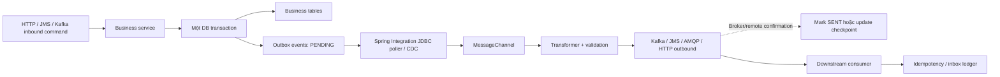
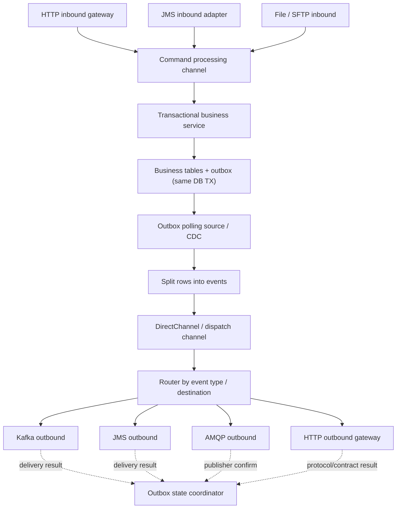
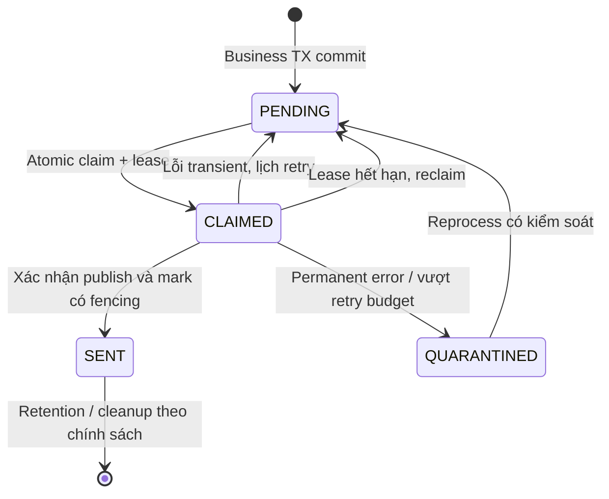

# Outbox pattern với adapter trong Spring Integration

## 1. Bài toán: cập nhật database và gửi message không cùng commit

Trong một ứng dụng tích hợp, việc xử lý một yêu cầu có thể gồm hai thao tác:

1. Lưu trạng thái nghiệp vụ, ví dụ tạo đơn hàng `Order` trong PostgreSQL.
2. Gửi sự kiện `OrderCreated` qua Kafka, JMS, AMQP hoặc HTTP để hệ thống khác xử lý.

Nếu chỉ dùng `@Transactional` trên phương thức Java chứa cả hai thao tác, **transaction database không tự làm cho broker hoặc HTTP tham gia commit nguyên tử**. Hai kết quả có thể lệch nhau:

- DB commit thành công nhưng publish thất bại: hệ thống đích **không biết** đơn hàng đã tồn tại.
- Broker đã nhận message nhưng DB rollback: hệ thống đích xử lý một sự kiện **không khớp trạng thái nguồn**.
- Broker đã nhận nhưng ứng dụng không nhận được xác nhận: retry có thể tạo **hai lần giao** cùng một nghiệp vụ.

**Transactional outbox pattern** giải quyết khoảng trống giữa **ghi trạng thái nghiệp vụ** và **ghi nhận ý định phát sự kiện** bằng cách đặt cả hai vào **cùng một transaction của database**. Sau commit, một bộ phận độc lập đọc outbox và gửi sự kiện ra ngoài, theo dõi xác nhận và thử lại nếu cần.

Trong module **SPRING_INTEGRATION_ADAPTERS**, Spring Integration đóng vai trò kết nối bằng inbound/outbound adapter, gateway, poller và `MessageChannel`. Outbox là mẫu kiến trúc đặc biệt phù hợp khi ứng dụng phải phối hợp JDBC với Kafka, JMS, AMQP, HTTP hoặc các hệ thống không thể cùng tham gia một distributed transaction.

### Mục tiêu học tập

Sau bài này, bạn có thể:

1. Chỉ ra vì sao `@Transactional`, broker acknowledgment hoặc transaction advice của poller **không tự bảo đảm** atomic commit DB–broker.
2. Thiết kế schema outbox, transaction nghiệp vụ và trạng thái publisher có thể phục hồi.
3. Kết nối outbox với Spring Integration JDBC polling adapter, `MessageChannel` và outbound adapter/gateway.
4. Phân tích các cửa sổ lỗi, `claim`/`lease`, concurrency, retry, dead-letter/quarantine và idempotency.
5. Phân biệt **polling outbox** với **transaction-log CDC**; chọn phù hợp quy mô và yêu cầu thứ tự.
6. Kiểm thử trạng thái nguồn, broker và consumer sau crash, restart, timeout, failover.

## 2. Mô hình trực tiếp có lỗ hổng gì?

Xem đoạn mã ý tưởng sau:

```java
@Transactional
public void placeOrder(PlaceOrder command) {
    orderRepository.save(Order.from(command));  // Database transaction
    kafkaTemplate.send("orders.events", command.orderId(), toJson(command));
}
```

Đoạn mã **không** chứng minh dữ liệu và sự kiện được commit cùng nhau:

- Phương thức `KafkaTemplate.send` có thể trả về trước khi broker xác nhận send bất đồng bộ.
- Khi producer gửi thành công nhưng commit DB lỗi, sự kiện đã ra khỏi phạm vi database.
- Nếu DB commit trước khi có xác nhận gửi đáng tin cậy, sự kiện có thể bị bỏ lỡ.
- Kafka producer transaction, nếu được cấu hình, không đồng nghĩa một PostgreSQL transaction được enlist tự động.

Tình huống tương tự xảy ra khi thay `kafkaTemplate` bằng outbound adapter của Spring Integration, `JmsTemplate`, `RabbitTemplate`, HTTP gateway hoặc SFTP outbound adapter. **Framework giúp kết nối; nó không xóa ranh giới transaction giữa các hệ thống độc lập.**

### 2.1 Sự khác nhau giữa mục tiêu đúng

| Mục tiêu | Outbox giải quyết ra sao | Điều cần bổ sung |
|---|---|---|
| Không mất **ý định phát** sự kiện khi DB commit | Ghi outbox row cùng transaction nghiệp vụ | Backup, monitoring, retention, recovery của DB |
| Không phát sự kiện nếu DB rollback | Outbox insert cũng rollback | Publisher chỉ đọc dữ liệu đã commit |
| Sau crash vẫn có thể gửi | Outbox PENDING còn bền vững | Worker quét lại, lease/reclaim, retry |
| Mỗi event được gửi tối thiểu một lần | Retry tới khi có xác nhận theo hợp đồng | Chấp nhận duplicate deliveries |
| Business effect ở consumer chỉ một lần | Outbox **không tự bảo đảm** | Idempotent consumer, unique constraint/inbox |
| Broker events theo đúng thứ tự | Không tự bảo đảm toàn cục | Aggregate version, partitioning/sequence, claim/order strategy |
| Hệ thống đích thực hiện xong | Broker ACK chưa đủ | Consumer acknowledgment/target readback hoặc ứng dụng-level confirmation |

## 3. Outbox pattern hoạt động như thế nào?



Một sequence cơ bản:

1. Request từ REST gateway, inbound JMS, Kafka consumer hay file adapter đi vào application service.
2. Service mở **một DB transaction** bằng transaction manager quản lý đúng database.
3. Trong cùng transaction, service cập nhật business tables và chèn **outbox record** chứa event ID, aggregate ID, type, payload, version.
4. Commit DB. Nếu transaction rollback, **cả business update và outbox insert đều không tồn tại**.
5. Outbox dispatcher chạy độc lập: poll row đủ điều kiện hoặc nhận event từ CDC; chuyển thành Spring Integration message.
6. Outbound adapter/protocol gửi event tới destination. Dispatcher phải biết **loại xác nhận nào đủ để đánh dấu đã chuyển**.
7. Khi xác nhận đạt yêu cầu, dispatcher cập nhật trạng thái hoặc checkpoint; nếu lỗi hoặc outcome chưa rõ thì retry/reconcile.
8. Consumer dùng event ID ổn định để ngăn business effect trùng khi event được phát lại.

### 3.1 Hai transaction có vai trò khác nhau

**Transaction A — business commit:** business row và outbox row cùng được commit.

**Transaction B — publisher state transition:** claim row, mark SENT, tăng attempts, lịch retry hoặc cập nhật checkpoint. Transaction B **không bao gồm** việc broker/HTTP đã chấp nhận message trừ khi có cơ chế distributed transaction thật sự.

Giữa các bước publish và mark SENT luôn có thể tồn tại **cửa sổ lỗi**. Đó là lý do outbox thường mang semantics **at-least-once**.

### 3.2 Outbox không phải queue nghiệp vụ hoàn chỉnh

Outbox là nhật ký **ý định tích hợp** được bảo vệ cùng business transaction, không phải nơi vô hạn dung lượng để giữ mọi event. Cần owner, retention, giới hạn backlog, cơ chế dọn dữ liệu đã xử lý và phương án phục hồi. Đối với broker durable, broker tiếp tục quản lý queue/topic và consumer delivery theo hợp đồng riêng.

## 4. Thiết kế hợp đồng outbox event

Một event nên có:

| Trường | Vai trò | Lưu ý |
|---|---|---|
| `event_id` | Định danh event bất biến | Dùng để idempotency khi publish/retry/consume |
| `aggregate_type` / `aggregate_id` | Phân nhóm đối tượng nghiệp vụ | Giúp routing và ordering theo aggregate |
| `aggregate_version` | Thứ tự thay đổi của aggregate nếu có | Dùng phát hiện event cũ hoặc lỗ hổng thứ tự |
| `event_type` | Loại sự kiện | Ví dụ `OrderCreated`, `OrderCancelled` |
| `schema_version` | Phiên bản hợp đồng dữ liệu | Giúp consumer nâng cấp không phá tương thích |
| `payload` | Snapshot tối thiểu cần để downstream xử lý | Cân nhắc PII, kích thước, mã hóa |
| `destination` / routing key | Đích dự kiến | Không nhận tùy tiện từ input chưa xác thực |
| `occurred_at` | Thời điểm nghiệp vụ | Không dùng riêng timestamp để kết luận thứ tự toàn cục |
| `created_at` | Thời điểm ghi outbox | Hỗ trợ backlog age |
| `status` | PENDING, CLAIMED, SENT, FAILED... | Là trạng thái **publisher**, không phải trạng thái nghiệp vụ |
| `attempt_count` / `next_attempt_at` | Retry có giới hạn | Phân biệt transient/permanent |
| `lease_owner` / `lease_until` / `lease_token` | Điều phối nhiều dispatcher | Fencing worker cũ, reclaim sau crash |
| `last_error_code` | Thông tin lỗi được giảm thiểu | Không ghi secrets/payload thô vào error |

Không bắt buộc mọi hệ thống phải có tất cả trường. Với CDC, nhiều trạng thái publisher có thể nằm ở **connector offsets** hoặc hệ thống điều phối thay vì cột `status`. Tuy nhiên **event ID, schema, aggregate binding và recovery contract** vẫn cần được thiết kế.

### 4.1 Ví dụ payload

```json
{
  "eventId": "evt-7b2c6f",
  "eventType": "OrderCreated",
  "schemaVersion": 2,
  "aggregate": {
    "type": "Order",
    "id": "order-1042",
    "version": 1
  },
  "occurredAt": "2026-11-23T08:00:00Z",
  "data": {
    "orderId": "order-1042",
    "currency": "VND",
    "total": 259000
  }
}
```

Đây là dữ liệu minh họa, không phải một schema chuẩn bắt buộc. Với nhiều tenant, cần xác định `tenantId` và ranh giới ủy quyền ở cả producer lẫn consumer; không tin tenant trong payload bên ngoài nếu chưa xác minh.

### 4.2 Event hay command?

- `OrderCreated` là **fact/event**: đơn đã được tạo và commit.
- `SendInvoice` là **command**: yêu cầu downstream thực hiện một hành động.

Hai loại có thể cùng được lưu vào outbox, nhưng semantics khác nhau. Event thường được nhiều consumer subscribe; command thường có đích cụ thể, deadline và kết quả nghiệp vụ cần xác nhận. Không dùng broker acknowledgment thay cho xác nhận command đã hoàn thành ở hệ thống đích.

## 5. Schema database cho transactional outbox

Ví dụ schema kiểu PostgreSQL để thảo luận. Cú pháp khóa, timestamp và kiểu JSON phụ thuộc database; không sao chép thẳng sang mọi hệ quản trị:

```sql
CREATE TABLE purchase_order (
    id              VARCHAR(80) PRIMARY KEY,
    customer_id     VARCHAR(80) NOT NULL,
    total_amount    NUMERIC(18, 2) NOT NULL,
    state           VARCHAR(32) NOT NULL,
    version         BIGINT NOT NULL
);

CREATE TABLE integration_outbox (
    event_id          VARCHAR(80) PRIMARY KEY,
    aggregate_type    VARCHAR(80) NOT NULL,
    aggregate_id      VARCHAR(80) NOT NULL,
    aggregate_version BIGINT NOT NULL,
    event_type        VARCHAR(120) NOT NULL,
    schema_version    INTEGER NOT NULL,
    destination       VARCHAR(200) NOT NULL,
    payload           JSONB NOT NULL,
    status            VARCHAR(20) NOT NULL DEFAULT 'PENDING',
    attempt_count     INTEGER NOT NULL DEFAULT 0,
    next_attempt_at   TIMESTAMPTZ NOT NULL DEFAULT CURRENT_TIMESTAMP,
    lease_owner       VARCHAR(100),
    lease_token       VARCHAR(100),
    lease_until       TIMESTAMPTZ,
    created_at        TIMESTAMPTZ NOT NULL DEFAULT CURRENT_TIMESTAMP,
    sent_at           TIMESTAMPTZ,
    last_error_code   VARCHAR(100),
    CONSTRAINT outbox_status_check
        CHECK (status IN ('PENDING', 'CLAIMED', 'SENT', 'QUARANTINED'))
);

CREATE INDEX idx_outbox_dispatch
    ON integration_outbox (status, next_attempt_at, created_at);

CREATE INDEX idx_outbox_lease
    ON integration_outbox (status, lease_until);
```

Những index này phục vụ phân tích ban đầu; cần đo plan thực tế. Với bảng nhiều event, có thể cân nhắc partition/retention, index có điều kiện và giảm ghi dữ liệu nóng. Không lưu payload nhạy cảm vô hạn chỉ để thuận tiện debug.

### 5.1 Vì sao primary key event ID quan trọng?

Nếu một request được retry ở business API với cùng `commandId`, business service phải ngăn tạo hai order và hai event không cần thiết. Unique constraints và cách gắn event ID theo transaction/aggregate giúp phát hiện duplicate ngay ở nguồn. **Outbox riêng lẻ không thay thế idempotency của inbound command**.

### 5.2 Có nên thêm cột `published` boolean?

Cho ví dụ nhỏ, `published=false/true` đủ minh họa. Production thường cần biết **attempts, thời điểm retry, worker sở hữu claim và trạng thái outcome chưa rõ**. Một boolean đơn giản có thể khiến khó phân biệt:

- Chưa thử gửi.
- Đang gửi nhưng worker chết.
- Gửi thành công, đánh dấu SENT thất bại.
- Gửi lỗi permanent.
- Gửi timeout chưa rõ broker có nhận hay không.

Không làm hệ thống phức tạp vô cớ, nhưng đừng chọn schema khiến vận hành không thể giải thích trạng thái.

## 6. Ghi business state và outbox trong **cùng** DB transaction

Điều kiện lõi: **cả hai thao tác phải sử dụng cùng nguồn giao dịch hợp lệ**. Nếu business update dùng một database khác với outbox database, một `@Transactional` thông thường không tạo atomicity giữa hai database.

Ví dụ Java/Spring với JDBC (mã minh họa cấu trúc):

```java
@Service
public class OrderApplicationService {

    private final JdbcTemplate jdbc;
    private final ObjectMapper objectMapper;

    public OrderApplicationService(JdbcTemplate jdbc, ObjectMapper objectMapper) {
        this.jdbc = jdbc;
        this.objectMapper = objectMapper;
    }

    @Transactional(
        transactionManager = "orderDbTransactionManager",
        rollbackFor = Exception.class
    )
    public void placeOrder(PlaceOrder command) throws JsonProcessingException {
        String orderId = command.orderId();
        String eventId = command.eventId(); // ổn định qua retry

        jdbc.update(
            "INSERT INTO purchase_order(id, customer_id, total_amount, state, version) " +
            "VALUES (?, ?, ?, 'CREATED', 1)",
            orderId, command.customerId(), command.amount()
        );

        String payload = objectMapper.writeValueAsString(
            new OrderCreated(eventId, orderId, command.amount())
        );

        jdbc.update(
            "INSERT INTO integration_outbox " +
            "(event_id, aggregate_type, aggregate_id, aggregate_version, " +
            " event_type, schema_version, destination, payload, status) " +
            "VALUES (?, 'Order', ?, 1, 'OrderCreated', 1, 'orders.events', " +
            " CAST(? AS jsonb), 'PENDING')",
            eventId, orderId, payload
        );
    }
}
```

Ví dụ giả định `PlaceOrder` và `OrderCreated` là các kiểu DTO của dự án. SQL `CAST(? AS jsonb)` đặc thù PostgreSQL. Transaction manager phải trỏ đúng `DataSource` của `JdbcTemplate`. Nếu một bean dùng `REQUIRES_NEW` hoặc kết nối DB khác, **atomic business + outbox** có thể bị phá vỡ.

### 6.1 Hai thử nghiệm nền tảng

**Trường hợp commit:**

```sql
SELECT state FROM purchase_order WHERE id = 'order-1042';
-- CREATED

SELECT status FROM integration_outbox WHERE aggregate_id = 'order-1042';
-- PENDING
```

**Trường hợp ném exception trước commit:** cả order và outbox event **không tồn tại** sau rollback.

Không cần chờ Kafka/JMS/HTTP để commit transaction này. Mục tiêu là tránh giữ database locks/connection trong khi chờ mạng bên ngoài.

### 6.2 Các bẫy `@Transactional`

- **Self-invocation:** gọi một phương thức annotated từ phương thức khác cùng object có thể bypass Spring proxy theo cấu hình proxy thường gặp.
- **Sai transaction manager:** business và outbox không cùng một `DataSource`/transaction.
- **Nuốt exception:** hàm bắt lỗi rồi trả về bình thường khiến transaction có thể commit dù nghiệp vụ yêu cầu rollback.
- **Async boundary:** ghi outbox trong `@Async`/executor riêng không tự tham gia business transaction.
- **Checked exception rollback:** theo mặc định thông thường của Spring, cần xét rollback rules nếu dùng checked exception.
- **Nested/new transaction:** `REQUIRES_NEW` cho outbox có thể commit outbox ngay cả khi transaction business ngoài rollback.

**Hãy chứng minh bằng integration test**: cố ý ném lỗi giữa hai lệnh SQL và đọc lại database, thay vì chỉ kiểm phương thức có annotation.

## 7. Spring Integration adapter nằm ở đâu?

Outbox có hai mặt:

1. **Đường inbound/nguồn nghiệp vụ:** HTTP/JMS/Kafka/File/SFTP inbound đưa command vào service transaction, ghi business row và outbox.
2. **Đường outbound/publisher:** JDBC poller hoặc CDC lấy outbox event đã commit, chuyển qua Spring `MessageChannel`, transformer/router rồi outbound adapter/gateway gửi đi.



### 7.1 JDBC inbound adapter và `MessageSource`

Spring Integration JDBC inbound adapter có thể định kỳ truy vấn các row đủ điều kiện. `SourcePollingChannelAdapter` sử dụng `PollerMetadata` để gọi `MessageSource.receive()` và phát một Spring message. Tùy adapter và row mapper, một lần receive có thể trả về **một message chứa danh sách row**, không phải tự động một message cho mỗi row.

### 7.2 `PollingConsumer` và `QueueChannel`

Một `PollingConsumer` có thể nhận từ `QueueChannel`. Nhưng nếu handoff sang queue trong memory trước khi publish, việc nhận vào queue **không đồng nghĩa event đã gửi ra broker** và có thể làm mất công việc khi restart. Nếu queue có backing bằng persistent MessageStore, cần kiểm transaction của store, trạng thái outbox và cơ chế xử lý lại.

### 7.3 `DirectChannel` so với `ExecutorChannel`

`DirectChannel` gọi downstream đồng bộ trong thread hiện tại. `ExecutorChannel` tách sang executor, vì vậy transaction context gắn với thread không tự lan theo. **Không đánh dấu outbox SENT chỉ vì `send()` vào ExecutorChannel trả về thành công**: đó có thể chỉ là xác nhận handoff.

### 7.4 Poller transaction advice có giải quyết luôn publish không?

Không. Transaction advice giúp bao quanh `receive()/update/handler` trong phạm vi transactional resource thích hợp. Nếu poller giữ DB transaction mở trong lúc outbound Kafka/HTTP send, sự kiện vẫn có thể được hệ thống ngoài nhận rồi DB rollback. Do đó:

- Dùng transaction ngắn cho **claim/lease** hoặc đọc/trạng thái trong DB.
- Thực hiện publish **ngoài transaction claim**.
- Ghi SENT bằng transaction DB khác **sau xác nhận thích hợp**, có fencing.
- Dùng idempotency để xử lý gửi lại khi outcome chưa rõ.

Đây là hướng triển khai dễ kiểm soát; không phải cấu hình outbox duy nhất. Với CDC, connector đọc committed transaction log thay vì poll bảng theo trạng thái.

## 8. Trạng thái publisher và claim/lease an toàn

Một dispatcher thường không phải chạy đơn độc. Khi ứng dụng scale thành nhiều replica, tất cả có thể thấy cùng row PENDING. Cần thiết kế **claim nguyên tử** để một row chỉ có một owner hợp lệ tại một thời điểm, đồng thời có **reclaim** nếu owner chết.

### 8.1 State machine tham khảo



Không phải mọi ứng dụng cần cột CLAIMED: một số dùng DB row lock trong lúc đọc, một số dùng CDC offsets. Khi sử dụng lease, cần định nghĩa chính xác:

- **Owner:** instance nào được phép publish.
- **Lease duration:** thời hạn sở hữu đủ cho send timeout dự kiến, nhưng không quá dài khiến worker chết mà công việc kẹt.
- **Lease token/version:** mã định danh lần claim để **fencing worker cũ**.
- **Retry schedule:** lúc nào row có thể được nhận lại.
- **State transition guard:** update SENT hoặc đổi lịch retry chỉ được phép khi token còn đúng.

### 8.2 Claim nguyên tử bằng PostgreSQL (minh họa)

Ví dụ SQL dưới đây dùng `FOR UPDATE SKIP LOCKED` và `UPDATE ... RETURNING`; nó phụ thuộc PostgreSQL và **không phải cú pháp chung cho mọi database**:

```sql
-- Chạy trong một DB transaction NGẮN, commit ngay sau claim.
-- :worker_id, :lease_token, :lease_seconds, :batch_size là tham số.
WITH candidates AS (
    SELECT event_id
    FROM integration_outbox
    WHERE (
            status = 'PENDING'
            AND next_attempt_at <= CURRENT_TIMESTAMP
          )
       OR (
            status = 'CLAIMED'
            AND lease_until < CURRENT_TIMESTAMP
          )
    ORDER BY created_at, event_id
    FOR UPDATE SKIP LOCKED
    LIMIT :batch_size
)
UPDATE integration_outbox AS o
SET status = 'CLAIMED',
    lease_owner = :worker_id,
    lease_token = :lease_token,
    lease_until = CURRENT_TIMESTAMP
        + (:lease_seconds * INTERVAL '1 second'),
    attempt_count = attempt_count + 1
FROM candidates AS c
WHERE o.event_id = c.event_id
RETURNING o.event_id, o.aggregate_id, o.aggregate_version,
          o.destination, o.payload, o.lease_token;
```

Tại một thời điểm, các transaction claim cạnh tranh sẽ bỏ qua row đã bị lock. Nhưng **điều kiện claim** phải được hiệu chỉnh theo khối lượng, index, fairness và ordering của hệ thống. Với PostgreSQL, truy vấn kết hợp `OR` và `ORDER BY` trong CTE cần đo query plan, tối ưu nếu backlog lớn. Với MySQL, SQL Server hoặc Oracle, sử dụng cơ chế khóa/claim được hỗ trợ tương đương; không sao chép cú pháp.

### 8.3 Vì sao phải commit claim trước khi publish?

Giữ DB transaction mở trong lúc gửi Kafka/JMS/HTTP có thể làm tăng thời gian giữ lock và connection. Nếu broker mất kết nối, transaction giữ lâu gây nghẽn những thao tác khác.

Một cách vận hành phổ biến:

1. Transaction ngắn A: claim tối đa N row, ghi owner/token/lease, commit.
2. Ngoài DB transaction A: publish từng event, chờ confirmation theo giao thức.
3. Transaction ngắn B: mark SENT **nếu** state/token vẫn thuộc dispatcher.
4. Nếu timeout hoặc outcome chưa rõ: để row được retry theo chính sách; consumer dedupe.

Đổi lại, phải chấp nhận trường hợp **lease hết hạn giữa lúc publish**. Hai worker có thể gửi cùng event. Fencing ngăn worker cũ thay đổi **trạng thái database** nhưng không thể “rút lại” một send đã được broker nhận. **Idempotent downstream vẫn bắt buộc.**

### 8.4 Mark SENT với fencing

```sql
UPDATE integration_outbox
SET status = 'SENT',
    sent_at = CURRENT_TIMESTAMP,
    lease_owner = NULL,
    lease_token = NULL,
    lease_until = NULL,
    last_error_code = NULL
WHERE event_id = :event_id
  AND status = 'CLAIMED'
  AND lease_token = :lease_token;
```

Nếu số row được cập nhật là **0**, không tự kết luận delivery thất bại hoặc đã hoàn tất. Có thể worker khác đã reclaim, event bị thao tác thủ công, hoặc token đã mất hiệu lực. Ghi cảnh báo và đối soát bằng event ID. Không viết một câu `UPDATE ... WHERE event_id = ?` bỏ qua lease token, vì worker cũ có thể overwrite trạng thái của worker mới.

### 8.5 Xử lý thất bại và timeout

```sql
-- Giả định lỗi transient; :next_attempt_at tính theo backoff/jitter.
UPDATE integration_outbox
SET status = 'PENDING',
    next_attempt_at = :next_attempt_at,
    last_error_code = :safe_error_code,
    lease_owner = NULL,
    lease_token = NULL,
    lease_until = NULL
WHERE event_id = :event_id
  AND status = 'CLAIMED'
  AND lease_token = :lease_token;
```

Nếu send **timeout**, outcome có thể **không xác định**: broker đã nhận nhưng client không nhận được ACK. Đưa row về PENDING để thử lại giúp tránh mất ý định gửi, nhưng có thể tạo duplicate. Muốn tăng độ chính xác, publisher có thể query remote trạng thái theo business event ID nếu giao thức hỗ trợ, song vẫn phải giữ chiến lược idempotency.

### 8.6 Khi nào quarantine?

Payload không hợp schema, destination không tồn tại do cấu hình sai, hay bị từ chối vĩnh viễn thường không thể sửa bằng retry dày. Đặt giới hạn attempts/time budget, chuyển sang `QUARANTINED` hoặc trạng thái có owner escalation, và tạo kênh reprocess sau khi sửa lỗi. **Không được đánh dấu SENT để làm queue giảm**.

## 9. Kết nối Spring Integration JDBC poller với dispatcher

### 9.1 Hướng một: JDBC inbound adapter trực tiếp đọc outbox

Spring Integration JDBC inbound channel adapter có thể:

- Poll bằng câu `SELECT` các row đủ điều kiện.
- Sử dụng câu `UPDATE` để đánh dấu đã nhận theo cơ chế adapter.
- Phát một Spring message tới channel.
- Gắn poller metadata: trigger, `maxMessagesPerPoll`, transaction advice và lifecycle.

Luồng thường gặp:

```text
SourcePollingChannelAdapter
    -> JdbcMessageSource: SELECT / UPDATE
    -> Message<List<Map<String,Object>>>
    -> Splitter
    -> Transformer: Map -> OutboxEvent
    -> DirectChannel / outbound adapter
```

**Điểm tinh tế:** câu `UPDATE` của JDBC inbound adapter xảy ra **lúc receive**, trước khi hệ thống biết broker đã xác nhận publish hay chưa. Nếu chỉ `UPDATE status='SENT'` trong bước này, bạn đánh dấu gửi xong **quá sớm**. Chỉ nên dùng cập nhật nhận làm **claim** theo một giao thức đã thiết kế, và **mark SENT riêng sau publish confirmation**.

Ngoài ra, nếu một receive trả **một danh sách row**, `maxMessagesPerPoll=1` nghĩa là một lần receive, **không phải một row**. Cần `split()` hoặc handler biết xử lý batch. `maxRows` và SQL limit quyết định số row phù hợp với nguồn; không được suy số lượng event theo scheduler một cách tùy tiện.

### 9.2 Hướng hai: claim service rồi đưa batch vào IntegrationFlow

Để chủ động kiểm soát lease và tránh giữ DB transaction qua mạng, có thể tạo **polling source gọi claim service**. Source trả một danh sách row đã claim; splitter tách chúng thành event, dispatcher dùng outbound client/adapter phù hợp.

Ví dụ Java DSL **minh họa API** (cần imports, bean và đối chiếu phiên bản Spring Integration):

```java
@Configuration
@EnableIntegration
class OutboxIntegrationConfig {

    @Bean
    IntegrationFlow outboxFlow(
            OutboxClaimService claimService,
            OutboxDispatchHandler dispatchHandler) {

        return IntegrationFlow
            .fromSupplier(
                () -> claimService.claimBatch(25),
                endpoint -> endpoint.poller(
                    Pollers.fixedDelay(Duration.ofSeconds(1))
                        .maxMessagesPerPoll(1)
                )
            )
            .split()
            .handle(dispatchHandler, "dispatch")
            .get();
    }
}
```

Đoạn mã không phải cấu hình hoàn chỉnh: `claimBatch`, `OutboxEvent` và `dispatch` do dự án tự định nghĩa. Với một số phiên bản DSL, chữ ký factory hoặc cách kết nối supplier phải được điều chỉnh. Mục tiêu là minh họa **separate claim transaction** và **publish outside claim**.

### 9.3 Transaction của claim service

```java
@Service
class OutboxClaimService {
    private final OutboxRepository repository;

    @Transactional(transactionManager = "orderDbTransactionManager")
    public List<OutboxRecord> claimBatch(int maxEvents) {
        String leaseToken = UUID.randomUUID().toString();
        return repository.claimAtomically(
            "outbox-worker-A", leaseToken, maxEvents, Duration.ofSeconds(30)
        );
    }
}
```

Vì `claimBatch` được gọi qua một Spring bean proxy, transaction có thể bắt đầu và commit trước khi trả danh sách về source. `OutboxRepository.claimAtomically` là abstraction dự án cần triển khai dựa trên SQL transaction phù hợp. Cần giới hạn số row, thời gian lease và thread pool. Nếu source không có công việc, trả empty list; splitter nên không tạo outbound message khi danh sách rỗng, theo hành vi DSL đã kiểm thử.

### 9.4 Một flow end-to-end nên tách trách nhiệm

- **Claim service**: sở hữu transaction ngắn, lock/lease và bản ghi đang xử lý.
- **Transformer**: kiểm hợp đồng event, headers, schema version.
- **Router**: chọn destination có allowlist dựa trên event type/config, không tin đích tùy ý từ client.
- **Publisher**: gửi qua Kafka/JMS/AMQP/HTTP, thu kết quả gửi.
- **State coordinator**: mark SENT/retry/quarantine dựa trên ownership token.
- **Reconciler**: phát hiện lease hết hạn, pending quá lâu, outcome chưa rõ.

Đặt những chức năng đó thành bean/module riêng giúp kiểm thử lỗi độc lập. Một inbound adapter hoặc outbound adapter không tự thay thế state coordinator.

## 10. Khi nào được đánh dấu SENT?

Không có một lời gọi chung tên `send()` mang cùng ý nghĩa ở mọi adapter. Chọn điều kiện thành công theo giao thức:

| Đích | Bằng chứng gửi cần xem xét | Điều chưa được bảo đảm |
|---|---|---|
| **Kafka** | Producer send future hoàn thành thành công theo `acks` và cấu hình producer | Consumer đã xử lý hoặc commit nghiệp vụ |
| **JMS** | JMS send/session transaction đã hoàn tất theo provider và producer semantics | Consumer bên kia đã ack / ghi DB |
| **AMQP/RabbitMQ** | Publisher confirm/return phù hợp và kiểm unroutable message theo cấu hình | Consumer đã xử lý message |
| **HTTP** | Response theo contract nghiệp vụ, ví dụ 2xx hoặc trạng thái đã chấp nhận | Server đã commit kết quả cuối nếu API xử lý async |
| **SFTP/File** | Remote/local write, rename/close và readback khi cần | Đích đã nhập/xử lý nội dung file |

**Nút bất đồng bộ:** outbound adapter có thể bàn giao message sang producer client và trả về trước khi broker ACK. Nếu đánh dấu SENT ngay khi channel send thành công, row có thể biến mất khỏi backlog mặc dù producer send thất bại sau đó. Phải dùng đường xác nhận đáng tin cậy (future/callback/gateway/publisher confirm) và bảo vệ lifecycle của callback.

### 10.1 Kafka: đợi producer acknowledgment theo hợp đồng

Ví dụ dùng `KafkaTemplate` trong một bean dispatcher; đây là ví dụ về cách lấy acknowledgment, không phải API outbound adapter duy nhất:

```java
@Service
class KafkaOutboxDispatchHandler {
    private final KafkaTemplate<String, String> kafkaTemplate;
    private final OutboxRepository repository;

    public void dispatch(OutboxRecord event) {
        try {
            kafkaTemplate.send(
                "orders.events",
                event.aggregateId(),
                event.payloadJson()
            ).get(10, TimeUnit.SECONDS);

            int updated = repository.markSentIfOwned(
                event.eventId(), event.leaseToken()
            );
            if (updated != 1) {
                // Một worker khác có thể đã reclaim; phải điều tra.
                reportOwnershipConflict(event);
            }
        } catch (InterruptedException e) {
            Thread.currentThread().interrupt();
            repository.scheduleRetryIfOwned(
                event.eventId(), event.leaseToken(), "INTERRUPTED"
            );
            throw new IllegalStateException("Outbox dispatch interrupted", e);
        } catch (ExecutionException | TimeoutException e) {
            repository.scheduleRetryIfOwned(
                event.eventId(), event.leaseToken(), "SEND_UNCONFIRMED"
            );
            throw new IllegalStateException("Outbox send not confirmed", e);
        }
    }

    private void reportOwnershipConflict(OutboxRecord event) {
        // Metrics/audit + reconciliation; không tự ghi đè trạng thái.
    }
}
```

Đoạn mã là **skeleton giải thích**, thiếu constructor/imports/records thực tế, retry policy và monitoring. Thực tế có thể dùng async callbacks thay vì block `get(...)`, nhưng callback phải lưu `eventId + leaseToken` và chỉ update khi còn quyền sở hữu. Một future hoàn thành cho thấy Kafka đã xác nhận theo cấu hình producer; **không chứng minh consumer đã xử lý**.

Khi dùng Kafka outbound adapter Spring Integration, hãy kiểm API và completion semantics của version đang dùng, đặc biệt nếu send là async. Không mark SENT chỉ dựa trên việc `MessageChannel.send()` trả `true`.

### 10.2 JMS: phân biệt send với transaction commit

Với JMS, producer có thể dùng `JmsTemplate` hoặc Spring Integration JMS outbound adapter. Nếu session là transacted, việc gọi send trước `commit()` chưa bảo đảm message đã được chốt. State coordinator phải xác định điểm publish được xác nhận theo contract provider/container và recovery behavior. JMS ACK của **consumer** là một việc khác với publish confirmation của **producer**.

### 10.3 AMQP: publisher confirm và unroutable message

AMQP outbound adapter có thể publish vào exchange; broker chấp nhận publish chưa chứng minh đã route vào queue phù hợp. Cần thiết lập routing, mandatory/return policy, publisher confirms và xử lý returns theo broker/framework version. Mark SENT theo tiêu chuẩn đã công bố: ví dụ “broker đã chấp nhận và message được route vào đích dự kiến”, không coi một lần gọi method thành công là đủ.

### 10.4 HTTP gateway: 2xx có thể chỉ là accepted

Một HTTP POST tới REST API có thể trả `202 Accepted` nghĩa là hệ thống xa chỉ nhận yêu cầu vào queue. Nếu mục tiêu outbox là **bàn giao command**, đây có thể là success đủ điều kiện; nếu mục tiêu là **nghiệp vụ xa hoàn tất**, cần callback/status endpoint hoặc event xác nhận riêng. Timeout là **unknown outcome**; nếu gửi lại, dùng `Idempotency-Key` ổn định ở API hỗ trợ.

### 10.5 SFTP/file: cần xác nhận điều kiện chuyển giao

Một outbound file adapter có thể tạo file tạm rồi đổi tên file đích khi ghi xong; rename atomic tùy filesystem/protocol. Với SFTP, download/upload/rename từ xa không tham gia DB transaction local. Cần business ID trong tên/manifest, phân biệt temp/final file, kiểm remote state khi timeout và xử lý duplicate file. `status=SENT` chỉ nên biểu thị đúng mốc bàn giao đã định nghĩa, không đại diện việc hệ thống xa đã import nội dung.

## 11. Ma trận crash: tính đúng đắn được quyết định ở điểm lỗi nào?

Một trong những kỹ năng thiết kế outbox quan trọng nhất là phân tích **mọi cửa sổ crash**. Không được chỉ chạy happy path và đếm message trong broker.

```mermaid
sequenceDiagram
    participant API as Business service
    participant DB as Business DB + Outbox
    participant WORKER as Outbox dispatcher
    participant BROKER as Broker / HTTP target
    participant CONSUMER as Downstream consumer
    API->>DB: Begin TX; write business + PENDING event
    DB-->>API: Commit
    WORKER->>DB: Claim event; commit lease
    DB-->>WORKER: Outbox event E
    WORKER->>BROKER: Publish E
    BROKER-->>WORKER: Confirm (có thể timeout)
    WORKER->>DB: Mark E SENT nếu lease còn hợp lệ
    BROKER->>CONSUMER: Deliver E (có thể lặp)
    CONSUMER->>CONSUMER: Deduplicate E theo inbox
```

| Cửa sổ lỗi | Business DB | Outbox | Broker/remote | Cách phục hồi |
|---|---|---|---|---|
| Trước business commit | Chưa commit | Row chưa commit | Chưa gửi | Rollback; inbound command có thể retry |
| Sau business commit, trước claim | Đã commit | PENDING | Chưa gửi | Poll/CDC tiếp tục sau restart |
| Sau claim, trước publish | Đã commit | CLAIMED với lease | Chưa gửi | Lease hết hạn, worker khác reclaim |
| Broker đã nhận, ACK chưa tới | Đã commit | CLAIMED / outcome unknown | Có thể đã nhận | Retry có thể gửi trùng; consumer dedupe |
| ACK nhận, trước mark SENT | Đã commit | CLAIMED | Đã nhận | Retry có thể gửi trùng; consumer dedupe |
| Sau mark SENT | Đã commit | SENT | Đã nhận theo contract | Consumer tự xử lý bằng cơ chế ack/retry |
| Worker cũ hoàn tất sau khi lease bị reclaim | Đã commit | Worker mới đang sở hữu | Có thể hai lần nhận | Fencing DB update; downstream dedupe |
| Consumer side effect commit, broker ack thất bại | Đã commit ở consumer | Producer đã xong | Broker có thể redeliver | Consumer inbox/idempotent transaction |

### 11.1 Cửa sổ lỗi không thể xóa bằng cách đổi thứ tự hai lệnh

Nếu mark SENT **trước** publish, crash có thể làm mất event. Nếu publish **trước** mark SENT, crash có thể làm gửi trùng. Outbox chọn ưu tiên **không làm mất sự kiện đã commit**, vì duplicate có thể xử lý bằng idempotency nhưng event bị mất thì khó tái dựng.

### 11.2 “Exactly once” phải ghi rõ phạm vi

Một broker có thể hỗ trợ transaction hoặc exactly-once semantics trong một phạm vi cụ thể. Nhưng khi luồng gồm business database, JMS/Kafka, HTTP và một SaaS, **không có lời bảo đảm exactly once end-to-end mặc định**. Thực tế thường đặt mục tiêu:

- **At-least-once publication** từ outbox tới broker/destination trong điều kiện retry còn hoạt động.
- **Idempotent business effect** ở consumer.
- **Observable reconciliation** cho những outcome chưa xác định.

Tập hợp đó có thể cho kết quả “mỗi nghiệp vụ chỉ có một tác động” trong phạm vi đã định nghĩa, nhưng không biến mọi giao thức thành một distributed ACID transaction.

## 12. Inbox pattern: phía nhận cũng phải idempotent

Giả sử outbox publisher gửi sự kiện E, broker nhận thành công nhưng dispatcher crash trước khi mark SENT. Sau restart E được gửi lần hai. Broker có thể giao cả hai bản đến consumer.

Một **inbox ledger** ghi việc đã xử lý event E **cùng DB transaction với business update ở consumer**:

```sql
CREATE TABLE processed_inbox (
    consumer_name     VARCHAR(100) NOT NULL,
    event_id          VARCHAR(80) NOT NULL,
    processed_at      TIMESTAMPTZ NOT NULL DEFAULT CURRENT_TIMESTAMP,
    PRIMARY KEY (consumer_name, event_id)
);
```

Pseudocode:

```java
@Transactional(transactionManager = "consumerDbTransactionManager")
public void handle(OrderCreated event) {
    // Insert-if-absent atomic theo unique constraint, không dùng
    // SELECT rồi INSERT không khóa trong môi trường concurrent.
    boolean firstTime = inbox.tryInsertIfAbsent("billing", event.eventId());
    if (!firstTime) {
        return; // đã xử lý, không tạo side effect trùng
    }
    billingRepository.recordReceivable(event);
    // Inbox insert và business update cùng COMMIT hoặc ROLLBACK.
}
```

`tryInsertIfAbsent` là phương thức repository do dự án thiết kế, **không phải API mặc định của Spring Data**. Phải xử lý duplicate key/concurrent attempts theo database vendor. Nếu consumer đã gửi email, gọi payment API hoặc publish sang broker khác trước khi commit inbox, ledger không tự đảo tác động đó; cần idempotency key của đích, outbox tiếp theo hoặc compensation.

### 12.1 Tầng idempotency khác nhau

| Vị trí | Khóa thường dùng | Bảo vệ |
|---|---|---|
| Inbound HTTP/JMS command | Command/request ID | Người dùng hoặc producer retry cùng yêu cầu |
| Business DB | Aggregate ID, unique domain constraint | Trùng order/payment/operation |
| Outbox event | Event ID | Gửi lại cùng một event |
| Inbox consumer | Consumer name + Event ID | Chống xử lý lặp ở một consumer |
| External HTTP target | Idempotency key do API hỗ trợ | Retry khi outcome ở dịch vụ ngoài chưa rõ |
| Projection/version | Aggregate ID + version | Sự kiện cũ/đến sai thứ tự |

Không thay event ID ổn định bằng mỗi Kafka offset hoặc JMS message ID vì producer có thể gửi cùng business event thành một message mới với offset/ID khác.

## 13. Thứ tự sự kiện và concurrency: không chỉ có “gửi đủ”

Giả sử một order phát:

```text
OrderCreated(order-1042, version=1)
OrderConfirmed(order-1042, version=2)
OrderCancelled(order-1042, version=3)
```

Nếu hai worker claim song song, worker gửi version 2 có thể thành công trước version 1. Nếu dispatcher retry version 1 nhiều lần, thứ tự arrival tại broker và consumer có thể sai. **ORDER BY created_at trong câu claim không bảo đảm thứ tự publish/consume khi có nhiều worker và hệ thống bất đồng bộ.**

### 13.1 Ba cấp cần tách

1. **Order of commits:** thứ tự các business transaction thật sự commit.
2. **Order of publication:** thứ tự publisher đưa event ra broker và broker xác nhận.
3. **Order of consumption:** thứ tự các consumer xử lý side effect và commit.

Một offset/Kafka partition giữ thứ tự trên một partition theo contract broker, nhưng việc nhiều publisher gửi đồng thời cho cùng aggregate có thể đã làm sai thứ tự **trước khi vào partition**.

### 13.2 Hướng thiết kế

- Tăng `aggregate_version` theo transaction/optimistic locking và lấy thứ tự từ nguồn có thẩm quyền.
- Cùng aggregate dùng một partition key khi publish Kafka, nếu business yêu cầu.
- Chỉ cho publish version tiếp theo khi event trước đã thỏa điều kiện; cần chính sách xử lý version bị kẹt.
- Dùng partition/worker ownership theo aggregate để giới hạn concurrency.
- Consumer dùng version để từ chối hoặc buffer event không đúng thứ tự.
- Phân biệt **global total order** (rất tốn kém) với **per-aggregate order** (thường thực tế hơn).

Một event bị `QUARANTINED` có thể ngăn tất cả event sau của cùng aggregate nếu bảo toàn strict ordering. Phải định nghĩa quy trình unblock/replay thủ công, không âm thầm bỏ event rồi coi thứ tự đúng.

### 13.3 Event snapshot so với event delta

- Snapshot (`OrderStateChanged` với trạng thái/version đầy đủ) có thể dễ reconcile hơn khi event đến sai thứ tự, nếu consumer áp version cao nhất hợp lệ.
- Delta (`BalanceIncreasedBy(100)`) đòi xử lý đủ event đúng số lần/thứ tự; dùng version, inbox và cơ chế gap detection nghiêm ngặt hơn.

Không lựa chọn mô hình event chỉ theo kích thước payload. Semantics của consumer và khả năng phục hồi mới quyết định đúng/sai.

## 14. Polling outbox hay Change Data Capture (CDC)?

Hai cách chính:

**Polling:** ứng dụng/adapter chạy truy vấn định kỳ trên outbox table, claim hàng đợi và publish.

**CDC:** connector đọc thay đổi đã commit từ transaction log của database rồi chuyển record tới broker, ví dụ thông qua một nền tảng CDC như Debezium và một outbox event router tương thích.

| Tiêu chí | JDBC polling | Transaction-log CDC |
|---|---|---|
| Cách lấy event | Query table theo lịch | Đọc transaction log của DB sau commit |
| Độ trễ | Phụ thuộc poll interval, batch, backlog | Có thể gần real time; vẫn phụ thuộc connector lag |
| Tải lên database | Query/index/claim/update định kỳ | Đọc log, cần log retention/connector resources |
| State dispatcher | Thường có status, lease, attempts | Có thể lưu offsets/checkpoints của connector |
| Vận hành | Dễ bắt đầu với Spring Integration JDBC | Thêm hạ tầng CDC, schema/offset/slot management |
| Ordering | Phải thiết kế worker/concurrency | Có mốc log order, nhưng routing/consumer vẫn cần kiểm |
| Backfill/replay | Dựa vào retained outbox rows, trạng thái và leases | Dựa vào log/connector offsets; log có thể bị xóa theo retention |
| Lỗi điển hình | Poll stampede, lost lease, dirty claim, poison row | Connector lag, lost replication slot, schema drift, snapshot mismatch |
| Tính nguyên tử với business write | Có khi cùng DB transaction | Có khi cùng DB transaction |
| Exactly-once end-to-end | Không tự bảo đảm | Không tự bảo đảm |

### 14.1 CDC không xóa nhu cầu outbox transaction

Nếu business service cập nhật business row rồi gửi Kafka ngoài transaction, việc thêm CDC cho business table **không tự tạo đúng hợp đồng event**. Outbox row vẫn đóng vai trò bản ghi sự kiện có schema, ID, version và payload phù hợp, được commit cùng business state.

### 14.2 CDC khác JDBC inbound adapter

Spring Integration JDBC inbound adapter dùng SQL polling. CDC connector như Debezium đọc transaction log theo cơ chế của connector/DB; không cấu hình một `Jdbc.inboundAdapter(...).poller(...)` rồi gọi đó là log-based CDC.

Có thể kết hợp: **CDC phát vào Kafka**, sau đó Spring Integration Kafka inbound adapter/flow nhận events để xử lý/route đến các adapter khác. Khi đó ack/offset và transaction trong Kafka consumer lại là một boundary riêng.

### 14.3 Cảnh giác khi CDC snapshot hoặc connector restart

Connector có thể cần initial snapshot, resume từ offset, restore slot và xử lý schema evolution. Các hành vi này có thể làm xuất hiện sự kiện trùng, thiếu hoặc lệch thứ tự theo thiết kế cấu hình. Phải kiểm:

- Log retention và offset store còn đủ để resume?
- Snapshot có phát lại row đã có ở downstream không?
- Schema của outbox và payload có tương thích với router không?
- Event ID có được bảo toàn end-to-end không?
- Nếu connector outage quá thời gian log retention, có backfill/reconciliation được không?

Không coi “CDC connector RUNNING” là bằng chứng mọi committed event đã tới đích.

## 15. Retry, backoff, poison events và DLQ

### 15.1 Phân loại lỗi

| Nhóm lỗi | Ví dụ | Xử lý |
|---|---|---|
| Transient | Broker tạm unreachable, HTTP 503, timeout | Retry có giới hạn, exponential backoff + jitter |
| Unknown outcome | Send timeout nhưng broker có thể đã nhận | Retry cùng event ID; dedupe và readback khi có |
| Permanent schema | Payload không hợp đồng, thiếu field bắt buộc | Quarantine, sửa/biến đổi theo chính sách, reprocess |
| Permanent configuration | Destination không tồn tại, quyền bị từ chối | Cảnh báo nghiêm trọng; không retry dày vô hạn |
| Data conflict | Duplicate aggregate version, invalid routing | Điều tra nguồn và trạng thái; tránh skip lặng lẽ |
| Stale worker | Lease hết hạn và worker mới đã reclaim | Fencing; không overwrite claim mới |
| Capacity issue | Broker quá tải, DB pool cạn, backlog lớn | Giới hạn concurrency, batch, retry budget, cảnh báo |

### 15.2 Không nuốt lỗi rồi mark SENT

```java
// Anti-pattern: publisher gọi send, bắt exception và vẫn đánh dấu SENT.
void wrongDispatch(OutboxRecord event) {
    try {
        sendToRemote(event);
    } catch (Exception ex) {
        log.warn("Publish failed", ex);
    }
    repository.markSent(event.eventId()); // SAI: event có thể bị mất.
}
```

Đúng hơn: nếu outcome chưa được xác nhận, giữ trạng thái retry/unknown và log, không tự kết luận hoàn tất. Với lỗi permanent, chuyển quarantine có owner rõ thay vì tự bỏ event.

### 15.3 Error channel của Spring Integration

Spring Integration có thể chuyển lỗi thành `ErrorMessage` trên `errorChannel`. Cần biết:

- Lỗi đến từ transformer/handler đồng bộ hay từ callback bất đồng bộ?
- Error flow có nhận được **eventId, leaseToken, destination, attempt** để cập nhật đúng row không?
- Exception có bị nuốt khiến poller thấy success dù outbound thật sự thất bại không?
- Có nhiều lớp retry (poller retry advice, Kafka retry, HTTP client retry, broker retry) tạo bão request không?

**Error channel là công cụ định tuyến lỗi, không phải một transaction manager**. Tín hiệu lỗi phải kết nối đúng với state coordinator và không được làm mất quyền sở hữu row.

### 15.4 Retry budget và poison message

Quy định max attempts, max age, deadline theo từng loại event; sau hạn đưa vào `QUARANTINED`/DLQ hoặc escalation. Một poison event không nên khóa toàn bộ bảng outbox hay khiến poller loop liên tục không chờ. Cần retention, quyền đọc và cơ chế reprocess có audit.

## 16. Vòng đời outbox: dung lượng, retention và bảo mật

### 16.1 Capacity planning

Outbox tạo thêm ít nhất một database write cho mỗi event nghiệp vụ và thêm một số update để claim/mark trạng thái. Khi broker outage, bảng có thể tăng nhanh.

Các câu hỏi cần trả lời:

- Trung bình và peak events/second?
- Kích thước payload/event và index overhead?
- Thời gian tối đa broker có thể outage trong khi business write vẫn tiếp tục?
- Dung lượng DB và write amplification cho status/attempt updates?
- Backpressure: khi outbox đầy, có giới hạn nhận business commands hay chuyển sang chế độ giảm tải?
- Reclaim lease và cleanup có cạnh tranh lock với business traffic không?

Không để backlog tăng không giới hạn đến mức business database hết dung lượng. Cảnh báo theo **oldest PENDING age**, **pending bytes/rows**, **error rate**, không chỉ tổng số row.

### 16.2 Retention và cleanup

Row `SENT` cần được lưu đủ lâu cho audit/reconciliation theo chính sách, rồi archive/delete bằng job có kiểm soát. Nếu xóa quá sớm, không thể giải thích một event đã phát hay chưa. Nếu giữ vô hạn, DB phình to và chứa dữ liệu nhạy cảm quá mức cần thiết.

Với partitioned table, có thể dọn partition SENT đủ tuổi theo policy. Không xóa PENDING/CLAIMED/QUARANTINED chỉ để giảm dung lượng, trừ khi có quy trình xử lý rủi ro rõ và bằng chứng theo quyết định.

### 16.3 Tránh lộ dữ liệu nhạy cảm qua broker

- **Data minimization:** event chỉ chứa trường cần thiết; cân nhắc gửi ID để consumer truy vấn API có authorization khi phù hợp.
- **Encryption:** TLS in transit, mã hóa lưu trữ khi cần, phân quyền DB/broker theo least privilege.
- **Tenant isolation:** validate tenant/resource khi tạo event và khi định tuyến.
- **Schema validation:** từ chối payload quá lớn hoặc chứa trường không được phép.
- **Logs:** không ghi toàn bộ token, private key, password, thông tin cá nhân vào exception hoặc metric labels.
- **Replay access:** người có thể reprocess event có thể kích hoạt side effect thật; cần approval/audit.

Outbox replication/backup cũng là bản sao dữ liệu nghiệp vụ. Phải tuân thủ retention, backup security và yêu cầu xử lý dữ liệu cá nhân tương ứng.

## 17. Metrics, tracing và SLO cho outbox

Một luồng Spring Integration có scheduler còn chạy và broker có traffic chưa chắc đang chuyển hết business events. Cần đo **đường dữ liệu từ commit của nghiệp vụ đến thời điểm downstream có thể sử dụng event**.

| Metric / chỉ số đề xuất | Mục đích | Tín hiệu bất thường |
|---|---|---|
| `outbox.pending.count` | Số event chưa được publish | Tăng liên tục dù broker khỏe |
| `outbox.oldest.pending.age` | Event lâu nhất chờ xử lý | Vượt deadline tích hợp |
| `outbox.claimed.count` / `lease.expired.count` | Event đang sở hữu hoặc lease bỏ lại | Worker chết, send quá chậm |
| `outbox.claim.rate` | Tốc độ đọc/claim | Poller bị tắt hoặc DB quá tải |
| `outbox.publish.attempts` | Tổng lần thử | Retry storm hoặc poison events |
| `outbox.confirmed.rate` | Số event broker/target đã xác nhận | Thấp hơn tốc độ tạo event |
| `outbox.confirmation.latency` p95/p99 | Thời gian chờ broker ACK | Network/provider slowdown |
| `outbox.sent.mark.conflicts` | Token fencing mismatch | Lease quá ngắn hoặc worker overlap |
| `outbox.quarantined.count` | Event không gửi được sau retry budget | Lỗi schema/config dài hạn |
| `outbox.backlog.bytes` | Dung lượng hàng đợi DB | Nguy cơ đầy storage |
| `inbox.duplicates.suppressed` | Số side effect trùng đã được ngăn | Sự cố retry/unknown ACK |
| `integration.delivery.lag` | Từ business commit đến xác nhận publish | Vi phạm SLA của event |
| `integration.consumer.apply.lag` | Từ publish đến business effect được xác nhận | Consumer lag khác với outbox lag |
| `cdc.connector.lag`, `cdc.offset.age` | Dùng với CDC | Không theo kịp transaction log |

Tên trên là **gợi ý metric**, không mặc định có sẵn trong mọi phiên bản Spring Integration/Micrometer/Kafka. Tránh đưa `eventId`, `customerId` hoặc `tenantId` có cardinality cao hay dữ liệu nhạy cảm vào metric labels; dùng logs/traces để truy vết từng event.

### 17.1 Một event nên đi xuyên được log/trace

```text
businessCommandId=cmd-9017
aggregateId=order-1042
aggregateVersion=1
eventId=evt-7b2c6f
traceId=trace-8e2a
outboxState=CLAIMED
leaseTokenHash=redacted-or-hashed
publishAttempt=2
transport=KAFKA
publishOutcome=CONFIRMED
markSentOutcome=UPDATED
consumerOutcome=PROCESSED_ONCE
```

Không log nguyên vẹn lease token/secret nếu chúng có thể được sử dụng để can thiệp quyền sở hữu. Từ logs phải phân biệt được `BROKER_CONFIRMED` với `BUSINESS_CONSUMED`, và `SEND_TIMEOUT_UNKNOWN` với `SEND_REJECTED`.

### 17.2 SLO nên dựa trên độ trễ thực tế

Ví dụ:

- 99,9% `OrderCreated` được xác nhận tới broker trong deadline đã phê duyệt.
- Không có business event đã commit nào bị xóa khỏi outbox khi chưa có bằng chứng chuyển giao.
- Các event `QUARANTINED` có owner và deadline xử lý.
- Chênh lệch giữa committed business records và emitted outbox events được reconcile.

Nếu broker outage kéo dài, outbox có thể bảo vệ khả năng retry nhưng **không giữ SLO latency như lúc bình thường**. Incident cần nói rõ backlog, độ trễ và mục tiêu phục hồi sau khi broker khỏe.

## 18. Runbook: khi outbox backlog tăng hoặc gửi trùng

### A. Phát hiện

1. Kiểm số event mới mỗi phút, PENDING/CLAIMED/QUARANTINED và oldest event age.
2. Phân biệt lỗi database, poller/scheduler, broker/network, outbound adapter, schema và consumer.
3. Xác định các destination/aggregate/tenant bị ảnh hưởng và critical business deadlines.
4. Kiểm lease expiry, worker ownership conflicts, transaction timeouts và retry storms.
5. Xem có instance nào đã đổi config, schema, key/certificate hoặc routing gần thời điểm lỗi không.

### B. Ổn định

1. Nếu broker lỗi, giữ business+outbox commit khi capacity cho phép; tránh biến lỗi publish thành rollback business **nếu hợp đồng nghiệp vụ đã chọn eventual delivery**.
2. Giới hạn claim concurrency và retry; không tăng poll rate vô hạn khi remote đang down.
3. Với event sai schema, cách ly `QUARANTINED` có audit, không cho nó khóa toàn bộ luồng.
4. Không update tất cả row thành SENT, không delete backlog và không xóa lease token của worker sống một cách tùy tiện.
5. Nếu storage sắp hết, kích hoạt quy trình backpressure/capacity đã được duyệt và thông báo tác động tới business acceptance.

### C. Khôi phục

1. Kiểm broker endpoint, TLS, ACL, destination routing, rate limits và producer confirmations.
2. Kiểm query/DB indexes và đủ connection pool cho polling.
3. Reclaim lease hết hạn theo policy; ưu tiên event lâu và critical.
4. Mở lại workers theo batch/concurrency giới hạn, theo dõi send latency và DB lock.
5. Xác nhận tiêu chí SENT đúng, các side effects trùng được consumer chặn.
6. Reprocess event quarantine sau khi schema/config được sửa và có phê duyệt nếu cần.

### D. Đối soát, đóng incident

1. So sánh business transactions đã commit với outbox records và event logs.
2. Tìm event đã publish nhưng mark SENT thất bại; dùng event ID/consumer ledger để đánh giá tác động.
3. Kiểm các aggregate có version gap hoặc thứ tự sai ở consumer.
4. Xác định DLQ/outbox quarantine còn chưa xử lý, owner và thời hạn.
5. Ghi root cause, độ trễ thực tế, số lần gửi trùng, tác động, cách sửa và integration test hồi quy.

## 19. Thiết kế kiểm thử tích hợp

Unit test `OutboxDispatchHandler.dispatch` chỉ chứng minh một số branch code. Để khẳng định transactional outbox thực sự hoạt động, nên dùng **database và broker thử nghiệm** tương đương production, cùng những đường lỗi có thể điều khiển.

### 19.1 Ma trận test cốt lõi

| Bài thử | Kỳ vọng | Bằng chứng |
|---|---|---|
| Business+outbox commit | Cả order và event tồn tại | DB readback trong hai bảng |
| Exception giữa business insert và outbox insert | Cả hai rollback | Không tồn tại order lẫn event |
| Exception sau outbox insert nhưng trước commit | Cả hai rollback | DB readback; broker không nhận event |
| Broker down sau business commit | Outbox vẫn PENDING/CLAIMED, có retry | Row state, retry schedule |
| Worker crash sau claim | Lease hết hạn và row được reclaim | Owner/token/version, eventual confirmation |
| Broker nhận, ACK tới muộn | Retry có thể gửi trùng, event không mất | Broker events, consumer inbox |
| Broker ACK thành công, mark SENT DB lỗi | Event có thể gửi lại nhưng business effect chỉ một lần | Pending state, dedupe ledger |
| Worker cũ quay lại sau reclaim | Không overwrite trạng thái owner mới | Fencing update count=0 |
| Hai workers claim đồng thời | Không claim cùng token hợp lệ lúc đầu | DB locks/lease owner |
| Payload sai schema | Quarantine sau budget | Error reason, attempts, owner |
| Retry permanent 4xx | Không retry nóng vô hạn | Retry policy, quarantine |
| Kafka producer future chưa ACK | Không mark SENT quá sớm | Async timing, row state |
| AMQP unroutable destination | Không coi publisher success khi mất routing theo contract | Return/confirm, retry/quarantine |
| HTTP timeout sau server commit | Retry cùng idempotency key, không double effect | Target ledger/readback |
| Process restart với 1000 pending | Không mất event, không stampede | Throughput/backlog/DB pool |
| Event version 2 vượt version 1 | Thứ tự hoặc gap được phát hiện | Aggregate version/inbox |
| Consumer crash trước ACK sau business commit | Duplicate delivery, không duplicate business effect | Inbox unique constraint |
| CDC restart sau snapshot | Không mất hoặc bỏ sót sự kiện theo recovery contract | Offset, event IDs, backfill |

### 19.2 Bài thực hành: rollback transaction nguồn

1. Tạo request thử `placeOrder(order-1042)`.
2. Chèn lỗi ở thời điểm business INSERT đã chạy nhưng outbox INSERT chưa thành công.
3. Đọc lại hai bảng: order và outbox **đều không tồn tại**.
4. Gỡ lỗi và chạy lại với cùng command ID theo idempotency policy.
5. Kiểm một order và một event tương ứng được commit.
6. Xác nhận dispatcher chỉ thấy row **sau commit**.

Đây là kiểm thử điều kiện nền tảng; nếu business và outbox nằm khác transaction, mẫu kiến trúc đã sai ngay từ đầu.

### 19.3 Bài thực hành: broker nhận nhưng worker crash

1. Tạo một event PENDING và cho worker claim với lease token A.
2. Cho broker xác nhận nhận event.
3. Inject crash **trước** khi worker ghi SENT.
4. Chờ lease hết hạn; worker B reclaim với token B.
5. Worker B có thể gửi event lại và mark SENT.
6. Consumer xác nhận chỉ một business effect nhờ inbox ledger.
7. Thử cho worker A tiếp tục: update mark SENT với token A phải cập nhật **0 row**.

**Tiêu chí PASS:** business effect không trùng, không mất event, không có stale worker ghi đè state. Đếm số bản message broker nhận có thể bằng 2; đây là kết quả hợp lệ của at-least-once, không phải lỗi nếu contract đã quy định.

### 19.4 Bài thực hành: split một batch thành message riêng

Với flow JDBC trả một `List<Map<String,Object>>`:

1. Insert 10 outbox rows đã commit.
2. Poll nguồn tối đa 5 row mỗi lần nhận.
3. Kiểm payload của source đúng dạng batch mà adapter thực tế trả về.
4. Sử dụng `Splitter` để tạo tối đa 5 message sự kiện.
5. Kiểm mỗi message giữ đúng `eventId`, `aggregateId`, `schemaVersion` và correlation.
6. Nếu một event lỗi, xác định rõ các event khác trong batch có bị ảnh hưởng không và rollback của batch đã được cấu hình ra sao.

Không đánh đồng `maxMessagesPerPoll=1` với chỉ publish một event, vì một `receive()` có thể chứa cả một danh sách.

### 19.5 Test không nên bị bao bởi transaction của test runner

Với `@SpringBootTest` hoặc integration test dùng Spring Test, nếu bản thân test method `@Transactional`, các thao tác fixture có thể chưa commit và poller thread không nhìn thấy. Ngược lại, rollback của test runner có thể che lỗi. Nên tạo fixture đã commit trước khi kích hoạt poller, rồi quan sát row/broker từ transaction độc lập.

### 19.6 Công cụ và phạm vi kiểm thử

Có thể dùng Testcontainers cho PostgreSQL, Kafka hoặc broker JMS/AMQP được hỗ trợ, Spring Boot test utilities, fault injection network và fixtures. Mọi ví dụ về chạy/thiết lập cần được áp dụng **theo dependency version của dự án**; bài này không giả định đã chạy test trên môi trường thực tế.

## 20. Những anti-pattern cần tránh

**“`@Transactional` bao cả ghi DB và gọi Kafka nên không thể mất event.”** Kafka/HTTP không tự tham gia DB transaction. Cần ghi ý định gửi vào outbox trong cùng DB transaction.

**“Cứ poll outbox rồi UPDATE SENT trước khi gửi để tránh duplicate.”** Crash sau mark SENT có thể làm mất event vĩnh viễn.

**“Outbound adapter nhận message nghĩa là broker đã xác nhận.”** Với producer bất đồng bộ, channel send có thể chỉ chứng minh đã bàn giao. Cần future/confirm theo giao thức.

**“Broker ACK nghĩa là consumer đã xử lý thành công.”** Broker chấp nhận publish và consumer xử lý là hai bước khác nhau; đừng trộn publication SLA với business completion SLA.

**“Một worker duy nhất thì không cần lease.”** Process có thể chết, restart hoặc chạy song song ngoài ý muốn trong deploy/failover. Cần biết cách reclaim và tránh stale update.

**“`SKIP LOCKED` là bảo đảm exactly once.”** Nó giúp các workers tránh tranh chấp claim trong transaction, nhưng không xóa cửa sổ lỗi sau publish và trước mark SENT.

**“Có lease token thì không thể gửi trùng.”** Fencing ngăn stale worker đổi trạng thái DB; worker cũ vẫn có thể đã gửi event ra ngoài. Consumer phải idempotent.

**“Đánh dấu lỗi send timeout là FAILED vĩnh viễn.”** Timeout có thể là unknown outcome; cần retry hoặc reconciliation với event ID.

**“`JMSMessageID` hoặc Kafka offset là business event ID.”** Khi producer gửi lại cùng event, message mới có thể có ID/offset khác. Business event ID phải ổn định.

**“Outbox tự bảo đảm thứ tự cho mọi event.”** Nhiều workers, retry và broker partitioning có thể đổi thứ tự. Cần version/order strategy.

**“CDC connector đang RUNNING thì chắc chắn không mất event.”** Phải kiểm offsets, log retention, snapshot/backfill, lag và outcome downstream.

**“Gửi HTTP 202 nghĩa là bên kia đã hoàn thành nghiệp vụ.”** 202 có thể chỉ là đã nhận command để xử lý sau; cần xác nhận mức phù hợp.

**“Một event xấu thì cứ retry không giới hạn.”** Poison event cần quarantine/DLQ có owner và cơ chế reprocess.

**“Xóa hết row SENT là đủ vận hành.”** Cần retention/audit và bảo vệ những row PENDING/CLAIMED/QUARANTINED.

**“Outbox thay thế kiểm soát idempotency ở consumer.”** Outbox giải quyết **không mất ý định gửi** cùng business commit; duplicate delivery vẫn có thể xảy ra.

## 21. Checklist triển khai outbox với Spring Integration Adapters

### Nguồn và giao dịch nghiệp vụ

- [ ] Business update và outbox INSERT dùng **cùng database transaction**?
- [ ] Event có ID bất biến, aggregate ID/version, schema version, destination và payload tối thiểu?
- [ ] Inbound command có idempotency key và unique constraint?
- [ ] Đã thử exception giữa hai thao tác DB và xác minh rollback cả hai?
- [ ] Không gửi message ra hệ thống ngoài như một điều kiện của DB commit?

### Publisher và trạng thái

- [ ] Đã chọn JDBC polling hoặc CDC theo topology/volume?
- [ ] Nếu polling, có atomic claim/lease, expiry/reclaim, fencing token?
- [ ] Poller `maxMessagesPerPoll`, batch size, thread handoff và transaction boundary được hiểu rõ?
- [ ] Có cập nhật SENT **sau** tiêu chí publish confirmation đúng giao thức?
- [ ] Có xử lý send timeout/unknown outcome an toàn?
- [ ] Retry có backoff/jitter và giới hạn, poison event có quarantine?
- [ ] Khi broker outage, backlog/capacity và backpressure có kế hoạch?

### Consumer và hợp đồng tích hợp

- [ ] Consumer có inbox ledger/idempotent business operation?
- [ ] Có yêu cầu ordering theo aggregate và cách áp version/gap detection?
- [ ] Kafka partition key, JMS correlation, AMQP routing hay HTTP idempotency key được dùng đúng chỗ?
- [ ] Producer ACK không bị nhầm với consumer business completion?
- [ ] Có quy trình replay event không gây side effect trùng ngoài ý muốn?

### Vận hành và kiểm thử

- [ ] Metrics có pending age, claim conflicts, publish confirmations, quarantine, duplicate suppression?
- [ ] Có reconciliation giữa committed business events và events đã bàn giao?
- [ ] Có test crash sau publish trước mark SENT, worker reclaim, stale lease, consumer retry?
- [ ] Có data minimization, backup/retention, audit và quyền reprocess?
- [ ] Có runbook xử lý backlog, lỗi routing, CDC offsets và outbox quarantine?

## 22. Bài tập tình huống

### Tình huống A — Đơn hàng tồn tại nhưng Kafka không có event

Service đã INSERT `Order` và gọi `KafkaTemplate.send` trong phương thức `@Transactional`. Database commit thành công, Kafka producer callback sau đó báo lỗi mạng. Không có bản ghi event nào để retry.

**Câu hỏi:** Vì sao transaction của database không đủ? Hãy thiết kế business+outbox transaction, worker publisher và điều kiện mark SENT.

*Gợi ý:* Một DB transaction; outbox PENDING; publish ngoài transaction; broker acknowledgment và retry.

### Tình huống B — Kafka nhận hai message

Worker gửi E101 thành công nhưng crash trước mark SENT. Worker mới reclaim lease và gửi E101 lần nữa. Một team kết luận outbox pattern thất bại vì Kafka có hai message.

**Câu hỏi:** Hai message có vi phạm hợp đồng at-least-once không? Cần kiểm những điều gì để biết **business effect** vẫn đúng một lần?

*Gợi ý:* Inbox ledger, unique constraint, stable event ID, target readback và lease fencing.

### Tình huống C — `ExecutorChannel` làm đánh dấu SENT quá sớm

JDBC poller đưa outbox event vào `ExecutorChannel` và ngay sau `MessageChannel.send() == true` thì đánh dấu row SENT. Worker thread khác gửi HTTP thất bại.

**Câu hỏi:** Handoff đã xảy ra ở đâu, transaction/publisher confirmation nằm ở đâu? Hãy đề xuất cách chuyển trạng thái SENT dựa trên kết quả thật của worker.

*Gợi ý:* Async boundary, durable handoff, eventId + leaseToken, callback/confirmation và retry.

### Tình huống D — Hai phiên bản aggregate bị đảo

Order có event v4 rồi v5. Worker A claim v4 nhưng broker chậm; worker B gửi v5 trước. Consumer chỉ biết cập nhật trạng thái cuối bằng event delta.

**Câu hỏi:** Khi nào cần strict per-aggregate order? Đề xuất version, partitioning, claim strategy hoặc cách xử lý out-of-order.

*Gợi ý:* Commit order ≠ publication order; partition key + publisher serialization; gap detection.

### Tình huống E — CDC mất log slot

Ứng dụng ghi outbox đều đặn nhưng CDC connector ngừng một ngày; transaction log cần thiết đã bị xóa theo retention. Sau restart connector không thể resume đúng offset.

**Câu hỏi:** Vì sao CDC không tự bảo đảm không mất event trong mọi tình huống? Cần monitoring và phương án backfill/reconciliation nào?

*Gợi ý:* CDC offsets, replication slot/log retention, event IDs, source-of-truth và kiểm chênh lệch.

### Tình huống F — HTTP 202 và double payment

Outbox publisher gửi command `ChargeCard` qua HTTP, nhận 202 nhưng callback kết quả cuối không tới. Một người vận hành reprocess lại row và tạo charge thứ hai.

**Câu hỏi:** Cần xác định mức completion nào để mark SENT? Làm sao gắn idempotency key và kiểm result cuối khi outcome chưa rõ?

*Gợi ý:* Hợp đồng command vs event, remote operation ID, trạng thái ACCEPTED/COMPLETED, idempotent endpoint.

### Tình huống G — Retry quá nhiều gây đầy DB

Broker down 2 giờ, outbox tạo 500 event/giây. Worker retry mỗi 100 ms, attempts tăng nhanh, DB pool quá tải và bảng gần hết dung lượng.

**Câu hỏi:** Đề xuất backoff, circuit breaker, backlog alert, capacity headroom, backpressure và recovery plan. Tại sao không thể xóa PENDING để chữa lỗi?

*Gợi ý:* Oldest age, retries có giới hạn, reclaim, capacity planning và không mất ý định gửi.

## 23. Tóm tắt cách ra quyết định

Khi chọn **Outbox pattern với adapter**, hãy hỏi lần lượt:

1. **Nguồn sự thật nghiệp vụ là gì?** Business tables và outbox có thể được ghi trong cùng DB transaction không?
2. **Event contract là gì?** Business event ID, aggregate ID/version, payload/schema, destination, tenant và semantics event/command.
3. **Lấy outbox bằng cách nào?** Spring Integration JDBC poller hay transaction-log CDC? Độ trễ, tải DB, offsets, khả năng replay?
4. **Nhiều worker xử lý ra sao?** Claim/lease, fencing, retry, ordering và poison events.
5. **Khi nào outbound adapter thật sự thành công?** Broker ACK, publisher confirm, HTTP acceptance, SFTP rename hay downstream processing? Mỗi khái niệm phải được định nghĩa riêng.
6. **Crash giữa publish và mark SENT thì sao?** Retry cùng event ID, chấp nhận gửi lại và bảo vệ consumer bằng inbox/idempotency.
7. **Vận hành có chứng minh được không?** Metrics, old pending age, reconciliation, negative/fault-injection tests và audit.

## 24. Điều cần ghi nhớ

**Transactional outbox** không tạo một transaction toàn cục giữa database và broker. Nó bảo đảm **trạng thái nghiệp vụ và ý định phát sự kiện cùng commit trong một database transaction**. Spring Integration có thể dùng **JDBC polling adapter, poller, splitter, MessageChannel, transformer, router và Kafka/JMS/AMQP/HTTP/File/SFTP outbound** để thực hiện quá trình bàn giao. Nhưng publisher vẫn có cửa sổ lỗi giữa **gửi thành công** và **đánh dấu SENT**, nên **at-least-once delivery, idempotent consumer, lease/fencing, retry/quarantine, ordering và reconciliation** là các mảnh thiết kế thiết yếu. Một giải pháp tốt được đánh giá bằng việc **không mất sự kiện đã commit và không tạo business effect trùng**, chứ không chỉ bằng một lần `send()` trả thành công.

## Tài liệu tham khảo định hướng

- Spring Integration Reference — JDBC Support: [JDBC inbound channel adapter](https://docs.spring.io/spring-integration/reference/jdbc/inbound-channel-adapter.html), poller và luồng cập nhật trạng thái nguồn.
- Spring Integration Reference — [Message Channels](https://docs.spring.io/spring-integration/reference/channel.html) và [Transaction Support](https://docs.spring.io/spring-integration/reference/transactions.html): transaction advice, synchronization và thread boundaries.
- Spring Integration Reference — Kafka, JMS, AMQP, HTTP adapters/gateways: phương thức outbound, acknowledgments và error handling theo phiên bản.
- Spring Framework — Transaction Management: `@Transactional`, transaction managers, rollback rules.
- Debezium Documentation — Outbox Event Router và CDC transaction-log processing: cần đối chiếu version connector/DB và offset recovery.

Các SQL/Java/DSL trong bài là ví dụ hướng dẫn kiến trúc, không phải bộ mã đã biên dịch hoặc test sẵn. Trước khi đưa vào production, cần đối chiếu API **Spring Integration, Spring Framework, JDBC driver, broker, CDC connector** đang dùng và chứng minh bằng integration tests với crash/restart, chậm acknowledgment và duplicate delivery.
