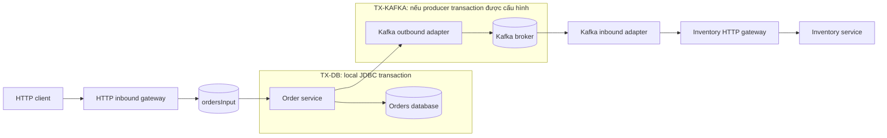
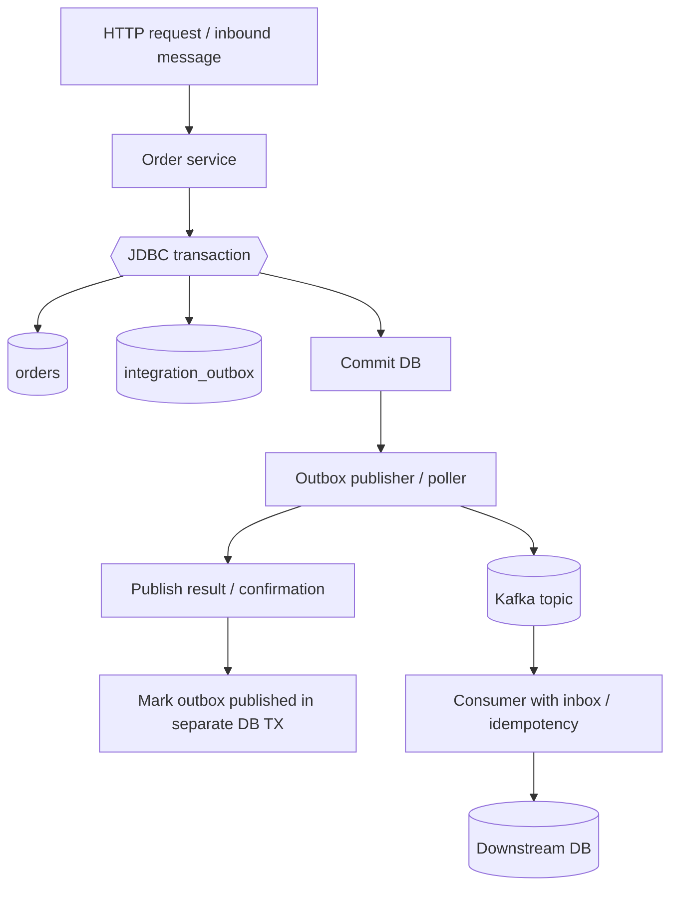
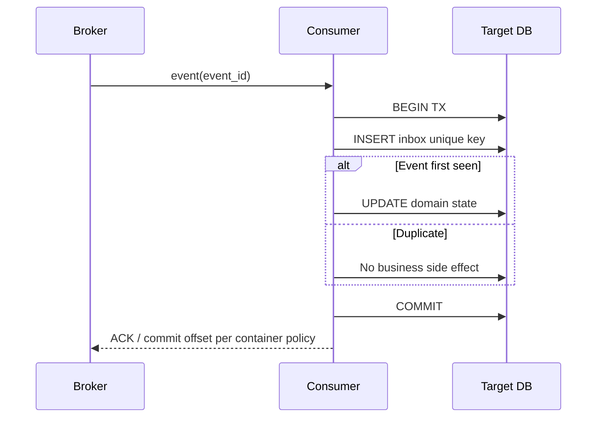
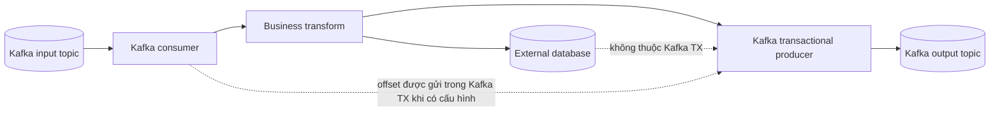
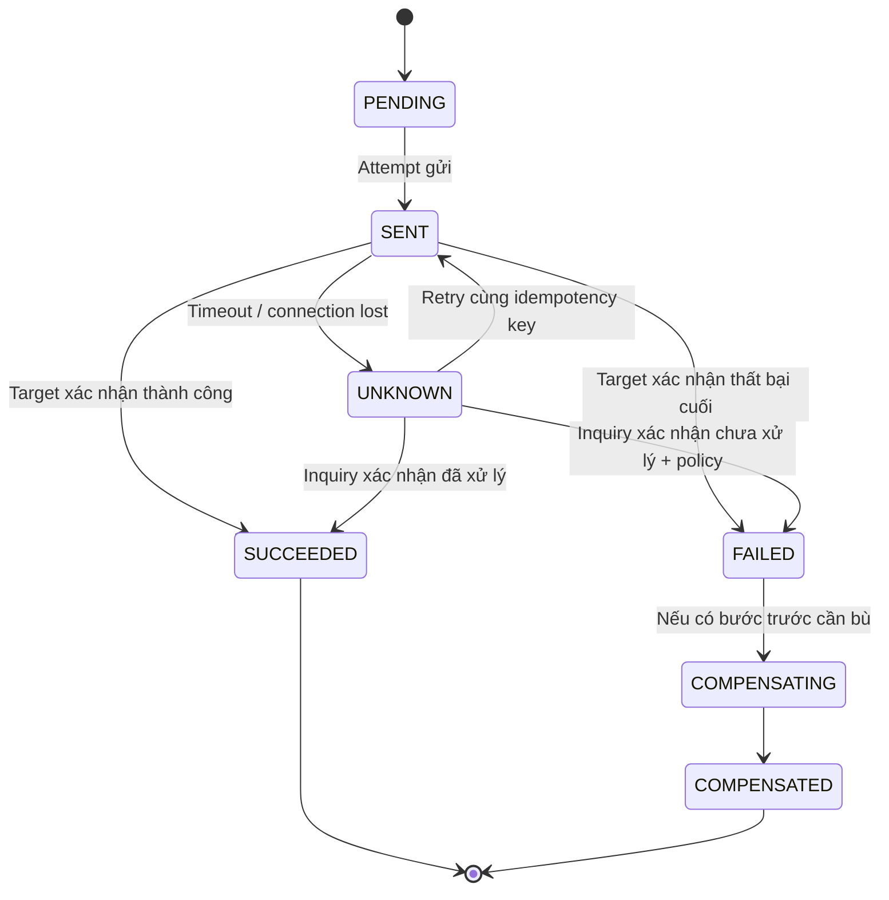
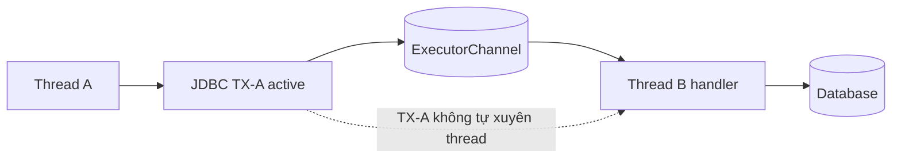
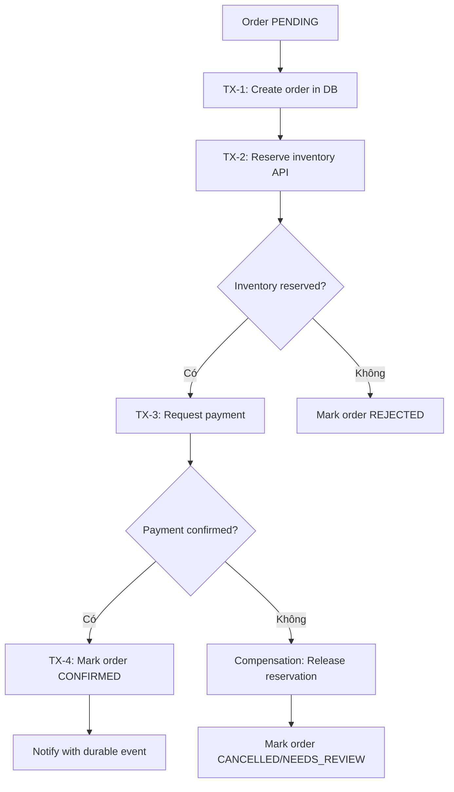
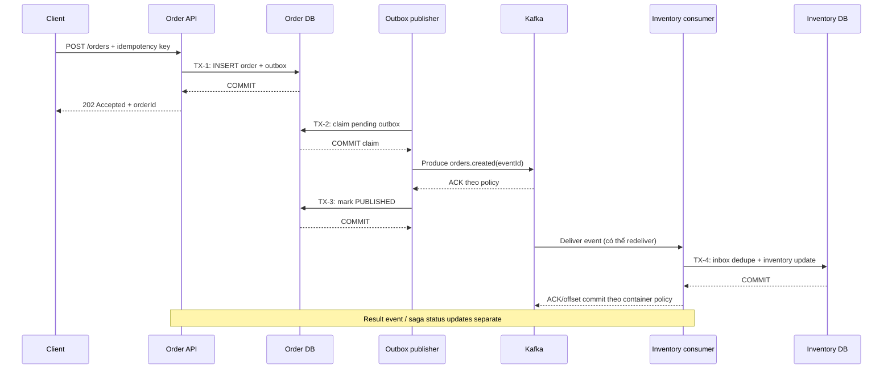

# Độc lập transaction giữa các hệ thống trong Spring Integration Adapters

## 1. Bài toán thực tế: một nghiệp vụ, nhiều hệ thống nhưng không có một commit chung

Một ứng dụng tích hợp nhận yêu cầu tạo đơn hàng qua **HTTP inbound gateway**, lưu đơn vào **PostgreSQL**, phát sự kiện lên **Kafka**, rồi một dịch vụ khác cập nhật tồn kho bằng **HTTP outbound gateway**. Trên sơ đồ, mọi bước nằm trong một “flow” nên dễ có cảm giác rằng chỉ cần bao quanh flow bằng `@Transactional` thì hoặc **tất cả thành công**, hoặc **tất cả rollback**.

Thực tế có thể xảy ra:

1. Database đã **COMMIT** đơn hàng.
2. Producer gửi sự kiện Kafka nhưng broker không phản hồi trong thời gian chờ.
3. Caller nhận HTTP 500/timeout và **retry**.
4. Đơn hàng đã tồn tại trong DB, nhưng không biết sự kiện đã tới Kafka chưa.
5. Một consumer có thể nhận cùng sự kiện hai lần; hệ thống tồn kho có thể xử lý hai lần nếu thiếu idempotency.

Vấn đề không phải chỉ là thêm một annotation. **Transaction của mỗi tài nguyên có phạm vi, cơ chế xác nhận và thời điểm commit riêng**; giữa HTTP, File/SFTP, Kafka, JMS, AMQP, JDBC thường **không có một transaction ACID tự động bao trùm**.

Bài **“Độc lập transaction giữa các hệ thống”** thuộc chương **Transactions** của mô-đun `SPRING_INTEGRATION_ADAPTERS`. Mô-đun tập trung kết nối bên ngoài qua **inbound/outbound adapter, gateway, poller và MessageChannel**, xử lý **file, SFTP, HTTP, JMS, AMQP, Kafka và cơ sở dữ liệu**, cùng hợp đồng message, lỗi và vòng đời kết nối.

Trọng tâm của bài là thiết kế **các transaction cục bộ độc lập**, đồng thời giữ **tính nhất quán nghiệp vụ cuối cùng**, xử lý lặp, lỗi giữa chừng và khả năng khôi phục.

### Kết quả cần đạt

Sau bài học, bạn có thể:

- Vẽ được **ranh giới transaction** trong một IntegrationFlow.
- Phân biệt **ACID local**, **acknowledgement**, **broker commit**, **business success** và **eventual consistency**.
- Giải thích vì sao `@Transactional` không rollback HTTP request đã gửi, file đã chuyển hoặc record Kafka đã được broker chấp nhận.
- Lựa chọn đúng **Transactional Outbox**, **Inbox/idempotent consumer**, **Saga/compensation**, **retry có kiểm soát** và **reconciliation**.
- Hiểu giới hạn của Kafka producer transaction, JMS/AMQP transaction, JDBC transaction và XA/2PC.
- Kiểm tra cách `DirectChannel`, `ExecutorChannel`, `QueueChannel`, poller và error flow tác động tới boundary.
- Thiết kế các kịch bản lỗi để chứng minh **không mất tác vụ** và **không tạo tác dụng phụ trùng** ngoài hợp đồng.
- Viết runbook và metrics để xử lý trạng thái **kết quả không chắc chắn** khi process/network crash.

> **Ý chính:** “Một flow” là bản đồ luân chuyển message; **không có nghĩa** “một distributed ACID transaction”. Mỗi lần chuyển qua hệ thống ngoài phải có **hợp đồng giao nhận và khôi phục** rõ ràng.

## 2. Ba nghĩa khác nhau của “transaction”

### 2.1. Transaction cục bộ (local transaction)

Một **local transaction** do một tài nguyên hoặc transaction manager cụ thể điều phối, ví dụ:

- JDBC transaction trong một database.
- Một phiên JMS transacted theo broker/provider.
- Một Kafka producer transaction trong giới hạn semantics Kafka.
- Một AMQP transaction trên channel theo cơ chế broker.

Trong phạm vi được tài nguyên hỗ trợ, commit/rollback có quy tắc rõ ràng. **Nhưng local rollback của DB không tự rollback được HTTP response, upload SFTP hoặc Kafka record đã được publish từ một tài nguyên khác.**

### 2.2. Transaction phân tán (distributed transaction)

Một **distributed transaction** cần cơ chế phối hợp commit giữa nhiều tài nguyên, điển hình XA/JTA với **two-phase commit (2PC)** khi mọi tài nguyên liên quan thật sự hỗ trợ giao thức.

Điều này **khác** việc đặt hai local transaction gần nhau rồi gọi chung là “atomic”. Không phải HTTP gateway, File/SFTP hay Kafka client tự trở thành XA resource khi thêm `@Transactional`.

### 2.3. Business transaction (giao dịch nghiệp vụ)

Một **business transaction** có thể kéo dài nhiều giây, phút hoặc ngày: tạo đơn, giữ hàng, thanh toán, giao file cho đối tác, xác nhận đối soát. Các bước thường diễn ra qua nhiều service, broker và retry.

Nó có thể được thực hiện bằng **nhiều transaction cục bộ liên tiếp**, với trạng thái trung gian và hành động bù khi cần. Điều này dẫn tới **eventual consistency**: dữ liệu ở các hệ thống có thể khác nhau tạm thời nhưng hội tụ về trạng thái đúng theo hợp đồng.

| Phạm vi | Ví dụ | Cái gì có thể rollback cùng nhau? | Cái gì cần cơ chế khác? |
|---|---|---|---|
| Một DB transaction | Ghi `orders` và `outbox` cùng DataSource/manager | Hai thay đổi DB trong cùng transaction | Broker publish sau commit |
| Một JMS transacted session | Receive và send qua session/provider hỗ trợ | Hoạt động JMS trong phạm vi session | DB write ở transaction khác |
| Kafka transaction | Produce nhiều records và (trong topology phù hợp) commit offsets cùng transaction Kafka | Các thao tác Kafka thuộc cùng transaction | JDBC/HTTP/SFTP |
| HTTP call | Gửi request tới dịch vụ khác | Không có rollback phân tán chung theo mặc định | Idempotency, truy vấn trạng thái, compensation |
| SFTP upload | Đẩy file tới remote server | Không có ACID rollback chung với DB | Temp file, rename, manifest, reconcile |
| Business saga | Tạo đơn → giữ hàng → thanh toán | Mỗi bước tự commit | Bù nghiệp vụ, trạng thái và đối soát |

## 3. Một sơ đồ đúng phải cho thấy ranh giới commit

Hãy xét luồng **HTTP → JDBC → Kafka → HTTP**:



Trong ví dụ:

- **TX-DB** chỉ bao trùm các thao tác DB được thực hiện bởi transaction manager phù hợp, trong cùng context/thread theo cơ chế transaction.
- **TX-KAFKA** có thể là producer transaction riêng khi được cấu hình, **không mặc định** được tạo chỉ vì flow có Kafka outbound.
- HTTP outbound gọi inventory service là một **side effect bên ngoài**. Timeout **không đồng nghĩa** request chưa được xử lý.
- Nếu service A rollback JDBC sau khi gửi Kafka record được broker nhận, DB và Kafka **có thể lệch nhau**.
- Hình biểu diễn logical flow; để xác định **thời điểm commit thực** cần đọc cấu hình adapter, transaction manager, callback, acknowledgement và trace/log.

### 3.1. Phân biệt bốn loại “đã xong”

| Dấu hiệu | Điều được xác nhận | Điều chưa tự được xác nhận |
|---|---|---|
| `MessageChannel.send() == true` | Channel tiếp nhận message theo semantics của nó | Broker đã nhận, DB đã commit, downstream thành công |
| Handler return bình thường | Phương thức handler kết thúc không ném exception | Transaction manager đã commit; callback async thành công |
| Broker ACK / publisher confirm | Broker xác nhận publish theo policy đã cấu hình | Consumer đã xử lý thành công |
| DB commit thành công | Các thay đổi thuộc DB transaction được commit | Hệ thống khác đã nhận event hoặc hoàn tất nghiệp vụ |
| HTTP 2xx/202 | Server phản hồi theo hợp đồng HTTP | Công việc async đã hoàn tất, trừ khi API bảo đảm điều đó |
| Business VERIFIED | Kết quả đích đã được xác minh theo hợp đồng | Các quy trình phụ khác ngoài scope |

Trong code, không dùng tên trạng thái `DONE` cho một lần **enqueue** nếu yêu cầu nghiệp vụ là **đã ghi DB hoặc đã thanh toán**.

## 4. Tại sao không thể chỉ thêm @Transactional quanh toàn bộ flow?

`@Transactional` của Spring khai báo cách quản lý một **transaction phù hợp** khi phương thức được gọi qua cơ chế proxy/aspect đang hoạt động. Nó không tạo một giao thức commit toàn cầu cho mọi lời gọi trong phương thức.

Ví dụ **không đủ để bảo đảm atomicity**:

```java
@Service
public class OrderPublisher {

    private final OrderRepository orderRepository;
    private final KafkaTemplate<String, String> kafkaTemplate;

    public OrderPublisher(OrderRepository orderRepository,
                          KafkaTemplate<String, String> kafkaTemplate) {
        this.orderRepository = orderRepository;
        this.kafkaTemplate = kafkaTemplate;
    }

    @Transactional
    public void createOrder(Order order) {
        orderRepository.save(order);           // DB resource
        kafkaTemplate.send(
                "orders.created",
                order.id(),
                serialize(order)                // Kafka resource
        );
    }

    private String serialize(Order order) {
        return order.toString(); // Chỉ minh họa, không dùng cho schema thật.
    }
}
```

**Lý do không đủ:**

1. `@Transactional` có thể chỉ bắt đầu JDBC transaction, theo manager được chọn.
2. `KafkaTemplate.send()` thường là thao tác bất đồng bộ; việc gọi không chứng minh broker đã ACK.
3. Commit DB và publish Kafka là hai thời điểm độc lập nếu không có thiết kế phối hợp cụ thể.
4. Nếu publish thành công nhưng DB rollback, event Kafka có thể mô tả đơn hàng không tồn tại.
5. Nếu DB commit trước còn publish thất bại, đơn hàng có thể tồn tại nhưng thiếu event.
6. Khi network timeout, producer không biết chắc broker đã nhận record chưa; retry có thể publish trùng.
7. Nếu method bị gọi **nội bộ cùng object (self-invocation)** mà không qua proxy ở chế độ Spring AOP phổ biến, annotation có thể không kích hoạt như mong đợi.
8. Nếu handler xử lý trên thread khác, transaction context gắn thread có thể **không đi theo**.

**Đoạn code trên chỉ dùng để phân tích anti-pattern**, không phải hướng triển khai đề xuất. Đặc biệt, không dùng `toString()` làm schema sự kiện thật.

### 4.1. “Hai transaction được đồng bộ thứ tự commit” vẫn có failure window

Một số tích hợp Spring cho phép **đồng bộ hóa hai local transaction**, ví dụ DB transaction và Kafka transaction, để sắp xếp thứ tự commit. Nhưng **đồng bộ thứ tự không phải một atomic distributed commit**.

Nếu tài nguyên thứ nhất đã commit mà tài nguyên thứ hai commit thất bại, tài nguyên thứ nhất **không thể tự quay về trạng thái trước**. Đổi thứ tự commit chỉ **chuyển vị trí failure window**, không xóa nó.

Không nên viết yêu cầu nghiệp vụ “hoặc DB và Kafka cùng commit hoặc cùng rollback trong mọi crash” nếu hệ thống chỉ có **hai local transaction synchronized**.

## 5. Failure-window analysis: viết DB trước hay phát event trước?

Giả sử yêu cầu: một đơn hàng mới trong DB phải tạo một sự kiện `orders.created` để các consumer xử lý.

### 5.1. Cách A: DB commit rồi publish

```text
BEGIN DB TX
  INSERT orders
COMMIT DB
PUBLISH Kafka event
```

Nếu process crash **sau COMMIT DB nhưng trước publish**:

- DB có đơn hàng.
- Kafka chưa có event.
- Consumer không biết có đơn hàng cần xử lý.
- Nếu không có retry job/nguồn dữ liệu bền, event có thể **mất vĩnh viễn**.

Nếu publish timeout, vẫn không biết chắc broker đã nhận event hay chưa. Retry thiếu idempotency có thể phát trùng.

### 5.2. Cách B: publish trước rồi DB commit

```text
PUBLISH Kafka event
BEGIN DB TX
  INSERT orders
COMMIT DB
```

Nếu Kafka publish thành công nhưng DB insert/commit thất bại:

- Consumer có thể nhận **event mô tả đơn hàng chưa tồn tại**.
- Nếu consumer gọi DB/API để đọc đơn, có thể nhận 404.
- Một hành động bên ngoài có thể được thực hiện trước khi đơn hàng thực sự commit.

### 5.3. Ma trận lỗi

| Thời điểm lỗi | DB-first | Publish-first | Hậu quả cần quản lý |
|---|---|---|---|
| Trước mọi thao tác | Chưa có gì | Chưa có gì | Retry đầu vào |
| Sau DB commit, trước publish | **DB có, event thiếu** | Không tương ứng | Durable outbox / reconciliation |
| Sau broker ACK, trước DB commit | Không tương ứng | **Event có, DB chưa chắc có** | Không publish trước commit hoặc dùng flow trạng thái |
| Network timeout khi publish | DB có, Kafka **không chắc** | Kafka **không chắc**, DB chưa chắc | Idempotent event ID và truy vấn/retry |
| Process chết sau publish, trước lưu cờ hoàn tất | Event có thể có, cờ chưa lưu | Event có, DB chưa chắc | Retry an toàn với duplicate handling |
| Consumer xử lý rồi crash trước ACK | Event đã tạo side effect, có thể redeliver | Tương tự | Inbox/idempotency, ACK sau commit |
| Downstream API timeout | Không biết target có xử lý chưa | Tương tự | Idempotency key, status inquiry, compensation |

**Kết luận:** chỉ sắp xếp hai lời gọi không biến chúng thành atomic. Cần một **bản ghi ý định bền vững** trong cùng transaction với thay đổi nghiệp vụ, rồi giao event theo cách có thể retry.

## 6. Transactional Outbox: đảm bảo ý định phát sự kiện được lưu cùng dữ liệu

### 6.1. Nguyên tắc

**Transactional Outbox** ghi đồng thời:

1. Thay đổi nghiệp vụ, ví dụ `orders`.
2. Bản ghi sự kiện cần phát, ví dụ `integration_outbox`.

Hai thay đổi **nằm trong cùng một JDBC transaction và cùng tài nguyên DB**. Sau commit, một publisher riêng đọc outbox rồi gửi qua Kafka/JMS/AMQP/HTTP, sau đó cập nhật trạng thái publish.



**Bảo đảm chính:** nếu DB transaction commit thành công thì **cả thay đổi nghiệp vụ và ý định phát event** tồn tại bền trong DB. Nếu rollback thì không có event outbox được commit như một “sự kiện đã xảy ra”.

**Không được hứa mặc định “exactly once end-to-end”.** Publisher có thể phát cùng event nhiều lần nếu crash sau broker ACK nhưng trước khi đánh dấu outbox `PUBLISHED`. Vì thế consumer vẫn cần idempotency.

### 6.2. Schema minh họa bằng PostgreSQL

```sql
CREATE TABLE orders (
    order_id          UUID PRIMARY KEY,
    customer_ref      TEXT NOT NULL,
    status            VARCHAR(32) NOT NULL,
    created_at        TIMESTAMPTZ NOT NULL DEFAULT now()
);

CREATE TABLE integration_outbox (
    event_id          UUID PRIMARY KEY,
    aggregate_id      UUID NOT NULL,
    event_type        VARCHAR(100) NOT NULL,
    schema_version    INTEGER NOT NULL,
    payload_json      JSONB NOT NULL,
    status            VARCHAR(20) NOT NULL DEFAULT 'PENDING',
    attempt_count     INTEGER NOT NULL DEFAULT 0,
    next_attempt_at   TIMESTAMPTZ NOT NULL DEFAULT now(),
    claimed_until     TIMESTAMPTZ,
    claim_token       UUID,
    last_error_code   VARCHAR(80),
    created_at        TIMESTAMPTZ NOT NULL DEFAULT now(),
    published_at      TIMESTAMPTZ,
    CONSTRAINT outbox_status_chk CHECK (
      status IN ('PENDING','CLAIMED','PUBLISHED','QUARANTINED')
    )
);

CREATE INDEX idx_outbox_pending
    ON integration_outbox(status, next_attempt_at, created_at);

CREATE INDEX idx_outbox_claimed_lease
    ON integration_outbox(status, claimed_until);
```

Đây là **mô hình học thuật**, không phải schema tự được Spring Integration sinh ra. Production cần thêm retention, partitioning, claim/lease policy, dead-letter/quarantine, audit, versioning và quyền truy cập. Payload là dữ liệu cần bảo vệ; không lưu password, access token hay thông tin nhạy cảm ngoài chính sách.

### 6.3. Ghi order và outbox trong cùng JDBC transaction

Ví dụ dịch vụ Java dùng **Spring JDBC** và `@Transactional` với một `PlatformTransactionManager` quản lý **cùng DataSource** của hai bảng:

```java
import java.util.Map;
import java.util.UUID;

import org.springframework.jdbc.core.namedparam.NamedParameterJdbcTemplate;
import org.springframework.stereotype.Service;
import org.springframework.transaction.annotation.Transactional;

@Service
public class OrderAcceptanceService {

    private final NamedParameterJdbcTemplate jdbc;

    public OrderAcceptanceService(
            NamedParameterJdbcTemplate jdbc) {
        this.jdbc = jdbc;
    }

    @Transactional
    public void accept(
            UUID eventId,
            UUID orderId,
            String customerRef,
            String eventJson) {

        jdbc.update("""
            INSERT INTO orders(order_id, customer_ref, status)
            VALUES (:orderId, :customerRef, 'ACCEPTED')
            ON CONFLICT (order_id) DO NOTHING
            """,
            Map.of(
                "orderId", orderId,
                "customerRef", customerRef
            ));

        jdbc.update("""
            INSERT INTO integration_outbox(
                event_id, aggregate_id, event_type,
                schema_version, payload_json
            )
            VALUES (
                :eventId, :orderId, 'orders.created',
                1, CAST(:payload AS jsonb)
            )
            ON CONFLICT (event_id) DO NOTHING
            """,
            Map.of(
                "eventId", eventId,
                "orderId", orderId,
                "payload", eventJson
            ));
    }
}
```

**Phạm vi ví dụ:**

- Hai `INSERT` sử dụng cùng transaction manager/DataSource; không có lệnh Kafka trong transaction này.
- `eventId` là **logical event ID ổn định**, không phải ID tạo mới ở mỗi lần retry.
- `ON CONFLICT DO NOTHING` giúp chống ghi trùng trong ví dụ, nhưng **không xác nhận payload hoặc customerRef trùng khớp với bản ghi đã tồn tại**. Với hệ thống thật phải có kiểm tra conflict về dữ liệu/hợp đồng và cơ chế xử lý sai khác.
- Nếu insert order bị conflict nhưng event outbox trước đó chưa được ghi vì một luồng ngoài kiến trúc, hệ thống cần reconciliation; đừng coi hai `ON CONFLICT` là toàn bộ nghiệp vụ.
- Nếu payload chứa dữ liệu cá nhân, mã hóa/giới hạn access và retention phù hợp.
- Không dùng cùng `eventId` cho nhiều phiên bản nội dung có ý nghĩa khác nhau mà không có quy tắc.
- Đoạn code cần Java hỗ trợ text block và đúng Spring Boot/JDBC dependency; là minh họa thiết kế, chưa phải một hệ thống chạy đầy đủ.

### 6.4. Tại sao publisher không nên giữ DB transaction khi gọi Kafka?

Không nên giữ transaction DB mở trong suốt một network publish có thể timeout:

```text
BEGIN DB TX
  SELECT pending outbox FOR UPDATE
  SEND Kafka (chờ nhiều giây)
  UPDATE published
COMMIT
```

Cách này giữ row locks/connection lâu, dễ làm giảm throughput và tăng deadlock khi broker chậm. **Nên tách**:

1. **TX-CLAIM:** claim một batch outbox, gắn lease/token rồi commit nhanh.
2. **NETWORK I/O:** publish ngoài DB transaction, theo callback/ACK thực.
3. **TX-MARK:** cập nhật trạng thái publish nếu claim token còn hợp lệ.
4. **RETRY:** nếu publish lỗi hoặc chưa chắc, để lease hết hạn hoặc schedule lại với backoff.

Đó là các **transaction độc lập**, gắn nhau qua durable state và idempotency.

### 6.5. Claim outbox có concurrency và lease

Một mẫu SQL minh họa dùng PostgreSQL:

```sql
WITH picked AS (
    SELECT event_id
    FROM integration_outbox
    WHERE (
        status = 'PENDING'
        AND next_attempt_at <= now()
    ) OR (
        status = 'CLAIMED'
        AND claimed_until < now()
    )
    ORDER BY created_at
    LIMIT 50
    FOR UPDATE SKIP LOCKED
)
UPDATE integration_outbox AS o
SET status = 'CLAIMED',
    claimed_until = now() + INTERVAL '2 minutes',
    claim_token = :claim_token,
    attempt_count = attempt_count + 1
FROM picked AS p
WHERE o.event_id = p.event_id
RETURNING o.event_id, o.payload_json, o.claim_token;
```

**`:claim_token`** là UUID duy nhất do worker sinh cho một lượt claim/batch, **không** dùng làm business event ID. Claim cần commit ngay trong local DB transaction, rồi mới publish.

Khi publisher nhận ACK theo contract, đánh dấu:

```sql
UPDATE integration_outbox
SET status = 'PUBLISHED',
    published_at = now(),
    claimed_until = NULL
WHERE event_id = :event_id
  AND claim_token = :claim_token
  AND status = 'CLAIMED';
```

Đọc affected row count: nếu `0`, worker có thể đã **mất lease** và event được worker khác claim. Lúc đó không được sửa trạng thái tùy ý. **Lease không loại bỏ hoàn toàn duplicate publish**: worker cũ có thể publish thành công sau khi lease hết hạn; worker mới cũng có thể publish. Consumer phải idempotent.

Khi lỗi chắc chắn hoặc timeout, cập nhật `next_attempt_at`, status và `last_error_code` theo token/claim còn hợp lệ; chọn exponential backoff có jitter và ngưỡng `QUARANTINED` để tránh poison event làm quay vòng vô hạn.

### 6.6. Các failure window của outbox

| Điểm crash | Trạng thái bền | Hành vi phục hồi |
|---|---|---|
| Trước COMMIT DB business+outbox | Cả hai rollback | Retry input; không publish |
| Sau COMMIT, trước claim | Order + outbox PENDING | Publisher lần sau claim |
| Sau claim, trước publish | Outbox CLAIMED có lease | Lease hết hạn → reclaim |
| Sau broker ACK, trước mark PUBLISHED | Event có thể đã publish, outbox còn CLAIMED | Publish lại có thể trùng; consumer dedupe |
| Sau mark PUBLISHED | Outbox đã xác nhận publish theo contract | Không phát lại thông thường |
| Network timeout, ACK không rõ | Kết quả **UNKNOWN** | Retry có thể trùng; dùng event ID, observability và reconciliation |

**Outbox xử lý vấn đề “DB có nhưng không có ý định phát event bền vững”. Nó không tự bảo đảm consumer chỉ xử lý một lần.**

## 7. Inbox và idempotent consumer: giao dịch đích cũng phải độc lập

Một consumer Kafka/JMS/AMQP có thể nhận lại cùng message do:

- Crash sau khi đã ghi DB nhưng trước ACK/commit offset.
- Broker redelivery hoặc listener retry.
- Publisher outbox gửi lặp sau timeout.
- Replay từ DLT/DLQ hoặc backfill.
- Các bản sao producer tạo cùng event do retry thiếu nhận diện.

Vì vậy consumer phải xem **duplicate delivery là trường hợp bình thường cần thiết kế**, không nhất thiết là lỗi broker.

### 7.1. Inbox pattern

Tại database đích, tạo bảng ghi những event đã được áp dụng:

```sql
CREATE TABLE integration_inbox (
    consumer_name   VARCHAR(100) NOT NULL,
    event_id        UUID NOT NULL,
    processed_at    TIMESTAMPTZ NOT NULL DEFAULT now(),
    PRIMARY KEY (consumer_name, event_id)
);
```

**Cùng một local DB transaction**:

1. Thử insert `(consumer_name,event_id)`.
2. Nếu đã tồn tại, bỏ qua side effect nghiệp vụ đã xử lý (theo quy tắc duplicate).
3. Nếu lần đầu, áp dụng thay đổi domain và commit cùng inbox row.
4. Chỉ khi DB transaction hoàn tất, tiến hành broker ACK/offset commit theo semantics listener đã chọn.



Bảng inbox và thay đổi domain **phải** nằm trong cùng tài nguyên/transaction nếu muốn chống trùng side effect DB với cách này. Nếu consumer gọi HTTP sau khi insert inbox, HTTP vẫn là side effect ngoài transaction và cần cơ chế idempotency riêng.

### 7.2. Ví dụ consumer service

```java
import java.util.Map;
import java.util.UUID;

import org.springframework.jdbc.core.namedparam.NamedParameterJdbcTemplate;
import org.springframework.stereotype.Service;
import org.springframework.transaction.annotation.Transactional;

@Service
public class InventoryEventApplier {

    private final NamedParameterJdbcTemplate jdbc;

    public InventoryEventApplier(
            NamedParameterJdbcTemplate jdbc) {
        this.jdbc = jdbc;
    }

    @Transactional
    public void apply(UUID eventId, UUID orderId) {
        int firstSeen = jdbc.update("""
            INSERT INTO integration_inbox(consumer_name, event_id)
            VALUES ('inventory-projection', :eventId)
            ON CONFLICT DO NOTHING
            """, Map.of("eventId", eventId));

        if (firstSeen == 0) {
            return; // Duplicate delivery đã được commit trước đó.
        }

        jdbc.update("""
            INSERT INTO inventory_projection(order_id, status)
            VALUES (:orderId, 'RESERVED')
            ON CONFLICT (order_id)
            DO UPDATE SET status = EXCLUDED.status
            """, Map.of("orderId", orderId));
    }
}
```

**Giả định:** bảng `inventory_projection` đã tồn tại và `RESERVED` là trạng thái demo; đây không phải ví dụ trừ tồn kho thật. Trong nghiệp vụ giữ tồn kho, cần kiểm tra số lượng, điều kiện hết hàng và concurrency. **Không được hiểu** `ON CONFLICT DO UPDATE` là giải pháp đầy đủ cho mọi nghiệp vụ.

Vì cùng DB transaction, nếu cập nhật projection thất bại thì row inbox được rollback cùng nó. Lần redelivery sau còn cơ hội xử lý lại.

**Giới hạn quan trọng:** ACK/commit offset **nằm ngoài method này** và phụ thuộc Kafka/JMS/AMQP listener/container. Đừng tự giả định `@Transactional` sẽ khiến container tự ACK chính xác theo thứ tự mong muốn; phải cấu hình và kiểm thử lifecycle/ack mode của transport đang dùng.

### 7.3. Idempotency không phải “bỏ mọi lần trùng”

Với một số nghiệp vụ, cùng `event_id` tới lại nhưng payload khác là **data-integrity incident**, không phải một retry bình thường. Cần xác thực schema version, business key, hash nội dung đã chuẩn hóa (theo chính sách), source trust và event ordering. Nếu có bản ghi trước mà nội dung xung đột, đưa vào quarantine/incident thay vì bỏ qua im lặng.

### 7.4. ACK sau DB commit vẫn có khoảng lỗi

Nếu DB commit thành công, sau đó process crash **trước broker ACK**, broker có thể redeliver. Inbox ngăn side effect DB bị áp dụng hai lần, sau đó consumer ACK theo hợp đồng.

Đây là **at-least-once delivery + idempotent effect**, không phải “một lần giao duy nhất”.

Nếu ACK được thực hiện **trước** khi DB commit, process crash sau ACK có thể làm event mất khỏi lần giao bình thường mà DB không có kết quả. Trình tự ACK/commit phải được test trên đúng adapter, listener, transaction manager và configuration.


## 8. Mỗi transport có commit, ACK và ranh giới transaction riêng

Không nên dùng một chữ **transaction** cho tất cả adapter rồi suy ra cùng hành vi rollback.

| Transport | Ranh giới commit/ACK chính | Không nằm chung theo mặc định | Kiểm tra bắt buộc |
|---|---|---|---|
| **JDBC** | DB transaction/connection do transaction manager quản lý | Kafka/JMS/HTTP/SFTP | Commit/rollback, constraints, isolation, pool |
| **Kafka** | Producer transaction, offset commit và consumer mode theo cấu hình | JDBC và HTTP | `transactional.id`, producer fencing, read-committed, retry/rebalance |
| **JMS** | Session transaction hoặc XA/JTA khi broker/provider hỗ trợ | HTTP/File/SFTP; DB nếu chỉ local session | ACK/redelivery, rollback, DLQ, session lifecycle |
| **AMQP** | Publisher confirms hoặc AMQP channel transaction theo mode; consumer ACK/NACK | DB commit, remote HTTP | Confirm/return, requeue/DLX, unacked, prefetch |
| **HTTP** | Client request/response và nghiệp vụ server-side | Transaction caller | Idempotency, timeout bất định, inquiry |
| **File** | Filesystem write/move/rename tùy hệ điều hành/FS | DB/broker transaction | Partial file, fsync/durability policy, rename, checksum |
| **SFTP** | Upload/download/rename do remote server thực hiện | Local DB, broker và file local | Partial upload, remote visibility, temp name, metadata |
| **Poller/channel** | Có thể tạo phạm vi transaction local cho một poll/handler sync | Thread khác hoặc remote resource | Advice chain, `DirectChannel`, executor, error flow |

**Dấu hiệu “gửi thành công” phải được định nghĩa theo từng adapter.** Kafka broker ACK, HTTP 200, file rename thành công hay JDBC transaction commit đều có mức xác nhận khác nhau.

## 9. Kafka transaction: mạnh trong phạm vi Kafka, không ôm cả database

### 9.1. Kafka producer transaction thực hiện gì?

Trong mô hình Kafka có cấu hình producer transactions đúng, nhiều records được đưa vào **một transaction Kafka** để consumer ở chế độ phù hợp có thể không thấy phần ghi chưa commit hoặc đã abort. Một topology **đọc Kafka → xử lý → ghi Kafka** có thể kết hợp output records và **offsets** vào cùng Kafka transaction khi sử dụng framework/client API hỗ trợ cơ chế đó.

Điều này có thể hỗ trợ semantics **exactly-once processing trong phạm vi Kafka** với những điều kiện đã xác định. Nó **không** tự bảo đảm:

- JDBC transaction của database ngoài Kafka.
- HTTP request tới inventory service.
- Upload SFTP hoặc thao tác file.
- Side effect gửi email/thanh toán.
- Idempotency business event khi cùng dữ liệu bị phát lại từ producer/outbox khác.

**Ví dụ logic:**



Tại đây, transaction Kafka có thể bảo vệ **write output Kafka + commit input offsets Kafka** trong cùng đơn vị khi cấu hình phù hợp. Ghi DB nằm ngoài; nếu DB commit rồi Kafka transaction abort, input có thể bị xử lý lại và DB cần idempotency.

### 9.2. Đừng nhầm producer idempotence và business idempotency

Kafka **idempotent producer** hỗ trợ hạn chế bản ghi trùng do retry mạng theo ngữ nghĩa của producer và broker, trong phạm vi cấu hình cụ thể. Nó **không** tự loại bỏ hai business events có cùng `event_id` được publish từ **hai lần chạy outbox worker khác nhau** hoặc hai HTTP requests lặp.

Tương tự, khi consumer đã xử lý DB nhưng offset Kafka chưa commit, record có thể được nhận lại. **Inbox/business unique key** vẫn là biện pháp cần xem xét.

### 9.3. Điểm phải kiểm tra trong Spring Integration Kafka

- Kafka inbound adapter/message-driven container có sử dụng **Kafka transaction manager** hay không.
- ProducerFactory/transactional ID prefix được cấu hình đúng và không bị chia sẻ sai giữa process.
- Listener và outbound producer có nằm trong đúng phạm vi transaction Kafka dự kiến không.
- Đầu ra consumer dùng isolation level thích hợp, ví dụ **`read_committed`**, nếu yêu cầu bỏ qua records aborted.
- Chính sách ACK/offset, exception, retry/DLT và container restart có phù hợp semantics không.
- Khi rolling deploy, có xử lý producer fencing, rebalances và in-flight transactions không.
- Nếu ghi thêm DB, **thứ tự commit DB/Kafka và failure window** được tài liệu hóa và test chưa.
- Phiên bản Spring Kafka/Spring Integration/Spring Boot có hỗ trợ chính xác các API/configuration đang sử dụng không.

**Đừng tuyên bố “exactly-once từ Kafka tới DB” chỉ vì bật Kafka transaction.** Kết quả DB không nằm trong transaction Kafka; muốn an toàn phải có idempotent writes hoặc mô hình outbox/inbox phù hợp.

### 9.4. Ví dụ failure window Kafka → DB

```text
Receive Kafka event(eventId=42)
BEGIN DB TX
  INSERT inbox(eventId=42)
  UPDATE DB
COMMIT DB
CRASH before Kafka offset commit
```

Consumer khác nhận lại event 42. Nếu xử lý đích dùng inbox trong cùng DB transaction, nó **bỏ qua side effect trùng** rồi tiếp tục ACK/commit theo policy. Nếu thiếu inbox, có thể cập nhật tồn kho hoặc tính phí lần hai.

## 10. JMS: local session transaction không tự gộp với JDBC

### 10.1. Transacted session

JMS có cơ chế **transacted session**; hoạt động receive/send được thực hiện trong phạm vi một session giao dịch theo provider và cấu hình.

Trong tình huống phù hợp:

- **Commit JMS session** xác nhận các hoạt động JMS thuộc session.
- **Rollback JMS session** có thể khiến message nhận được giao lại theo provider policy.
- Consumer ACK và redelivery chịu ảnh hưởng của loại session/container/acknowledgement mode.

Điều đó không đồng nghĩa cùng transaction với thao tác `INSERT orders` ở PostgreSQL. Nếu chỉ có một **JDBC local transaction** và một **JMS local transaction** độc lập, mỗi tài nguyên có thể commit hoặc rollback riêng.

### 10.2. Hai thứ tự đều có khoảng rủi ro

**DB commit trước JMS ACK:**

```text
Receive JMS → COMMIT DB → ACK/COMMIT JMS
```

Nếu crash sau DB commit nhưng trước JMS commit, broker có thể redeliver. Cần consumer idempotency.

**JMS ACK trước DB commit:**

```text
Receive JMS → ACK/COMMIT JMS → COMMIT DB
```

Nếu DB fail, message có thể không được giao lại theo cách mong đợi, làm mất công việc nghiệp vụ. Vì vậy phải tránh ACK sớm ngoài hợp đồng.

### 10.3. Khi nào dùng XA/JTA cho JDBC + JMS?

Nếu **cả DataSource và JMS ConnectionFactory đều hỗ trợ XA** và ứng dụng có **JTA transaction manager/coordinator** được cấu hình đúng, có thể phối hợp các XA resources trong một 2PC transaction.

Nhưng cần tính:

- Hỗ trợ XA thực tế của driver, broker/provider, pool và cấu hình recovery.
- Transaction log bền vững của coordinator, xử lý in-doubt transactions.
- Latency/locks kéo dài khi network hoặc participant lỗi.
- Heuristic outcomes và quy trình vận hành đặc biệt.
- Hạn chế throughput và tác động khi coordinator bị mất kết nối.
- Không có chuyện HTTP, File/SFTP hay Kafka tự nhiên trở thành XA resource cùng transaction.

**XA không nên được chọn chỉ vì mong muốn có “một nút rollback mọi hệ thống”.** Nó chỉ khả thi khi tài nguyên và vận hành hỗ trợ đầy đủ, và vẫn cần chiến lược recovery/audit.

### 10.4. Spring Integration với JMS listener

Cần biết **inbound endpoint** dùng `DefaultMessageListenerContainer`, một container/provider khác hay polling adapter, cùng:

- Transaction manager/session transacted setting.
- Client acknowledgement/transaction semantics.
- Reply hoặc outbound JMS có dùng cùng session/resource không.
- Nếu một handler async dispatch qua `ExecutorChannel`, công việc sau đó còn trong listener transaction không.
- Lỗi trong handler đi đâu: propagate về container, `ErrorMessage`, error channel hay retry advice?
- DLQ policy và giới hạn redelivery của provider.

**Đặt errorChannel đúng không phải bằng chứng JMS transaction đã rollback.** Exception có thể bị error handler xử lý/nuốt, làm listener xem invocation thành công và ACK message tùy cấu hình. Phải test lỗi thật với listener container đang dùng.

## 11. AMQP: transaction, publisher confirm và consumer ACK khác nhau

Với AMQP/RabbitMQ, có ít nhất ba khái niệm:

1. **AMQP channel transaction**, khi được bật và được broker/client hỗ trợ, có phạm vi hoạt động của channel.
2. **Publisher confirm**, xác nhận broker đã xử lý bước publish theo chế độ confirm.
3. **Consumer ACK/NACK**, xác nhận hoặc từ chối delivery nhận được.

Ba cơ chế này **không cùng một thứ**.

### 11.1. Publisher confirm không phải DB commit

```text
BEGIN JDBC TX
  UPDATE order
COMMIT JDBC
Publish AMQP event
Await publisher confirm
```

Nếu DB commit rồi publisher thất bại, event có thể thiếu. Nếu confirm bị timeout, trạng thái publish có thể **không xác định**; retry phải bảo đảm idempotency ở consumer.

Trong RabbitMQ, **publisher confirms và AMQP channel transactions** là các chế độ điều khiển riêng; không nên giả định dùng cả hai trên cùng channel sẽ tạo ra giao thức atomic DB+AMQP. Xác minh hỗ trợ và tương tác theo client/version.

### 11.2. Consumer ACK không phải business commit

Consumer nhận event, gọi DB và ACK:

- Nếu DB commit rồi ACK bị mất, broker có thể redeliver.
- Nếu ACK trước rồi DB rollback, message có thể mất khỏi queue.
- Nếu handler bị lỗi, `nack/requeue` hoặc dead-letter phụ thuộc policy chứ không tự phát sinh một transaction DB.
- **Unacked messages** có thể tăng khi downstream chậm, dù queue ready giảm.

**Gợi ý:** xử lý domain/inbox trong local JDBC transaction, rồi ACK theo policy khi commit thành công; cần test consumer container thực và tránh infinite requeue loop.

### 11.3. Publish không tới queue mong muốn

Broker có thể nhận publish nhưng routing key/exchange/binding không dẫn message tới queue mong muốn. **Publisher confirm** và **routing outcome** không hoàn toàn giống nhau; nếu dùng mandatory/return callbacks hoặc delivery topology, phải quan sát cả kết quả unroutable.

Một kết quả `confirm=ACK` không tự chứng minh consumer nhận đúng queue, chưa nói tới xử lý nghiệp vụ.

## 12. HTTP gateway: timeout tạo ra trạng thái không biết chắc

HTTP là ví dụ rõ nhất của **side effect ngoài transaction**.

Giả sử ứng dụng A gửi:

```http
POST /payments
Idempotency-Key: order-42-payment-v1
Content-Type: application/json

{"orderId":"42","amount":100000}
```

Phía A có thể gặp **read timeout** sau khi gửi request. Có hai kịch bản không thể phân biệt chỉ từ timeout:

- Đích **chưa xử lý** request.
- Đích **đã xử lý và commit**, nhưng response bị mất hoặc trả về quá muộn.

Vì vậy **HTTP timeout không có nghĩa transaction phía đối tác rollback**.

### 12.1. Idempotency key

Với API hỗ trợ idempotency, sử dụng một **key ổn định cho cùng logical operation**, ví dụ `payment-operation-42`. Khi retry cùng key và payload hợp lệ, server thực hiện theo hợp đồng idempotency (chẳng hạn trả kết quả đã được lưu thay vì tạo thanh toán mới).

**Phía server cũng phải thực sự triển khai và lưu key/result đúng**, không chỉ để client gửi header tên `Idempotency-Key` rồi kỳ vọng phép màu.

Những yêu cầu cơ bản:

- Key ổn định qua retry, không tạo key mới mỗi attempt.
- Có rule kiểm tra payload/amount/customer không xung đột với key cũ.
- Storage key/result cần có tính bền vững và uniqueness.
- TTL của key phải lớn hơn cửa sổ retry/reconciliation cần thiết.
- Quyền truy vấn kết quả không làm lộ nghiệp vụ của tenant khác.
- Nếu provider không hỗ trợ idempotency, cần inquiry/status API hoặc quy trình đối soát riêng.

### 12.2. Trạng thái `PENDING/UNKNOWN` không phải thất bại chắc chắn

Một state machine gợi ý:



`UNKNOWN` là trạng thái **thông tin chưa đủ**, không tự là `FAILED`. Nếu đích không có inquiry và không hỗ trợ idempotency, retry tự động đối với giao dịch nhạy cảm có thể gây hậu quả kép; cần escalation/đối soát thủ công hoặc cơ chế nghiệp vụ được thiết kế trước.

### 12.3. HTTP 202 Accepted và business transaction

Một API có thể trả `202 Accepted` khi đã nhận job vào hàng đợi. Điều này **không bảo đảm job đã hoàn tất**. Phải theo dõi job ID/trạng thái hoặc callback/event kết quả.

Nếu Spring Integration **HTTP outbound gateway** nhận 202, chỉ nên ghi trạng thái **accepted/by external API** cho đến khi có xác nhận nghiệp vụ theo hợp đồng.

### 12.4. OAuth, TLS và credential failure

401/403/TLS handshake failure là lỗi kết nối/phân quyền; chúng có thể phát sinh **trước** khi request được xử lý hoặc do downstream policy. Không vì lỗi authentication mà rollback được DB đã commit trước đó.

Không đưa API key, bearer token hoặc cookie vào message headers truyền qua broker, log, tracing baggage hoặc outbox. Credential thuộc cấu hình/client security, còn **idempotency key** là metadata nghiệp vụ được phép theo contract.

## 13. File và SFTP: thao tác không tham gia transaction JDBC

File/SFTP thường có các hành động:

- Tạo file/tải lên/tải xuống.
- Ghi byte và flush/close.
- Đổi tên/move từ thư mục tạm sang thư mục sẵn sàng.
- Tạo file marker/manifest.
- Xóa hoặc archive sau khi xử lý.

Những thao tác này **không tự rollback** khi một JDBC transaction ở process khác thất bại.

### 13.1. Pattern temp file + rename + manifest

Một cách giao file tương đối an toàn:

```text
1. Tạo file với tên tạm: orders-20261123.csv.part
2. Ghi hết dữ liệu và đóng stream, kiểm tra kích thước/checksum
3. Đổi tên sang orders-20261123.csv khi file đã sẵn sàng
4. Ghi manifest hoặc ready marker nếu hợp đồng yêu cầu
5. Phía nhận chỉ poll những file đáp ứng quy tắc ready
6. Xác nhận xử lý bằng receipt/status riêng
```

**Không khẳng định rename luôn atomic/durable trên mọi filesystem hoặc SFTP server.** Tính atomic phụ thuộc filesystem, cùng volume/directory, server implementation, cơ chế replace và durability. Test đúng server/FS và hợp đồng chuyển file.

### 13.2. Không coi “file đã tải” là “nghiệp vụ đã commit”

Một file được download có thể chứa dữ liệu không hợp lệ; một upload có thể bị cắt giữa chừng; một lần retry có thể ghi đè/nhân đôi file.

Nên có:

- **File ID hoặc manifest ID** bền vững, checksum và schema version.
- Directory `incoming`, `processing`, `processed`, `quarantine` với quy tắc rõ.
- Filter/metadata store hoặc durable claim để tránh nhập trùng.
- Khả năng nhận diện partial file, temp name và retry.
- Receipt/acknowledgement ngoài filesystem nếu nghiệp vụ cần.
- Compensation hoặc reconciliation nếu database đã commit nhưng file giao đi lỗi.

### 13.3. Failure window SFTP ↔ DB

| Thứ tự | Điểm crash | Hậu quả | Biện pháp |
|---|---|---|---|
| DB commit → SFTP upload | Sau DB commit, trước upload | DB có công việc, file chưa có | Durable export job/outbox + retry |
| SFTP upload → DB update | Sau upload, trước cập nhật DB | File có ở remote, DB nghĩ chưa gửi | File ID/manifest, remote inquiry, retry idempotent |
| Download → DB process | Sau download, trước DB commit | File có thể được đọc lại | Dedup file ID, staging, transaction DB |
| DB commit → archive/delete remote | Sau DB commit, trước archive | File còn ở source, poller có thể thấy lại | Metadata store/inbox + idempotent processing |

SFTP `rename` hay archive không phải một phần của DB commit. Phía nhận cần kiểm thử crash ở từng bước và **quy trình đối soát các file có trạng thái mơ hồ**.

## 14. Spring Integration transaction boundary: message channel và thread

### 14.1. DirectChannel thường giữ cùng thread

Một **`DirectChannel`** thường dispatch handler đồng bộ trên thread gửi. Nếu đang có một JDBC transaction được Spring mở trên thread đó, các lời gọi JDBC **tham gia đúng transaction manager** có thể hoạt động trong cùng phạm vi.

Tuy nhiên:

- `DirectChannel` không tự mở transaction.
- Handler khác dùng một DataSource/manager khác không mặc nhiên cùng transaction.
- Gọi HTTP/SFTP/Kafka vẫn là side effect ngoài JDBC transaction, dù chạy cùng thread.
- Catch rồi nuốt exception có thể khiến transaction được commit dù nghiệp vụ mong rollback.
- Transaction isolation/propagation phụ thuộc `@Transactional` và manager thực.

### 14.2. ExecutorChannel tạo thread boundary

**`ExecutorChannel`** chuyển dispatch sang executor. Transaction context JDBC thường gắn với thread qua Spring transaction synchronization; **không truyền tự động một DB transaction đang mở sang worker thread** chỉ vì message đã được gửi.



Nếu handler ở thread B cần ghi DB atomic, hãy mở **TX-B riêng tại điểm xử lý ở thread B**, thay vì giả định nó tham gia TX-A.

**Trace/correlation context** cũng có thể bị mất khi đổi thread, nhưng vấn đề tracing là riêng: truyền trace context không làm các local DB transaction trở thành một.

### 14.3. QueueChannel chia giai đoạn producer/consumer

**`QueueChannel`** là PollableChannel, consumer/poller nhận message ở thời điểm sau. Trong bộ nhớ, nó **không tự có durability** và không tự kết hợp transaction của producer với transaction của handler.

```text
Producer thread: TX-A → send to QueueChannel → COMMIT TX-A
                              |
Consumer poller later:       receive → TX-B → handler → COMMIT TX-B
```

Nếu producer đã enqueue trong-memory rồi rollback DB, message **vẫn có thể đã được consumer nhận**; cần thiết kế thứ tự và storage/boundary. Nếu cần durable handoff, dùng message store/DB outbox/broker với hợp đồng commit và khôi phục rõ ràng.

### 14.4. PublishSubscribeChannel, splitter và aggregator

- Publish-subscribe synchronous có thể gọi nhiều subscriber theo thứ tự/semantics framework, nhưng **không tạo một distributed transaction qua mọi subscriber**.
- Với executor, các subscriber có thể chạy trên thread khác; transaction context cục bộ không tự lan sang.
- Splitter có thể tạo nhiều child messages. Nếu một child đã gửi HTTP, rồi child khác lỗi, **không thể rollback HTTP side effect** bằng transaction của splitter.
- Aggregator có message group store và release/expiry policy; commit group store không tự commit hệ thống đích.
- Retry advice có thể làm handler chạy lại; phải biết retry nằm **trong hay ngoài** local transaction để tránh side effect trùng.

### 14.5. Error channel không phải một “rollback bus”

Trong Spring Integration, exception có thể được:

- Propagate đồng bộ lên caller.
- Chuyển thành `ErrorMessage` trong bối cảnh endpoint/transport thích hợp.
- Bắt và xử lý bởi retry/advice chain.
- Chuyển tới error flow, DLQ/DLT hoặc một gateway error response.

**Không giả định mọi lỗi đều xuất hiện tại `errorChannel` và mọi lỗi được route vào đó sẽ rollback transaction.** Nếu error handler **tiêu thụ và không ném lại exception**, container có thể coi xử lý hoàn tất theo cấu hình và ACK/commit. Khi muốn rollback/redelivery, phải kiểm tra **exception propagation và transaction advice** cụ thể.

## 15. Poller với transaction advice: phạm vi nằm ở đâu?

Một polling inbound adapter hoặc polling consumer có thể được cấu hình chạy dưới **transaction advice**. Ví dụ cấu trúc Java DSL minh họa:

```java
import java.time.Duration;

import org.springframework.context.annotation.Bean;
import org.springframework.context.annotation.Configuration;
import org.springframework.integration.dsl.IntegrationFlow;
import org.springframework.integration.dsl.Pollers;
import org.springframework.integration.jdbc.inbound.JdbcPollingChannelAdapter;
import org.springframework.transaction.PlatformTransactionManager;

@Configuration
class OrderPollingFlowConfiguration {

    @Bean
    IntegrationFlow orderRowsFlow(
            JdbcPollingChannelAdapter jdbcSource,
            PlatformTransactionManager jdbcTransactionManager) {

        return IntegrationFlow.from(
                jdbcSource,
                endpoint -> endpoint.poller(
                        Pollers.fixedDelay(Duration.ofSeconds(5))
                                .maxMessagesPerPoll(20)
                                .transactional(jdbcTransactionManager)
                )
        )
        .channel("ordersToProcess")
        .get();
    }
}
```

**Điều kiện và giới hạn:**

- `JdbcPollingChannelAdapter`, `ordersToProcess` và transaction manager cần các bean/cấu hình thực trong ứng dụng. Đây là fragment minh họa, chưa phải project hoàn chỉnh.
- Poller transaction advice có thể bao một lần poll/receive và xử lý đồng bộ tương ứng tùy cấu hình endpoint và advice chain; cần kiểm thử với phiên bản/framework thực.
- `ordersToProcess` nếu là **DirectChannel** với handler đồng bộ có thể giữ cùng thread; nếu là **ExecutorChannel/QueueChannel** thì công việc phía sau có ranh giới khác.
- Không vì `.transactional(jdbcTransactionManager)` mà **SFTP upload, HTTP call hoặc Kafka broker transaction** nằm trong JDBC transaction.
- Một poller có thể được cấu hình transaction để **đọc/claim row** và xử lý theo kỳ, nhưng nếu handler chờ network lâu sẽ giữ lock/DB connection lâu. Cân nhắc **claim ngắn → commit → xử lý riêng**, với lease/outbox/inbox.
- API overload và behavior của `Pollers.transactional(...)` thay đổi theo phiên bản Spring Integration: kiểm tra build, transaction manager, advice order và integration test.

### 15.1. Đừng giữ JDBC transaction qua I/O mạng dài

```text
BEGIN JDBC TX
  SELECT rows FOR UPDATE
  HTTP POST /partner  (timeout 30s)
  UPDATE rows
COMMIT JDBC
```

Nếu đối tác chậm, DB row locks/connection bị giữ hàng chục giây, gây deadlock và giảm throughput. Khi HTTP timeout, trạng thái bên ngoài còn **unknown**; rollback DB có thể khiến hệ thống gọi HTTP lại và gây side effect trùng.

Thường phù hợp hơn:

```text
TX-1: claim durable work + lease → COMMIT
HTTP request: idempotency key + deadline
TX-2: ghi outcome hoặc UNKNOWN → COMMIT
Background reconciliation: hỏi trạng thái / retry có kiểm soát
```

Các transaction độc lập có trạng thái **durable** giúp hệ thống phục hồi ngay cả khi process chết ở giữa.

## 16. Saga: khi workflow có nhiều bước nghiệp vụ độc lập

**Saga** tổ chức một business process thành chuỗi **local transactions**, mỗi bước có điều kiện thành công, retry và có thể có **compensation** khi quy trình không đạt mục tiêu.

Ví dụ đặt hàng:



Mỗi ô TX có thể thuộc **hệ thống khác nhau**. Saga **không** biến các bước thành một DB transaction toàn cục.

### 16.1. Choreography và orchestration

| Kiểu | Cách hoạt động | Ưu điểm | Rủi ro |
|---|---|---|---|
| **Choreography** | Service phát event, service khác phản ứng | Giảm điều phối tập trung | Khó thấy toàn bộ trạng thái, vòng event và phụ thuộc ẩn |
| **Orchestration** | Một coordinator lưu trạng thái saga và gọi bước kế tiếp | Dễ quan sát quy trình/timeout/compensation | Coordinator phải bền vững, idempotent, có recovery |
| **Hybrid** | Coordinator cho bước trọng yếu; events cho thông báo | Linh hoạt | Cần hợp đồng rõ để không tạo vòng mơ hồ |

### 16.2. Compensation không phải rollback kỹ thuật

`Release inventory` **không xóa lịch sử** của việc giữ hàng; nó là một thao tác nghiệp vụ mới, có thể thất bại hoặc được thực hiện trễ. Với thanh toán, hoàn tiền có thể mất nhiều ngày, có phí hoặc không thể hoàn nguyên ở cùng thời điểm.

Một compensation an toàn cần:

- `saga_id`, `step_id` và `operation_id` ổn định.
- **Idempotency key** cho cả forward action lẫn compensation.
- Precondition và trạng thái để tránh bù nhầm.
- Deadline, retry/backoff, escape hatch/manual review.
- Audit kết quả, không coi “đã gửi yêu cầu bù” là “bù thành công”.
- Kiểm tra nghiệp vụ nào **không thể bù** và cách thiết kế đặt chúng ở bước phù hợp.

### 16.3. Khi một bước là UNKNOWN

Nếu payment API timeout và không biết đã trừ tiền chưa, **không được tự thực hiện refund rồi retry payment vô điều kiện**. Trước tiên thực hiện inquiry theo operation ID/idempotency key, hoặc chuyển `NEEDS_REVIEW` khi không có API đối soát. Một saga coordinator phải biết cách giữ trạng thái chờ thay vì mặc định timeout = thất bại chắc chắn.

### 16.4. Eventual consistency không phải bỏ qua tính đúng

Chọn eventual consistency nghĩa là chấp nhận thời gian dữ liệu tạm chưa đồng nhất, **nhưng phải công bố**:

- Khoảng thời gian chờ có thể chấp nhận (SLO).
- Điều kiện trạng thái `PENDING`, `CONFIRMED`, `FAILED`, `COMPENSATING`.
- Cơ chế bền vững để tiếp tục sau crash.
- Retry, duplicate detection, ordering và partition strategy.
- Cách phát hiện và sửa trạng thái không hội tụ.
- Quyền truy cập/audit và xử lý manual khi thời hạn bị vượt.

Không dùng “eventual consistency” như cách hợp thức hóa việc **mất event** hoặc **không có reconciliation**.


## 17. Propagation và isolation: không vô tình chia tách giao dịch DB cần atomic

Ngay cả **bên trong một database**, transaction independence phải là quyết định có chủ đích. Spring hỗ trợ các chế độ propagation như `REQUIRED` và `REQUIRES_NEW`, nhưng ý nghĩa của chúng không thể bỏ qua.

### 17.1. REQUIRED và REQUIRES_NEW

Trong một cấu hình transaction manager thông thường:

- **`REQUIRED`**: nếu đã có transaction thích hợp, tham gia vào; nếu chưa có thì mở mới.
- **`REQUIRES_NEW`**: mở một transaction riêng, tạm ngưng transaction hiện tại theo cơ chế manager hỗ trợ.
- **`NOT_SUPPORTED`**: chạy ngoài transaction hiện tại trong phạm vi cơ chế transaction.
- **`MANDATORY`**: yêu cầu transaction hiện hữu, nếu không có thì lỗi.

Ví dụ **sai đối với transactional outbox**:

```java
@Service
class OrderWriter {

    private final OrderRepo orderRepo;
    private final EventWriter eventWriter;

    @Transactional
    void create(Order order) {
        orderRepo.insert(order);
        eventWriter.writeOutboxInNewTransaction(order);
        // Nếu outer transaction rollback sau khi method bên dưới commit,
        // outbox event có thể tồn tại dù order không tồn tại.
    }
}

@Service
class EventWriter {

    @Transactional(
        propagation = Propagation.REQUIRES_NEW
    )
    void writeOutboxInNewTransaction(Order order) {
        // INSERT integration_outbox...
    }
}
```

Đoạn code là **anti-pattern minh họa**, chưa bao gồm imports/bean đầy đủ. Nếu outbox commit trong `REQUIRES_NEW` mà order thuộc transaction ngoài bị rollback, **atomicity mong muốn giữa order và outbox bị phá**.

Với mục tiêu **business row và outbox row cùng commit hoặc rollback**, hãy bảo đảm cả hai nằm trong **một transaction DB phù hợp** và cùng DataSource/transaction manager; không tự dùng `REQUIRES_NEW` cho outbox.

### 17.2. Isolation level và race condition

Một thiết kế idempotency sai có thể làm:

```text
IF inbox does not contain event-42:
    perform business write
    INSERT inbox(event-42)
```

Nếu hai workers đồng thời kiểm tra trước khi insert, **cả hai có thể tin là chưa tồn tại**. Chỉ kiểm tra bằng `SELECT` rồi hành động là thiếu an toàn.

Nên dựa trên **unique constraint và write atomic trong cùng transaction**, ví dụ `INSERT ... ON CONFLICT DO NOTHING`, hoặc locking/serialization phù hợp. Kiểm tra kết quả insert trước khi làm side effect DB.

**Không coi `READ_COMMITTED` hay `SERIALIZABLE` là giải pháp toàn cục cho HTTP/broker.** Isolation level chỉ điều phối cách transaction **trong DB** nhìn thấy và xung đột dữ liệu theo tài nguyên đó.

### 17.3. Transaction timeout và connection pool

Nếu transaction DB đợi HTTP/SFTP dài, một thread đang giữ connection và locks. Timeout có thể khiến DB rollback nhưng request ngoài **đã thành công**. Do đó:

- Giữ DB transaction **ngắn và xác định được phạm vi**.
- Đặt timeout cho I/O mạng và transaction riêng biệt.
- Giới hạn concurrency, connection pool và retry.
- Không mở transaction DB trước bước network I/O trừ khi có lý do được kiểm chứng.
- Với claim/lease, có expiry/recovery và owner để tránh công việc bị giữ mãi.

## 18. Ordering: đúng event nhưng sai thứ tự cũng làm dữ liệu sai

Outbox/inbox giải quyết **durable intent và duplicate side effects**, nhưng không tự bảo đảm **thứ tự**.

Giả sử:

```text
Event-1: Order 42 CREATED
Event-2: Order 42 CANCELLED
```

Hai outbox workers có thể claim hai event gần nhau; do network/retry, Kafka hoặc HTTP target nhận `CANCELLED` trước `CREATED`. Nếu consumer áp dụng “event cuối cùng đến” mà không kiểm tra version, đơn có thể bị resurrect.

### 18.1. Chọn quy tắc ordering theo aggregate

- Gắn `aggregate_id` và `aggregate_version` tăng đơn điệu trong DB domain transaction.
- Với Kafka, chọn partition key phù hợp khi cần ordering per aggregate; **chỉ thứ tự trong cùng partition** mới có ý nghĩa theo Kafka.
- Với parallel outbox publisher, nếu yêu cầu strict order, kiểm soát claim theo aggregate hoặc bảo đảm gửi tuần tự theo key; `ORDER BY created_at` trong một truy vấn claim **không tự bảo đảm ordering end-to-end** khi nhiều workers chạy.
- Consumer kiểm tra expected version/sequence, phát hiện gap hoặc event cũ.
- Có policy buffer/retry, dead-letter hoặc reconciliation khi nhận event ngoài thứ tự.

### 18.2. Eventual consistency và version check

Một bản ghi projection có thể lưu:

```sql
CREATE TABLE order_projection (
    order_id UUID PRIMARY KEY,
    version BIGINT NOT NULL,
    status VARCHAR(32) NOT NULL
);
```

Khi nhận event phiên bản thấp hơn phiên bản đã áp dụng, consumer có thể **bỏ qua theo quy tắc nghiệp vụ**; khi nhận phiên bản nhảy quá xa, có thể đưa vào `WAITING_FOR_PREDECESSOR` hoặc query state từ nguồn. Quy tắc cụ thể phụ thuộc domain: không phải loại sự kiện nào cũng phải áp dụng theo thứ tự đơn điệu, và không nên tự bỏ qua một event mang side effect độc lập.

**Idempotency không giải quyết mọi lỗi thứ tự.** “Không áp dụng event hai lần” và “áp dụng đúng event ở đúng thứ tự” là hai yêu cầu khác nhau.

## 19. Chọn mô hình transaction theo loại luồng

### 19.1. Ma trận lựa chọn

| Luồng | Mục tiêu thường gặp | Mẫu phù hợp | Điều phải kiểm chứng |
|---|---|---|---|
| HTTP inbound → JDBC | Một request ghi nhiều bảng cùng DB | Local JDBC transaction + idempotency request | Commit trước response, retry HTTP |
| JDBC → Kafka | Không mất ý định phát event sau DB commit | Transactional Outbox + idempotent consumer | Publisher retry, ordering, duplicate |
| Kafka → JDBC | Không áp dụng side effect DB hai lần khi redelivery | Inbox/unique business key trong DB transaction | DB commit trước offset theo policy |
| Kafka → Kafka | Xử lý record và phát record Kafka theo transaction | Kafka transactional processing nếu stack hỗ trợ | Offsets/output, read-committed, fencing |
| JMS → JDBC | At-least-once + idempotent DB hoặc XA nếu thực sự cần/hỗ trợ | Inbox + ACK sau commit; tùy trường hợp JTA/XA | Redelivery, ack mode, recovery |
| AMQP → JDBC | Consumer ACK có thể đến sau DB commit | Inbox + ACK/NACK policy | Requeue, DLX, unacked |
| JDBC → JMS/AMQP | Domain commit không được mất notification | Outbox + publisher | Publisher confirm, DLQ/outcome |
| HTTP outbound payment | Timeout không biết target đã xử lý chưa | Idempotency key + status inquiry + durable state | Key TTL, payload conflict, duplicate charge |
| File/SFTP inbound → JDBC | Có thể đọc lại file khi crash | File ID/manifest + inbox + staging | Partial file, accepted-once, DB commit |
| JDBC → File/SFTP outbound | Phải xuất file cuối cùng sau commit | Durable export job + temp file/rename + receipt | Upload retry, file overwrite, reconciliation |
| SFTP → Kafka → JDBC | Nhiều commit và format boundary | Durable staging/outbox + consumer idempotency | Transfer identity, Kafka publish, target commit |
| Multiple business services | Nhiều bước có thể thất bại độc lập | Saga + compensation | Unknown results, overdue, manual recovery |

Không có mẫu nào được chọn chỉ theo số lượng dòng code. **Hợp đồng tài nguyên, độ tin cậy, throughput, latency, yêu cầu audit và khả năng khôi phục** mới quyết định kiến trúc.

### 19.2. Khi nào không cần một Saga phức tạp?

Nếu toàn bộ thao tác thực sự nằm trong một database và có thể commit nguyên tử, **local JDBC transaction** là đơn giản nhất. Đừng tách thành nhiều sự kiện rồi xây Saga chỉ vì thích microservices.

Ngược lại, khi payment API, SFTP server và Kafka broker phải tham gia, đừng cố làm như chúng chung một local transaction. **Đơn giản hóa bằng durable state + idempotency** thường tốt hơn giả vờ có atomicity.

## 20. Một thiết kế end-to-end mẫu: HTTP → DB outbox → Kafka → HTTP/DB

### 20.1. Yêu cầu

Một khách đặt hàng qua HTTP. Hệ thống phải:

1. Không tạo hai đơn khi client retry.
2. Lưu đơn ở `PENDING` cùng ý định publish event.
3. Gửi `orders.created` tới Kafka sau DB commit.
4. Consumer reserve inventory ở service khác; một lần retry không trừ tồn kho nhiều lần.
5. Nhận kết quả inventory và cập nhật order `CONFIRMED` hoặc `REJECTED`.
6. Nếu không xác định kết quả inventory do timeout, giữ `UNKNOWN/PENDING_RECONCILIATION` thay vì tự giả định thất bại.
7. Báo lỗi/tiến độ cho người dùng với operation ID có thể tra cứu.

### 20.2. Sơ đồ transaction độc lập



Trong ví dụ:

- `202 Accepted` nghĩa là request đã được tiếp nhận bền vững theo contract API, **không** nghĩa inventory đã reserved.
- Event producer/consumer dùng `eventId` bền vững.
- Kafka ACK và DB outbox `PUBLISHED` là **hai local outcomes**, không cùng commit atomically.
- Consumer inventory commit độc lập với producer DB.
- Nếu cần phản hồi inventory lại Order service, thiết kế **một event kết quả hoặc callback mới**, có inbox/outbox và idempotency tương tự.
- Không giữ HTTP request mở nhiều phút để giả vờ đây là một synchronous ACID transaction.

### 20.3. Một hợp đồng message tối thiểu

Ví dụ payload minh họa, không chứa credential:

```json
{
  "eventId": "e5a7ad1b-6c2f-4e91-8849-44d1034dba70",
  "eventType": "orders.created",
  "schemaVersion": 1,
  "orderId": "ea43978d-f11d-4ccd-8eb9-2a5a1b2fe054",
  "aggregateVersion": 1,
  "occurredAt": "2026-11-23T09:00:00Z",
  "correlationId": "order-ea43978d"
}
```

Các trường nên có định nghĩa rõ:

- **`eventId`**: dùng nhận diện/dedup cho event.
- **`orderId`**: aggregate/business identity.
- **`aggregateVersion`**: hỗ trợ ordering khi domain yêu cầu.
- **`correlationId`**: nối logs/traces/saga; không thay `eventId`.
- **`schemaVersion`**: hỗ trợ tiến hóa contract.
- **`occurredAt`**: thời điểm nghiệp vụ nguồn; cần quản lý clock.
- **Không chứa** DB password, Kafka JAAS, bearer token hay private key.

### 20.4. Vì sao dùng result event thay vì trực tiếp cập nhật DB của service khác?

Mỗi service nên **sở hữu dữ liệu/transaction của mình**. Service inventory không nên tự ghi vào DB của order để “làm mọi thứ cùng transaction”, vì:

- Phá ranh giới ownership và coupling schema.
- Tăng khó khăn security/least privilege.
- Tạo transaction kéo dài qua nhiều hạ tầng.
- Khó khôi phục khi một service bị deploy hoặc database tạm unavailable.

Result event/callback có thể đưa order service cập nhật trạng thái qua **local transaction riêng**. Dù có độ trễ eventual consistency, hệ thống có durable state và khả năng phục hồi rõ ràng.

## 21. Metrics và observability cho transaction độc lập

**Một hệ thống eventual consistency không có trạng thái quan sát là một hệ thống khó vận hành.** Cần đo riêng từng boundary và mốc của logical event.

### 21.1. Những metric nên có

| Metric ứng dụng đề xuất | Đơn vị | Ý nghĩa |
|---|---|---|
| `integration_business_transactions_started_total` | Event | Số logical operations bắt đầu |
| `integration_business_transactions_verified_total` | Event | Số operation đạt điều kiện hoàn tất |
| `integration_business_transactions_overdue` | Event | Số operation đang mở quá deadline |
| `integration_outbox_pending` | Row | Số event cần publish |
| `integration_outbox_oldest_age_seconds` | Giây | Tuổi event outbox cũ nhất chưa publish |
| `integration_outbox_publish_attempts_total` | Attempt | Số lần publish gồm retry |
| `integration_outbox_publish_unknown_total` | Attempt | Số lần publish timeout/unknown |
| `integration_inbox_duplicates_total` | Delivery | Số lần consumer nhận event đã xử lý |
| `integration_consumer_tx_failures_total` | Attempt | Lỗi DB/transaction của consumer |
| `integration_compensations_pending` | Step | Số compensation chưa hoàn tất |
| `integration_unknown_external_outcomes` | Operation | Số external operations chưa biết kết quả |
| `integration_reconciliation_failures_total` | Lần | Lỗi của worker đối soát |

**Đây là tên metric minh họa**, không phải những metric tự động có trong Spring Boot, Spring Integration hoặc Kafka. Dùng Micrometer/Actuator hoặc công cụ quan sát phù hợp, kiểm tra naming convention và tránh tự tạo metric trùng ý nghĩa.

### 21.2. Một timeline sự kiện cho mỗi business operation

```text
09:00:00  order.accepted                  orderId=42
09:00:00  tx.order_and_outbox.committed    eventId=E42
09:00:03  outbox.claimed                  eventId=E42 attempt=1
09:00:04  kafka.publish.timeout            eventId=E42
09:00:09  outbox.retried                  eventId=E42 attempt=2
09:00:10  kafka.publish.acknowledged      eventId=E42
09:00:11  inventory.inbox.first_seen      eventId=E42
09:00:12  inventory.tx.committed          eventId=E42
09:00:14  order.verified                  orderId=42
```

Nếu attempt 1 thực chất đã publish thành công dù timeout, consumer có thể thấy **hai delivery cùng eventId**. Đây không nhất thiết là lỗi nghiêm trọng nếu side effect được dedupe và hệ thống có bằng chứng.

**Structured logs** cần theo `correlationId`, `eventId`, `step`, `attempt`, `outcome` nhưng phải được phân quyền. **Không dùng `eventId` hoặc `traceId` làm metric label mỗi event** gây high cardinality.

### 21.3. Trace không phải bằng chứng commit

Một span kết thúc với status `OK` có thể chỉ nghĩa là:

- Handler không ném exception.
- HTTP client nhận response.
- Kafka produce request đã được gửi.
- JDBC driver call hoàn tất.

Muốn khẳng định **business verified**, cần theo hợp đồng cụ thể: DB commit/readback, broker callback, consumer outcome hoặc trạng thái nghiệp vụ ở target. Trace là công cụ tìm điểm nghẽn và quan hệ operation, **không phải durable audit ledger**.

### 21.4. Dashboard cần phân biệt UNKNOWN và FAILED

Một payment timeout không phải `FAILED` chắc chắn. Dashboard nên có các trạng thái:

```text
PENDING
IN_PROGRESS
COMMITTED_LOCAL
DISPATCHED
EXTERNAL_UNKNOWN
CONFIRMED
REJECTED
COMPENSATING
COMPENSATED
NEEDS_MANUAL_REVIEW
```

Các tên trạng thái do ứng dụng tự định nghĩa. Quy trình vận hành phải biết rõ khi nào được retry, khi nào phải inquiry, khi nào cần compensation và khi nào escalation.

## 22. Kiểm thử lỗi trước khi đưa lên production

Chỉ test `happy path` hoặc `@Transactional` rollback khi repository ném exception **không đủ** cho transaction độc lập. Cần kiểm thử **crash window**, mạng bất định và message replay.

### 22.1. Ma trận failure injection

| Kịch bản | Kết quả mong đợi |
|---|---|
| DB business+outbox rollback | Cả business row và outbox row không commit |
| DB commit xong, process chết trước publisher | Outbox vẫn pending, publisher sau restart xử lý được |
| Outbox claim rồi worker chết | Lease hết hạn, worker khác reclaim |
| Kafka ACK xong, worker chết trước mark | Có thể publish trùng, consumer inbox chặn side effect |
| Kafka publish timeout nhưng broker đã nhận | Retry không tạo business side effect trùng |
| Consumer DB commit xong, chết trước ACK | Broker redelivery, inbox bỏ qua duplicate |
| Consumer DB rollback rồi ACK bị ngăn | Message còn có đường retry theo container policy |
| JMS session rollback | Redelivery/DLQ đúng policy và DB state nhất quán |
| RabbitMQ ready giảm nhưng unacked cao | Không báo đã xử lý xong chỉ vì queue ready thấp |
| HTTP timeout sau khi target commit | Inquiry/idempotency cho ra kết quả xác định |
| HTTP target trả 202 | Trạng thái vẫn pending external completion |
| SFTP upload dở | File temp không bị nhận như file hoàn tất |
| SFTP upload xong nhưng DB chưa mark | File ID/manifest giúp tránh gửi lại tác dụng sai |
| DB connection pool cạn | Retry/backpressure có giới hạn; không giữ tx qua network |
| ExecutorChannel đổi thread | TX-B riêng, không giả định tham gia TX-A |
| DLQ/DLT nhận message | Logical business event vẫn được theo dõi |
| Outbox workers chạy đồng thời | Unique claim/token và idempotency hoạt động |
| Outbox lease hết trong khi publish chậm | Duplicate có thể xảy ra nhưng trạng thái không bị ghi đè sai |
| Event cùng key đến đảo thứ tự | Version/precondition bảo vệ projection |
| Secret/credential rotation khi in-flight | Session/connection phục hồi mà không mất event |
| Monitoring mất span/exporter | Business processing không phụ thuộc trace backend |
| Restart đúng lúc compensation | Compensation idempotent, có recovery |
| Target trả kết quả mâu thuẫn | Quarantine và audit thay vì overwrite tùy ý |

### 22.2. Một bài test integration cho outbox

Với PostgreSQL test container hoặc database test được phê duyệt:

1. Bắt đầu local DB transaction cho `accept(order)`.
2. Giả lập lỗi sau khi ghi order nhưng trước outbox insert; xác minh rollback toàn bộ.
3. Chạy lại thành công, xác minh đúng một order và một outbox event.
4. Chạy hai publisher đồng thời; xác minh một claim trong một thời điểm còn lease hiệu lực.
5. Cho publisher gửi event, sau broker ACK **kill publisher** trước `PUBLISHED`.
6. Chạy worker mới/reclaim, xác minh có thể publish trùng nhưng **consumer áp dụng side effect một lần**.
7. Kiểm tra đúng business event state sau commit của consumer.
8. Kiểm tra metrics/outbox age và không có row `CLAIMED` treo mãi.

**Không chỉ assert “Kafka topic có một record”.** Kiến trúc at-least-once có thể tạo nhiều records cùng event ID nhưng vẫn đúng kết quả nghiệp vụ. Điều quan trọng là **side effect đích** không bị lặp sai và event cuối cùng được xác nhận theo contract.

### 22.3. Kiểm thử timeout HTTP

Dùng mock HTTP server hoặc test service có idempotency store:

1. Server nhận request và **commit một operation**.
2. Server cố ý **không trả response** trước client timeout.
3. Client ghi `UNKNOWN`, không ghi `FAILED` cuối cùng.
4. Client inquiry bằng operation ID hoặc retry **cùng idempotency key**.
5. Server trả kết quả operation đã có mà không tạo side effect thứ hai.
6. Client hoàn tất trạng thái và ghi audit.

Nếu provider không hỗ trợ idempotency/inquiry, test phải kiểm chứng đúng policy **manual review/quarantine**, không giả định retry vô điều kiện là an toàn.

### 22.4. Kiểm thử File/SFTP

- Upload file vào tên `.part`, kill process giữa chừng: inbound không nhập nhầm file dở.
- Hoàn thành upload, fail trước mark DB: retry nhận diện file ID và tránh ghi trùng.
- Remote rename không hỗ trợ atomic theo yêu cầu: hệ thống có manifest/ready marker hoặc cơ chế tương ứng.
- `accept-once` metadata store mất dữ liệu/restart: test duplicate detection theo business file ID.
- SFTP session lỗi auth/host-key giữa upload: retry có giới hạn, không bỏ kiểm tra bảo mật.
- File xử lý xong nhưng archive lỗi: trạng thái nghiệp vụ vẫn có thể xác minh và archive được retry riêng.

## 23. Runbook: phát hiện DB đã commit nhưng event không đến downstream

Giả sử đội vận hành nhận cảnh báo: **“Đơn hàng được ghi thành công, nhưng inventory service không cập nhật sau 10 phút”**.

**Bước 1 — Xác định logical operation.** Tìm `order_id`, `event_id`, `saga_id` nếu có; kiểm tra schema version và mốc nguồn. Không dùng trace ID thay business event ID.

**Bước 2 — Kiểm tra DB business row.** Transaction đã commit chưa, trạng thái hiện tại và version của aggregate là gì? Không kết luận dựa chỉ vào log trước commit.

**Bước 3 — Kiểm tra outbox.** Có event PENDING/CLAIMED/PUBLISHED không; `attempt_count`, `claimed_until`, `last_error_code` và tuổi oldest pending ra sao?

**Bước 4 — Kiểm tra publisher.** Producer có nhận broker ACK không; timeout/UNKNOWN có thể đã publish. Kiểm tra transactional ID/fencing nếu dùng Kafka transaction, callback và retry.

**Bước 5 — Kiểm tra transport.** Kafka partition/consumer lag/offset, JMS/AMQP queue ready/unacked/DLQ, HTTP target status hoặc file/SFTP remote receipt tùy flow.

**Bước 6 — Kiểm tra consumer.** Event có tới inbox không; DB transaction đích đã commit chưa; ACK/offset có thể bị thất bại sau DB commit không?

**Bước 7 — Tìm duplicate và ordering.** Có nhiều deliveries cùng event ID? Aggregate version có bị xử lý ngược thứ tự? Có projection đang thiếu event trung gian?

**Bước 8 — Tách UNKNOWN khỏi FAILED.** Nếu external call timeout, dùng inquiry/status để biết tác dụng thực trước khi retry một thao tác không idempotent.

**Bước 9 — Chọn recovery an toàn.** Retry outbox, replay DLT, reprocess file hoặc compensation chỉ theo runbook có phê duyệt. Không skip offset/xóa queue chỉ để làm chart xanh.

**Bước 10 — Xác minh đích.** Kiểm tra inventory DB hoặc trạng thái API thực, không chỉ thấy record rời broker.

**Bước 11 — Đối soát mở rộng.** Tìm những order khác cùng batch/partition/credential/deployment; phân biệt sự cố đơn lẻ với hệ thống.

**Bước 12 — Đóng incident.** Ghi root cause, timestamps, durable state, duplicate handling, số event còn overdue và thay đổi kiểm soát.

### 23.1. Điều gì nên làm khi kết quả bất định?

| Dấu hiệu | Hành động an toàn hơn |
|---|---|
| DB row có, outbox row không có do code lỗi | Reconcile theo transaction/business intent và tạo event bù được phê duyệt, kiểm tra không trùng |
| Outbox CLAIMED quá hạn | Cho lease expire/reclaim, tránh sửa claim của worker còn active |
| Publish timeout/UNKNOWN | Retry với event ID ổn định, consumer dedupe |
| Consumer DB commit nhưng broker chưa ACK | Cho redelivery; inbox chặn side effect trùng |
| HTTP payment timeout | Inquiry/idempotency key, không gửi payment mới vô điều kiện |
| SFTP file tồn tại nhưng local state báo chưa gửi | Đối soát file ID/checksum/manifest trước upload lại |
| Saga compensation lỗi | Retry idempotent, escalation và manual review |
| Event lệch version | Buffer/quarantine/reconcile, không ghi đè trạng thái mới bằng event cũ |

## 24. Anti-pattern và cách sửa

1. **Cho rằng `@Transactional` bao toàn bộ IntegrationFlow.** → Chỉ tài nguyên được manager hỗ trợ thuộc transaction; vẽ boundary cụ thể.
2. **Gọi Kafka/HTTP trong JDBC transaction rồi tin rollback sẽ xóa side effect.** → Outbox hoặc durable intent.
3. **Đổi thứ tự DB commit và Kafka publish rồi tuyên bố atomic.** → Phân tích cả hai failure window.
4. **Dùng `REQUIRES_NEW` cho outbox nằm cạnh business write.** → Giữ outbox và domain write trong cùng local DB transaction.
5. **Đánh dấu outbox published trước broker confirmation.** → Nguy cơ mất event; mark theo ACK policy.
6. **Đợi broker dưới DB row lock hàng chục giây.** → Claim ngắn, I/O ngoài TX, mark riêng.
7. **Không có lease/recovery cho outbox worker.** → Worker chết khiến event treo mãi.
8. **Cho rằng lease loại bỏ duplicate publish.** → Vẫn cần consumer idempotency.
9. **Dùng trace ID hoặc Spring Message ID làm idempotency key.** → Dùng logical event/operation ID bền.
10. **Kiểm tra inbox bằng SELECT rồi insert không có unique constraint.** → Race condition khi nhiều consumers.
11. **Ghi inbox ngoài transaction cập nhật domain.** → Inbox có thể ghi đã xử lý nhưng domain rollback.
12. **ACK broker trước khi DB commit.** → Rủi ro mất công việc nếu DB fail.
13. **Coi Kafka EOS bao gồm JDBC/HTTP.** → Giới hạn trong tài nguyên/semantics Kafka; DB cần dedupe.
14. **Coi publisher confirm là consumer đã xử lý.** → Theo dõi delivery và business outcome riêng.
15. **Coi HTTP timeout là thất bại chắc chắn.** → UNKNOWN, inquiry, idempotency.
16. **Retry payment bằng key mới mỗi lần.** → Có thể tạo nhiều giao dịch; giữ operation ID ổn định.
17. **Coi file rename trên mọi SFTP server là atomic và durable.** → Test filesystem/server, dùng manifest/receipt.
18. **Xóa/archiving file ngay sau nhận mà chưa commit trạng thái.** → Rủi ro mất khả năng retry.
19. **Tin transaction thread-local xuyên `ExecutorChannel`.** → Mở transaction riêng tại worker.
20. **Tin `QueueChannel` memory là durable transactional handoff.** → Chọn persistent store/broker/outbox phù hợp.
21. **Nhận `ErrorMessage` rồi coi nguồn tự rollback.** → Xác minh exception propagation và ACK mode.
22. **Nuốt exception trong handler mà không ghi trạng thái lỗi.** → Có thể commit/ACK sai.
23. **Coi DLQ/DLT là nghiệp vụ đã hoàn tất.** → Theo dõi outstanding work và manual recovery.
24. **Không kiểm tra ordering theo aggregate.** → Event mới có thể bị ghi đè bởi event cũ.
25. **Dùng Saga compensation như rollback ACID.** → Compensation là thao tác mới có thể thất bại.
26. **Không có trạng thái UNKNOWN cho external I/O.** → Retry sai có thể tạo side effect kép.
27. **Không kiểm tra consumer group offset/DB commit khi restart.** → Duplicates hoặc gaps khó phát hiện.
28. **Đặt mã bí mật trong event/outbox/log.** → Vi phạm least privilege, tăng phạm vi rò rỉ.
29. **Chỉ nhìn trace success để kết luận DB/broker commit.** → Dùng bằng chứng durable và target verification.
30. **Không có alert outbox age/reconciliation overdue.** → Event bị mắc kẹt nhiều ngày không ai biết.

## 25. Câu hỏi tự kiểm tra

**Câu 1.** Một service `@Transactional` ghi DB rồi gọi HTTP payment; DB rollback sau khi payment trả 200. Có thể tự động rollback tiền ở đối tác không?

**Đáp án:** Không. HTTP side effect thuộc hệ thống ngoài transaction JDBC. Cần compensation/refund theo hợp đồng, idempotency, inquiry và durable saga state.

**Câu 2.** Vì sao transactional outbox giúp tránh mất ý định publish khi DB commit, nhưng vẫn có thể publish trùng?

**Đáp án:** Domain row và outbox row commit cùng nhau. Publisher có thể chết **sau broker ACK trước khi mark PUBLISHED**; worker khác publish lại. Consumer cần idempotency.

**Câu 3.** Outbox được ghi trong `REQUIRES_NEW`, còn đơn hàng ghi trong outer `REQUIRED`. Outer rollback sau khi outbox commit. Có gì sai?

**Đáp án:** Outbox có thể tồn tại dù đơn không được commit, phá atomicity. Hai thay đổi phải dùng cùng transaction DB.

**Câu 4.** Kafka consumer ghi DB thành công nhưng crash trước commit offset. Broker redeliver. Đây có phải Kafka “lỗi” không?

**Đáp án:** Không nhất thiết. Đây là failure window thường gặp của at-least-once. Consumer inbox/unique key giúp side effect DB chỉ áp dụng một lần.

**Câu 5.** Kafka transaction có thể khiến một HTTP request gửi sang inventory service rollback khi producer abort không?

**Đáp án:** Không. HTTP target ngoài Kafka transaction. Cần idempotency/status inquiry/compensation riêng.

**Câu 6.** JMS nhận message trong transacted session và ghi DB qua JDBC local transaction. Có mặc định là một atomic transaction không?

**Đáp án:** Không. Muốn XA/JTA cần cả driver/provider hỗ trợ và transaction coordinator/recovery; hoặc dùng idempotent DB + ACK/redelivery theo policy.

**Câu 7.** RabbitMQ publisher confirm ACK nghĩa là consumer đã ghi thành công vào database?

**Đáp án:** Không. Confirm liên quan bước broker chấp nhận publish; cần consumer outcome và DB commit độc lập.

**Câu 8.** HTTP client timeout khi gọi payment. Có nên retry bằng một idempotency key mới?

**Đáp án:** Không; key mới có thể khiến server tạo payment thứ hai. Giữ operation key ổn định, inquiry trạng thái hoặc chuyển UNKNOWN/manual review theo hợp đồng.

**Câu 9.** File đã upload sang SFTP nhưng process chết trước khi DB đánh dấu đã gửi. Có thể coi file chắc chắn chưa tới?

**Đáp án:** Không. Kiểm tra remote file ID/manifest/checksum/ready marker, sau đó retry idempotent hoặc reconcile.

**Câu 10.** Một `ExecutorChannel` chạy handler trên worker thread. Có thể handler đó tham gia JDBC transaction được mở tại thread gửi không?

**Đáp án:** Không mặc nhiên. Transaction context thường gắn thread. Mở local transaction riêng tại worker và dùng durable handoff.

**Câu 11.** Error handler nhận lỗi và return bình thường. Có chắc JMS listener rollback/redeliver không?

**Đáp án:** Không. Nếu exception bị tiêu thụ, listener có thể coi xử lý thành công tùy config. Phải test propagation, ACK và transaction advice.

**Câu 12.** Saga release inventory sau khi payment lỗi, nhưng release API cũng timeout. Trạng thái nên là gì?

**Đáp án:** COMPENSATING/UNKNOWN/NEEDS_REVIEW theo policy, không tự đánh dấu COMPENSATED. Cần retry idempotent và inquiry.

**Câu 13.** Hai outbox events của cùng đơn đến consumer ngược thứ tự. Inbox unique event ID có bảo vệ business state khỏi lỗi ordering không?

**Đáp án:** Chỉ chống duplicate; ordering cần aggregate version, partition/claim strategy và precondition/reconciliation.

**Câu 14.** Vì sao không nên giữ DB transaction mở trong suốt một HTTP request timeout 30 giây?

**Đáp án:** Giữ locks/connection lâu, dễ nghẽn/deadlock và vẫn không rollback được side effect HTTP. Chọn claim/commit ngắn, gọi mạng ngoài transaction, cập nhật trạng thái riêng.

**Câu 15.** Một event chuyển sang DLT và biến mất khỏi Kafka main topic. Có thể kết luận nghiệp vụ hoàn tất?

**Đáp án:** Không trừ khi domain contract cho phép coi DLT như terminal outcome hợp lệ. Thông thường cần owner, deadline, replay/quarantine hoặc compensation.

**Câu 16.** Một `QueueChannel` in-memory nhận message từ một handler trong DB transaction. Handler sau đó rollback. Message có tự rollback khỏi QueueChannel không?

**Đáp án:** Không mặc nhiên. In-memory handoff không gắn ACID với DB. Cần xem thiết kế transactional channel/store hoặc chuyển sang outbox/broker phù hợp.

**Câu 17.** Một DB unique constraint giúp insert inbox không trùng. Nó có tự ngăn duplicate HTTP payment đã được gọi trước insert không?

**Đáp án:** Không. Nếu HTTP được gọi trước durable claim và là side effect bên ngoài, unique DB constraint đến sau không thu hồi HTTP action. Cần idempotency tại target hoặc thay đổi thứ tự quy trình/operation state.

**Câu 18.** Có thể gọi kiến trúc at-least-once + idempotent consumer là “exactly-once message delivery” không?

**Đáp án:** Không. Broker có thể giao lặp; thiết kế hướng tới **hiệu ứng nghiệp vụ không bị áp dụng trùng** trong phạm vi đã kiểm chứng, không phải chỉ có một lần giao vật lý.

**Câu 19.** Outbox `PUBLISHED` có nghĩa mọi service downstream đã xử lý xong?

**Đáp án:** Không. Nó chỉ xác nhận publish theo hợp đồng của publisher. Cần theo dõi consumer/business result event hoặc reconciliation tại target.

**Câu 20.** Khi cần transaction DB và JMS atomic thật sự, bước nào phải kiểm chứng trước khi chọn XA?

**Đáp án:** XA support của DataSource/JMS provider/driver, JTA coordinator/recovery, performance/availability, in-doubt handling và phạm vi tài nguyên. HTTP/SFTP/Kafka không tự thuộc cùng XA transaction.

## 26. Checklist triển khai

- [ ] Đã vẽ rõ **local transaction boundary** của mỗi adapter, service và database.
- [ ] Đã phân biệt **send accepted, broker ACK, offset commit, DB commit, HTTP response, business verified**.
- [ ] Không coi toàn IntegrationFlow hoặc `@Transactional` là distributed ACID transaction.
- [ ] Có failure-window analysis cho **mọi lần chuyển từ tài nguyên A sang B**.
- [ ] Với DB → broker, đã quyết định outbox hoặc giải pháp durable equivalent và kiểm tra atomic business write + outbox.
- [ ] Outbox publisher có claim/lease, retry/backoff, recovery, metric tuổi và policy quarantine.
- [ ] Không mark `PUBLISHED` trước kết quả broker publish theo hợp đồng.
- [ ] Có `event_id`/operation ID ổn định qua retry/replay, không dùng trace ID thay idempotency key.
- [ ] Consumer có unique constraint/inbox hoặc hiệu ứng idempotent đã kiểm thử.
- [ ] Inbox và domain update nằm trong cùng local transaction khi dựa trên mẫu này.
- [ ] ACK/offset commit được cấu hình và test sau DB outcome theo đúng transport.
- [ ] Kafka transactions, read-committed, producer fencing và DB boundary được hiểu đúng.
- [ ] JMS/AMQP có ACK/requeue/DLQ/transaction mode được test với provider thực.
- [ ] HTTP outbound có timeout, stable idempotency key, inquiry và trạng thái UNKNOWN.
- [ ] File/SFTP có temp-file/ready marker/manifest, checksum và nhận diện duplicate.
- [ ] JDBC poller không giữ locks qua network lâu nếu có thể tránh.
- [ ] `DirectChannel`, `ExecutorChannel`, `QueueChannel` được xét đúng transaction/thread/durability semantics.
- [ ] Error channel/retry advice không vô tình nuốt exception rồi ACK/commit sai.
- [ ] Không vô tình dùng `REQUIRES_NEW` làm outbox commit độc lập với domain row.
- [ ] Có chính sách ordering/version per aggregate nếu nghiệp vụ cần.
- [ ] Saga có state bền, compensation idempotent, owner, deadline và manual review.
- [ ] Có reconciliation cho publish UNKNOWN, HTTP timeout, SFTP partial upload, saga quá hạn.
- [ ] Có metrics/alerts cho outbox age, retries, duplicates, unknown outcomes, DLQ và overdue.
- [ ] Đã kiểm thử crash trước/sau từng commit, timeout, redelivery, rollback và restart.
- [ ] Đã xác minh **kết quả nghiệp vụ tại target**, không chỉ channel send, ACK hoặc trace span.
- [ ] Payload/outbox/inbox/audit không chứa secret và tuân thủ retention, least privilege, encryption theo chính sách.
- [ ] Có runbook rõ ràng cho sự cố DB/broker/HTTP/SFTP và thao tác replay/compensation được phê duyệt.
- [ ] Đã xác nhận API/transaction behavior với **đúng phiên bản Spring Integration, Spring Boot và transport libraries** đang sử dụng.

## Ghi nhớ

**Độc lập transaction giữa các hệ thống** nghĩa là mỗi **JDBC transaction, Kafka transaction, JMS/AMQP session, HTTP operation và File/SFTP side effect** có phạm vi commit riêng. **Một IntegrationFlow không biến chúng thành một ACID transaction toàn cục**. Thiết kế an toàn là chia luồng thành các bước **local commit ngắn**, lưu **durable intent/state**, truyền **event/operation ID ổn định**, xử lý **retry và redelivery bằng idempotency**, giữ trạng thái **UNKNOWN** khi kết quả mạng bất định, dùng **outbox/inbox, Saga/compensation và reconciliation** theo nhu cầu. Với Spring Integration Adapters, luôn đối chiếu **MessageChannel, poller, thread boundary, ACK/offset, error flow, credential lifecycle, metrics và target verification** để đạt đúng hợp đồng message **mà không đánh đồng enqueue, publish, commit và hoàn tất nghiệp vụ**.


