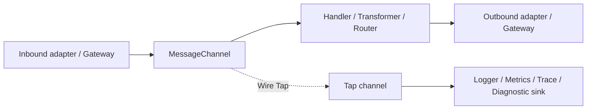
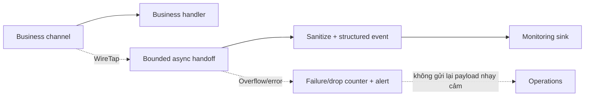

# Wire tap quan sát message trong Spring Integration

## 1. Bài toán: quan sát message mà không đổi luồng nghiệp vụ

Trong hệ thống tích hợp, một message có thể đi từ **inbound adapter** nhận file, SFTP, HTTP, JMS, AMQP hoặc Kafka, qua một hay nhiều **MessageChannel**, rồi tới transformer, router, service activator hoặc **outbound adapter/gateway**. Khi hệ thống gặp lỗi, đội vận hành thường muốn biết:

- Message đã đi vào flow chưa, qua channel nào và lúc nào?
- Một message có bị chặn trước bước xử lý hay bị trễ ở hàng đợi?
- Giá trị **correlation ID**, loại payload và tên luồng có giữ nhất quán không?
- Từ khi nhận file hoặc record đến khi gửi sang hệ thống ngoài mất bao lâu?
- Làm sao lấy mẫu dữ liệu để chẩn đoán mà **không ghi lộ token, mật khẩu hoặc nội dung nhạy cảm**?
- Nếu hệ thống logging/monitoring chậm, xử lý nghiệp vụ có bị ảnh hưởng không?

**Wire Tap** là mẫu thiết kế tích hợp (*Enterprise Integration Pattern — EIP*) giải quyết nhu cầu **quan sát bản tin chạy qua một vị trí** mà không phải chèn thêm nghiệp vụ vào mỗi handler. Trong **Spring Integration**, có thể dùng **WireTap** dưới dạng **ChannelInterceptor** hoặc khai báo trong **Java DSL** với `.wireTap(...)`.

Bài học này thuộc chương **Observability** của mô-đun `SPRING_INTEGRATION_ADAPTERS`: kết nối các hệ thống bên ngoài bằng **inbound/outbound adapter, gateway, poller và MessageChannel**; vận hành các luồng **file, SFTP, HTTP, JMS, AMQP, Kafka và cơ sở dữ liệu**; quản lý hợp đồng message, lỗi và vòng đời kết nối.

**Kết quả cần đạt:** biết chọn điểm gắn wire tap, xây một nhánh quan sát riêng, hiểu đặc tính đồng bộ/bất đồng bộ, đưa metadata an toàn vào log/metrics/tracing và kiểm thử rằng hoạt động quan sát không làm sai hành vi của flow chính.

## 2. Wire Tap là gì?

Wire Tap là một nhánh phụ nhận message đi qua một kênh hoặc một vị trí của flow. **Nhánh chính tiếp tục công việc vốn có**; nhánh tap dùng để log, đo đạc, tạo sự kiện quan sát hoặc phục vụ chẩn đoán.



Trong Spring Integration, WireTap thường được cài như **interceptor của MessageChannel**. Khi message đi qua channel, interceptor gửi message tới channel quan sát, còn đường gửi message của channel chính vẫn được thực hiện theo ngữ nghĩa thông thường.

**Các đặc điểm quan trọng:**

1. **Quan sát tại một điểm cụ thể:** chỉ thấy message thực sự đi qua vị trí có tap; không tự thấy mọi message trong ứng dụng.
2. **Không thay thế consumer chính:** tap bổ sung một đường nhận; nó không phải router điều hướng message khỏi đường chính.
3. **Không mặc nhiên bất đồng bộ:** việc gửi sang nhánh tap có thể xảy ra trên thread xử lý của luồng chính. Muốn tách phần xử lý quan sát nặng, cần thiết kế channel/executor/queue và chính sách quá tải phù hợp.
4. **Không phải deep copy:** không giả định object payload được sao chép sâu. Nếu payload có trạng thái mutable, nhánh quan sát có thể nhìn cùng đối tượng hoặc trạng thái biến đổi theo thời gian.
5. **Không bảo đảm durable audit:** WireTap tự nó không phải transaction log, không phải broker và không cho cam kết exactly-once đối với dữ liệu audit.

### 2.1. Wire Tap khác những thành phần gần giống ra sao?

| Thành phần | Vai trò | Khi nào sử dụng |
|---|---|---|
| **Wire Tap** | Rẽ một bản tin sang đường quan sát tại channel/điểm flow | Log/telemetry mà không sửa logic định tuyến nghiệp vụ |
| **PublishSubscribeChannel** | Phát message cho nhiều subscriber có vai trò xử lý | Nhiều consumer thực sự cùng tham gia kiến trúc flow |
| **Recipient List Router** | Định tuyến message tới nhiều người nhận theo quy tắc | Gửi tới danh sách đích nghiệp vụ đã chọn |
| **Content-based Router** | Chọn nhánh xử lý dựa trên nội dung/header | Điều hướng luồng nghiệp vụ |
| **Service Activator** | Gọi logic xử lý một message | Chuyển đổi trạng thái, gọi service, ghi nghiệp vụ |
| **LoggingChannelAdapter** | Nhận message để ghi log | Làm điểm tiêu thụ nhánh quan sát đơn giản |
| **Micrometer/Observation** | Thu thập chỉ số/trace của component/operation | Đo throughput, latency, lỗi và chuỗi xử lý |

Nếu cần hai consumer đều phải thực hiện **nghiệp vụ có bảo đảm delivery**, Wire Tap thuần túy thường **không đủ**; hãy xem publish-subscribe kết hợp broker/transactional outbox hoặc kiến trúc phân phối có cam kết rõ ràng.

## 3. Vị trí gắn tap quyết định điều quan sát được

Một flow có thể có nhiều điểm đáng chú ý:

```text
Inbound source
    |
    v
[rawInputChannel]       <-- tap A: message vừa được adapter tạo
    |
    v
[transform/validate]
    |
    v
[validatedChannel]      <-- tap B: message đã chuẩn hóa/kiểm tra
    |
    v
[route/filter]
    |
    v
[outboundRequestChannel] <-- tap C: trước khi gọi hệ thống ngoài
    |
    v
Outbound adapter
```

| Điểm gắn | Quan sát được | Không chứng minh được |
|---|---|---|
| **Ngay sau inbound adapter** | Message đã vào Spring Integration, metadata nguồn đã được tạo | Payload đã hợp lệ, outbound thành công |
| **Sau transformer** | Payload/header ở dạng đã chuẩn hóa | Dữ liệu gốc còn nguyên |
| **Sau filter/router** | Message đi tới nhánh được chọn | Tất cả message ban đầu, đặc biệt message đã bị filter |
| **Trước outbound adapter** | Hệ thống sắp gửi request tới target | Target đã nhận, commit hoặc ACK |
| **Sau bước nhận reply/ACK có chủ đích** | Tín hiệu phản hồi hoặc trạng thái đã được flow nhận | Hệ thống ngoài đã hoàn tất đúng nếu ACK không đủ ngữ nghĩa |

**Một tap sau bước filter không thấy những message bị loại**, vì chúng không đi tới channel đó. Nếu cần đo tỷ lệ bị loại, gắn tap trước filter và ghi thêm metric kết quả filter, hoặc dùng một nhánh rejection rõ ràng.

**Một tap trước outbound adapter không chứng minh đã gửi thành công**. Với Kafka/JMS/AMQP, kết luận về publish/commit/ack còn phụ thuộc adapter, broker và transaction semantics. Với HTTP hay SFTP, cần xem response và trạng thái tác vụ riêng.

## 4. Ví dụ Java DSL: wire tap quan sát metadata

Đây là cấu hình minh họa theo phong cách **Spring Integration Java DSL**. Giả sử một inbound adapter hoặc HTTP gateway đưa message vào channel `ordersInput`. Flow chính xử lý message; wire tap gửi sự kiện sang `observationTap`.

```java
import java.util.concurrent.Executor;
import org.slf4j.Logger;
import org.slf4j.LoggerFactory;
import org.springframework.context.annotation.Bean;
import org.springframework.context.annotation.Configuration;
import org.springframework.integration.annotation.IntegrationComponentScan;
import org.springframework.integration.channel.DirectChannel;
import org.springframework.integration.channel.ExecutorChannel;
import org.springframework.integration.config.EnableIntegration;
import org.springframework.integration.dsl.IntegrationFlow;
import org.springframework.messaging.MessageChannel;
import org.springframework.scheduling.concurrent.ThreadPoolTaskExecutor;

@Configuration
@EnableIntegration
public class OrdersObservationConfig {

    private static final Logger log =
            LoggerFactory.getLogger(OrdersObservationConfig.class);

    @Bean
    public MessageChannel ordersInput() {
        return new DirectChannel();
    }

    // Hàng đợi thực thi phần xử lý observability;
    // giới hạn kích thước thay vì tạo thread vô hạn.
    @Bean
    public ThreadPoolTaskExecutor observationExecutor() {
        ThreadPoolTaskExecutor executor = new ThreadPoolTaskExecutor();
        executor.setCorePoolSize(2);
        executor.setMaxPoolSize(4);
        executor.setQueueCapacity(200);
        executor.setThreadNamePrefix("tap-observe-");
        executor.initialize();
        return executor;
    }

    @Bean
    public MessageChannel observationTap(
            ThreadPoolTaskExecutor observationExecutor) {
        return new ExecutorChannel(observationExecutor);
    }

    @Bean
    public IntegrationFlow ordersBusinessFlow() {
        return IntegrationFlow.from("ordersInput")
                .wireTap("observationTap")
                .handle(message -> {
                    // Thay bằng handler nghiệp vụ thực tế.
                    // Không phụ thuộc vào kết quả từ nhánh quan sát.
                    log.debug("Business message accepted");
                })
                .get();
    }

    @Bean
    public IntegrationFlow ordersObservationFlow() {
        return IntegrationFlow.from("observationTap")
                .handle(message -> {
                    // Chỉ lấy metadata được phép công khai trong log.
                    Object flowName = message.getHeaders().get("flowName");
                    log.info(
                            "wiretap flow={} messageId={} payloadType={}",
                            flowName,
                            message.getHeaders().getId(),
                            message.getPayload().getClass().getSimpleName()
                    );
                })
                .get();
    }
}
```

Trong ví dụ:

- `ordersInput` là `DirectChannel`, vì vậy handler nghiệp vụ được gọi theo cơ chế dispatch đồng bộ của channel.
- `.wireTap("observationTap")` thêm đường quan sát cho message qua vị trí đó.
- `observationTap` là `ExecutorChannel`: **handler quan sát** thực thi qua executor riêng, giảm nguy cơ logger chậm giữ thread nghiệp vụ quá lâu.
- Executor có **pool/queue giới hạn**. Việc bàn giao task sang executor vẫn có chi phí, và khi hàng đợi đầy có thể xảy ra từ chối thực thi hoặc backpressure. Vì vậy, không được tuyên bố cấu hình này “không bao giờ ảnh hưởng flow chính”.
- Nhánh log chỉ ghi `flowName`, message ID và loại payload, không gọi `toString()` lên toàn bộ payload.

**Lưu ý phiên bản:** chữ ký DSL, cách đăng ký các endpoint và cơ chế đo tích hợp có thể thay đổi theo phiên bản Spring Integration/Spring Boot. Khi tích hợp vào project thực, kiểm tra phiên bản dependency và API có sẵn. Ví dụ là cấu trúc mẫu, không thay thế việc biên dịch và kiểm thử trong ứng dụng đích.

### 4.1. Vì sao không log toàn bộ `Message<?>`?

Đoạn sau **không nên dùng mặc định trong production**:

```java
// Tránh: có thể lộ payload, Authorization, cookie, token, PII...
log.info("received={}", message);
```

`MessageHeaders` có thể chứa thông tin transport như token, header HTTP, ID người dùng, đường dẫn file hoặc đối tượng xác nhận broker. `payload.toString()` có thể làm lộ nội dung business, dữ liệu cá nhân hoặc bí mật. Quan sát nên xây dựng **bản ghi đã chọn lọc và giảm dữ liệu** theo một **allowlist field**.

Nếu buộc phải xem nội dung để debug, dùng cơ chế **sampling có thời hạn, phân quyền, redaction**, TTL và audit việc bật/tắt. Tuyệt đối không ghi credential, access token, private key hay nguyên nội dung dữ liệu nhạy cảm vào sink quan sát.

## 5. WireTap dưới dạng ChannelInterceptor

Java DSL giúp khai báo nhanh trong flow; về bản chất WireTap có thể là **channel interceptor**. Điều này hữu ích khi một `MessageChannel` đã được nhiều endpoint sử dụng và muốn quan sát bất kỳ message nào đi qua đó.

Mã minh họa ý tưởng:

```java
import org.springframework.integration.channel.DirectChannel;
import org.springframework.integration.channel.interceptor.WireTap;

// tapTarget là MessageChannel đã được cấu hình và có consumer.
DirectChannel sourceChannel = new DirectChannel();
sourceChannel.addInterceptor(new WireTap(tapTarget));
```

Khi dùng cách cấu hình interceptor trực tiếp, cần quản lý channel và vòng đời bean đúng cách; trong project Spring, nên ưu tiên đăng ký các bean/flow bằng container. Điểm gắn vào channel có thể giúp quan sát **nhiều producer** gửi chung một channel, khác với việc gắn ở một flow cụ thể.

**Không nhầm interceptor với việc tạo thêm một consumer tranh nhận message trên cùng `DirectChannel` hoặc `QueueChannel`.** Hai consumer cạnh tranh trên point-to-point channel có thể chia message cho nhau, làm mất message khỏi luồng nghiệp vụ. Wire Tap là cơ chế **nhận bản tin phụ**, không phải một consumer nghiệp vụ cạnh tranh.

### 5.1. Điều gì xảy ra với payload mutable?

Spring Integration message biểu diễn envelope gồm payload và headers. Việc wire tap một message **không mặc nhiên deep-copy payload**.

Giả sử payload là `Map` hoặc một đối tượng mutable. Handler nghiệp vụ sửa nội dung ngay sau điểm tap trong khi handler quan sát chạy ở thread khác. Nhánh quan sát có thể đọc dữ liệu **sau khi đã bị sửa**, tạo log không phản ánh chính xác thời điểm tap hoặc gặp vấn đề thread-safety.

Giải pháp:

1. Ưu tiên **payload bất biến** hoặc mô hình dữ liệu không bị sửa tại chỗ.
2. Khi cần snapshot điều tra, **chuyển đổi thành bản tóm tắt bất biến đã được làm sạch** ngay tại điểm quan sát.
3. Không đưa payload có tham chiếu sống vào hàng đợi quan sát dài hạn nếu cần tính tái lập.
4. Khi gửi nội dung qua thread khác, xem xét serialization, kích thước dữ liệu và chi phí copy; không deep-copy toàn bộ mặc định nếu thông tin không cần.

**WireTap giúp tách logic xử lý, không tự bảo đảm tính bất biến dữ liệu.**

## 6. Đồng bộ, bất đồng bộ, backpressure và ảnh hưởng tới flow chính

Một hiểu nhầm thường gặp là “Wire Tap luôn fire-and-forget”. Thực tế cần xem **channel đích của tap** và cơ chế gửi.

| Nhánh tap | Hành vi thường gặp | Rủi ro |
|---|---|---|
| `DirectChannel` | Consumer tap chạy đồng bộ khi gửi | Logger/sink chậm làm tăng latency; lỗi tap có thể ảnh hưởng lời gọi gửi |
| `ExecutorChannel` | Dispatch consumer thông qua executor | Queue đầy, task bị từ chối; thread pool và lifecycle phải được theo dõi |
| `QueueChannel` | Message được đưa vào queue để poll consumer | Queue bounded có thể đầy; queue không phải durable log |
| Broker/channel durable do hệ thống hỗ trợ | Bên nhận xử lý qua hạ tầng trung gian | Cần quản trị publish confirm, retry, retention, dead-letter và quyền truy cập |

**Chọn chính sách lỗi trước khi triển khai:**

- **Best-effort telemetry:** ưu tiên flow nghiệp vụ; khi sink quan sát lỗi, có thể chấp nhận mất một số bản ghi **đã được phân loại là telemetry không bắt buộc**, nhưng phải có counter cho drop/failure, giới hạn bộ nhớ và khả năng chẩn đoán. Cần kiểm thử thực tế để chắc lỗi nhánh tap không lan sang flow chính.
- **Audit bắt buộc:** nếu pháp lý/kiểm soát yêu cầu **không mất sự kiện**, một wire tap best-effort là chưa đủ. Cần thiết kế **transactional outbox, durable queue/broker hoặc cơ chế audit có xác nhận**, cùng chính sách fail-closed/fail-stop có thẩm quyền đối với trường hợp không ghi được audit.
- **Nội dung rất lớn:** không đưa payload file nhiều MB lên memory queue chỉ để log; dùng ID, checksum hoặc metadata cho phép, liên kết tới dữ liệu gốc có kiểm soát.
- **Sink chậm kéo dài:** phải có giới hạn queue, cảnh báo, retry/backoff và phương án xử lý để không tăng bộ nhớ vô hạn.

Nhánh bất đồng bộ cũng thay đổi **thứ tự quan sát**: log từ tap có thể xuất hiện **sau** log của handler chính hoặc khác thứ tự message đến. Đừng kết luận flow xử lý ngược thứ tự chỉ vì thời điểm ghi log khác nhau; cần so sánh timestamp nguồn, correlation ID và sự kiện có cùng ngữ nghĩa.

### 6.1. Một lược đồ mục tiêu bảo vệ nhánh chính



Đây là **kiến trúc mục tiêu**, không phải cam kết rằng chỉ khai báo `ExecutorChannel` đã có sẵn mọi chính sách bảo vệ. Cần hiện thực xử lý lỗi, saturation và giới hạn lượng dữ liệu tương ứng trong ứng dụng.

## 7. Message contract, headers và correlation ID

Một message Spring Integration có **payload** và **headers**. Khi đi qua HTTP gateway, file adapter, JMS, AMQP hoặc Kafka adapter, các header transport có thể khác nhau; một số header do framework tạo, một số do adapter hoặc ứng dụng bổ sung.

Với quan sát, nên phân biệt:

| Trường | Dùng để làm gì? | Chính sách |
|---|---|---|
| `messageId` | Nhận diện message tại một điểm; giúp ghép log | Không tự coi ID ổn định sau mọi transformer/rebuild |
| `correlationId` | Liên kết các message trong một nghiệp vụ/flow | Quy định cách tạo/lan truyền; không dùng PII nhạy cảm |
| `traceId`, `spanId` | Kết nối distributed tracing nếu đã cấu hình instrumentation | Propagation phải được kiểm thử qua async/broker |
| `flowName`, `channelName` | Chỉ ra vị trí hoặc luồng | Dùng nhãn có số lượng giá trị thấp |
| `adapterType` | File, SFTP, HTTP, JMS, AMQP, Kafka, JDBC… | Dùng enum/nhãn ổn định |
| `payloadType` | Kiểu dữ liệu thay vì nội dung | Tránh class name có dữ liệu bí mật ở `toString()` |
| `payloadSize` | Hỗ trợ phát hiện payload lớn và bottleneck | Đo bytes đúng dạng; không mặc định string length = bytes |
| `sourceRef` | Đường dẫn file, topic, queue, tên bảng | Chỉ ghi thông tin đã được chuẩn hóa/cho phép |
| `outcome`, `errorType` | Thành công, lỗi validation, retry, timeout | Không gắn stack trace hoặc dữ liệu nhạy cảm làm metric tag |
| `observedAt` | Mốc quan sát | Phân biệt với thời điểm nguồn sinh message |

**Message ID không luôn là business ID.** Một transformer hoặc handler có thể tạo message mới, làm message ID thay đổi. Nếu cần theo dõi trọn vòng đời yêu cầu, nên gắn **business correlation ID ổn định** có chính sách nguồn sinh và kiểm tra propagation.

**Không giả định trace tự động được giữ qua `ExecutorChannel` hoặc broker.** Tùy cấu hình Micrometer Observation/OpenTelemetry và phiên bản, context có thể cần cơ chế truyền/khôi phục rõ ràng. Kiểm thử bằng trace thật trước khi tuyên bố có distributed tracing end-to-end.

### 7.1. Một sự kiện quan sát an toàn

Dạng JSON minh họa, không phải schema mặc định của framework:

```json
{
  "event": "integration.message.observed",
  "flow": "order-ingest",
  "stage": "after-validation",
  "adapterType": "sftp",
  "messageId": "c245aab3-0e38-445e-9a86-401ba88b8a52",
  "correlationId": "flow-7d2f",
  "payloadType": "OrderEnvelope",
  "outcome": "RECEIVED",
  "observedAt": "2026-11-23T15:30:00+07:00"
}
```

Một logger có cấu trúc nên lấy dữ liệu từ **allowlist** và thực thi redaction **trước khi** chuyển sang queue/sink nếu nhánh phụ có quyền truy cập rộng hơn. Không biến toàn bộ header thành JSON bằng thao tác `new HashMap<>(message.getHeaders())` rồi lọc ở nơi nhận, vì bí mật đã đi qua đường quan sát.

## 8. Kết hợp Wire Tap với metrics, tracing và logs

**Observability** thường gồm ba loại tín hiệu:

- **Logs:** sự kiện giàu ngữ cảnh, thuận tiện để điều tra một message cụ thể.
- **Metrics:** số lượng, tỷ lệ lỗi, latency và backlog ở mức tổng hợp; thuận tiện cảnh báo.
- **Traces:** đường đi và thời gian của từng operation xuyên các thành phần/ứng dụng.

Wire Tap có thể hỗ trợ **tạo log/sự kiện bổ sung**, nhưng không thay thế instrumentation chuẩn cho handler, adapter, channel và broker.

### 8.1. Metrics nên thu thập

| Metric đề xuất | Đơn vị | Gợi ý nhãn phù hợp |
|---|---|---|
| `integration_messages_observed_total` | Counter | `flow`, `stage`, `adapter` |
| `integration_observation_failures_total` | Counter | `flow`, `failure_type` |
| `integration_observation_dropped_total` | Counter | `flow`, `reason` |
| `integration_message_processing_duration_seconds` | Timer/histogram | `flow`, `outcome` |
| `integration_adapter_requests_total` | Counter | `adapter`, `target`, `outcome` |
| `integration_retries_total` | Counter | `adapter`, `error_category` |
| `integration_backlog_size` | Gauge | `flow`, `queue` |
| `integration_age_oldest_message_seconds` | Gauge | `flow` hoặc `queue` |

**Đây là tên metric minh họa do ứng dụng tự định nghĩa**, không khẳng định Spring Integration hoặc Actuator tự xuất tất cả tên này. Micrometer có thể đo một số thành phần integration nếu cấu hình phiên bản hỗ trợ; phải kiểm tra endpoint metrics thực tế và tránh tạo hai bộ đếm mang cùng nghĩa.

Không dùng `messageId`, `correlationId`, user ID, file path hoặc tên khách hàng làm **metric tag**: số cardinality có thể tăng gần bằng số message, gây chi phí cao và làm hệ thống metrics quá tải. Các ID có thể xuất hiện trong **log hoặc trace có kiểm soát**, không phải nhãn định lượng nhiều giá trị.

### 8.2. Latency ở điểm tap không tự là end-to-end latency

Nếu tap A tại inbound lúc `t_A`, tap B sau transform lúc `t_B`, tap C trước outbound lúc `t_C`:

\[
T_{\mathrm{transform\_segment}} = t_B - t_A
\]

\[
T_{\mathrm{pre\_outbound}} = t_C - t_A
\]

Tuy nhiên, nếu timestamp được ghi **bất đồng bộ tại sink** thay vì chụp ngay lúc message đi qua, độ trễ queue/logging có thể làm các phép trừ sai. Muốn đo latency thật, nên dùng **timer/span quanh đoạn xử lý chính** hoặc ghi timestamp tại điểm quan sát trước khi handoff, sau đó chuyển bản ghi bất biến sang nhánh telemetry.

Nếu flow qua broker hoặc polling, cần phân biệt:

- **Queue wait:** message ở hàng đợi chờ worker.
- **Processing time:** thời gian handler làm việc.
- **External call latency:** gửi request tới bên ngoài và chờ response.
- **End-to-end time:** từ sự kiện nguồn tới kết quả có ý nghĩa nghiệp vụ, có thể gồm chờ/ack và retry.

Một tap tại điểm trước adapter không thể tự biết thời gian broker commit, HTTP response hay SFTP upload hoàn tất.

### 8.3. Tracing và MDC

Khi triển khai distributed tracing, hãy truyền trace context theo cơ chế được framework/broker hỗ trợ, rồi tạo span/observation tại những bước có ý nghĩa. Có thể đưa trace ID vào log thông qua **MDC** hoặc hệ thống logging có khả năng kết hợp trace.

**Lưu ý:** MDC truyền thống thường gắn với thread; khi chuyển sang `ExecutorChannel`, poller hoặc callback async, context có thể không được tự động truyền. Dùng context propagation được hỗ trợ và xóa context phù hợp khi thread tái sử dụng; tránh gắn trace ID của message trước sang message sau.

## 9. Wire Tap trong từng nhóm adapter

### 9.1. File inbound/outbound

Với **file inbound adapter** và poller, message thường mang payload là file/resource hoặc dữ liệu được xử lý, có metadata đường dẫn/tên file. Tap tại channel sau inbound có thể ghi:

- Loại sự kiện `FILE_SEEN`, file size và tên luồng đã chuẩn hóa.
- Correlation ID giữa file đầu vào và message sau transform.
- Thời điểm poll, số file đang chờ và số file thất bại.

**Không** log toàn bộ path nội bộ hoặc nội dung file nếu có dữ liệu nhạy cảm. File được phát hiện **không đồng nghĩa** file đã đọc xong hoặc outbound file đã được ghi nguyên vẹn. Nếu cần đánh dấu hoàn tất, đặt sự kiện sau bước đọc/xử lý/ghi có xác minh.

### 9.2. SFTP

SFTP inbound/outbound adapter thường phụ thuộc kết nối, remote file list, bộ lọc file và phiên upload/download.

Tap giúp thấy message đã vào pipeline và metadata được phép ghi; nhưng phải theo dõi riêng:

- Poller có chạy và nhận file mới không?
- Remote endpoint có trả lỗi authentication/timeout không?
- Có tải lại file do lỗi lọc hoặc lỗi ghi trạng thái đã xử lý không?
- Upload/download có hoàn thành và được xác minh theo hợp đồng nghiệp vụ không?

Không log username/password/private key, URI chứa credential hoặc nội dung file. Khi cần correlation, dùng ID nghiệp vụ an toàn hoặc tên file đã được ẩn bớt.

### 9.3. HTTP inbound gateway và outbound gateway

HTTP **gateway** có thể nhận request và trả reply; **outbound gateway** thường đợi response. Gắn tap ở:

- Channel sau HTTP inbound: xác nhận request đã được chuyển thành message.
- Channel trước outbound: quan sát request trước khi gọi dịch vụ.
- Channel reply hoặc điểm sau khi nhận response: quan sát trạng thái trả về.

**Tap request không chứng minh gateway đã trả 2xx**, và log inbound có thể chứa `Authorization`, cookies, query parameters hoặc payload cá nhân. Chỉ ghi phương thức HTTP, route đã chuẩn hóa, mã phản hồi hoặc duration nếu có sẵn một cách hợp lệ.

### 9.4. JMS và AMQP

Khi adapter sử dụng **JMS** hoặc **AMQP**, message có thể gắn delivery metadata, routing key, redelivery, ack hoặc transaction. Tap có thể giúp phân tích message đã vào kênh xử lý, nhưng:

- Message được quan sát không đồng nghĩa broker đã ACK hoặc transaction đã commit.
- Retry/redelivery có thể đưa cùng logical message qua tap nhiều lần.
- Log cần có delivery attempt/message business ID phù hợp để phân biệt *duplicate delivery* với *duplicate business operation*.
- Nhánh tap không được vô tình khiến acknowledgement/transaction của luồng chính lệch khỏi chính sách.

Nếu cần audit không mất message, dùng cơ chế durable và transactional phù hợp thay vì coi log wiretap là nguồn sự thật duy nhất.

### 9.5. Kafka

Kafka inbound adapter có offset, partition, topic và commit/ack behavior tùy cấu hình. Tap tại `MessageChannel` cho biết **record đã được chuyển thành Spring Message ở vị trí đó**, nhưng **không tự cho biết offset đã commit**.

Nên theo dõi thêm **consumer lag, retry, DLT/dead-letter, thời gian xử lý và trạng thái commit** bằng thành phần chuyên trách. Không đưa key/payload nhạy cảm hoặc header broker object vào log. Các record có cùng payload vẫn có thể là hai sự kiện khác nhau; correlation theo business key phải có hợp đồng rõ.

### 9.6. JDBC/Database

Inbound JDBC poller có thể đọc các dòng dữ liệu theo lịch; outbound JDBC adapter có thể thực hiện thao tác ghi. WireTap quan sát message trước/sau bước biến đổi, nhưng không chứng minh:

- Transaction DB đã commit;
- Hàng được đánh dấu đã xử lý một cách nguyên tử;
- Dữ liệu sẽ không được đọc lại sau rollback;
- Batch update đã áp dụng đầy đủ vào DB.

Để chẩn đoán, kết hợp tap với **transaction metrics, query timings, commit result và idempotency key**. Tránh log toàn bộ record từ bảng có dữ liệu cá nhân hoặc thông tin tài chính.

### 9.7. Poller và vòng đời kết nối

Poller có chu kỳ, giới hạn số message mỗi lần poll, task executor và các cơ chế transaction/error handling. Một flow có **không có message** có thể là bình thường (không có file mới) hoặc sự cố (poller không hoạt động).

WireTap **chỉ quan sát khi message đi qua điểm tap**. Nó **không thay thế** heartbeat poller, connector health, remote connection metrics, queue depth, lịch retry hoặc cảnh báo endpoint dừng. Để biết adapter đã thực sự chạy, cần tín hiệu từ adapter/poller độc lập với luồng message.

## 10. Lỗi trong nhánh chính và nhánh quan sát

Trong Spring Integration có **error channels**, error handling của poller và các cơ chế xử lý ngoại lệ tùy endpoint/async channel. Cần phân biệt:

1. **Lỗi nghiệp vụ**: validation sai, handler ném exception, request outbound timeout.
2. **Lỗi vận chuyển**: broker mất kết nối, SFTP timeout, HTTP target unavailable.
3. **Lỗi nhánh quan sát**: executor đầy, logger chậm, sink telemetry down, serialization thất bại.
4. **Lỗi hợp đồng dữ liệu**: correlation ID thiếu, message schema thay đổi, payload không parse được.

Không nên để lỗi của nhánh quan sát bị ghi thành “business processing failed” nếu hệ thống thực tế không thất bại về nghiệp vụ. Ngược lại, không được nuốt lỗi quan sát bắt buộc mà không có tín hiệu/cảnh báo chỉ vì muốn giảm latency.

### 10.1. Kịch bản lỗi và cách ứng xử

| Kịch bản | Hành vi mong muốn | Kiểm chứng |
|---|---|---|
| Sink logs tạm không sẵn sàng | Chính sách best-effort đã phê duyệt, counter/alert | Flow nghiệp vụ vẫn đi đúng; số drop/failure đo được |
| Tap channel hết dung lượng | Áp dụng giới hạn và chính sách saturation rõ ràng | Không OOM, không block vô hạn ngoài SLA |
| Payload lớn hoặc mutable | Chỉ tạo snapshot metadata an toàn | Không giữ dữ liệu nhạy cảm, không thay payload gốc |
| Handler nghiệp vụ lỗi | Error flow ghi nhận exception đúng loại | Tap không tạo ảo giác outbound đã thành công |
| Message redelivered | Correlation theo logical event + attempt | Không nhầm một sự kiện retry thành nhiều nghiệp vụ |
| Metadata thiếu `flowName` | Dùng nhãn `unknown` có kiểm soát, cảnh báo chất lượng | Không tạo hàng triệu tag giá trị tự do |
| Consumer wiretap dừng | Health/metrics nhận diện nhánh quan sát bị mất | Không suy luận “0 messages = hệ thống không có traffic” |

**Chính sách lỗi là một quyết định sản phẩm/vận hành**, không phải một tính năng tự động của `.wireTap()`. Cần có test thực tế trên loại channel và executor được dùng.

## 11. Kiểm thử hành vi wire tap

Khi viết test, nên chứng minh ba đặc tính độc lập:

- **Luồng chính vẫn xử lý** đúng nội dung, đúng số lần theo hợp đồng.
- **Nhánh tap nhận bản tin quan sát** tại điểm đã chọn.
- **Quan sát không làm thay đổi message gốc**, không lộ dữ liệu và không gây deadlock/latency không chấp nhận được.

### 11.1. Test đơn giản bằng QueueChannel

Dùng `QueueChannel` trong **cấu hình test** giúp nhận message từ tap để so sánh, không cần sink quan sát thật. Đây là ví dụ cô lập với cấu hình production ở mục 4:

```java
import org.springframework.context.annotation.Bean;
import org.springframework.context.annotation.Configuration;
import org.springframework.integration.channel.DirectChannel;
import org.springframework.integration.channel.QueueChannel;
import org.springframework.integration.config.EnableIntegration;
import org.springframework.integration.dsl.IntegrationFlow;
import org.springframework.messaging.MessageChannel;

@Configuration
@EnableIntegration
class WireTapTestConfig {

    @Bean
    MessageChannel testInput() {
        return new DirectChannel();
    }

    @Bean
    QueueChannel tapQueue() {
        return new QueueChannel(10);
    }

    @Bean
    IntegrationFlow testFlow() {
        return IntegrationFlow.from("testInput")
                .wireTap("tapQueue")
                .handle(message -> {
                    // Giả lập xử lý nghiệp vụ; không đụng vào payload.
                })
                .get();
    }
}
```

Ví dụ kiểm thử JUnit 5 với cấu hình trên:

```java
import static org.junit.jupiter.api.Assertions.*;

import org.junit.jupiter.api.Test;
import org.springframework.beans.factory.annotation.Autowired;
import org.springframework.beans.factory.annotation.Qualifier;
import org.springframework.integration.channel.QueueChannel;
import org.springframework.messaging.Message;
import org.springframework.messaging.MessageChannel;
import org.springframework.messaging.support.MessageBuilder;
import org.springframework.test.context.junit.jupiter.SpringJUnitConfig;

@SpringJUnitConfig(WireTapTestConfig.class)
class WireTapTest {

    @Autowired
    @Qualifier("testInput")
    MessageChannel input;

    @Autowired
    @Qualifier("tapQueue")
    QueueChannel tapQueue;

    @Test
    void tapSeesMessageWithoutChangingPayload() {
        Message<String> original = MessageBuilder
                .withPayload("order-42")
                .setHeader("flowName", "orders")
                .build();

        assertTrue(input.send(original));

        Message<?> observed = tapQueue.receive(1000);
        assertNotNull(observed);
        assertEquals("order-42", observed.getPayload());
        assertEquals("orders", observed.getHeaders().get("flowName"));
    }
}
```

Test cho thấy tap nhận message; để **khẳng định nhánh nghiệp vụ xử lý đúng**, hãy thay handler giả bằng một spy hoặc counter và assert số lần xử lý/kết quả. Cần test thêm message khác kiểu payload, timeout, queue đầy và cùng ID xuyên transformer nếu đó là hợp đồng cần bảo vệ.

**Không dùng QueueChannel của test như durable audit trong production.** Queue trong bộ nhớ có thể mất dữ liệu khi process chết; dung lượng giới hạn và consumer chậm còn có thể làm nhánh tap bị nghẽn.

### 11.2. Các ca kiểm thử quan trọng hơn

| Kiểm thử | Điều phải chứng minh |
|---|---|
| Tap sau transform | Thấy message ở định dạng **sau** transform, không phải trước |
| Filter bỏ message | Tap trước filter có thể thấy message; tap sau filter thì không |
| Retry/redelivery Kafka/JMS | Số message quan sát có thể nhiều hơn logical business event; không đếm sai |
| Executor bị saturation | Flow chính có hành vi đúng chính sách khi tap không nhận thêm task |
| Sink mất kết nối | Error/drop signal có thể nhận diện; không mất audit bắt buộc mà không biết |
| Payload chứa token/PII | Log chỉ chứa allowlist metadata, không lộ payload/headers nhạy cảm |
| Payload mutable | Log snapshot phản ánh trạng thái mong muốn, không bị race |
| Correlation context qua async | Trace/log đúng nghiệp vụ; context cũ không rò giữa thread tái sử dụng |
| SFTP/file payload lớn | Không ép toàn bộ file vào log hoặc giữ dữ liệu trong memory queue |
| App shutdown/restart | Xác định những telemetry đang queue bị mất hay có cơ chế flush |
| Poller không có message | Heartbeat xác nhận poller chạy, không dựa vào WireTap |
| Dead-letter/error flow | Quan sát đúng lỗi kỹ thuật và outcome nghiệp vụ, không nhầm thành thành công |

## 12. Checklist triển khai trong hệ thống thật

1. **Xác định mục tiêu:** debug một flow, đo throughput, theo dõi lỗi hay lập audit? Mỗi mục tiêu có độ tin cậy và dữ liệu cần thu khác nhau.
2. **Chọn vị trí tap:** inbound, sau transform, trước outbound hoặc reply; ghi tên channel và stage rõ ràng.
3. **Định nghĩa event contract:** message ID, correlation ID, flow, stage, adapter, outcome, timestamp, payload type và version.
4. **Phân loại dữ liệu:** chỉ log field được cho phép; redaction trước khi chuyển thông tin sang sink, không đưa token vào telemetry.
5. **Chọn channel/executor:** quyết định sync hay async, pool/queue bounded, giới hạn thời gian, chính sách lỗi và backpressure.
6. **Đảm bảo ổn định:** tránh loop tap vào chính channel quan sát, retry không kiểm soát hoặc logging quá chi tiết.
7. **Tách transport semantics:** WireTap thấy message tại channel không thay thế ACK/commit/reply/readback.
8. **Kết hợp metrics/traces:** dùng Micrometer/Observation/OpenTelemetry khi phù hợp; không tạo metric tag cardinality cao.
9. **Bổ sung health:** poller/adapter, broker lag, connector status, sink availability và executor saturation.
10. **Kiểm thử thất bại:** sink chậm/mất kết nối, queue đầy, payload lớn, redelivery, async context và shutdown.
11. **Giới hạn chi phí:** sampling, retention, storage encryption, phân quyền và lịch loại bỏ telemetry.
12. **Ghi lại bằng chứng:** cấu hình, diagram flow, kết quả load test, ngưỡng cảnh báo và runbook xử lý.

## 13. Anti-pattern và cách sửa

| Anti-pattern | Hậu quả | Cách sửa |
|---|---|---|
| Log `message.toString()` ở mọi kênh | Lộ payload/header nhạy cảm, log bùng nổ | Structured logging với allowlist |
| Nghĩ rằng Wire Tap mặc định async | Logger có thể làm tăng latency luồng chính | Chọn channel/executor và kiểm thử tải |
| Dùng unbounded queue để “không block” | OOM khi sink chậm | Bounded queue, chính sách saturation, counter |
| Gắn tap trước outbound rồi báo “đã gửi thành công” | Nhầm request attempt với kết quả target | Theo dõi reply/ACK/commit phù hợp |
| Dùng Wire Tap làm audit bắt buộc | Có thể mất log, thiếu delivery guarantee | Durable audit/outbox và yêu cầu acknowledgement |
| Dùng message ID làm business identity duy nhất | ID có thể đổi sau transform/rebuild | Correlation ID ổn định do hợp đồng định nghĩa |
| Đưa `messageId` vào metric labels | Cardinality tăng theo từng message | Giữ ID ở log/trace, metric theo nhóm nhỏ |
| Tap payload mutable rồi xử lý async | Đọc dữ liệu sau biến đổi/race | Bất biến hoặc tạo snapshot đã sanitize |
| Chỉ có WireTap mà không monitor poller | Không biết poller chết khi không có message | Heartbeat, scheduler và connector metrics |
| Tap mọi message với full payload ở production | Tốn CPU/băng thông, rủi ro PII | Sampling có kiểm soát và giới hạn retention |
| Cấu hình tap quay ngược về channel nguồn | Vòng lặp và nhân bản message vô hạn | Vẽ topology, tránh cycle, test integration graph |
| Bỏ qua error/drop của nhánh telemetry | Dashboard im lặng bị hiểu là không có traffic | Alert chất lượng telemetry và nguồn health độc lập |

## 14. Bài tập và câu hỏi tự kiểm tra

**Câu 1.** Flow `HTTP inbound → transform → outbound JMS` có tap tại channel sau HTTP inbound. Tap thấy message nhưng JMS gửi thất bại. Có thể coi bản ghi tap là bằng chứng message đã publish JMS không?

**Đáp án:** **Không.** Tap chỉ xác nhận message đi qua vị trí đó. Cần kết quả publish/ACK/transaction theo ngữ nghĩa outbound JMS để biết đã gửi thành công.

**Câu 2.** Vì sao dùng `DirectChannel` cho sink logging chậm có thể làm tăng latency luồng nghiệp vụ?

**Đáp án:** Handler nhận message đồng bộ khi send tới `DirectChannel`. Khi WireTap gửi vào nhánh này, thời gian chạy consumer tap có thể nằm trên đường gửi và ảnh hưởng thời gian hoàn tất. Có thể tách bằng async/queue nhưng phải thiết kế saturation và lỗi.

**Câu 3.** Một transformer sửa `Map` payload tại chỗ sau wiretap. Handler tap đọc Map trên thread khác. Có bảo đảm log phản ánh payload trước transformer không?

**Đáp án:** **Không.** Wire Tap không hứa deep-copy. Cần payload bất biến hoặc snapshot metadata/nội dung đã chọn lọc ngay tại thời điểm quan sát.

**Câu 4.** Tại sao không dùng `correlationId` làm tag Prometheus cho mọi message?

**Đáp án:** Một ID khác nhau cho mỗi nghiệp vụ tạo **high cardinality**, tăng chi phí bộ nhớ/lưu trữ và giảm khả năng vận hành. Nên dùng `flow`, `stage`, `adapter`, `outcome` cho metric; đặt correlation ID vào log/trace có kiểm soát.

**Câu 5.** Một Kafka record được retry ba lần và đi qua cùng tap ba lần. Có phải ba business order khác nhau không?

**Đáp án:** Không mặc nhiên. Cần phân biệt **delivery attempts** với logical business event, áp dụng key/idempotency theo hợp đồng message và xem offset/ack semantics của consumer.

**Câu 6.** Wire tap không ghi nhận message mới trong 20 phút. Có thể kết luận inbound SFTP không có file mới?

**Đáp án:** **Chưa thể.** Poller có thể ngừng chạy, connector mất kết nối, bộ lọc không đưa file vào channel hoặc sink telemetry bị lỗi. Kiểm tra heartbeat, remote status, poller metrics, queue và lỗi quan sát.

**Câu 7.** Nhóm yêu cầu audit pháp lý **không được mất sự kiện**, nhưng hệ thống đang ghi log bằng WireTap → `ExecutorChannel` → logger. Có đáp ứng được chưa?

**Đáp án:** **Chưa đủ căn cứ.** ExecutorChannel và logger không tự bảo đảm durable delivery, transaction consistency hoặc exactly-once. Cần một thiết kế audit có xác nhận, cơ chế lưu bền, retry và xử lý lỗi/khôi phục thích hợp.

**Câu 8.** Trong flow file inbound, tap log toàn bộ nội dung PDF khách hàng để debug. Nguy cơ và hướng thay thế là gì?

**Đáp án:** Nguy cơ lộ dữ liệu cá nhân, quá tải memory/log và retention không phù hợp. Chỉ ghi **metadata được cho phép**, kích thước, loại file, correlation ID, checksum theo chính sách; dùng debug có kiểm soát khi thật sự cần.

**Câu 9.** Một HTTP gateway trả response 200 nhưng tap tại channel inbound đã ghi outcome `SUCCESS` ngay khi nhận request. Sai ở đâu?

**Đáp án:** Mốc tap inbound mới biết request đã vào flow, chưa biết kết quả. Ghi `RECEIVED` ở inbound; outcome HTTP nên đo sau khi có response với ngữ nghĩa rõ ràng.

**Câu 10.** Sau khi thêm tap vào production, p95 xử lý tăng mạnh và `ThreadPoolTaskExecutor` báo queue luôn đầy. Bạn sẽ kiểm tra gì?

**Đáp án:** Sink latency, kích thước và số message, chính sách task rejection, việc tap dispatch trên thread business, tốc độ consumer, sampling và counter drop/error. Điều chỉnh kiến trúc quan sát để bảo vệ SLA nghiệp vụ, không chỉ tăng queue vô hạn.

## Ghi nhớ

**Wire Tap trong Spring Integration là cách quan sát message đi qua một `MessageChannel` hoặc điểm trong `IntegrationFlow` bằng một đường phụ**, giúp log/đo lường mà không cần đưa logic quan sát vào từng handler. Nhưng nó **không tự bất đồng bộ, không deep-copy payload, không bảo đảm audit bền vững, không xác nhận ACK/commit ở hệ thống ngoài và không thay thế health của poller/adapter**. Hãy chọn điểm tap có ý nghĩa, ghi metadata an toàn, duy trì correlation/tracing, giới hạn queue và cardinality, kiểm thử lỗi nhánh quan sát và ghép với metrics/traces phù hợp. Mục tiêu là **thấy đúng hành trình message qua file, SFTP, HTTP, JMS, AMQP, Kafka và cơ sở dữ liệu mà không làm sai hợp đồng message, nghiệp vụ hay vòng đời kết nối**.
