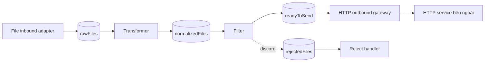
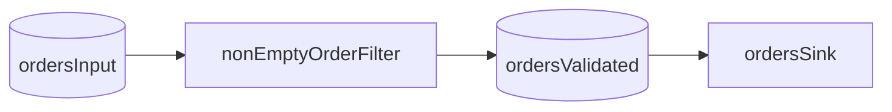
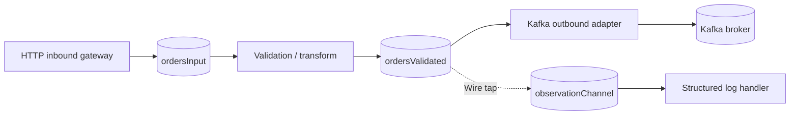
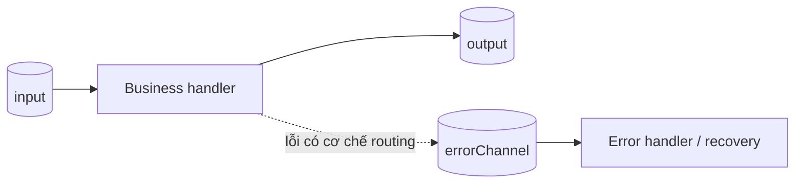
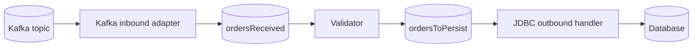

# Integration graph của flow trong Spring Integration

## 1. Vì sao cần quan sát đồ thị tích hợp?

Một ứng dụng **Spring Integration** thường không xử lý dữ liệu trong một hàm duy nhất. Message đi qua nhiều thành phần: **inbound adapter** nhận file hoặc sự kiện từ SFTP/JMS/Kafka, **MessageChannel** chuyển message, filter/router/transformer điều hướng và chuyển đổi, rồi **outbound adapter/gateway** gọi HTTP, ghi cơ sở dữ liệu hoặc gửi message tới broker.

Khi luồng phát triển, việc tìm câu trả lời cho các câu hỏi sau trở nên khó khăn:

- Message từ adapter A có thể đi qua những channel và handler nào trước khi tới hệ thống B?
- Một **gateway** đang gửi request vào channel nào, và reply được lấy ở đâu?
- Tại sao một poller vẫn chạy nhưng không có message xuất hiện ở channel đích?
- Một `errorChannel` đã thực sự được nối tới flow xử lý lỗi chưa?
- Khi thêm một adapter hoặc đăng ký flow động, **topology đang chạy** khác gì so với cấu hình dự kiến?
- Một endpoint bị dừng, một broker bị lỗi hoặc một downstream quá chậm có thể được xác định chỉ bằng sơ đồ kết nối không?

**Integration graph** là cách trình bày các **thành phần và mối liên kết trong mô hình Spring Integration đang hoạt động** dưới dạng một đồ thị. Nó hỗ trợ đọc kiến trúc flow, tìm điểm cần đo metrics/traces, kiểm tra kết nối và hỗ trợ điều tra sự cố. Đồ thị **không phải** nhật ký từng message, không tự biểu diễn trạng thái nghiệp vụ hoặc bảo đảm thành công của một lệnh gửi ra hệ thống ngoài.

Bài này nằm trong chương **Observability** của mô-đun `SPRING_INTEGRATION_ADAPTERS`: kết nối hệ thống ngoài qua **inbound/outbound adapter, gateway, poller và MessageChannel**, với các luồng file, SFTP, HTTP, JMS, AMQP, Kafka và database; chú trọng **hợp đồng message, xử lý lỗi, trạng thái kết nối và khả năng quan sát**.

Sau bài học, bạn có thể:

1. Phân biệt **đồ thị topology**, **đường đi thực của message** và **dữ liệu telemetry**.
2. Đọc các node/channel/endpoint và các liên kết giữa chúng.
3. Thiết kế flow Java DSL dễ quan sát bằng tên channel/endpoint rõ ràng.
4. Hiểu vai trò của **IntegrationGraphServer** và cách truy xuất đồ thị qua công cụ quản trị/Actuator khi môi trường hỗ trợ.
5. Kết hợp graph với logs, metrics, tracing, error channel và kiểm tra tại adapter.
6. Nhận diện giới hạn của graph, rủi ro bảo mật và các kiểm thử cần có trước khi đưa vào vận hành.

## 2. Integration graph là gì?

Trong ngữ cảnh này, **graph** là một mô hình quan hệ gồm:

- **Node (đỉnh):** một thành phần Spring Integration, ví dụ message channel, endpoint, message handler hoặc message source.
- **Link/edge (cạnh):** mối liên hệ cấu hình giữa các thành phần, ví dụ endpoint tiêu thụ từ channel nào, gửi sang channel nào hoặc được gắn vào một thành phần khác.
- **Metadata:** tên bean, loại thành phần, ID hoặc thông tin cấu hình được hệ thống công bố tại thời điểm lấy graph.

Ví dụ logic:



Trong sơ đồ, những hộp tròn đại diện cho **MessageChannel**, còn các hộp chữ nhật đại diện cho endpoint/handler hoặc hệ thống ngoài. Đây là **sơ đồ minh họa được vẽ để giải thích**; không phải hình khẳng định đầu ra JSON của graph luôn có cùng kiểu node, tên hoặc tất cả cạnh như trên.

Điều đồ thị giúp trả lời: **“Những thành phần nào được nối với nhau trong runtime topology?”**

Điều nó **không** tự trả lời: **“Message cụ thể X đã đi qua những node nào lúc 14:03, đã được ACK chưa và mất bao nhiêu mili giây?”**

Muốn trả lời câu thứ hai, cần **correlation ID, structured logs, metrics và distributed traces** ở các vị trí phù hợp.

### 2.1. So sánh ba góc nhìn

| Góc nhìn | Đối tượng chính | Câu hỏi giải quyết | Giới hạn |
|---|---|---|---|
| **Integration graph** | Component, channel, endpoint, liên kết | Flow hiện được nối thế nào? | Không chứng minh một message đã chạy qua cạnh |
| **Message trace/log** | Một request/message hoặc nhóm sự kiện có correlation | Message thực tế đã đi đâu và gặp lỗi gì? | Có thể thiếu điểm instrument; log async có thể đổi thứ tự |
| **Metrics/health** | Throughput, latency, lỗi, backlog, trạng thái adapter | Flow đang khỏe hay nghẽn ở đâu? | Không mô tả toàn bộ topology hoặc payload |

Ví dụ, graph có cạnh từ `ordersValidated` tới `ordersKafkaOutbound`. Điều đó **không có nghĩa** broker Kafka đang hoạt động, topic tồn tại, record đã được publish hoặc consumer đã commit offset. Nó chỉ cho biết phần kết nối có thể được mô hình hóa ở mức Spring Integration.

## 3. Đọc node và cạnh: các khái niệm phải nắm

### 3.1. MessageChannel — nơi message được chuyển giao

Các loại channel khác nhau có tác động vận hành khác nhau:

| Channel | Ngữ nghĩa chính | Điều cần nhớ khi nhìn graph |
|---|---|---|
| `DirectChannel` | Gọi handler đồng bộ theo cơ chế dispatch point-to-point | Một cạnh không nói được thời gian handler hay thread đang block |
| `ExecutorChannel` | Dispatch qua executor | Graph không cho biết queue của executor đang đầy hoặc task bị từ chối |
| `QueueChannel` | Lưu tạm message để consumer/poller lấy | Cần đo queue depth, tuổi message, capacity; graph không phải báo cáo backlog |
| `PublishSubscribeChannel` | Phát cho nhiều subscriber theo cấu hình | Nhiều nhánh có thể cùng nhận; cần hiểu policy về lỗi/order |
| Channel liên quan broker/persistent store | Có thể dựa trên cơ chế lưu trữ/transport riêng | Độ bền và ACK/commit phụ thuộc cấu hình, không suy ra từ hình dạng graph |

Một điều quan trọng: nhiều subscriber trên một **point-to-point channel** không mặc nhiên tạo nhiều bản sao message. Đừng suy luận “có ba nhánh graph nên mỗi message được xử lý ba lần” nếu chưa hiểu channel và dispatcher thực tế.

### 3.2. Message endpoint và handler

Một **consumer endpoint** nối `MessageChannel` tới handler. Handler có thể là:

- **Transformer:** chuyển payload hoặc headers; có thể sinh message mới.
- **Filter:** cho đi tiếp hoặc loại message; có thể có discard channel.
- **Router:** chọn đích dựa trên nội dung/header/chính sách.
- **Service activator:** gọi logic nghiệp vụ.
- **Splitter/Aggregator:** một message thành nhiều phần hoặc gom nhiều message thành một kết quả.
- **Outbound adapter/gateway:** gửi sang hệ thống ngoài; gateway thường quan tâm request–reply.

Một **inbound endpoint** có thể có message source, chẳng hạn polling SFTP/file/JDBC, hoặc một adapter nhận sự kiện push/broker.

Tên hiển thị của handler và endpoint có thể do framework tạo nếu không đặt ID rõ ràng. Đối với bài toán observability, **đặt ID có ý nghĩa giúp trace ngược giữa graph, metrics và log**.

### 3.3. Graph là topology, không phải bản sao chính xác của mọi quy tắc runtime

Một router có thể chọn channel theo header, cấu hình hoặc registry động. Graph có thể trình bày những quan hệ tĩnh mà framework biết, nhưng **không nhất thiết liệt kê hết mọi đích tạo ra lúc runtime**.

Tương tự:

- Bộ lọc có điều kiện theo payload; graph không chỉ rõ message nào bị loại.
- Poller kích hoạt theo lịch; một cạnh có tồn tại không có nghĩa poll đã chạy.
- Advice, retry, transaction interceptor, permission hoặc external API dependency có thể không được biểu diễn đầy đủ.
- Một handler có thể tự gọi SDK hoặc gửi message bên ngoài mà **không tạo thành Spring Integration endpoint được graph nhận diện**.
- Đường `errorChannel` có thể phụ thuộc endpoint, thread và cách ngoại lệ được chuyển thành error message; không được giả định mọi exception đều đi qua một node có tên `errorChannel`.

Vì vậy, sử dụng graph như **bản đồ các thành phần đã biết**, rồi đối chiếu cấu hình, health và thực nghiệm.

## 4. Vòng đời của Integration graph trong Spring Integration

Spring Integration có cơ chế **runtime integration graph** để mô tả những thành phần tích hợp trong `ApplicationContext`. Thành phần thường được nhắc tới là **`IntegrationGraphServer`**, phụ trách xây dựng/cung cấp mô hình graph từ các component được quản lý.

Tùy phiên bản **Spring Integration / Spring Boot**, framework và hệ sinh thái quản trị có thể cung cấp cách khai thác graph khác nhau; trong ứng dụng dùng **Spring Boot Actuator**, endpoint có tên **`integrationgraph`** thường là cách thuận tiện để xem graph runtime khi điều kiện tự cấu hình và quyền truy cập cho phép.

**Điều cần phân biệt:**

- **Code Java DSL/XML/annotation** là mô tả thiết kế của flow.
- **Bean/endpoint đã đăng ký trong `ApplicationContext`** là thành phần có khả năng xuất hiện trong graph runtime.
- **Graph được truy xuất** là ảnh chụp mô hình tại một thời điểm, có thể cần refresh/rebuild khi topology thay đổi tùy phiên bản và cơ chế quản trị.
- **Endpoint được vẽ** không bảo đảm **đang running**, kết nối mạng còn sống hoặc broker có thể nhận dữ liệu.

### 4.1. Ví dụ cấu hình Spring Boot Actuator

Nếu ứng dụng dùng bản Spring Boot/Spring Integration hỗ trợ endpoint tương ứng, có thể cấu hình **minh họa** như sau:

```yaml
management:
  endpoint:
    integrationgraph:
      enabled: true
  endpoints:
    web:
      exposure:
        include: "health,info,integrationgraph"
```

Sau khi khởi động ứng dụng trong **môi trường kiểm thử được phép**, thử:

```bash
curl --fail --silent http://localhost:8080/actuator/integrationgraph
```

**Đây không phải công thức bảo đảm hoạt động trên mọi phiên bản.** Endpoint chỉ xuất hiện nếu actuator, integration component liên quan và điều kiện cấu hình đáp ứng; URL thực còn chịu ảnh hưởng bởi `management.server.port`, context/base path và reverse proxy. Trong production phải bảo vệ endpoint bằng chính sách xác thực, phân quyền, network access và TLS; **không công khai integration graph lên Internet**.

Nếu phản hồi `404`, trước hết kiểm tra **endpoint có hiện diện và được expose trong phiên bản đang dùng không**, thay vì mặc định flow không tồn tại. Nếu `401/403`, kiểm tra **quyền quản trị**; không tìm cách tắt bảo mật để lấy graph.

**Lưu ý:** cụ thể về API của `IntegrationGraphServer`, các cấu hình quản lý và tên trường JSON có thể thay đổi giữa các phiên bản; xác nhận bằng tài liệu của phiên bản trong project trước khi viết công cụ phụ thuộc cứng vào schema.

### 4.2. Đầu ra graph có thể trông như thế nào?

Ví dụ **schema khái niệm** (không phải JSON thực được cam kết bởi `integrationgraph`):

```json
{
  "nodes": [
    {"id": "ordersInput", "type": "channel"},
    {"id": "validateOrder", "type": "endpoint"},
    {"id": "ordersValidated", "type": "channel"},
    {"id": "ordersSink", "type": "endpoint"}
  ],
  "links": [
    {"from": "ordersInput", "to": "validateOrder"},
    {"from": "validateOrder", "to": "ordersValidated"},
    {"from": "ordersValidated", "to": "ordersSink"}
  ]
}
```

Mục đích ví dụ là mô tả **node và link**, không phải đưa ra cam kết rằng REST API luôn trả `type`, `from`, `to` đúng như trên. Trình trực quan hóa cần **adapter/parser tương thích phiên bản** và kiểm thử schema trước khi sử dụng.

### 4.3. Tên bean và tính ổn định của graph

Một flow Java DSL tạo ra nhiều endpoint nội bộ; nếu không đặt ID, tên tự sinh thường khó hiểu và dễ thay đổi khi sửa thứ tự DSL. Nên:

1. Đặt **tên channel/bean** mang ý nghĩa nghiệp vụ, chẳng hạn `ordersInput`, `ordersValidated`, `ordersToKafka`.
2. Đặt **ID endpoint** ở các chặng quan trọng, ví dụ `ordersValidator`, `ordersKafkaPublisher`.
3. Dùng quy ước ổn định theo module/flow/stage, tránh mã chứa dữ liệu người dùng hoặc order ID.
4. Đừng đổi tên endpoint chỉ để trình bày đồ thị nếu dashboard/alert đang tham chiếu đến ID đó mà chưa có kế hoạch di chuyển.
5. Với flow được tạo động, lưu thêm **instance ID, thời điểm đăng ký và version cấu hình** khi so sánh graph.

## 5. Xây flow Java DSL có topology rõ ràng

Ví dụ sau tạo hai channel và một flow gồm bước lọc và handler. Nó dùng **Java DSL** với các tên rõ ràng để thuận tiện đọc graph. Adapter ngoài có thể gửi message đến `ordersInput`; đoạn code tập trung vào phần **nội bộ IntegrationFlow**.

```java
import org.springframework.context.annotation.Bean;
import org.springframework.context.annotation.Configuration;
import org.springframework.integration.channel.DirectChannel;
import org.springframework.integration.config.EnableIntegration;
import org.springframework.integration.dsl.IntegrationFlow;
import org.springframework.messaging.MessageChannel;
import org.slf4j.Logger;
import org.slf4j.LoggerFactory;

@Configuration
@EnableIntegration
public class OrderGraphConfiguration {

    private static final Logger log =
            LoggerFactory.getLogger(OrderGraphConfiguration.class);

    @Bean
    public MessageChannel ordersInput() {
        return new DirectChannel();
    }

    @Bean
    public MessageChannel ordersValidated() {
        return new DirectChannel();
    }

    @Bean
    public IntegrationFlow ordersFlow() {
        return IntegrationFlow.from("ordersInput")
                .filter(
                        String.class,
                        text -> !text.isBlank(),
                        endpoint -> endpoint.id("nonEmptyOrderFilter")
                )
                .channel("ordersValidated")
                .handle(
                        message -> log.info(
                                "Processed payloadType={}",
                                message.getPayload().getClass().getSimpleName()
                        ),
                        endpoint -> endpoint.id("ordersSink")
                )
                .get();
    }
}
```

**Giả định:** payload ở flow này là `String`, ứng dụng dùng phiên bản Java hỗ trợ `String.isBlank()`, và Spring Integration DSL trong project có các overload tương ứng. Với ứng dụng thật, nên chọn **type converter, validation, error flow, hợp đồng payload và logging** theo phiên bản đang sử dụng.

Về mặt logic:



Khi một inbound HTTP gateway, JMS adapter hoặc Kafka inbound endpoint gửi vào `ordersInput`, phần flow nội bộ này là một đoạn của topology tổng thể. Nếu payload rỗng bị filter loại, nó **không đi đến** `ordersValidated`; graph vẫn cho thấy mối liên kết cấu hình, không cho biết số message bị loại.

### 5.1. Kiểm tra message chạy thật khác với đọc graph

Một kiểm thử đơn giản cho flow trên có thể gửi một message:

```java
import org.springframework.messaging.MessageChannel;
import org.springframework.messaging.support.MessageBuilder;

// Ví dụ sử dụng bean MessageChannel đã được inject từ Spring.
boolean sent = ordersInput.send(
        MessageBuilder.withPayload("order-42").build()
);

// sent phản ánh kết quả send theo ngữ nghĩa của channel;
// không có nghĩa mọi hệ thống downstream đã commit thành công.
```

Khi muốn chắc message đã tới handler, cần **assert một side effect được kiểm soát** hoặc dùng mock/spy handler trong test; kiểm tra `send()` trả `true` không đủ chứng minh một outbound HTTP/Kafka/DB đã hoàn tất.

### 5.2. Gắn gateway và adapter vào phần flow

Một hệ thống đầy đủ có thể có topology:



Đây là **đích thiết kế minh họa**, không phải sơ đồ được tạo từ code ở trên. Nếu thực tế muốn gửi vừa sang Kafka vừa sang nhánh observability, hãy dùng **Wire Tap** hoặc kiến trúc publish–subscribe tương thích; đừng chỉ nối hai consumer vào một point-to-point channel rồi giả định cả hai luôn nhận đủ mọi message.

## 6. Đọc graph cho inbound adapter, outbound adapter và gateway

### 6.1. Inbound adapter

Inbound adapter là điểm kết nối **bên ngoài → Spring Integration**. Ví dụ:

- File inbound adapter đọc file từ thư mục.
- SFTP inbound adapter lấy file từ máy chủ.
- Kafka/JMS/AMQP inbound adapter nhận record/message từ broker.
- JDBC inbound adapter có thể poll dữ liệu database.
- HTTP inbound gateway nhận request đồng bộ và thường có reply.

Trong graph, có thể thấy endpoint và channel nhận message. Nhưng graph **không tự chứng minh adapter đã poll thành công** hoặc đang kết nối với broker/host từ xa.

Ví dụ, file inbound endpoint nối tới `incomingFiles`. Nếu không có message tới `incomingFiles`, các khả năng gồm: không có file, file bị filter, poller không hoạt động, không có quyền thư mục, hoặc lỗi khi tạo message. Graph không cho biết nguyên nhân nào đúng; phải xem metrics, event log và health adapter.

### 6.2. Outbound adapter

Outbound adapter là điểm **Spring Integration → hệ thống bên ngoài**. Graph có thể cho biết channel nguồn và handler gửi, chẳng hạn `outgoingKafka` → `kafkaPublisher`.

Tuy nhiên:

- Một message được gửi đến channel chưa có nghĩa **broker đã ACK**.
- Gọi HTTP gateway chưa có nghĩa nhận response hợp lệ.
- Gọi file/SFTP outbound adapter chưa có nghĩa nội dung file đã được ghi hoàn toàn và xác minh theo hợp đồng.
- Gọi JDBC outbound adapter chưa có nghĩa transaction đã commit.
- Lỗi có thể đi vào `errorChannel`, bị advice xử lý hoặc được propagated cho caller tùy loại endpoint.

**Đồ thị mô tả đường nối, không phải kết quả giao dịch.**

### 6.3. Gateway request–reply

Gateway có ngữ nghĩa khác one-way adapter: caller gửi yêu cầu và có thể chờ phản hồi qua reply channel hoặc cơ chế tương ứng. Nếu dùng HTTP inbound gateway và outbound gateway, cần theo dõi:

- Channel request và điểm chuyển đổi message.
- Những handler tạo reply, timeout hoặc exception.
- Quan hệ **reply/error channel** được khai báo hoặc phát sinh trong quá trình runtime.
- Đường đi của correlation ID để ghép request và response.

Một graph **không chứng minh reply của từng request** đi qua đường nào nếu routing phụ thuộc header hoặc trạng thái runtime. Với gateway, kết hợp graph với trace có **parent/child spans** và log có correlation ID để phân tích tình huống request timeout.

## 7. Poller, channel và lỗi: các thành phần dễ bị hiểu sai

### 7.1. Poller không có message chưa chắc là lỗi

Poller quyết định **khi nào và bao nhiêu lần** source được kiểm tra, thường theo `fixedDelay`, `fixedRate` hoặc cron, với `maxMessagesPerPoll`, transaction và task executor tùy cấu hình.

Trong graph, một polling endpoint có thể hiện diện ngay cả khi:

- Không có file SFTP mới hoặc bản ghi database mới.
- Connector bị timeout và không đọc được dữ liệu.
- Poller đã bị dừng, không còn trigger.
- Bộ lọc duplicate file/row đã loại mọi nguồn.
- Thread pool bận hoặc scheduler không chạy.

Vì vậy phải đo riêng **poller heartbeat, số lần poll, last successful poll, số message phát ra, lỗi kết nối và thời gian chờ**. Graph giúp biết *cần kiểm tra poller nào*, chứ không tự cung cấp mọi trạng thái đó.

### 7.2. Channel trung gian làm rõ vùng có thể nghẽn

Ví dụ:

```text
SFTP inbound --> rawFiles --> transformer --> validatedFiles
                                       |
                                  QueueChannel
                                       |
                                  outbound HTTP
```

Nếu queue tăng liên tục, nguyên nhân có thể là HTTP downstream chậm, consumer giảm tốc hoặc retry làm backlog tích tụ. Graph chỉ cho thấy có thành phần queue; để kết luận cần quan sát:

- `queue_depth`, `oldest_message_age`.
- Throughput inbound/outbound.
- Latency handler, timeout và error rate.
- Cơ chế drop/retry/requeue và giới hạn bộ nhớ.

**Sự tồn tại của `QueueChannel` không chứng minh queue bền vững qua restart.** Độ bền phụ thuộc cách cấu hình message store và transport.

### 7.3. Error flow

Spring Integration có cơ chế `errorChannel`, `ErrorMessage`, exception handling của endpoint/poller và error flow theo cấu hình. Nhưng lỗi từ các kiểu channel/thread khác nhau có thể được **propagate trực tiếp**, được đưa vào error channel hoặc được callback riêng xử lý.

Một sơ đồ logic:



Đường nét đứt trong hình là **khả năng xử lý lỗi nếu đã được cấu hình và phù hợp cơ chế**, không phải kết luận rằng mọi exception đều tạo `ErrorMessage` trên `errorChannel`.

Khi điều tra graph:

1. Xác minh endpoint nào được cấu hình `errorChannel`.
2. Xem giao thức lỗi của handler/adapter và transaction/poller.
3. Kiểm tra log của `ErrorMessage` hoặc exception đã propagate.
4. Tạo test lỗi có kiểm soát, chứng minh nhánh nào thực sự nhận lỗi.
5. Đánh giá retry/DLQ/DLT để không nhầm “đã route lỗi” với “đã xử lý thành công”.

## 8. Từng loại adapter xuất hiện thế nào trong bài toán graph?

| Adapter/transport | Các node hoặc chặng liên quan | Cần dữ liệu khác ngoài graph |
|---|---|---|
| **File** | Polling file source, input channel, transformer, file outbound handler | Files discovered/processed, filter, transaction, file size, filesystem health |
| **SFTP** | SFTP inbound/outbound endpoint, channel, poller | SSH/auth, remote path, session pool, download/upload result |
| **HTTP** | Inbound gateway, request channel, reply, outbound gateway | HTTP status, timeout, TLS, endpoint latency, response body policy |
| **JMS** | Inbound listener/polling adapter, channel, outbound handler | Broker connectivity, redelivery, transaction, ack, DLQ |
| **AMQP** | Message-driven/polling endpoint, routing channel, outbound adapter | Exchange/queue bindings, publisher confirm, consumer ack, DLX |
| **Kafka** | Inbound adapter, processing channels, Kafka outbound handler | Topic, partition, lag, offsets, retry/DLT, publish result |
| **Database/JDBC** | Polling source, rows-as-message, transformer, JDBC outbound | Query plan, cursor/pagination, transaction commit, row locking |

Graph rất hữu ích để nối một endpoint với **owner flow, channel đầu vào và vị trí chèn instrumentation**. Nhưng broker, remote SFTP, database engine hoặc HTTP service là **phụ thuộc ngoài Spring Integration graph**; chúng chỉ được mô tả đầy đủ nếu đội vận hành kết hợp thêm sơ đồ kiến trúc hoặc metadata riêng.

### Ví dụ: sự cố Kafka → JDBC

Sơ đồ mong muốn:



Khi record tồn tại trong Kafka nhưng không có hàng mới trong DB:

- Graph cho biết **đường nối logic** từ Kafka inbound tới JDBC handler.
- Kafka consumer lag/offset cho biết consumer có thực sự nhận record hay không.
- Log/trace có correlation ID cho biết record đi qua validator chưa.
- Metrics channel/handler cho biết luồng có nghẽn hoặc lỗi không.
- Transaction log và dữ liệu DB xác nhận thao tác ghi có commit hay không.

Không kết luận “JDBC handler đã ghi thành công” chỉ vì node và cạnh xuất hiện.

## 9. Kết hợp graph với Wire Tap, logs, metrics và tracing

**Graph trả lời “đi đâu?”; observability trả lời “đang xảy ra điều gì?”**. Một cách làm hiệu quả là dùng graph để xác định các vị trí đo có giá trị cao:

1. **Ngay sau inbound:** đếm message đã chuyển từ nguồn ngoài vào `MessageChannel`.
2. **Sau filter/validation:** đo tỷ lệ thông qua và bị từ chối.
3. **Trước outbound:** đo số request attempt.
4. **Sau phản hồi hoặc xác nhận đích:** đo success/failure theo ngữ nghĩa của adapter.
5. **Tại error flow:** phân loại exception, retry và dead-letter.
6. **Tại queue/poller:** quan sát backlog, tuổi message và heartbeat.

**Wire Tap** có thể gửi message sang nhánh logging mà không đưa logic quan sát vào mỗi handler. Tuy nhiên, Wire Tap **không mặc nhiên bất đồng bộ**, không deep-copy payload và không phải durable audit; khi gắn vào flow phải quản lý thread/queue, làm sạch dữ liệu và chính sách lỗi.

### 9.1. Structured log dựa trên ID ổn định

Ví dụ sự kiện quan sát **do ứng dụng định nghĩa**:

```json
{
  "event": "integration.stage.completed",
  "flow": "orders-import",
  "component": "nonEmptyOrderFilter",
  "stage": "validated",
  "adapter": "http",
  "correlationId": "flow-b4d2",
  "outcome": "ACCEPTED",
  "observedAt": "2026-11-23T15:30:00+07:00"
}
```

Không ghi `Authorization`, cookie, API key, dữ liệu cá nhân hoặc nguyên payload vào log. Sử dụng **allowlist fields** và thực hiện redaction trước khi chuyển sang sink telemetry.

Tên node/endpoint trong graph có thể giúp gắn `component` hoặc `stage` ổn định cho log, nhưng **không** nên đưa `messageId` hoặc `correlationId` làm nhãn cho metrics vì dễ gây **high cardinality**.

### 9.2. Metrics gắn với topology

| Metric minh họa | Đo điều gì? | Liên hệ node |
|---|---|---|
| `integration_messages_received_total` | Số message đi vào luồng | Inbound/channel |
| `integration_messages_rejected_total` | Số message bị filter từ chối | Filter/validation |
| `integration_handler_duration_seconds` | Thời gian xử lý một handler | Handler |
| `integration_adapter_failures_total` | Số lỗi theo adapter và loại | Adapter |
| `integration_queue_depth` | Số message trong hàng đợi | QueueChannel/broker |
| `integration_oldest_message_age_seconds` | Tuổi của message chờ lâu nhất | Queue/poller |
| `integration_retries_total` | Số lần retry theo nhóm lỗi | Endpoint/retry |
| `integration_graph_collection_failures_total` | Số lần thu graph thất bại | Collector quản trị |

**Các tên metric trên là đề xuất do ứng dụng tự đặt, không phải danh sách endpoint metric mặc định của Spring Integration.** Micrometer/Observation và Spring Integration Management có thể cung cấp metrics riêng tùy phiên bản/cấu hình; tránh tự ghi metric trùng nghĩa với những gì hệ thống đã thu.

Những nhãn nên có số giá trị hữu hạn, chẳng hạn `flow`, `component`, `adapter`, `outcome`. Không lấy tên file duy nhất, customer ID hay topic được sinh động không giới hạn làm tag mà chưa có quy tắc cardinality.

### 9.3. Trace cho message thực tế

Distributed tracing với OpenTelemetry/Micrometer Observation có thể giúp theo dõi các bước của một request qua nhiều thành phần, nhưng cần **context propagation** phù hợp:

- `DirectChannel` thường đi theo đường thực thi đồng bộ.
- `ExecutorChannel` chuyển thread; context/MDC không mặc nhiên được truyền đúng nếu không cấu hình.
- Kafka/JMS/AMQP qua broker đòi hỏi truyền và khôi phục context theo headers/protocol phù hợp.
- Một transformer có thể tạo message mới; Spring `MessageHeaders.ID` không nhất thiết là business correlation ID.
- Poller có thể khởi tạo trace mới, nên phải xác định cách liên hệ event nguồn với process attempt.

**Graph mô tả topology; trace cho thấy một lần thực thi cụ thể.** Nếu trace chỉ đi tới handler đầu tiên dù graph có nhiều node, hãy kiểm tra instrumentation/propagation, không kết luận ngay rằng message đã dừng ở node đầu.

## 10. So sánh graph giữa các bản triển khai

Một ứng dụng mới deploy có thể thay đổi topology ngoài dự kiến:

- Thêm transformer nhưng bỏ nhầm bước validation.
- Đổi `DirectChannel` sang `ExecutorChannel`, làm thay đổi thread/transaction boundary.
- Thêm một outbound adapter hoặc thay topic/queue.
- Tạo một flow động mới nhưng không dừng flow cũ.
- Gỡ error handler hoặc disable một inbound endpoint.
- Đổi ID endpoint khiến dashboard/alert không nhận ra thành phần.

So sánh graph giữa **phiên bản trước** và **phiên bản mới** là cách kiểm tra kiến trúc bổ trợ cho integration test.

### 10.1. Quy trình snapshot/diff an toàn

1. Thu graph ở **cùng điều kiện runtime** (profile, feature flag, tenant, plugin và flow động).
2. Gắn metadata: `application`, `instanceId`, `buildVersion`, `capturedAt`, `environment`.
3. Chuẩn hóa tên tự sinh hoặc xác định rõ quy tắc so sánh để tránh false positive.
4. So sánh **tập node và link** cùng những thuộc tính thực sự cần kiểm soát.
5. Đánh dấu các thay đổi expected theo bản thiết kế hoặc release ticket.
6. Chạy test message qua những đường quan trọng, không chỉ so sánh topology.
7. Lưu báo cáo diff và bằng chứng kiểm tra với quyền truy cập thích hợp.

**Không nên dùng graph của một instance làm đại diện mọi replica** khi các replica có cấu hình/flow đăng ký động khác nhau. Với autoscaling, cần chọn chiến lược lấy mẫu hoặc so sánh các instance cùng build và cùng configuration snapshot.

### 10.2. Hình thức trình bày diff

Ví dụ **kết quả phân tích do công cụ nội bộ tạo**:

```text
Graph diff: release 2.4 -> 2.5
ADDED:
  endpoint: ordersAuditHandler
  channel: ordersAuditChannel
REMOVED:
  endpoint: legacyOrdersHandler
CHANGED:
  edge: ordersValidated -> ordersKafkaPublisher
  edge: ordersValidated -> ordersRetryFlow
CHECK REQUIRED:
  - Is the retry path included in error policy?
  - Does audit handler change transaction boundaries?
  - Do all required messages still reach the intended outbound adapter?
```

Đây không phải định dạng API của Spring Integration. Nó minh họa cách chuyển dữ liệu graph thành báo cáo dễ review.

## 11. IntegrationFlow động và topology thay đổi trong runtime

Spring Integration có cơ chế đăng ký flow bằng code, chẳng hạn dùng **`IntegrationFlowContext`** trong các ứng dụng cần tạo kết nối hoặc route động. Khi một flow được đăng ký/hủy trong khi ứng dụng chạy:

- Danh sách endpoint/channel có thể thay đổi theo thời gian.
- Tên bean/ID có thể được tạo tự động, gây khó diff nếu không có quy ước.
- Graph có thể cần được **làm mới/rebuild** trước khi phản ánh đúng topology mới theo API và phiên bản đang dùng.
- Một endpoint tồn tại trong graph chưa chắc đã được start; cần kiểm tra lifecycle của từng endpoint.
- Khi dừng flow, có thể còn message đang chờ, retry chưa xong hoặc kết nối ngoài chưa được giải phóng ngay.

**Không lấy graph cũ làm bằng chứng rằng một flow động vẫn hoạt động ở thời điểm hiện tại.** Với môi trường có nhiều flow động, ghi rõ **thời điểm chụp**, cơ chế cache của graph và phiên bản cấu hình, đồng thời kiểm tra bean/lifecycle và thử gửi message theo quyền được phép.

### 11.1. Trạng thái bean và kết nối bên ngoài khác nhau

| Thông tin | Nguồn xác nhận đáng tin hơn |
|---|---|
| Thành phần có được khai báo/đăng ký? | ApplicationContext / Integration graph |
| Endpoint có đang start? | Lifecycle state, endpoint management |
| Poller có thực sự chạy? | Scheduler/heartbeat/last poll |
| SFTP có kết nối và liệt kê file được? | SFTP adapter health, connection/error logs |
| Kafka consumer có đọc được record? | Consumer metrics, lag, partition assignment, logs |
| HTTP target có trả đúng response? | Gateway trace, status/latency, health thích hợp |
| JDBC đã commit transaction? | Transaction outcome, DB state/log |
| Message cụ thể đã đi qua node? | Correlation log, span, handler evidence |

Một graph đẹp là **điểm khởi đầu điều tra**, không phải kết luận health.

## 12. Quy trình xử lý sự cố dựa trên graph

Giả sử có báo động: **“SFTP có file mới nhưng không có record được gửi sang Kafka”**. Runbook gợi ý:

**Bước 1 — Chốt phạm vi sự cố.** Xác định flow ID, instance, environment, thời điểm bắt đầu, file sample và ràng buộc bảo mật. Không dùng tên file có dữ liệu cá nhân làm nhãn metrics.

**Bước 2 — Lấy graph runtime.** Kiểm tra các endpoint SFTP inbound, raw channel, transformer/filter, outbound Kafka có xuất hiện đúng topology mong đợi không. Kiểm tra thay đổi deployment hoặc flow động.

**Bước 3 — Kiểm tra nguồn.** SFTP session, poller heartbeat, last successful poll, permission remote directory, filename filter và metadata file.

**Bước 4 — Đọc số liệu theo các node.** Nếu `rawFiles` có throughput nhưng `validatedFiles` không, kiểm tra transformer/filter/error flow. Nếu `validatedFiles` hoạt động nhưng outbound Kafka lỗi, kiểm tra retries, broker connectivity và publish outcomes.

**Bước 5 — Tìm message cụ thể.** Dùng correlation ID, file/source reference đã sanitize, log và trace; đừng coi đường có trên graph là đường thực message đã đi.

**Bước 6 — Xác minh hệ thống đích.** Quan sát kết quả gửi, ACK/commit và consumer theo hợp đồng; nếu có retry/replay, kiểm tra idempotency để tránh tạo bản ghi trùng.

**Bước 7 — Khôi phục và xác minh lại.** Khắc phục poller/connector/route, theo dõi backlog, kiểm thử mẫu end-to-end và lưu evidence của outcome.

**Bước 8 — Cập nhật graph baseline/runbook.** Gắn nhãn các node trọng yếu, bổ sung telemetry và cảnh báo cho điểm thiếu quan sát.

Không suy luận lỗi do Kafka khi graph xuất hiện mũi tên Kafka outbound; nếu flow chưa có message tới channel đó, nguyên nhân có thể nằm hoàn toàn ở phía SFTP/poller/filter.

## 13. Kiểm thử để graph mang lại giá trị thực tế

Với một IntegrationFlow có graph management, kiểm thử nên gồm **hai lớp**:

### Lớp A: kiểm tra cấu trúc

- Xác nhận `ApplicationContext` tạo được bean channel và flow bắt buộc.
- Truy vấn graph trong **test environment có endpoint management được cho phép**.
- Kiểm tra node/edge quan trọng theo parser phù hợp **đúng phiên bản**.
- Xác nhận flow hoặc endpoint không được phép xuất hiện đã không còn trong topology.
- Kiểm tra đổi cấu hình/đăng ký động có làm graph mới khác baseline theo dự kiến hay không.
- Không assert mọi tên bean tự sinh nếu các ID đó không thuộc hợp đồng cần giữ.

### Lớp B: kiểm tra hành vi

- Gửi message hợp lệ và xác minh outbound side effect theo hợp đồng.
- Gửi message không hợp lệ và chứng minh filter/rejection đúng.
- Tạo lỗi handler và xác minh error flow theo cơ chế lỗi thật.
- Đo kết quả từ HTTP/JMS/AMQP/Kafka/JDBC hoặc dùng test double.
- Kiểm tra khi poller dừng hoặc remote connection lỗi, health/metrics vẫn có tín hiệu.
- Kiểm tra trace/correlation xuyên thread/broker và việc không log payload nhạy cảm.
- Kiểm tra lifecycle restart/redeploy không tạo flow trùng hoặc bỏ quên kết nối.

### 13.1. Một smoke test nên xác minh hai kết luận khác nhau

Ví dụ cách ghi kết quả:

```text
STRUCTURE:
  ordersInput -> nonEmptyOrderFilter -> ordersValidated -> ordersSink
  status = PASS (graph/config matched expected topology)

BEHAVIOR:
  non-empty payload -> ordersSink received once
  blank payload -> rejected by filter
  status = PASS (verified by controlled test)

RUNTIME HEALTH:
  relevant adapter connected and processing within SLA
  status = SEPARATE CHECK
```

Cách tách này ngăn lỗi phổ biến: báo **flow đang khỏe** chỉ vì node và link xuất hiện trong graph.

## 14. Giới hạn và rủi ro bảo mật của integration graph

Graph là thông tin **nội bộ về kiến trúc hệ thống**. Nó có thể làm lộ tên bean, loại adapter, tên channel, đường đi tới hệ thống nhạy cảm, metadata kết nối hoặc cấu trúc error/retry tùy phiên bản/cách render.

**Không công khai endpoint graph cho người không có quyền vận hành.** Nên:

1. Dùng **network isolation, authentication, authorization và TLS** với management endpoint.
2. Hạn chế truy vấn graph ở môi trường production theo vai trò, không cho phép khách bên ngoài tải topology.
3. Không nhúng password, token, connection string chứa credential hoặc PII trong ID bean/channel.
4. Không đưa toàn bộ metadata graph vào dashboard công khai hoặc gửi sang telemetry sink không phù hợp.
5. Lưu snapshot graph theo chính sách retention, có đánh dấu version và quyền truy cập.
6. Giới hạn tần suất thu thập và rebuild để tránh tạo tải không cần thiết.
7. Kiểm thử parser khi nâng phiên bản Spring Integration/Boot; không mặc định JSON schema bất biến.
8. Tách **graph metadata** khỏi **payload message**; graph không phải lý do để ghi nguyên nội dung event nhạy cảm.

**Nếu phải chia sẻ sơ đồ cho đội khác**, ưu tiên bản kiến trúc đã sanitize gồm tên logic và quan hệ chính, thay vì xuất nguyên REST response runtime có thể chứa thông tin nội bộ không cần thiết.

## 15. Sai lầm và anti-pattern thường gặp

| Sai lầm | Vì sao nguy hiểm? | Cách tiếp cận phù hợp |
|---|---|---|
| **Graph có link nên message đã đi qua link đó** | Link chỉ là cấu trúc, không phải trace | Dùng correlation logs/tracing |
| **Graph có outbound Kafka nên publish thành công** | Broker ACK/transaction không nằm trong topology | Đo publish outcome/commit |
| **Không có message nghĩa là poller không có dữ liệu** | Poller hoặc connector có thể bị lỗi/dừng | Heartbeat và metrics nguồn |
| **Lấy graph từ một replica để kết luận toàn cluster** | Runtime topology có thể khác theo profile/dynamic registration | Lấy mẫu từng instance hoặc xác thực cấu hình đồng nhất |
| **Đổi tên endpoint tự sinh rồi coi đó là thay đổi nghiệp vụ** | ID tự sinh không ổn định | Đặt tên các stage quan trọng và chuẩn hóa diff |
| **Dùng graph làm audit log** | Không lưu thứ tự/hành vi từng message | Durable audit, event log và trace phù hợp |
| **Chỉ kiểm thử graph shape** | Component có thể tồn tại nhưng không xử lý đúng | Thêm integration/contract tests |
| **Coi errorChannel áp dụng cho mọi lỗi** | Sync/async/adapter error semantics khác nhau | Test lỗi theo endpoint |
| **Bật graph endpoint công khai** | Lộ topology, endpoint và quan hệ nội bộ | Bảo vệ management plane |
| **Gán message ID làm metric label** | High cardinality làm quá tải backend | Dùng stage/flow/adapter cố định |
| **Vẽ broker hoặc DB như node nội bộ của graph mà không phân biệt** | Dễ nhầm phụ thuộc ngoài với component được framework quản lý | Phân biệt Spring node và external system |
| **Tuyên bố graph tự cập nhật sau mọi flow động** | Có thể cần refresh/rebuild, cache tùy phiên bản | Ghi thời điểm và kiểm tra API/runtime |
| **Chỉ theo dõi lỗi khi message xuất hiện** | Một connector không hoạt động có thể tạo 0 event | Monitor health độc lập với traffic |
| **Lấy trạng thái bean là trạng thái kết nối** | Bean có thể tồn tại khi TCP/SSH/broker down | Kiểm tra lifecycle và dependency health |
| **Dùng Wire Tap làm consumer thứ hai trên point-to-point channel** | Có thể làm cạnh tranh tiêu thụ message | Cấu hình Wire Tap/Publish-Subscribe đúng ngữ nghĩa |

## 16. Bài tập tự kiểm tra

**Câu 1.** Integration graph hiển thị `kafkaInbound → ordersChannel → jdbcOutbound`, nhưng bảng database không có dữ liệu mới. Có thể khẳng định `jdbcOutbound` đã ghi dữ liệu và lỗi nằm ở DB không?

**Đáp án:** **Không.** Graph chỉ cho biết topology. Cần kiểm tra Kafka consumer lag, message logs, filter/transformer, invocation và transaction/commit của JDBC.

**Câu 2.** Một flow dùng `QueueChannel` giữa inbound SFTP và outbound HTTP. Graph có cả hai endpoint, nhưng queue ngày càng dài. Dữ liệu nào cần bổ sung?

**Đáp án:** Queue depth, tuổi message lâu nhất, throughput vào/ra, HTTP latency/error, trạng thái poller và retry. Graph không tự cho biết độ nghẽn.

**Câu 3.** Gateway trả timeout nhưng graph có liên kết request đến service activator. Tại sao chưa thể kết luận handler đã thực thi?

**Đáp án:** Cạnh graph là đường nối cấu hình. Timeout có thể xảy ra do dispatch, queue, handler, downstream, reply channel hoặc propagation. Cần trace/log theo correlation ID và kiểm thử request–reply.

**Câu 4.** Một endpoint nhận message từ Kafka chỉ được tạo khi tenant A đăng ký runtime. Bạn thu graph trước đăng ký và không thấy endpoint. Có phải ứng dụng mất code Kafka không?

**Đáp án:** **Không nhất thiết.** Đây có thể là dynamic flow chưa đăng ký tại thời điểm chụp. Cần kiểm tra registry/lifecycle và làm mới graph theo API phiên bản đang dùng.

**Câu 5.** Một hệ thống bật `/actuator/integrationgraph` cho Internet công khai để đội hỗ trợ dễ xem. Có vấn đề gì?

**Đáp án:** Graph có thể lộ topology và metadata nội bộ. Cần giới hạn management endpoint bằng network, xác thực, phân quyền và TLS, hoặc chia sẻ sơ đồ đã sanitize.

**Câu 6.** Tại sao không nên dùng `correlationId` làm Prometheus tag cho mọi node trong graph?

**Đáp án:** Giá trị gần như duy nhất theo message tạo high cardinality. Metrics nên dùng nhãn hữu hạn như `flow`, `stage`, `adapter`; correlation ID thuộc log/trace có kiểm soát.

**Câu 7.** Một file inbound adapter có node trong graph nhưng poller đã bị dừng. Vì sao “graph vẫn có node” không mâu thuẫn với việc flow không nhận file?

**Đáp án:** Node thể hiện component được đăng ký, không mặc định nó đang chạy hoặc kết nối khỏe. Cần kiểm tra lifecycle, scheduler và last poll.

**Câu 8.** Một `Filter` loại message trước outbound. Graph vẫn vẽ đường từ Filter tới outbound channel. Có phải message bị loại vẫn được gửi đi?

**Đáp án:** **Không.** Graph thể hiện đường kết nối có thể thực hiện; quyết định filter phụ thuộc runtime. Test message không hợp lệ và đo nhánh discard/reject để xác minh.

**Câu 9.** Sau deploy, graph diff báo mất `errorHandler`. Đội nên làm gì trước khi kết luận sự cố đang xảy ra?

**Đáp án:** Xác nhận schema/version và tên endpoint, so sánh cấu hình, kiểm tra flow lỗi có được đăng ký hay không và thực hiện test lỗi có kiểm soát. Việc mất node là dấu hiệu cần điều tra, chưa tự chứng minh đã có message lỗi.

**Câu 10.** Một trace chỉ có span ở inbound dù graph có transform và outbound. Điều đó chứng minh message dừng ở inbound không?

**Đáp án:** **Không.** Có thể thiếu instrumentation hoặc context propagation qua async/broker. Kiểm tra logs, metrics, handler outcome và cấu hình tracing.

## 17. Checklist triển khai

- [ ] Đã vẽ **hành trình nghiệp vụ** cần quan sát trước khi đọc graph.
- [ ] Đã xác định các **bean/channel/endpoint ID** trọng yếu và quy ước tên ổn định.
- [ ] Đã phân biệt **đồ thị cấu trúc** với **luồng message thực tế** và **health**.
- [ ] Endpoint graph/management chỉ được truy cập bởi vai trò phù hợp.
- [ ] Đã kiểm tra API và JSON schema của **đúng phiên bản Spring Integration/Spring Boot** đang dùng.
- [ ] Có bản graph baseline kèm build, instance, thời điểm và feature flags.
- [ ] Có metrics cho inbound/outbound/error/queue/poller và health connector.
- [ ] Có correlation ID/tracing qua boundary async/broker khi yêu cầu.
- [ ] Có error-flow tests, retry/DLT/DLQ behavior tests và xác minh kết quả ở hệ thống đích.
- [ ] Với flow động, đã xác minh topology được cập nhật/refresh và kiểm tra lifecycle.
- [ ] Logging đã sanitize, không đưa payload/secret vào endpoint hoặc dashboard công khai.
- [ ] Graph diff sau deploy được đối chiếu với integration test và thay đổi dự kiến.
- [ ] Runbook điều tra chỉ rõ bước chuyển từ node trên graph sang logs/metrics/traces và target verification.

## Ghi nhớ

**Integration graph của flow** trong Spring Integration là **bản đồ runtime của các thành phần và liên kết tích hợp** — từ inbound adapter, gateway, poller, MessageChannel, transformer/filter/router cho tới outbound adapter và error flow. Nó giúp hiểu kiến trúc, phát hiện wiring ngoài dự kiến và chọn nơi quan sát, nhưng **không chứng minh message đã đi qua đường nào, không đo latency hay ACK/commit, và không xác nhận connector đang khỏe**. Hãy sử dụng **IntegrationGraphServer/Actuator theo phiên bản**, đặt tên node ổn định, bảo vệ management endpoint, đối chiếu graph với **logs, metrics, traces và kiểm thử hành vi thực tế**. Khi đó graph trở thành công cụ điều tra có giá trị cho các luồng **File, SFTP, HTTP, JMS, AMQP, Kafka và cơ sở dữ liệu** mà không làm sai hợp đồng message hay vòng đời kết nối.
