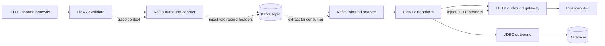
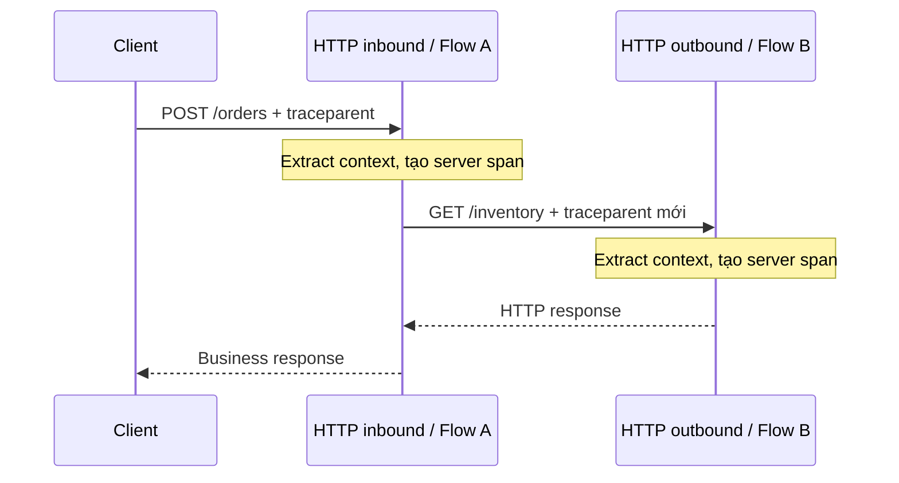
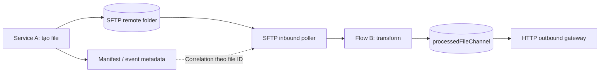
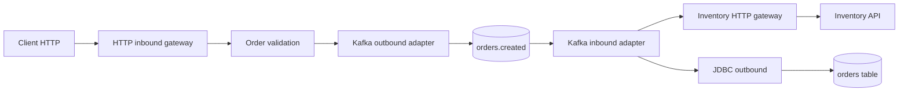

# Tracing message qua transport boundary trong Spring Integration

## 1. Bài toán: một message đi qua nhiều hệ thống và nhiều thread

Một ứng dụng tích hợp hiếm khi xử lý toàn bộ công việc trong một phương thức Java. Ví dụ:

1. **HTTP inbound gateway** nhận yêu cầu tạo đơn hàng.
2. Một **MessageChannel** chuyển message sang transformer và validator.
3. **Kafka outbound adapter** publish sự kiện sang broker.
4. Một dịch vụ khác nhận record bằng **Kafka inbound adapter**.
5. Dịch vụ đó gọi **HTTP outbound gateway** để xác nhận tồn kho và ghi trạng thái qua **JDBC**.

Khi khách hàng báo chậm, nhóm vận hành muốn biết yêu cầu đã chậm ở HTTP, ở channel nội bộ, lúc chờ Kafka, khi downstream xử lý hay khi gọi database. Nếu mỗi thành phần chỉ sinh log không có liên kết, khó tái dựng được **một hành trình nghiệp vụ xuyên nhiều process**.

**Distributed tracing** liên kết những bước xử lý liên quan thành một **trace** gồm nhiều **span** và truyền **trace context** qua những điểm chuyển giao, đặc biệt là **transport boundary** (ranh giới giữa process, broker, giao thức hoặc nơi lưu trữ trung gian).

Bài này thuộc chương **Observability** của mô-đun `SPRING_INTEGRATION_ADAPTERS`. Phạm vi bao gồm **inbound/outbound adapter, gateway, poller và MessageChannel**; các luồng **file, SFTP, HTTP, JMS, AMQP, Kafka và cơ sở dữ liệu**; hợp đồng message, xử lý lỗi, retry và vòng đời kết nối. Trọng tâm là giữ **quan hệ nguyên nhân giữa các bước** chứ không chỉ sao chép một chuỗi ID vào log.

Sau bài học, bạn cần biết:

- Nhận diện ranh giới process, thread, broker, file và transaction.
- Phân biệt trace ID, span ID, correlation ID, message ID và delivery ID.
- Truyền và trích xuất trace context qua adapter/gateway khi transport hỗ trợ.
- Thiết kế hành vi khi một transport không có chỗ lưu metadata (file, SFTP, một số bảng DB).
- Không nhầm message đã **được quan sát** với message đã **commit/ACK**.
- Kiểm tra trace bị đứt qua `ExecutorChannel`, poller, retry hoặc redelivery.
- Bảo vệ dữ liệu nhạy cảm, sampling và cardinality.

## 2. Tracing, correlation và observability: phân biệt đúng

### 2.1. Trace và span

Một **trace** mô tả tập các hoạt động có quan hệ với nhau trong một lần xử lý hoặc một hành trình phân tán. Mỗi **span** biểu diễn một operation có thời điểm bắt đầu, kết thúc, ngữ cảnh và thuộc tính.

Ví dụ logic:

```text
Trace: request tạo đơn hàng
|
+-- HTTP SERVER: POST /orders
|   +-- Spring Integration: validate order
|   +-- Kafka PRODUCER: orders.created
|
+-- Kafka CONSUMER: process orders.created
    +-- Spring Integration: transform event
    +-- HTTP CLIENT: GET /inventory
    +-- JDBC CLIENT: update orders
```

Trong hệ thống thực, quan hệ giữa producer và consumer có thể là **parent–child** hoặc **span links** tùy cơ chế tracing, batch, retry và khoảng thời gian lưu hàng đợi. Không được mặc định mọi trace backend sẽ hiển thị tất cả span theo cấu trúc ví dụ.

Mỗi span thường có:

| Thành phần | Vai trò | Cách sử dụng |
|---|---|---|
| **Trace ID** | Nhận diện một trace phân tán | Dùng tìm cả hành trình |
| **Span ID** | Nhận diện một operation trong trace | Dùng xác định bước cụ thể |
| **Parent span hoặc span links** | Quan hệ giữa các operation | Phân tích nguồn gốc và fan-out/batch |
| **Span name** | Tên operation có ý nghĩa, ổn định | Ví dụ `orders.validate`, không dùng ID đơn hàng |
| **Span kind** | Vai trò SERVER, CLIENT, PRODUCER, CONSUMER, INTERNAL | Phân biệt phía gửi/nhận và bước nội bộ |
| **Attributes** | Giao thức, tên flow, outcome, loại lỗi, thông tin được phép | Tránh PII/secret và giá trị có cardinality quá cao |
| **Events / status** | Mốc đáng chú ý hoặc lỗi | Không coi `ERROR` tự động là broker đã rollback |
| **Start/end timestamp** | Thời gian một operation được quan sát | Không tự thay thế end-to-end business SLA |

Span có thể không xuất hiện trên hệ thống trace vì **sampling, lỗi exporter, instrumentation thiếu, mất context hoặc backend quá tải**. Không thấy một span **không đủ chứng minh thao tác chưa diễn ra**.

### 2.2. Các loại ID không thể thay thế nhau

| ID | Được tạo/quản lý ở đâu? | Ngữ nghĩa |
|---|---|---|
| `traceId` | Tracing SDK/instrumentation | Tìm chuỗi operation phân tán có quan hệ |
| `spanId` | Tracing SDK/instrumentation | Phân biệt từng operation |
| `correlationId` | Hợp đồng nghiệp vụ/tích hợp | Liên kết message hoặc các bước thuộc cùng ca nghiệp vụ |
| Spring `MessageHeaders.ID` | Spring Messaging khi tạo message | Định danh một message envelope; có thể đổi khi tạo message mới |
| Kafka topic/partition/offset | Kafka broker | Xác định vị trí record trong partition |
| JMS `JMSMessageID` | JMS provider | Định danh message theo JMS; khác business ID |
| AMQP delivery tag | Broker/channel consumer | Phục vụ acknowledgement theo phiên/kết nối; không phải trace ID |
| File ID/manifest ID | Quy ước ứng dụng | Đối chiếu file, batch và lần nhập/xuất |

**Trace ID không phải idempotency key.** Một đơn hàng có thể được retry nhiều lần và tạo nhiều trace; ngược lại, một trace có thể chứa nhiều message từ splitter, aggregator hoặc batch. Muốn bảo đảm không xử lý một nghiệp vụ hai lần, cần **business key, deduplication và transaction semantics** riêng.

**Message ID không phải correlation ID bền vững.** Transformer, gateway, splitter hoặc flow tạo message mới có thể tạo envelope/header ID mới. Doanh nghiệp nên định nghĩa correlation ID dựa trên hợp đồng nghiệp vụ và kiểm thử việc truyền nó, không suy ra tự động từ trace ID.

## 3. Transport boundary là gì?

**Boundary** là nơi thông điệp hoặc hoạt động rời khỏi một phạm vi thực thi và xuất hiện ở phạm vi khác. Không phải mọi boundary đều tương đương:

| Boundary | Ví dụ | Nguy cơ mất ngữ cảnh |
|---|---|---|
| **Thread boundary** | `DirectChannel` chuyển sang `ExecutorChannel` | Thread-local trace context/MDC không được truyền |
| **Process boundary** | HTTP gateway gọi dịch vụ khác | HTTP headers bị bỏ hoặc middleware không trích xuất |
| **Broker boundary** | Kafka, JMS, AMQP | Record/message properties không được map hoặc consumer không extract |
| **Polling boundary** | File/SFTP/JDBC poller | Trigger diễn ra trong execution mới, không có request context nguồn |
| **Persistence boundary** | Ghi outbox/DB rồi worker đọc sau | Trace context không được lưu hoặc bị loại vì schema |
| **Retry/redelivery boundary** | DLQ/DLT, scheduler retry, requeue | Tạo lại message thiếu headers; sai cách nối parent/link |
| **Security/trust boundary** | Gọi API đối tác, nhận message ngoài tổ chức | Context bên ngoài không đáng tin như dữ liệu xác thực |

**Trong cùng một process**, đôi khi tracing SDK tự giữ context khi handler thực thi đồng bộ. **Qua process/broker**, thường cần **inject** context vào một carrier của transport ở phía gửi và **extract** tại phía nhận. Qua thread boundary cần truyền execution context bằng cơ chế được framework hỗ trợ.

Có thể hình dung:



Các cạnh nét đứt chỉ **ý định truyền ngữ cảnh**. Để thực hiện được, cần cấu hình instrumentation và header mapping đúng phiên bản/adapter. Đồ thị không bảo đảm Spring Integration tự động tạo mọi span hoặc tự truyền context ở mọi transport.

## 4. W3C Trace Context, Baggage và quy tắc truyền

Một lựa chọn thông dụng để truyền trace context qua HTTP và những carrier hỗ trợ key/value là **W3C Trace Context**:

- **`traceparent`**: chứa version, trace ID, parent span ID và trace flags.
- **`tracestate`**: metadata bổ trợ của tracing vendor theo tiêu chuẩn.
- **`baggage`**: một cơ chế chuẩn riêng để truyền các cặp metadata qua nhiều bước, **không cần thiết** cho việc nối trace cơ bản.

Ví dụ về dạng `traceparent`:

```text
traceparent: 00-4bf92f3577b34da6a3ce929d0e0e4736-00f067aa0ba902b7-01
```

Đây là **ví dụ định dạng**, không phải dữ liệu của một trace thực tế. W3C propagation có quy tắc về độ dài, biểu diễn hex và kiểm tra hợp lệ; nên dùng thư viện tracing chuẩn thay vì tự ghép/parsing chuỗi.

### 4.1. Inject và extract

- **Inject:** ghi trace context **hiện hành** vào carrier trước khi gọi HTTP, publish Kafka/JMS/AMQP hoặc lưu một sự kiện cần xử lý sau.
- **Extract:** đọc trace context từ carrier ở phía nhận để tạo span consumer/server có quan hệ với hoạt động upstream.
- **Activate scope:** đặt context đúng trong khoảng handler xử lý, rồi **đóng scope** để không rò sang message kế tiếp.
- **Propagate tiếp:** khi outbound từ handler nhận, context mới trở thành nguồn của bước downstream.

**Không chỉ copy `traceId` dưới dạng business header rồi gọi đó là tracing.** Để nối span cần đầy đủ ngữ nghĩa parent/context, trace flags và cơ chế instrumentation phù hợp.

### 4.2. Baggage cần hạn chế mạnh

Không đưa các giá trị sau vào baggage, span attributes hoặc raw logs:

- Access token, refresh token, cookie, mật khẩu, API key, private key.
- Email, tên người dùng, số điện thoại, địa chỉ hoặc dữ liệu khách hàng không cần thiết.
- Nội dung file SFTP, payload giao dịch, số tài khoản hoặc tài liệu nhạy cảm.
- Tên bảng/đường dẫn/định danh nội bộ không thuộc phạm vi chia sẻ với phía bên ngoài.

Baggage thường được truyền cho các downstream có thể đọc được header; dùng nó như kênh bí mật là sai. Nếu cần định tuyến nghiệp vụ, tạo **business header riêng** với phân quyền/kiểm tra đầu vào rõ ràng. Chỉ truyền metadata tối thiểu và có allowlist qua trust boundary.

### 4.3. Context nhận từ bên ngoài không phải chứng cứ tin cậy

Một client HTTP hoặc producer Kafka có thể cố tình gửi `traceparent` tùy ý. Trace context chỉ nhằm liên kết hoạt động quan sát, **không chứng minh danh tính, vai trò, tenant hay quyền truy cập**. Xác thực và phân quyền vẫn dựa trên hệ thống bảo mật thực sự.

Tại public endpoint cần giới hạn kích thước header, kiểm tra format, tránh tin vào baggage nhạy cảm và tuân theo chính sách chấp nhận hoặc tạo trace mới. Khi đi ra đối tác, cần chính sách cross-tenant và không rò topology, metadata hoặc business data qua trace attributes.

## 5. Tracing trong Spring Integration: ai tạo span và ai truyền context?

Các phiên bản Spring Integration và Spring Boot hiện đại có thể tích hợp **Micrometer Observation/Tracing**, đồng thời hạ tầng ứng dụng có thể dùng **OpenTelemetry** để xử lý trace context và xuất dữ liệu tới hệ thống observability.

Tuy nhiên, câu “đã thêm tracing dependency” **chưa chứng minh** từng channel, endpoint và adapter đều có instrumentation, hoặc trace context đã qua broker. Thực tế phụ thuộc:

1. Phiên bản Spring Boot/Spring Integration, starter và cấu hình observation.
2. Thành phần được instrument: `MessageChannel`, endpoint, gateway, HTTP client/server, Kafka/JMS/AMQP.
3. Cơ chế propagation trên header mapper và carrier transport.
4. Execution model: `DirectChannel`, `ExecutorChannel`, poller, async callback.
5. Tracing bridge/exporter và sampling settings.
6. Framework tự instrument ở những ranh giới nào, tránh tạo span thủ công trùng lặp.

**Micrometer Observation** là API quan sát cấp ứng dụng có thể kết nối metrics/tracing qua registry/handler. **OpenTelemetry** cung cấp API/SDK, propagation và exporter cho trace; chúng có thể làm việc với nhau thông qua bridge phù hợp, nhưng **không tự động dùng chung context nếu tạo hai hệ tracing độc lập**.

### 5.1. Bảng quyết định instrumentation

| Vị trí | Nên đo gì? | Cần truyền gì? |
|---|---|---|
| HTTP inbound gateway | Server span/request outcome | Extract `traceparent` từ HTTP request |
| Handler/transformer nội bộ | Thời gian xử lý, lỗi, flow/stage | Context của request/message hiện hành |
| `ExecutorChannel` | Queue wait và handler duration | Context qua task/executor boundary |
| Kafka/JMS/AMQP outbound | Producer span, publish attempt/result | Inject vào record headers/properties |
| Kafka/JMS/AMQP inbound | Consumer span, processing outcome | Extract từ broker message headers/properties |
| SFTP/File poller | Poll attempt, discovered file, processing span | Tạo trace mới hoặc nối từ metadata/manifest tin cậy |
| Outbox/JDBC poller | Event persisted/read/dispatch | Lưu carrier metadata riêng nếu cần nối trace |
| HTTP outbound gateway | Client span và response | Inject HTTP trace headers |
| Error/retry flow | Phân loại lỗi, retry, DLQ/DLT | Giữ nguồn gốc hợp lý; không tái sử dụng context sai |

**Không tạo span cho mọi thao tác nhỏ** nếu chi phí vượt giá trị quan sát. Chọn các mốc có ý nghĩa nghiệp vụ và ranh giới lỗi, đồng thời dựa vào instrumentation có sẵn trước khi thêm span thủ công.

## 6. HTTP gateway: đường truyền context quen thuộc nhất

Một **HTTP inbound gateway** có thể nhận `traceparent` từ client; một **HTTP outbound gateway** có thể đưa context hiện hành vào request headers gửi tới dịch vụ kế tiếp.



**`traceparent` trên outbound thường chứa span ID của hoạt động phía gửi phù hợp**, chứ không phải copy một header tùy ý không đổi qua mọi hop. Việc thay parent span ID và tạo client/server spans nên để SDK/instrumentation quản lý.

### 6.1. Điểm cần xác minh

- HTTP server có extract trace context và tạo span đúng không?
- HTTP client do outbound gateway dùng có được instrument không?
- Header mapper/gateway có loại `traceparent` hoặc `tracestate` không?
- Nếu request đi qua reverse proxy/API gateway, headers có được forward theo chính sách không?
- Khi nhận 4xx/5xx/timeout, trace có event/status phù hợp không?
- Header có bị ghi nguyên trong access log với dữ liệu nhạy cảm không?
- Callback hoặc thread async có giữ context đúng không?

Đối với HTTP, khi trace bị đứt tại outbound, kiểm tra **cả HTTP client instrumentation và propagation**, không chỉ đoạn Java DSL nối message channel.

## 7. Kafka: record headers, producer/consumer và commit

Trong Kafka, phía producer tạo record và có thể chèn trace context vào **record headers**. Broker lưu record; phía consumer phải **extract** context từ headers trước khi xử lý. Các thư viện tracing thường dùng carrier dựa trên Kafka headers với encoding phù hợp; ứng dụng không nên tự giả định chúng là `Map<String,String>` thông thường.

Ví dụ:

```text
Flow A
  ordersValidated
      |
  Kafka outbound adapter
      | inject tracing headers
      v
  topic orders.created
      | partition 3, offset 8123
      v
  Kafka inbound adapter
      | extract tracing headers
  Flow B
      |
  validate -> JDBC -> reply
```

**Những lưu ý vận hành:**

1. **Producer span** không tự chứng minh record đã durable: kiểm tra callback/ack/transaction và broker policy.
2. **Consumer span** biểu diễn một lần nhận/xử lý theo instrumentation; không mặc định đồng nghĩa offset đã được commit.
3. **Retry/redelivery** có thể tạo nhiều processing spans cho cùng một record hoặc logical event.
4. **Batch consumer** đọc nhiều record với nhiều parent context. Không nên ép mọi record thành một parent tùy ý; có thể dùng **span links** hoặc tạo span cho từng record khi cần và khi chi phí cho phép.
5. **DLT/dead-letter** phải giữ ngữ cảnh đủ để điều tra nhưng không làm lộ header nhạy cảm hoặc dùng sai trace parent.
6. Kafka key, topic, partition, offset và business event ID thuộc các mục đích khác nhau; **offset không thay thế trace ID**.
7. Khi ứng dụng chuyển sang topic mới, phải kiểm tra lại **producer serializer/header propagation**, không chỉ chuyển payload.

Khi điều tra “producer có span nhưng consumer không”, kiểm tra record thực sự được publish, consumer group assignment/lag, header mapping, sampling và instrumentation phía nhận trước khi kết luận Kafka làm mất dữ liệu.

## 8. JMS và AMQP: dùng message properties/headers đúng ngữ nghĩa

### 8.1. JMS

JMS message có thể mang **properties** là cặp tên–giá trị. Một số integration/framework có thể map trace context vào properties phù hợp. Cần kiểm tra:

- Mapping Spring `MessageHeaders` sang JMS properties và chiều ngược lại.
- Quy tắc tên, kiểu dữ liệu và giới hạn của provider.
- Message đã được broker chấp nhận chưa; transaction/ack và redelivery.
- Exception có được propagate hoặc đưa vào error channel không.
- JMS `JMSCorrelationID` phục vụ tương quan message/request–reply **không tự bằng trace ID**.

Ví dụ request–reply qua JMS cần **cả** business correlation và tracing context. Nếu một request có timeout rồi retry, có thể có nhiều attempts; không tự dùng một trace span kéo dài vô hạn để che thời gian chờ nghiệp vụ.

### 8.2. AMQP (ví dụ RabbitMQ)

AMQP message thường có **headers** và delivery metadata do broker/consumer quản lý. Producer có thể inject context vào headers, consumer extract khi nhận.

Cần phân biệt:

- **Publish confirm** của broker với handler nghiệp vụ thành công.
- **Consumer ack/nack** với kết quả xử lý theo transaction.
- **Dead-letter exchange (DLX)** với error channel trong Spring Integration.
- **Delivery tag** theo channel/consumer với trace ID.
- Header bị thay đổi khi republish, retry hoặc đi qua bridge.

Một message vào dead-letter queue có thể mang trace context của lần gửi trước; khi được xử lý lại sau thời gian dài, có thể hợp lý hơn nếu tạo **processing span mới có link** tới sự kiện gốc, tùy convention và policy tracing. Không coi span ID cũ là một span vẫn hoạt động suốt thời gian chờ.

### 8.3. Lựa chọn parent–child và span links

Khi một message được nhận sau vài phút, hoặc một batch chứa nhiều message độc lập:

- **Parent–child** hữu ích khi có quan hệ nhân quả trực tiếp được truyền rõ ràng.
- **Span links** hữu ích để liên kết nhiều nguồn hoặc các lần xử lý không tạo quan hệ cây đơn giản.
- **Correlation ID** vẫn cần cho nghiệp vụ độc lập với quyết định tracing.

Không có một hình dạng span tree duy nhất đúng cho mọi broker, mọi batch và mọi retry. Ưu tiên convention mà hệ tracing hỗ trợ, kiểm thử hiển thị trong backend và giữ kết quả ổn định giữa các phiên bản.

## 9. File và SFTP: không có headers để mang context tự nhiên

File và SFTP khác HTTP/Kafka/JMS/AMQP: bản thân file trên filesystem hoặc SFTP server **không tự lưu Spring MessageHeaders hay W3C trace context**. Khi một process ghi file, process khác poll file sau đó, trace context trong bộ nhớ của bên ghi đã mất trừ khi ứng dụng chủ động lưu metadata.

### 9.1. Các chiến lược phù hợp

| Chiến lược | Khi nào phù hợp? | Giới hạn |
|---|---|---|
| **Tạo trace mới khi poll file** | Đầu vào bên ngoài không có metadata tracing | Không nối tự động với trace của người ghi |
| **Correlation ID theo file/manifest** | Cần liên kết nghiệp vụ bền vững qua thời gian | ID không tự tạo parent–child spans |
| **Sidecar manifest có trace context** | Hai hệ thống do bạn kiểm soát cùng thỏa thuận hợp đồng | Phải đồng bộ file/manifest, kiểm tra nguồn, bảo vệ dữ liệu |
| **Metadata trong định dạng nội dung được phép** | File format có trường tracing rõ ràng | Không ghi trace context vào dữ liệu nhạy cảm ngoài chính sách |
| **Event/outbox đi kèm file** | Cần audit/khả năng đối soát chính xác | Thêm hạ tầng và cần đảm bảo nhất quán sự kiện–file |

**Không** mặc định nhúng `traceparent` vào tên file hoặc đường dẫn SFTP. Điều này làm lộ metadata, dài tên và dễ mất khi rename, move, archive.

### 9.2. Ví dụ flow SFTP



Khi poller phát hiện file:

1. Ghi span cho **poll/download** theo hành vi đã instrument.
2. Tạo hoặc đọc **correlation ID** từ metadata hợp lệ.
3. Nếu có manifest chứa trace context tin cậy và hợp đồng cho phép, extract theo quy tắc; nếu không, bắt đầu một trace xử lý mới, giữ business correlation để tìm liên kết.
4. Đo thời gian file **được phát hiện**, **bắt đầu xử lý**, **xử lý xong** và **đã được xác nhận ở đích** theo các mốc riêng.
5. Kiểm tra file có thể được poll lại sau lỗi; nhiều trace không đồng nghĩa có nhiều file nghiệp vụ độc lập.

**Trace không chứng minh file được upload/download nguyên vẹn.** Cần kiểm tra trạng thái adapter, file size/checksum theo chính sách, file lock/temp name/rename và xác nhận hoàn tất.

## 10. JDBC, database và transactional outbox

Một thao tác **JDBC outbound** có thể tạo DB client span nhờ instrumentation của driver/framework. Span đó mô tả lời gọi database; nó không tự làm trace context trở thành **dữ liệu bền vững** để một worker khác đọc sau.

Nếu một ứng dụng ghi đơn hàng vào DB và poller khác phát sự kiện, có một **persistence boundary**:

```text
HTTP request -> business transaction
    |
    +-- INSERT orders
    +-- INSERT outbox (event_id, payload, metadata)
    |
  COMMIT
    |
    v
Outbox poller (lúc khác / thread khác / instance khác)
    |
    v
Kafka publisher
```

Muốn nối trace qua outbox, có thể lưu **trace metadata đã được cho phép** vào các cột riêng của outbox khi ghi cùng transaction. Worker đọc outbox, kiểm tra metadata, rồi tạo span gửi mới với parent/link phù hợp.

**Nhưng trace context không thay thế transaction và idempotency:**

- Ghi đơn hàng và outbox cần có cam kết atomic tương ứng nếu hợp đồng kiến trúc yêu cầu.
- Poller có thể gửi cùng event nhiều lần sau crash/retry.
- Consumer cần xử lý duplicate theo `event_id` hoặc business key.
- Không dùng trace ID làm primary key của outbox.
- Không log toàn bộ SQL parameters hoặc dữ liệu cá nhân trong span attributes.
- “JDBC span ended” chưa đủ để chứng minh nghiệp vụ đã commit đúng hoặc downstream đã xử lý.

### 10.1. Mô hình bảng outbox minh họa

```sql
CREATE TABLE integration_outbox (
    event_id         UUID PRIMARY KEY,
    event_type       VARCHAR(100) NOT NULL,
    payload_json     JSONB NOT NULL,
    correlation_id   VARCHAR(100) NOT NULL,
    traceparent      VARCHAR(200),
    tracestate       TEXT,
    created_at       TIMESTAMPTZ NOT NULL,
    published_at     TIMESTAMPTZ
);
```

Đây là **schema học thuật minh họa**, không phải schema mặc định của Spring Integration. Trong hệ thống thật, cần xem xét trạng thái claim/lease, retry, indexing, retention, bảo mật dữ liệu và nhiều instance poll song song. Các cột trace metadata không nên chứa baggage/credential; lưu `tracestate` phải qua chính sách kích thước, tin cậy và retention.

Nếu dữ liệu đến từ hệ thống đối tác **không thể tin tưởng trace context**, không tự coi `traceparent` được lưu trong DB là bằng chứng xác thực. Có thể tạo trace mới, gắn link hoặc chỉ giữ correlation ID.

## 11. Code minh họa: inject/extract bằng OpenTelemetry API

Ví dụ này làm rõ **nguyên tắc propagation** mà adapter cần thực hiện. Nó dùng **OpenTelemetry API** và một carrier kiểu `Map<String,String>` để đơn giản hóa. Đây **không phải API header mapping đặc thù của mọi Spring Integration adapter**; HTTP, Kafka, JMS và AMQP phải có converter tương ứng.

**Giả định:** ứng dụng đã có OpenTelemetry SDK/propagators được cấu hình phù hợp; nếu chỉ dùng `GlobalOpenTelemetry` mặc định không có SDK/propagator thực sự, đoạn mã có thể không tạo trace hữu ích. Trong ứng dụng dùng Micrometer Tracing, phải chọn bridge/instrumentation nhất quán, không tạo một hệ tracing OpenTelemetry độc lập ngoài pipeline hiện hành.

```java
import io.opentelemetry.api.GlobalOpenTelemetry;
import io.opentelemetry.context.Context;
import io.opentelemetry.context.propagation.TextMapGetter;
import io.opentelemetry.context.propagation.TextMapSetter;

import java.util.HashMap;
import java.util.Map;

public final class TraceCarrier {

    private TraceCarrier() {
    }

    private static final TextMapSetter<Map<String, String>> SETTER =
            (carrier, key, value) -> carrier.put(key, value);

    private static final TextMapGetter<Map<String, String>> GETTER =
            new TextMapGetter<>() {
                @Override
                public Iterable<String> keys(Map<String, String> carrier) {
                    return carrier.keySet();
                }

                @Override
                public String get(Map<String, String> carrier, String key) {
                    return carrier.get(key);
                }
            };

    // Gọi khi span phía gửi đang nằm trong Context.current().
    public static Map<String, String> inject() {
        Map<String, String> headers = new HashMap<>();
        GlobalOpenTelemetry.getPropagators()
                .getTextMapPropagator()
                .inject(Context.current(), headers, SETTER);
        return headers;
    }

    // Gọi trước khi mở processing span ở phía nhận.
    public static Context extract(Map<String, String> headers) {
        return GlobalOpenTelemetry.getPropagators()
                .getTextMapPropagator()
                .extract(Context.root(), headers, GETTER);
    }
}
```

**Các bước cần thực hiện trong adapter thật:**

1. Tại phía **gửi**, có span đang active, gọi `TraceCarrier.inject()`.
2. Map các cặp tên/giá trị trả về sang **carrier thật**: HTTP headers, Kafka record headers, JMS properties hoặc AMQP headers theo API đúng transport.
3. Tại phía **nhận**, lấy trace-related carrier fields được phép từ transport; chuyển về `Map` để gọi `extract()`, hoặc dùng `TextMapGetter` trực tiếp theo API transport.
4. Mở processing span với **context vừa extract** và đóng scope khi handler kết thúc.
5. Khi handler gọi outbound tiếp theo, context của processing span là nguồn cho lần inject mới.

Một mẫu mở scope phía consumer bằng OpenTelemetry:

```java
import io.opentelemetry.api.GlobalOpenTelemetry;
import io.opentelemetry.api.trace.Span;
import io.opentelemetry.api.trace.SpanKind;
import io.opentelemetry.api.trace.StatusCode;
import io.opentelemetry.api.trace.Tracer;
import io.opentelemetry.context.Context;
import io.opentelemetry.context.Scope;

import java.util.Map;

public class ObservedMessageHandler {

    private final Tracer tracer =
            GlobalOpenTelemetry.getTracer("integration-orders");

    public void onMessage(Map<String, String> transportHeaders,
                          String payload) {
        Context incoming = TraceCarrier.extract(transportHeaders);

        try (Scope parentScope = incoming.makeCurrent()) {
            Span span = tracer.spanBuilder("orders.consume")
                    .setSpanKind(SpanKind.CONSUMER)
                    .startSpan();
            try (Scope spanScope = span.makeCurrent()) {
                // Thực tế: validate/transform và gọi service nghiệp vụ.
                processOrder(payload);
            } catch (RuntimeException exception) {
                span.recordException(exception);
                span.setStatus(StatusCode.ERROR);
                throw exception;
            } finally {
                span.end();
            }
        }
    }

    private void processOrder(String payload) {
        // Logic minh họa, không phải ví dụ broker transaction.
    }
}
```

**Giới hạn:** ví dụ minh họa một message và một handler đồng bộ. Nó **không** xử lý hết batch, retry scheduling, redelivery, acknowledgement, transaction, propagation qua thread pool hoặc lỗi transport. Nếu framework đã tự tạo consumer span, **không lặp lại nguyên xi** để tránh trace chứa span trùng nghĩa; hãy dùng span thủ công cho operation nội bộ thực sự cần đo.

### 11.1. Spring MessageHeaders và headers của transport khác nhau

Một `org.springframework.messaging.Message<?>` có **MessageHeaders** riêng. Chúng **không tự động tương đương** với HTTP headers, Kafka `Headers`, JMS properties hoặc AMQP `MessageProperties`.

Nếu muốn đưa carrier metadata từ Spring Message ra transport:

- Xác định **header mapper** của adapter/gateway.
- Chỉ định những header tracing nào được phép đi qua; kiểm tra tên và kiểu dữ liệu transport.
- Tránh xóa các header kỹ thuật bắt buộc của broker hoặc framework.
- Không cố sửa trực tiếp `MessageHeaders` theo kiểu mutable map; khi cần tạo message mới, dùng `MessageBuilder.fromMessage(original)` và đặt header được phép.
- Đảm bảo context được extract ở chiều inbound **trước khi** tạo span xử lý hoặc downstream outbound.

Một đoạn logic minh họa tạo message mới với allowlist metadata:

```java
import org.springframework.messaging.Message;
import org.springframework.messaging.support.MessageBuilder;

public Message<?> attachApprovedHeaders(
        Message<?> original,
        Map<String, String> carrier) {

    MessageBuilder<?> builder = MessageBuilder.fromMessage(original);

    for (String key : new String[] {"traceparent", "tracestate"}) {
        String value = carrier.get(key);
        if (value != null) {
            builder.setHeader(key, value);
        }
    }
    return builder.build();
}
```

Đoạn này chỉ tạo **Spring Message có headers được chọn**; chưa chứng minh outbound adapter sẽ đưa chúng vào transport. Cần test adapter cụ thể và không đưa nguyên toàn bộ map/baggage của bên ngoài vào message một cách mù quáng.

## 12. Micrometer Observation cho một đoạn xử lý nội bộ

Khi dùng Spring Boot/Micrometer, ứng dụng có thể đo một đoạn xử lý nội bộ với `ObservationRegistry`. Ví dụ:

```java
import io.micrometer.observation.Observation;
import io.micrometer.observation.ObservationRegistry;

public final class OrderValidation {

    private final ObservationRegistry registry;

    public OrderValidation(ObservationRegistry registry) {
        this.registry = registry;
    }

    public void validate(String orderPayload) {
        Observation.createNotStarted("orders.validate", registry)
                .lowCardinalityKeyValue("flow", "orders")
                .lowCardinalityKeyValue("stage", "validation")
                .observe(() -> {
                    if (orderPayload == null || orderPayload.isBlank()) {
                        throw new IllegalArgumentException("Empty order");
                    }
                    // Logic validation thực tế...
                });
    }
}
```

Điểm chính:

- `Observation` có thể phục vụ **metrics và tracing** qua handler/bridge được cấu hình, không phải mọi registry đều tự xuất trace.
- Tên `orders.validate`, nhãn `flow=orders`, `stage=validation` có số giá trị thấp.
- Không đưa `orderId`, email, tên file hoặc nguyên payload vào **low-cardinality tags**.
- Observation được tạo trong handler; để nó nằm đúng trace cần có **active context** được propagate qua thread/transport trước đó.
- Nếu Spring Integration/framework đã đo đoạn này với cùng ngữ nghĩa, cân nhắc không tạo observation trùng.

**Code ở mục 11 và mục 12 là hai cách minh họa các API khác nhau**, không phải chỉ dẫn dùng đồng thời hai pipeline tracing tách biệt. Trong dự án thật, thống nhất một mô hình instrumentation và kiểm thử trace từ inbound tới outbound.

## 13. Thread boundary: DirectChannel, ExecutorChannel và poller

### 13.1. DirectChannel

Với `DirectChannel`, nhiều bước xử lý thông thường chạy **đồng bộ trên thread gọi send**. Trace context trong thread có thể còn hiện diện khi handler được gọi; tuy nhiên điều này không tự chứng minh mọi endpoint đều sinh span hoặc lỗi được route vào `errorChannel`.

### 13.2. ExecutorChannel

`ExecutorChannel` chuyển việc xử lý sang task executor, tạo **thread boundary**. Thread-local context (bao gồm MDC và nhiều tracing scope) có thể mất nếu task không được wrap/propagate đúng.

Tùy phiên bản và cấu hình, có thể dùng cơ chế **context propagation/task decoration** mà Spring/Micrometer hỗ trợ. Khi thiết kế:

1. Kiểm tra inbound handler đã extract context chưa.
2. Kiểm tra executor có cơ chế capture/restore context phù hợp.
3. Mở scope khi task chạy, đóng scope trong `finally` hoặc try-with-resources.
4. Kiểm tra thread tái sử dụng **không mang trace của message trước**.
5. Không tự nhét một object `Scope` của thread nguồn vào message để dùng ở thread khác.
6. Đo queue wait riêng nếu cần; thời gian chờ executor không tự nằm trong mọi handler span.

### 13.3. Poller và scheduler

File, SFTP, JDBC hoặc source polling chạy theo scheduler, **không tự kế thừa trace của request trước đó**. Mỗi lần poll có thể tạo observation/span mới, rồi tạo span xử lý từng message. Nếu dữ liệu từ nguồn có metadata correlation hoặc trace context đã được lưu đúng, có thể nối theo quy tắc; nếu không thì tạo trace mới là hợp lý.

**Không cố giữ một trace đang mở suốt nhiều giờ chỉ để chờ file hoặc record mới xuất hiện.** Tracing nên mô tả operation có giới hạn thời gian, còn độ trễ end-to-end nghiệp vụ cần kết hợp timestamp nguồn, message age và correlation/event store.

## 14. Retry, redelivery, batch, splitter và aggregator

Các mẫu tích hợp làm trace phức tạp hơn nhiều so với một HTTP request đồng bộ.

| Tình huống | Cách phân tích phù hợp |
|---|---|
| **Retry trong cùng handler** | Có thể dùng span events hoặc child spans cho attempts, tránh nhân đôi operation nếu không cần |
| **Retry sau khi lập lịch lại** | Tạo attempt mới; giữ correlation với sự kiện gốc và xử lý idempotency riêng |
| **Kafka/JMS/AMQP redelivery** | Một logical event có thể có nhiều consumer processing spans |
| **Dead-letter/replay** | Bảo toàn nguồn gốc; tùy convention dùng links thay vì kéo một parent chain dài sai nghĩa |
| **Splitter** | Một message tạo nhiều message con; dùng correlation/business ID và spans/links phù hợp |
| **Aggregator** | Một kết quả có thể phụ thuộc nhiều input contexts; parent duy nhất có thể không đủ biểu diễn |
| **Batch consumer** | Có nhiều context đầu vào; xem xét span links, mỗi record hoặc batch span tùy chi phí |
| **Fan-out qua nhiều outbound adapters** | Các nhánh gửi có spans riêng, lỗi từng đích phải phân biệt |
| **Compensation/saga** | Gắn nghiệp vụ cùng một correlation ID, dùng trace/event links thay vì giữ span sống nhiều ngày |

**Tracing không quyết định message có bị xử lý lại hay không.** Exactly-once, at-least-once, ACK, offset commit, transaction và deduplication thuộc hợp đồng delivery của hệ thống tích hợp. Một trace đẹp không chứng minh không có duplicate business operation.

### 14.1. Ví dụ nghiệp vụ và trace attempts

Giả sử Kafka consumer nhận event `order-created-42`:

- Attempt 1: HTTP inventory timeout, message được retry.
- Attempt 2: HTTP trả lỗi tạm thời, hệ thống schedule lại.
- Attempt 3: thành công, JDBC commit.
- Kafka offset được commit theo chính sách sau khi hoàn tất.

Có thể có ba consumer processing spans trong một hoặc nhiều trace. Cần `event_id=order-created-42` hoặc idempotency key để biết chúng là **cùng nghiệp vụ**, và metric retry/processing để phân tích tổng số attempts. **Không dùng một span duy nhất kéo dài xuyên mọi lần retry khi các attempts thực tế chạy ở những thời điểm/process khác nhau**.

## 15. Chuẩn hóa span attributes, sampling và chi phí

### 15.1. Đặt tên và attributes có mục đích

Một span có thể có những thuộc tính ứng dụng được định nghĩa rõ:

| Thuộc tính minh họa | Ví dụ | Cần kiểm soát |
|---|---|---|
| `integration.flow` | `orders-import` | Số lượng flow hữu hạn |
| `integration.stage` | `validated` | Không dùng nội dung payload |
| `integration.adapter` | `kafka`, `sftp`, `http` | Enum chuẩn |
| `integration.outcome` | `success`, `retry`, `failed` | Phân biệt attempt với commit |
| `messaging.destination` | `orders.created` | Chỉ nếu tên đích được phép chia sẻ |
| `error.type` | `timeout`, `validation` | Không gắn raw exception message nhạy cảm |
| `processing.attempt` | `1`, `2` | Theo giới hạn hợp đồng; không biến thành metric tag vô hạn |
| `deployment.environment` | `staging`, `production` | Lấy từ cấu hình đáng tin |

Đây là **tên thuộc tính minh họa**; OpenTelemetry Semantic Conventions có bộ tên chuẩn thay đổi theo phiên bản. Khi triển khai, ưu tiên convention của instrumentation thực tế và tránh cùng một ý nghĩa được phát dưới nhiều key không thống nhất.

Tránh gắn raw payload, header `Authorization`, customer ID, tên file chứa dữ liệu cá nhân hoặc câu lệnh SQL kèm tham số nhạy cảm vào trace. Tracing backend thường là hệ thống **tập trung**; một attribute được ghi ở dịch vụ A có thể được nhiều nhóm đọc.

### 15.2. Sampling

Tracing thường dùng sampling để giới hạn dung lượng:

- **Head-based sampling:** quyết định lấy mẫu sớm dựa trên trace ID hoặc chính sách khác.
- **Tail-based sampling:** quyết định khi đã thấy nhiều span/event, giúp ưu tiên trace chậm/lỗi nhưng tăng yêu cầu collector/buffer.
- **Rule-based sampling:** ưu tiên flow rủi ro, lỗi hoặc latency cao.

Sampling có thể khiến trace **không đầy đủ**, nhất là khi các dịch vụ có cấu hình độc lập hoặc propagation flags không nhất quán. Không dùng số span được thu để trực tiếp suy ra **số message nghiệp vụ** nếu sampling không phải 100%.

Đối với **audit bắt buộc**, luôn cần log/event bền vững phù hợp. **Tracing là kênh quan sát có thể bị sampling hoặc mất dữ liệu**, không tự đáp ứng yêu cầu lưu mọi hành động pháp lý.

### 15.3. Log, metrics và tracing bổ sung cho nhau

| Tín hiệu | Phù hợp để | Không nên dùng để |
|---|---|---|
| **Traces** | Tìm bottleneck, nối lời gọi qua service/transport, phân tích một sample | Đếm chính xác toàn bộ message khi sampling |
| **Metrics** | Throughput, latency histogram, error rate, queue depth, consumer lag | Lưu business ID làm label trên mọi record |
| **Structured logs** | Tra cứu lỗi cụ thể, correlation ID, audit vận hành được phép | Ghi toàn bộ payload/secret hoặc làm durable audit mặc định |
| **Durable events/audit** | Chứng minh trạng thái xử lý, thao tác quan trọng và tái dựng sau crash | Thay thế hoàn toàn metrics latency hoặc distributed tracing |

**Nhãn metric cần cardinality thấp.** Không gắn `traceId`, `spanId`, `messageId` hoặc `orderId` vào Prometheus tags theo mọi message; chúng phù hợp hơn cho log/trace lookup có kiểm soát.

## 16. Bài thực hành: HTTP → Kafka → HTTP và JDBC

Hãy thiết kế và quan sát pipeline:



### 16.1. Hợp đồng mẫu

- `event_id`: định danh duy nhất của sự kiện, dùng cho idempotency.
- `correlation_id`: liên kết sự kiện với đơn hàng hoặc request nghiệp vụ.
- `trace context`: được quản lý bởi tracing, đi qua HTTP/Kafka headers theo adapter.
- `schema_version`: phiên bản hợp đồng payload.
- `occurred_at`: thời điểm sự kiện nghiệp vụ phát sinh.
- `attempt`: thông tin retry trong phạm vi cần giám sát; không dùng làm ID logic.

### 16.2. Điểm quan sát

1. HTTP server span: nhận và hoàn thành request.
2. Validation observation/span: thời gian kiểm tra dữ liệu.
3. Kafka producer span: publish attempt, kết quả broker theo instrumentation thực.
4. Kafka consumer span: nhận và xử lý record.
5. HTTP client span: latency gọi inventory.
6. JDBC span: thời gian query/transaction theo cấu hình.
7. Business event: xác nhận đơn hàng thực sự được xử lý, dùng audit/outbox khi cần.

### 16.3. Kịch bản kiểm thử

| Kịch bản | Kỳ vọng từ tracing và dữ liệu khác |
|---|---|
| HTTP thành công, Kafka publish thành công | Trace context được inject/extract; record ID khớp correlation |
| Kafka publish timeout | Có lỗi/timeout, trạng thái ACK theo contract; không báo delivered chỉ vì span tồn tại |
| Kafka redelivery | Attempts được thể hiện; idempotency ngăn side effect trùng |
| Consumer chạy qua executor | Context liên kết đúng; không rò MDC sang message khác |
| Inventory HTTP trả 503 | Child client span ghi lỗi, retry có giới hạn và business outcome chính xác |
| JDBC rollback | Operation trace có thể tồn tại nhưng business success không được đánh dấu |
| Trace backend bị tắt | Flow nghiệp vụ còn chạy theo chính sách; metrics/audit độc lập còn đủ |
| Baggage chứa dữ liệu nhạy cảm | Bị loại/giới hạn trước khi forward theo allowlist |
| Sampling chỉ 10% | Không suy ra throughput từ số trace, so sánh với metrics counter |
| Đi qua SFTP/file thay Kafka | Có trace mới hoặc link từ manifest; không giả định headers tự tồn tại |

## 17. Troubleshooting: trace bị đứt ở đâu?

Khi trace viewer cho thấy một span producer ở dịch vụ A nhưng không thấy consumer span ở dịch vụ B, đi theo các bước sau.

**Bước 1 — Xác minh message thực sự được chuyển.** Với HTTP xem response/status; với Kafka xem publish result, offset, consumer lag; JMS/AMQP xem ACK và queue; SFTP/file xem file đã được ghi/đọc; JDBC xem transaction. Không quy kết mất trace trước khi chứng minh message đã tới.

**Bước 2 — Kiểm tra sampling và exporter.** Hai process có cùng tracing backend, sampler/propagator và exporter khỏe không? Có dấu hiệu collector queue/drop không? Trace bị cắt có thể là lỗi telemetry, không phải luồng nghiệp vụ.

**Bước 3 — Kiểm tra header phía gửi.** Header `traceparent` có được inject khi span producer/client đang active? Không log token hay toàn bộ headers. Có cần `tracestate` không?

**Bước 4 — Kiểm tra carrier giữa hai đầu.** HTTP gateway, Kafka record headers, JMS properties, AMQP headers hoặc manifest có giữ metadata hay mapper đã lọc? Nếu qua proxy/bridge, kiểm tra từng hop theo chính sách.

**Bước 5 — Kiểm tra extract phía nhận.** Handler có extract trước khi tạo consumer span không? Context nhận từ bên ngoài có hợp lệ và được xử lý an toàn không?

**Bước 6 — Kiểm tra thread boundary.** Có `ExecutorChannel`, scheduler, async callback, listener thread hoặc Reactor context không? Task có capture/restore đúng? MDC có bị reset sai không?

**Bước 7 — Kiểm tra việc tạo span trùng hoặc trace mới.** Framework có auto-instrument và code ứng dụng đồng thời tạo root span không? Có vô tình dùng `Context.root()` khi đã có context hợp lệ ở bước tiếp theo?

**Bước 8 — Kiểm tra retry/batch.** Một message được xử lý trong retry worker hoặc batch processing có thể tạo trace khác có link. Tìm bằng correlation ID và event ID, không chỉ một trace ID.

**Bước 9 — Kiểm tra dấu thời gian.** Đồng hồ các instance có đồng bộ không? Queue wait lớn có thể khiến thứ tự span khó hiểu. Không biến timestamp nhận telemetry thành thời gian xảy ra sự kiện.

**Bước 10 — Xác minh lại.** Dùng một message test không nhạy cảm; kiểm tra thông tin producer/consumer cùng nhau, so sánh với log/metrics/ACK/DB và lưu kết quả trong runbook.

### Các triệu chứng thường gặp

| Triệu chứng | Nguyên nhân có thể | Nơi cần kiểm tra |
|---|---|---|
| HTTP có trace, Kafka consumer tạo trace mới | Chưa inject/extract headers hoặc instrumentation không thống nhất | Kafka header mapper, producer/consumer tracing |
| Trace đổi sau `ExecutorChannel` | Mất thread-local context | Context propagation/task executor |
| Log có correlation ID nhưng trace không nối | Business ID không phải trace context | W3C propagator và parent/link |
| Một event tạo nhiều consumer spans | Redelivery/retry, nhiều attempts | Broker ack/commit, retry, idempotency |
| Một trace có nhiều business event | Splitter/aggregator/batch | Event ID, span links và nhóm message |
| Không thấy SFTP inbound dưới trace HTTP gốc | File không mang tracing headers | Manifest hoặc business correlation |
| Trace latency khác SLA nghiệp vụ | Span chỉ đo một bước, chưa tính queue/poll/retry | Event timestamps, backlog, business outcome |
| Có client span HTTP nhưng không có response thành công | Lỗi transport/target | Status/timeout, error handling |
| Trace không có lỗi dù business rollback | Instrumentation chưa ghi transaction outcome | Transaction logs và result events |
| Trace backend im lặng | Sampling/exporter lỗi hoặc thiếu instrumentation | Collector health, metric counters, config |

## 18. Kiểm thử propagation theo transport

Nên có kiểm thử cho **cả context lẫn hành vi nghiệp vụ**:

### 18.1. Unit test cho carrier

- Với carrier `Map<String,String>`, cấu hình propagator W3C trong môi trường test.
- Tạo span có hiệu lực, inject headers, extract ở context khác và kiểm tra trace ID/quan hệ đúng.
- Kiểm tra header thiếu/hỏng không làm crash handler hoặc bypass xác thực.
- Kiểm tra baggage bị lọc theo chính sách; không truyền secret.

### 18.2. Integration test với adapter thật hoặc test container

| Adapter | Điều cần xác minh |
|---|---|
| HTTP | Outbound gửi `traceparent`; inbound extract và tạo trace đúng |
| Kafka | Record header giữ context qua broker, kể cả retry và DLT theo hợp đồng |
| JMS | Property mapping giữ dữ liệu hợp lệ; redelivery không mất correlation |
| AMQP | Headers được truyền qua exchange/queue, retry/republish theo thiết kế |
| SFTP/File | Manifest/event correlation đúng; không mặc định có tracing header |
| JDBC/Outbox | Event và trace metadata được commit/đọc theo logic; không dùng trace ID làm dedupe |
| `ExecutorChannel` | Context được phục hồi đúng trên worker và không rò giữa tác vụ |
| Poller | Có trace riêng cho poll và processing; không giữ scope treo |
| Error flow | Lỗi/attempt thể hiện trong trace phù hợp và có business outcome chính xác |

### 18.3. Phép kiểm chứng tối thiểu

Một test end-to-end có thể khẳng định:

1. **Cùng trace ID**, khi đó là ngữ nghĩa parent–child được chọn, ở các spans cần nối.
2. Hoặc **span links đúng** nếu flow batch/async được thiết kế theo mô hình link.
3. `correlationId` khớp logical event/batch theo business contract.
4. Header tracing không làm thay đổi payload, schema hoặc nghiệp vụ.
5. Không log secret/PII; không tạo metric tags high cardinality.
6. Lỗi collector hoặc sampling không phá hợp đồng delivery.
7. Kết quả ACK/commit/DB thật được xác minh riêng, không suy ra từ trace.

## 19. Các anti-pattern thường gặp

1. **Copy `traceId` vào header rồi tự gọi đó là distributed tracing:** thiếu parent/span/flags.
2. **Dùng trace ID thay idempotency key:** retry có thể tạo trace khác và sinh thao tác trùng.
3. **Tin mọi adapter tự động propagate:** Spring headers và transport carrier có mapper riêng.
4. **Chỉ instrument HTTP:** Kafka/JMS/AMQP hoặc scheduler làm trace đứt.
5. **Dùng MDC như cơ chế propagation duy nhất:** qua thread/process có thể mất hoặc bị rò context.
6. **Cho toàn bộ baggage đi qua hệ thống đối tác:** lộ thông tin không được phép.
7. **Ghi payload/Authorization vào span attributes:** dữ liệu có thể bị xuất tới backend tập trung.
8. **Dùng trace count thay throughput:** sampling khiến số liệu không chính xác.
9. **Tạo một span sống trong nhiều giờ chờ broker/file:** khó quản lý lifecycle và ngữ nghĩa.
10. **Ép batch nhiều message về một parent duy nhất:** mất các quan hệ nguồn khác nhau.
11. **Đánh dấu success khi producer span kết thúc:** không chứng minh broker ack hoặc DB commit.
12. **Xem mọi redelivery là message mới:** trộn attempt với logical business event.
13. **Tạo span thủ công trùng instrumentation tự động:** trace quá ồn, số liệu sai.
14. **Lấy message ID của Spring làm business ID bền:** ID có thể đổi khi tạo message mới.
15. **Lưu `traceparent` trong tên file/URL công khai:** rò metadata và khó vận hành.
16. **Không kiểm tra context propagation qua executor:** thread đổi làm trace tách.
17. **Tự tin rằng endpoint `errorChannel` sẽ bắt mọi lỗi:** sync/async/transport có ngữ nghĩa khác.
18. **Chỉ nhìn graph và trace mà bỏ health poller:** nguồn không phát message cũng làm tracing im lặng.
19. **Truyền context bên ngoài như thông tin xác thực:** trace không cấp quyền.
20. **Để exporter quá tải cản xử lý nghiệp vụ:** cần chính sách telemetry failure rõ ràng, ngoại trừ audit bắt buộc có kiến trúc riêng.

## 20. Câu hỏi tự kiểm tra

**Câu 1.** Một HTTP request vào dịch vụ A có trace ID, A publish Kafka event, dịch vụ B nhận record nhưng tạo trace ID mới. Đâu là các điểm kiểm tra đầu tiên?

**Đáp án:** Kafka producer có inject headers lúc đúng context không; record headers có tới broker không; consumer có extract trước khi tạo span không; instrumentation/bridge và sampling có nhất quán không. Phải xác nhận record đã được giao thành công trước khi quy lỗi cho propagation.

**Câu 2.** Một message đi qua `ExecutorChannel` và log ở handler sau đó mất trace ID. Có thể chỉ copy MDC bằng tay rồi coi là xong?

**Đáp án:** Chưa đủ. MDC phục vụ logging và thường gắn thread; cần cơ chế capture/restore **tracing context** được framework hỗ trợ, đóng scope đúng và kiểm tra thread không mang context của message trước.

**Câu 3.** Một Kafka record bị retry ba lần. Trace backend hiện ba consumer spans. Có phải ba đơn hàng khác nhau?

**Đáp án:** **Không.** Có thể là ba **processing attempts** của một event. Dùng `event_id`/business key để xác định logical event và idempotency để tránh side effect trùng.

**Câu 4.** Dịch vụ A ghi một file qua SFTP, dịch vụ B poll file sau 15 phút. Tại sao trace context không tự đi theo file?

**Đáp án:** File/SFTP không mang Spring MessageHeaders theo mặc định. Muốn nối cần hợp đồng metadata/manifest hoặc sự kiện đi kèm; nếu không, tạo trace xử lý mới và dùng correlation ID nghiệp vụ để tra cứu.

**Câu 5.** HTTP client span đã kết thúc `OK`, nhưng database phía sau không có bản ghi. Có thể kết luận database đã commit thành công không?

**Đáp án:** Không. Client span chỉ là một bước trong flow; cần kiểm tra response semantics, handler downstream, transaction/commit và trạng thái DB.

**Câu 6.** Vì sao không đặt `traceId` làm metric tag cho từng request?

**Đáp án:** Vì nó có số lượng giá trị rất lớn (**high cardinality**), gây quá tải và chi phí lưu trữ. Giữ trace ID trong trace/log có kiểm soát; metrics dùng nhãn hữu hạn như `flow`, `adapter`, `outcome`.

**Câu 7.** Một nhóm muốn bảo đảm mọi thao tác IAM và giao dịch đều được lưu theo yêu cầu pháp lý. Có thể dựa hoàn toàn vào distributed tracing không?

**Đáp án:** Không. Tracing thường được lấy mẫu, exporter có thể mất dữ liệu và span không đảm bảo transactional durability. Cần **durable audit/event log** với retention, kiểm soát truy cập và cơ chế xác nhận theo yêu cầu.

**Câu 8.** Một batch Kafka chứa record từ ba trace đầu vào. Phải dùng record đầu tiên làm parent của batch span không?

**Đáp án:** Không mặc nhiên. Có thể dùng **span links** tới nhiều input contexts hoặc cách instrument từng record phù hợp; cần tuân thủ convention của tracing và kiểm tra chi phí.

**Câu 9.** Khi ingest HTTP, client gửi baggage `customer_email`. Có nên forward sang Kafka để dễ lọc trace không?

**Đáp án:** Không nên mặc định. Email là dữ liệu cá nhân; baggage có thể lan tới nhiều dịch vụ/broker. Cần chính sách allowlist, loại bỏ dữ liệu không cần, tuân thủ quyền riêng tư và dùng ID không nhạy cảm khi phù hợp.

**Câu 10.** Một flow SFTP không có trace nào mới trong một giờ. Có chắc không có file mới?

**Đáp án:** **Không.** Poller/connection có thể lỗi hoặc tracing exporter không hoạt động. Kiểm tra poller heartbeat, remote status, file filters, adapter metrics và dữ liệu nguồn.

## 21. Checklist triển khai thực tế

- [ ] Đã xác định các ranh giới **process/thread/broker/poll/file/persistence** trong flow.
- [ ] Đã phân biệt **trace ID, span ID, message ID, business correlation ID và idempotency key**.
- [ ] Đã chọn một pipeline instrumentation/tracing nhất quán với phiên bản Spring Boot/Spring Integration.
- [ ] Đã kiểm tra `traceparent`/`tracestate` injection/extraction trên **HTTP**.
- [ ] Đã kiểm tra header mapping và processing spans trên **Kafka/JMS/AMQP**.
- [ ] Với **File/SFTP/JDBC**, đã quyết định tạo trace mới, dùng manifest/metadata hay link từ outbox/event.
- [ ] Đã có context propagation qua `ExecutorChannel`, callback async và poller nếu cần.
- [ ] Đã thử retry, redelivery, DLT/DLQ, splitter, aggregator và batch theo ngữ nghĩa parent/link.
- [ ] Đã đo latency, backlog và outcomes bằng metrics/event log bổ trợ, không suy ra từ spans được sampling.
- [ ] Đã chặn header/payload/secret/PII không được phép lan qua telemetry và trust boundary.
- [ ] Đã giới hạn cardinality, kích thước attributes và sampling/exporter cost.
- [ ] Đã kiểm thử khi tracing backend mất kết nối và bảo đảm business delivery theo policy.
- [ ] Đã phân biệt việc trace hiện diện với **ACK/commit/transaction success**.
- [ ] Đã xác nhận correlation ID giữ đúng qua transformer/gateway và các message mới.
- [ ] Đã lưu runbook cho trường hợp trace bị đứt, context không được truyền và adapter không có message.

## Ghi nhớ

**Tracing message qua transport boundary** là việc giữ quan hệ quan sát giữa các operation khi message rời một thread, process, broker hoặc môi trường lưu trữ và được xử lý ở nơi khác. Trong **Spring Integration Adapters**, cần kết hợp **Micrometer/OpenTelemetry, context propagation, MessageChannel, inbound/outbound adapter, gateway và poller** theo ngữ nghĩa thực của **HTTP, JMS, AMQP, Kafka, File, SFTP và JDBC**. Hãy dùng `traceparent`/propagator ở transport có carrier phù hợp; với file, SFTP hoặc outbox hãy tạo **hợp đồng metadata/correlation rõ ràng** thay vì giả định context tự đi theo payload. Trace giúp xác định nơi chậm và nơi lỗi, nhưng **không thay thế business ID, idempotency, broker ACK, database commit, logs/metrics hay audit bền vững**. Một hệ thống có observability tốt là hệ thống nối được dấu vết xuyên transport **mà vẫn bảo vệ dữ liệu, không làm sai hợp đồng message và vận hành ổn định khi telemetry gặp lỗi**.
