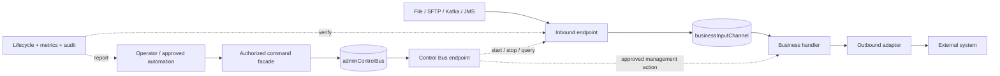
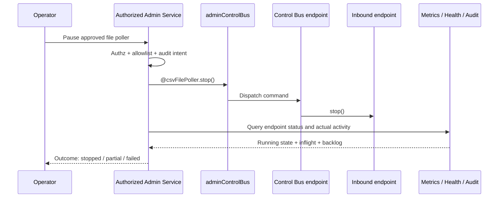
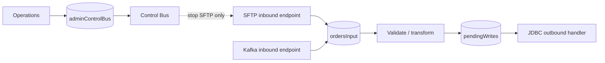
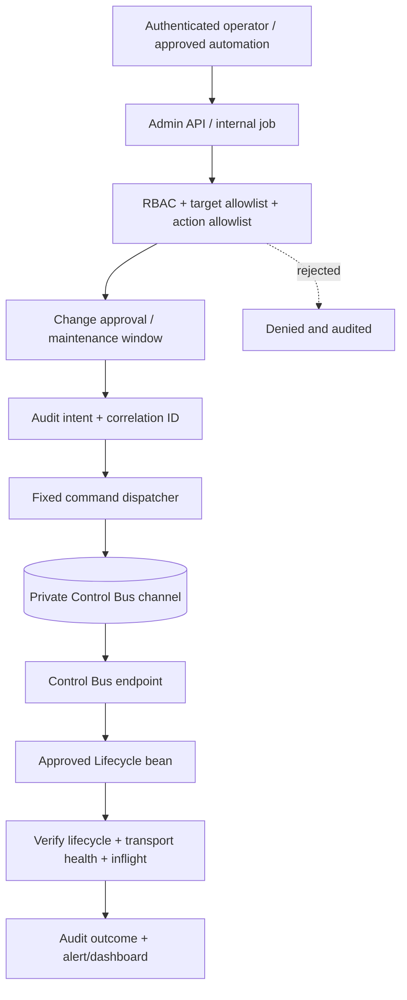
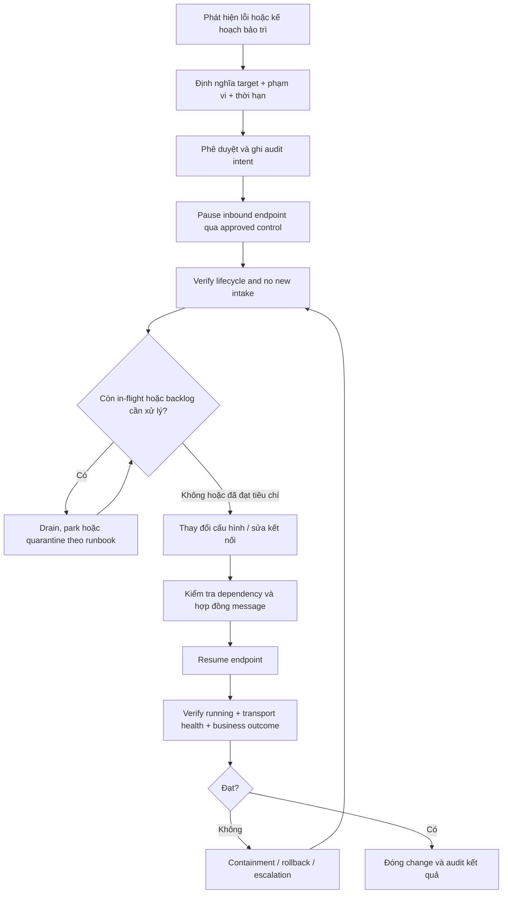

# Control Bus điều khiển adapter trong Spring Integration

## 1. Vì sao cần một kênh điều khiển riêng?

Trong một hệ thống **Spring Integration Adapters**, message có thể đi từ **File/SFTP inbound adapter**, HTTP gateway, **JMS/AMQP/Kafka consumer** hoặc bộ đọc JDBC vào một `MessageChannel`, được kiểm tra, biến đổi rồi gửi ra hệ thống đích. Bên cạnh xử lý nghiệp vụ, đội vận hành cần khả năng **tạm ngừng nhận message, tiếp tục sau khi khắc phục, kiểm tra trạng thái endpoint hoặc thực hiện thao tác bảo trì có kiểm soát**.

Ví dụ:

- Hệ thống SFTP phía đối tác đang chuyển file sai định dạng. Cần **dừng poller đầu vào** để không nhập thêm file, đồng thời vẫn để các message đang chờ được xử lý theo chính sách.
- Kafka consumer đang đẩy dữ liệu tới database mất kết nối. Đội vận hành muốn **tạm ngừng tiếp nhận** nhằm hạn chế backlog trong bộ nhớ, sau đó kiểm tra khả năng resume đúng offset.
- Một endpoint JMS có nguy cơ xử lý message trùng do lỗi downstream. Cần giới hạn phạm vi lỗi, nhưng không muốn dừng toàn bộ ứng dụng tích hợp.
- Một thay đổi cấu hình đã được phê duyệt cần **dừng adapter, xác nhận hết tác vụ in-flight, triển khai, khởi động lại và kiểm tra health**.
- Dashboard hiển thị endpoint đã được cấu hình nhưng không nhận message; cần biết **nó có đang running** hay không trước khi điều tra broker hoặc poller.

**Control Bus** là mẫu tích hợp (*Enterprise Integration Pattern — EIP*) cung cấp một **luồng message phục vụ điều khiển/giám sát hệ thống**, tách khỏi kênh chứa dữ liệu nghiệp vụ. Trong Spring Integration, **Control Bus endpoint** thường xử lý những **biểu thức Spring Expression Language (SpEL)** gửi tới channel điều khiển, giúp gọi các phương thức quản trị thích hợp trên các bean được Spring quản lý.

Bài thuộc chương **Observability** của mô-đun `SPRING_INTEGRATION_ADAPTERS`: kết nối các hệ thống ngoài bằng **inbound/outbound adapter, gateway, poller và MessageChannel**; trao đổi qua **file, SFTP, HTTP, JMS, AMQP, Kafka và database**; xử lý hợp đồng message, lỗi và vòng đời kết nối.

**Mục tiêu:** hiểu Control Bus dùng để làm gì, viết flow điều khiển an toàn, phân biệt *command accepted* với *endpoint thực sự hoạt động*, quan sát hậu quả điều khiển trên từng transport và kiểm thử để không làm mất/nhân đôi message.

## 2. Control Bus là gì và không phải là gì?

Control Bus là một **kênh điều khiển vận hành**. Một message điều khiển yêu cầu hệ thống thực hiện thao tác quản trị, chẳng hạn:

- **`start()`** hoặc **`stop()`** một endpoint có hỗ trợ vòng đời thích hợp.
- **`isRunning()`** để đọc trạng thái lifecycle.
- Truy vấn một thuộc tính hoặc gọi một thao tác quản trị **được thiết kế và cho phép** trên bean phù hợp.
- Kết hợp các thao tác với quy trình kiểm tra health, cảnh báo và nhật ký kiểm toán.

Ví dụ biểu thức SpEL thường gặp:

```text
@csvFilePoller.stop()
@csvFilePoller.start()
@csvFilePoller.isRunning()
```

Dấu `@` trong SpEL tham chiếu tới **Spring bean** theo tên. Các biểu thức trên chỉ có ý nghĩa nếu bean mang tên `csvFilePoller` tồn tại và hỗ trợ phương thức được gọi. **Không phải mọi bean hoặc outbound handler đều hỗ trợ `start()`/`stop()`.**

### 2.1. Hình dung luồng điều khiển và luồng nghiệp vụ



Các đường nét đứt là **lệnh quản trị hoặc đối soát trạng thái**, không phải message nghiệp vụ. Trong triển khai thực tế, việc điều khiển handler chỉ phù hợp khi handler/endpoint đích có hỗ trợ lifecycle và thao tác đó an toàn theo hợp đồng.

### 2.2. Phân biệt Control Bus với các cơ chế khác

| Cơ chế | Chức năng chính | Khác Control Bus ở đâu? |
|---|---|---|
| **Control Bus** | Thực thi yêu cầu quản trị trong hệ thống tích hợp | Điều khiển bean/endpoint bằng message quản trị; cần giới hạn quyền rất chặt |
| **MessageChannel nghiệp vụ** | Vận chuyển dữ liệu cần xử lý | Không dùng để gửi SpEL điều khiển từ nguồn không tin cậy |
| **Integration graph** | Mô tả node và liên kết flow | Cho biết topology, không tự phát lệnh pause/resume |
| **Spring Lifecycle/SmartLifecycle** | Mô hình `start()`, `stop()`, `isRunning()` của component | Là giao diện thực thi vòng đời mà Control Bus có thể gọi |
| **Actuator/health/metrics** | Quan sát health, throughput, queue, lỗi | Đo và báo trạng thái; không đồng nghĩa với control command |
| **Deployment/orchestrator** | Khởi động, dừng process, scale replica, thay cấu hình | Mức ứng dụng/hạ tầng, không chỉ một endpoint |
| **Broker pause/consumer control** | Điều tiết việc nhận message từ transport cụ thể | Có ngữ nghĩa ack/offset/session riêng, khác endpoint lifecycle tổng quát |
| **Circuit breaker/backpressure** | Tự động hạn chế tải hoặc downstream lỗi | Điều khiển theo tín hiệu runtime; không nhất thiết dùng Control Bus |

**Control Bus không phải nền tảng bảo mật để nhận code hoặc lệnh tùy ý từ người dùng.** Nó là khả năng quản trị nhạy cảm bên trong ứng dụng, cần một lớp xác thực, phân quyền, allowlist và kiểm toán riêng.

## 3. Control Bus hoạt động thế nào trong Spring Integration?

Có thể diễn giải theo bốn bước:

1. **Nguồn tin cậy** tạo một message chứa command đã được cho phép.
2. Message đi vào **channel riêng dành cho quản trị**, ví dụ `adminControlBus`.
3. **Control Bus endpoint** đánh giá payload theo cơ chế biểu thức được hỗ trợ, thường là **SpEL** được phép truy cập các bean Spring.
4. Tác dụng lên bean đích xảy ra theo ngữ nghĩa của phương thức/lifecycle; nếu có request–reply, kết quả truy vấn có thể được đưa về bên yêu cầu theo cấu hình.



Đây là sơ đồ **logic**; các thao tác xác minh và trả kết quả **không tự được Control Bus làm hết**. Cần triển khai thêm lớp quản trị, kiểm tra trạng thái, deadline và bằng chứng.

### 3.1. Phải có endpoint đích và phương thức tương ứng

SpEL `@beanName.stop()` về bản chất là gọi phương thức trên **bean được tham chiếu**. Nếu bean không có phương thức, không được quản lý bởi application context hoặc đã bị đổi tên, command sẽ thất bại.

Nên điều khiển **endpoint của adapter** thay vì tự phỏng đoán tên của source, poller hoặc handler bên trong. Ví dụ, khi định nghĩa polling inbound adapter bằng Java DSL, đặt **endpoint ID** có ý nghĩa để lấy đúng bean lifecycle.

**Không đồng nhất các đối tượng sau:**

- `MessageSource` đọc file hoặc record.
- **Polling consumer endpoint** được scheduler kích hoạt để lấy message.
- **Outbound MessageHandler** thực thi thao tác gửi.
- **MessageChannel** chuyển message.
- **Broker consumer/listener container** có mô hình lifecycle riêng.

Dừng **polling endpoint** thường là hành động có ý nghĩa đối với inbound polling. Dừng một `MessageChannel` hoặc gọi `stop()` trên một outbound handler bất kỳ **không phải cách tổng quát để tạm dừng cả flow**.

### 3.2. Control command và command result

Một lần `send()` thành công vào control channel chỉ chứng minh **message điều khiển được channel tiếp nhận theo ngữ nghĩa của nó**. Với `DirectChannel`, việc thực thi có thể đồng bộ; tuy nhiên không nên đồng nhất điều đó với:

- Poller đã hủy mọi tác vụ đang chạy;
- Kafka đã commit offset gần nhất;
- JMS/AMQP đã ACK tất cả message;
- SFTP session đã được đóng hoàn toàn;
- Message trong `QueueChannel` đã được xử lý hết;
- Hệ thống bên ngoài đã sẵn sàng khi resume.

Một đáp án **`isRunning() == true`** thường chỉ nói component **đã ở trạng thái lifecycle running**, không chứng minh đường mạng, broker, token, filesystem hoặc downstream đang khỏe.

## 4. Ví dụ Java DSL: inbound file có thể start/stop

Ví dụ minh họa sử dụng **Spring Integration Java DSL**. Một file inbound adapter kiểm tra thư mục `./incoming` theo chu kỳ. Ta đặt ID `csvFilePoller` cho polling endpoint và tạo **Control Bus riêng**.

```java
import java.io.File;
import java.time.Duration;

import org.slf4j.Logger;
import org.slf4j.LoggerFactory;
import org.springframework.context.annotation.Bean;
import org.springframework.context.annotation.Configuration;
import org.springframework.integration.channel.DirectChannel;
import org.springframework.integration.config.EnableIntegration;
import org.springframework.integration.dsl.IntegrationFlow;
import org.springframework.integration.dsl.Pollers;
import org.springframework.integration.file.dsl.Files;
import org.springframework.messaging.MessageChannel;

@Configuration
@EnableIntegration
public class FileAdapterControlConfiguration {

    private static final Logger log =
            LoggerFactory.getLogger(FileAdapterControlConfiguration.class);

    @Bean
    public MessageChannel adminControlBus() {
        return new DirectChannel();
    }

    @Bean
    public IntegrationFlow controlBusFlow() {
        return IntegrationFlow.from("adminControlBus")
                .controlBus()
                .get();
    }

    @Bean
    public IntegrationFlow csvFileIngestFlow() {
        return IntegrationFlow.from(
                Files.inboundAdapter(new File("./incoming"))
                        .patternFilter("*.csv"),
                endpoint -> endpoint
                        .id("csvFilePoller")
                        .poller(Pollers.fixedDelay(Duration.ofSeconds(5)))
        )
        .handle(message -> {
            // Xử lý giả lập để tập trung vào Control Bus.
            // Production cần validation, idempotency và error flow.
            log.info("Received file message, type={}",
                    message.getPayload().getClass().getSimpleName());
        })
        .get();
    }
}
```

**Vai trò của từng thành phần:**

- `adminControlBus`: channel quản trị tách biệt với message dữ liệu. Trong ví dụ, `DirectChannel` giúp việc dispatch diễn ra đồng bộ.
- `controlBusFlow()`: đăng ký endpoint Control Bus đánh giá command gửi tới channel trên.
- `csvFileIngestFlow()`: một inbound file adapter với **poller mỗi 5 giây** theo cấu hình minh họa.
- `.id("csvFilePoller")`: đặt ID cho **polling endpoint** để có đối tượng lifecycle có thể tham chiếu từ control command.
- `.handle(...)`: điểm nhận message nghiệp vụ; code ví dụ chỉ log kiểu payload, không cố mở/đọc file.

**Cần kiểm tra phiên bản:** tên package và overload DSL có thể khác tùy phiên bản Spring Integration/Spring Boot. Đây là cấu hình học thuật; việc build, dependency, thư mục và bean lifecycle thực tế phải được xác minh trong project ứng dụng. Hãy kiểm tra rằng `csvFilePoller` thực sự là bean endpoint hỗ trợ `Lifecycle`/các phương thức dự định điều khiển trước khi vận hành.

### 4.1. Gửi các command đã định nghĩa sẵn

Ví dụ lớp dịch vụ nội bộ dưới đây chỉ gửi **hai biểu thức cố định**. Nó **không nhận chuỗi SpEL tùy ý từ HTTP request, UI hay message bên ngoài**.

```java
import org.springframework.beans.factory.annotation.Qualifier;
import org.springframework.context.Lifecycle;
import org.springframework.context.ApplicationContext;
import org.springframework.messaging.MessageChannel;
import org.springframework.messaging.support.MessageBuilder;
import org.springframework.stereotype.Service;

@Service
public class FilePollingOperations {

    private final MessageChannel controlBus;
    private final ApplicationContext applicationContext;

    public FilePollingOperations(
            @Qualifier("adminControlBus") MessageChannel controlBus,
            ApplicationContext applicationContext) {
        this.controlBus = controlBus;
        this.applicationContext = applicationContext;
    }

    public void pauseFilePolling() {
        sendFixedCommand("@csvFilePoller.stop()");
    }

    public void resumeFilePolling() {
        sendFixedCommand("@csvFilePoller.start()");
    }

    public boolean endpointRunning() {
        Lifecycle endpoint = applicationContext.getBean(
                "csvFilePoller", Lifecycle.class);
        return endpoint.isRunning();
    }

    private void sendFixedCommand(String command) {
        boolean accepted = controlBus.send(
                MessageBuilder.withPayload(command).build()
        );
        if (!accepted) {
            throw new IllegalStateException(
                    "Control Bus did not accept the command");
        }
    }
}
```

**Điểm bảo mật:** việc `sendFixedCommand()` là private chỉ giới hạn code trong ví dụ, **không tự thay thế authorization** ở nơi gọi các phương thức public. Một API quản trị thật phải xác thực operator, kiểm tra vai trò/quyền với từng target, kiểm soát thay đổi và lưu audit.

**Điểm vận hành:** sau khi gọi `pauseFilePolling()`, nên đọc `endpointRunning()` và kiểm tra **số lần poll, in-flight work, queue depth**. Cần xác minh cả ba trước khi báo “đã dừng intake hoàn toàn”. Nếu ngữ nghĩa yêu cầu dừng khi job hiện tại kết thúc, phải thiết kế riêng bước **drain**.

**Lưu ý về `send()`:** nếu SpEL evaluation thất bại trên `DirectChannel`, có thể phát sinh exception thay vì chỉ trả `false`. Lớp quản trị thật cần xử lý lỗi này, gắn correlation/audit và không tự báo thành công khi có exception.

### 4.2. Truy vấn trạng thái qua Control Bus

Ngoài thao tác start/stop, trong môi trường hỗ trợ request–reply, payload biểu thức sau có thể đọc trạng thái lifecycle:

```text
@csvFilePoller.isRunning()
```

Để nhận kết quả, **bên yêu cầu phải cấu hình reply channel hoặc sử dụng gateway/messaging template hỗ trợ request–reply phù hợp**. Gửi biểu thức vào channel theo kiểu fire-and-forget rồi hy vọng nhận được Boolean từ `send()` là sai: `send()` trả trạng thái gửi message, không phải kết quả của `isRunning()`.

Trong nhiều trường hợp, đọc trực tiếp bean `Lifecycle` từ một **dịch vụ quản trị nội bộ** như ví dụ trên đơn giản và dễ kiểm soát hơn. Dù lấy trạng thái theo cách nào, luôn đối chiếu với **health thực tế của connector**.

## 5. Khi nào start/stop có tác dụng — và khi nào không?

Điểm quyết định là **component nào có lifecycle thực sự**.

| Đối tượng | Tác động của stop thường hướng tới | Điều không mặc nhiên xảy ra |
|---|---|---|
| **File inbound polling endpoint** | Ngừng các lần poll mới của endpoint | Không xóa file, không tự dọn queue, không hủy tác vụ đã chạy |
| **SFTP inbound polling endpoint** | Ngừng poll nguồn SFTP theo endpoint | Không chắc đã kết thúc ngay phiên đang truyền file |
| **JDBC inbound polling endpoint** | Ngừng kích hoạt query/poll mới | Không rollback giao dịch đã hoàn tất, không tự reset marker |
| **JMS message-driven inbound endpoint/listener** | Dừng listener/consumer theo hỗ trợ cụ thể | Không chứng minh message in-flight đã ACK hoặc rollback xong |
| **AMQP inbound listener** | Dừng consumer/listener theo lifecycle của nó | Không chứng minh requeue, ack/nack hoặc prefetch đã xử lý đúng |
| **Kafka message-driven inbound endpoint** | Dừng nhận record mới qua listener container theo cơ chế adapter | Không tự chứng minh offset đã commit, không bảo toàn trạng thái nếu replay sai |
| **HTTP inbound gateway** | Phụ thuộc implementation: endpoint, HTTP server, route/controller và cấu hình | Không mặc định một `stop()` sẽ khóa URL hoặc chặn mọi request ngoài mạng |
| **Outbound handler/gateway** | Chỉ nếu bean/endpoint tương ứng hỗ trợ lifecycle và tác dụng được định nghĩa | Không mặc định có khả năng `stop()` hoặc dừng an toàn mọi lời gọi in-flight |

**Không suy đoán một command chung dùng được trên tất cả adapter.** Các adapter có mô hình quản lý vòng đời khác nhau: polling source, listener container, request–reply gateway và outbound sender không giống nhau. Trước khi tự động hóa, kiểm tra bean thực tế, lifecycle interface, tài liệu/version và hành vi khi có message đang xử lý.

### 5.1. Stop một inbound endpoint không giống stop application

Khi một inbound endpoint dừng:

- Các **flow khác** trong cùng Spring Boot application vẫn có thể chạy.
- Những **message đã nằm trong QueueChannel/broker** có thể vẫn tiếp tục được xử lý bởi consumer khác.
- Những **task đang chạy** có thể hoàn tất hoặc kết thúc theo policy/implementation.
- Các **producer khác** vẫn có thể gửi vào một channel đang được dùng chung.
- Health endpoint `/actuator/health` có thể vẫn trả healthy nếu không có health indicator riêng cho endpoint đã dừng.

Do đó, **“pause intake”**, **“drain in-flight”**, **“quiesce flow”** và **“stop process”** là bốn mục tiêu khác nhau.

### 5.2. Start không bảo đảm đã kết nối thành công

Khi gọi `start()`:

1. Bean có thể chuyển trạng thái `running`.
2. Poller/listener có thể bắt đầu cố gắng kết nối.
3. Remote SFTP, broker hoặc database có thể tiếp tục lỗi.
4. Adapter có thể retry theo policy.
5. Chỉ khi kiểm tra **kết nối, poll heartbeat, số message và kết quả ở target**, mới có thể khẳng định flow xử lý bình thường.

**Lifecycle state ≠ transport health ≠ business success.** Ba lớp thông tin này cần được công bố độc lập trong dashboard vận hành.

## 6. Điều khiển theo từng transport

### 6.1. File inbound/outbound

File inbound thường chạy qua **poller**. Khi phát hiện một file sai format hàng loạt, đội vận hành có thể dừng polling endpoint để cô lập nguồn rồi điều tra:

- File đã được liệt kê/cấp message chưa?
- Có file đang được đọc ở thời điểm dừng không?
- Bộ lọc file/accept-once đã ghi nhận file là đã xem chưa?
- Khi start lại có cần **reprocess** hay tránh xử lý trùng?
- File được ghi sang outbound thư mục khác có trạng thái tạm/đã hoàn tất không?

**Không dùng Control Bus để xóa file nhằm “giải phóng backlog”.** Việc xóa, chuyển thư mục, đánh dấu đã xử lý và retry cần runbook riêng và bằng chứng rõ ràng.

### 6.2. SFTP

SFTP adapter có thể có session factory, cache, remote filters và giới hạn kết nối. Stop polling endpoint thường hạn chế tạo poll mới, nhưng không thể khẳng định đã dừng ngay một lần download/upload đang diễn ra.

Khi resume, cần kiểm tra:

- SSH authentication và host-key verification.
- Remote path và quyền truy cập.
- Trạng thái tệp tải dở, temporary file, rename/atomic move theo thiết kế.
- Local/remote file filter, metadata store và nguy cơ tải lại.
- Session pool, timeout và chính sách reconnect.
- Kết quả end-to-end: file đã thực sự tới đích và xử lý được chưa?

Một **SFTP outbound adapter** có thể không cung cấp thao tác start/stop tương tự polling inbound. Nếu muốn ngừng xuất file, có thể cần dừng endpoint nhận message, đưa vào queue có kiểm soát hoặc áp dụng gate ở flow — tùy kiến trúc, không chỉ gọi lệnh bất kỳ lên bean handler.

### 6.3. JMS

JMS inbound message-driven adapter thường sử dụng listener/container. Khi cần pause:

- Xác định bean lifecycle của **listener endpoint/container** thực tế.
- Kiểm tra message đã nhận nhưng chưa ACK hoặc đang trong transaction.
- Theo dõi queue depth, redelivery, DLQ và consumer count.
- Xác minh stop có ý nghĩa gì với message đang xử lý theo provider/config.
- Khi resume, xác minh consumer gắn lại, processing hồi phục và idempotency hoạt động.

**Control Bus không thay thế chính sách JMS acknowledgement/transaction.** Một message có thể xuất hiện lại sau restart; nghiệp vụ phải có idempotency hoặc cơ chế đảm bảo được chọn theo hợp đồng.

### 6.4. AMQP

AMQP inbound thường phụ thuộc RabbitMQ listener container, prefetch, manual/auto ack, retry và dead-letter exchange.

Trước khi gửi stop cho endpoint:

- Kiểm tra tác động tới các consumer còn lại và queue tồn đọng.
- Biết trạng thái những delivery chưa ACK.
- Không mặc định stop sẽ chuyển toàn bộ delivery sang DLQ.
- Theo dõi exchange/queue bindings, publish confirms và kết quả xử lý.
- Kiểm tra container lifecycle của phiên bản Spring AMQP/Spring Integration đang dùng.

Nếu mục tiêu là **circuit breaker khi downstream mất kết nối**, có thể cần rate limiter/backpressure hoặc quản lý consumer concurrency ngoài Control Bus.

### 6.5. Kafka

Với Kafka inbound adapter, cách pause/resume cần đặc biệt cẩn thận về:

- Listener container và consumer group.
- Partition assignment/rebalance.
- Offset commit, transaction và xử lý in-flight.
- Retry topic/DLT.
- Tốc độ bắt kịp backlog sau resume và áp lực lên downstream.

**Dừng Kafka listener không giống “pause partitions”** ở mức Kafka Consumer API. Khi stop/start một listener, container có thể rời và tham gia lại group; hành vi phụ thuộc cách triển khai. Nếu cần tạm dừng nhận nhưng vẫn duy trì membership, phải đánh giá **cơ chế pause/resume chuyên dụng của listener/container** và policy ứng dụng, thay vì giả định Control Bus `stop()` đạt cùng mục tiêu.

Một sự kiện được xử lý lại sau resume không mặc nhiên là lỗi broker; cần phân biệt **processing attempt**, **committed offset** và **business event ID**.

### 6.6. HTTP inbound/outbound gateway

HTTP gateway không vận hành như source polling file/SFTP. Việc stop một bean xử lý request có thể không dừng web server hoặc route servlet vẫn được expose; tác dụng phụ thuộc thành phần cụ thể.

Nếu cần bảo trì endpoint HTTP:

- Dùng **API gateway/load balancer/routing policy** hoặc cơ chế ingress phù hợp để ngăn request mới.
- Trả mã lỗi/maintenance response có kiểm soát, không bỏ qua auth.
- Đợi request in-flight hoàn tất trong deadline.
- Theo dõi connection timeout, retry của client và idempotency.
- Đảm bảo outbound HTTP gateway không bị gọi từ các flow khác hoặc có gate riêng nếu cần.

**Không cấu hình public HTTP endpoint cho phép client gửi chuỗi SpEL thẳng vào Control Bus.** Đây là lỗ hổng điều khiển có thể cho phép gọi những phương thức không được phê duyệt trên bean Spring.

### 6.7. JDBC / database

Với JDBC inbound polling, dừng poller có thể giảm các query mới trong thời gian DB bảo trì. Nhưng cần phân biệt:

- Query đang thực thi và transaction chưa commit.
- Row locking, claim marker hoặc trạng thái `processed`.
- Scheduler và số lần poll.
- Idempotency khi retry những dòng đã đọc.
- DB connection pool health sau resume.
- Quyền và dữ liệu nhạy cảm bị log trong lỗi SQL.

Với **JDBC outbound adapter**, việc dừng một endpoint có thể làm các upstream send bị lỗi hoặc tăng backlog; không tự rollback giao dịch đã commit. Kế hoạch bảo trì phải quy định cách buffer/reject/circuit-breaker cho message đến trong thời gian tạm dừng.

## 7. Control Bus và flow topology: điều gì đang được điều khiển?

Trong hệ thống lớn, nhiều adapter có thể dùng chung một `MessageChannel`. Để dừng đúng nguồn, hãy xem:



Dừng **SFTP inbound endpoint** không dừng Kafka inbound. Nếu `pendingWrites` đã có 1.000 message chờ JDBC, chúng vẫn cần được xử lý hoặc quản lý riêng. Không báo “flow đã dừng hoàn toàn” chỉ vì một endpoint báo `isRunning=false`.

**Integration graph** có thể giúp tìm các node, tên channel và endpoint liên quan. Tuy nhiên, graph là **mô hình topology**, không tự xác nhận bean đang running, poller đang hoạt động, broker đang khỏe hoặc message đã commit.

### 7.1. Đặt tên endpoint để tránh điều khiển nhầm

Quy ước gợi ý:

```text
orders.file.inboundPoller
orders.sftp.inboundPoller
orders.kafka.inboundListener
orders.jdbc.outboundHandler
operations.adminControlBus
```

Tên trên là **ví dụ quy ước**, không phải mặc định của framework. Nếu dùng tên có dấu chấm, khi tham chiếu bean bằng SpEL có thể cần cú pháp tên phù hợp, hoặc dùng tên bean ngắn/ký tự an toàn để tránh parser ambiguity. Quan trọng hơn là giữ **tên ổn định và danh sách target được phê duyệt**.

Một bảng kiểm soát có thể lưu:

| Field | Ý nghĩa |
|---|---|
| `logical_flow` | Tên hành trình nghiệp vụ |
| `endpoint_bean_name` | Tên bean có lifecycle thực tế |
| `transport` | File, SFTP, JMS, AMQP, Kafka, HTTP, JDBC |
| `instance_id` | Replica/process chịu ảnh hưởng |
| `supported_actions` | Chỉ các thao tác đã kiểm thử: pause/resume/query… |
| `owner_team` | Đội chịu trách nhiệm |
| `risk_tier` | Phạm vi ảnh hưởng đến dữ liệu/nghiệp vụ |
| `recovery_check` | Cách xác minh sau start |
| `safe_shutdown_check` | Cách xác minh in-flight/ACK/queue trước stop |

**Không xây command string trực tiếp từ `endpoint_bean_name` do người gọi tự cung cấp.** Registry chỉ nên ánh xạ lựa chọn đã được thẩm định sang một tập lệnh cố định hoặc API quản trị đã kiểm soát.

## 8. Lớp quản trị an toàn: chỉ cho phép hành động đã duyệt

Control Bus sử dụng biểu thức có thể truy cập bean Spring, nên **một channel tiếp nhận SpEL tùy ý là bề mặt tấn công nguy hiểm**. Đây không phải nơi chấp nhận payload từ HTTP gateway, Kafka topic của đối tác hoặc một bảng dữ liệu có thể bị sửa bởi người dùng nghiệp vụ.

### 8.1. Kiến trúc đề xuất



Lớp quản trị nên:

1. **Xác thực người thực hiện** hoặc hệ automation với identity riêng.
2. **Phân quyền theo target và action**, ví dụ chỉ đội integration được pause SFTP; nhóm hỗ trợ chỉ có quyền đọc trạng thái.
3. **Allowlist** endpoint/command, không truyền nguyên chuỗi SpEL từ request.
4. **Bảo vệ channel điều khiển** khỏi mọi flow nghiệp vụ và source không tin cậy.
5. **Giới hạn phạm vi** theo instance, môi trường và tài nguyên.
6. **Dùng approval/dual control** cho thay đổi production có tác động cao.
7. **Ghi nhật ký bất biến hoặc audit tin cậy** về actor, lý do, mốc, target, kết quả.
8. **Kiểm soát tốc độ** command và tránh spam start/stop gây flapping.
9. **Không log secret, token hoặc raw SpEL từ người dùng** vào dashboard công khai.
10. **Có cơ chế break-glass** được phê duyệt và review sau sử dụng nếu IAM quản trị thông thường không khả dụng.

**Ví dụ lựa chọn được phép ở lớp API:**

```json
{
  "action": "PAUSE_FILE_INGEST",
  "target": "csvFilePoller",
  "reason": "Upstream file schema mismatch",
  "changeId": "CHG-2026-1142"
}
```

JSON là **hợp đồng quản trị do ứng dụng tự thiết kế**, không phải schema mặc định của Spring Integration. Lớp API ánh xạ `PAUSE_FILE_INGEST` sang một thao tác đã duyệt; **không** lấy `action` hoặc `target` nối thành SpEL tùy ý.

### 8.2. Những dữ liệu nào nên được ghi audit?

| Trường | Cần lưu để làm gì? |
|---|---|
| `command_id` | Chống gửi lặp ở tầng quản trị và truy vết |
| `actor_id`, `actor_role` | Ai yêu cầu, có quyền gì |
| `reason`, `change_id` | Vì sao thay đổi và phê duyệt nào liên quan |
| `environment`, `instance_id` | Tác động tới môi trường/replica nào |
| `target_endpoint`, `requested_action` | Đã đề nghị điều khiển thành phần gì |
| `requested_at`, `dispatched_at` | Độ trễ xử lý command |
| `lifecycle_before`, `lifecycle_after` | Trạng thái bean trước/sau |
| `inflight_count`, `backlog_size` | Còn message nào chưa hoàn tất |
| `verification_at`, `verification_method` | Khi nào xác minh, bằng chứng gì |
| `outcome`, `error_category` | Success/partial/failure, nguyên nhân |
| `correlation_id`, `evidence_ref` | Liên kết log, ticket, dashboard, trace |

**Chú ý:** `command_id` giúp idempotency của yêu cầu quản trị **chỉ nếu lớp điều phối có cơ chế lưu và khử trùng lặp thật**. Control Bus thuần túy không tự bảo đảm exactly-once execution cho các command.

## 9. Observability cho Control Bus: trạng thái, kết quả và tác động

Vì bài nằm trong **Observability**, cần nhìn Control Bus như một **vòng điều khiển có phản hồi**. Bốn nhóm tín hiệu nên được quan sát:

1. **Ý định điều khiển:** ai muốn dừng/start, vì sao và lúc nào.
2. **Kết quả dispatch:** command có được chấp nhận, có lỗi SpEL/bean/method không.
3. **Trạng thái lifecycle:** endpoint báo running/stopped sau thao tác hay không.
4. **Tình trạng hệ thống thực:** poll heartbeat, broker connectivity, in-flight, queue depth, retry và kết quả outbound.

| Metric minh họa | Loại | Mục đích |
|---|---|---|
| `integration_control_commands_total` | Counter | Số command theo `action`, `outcome`, `target_type` |
| `integration_control_command_duration_seconds` | Timer | Thời gian từ nhận lệnh đến dispatch/xác minh, phải ghi định nghĩa |
| `integration_endpoint_running` | Gauge 0/1 | Lifecycle state theo endpoint cho phép |
| `integration_endpoints_intentionally_paused` | Gauge | Phân biệt chủ động pause với sự cố |
| `integration_poller_last_success_age_seconds` | Gauge | Thời gian từ lần poll thành công cuối |
| `integration_adapter_connection_failures_total` | Counter | Phân loại lỗi kết nối |
| `integration_inflight_messages` | Gauge | Tác vụ đang chạy cần drain |
| `integration_queue_backlog` | Gauge | Số message đang chờ |
| `integration_control_verification_failures_total` | Counter | Lệnh đã gửi nhưng trạng thái/health không đạt |

**Các tên metric là minh họa do ứng dụng định nghĩa, không phải metric mặc định chắc chắn có của Spring Integration.** Khi dùng Micrometer/Actuator, kiểm tra metrics thực tế và tránh đếm trùng. Metric tags cần **cardinality thấp**: `action`, `outcome`, `transport`, tên endpoint hữu hạn. Không dùng `command_id`, ID người vận hành hoặc message ID làm tag cho từng lệnh.

### 9.1. Một lệnh stop không đồng nghĩa đã hết rủi ro

Ví dụ SFTP inbound được dừng lúc 10:02, nhưng còn:

- 1 file đang tải dở;
- 120 message trong `QueueChannel`;
- 3 retry HTTP outbound chờ chạy;
- một phiên SFTP đang mở;
- một thao tác JDBC đang chờ commit.

Dashboard cần hiển thị rõ **intake paused** nhưng **processing/in-flight chưa về 0**. Nếu mục tiêu chỉ là ngăn poll mới, thành công một phần có thể đúng. Nếu mục tiêu là bảo trì không còn side effect, phải thực hiện thêm **quiesce/drain/verify**.

### 9.2. Tracing command điều khiển

Có thể tạo span hoặc structured log cho hành trình:

```text
admin request -> authorization -> audit intent -> Control Bus
    -> lifecycle transition -> health/queue verification -> audit outcome
```

Phân biệt trace **command quản trị** với trace **message nghiệp vụ**. Một stop có thể gián tiếp làm một số business messages bị chờ; việc liên kết hai trace phải dựa trên correlation/event hợp lý, không tự coi stop command là parent của mọi message tồn đọng.

**Không biến Control Bus thành nguồn dữ liệu telemetry thay thế**: đọc `isRunning()` có ích, nhưng không đủ chứng minh throughput, latency, broker ACK hoặc trạng thái bên ngoài.

## 10. Quản trị trong môi trường nhiều instance

Khi có nhiều replica Spring Boot, mỗi process thường sở hữu **ApplicationContext, Control Bus và endpoint lifecycle riêng**.

Ví dụ có ba instance của một dịch vụ:

```text
integration-app-1: csvFilePoller RUNNING
integration-app-2: csvFilePoller RUNNING
integration-app-3: csvFilePoller RUNNING
```

Nếu gửi `@csvFilePoller.stop()` tới **instance 1**, các instance 2 và 3 **không tự dừng**. Control Bus nội bộ không phải broadcast cluster toàn cục.

Để điều khiển an toàn ở quy mô cluster cần:

- Registry instance và endpoint đang chạy.
- Orchestrator hoặc control-plane có khả năng chọn đúng replica/nhóm replica.
- Command ID, authorization và audit cho từng instance.
- Kiểm tra kết quả trên **tất cả instance** theo mục tiêu.
- Xác định trường hợp timeout, instance offline hoặc command được gửi hai lần.
- Phân biệt replica đang shutdown/redeploy với replica chủ động paused.
- Kiểm tra leadership, partition ownership hoặc consumer-group rebalance tùy transport.
- Xử lý lại trạng thái khi instance mới được tạo bởi autoscaling.

**Thay đổi lifecycle thường là trạng thái runtime**, không mặc nhiên là cấu hình bảo trì bền vững sau restart. Nếu cần “pause tới khi được phê duyệt resume” qua redeploy/scale-out, phải dùng **desired-state registry hoặc cấu hình vận hành bền vững**, rồi áp dụng khi instance khởi động.

### 10.1. Lưu desired state và observed state riêng

| Thuộc tính | Ý nghĩa |
|---|---|
| `desired_state = PAUSED` | Control plane muốn endpoint chưa nhận message |
| `observed_state = RUNNING` | Replica vẫn báo đang chạy |
| `command_status = DISPATCHED` | Lệnh đã được gửi nhưng chưa xác minh |
| `verification_status = FAILED` | Có lệch giữa mong muốn và thực tế |
| `observed_at` | Thời điểm đọc trạng thái, để tránh dùng dữ liệu cũ |

Một vòng reconciliation có thể phát lại **các thao tác idempotent đã cho phép** khi phát hiện lệch state, nhưng phải có giới hạn retry và cảnh báo; đừng tự tạo vòng start/stop liên tục gây mất ổn định.

## 11. Quy trình bảo trì an toàn: pause → drain → change → resume

Một runbook có thể áp dụng cho inbound polling, broker listener hoặc flow có queue trung gian sau khi đã xác minh semantics của adapter.



**Các bước cụ thể:**

1. **Chốt phạm vi**: endpoint/instance nào dừng; upstream có tiếp tục gửi không; buffer nằm ở đâu; những nghiệp vụ nào bị ảnh hưởng.
2. **Xác minh quyền**: người gọi có quyền cho môi trường và endpoint đó không, có cần phê duyệt thứ hai không.
3. **Gửi stop**: dùng action cố định; ghi command ID và lỗi nếu có.
4. **Đọc trạng thái**: kiểm tra lifecycle, poll heartbeat, listener container và source connection theo ngữ nghĩa.
5. **Đợi hoặc xử lý in-flight**: theo dõi queue, transaction, ACK/offset, retry; không xóa backlog để làm đẹp dashboard.
6. **Thực hiện bảo trì**: giữ snapshot cấu hình/rollback, xử lý sự cố ngoài hệ thống.
7. **Đánh giá trước resume**: target đã khỏe, credential hợp lệ, schema tương thích, idempotency và retry policy sẵn sàng.
8. **Start/resume**: áp dụng theo đúng loại endpoint; trong cluster có thể mở dần theo replica.
9. **Xác minh end-to-end**: có message vào, xử lý thành công và đích xác nhận theo hợp đồng; không chỉ kiểm tra `isRunning()`.
10. **Theo dõi sau thay đổi**: backlog giảm ổn định, error rate không tăng, không có duplicate ngoài dự kiến.
11. **Đóng audit**: ghi outcome, timestamp, owner, bằng chứng và các rủi ro còn lại.

### 11.1. Dừng intake và dừng processing là hai chế độ khác nhau

| Chế độ | Điều cần làm | Dấu hiệu xác nhận |
|---|---|---|
| **Pause intake** | Stop inbound endpoint thích hợp | Không còn poll/listener tiếp nhận mới theo kỳ vọng |
| **Drain** | Cho phép consumer xử lý phần đã nhận | In-flight giảm; queue/transaction đạt tiêu chí |
| **Quiesce** | Ngừng intake và chờ các bước bắt buộc hoàn tất | Không còn side effect chưa kiểm soát |
| **Emergency containment** | Ngăn tác động nguy hiểm ngay theo playbook | Đường gây rủi ro bị chặn, có escalation |
| **Resume** | Start endpoint và kiểm tra dependency | Running + health + business success |

Không dùng một biểu thức `stop()` làm đại diện cho tất cả chế độ trên.

## 12. Hành vi lỗi của Control Bus và cách xử lý

Một command có thể thất bại vì:

- Bean name không tồn tại hoặc endpoint đã bị gỡ khi deploy.
- Phương thức không hỗ trợ lifecycle hoặc không phù hợp target.
- Lỗi SpEL evaluation.
- Channel điều khiển không có consumer hoặc đang dừng.
- Bean lifecycle gọi nhưng component phát sinh exception.
- Backend bên ngoài mất kết nối dù bean đã chuyển running.
- Replica đích ngừng hoạt động giữa lúc gửi command.
- Command đã được chấp nhận nhưng verification timeout.
- Hai operator đồng thời gửi start/stop gây trạng thái không ổn định.

**Cần tách các trạng thái:** `REJECTED` (không được quyền), `DISPATCH_FAILED`, `APPLIED`, `VERIFICATION_FAILED`, `PARTIAL`, `VERIFIED`. Một trạng thái `APPLIED` không đồng nghĩa transport/business đã khỏe.

### 12.1. Lỗi đồng bộ và bất đồng bộ

Với `DirectChannel`, handler điều khiển thường chạy trên thread gửi; một lỗi thực thi có thể được **propagate** trực tiếp. Trong kiến trúc command async, lỗi có thể được chuyển qua error channel/callback/queue theo cơ chế của endpoint.

Không giả định mọi lỗi đều đi vào một `errorChannel` mặc định. Thiết kế cần xác nhận đường lỗi thực tế, tránh nuốt exception khi gửi command.

**Ví dụ phản hồi từ admin API — chỉ minh họa:**

```json
{
  "commandId": "ctl-6142",
  "target": "csvFilePoller",
  "requestedAction": "PAUSE",
  "dispatchStatus": "APPLIED",
  "verificationStatus": "VERIFIED",
  "observedLifecycle": "STOPPED",
  "transportHealth": "NOT_APPLICABLE_WHILE_PAUSED",
  "verifiedAt": "2026-11-23T16:20:00+07:00"
}
```

Đây **không phải** message payload bắt buộc hoặc format mặc định của Spring Integration; là ví dụ của một lớp quản trị tự xây dựng, phải phù hợp chính sách audit và quyền truy cập.

### 12.2. Chống command flapping

Nếu một automation thấy downstream lỗi và gọi `stop()`, rồi health check thấy thiếu throughput và tự `start()` ngay, hệ thống có thể dao động liên tục.

Giải pháp:

- **Hysteresis:** điều kiện pause và resume khác nhau.
- **Cooldown:** giới hạn tần suất chuyển trạng thái.
- **Manual override:** khi operator chủ động giữ bảo trì, automation không tự resume.
- **Desired-state version:** so sánh quyết định mới/cũ trước khi áp dụng.
- **Owner & escalation:** có người xử lý khi trạng thái không xác minh được.
- **Backoff:** retry có giới hạn, không spam command khi endpoint hoặc broker lỗi.

## 13. Kiểm thử Control Bus và trạng thái endpoint

Kiểm thử cần xác nhận cả **tác dụng lifecycle** lẫn **hành vi nghiệp vụ**.

### 13.1. Test start/stop ở mức tích hợp

Một test theo cấu hình Java DSL mục 4 có thể làm:

```java
import static org.junit.jupiter.api.Assertions.*;

import org.junit.jupiter.api.Test;
import org.springframework.beans.factory.annotation.Autowired;
import org.springframework.beans.factory.annotation.Qualifier;
import org.springframework.context.ApplicationContext;
import org.springframework.context.Lifecycle;
import org.springframework.messaging.MessageChannel;
import org.springframework.messaging.support.MessageBuilder;
import org.springframework.test.context.junit.jupiter.SpringJUnitConfig;

@SpringJUnitConfig(FileAdapterControlConfiguration.class)
class FileAdapterControlTest {

    @Autowired
    ApplicationContext context;

    @Autowired
    @Qualifier("adminControlBus")
    MessageChannel controlBus;

    @Test
    void controlBusCanStopAndStartPoller() {
        Lifecycle poller =
                context.getBean("csvFilePoller", Lifecycle.class);

        try {
            assertTrue(controlBus.send(
                    MessageBuilder
                            .withPayload("@csvFilePoller.stop()")
                            .build()));
            assertFalse(poller.isRunning());

            assertTrue(controlBus.send(
                    MessageBuilder
                            .withPayload("@csvFilePoller.start()")
                            .build()));
            assertTrue(poller.isRunning());
        } finally {
            // Để test không để endpoint dừng sau khi assertion lỗi.
            controlBus.send(
                    MessageBuilder
                            .withPayload("@csvFilePoller.start()")
                            .build());
        }
    }
}
```

**Hạn chế của test:** chỉ kiểm tra lifecycle; chưa chứng minh poller ngừng nhận file trong một cửa sổ thời gian, chưa kiểm tra file đang đọc, retry, queue hay side effect. Trạng thái `isRunning()` có thể đổi theo thiết kế nội bộ; trong ứng dụng với scheduler async nên dùng **kiểm tra chờ có timeout và dữ liệu thử**, không giả định mọi chuyển đổi từ xa là tức thời.

Đây là test minh họa; khi chạy thật cần project có JUnit/Spring Test, dependency Spring Integration tương thích, thư mục test được tạo theo điều kiện môi trường, và không có file production vô tình nằm ở `./incoming`.

### 13.2. Bài test nghiệp vụ theo thời gian

Ví dụ với file inbound:

1. Tạo thư mục test tạm, để trống và khởi động flow.
2. Tạo file A; xác minh đúng **một** message được xử lý.
3. Gửi pause qua lớp quản trị được test và xác minh endpoint stopped.
4. Tạo file B trong lúc paused; đợi hơn một chu kỳ poll và xác nhận **không có poll mới đưa B vào flow**, tính đến những tác vụ in-flight đã được kiểm soát.
5. Gửi resume, xác minh file B được nhận theo chính sách.
6. Xác minh không xử lý lại file A nếu hợp đồng yêu cầu once-only.
7. Mô phỏng parser lỗi và quan sát error flow/backlog; xác minh control command không bị nhầm thành business message.
8. Đảm bảo sau test có cleanup tài nguyên và khôi phục trạng thái mong đợi.

Với Kafka/JMS/AMQP, thay bằng broker test/container phù hợp; cần assert **consumer behavior, offset/ACK, redelivery**, không chỉ lifecycle.

### 13.3. Kiểm thử bảo mật bắt buộc

| Trường hợp | Kết quả mong muốn |
|---|---|
| User không có quyền pause | Lệnh bị chặn trước Control Bus và có audit |
| Operator chỉ đọc trạng thái | Không thể gọi start/stop |
| Payload SpEL do client gửi | Không được chuyển thẳng vào control channel |
| Target không có trong allowlist | Bị từ chối và ghi lý do |
| Production yêu cầu approval | Không thực thi trước phê duyệt |
| Command trùng ID | Được xử lý theo chính sách dedupe của control plane |
| Một instance mất kết nối | Có kết quả partial, không báo cluster đã dừng hết |
| Control command gây exception | Không báo `VERIFIED`; giữ error/evidence |
| Audit sink lỗi | Áp dụng chính sách fail/queue/alert đã phê duyệt |
| Operator cố dùng bean nhạy cảm | Không thể thao tác qua API cho phép |

Nếu không có những kiểm thử này, việc expose một kênh nhận SpEL lên network tạo nguy cơ nghiêm trọng hơn lợi ích vận hành.

## 14. Khi nào nên dùng giải pháp khác Control Bus?

Control Bus hữu ích cho **thao tác vận hành trên bean/endpoint có lifecycle**, nhưng không phải lựa chọn tốt nhất cho mọi nhu cầu.

| Nhu cầu | Hướng phù hợp hơn hoặc cần kết hợp |
|---|---|
| Tạm ngừng một polling endpoint trong process | Control Bus với target đã kiểm thử và lớp quản trị an toàn |
| Tạm dừng Kafka partitions nhưng muốn giữ consumer group | API quản lý listener/container và cơ chế pause chuyên dụng nếu phù hợp |
| Ngăn request HTTP ở edge | API gateway/load balancer, ingress hoặc route policy |
| Cô lập lỗi downstream tự động | Circuit breaker, rate limiting, bounded queue, retry/backoff |
| Quản lý trạng thái pause xuyên deploy/scale | Desired-state registry + orchestration/reconciliation |
| Drain queue bảo đảm không mất message | Cơ chế queue/broker/transaction và quy trình quiesce riêng |
| Đổi schema, credential hoặc endpoint remote | Configuration/secret management, change management |
| Đảm bảo audit không mất event | Durable audit/outbox có chính sách delivery rõ |
| Giám sát throughput, p95, queue hoặc connection | Metrics, tracing, health indicators |
| Hiểu flow nào nối tới endpoint nào | Integration graph/đồ thị cấu hình |
| Gửi lệnh người dùng cuối để điều khiển bean Spring | **Không dùng SpEL trực tiếp**; thiết kế API nghiệp vụ có xác thực và action allowlist |

Các công cụ này thường **bổ sung** cho nhau: graph chỉ ra điểm điều khiển, Control Bus áp dụng lệnh, metrics/health xác minh tác dụng, còn broker-specific API quản lý offset/session khi cần.

## 15. Anti-pattern và cách sửa

1. **Đưa payload HTTP/Kafka của người dùng vào Control Bus như SpEL** → nguy cơ thực thi phương thức ngoài ý muốn. Chỉ dùng lệnh cố định do lớp quản trị đã phê duyệt tạo ra.
2. **Dùng một channel cho message nghiệp vụ và command** → sai ranh giới tin cậy; tạo channel quản trị riêng.
3. **Cho mọi operator gọi mọi bean** → không có least privilege; phân quyền theo target/action/môi trường.
4. **Tin `send() == true` nghĩa adapter đã an toàn** → thiếu lifecycle/health verification.
5. **Tin `isRunning()` nghĩa broker/DB khỏe** → cần kết quả kết nối và side effect thật.
6. **Dừng Kafka listener rồi khẳng định giữ nguyên partition assignment** → stop/start có thể gây rebalance; kiểm tra container semantics.
7. **Dừng inbound rồi tuyên bố không còn message tồn đọng** → queue và in-flight có thể tiếp tục.
8. **Gọi `stop()` trên outbound handler bất kỳ** → có thể không hỗ trợ lifecycle; kiểm tra bean cụ thể.
9. **Dừng một replica nhưng báo toàn cluster đã pause** → thiếu orchestration theo instance.
10. **Không lưu trạng thái mong muốn qua restart** → replica mới tự start làm mất maintenance intent.
11. **Không có audit actor/reason/target** → không giải thích được vì sao pipeline dừng.
12. **Ghi raw SpEL hoặc secret vào log công khai** → rò quyền truy cập/quản trị; log metadata cho phép.
13. **Không giới hạn start/stop tự động** → command flapping và xử lý trùng.
14. **Chạy command không có deadline/timeout xác minh** → treo quy trình bảo trì.
15. **Dùng Control Bus để “xóa backlog”** → mất dữ liệu; phải theo broker/queue/runbook riêng.
16. **Không phân biệt command accepted/applied/verified** → dashboard báo thành công giả.
17. **Lấy Control Bus làm thay thế error handling** → message lỗi vẫn cần errorChannel/DLQ và retry policy.
18. **Test chỉ assert lifecycle** → bỏ sót xử lý file/offset/ACK/transaction sai sau resume.
19. **Dựa vào Control Bus để quản lý credential** → cần secret management, rotate và cơ chế thu hồi an toàn.
20. **Bỏ qua health của poller khi không có message** → hệ thống im lặng bị hiểu là không có nguồn dữ liệu.

## 16. Bài tập và câu hỏi tự kiểm tra

**Câu 1.** Bạn có file inbound poller tên `csvFilePoller`. Biểu thức nào là ví dụ để yêu cầu dừng endpoint, với điều kiện bean tồn tại và hỗ trợ lifecycle?

**Đáp án:** `@csvFilePoller.stop()`. Biểu thức phải được tạo từ lớp quản trị đáng tin; không chấp nhận từ người dùng hoặc payload broker bất kỳ.

**Câu 2.** Sau khi gửi stop, `isRunning()` trả `false`, nhưng vẫn có 50 message trong `QueueChannel`. Có thể khẳng định toàn flow đã hoàn tất bảo trì không?

**Đáp án:** **Không.** Chỉ có bằng chứng lifecycle của endpoint đã stopped. Cần kiểm tra in-flight, queue, retry và target outcome; quiesce/drain theo mục tiêu bảo trì.

**Câu 3.** Một Kafka listener bị stop rồi start làm consumer group rebalance. Có phải lỗi Control Bus không?

**Đáp án:** Không mặc nhiên. Stop/start listener có thể thay đổi consumer membership theo ngữ nghĩa container. Nếu mục tiêu là pause mà giữ membership, cần đánh giá cơ chế pause/resume chuyên dụng và kiểm tra offset, partition assignment.

**Câu 4.** `controlBus.send(...)` trả `true`. Đó có phải kết quả Boolean của `@csvFilePoller.isRunning()` không?

**Đáp án:** **Không.** `send()` phản ánh việc chuyển command vào channel. Muốn lấy kết quả biểu thức, dùng request–reply phù hợp hoặc đọc trạng thái bean trực tiếp bằng service quản trị.

**Câu 5.** Dịch vụ có ba replica. Chỉ gửi stop cho replica A; B/C vẫn nhận JMS. Có thể coi maintenance toàn dịch vụ đã bắt đầu không?

**Đáp án:** **Chưa**, nếu mục tiêu là chặn toàn cluster. Control Bus là local theo application context; phải điều phối và xác minh từng instance hoặc dùng control plane phù hợp.

**Câu 6.** SFTP poller báo `running=true` sau resume nhưng không nhận file. Những dữ liệu nào cần kiểm tra?

**Đáp án:** Session/auth/host-key, remote file listing, permission, poller heartbeat, filters, metadata store, lỗi connector, trạng thái file và throughput downstream. Running không chứng minh kết nối thành công.

**Câu 7.** Một HTTP API cho phép caller gửi `{"expression":"@bean.anyMethod()"}` vào Control Bus. Điều gì sai và cách sửa?

**Đáp án:** Đây là bề mặt thực thi biểu thức trên bean rất nguy hiểm. Không expose raw SpEL; thiết kế API hành động có allowlist, xác thực, phân quyền, approval và audit.

**Câu 8.** Trong bài test, sau stop bạn assert `isRunning=false` nhưng không kiểm tra file được tạo trong lúc paused. Test đã đủ chưa?

**Đáp án:** **Chưa.** Cần test poll/processing thực tế, các tác vụ in-flight, file filter và resume không xử lý trùng.

**Câu 9.** Adapter JDBC đang thực thi transaction thì operator dừng polling endpoint. Liệu Control Bus có tự rollback transaction đó không?

**Đáp án:** **Không được giả định.** Stop poller chủ yếu nhằm ngừng kích hoạt poll mới; transaction đang chạy chịu cơ chế transaction/lifecycle của endpoint. Phải kiểm tra trạng thái DB và quy tắc commit/rollback.

**Câu 10.** Một automation cứ 5 giây gửi `start()` vì không thấy message; một operator đã pause endpoint theo change ticket. Nguy cơ và biện pháp?

**Đáp án:** Automation có thể phá maintenance window và gây flapping. Cần lưu desired state có owner/expiry, ưu tiên manual override, cooldown và chỉ resume khi được phê duyệt.

**Câu 11.** Một JMS message bị xử lý lại sau khi listener resume. Trace chứa hai attempts. Có thể kết luận hai nghiệp vụ khác nhau không?

**Đáp án:** **Không.** Cần dùng business event ID/idempotency và kết quả ack/transaction để phân biệt redelivery với nghiệp vụ mới.

**Câu 12.** Bạn muốn bảo đảm không mất audit khi dừng/khởi động adapter. Ghi một dòng INFO ngay sau gửi Control Bus là đủ chưa?

**Đáp án:** **Không.** Cần ghi ý định, người thực hiện và kết quả xác minh bằng cơ chế audit đáng tin, retention/phân quyền phù hợp; log thường hoặc tracing có thể bị mất/sampling.

## 17. Checklist áp dụng thực tế

- [ ] Đã xác định **đúng target endpoint bean** và phương thức lifecycle tương ứng.
- [ ] Đã phân biệt polling source, listener container, outbound handler, gateway và channel.
- [ ] Có **kênh Control Bus riêng**, không nhận trực tiếp payload từ nguồn không tin cậy.
- [ ] Admin API có xác thực, phân quyền **action + target + environment** và allowlist.
- [ ] Command có owner, reason, change ID, audit intent và audit outcome.
- [ ] Có deadline, kiểm tra trạng thái lifecycle và cơ chế xử lý lỗi/partial.
- [ ] Có metrics độc lập: poll heartbeat, connection, inflight, backlog, error rate.
- [ ] Với Kafka/JMS/AMQP, đã kiểm tra ACK/offset/rebalance/redelivery theo container thực.
- [ ] Với File/SFTP/JDBC, đã kiểm tra retry, filter, transaction và tài nguyên đang thực thi.
- [ ] Với HTTP, đã kiểm tra behavior ở ingress/gateway, không giả định stop bean sẽ đóng URL.
- [ ] Đã xác minh các replica chịu tác động; trạng thái pause bền vững nếu cần qua restart.
- [ ] Có runbook **pause → drain → change → resume → verify**.
- [ ] Không dùng Control Bus để xóa backlog hoặc thay durable audit.
- [ ] Có test lệnh sai/thiếu quyền/SpEL injection/target sai và audit.
- [ ] Có test nghiệp vụ thực sau resume và kiểm tra không xử lý trùng ngoài hợp đồng.
- [ ] Có cơ chế hạn chế flapping, theo dõi desired vs observed state và escalation.
- [ ] Đã xác minh trạng thái adapter trên đúng phiên bản Spring Integration/Spring Boot.

## Ghi nhớ

**Control Bus** trong Spring Integration là **kênh điều khiển endpoint/bean qua message quản trị**, thường sử dụng **SpEL** để gọi `start()`, `stop()`, `isRunning()` trên những component hỗ trợ lifecycle. Nó hữu ích khi cần tạm dừng hoặc khôi phục adapter mà không phải dừng cả ứng dụng, nhưng **không tự xả hàng đợi, không quản lý ACK/offset/transaction, không bảo đảm kết nối ngoài khỏe và không điều khiển toàn cluster**. Hãy đặt tên endpoint rõ ràng, gửi **lệnh cố định từ lớp quản trị được xác thực và phân quyền**, tách command khỏi business channel, ghi audit, kiểm tra lifecycle **và** transport health, kiểm thử pause/drain/resume cho File, SFTP, HTTP, JMS, AMQP, Kafka và JDBC. Mục tiêu là **điều khiển flow có trách nhiệm, có thể kiểm chứng và không làm sai hợp đồng message hay vòng đời kết nối**.
