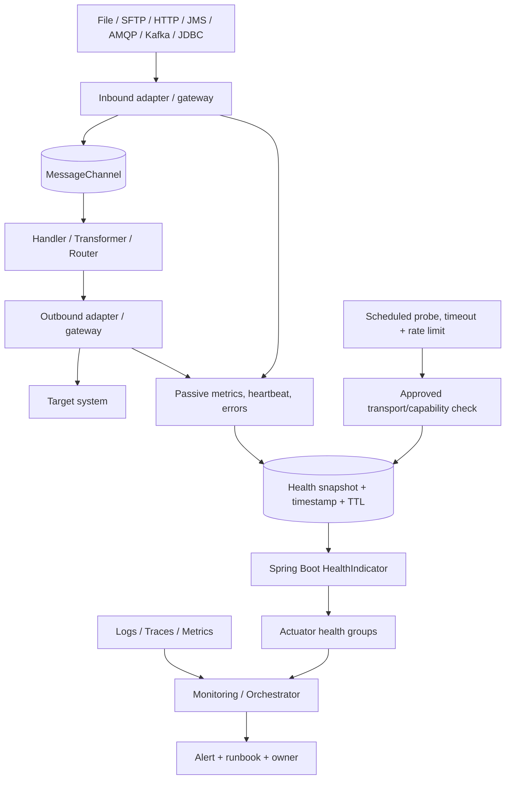
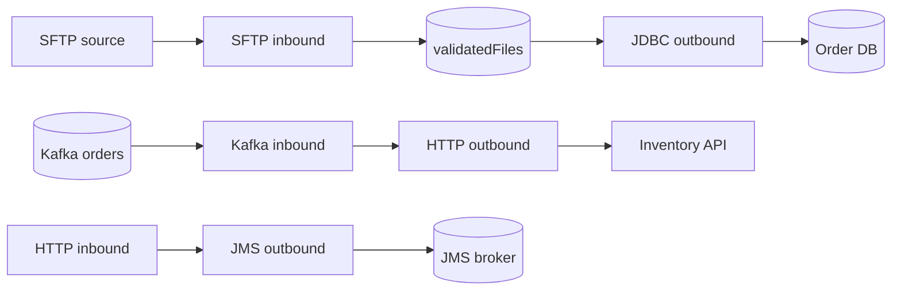

# Health indicator cho kết nối ngoài trong Spring Integration Adapters

## 1. Bài toán: ứng dụng vẫn chạy nhưng adapter không kết nối được

Một ứng dụng **Spring Integration** có thể khởi động thành công, các `MessageChannel` vẫn được đăng ký và endpoint quản trị vẫn trả lời, nhưng một hoặc nhiều **kết nối tới hệ thống ngoài** không hoạt động:

- **SFTP inbound adapter** không xác thực được với máy chủ đối tác; poller chạy nhưng không tải file.
- **HTTP outbound gateway** gọi API bị timeout hoặc nhận `401` do credential hết hạn.
- **Kafka inbound adapter** đang có bean listener, nhưng consumer không lấy được metadata hoặc bị lỗi phân quyền.
- **JMS/AMQP listener** đã start nhưng broker đang mất kết nối, queue backlog tăng.
- **JDBC inbound poller** mở được connection nhưng không đủ quyền truy vấn bảng nghiệp vụ.
- **File inbound adapter** mất quyền đọc thư mục mount; không có message mới dù thư mục nguồn có file.
- Flow nội bộ vẫn thấy trên **integration graph**, nhưng hệ thống đích không ACK hoặc commit.

Trong chương **Observability** của mô-đun `SPRING_INTEGRATION_ADAPTERS`, **health indicator cho kết nối ngoài** là một tín hiệu được định nghĩa rõ để đánh giá **mức sẵn sàng của một dependency cụ thể** và cung cấp ngữ cảnh xử lý sự cố.

Bài học liên kết các **inbound/outbound adapter, gateway, poller và MessageChannel** với các luồng **File, SFTP, HTTP, JMS, AMQP, Kafka và cơ sở dữ liệu**, tập trung vào **hợp đồng message, lỗi và vòng đời kết nối**.

Sau bài này, bạn cần biết:

1. Phân biệt trạng thái **liveness**, **readiness**, tình trạng kết nối và kết quả nghiệp vụ.
2. Xác định phép thử nào đủ để gọi một dependency là **UP**.
3. Tạo custom **Spring Boot Actuator HealthIndicator** với timeout và thông tin an toàn.
4. Chọn giữa **active probe**, **passive signal** và health snapshot có TTL.
5. Đưa tín hiệu health vào đúng health group mà không gây **restart loop**.
6. Đánh giá riêng cho File/SFTP/HTTP/JMS/AMQP/Kafka/JDBC và các adapter có poller.
7. Kết hợp health với metrics, logs, tracing, integration graph và lifecycle.
8. Kiểm thử điều kiện lỗi, phục hồi và giới hạn tác dụng phụ của health checks.

**Nguyên tắc cốt lõi:** một probe `UP` chỉ chứng minh **điều kiện đã được kiểm tra** đạt, không chứng minh mọi message trong flow đã tới đích thành công.

## 2. HealthIndicator là gì?

Trong **Spring Boot Actuator**, `HealthIndicator` là giao diện để một thành phần đóng góp kết quả vào **health endpoint**. Một indicator thường tương ứng với một dependency hoặc điều kiện sức khỏe có thể quan sát độc lập.

Ví dụ, `partnerSftp` có thể cho biết:

- Có mở được session SFTP với authentication và host key hợp lệ không?
- Có thực hiện được thao tác metadata được phép trên thư mục canary không?
- Kết quả probe được cập nhật lúc nào, có quá cũ không?
- Nếu lỗi, đó là **timeout**, **authentication**, **DNS** hay **permission**?
- Phụ thuộc này có bắt buộc đối với readiness của instance không?

Các trạng thái thông dụng của Actuator:

| Status | Diễn giải theo điều kiện đã kiểm tra | Ví dụ |
|---|---|---|
| **UP** | Điều kiện probe được định nghĩa đã thành công | HTTP health route nhận 2xx trong deadline |
| **DOWN** | Điều kiện cần thiết thất bại | Không tạo được SFTP session hoặc DB connection |
| **OUT_OF_SERVICE** | Chủ động không sẵn sàng phục vụ theo chính sách | Adapter đang bảo trì nếu health contract chọn cách biểu diễn này |
| **UNKNOWN** | Chưa đủ thông tin xác nhận | Chưa có snapshot hoặc kết quả collector không đáng tin |

**`UP` không phải “mọi thứ đều tốt”**. Nếu indicator chỉ kiểm tra HTTP TCP/TLS, nó không chứng minh API nghiệp vụ có thể ghi giao dịch. Nếu probe chỉ mở database connection, nó chưa chứng minh transaction thật có thể commit.

`UNKNOWN` cũng không được diễn giải là `UP`. Quy tắc tổng hợp status, ánh xạ HTTP response và hiển thị details có thể phụ thuộc cấu hình Spring Boot/Actuator: phải kiểm tra tại đúng phiên bản ứng dụng.

### 2.1. Ba lớp tình trạng phải tách riêng

| Lớp | Câu hỏi | Nguồn thông tin |
|---|---|---|
| **Adapter lifecycle** | Endpoint đã `start()`, `isRunning()` chưa? | Spring `Lifecycle`, endpoint management |
| **Dependency health** | Phụ thuộc ngoài có đáp ứng phép thử đã công bố không? | `HealthIndicator`, heartbeat, probe network/protocol |
| **Business/flow health** | Message có được xử lý, ACK/commit và hoàn tất đúng SLA không? | Metrics, traces, transaction outcome, broker ACK, synthetic test |

Một Kafka listener có thể `running=true` trong khi broker lỗi. Một JMS broker có thể kết nối được nhưng consumer không ACK. Một file adapter có thể không nhận file mới vì **không có file**, chứ không phải vì endpoint lỗi.

## 3. Liveness và readiness không thể dùng thay nhau

### 3.1. Liveness: process còn khả năng tự vận hành?

**Liveness** cho biết liệu process có ở trạng thái cần restart để hồi phục không. Nó không nên phụ thuộc một cách máy móc vào HTTP/SFTP/broker/database **bên ngoài**.

Ví dụ nếu thêm SFTP partner vào liveness, cứ mỗi lần partner bảo trì thì orchestrator lại restart mọi pod Spring Boot. Restart không sửa được hệ thống đối tác, thậm chí còn gây bão kết nối lúc đối tác phục hồi.

**Khuyến nghị:** không đưa dependency ngoài vào liveness khi lỗi của dependency không phải trạng thái bất khả phục hồi của process.

### 3.2. Readiness: instance có nên tiếp nhận công việc mới?

**Readiness** cho biết instance có đáp ứng nhiệm vụ đang được giao ở thời điểm hiện tại không.

Tuy nhiên, với ứng dụng tích hợp chứa nhiều flow độc lập:

- SFTP inbound lỗi có thể **không ảnh hưởng** HTTP inbound → JMS outbound.
- Một HTTP outbound gateway là bước đồng bộ bắt buộc cho API thanh toán có thể là điều kiện readiness của API đó.
- Một worker Kafka vẫn có thể cần chạy để giảm backlog dù lag tăng cao; chuyển readiness `DOWN` không tự sửa lag.
- Một endpoint được **pause theo maintenance window** cần được nhận diện khác sự cố ngoài kế hoạch.

**Readiness là quyết định điều phối traffic hoặc công việc theo phạm vi dịch vụ**, không phải phép OR/AND tùy tiện của mọi phụ thuộc trong ứng dụng.

### 3.3. Readiness không thay thế cơ chế flow control

Một health endpoint không tự:

- Tạm dừng Kafka consumer theo partition.
- Ngừng JMS/AMQP broker gửi message tới listener.
- Hoàn tất in-flight HTTP requests.
- Drain `QueueChannel`.
- Commit/rollback transaction JDBC.
- Dừng một lần tải SFTP đang thực thi.
- Kích hoạt retry, circuit breaker hoặc error channel.

Các hành động đó cần **adapter lifecycle, listener/container API, timeout, backpressure, retry, circuit breaker và runbook** theo ngữ nghĩa transport.

## 4. Phân cấp “khỏe”: từ kết nối tới nghiệp vụ

Đừng dùng một chữ “healthy” mà không mô tả phép kiểm tra.

| Mức | Phép kiểm tra | Kết luận hợp lý | Điều chưa được chứng minh |
|---|---|---|---|
| **L0 — Configuration** | Bean, endpoint và properties có hợp lệ | Có cấu hình cần thiết | Kết nối tới bên ngoài |
| **L1 — Transport** | DNS/TCP/TLS/SSH handshake | Có thể giao tiếp tầng transport | Quyền thực hiện thao tác cần thiết |
| **L2 — Protocol** | HTTP route, broker metadata, SFTP list, DB query nhẹ | Một yêu cầu protocol thành công | Nghiệp vụ end-to-end |
| **L3 — Capability** | Đọc/ghi canary resource theo quyền tối thiểu | Một năng lực cụ thể hoạt động | Mọi request và transaction thật |
| **L4 — Business flow** | Synthetic flow có kiểm chứng ở hệ thống đích | Hành trình thử nghiệm hoạt động | 100% message thật thành công |

Một `partnerHttp=UP` dựa trên `HEAD /health` ở mức **L2** không được gắn nhãn **“payment processing healthy”** nếu chưa thử khả năng thanh toán.

Không nhất thiết chạy L4 trong `HealthIndicator.health()` trực tiếp. Synthetic workflow có thể tạo dữ liệu, mất nhiều giây và tốn quota. Thường nên **chạy riêng theo lịch**, lưu kết quả với **timestamp/TTL** rồi để Actuator đọc snapshot.

### 4.1. Hợp đồng health nên được công bố

```text
dependency_id
owner_team
target_system
adapter_type
probe_level
probe_operation
timeout
interval
max_result_age
expected_result
status_mapping
required_for
probe_permissions
verification_evidence
```

Một kết quả không có **phạm vi kiểm tra** và **thời điểm kiểm tra** có thể làm vận hành hiểu sai nghiêm trọng.

## 5. Active probe, passive observation và hybrid

### 5.1. Active probe

**Active probe** chủ động gửi request mới để kiểm tra dependency:

- HTTP GET/HEAD tới route probe được đối tác công bố.
- Mở/đóng session SFTP, kiểm tra metadata một thư mục canary nhỏ.
- Truy vấn Kafka metadata bằng admin client có giới hạn thời gian.
- Kiểm tra broker connection/channel của JMS hoặc AMQP.
- Mở DB connection và chạy query chỉ đọc, nhẹ, đúng quyền.

**Ưu điểm:** có tín hiệu ngay cả khi không có business traffic. **Nhược điểm:** tạo thêm tải, dùng credentials, nguy cơ rate limit và side effect.

### 5.2. Passive observation

**Passive signal** lấy dữ liệu đã sinh từ flow:

- Lần SFTP poll thực sự hoàn thành kiểm tra nguồn.
- Lần outbound HTTP nhận phản hồi.
- Lần Kafka producer có publish confirmation phù hợp.
- Thời điểm JMS/AMQP listener gặp lỗi kết nối.
- DB connection pool có lỗi/timeout.
- Tuổi message chưa được xử lý và retry backlog.

**Ưu điểm:** không tạo request mới mỗi lần dashboard hỏi. **Giới hạn:** không có file/record mới **không đồng nghĩa lỗi**. Cần heartbeat của scheduler/connection, không dùng riêng `lastMessageAt`.

### 5.3. Hybrid

Một thiết kế thực tế thường gồm:

1. Probe nhẹ **theo lịch và với concurrency giới hạn**.
2. Health snapshot lưu `status`, `checkedAt`, `reasonCode` và `TTL`.
3. Passive metrics để biết lỗi xảy ra giữa các lần active probe.
4. Synthetic business flow chạy thưa hơn và được quản trị riêng.
5. Alert khi probe **không có dữ liệu mới** hoặc collector ngừng hoạt động.

Đừng giữ `UP` vô thời hạn khi scheduler đã chết; cũng đừng coi một lỗi network thoáng qua là lý do chắc chắn để restart cả ứng dụng.

## 6. Kiến trúc quan sát sức khỏe dependency



Đây là **sơ đồ kiến trúc gợi ý**, không phải cơ chế được Spring Integration dựng tự động. Việc chọn một probe nhẹ, có TTL và nguồn dữ liệu thụ động cần thiết kế theo thực tế:

- **Tách health khỏi business request path:** đọc `/actuator/health` không được ACK message hay tạo order thật.
- **Đặt deadline:** không để một SFTP session treo khiến toàn bộ HTTP health endpoint chậm vô hạn.
- **Dùng bounded execution:** pool/queue/connection đều có giới hạn và giám sát.
- **Tái sử dụng connection khi thích hợp:** tránh mở session mới liên tục.
- **Định nghĩa stale policy:** nếu kết quả quá cũ, trả `UNKNOWN` hoặc `DOWN` theo hợp đồng.
- **Theo dõi health của chính hệ thống giám sát:** source im lặng không phải bằng chứng bình an.
- **Chỉ xuất thông tin an toàn:** không lộ credential, hostname nhạy cảm hoặc raw exception.

## 7. Ví dụ HealthIndicator cho HTTP outbound dependency

Giả sử một flow có **HTTP outbound gateway** gọi catalog API. Ta muốn kiểm tra một route health **không gây side effect**, có timeout ngắn và không lộ exception ra ngoài.

Ví dụ **Java 17+**, Spring Boot Actuator, JDK `HttpClient`:

```java
import java.io.IOException;
import java.net.URI;
import java.net.http.HttpClient;
import java.net.http.HttpRequest;
import java.net.http.HttpResponse;
import java.time.Duration;

import org.springframework.beans.factory.annotation.Value;
import org.springframework.boot.actuate.health.Health;
import org.springframework.boot.actuate.health.HealthIndicator;
import org.springframework.context.annotation.Bean;
import org.springframework.context.annotation.Configuration;

@Configuration
public class CatalogHealthConfig {

    @Bean("catalogHttpHealthIndicator")
    HealthIndicator catalogHttpHealthIndicator(
            @Value("${partners.catalog.health-uri}") URI healthUri) {

        HttpClient client = HttpClient.newBuilder()
                .connectTimeout(Duration.ofSeconds(1))
                .followRedirects(HttpClient.Redirect.NEVER)
                .build();

        return () -> {
            HttpRequest request = HttpRequest.newBuilder(healthUri)
                    .timeout(Duration.ofSeconds(2))
                    .method(
                            "HEAD",
                            HttpRequest.BodyPublishers.noBody()
                    )
                    .build();

            try {
                HttpResponse<Void> response = client.send(
                        request,
                        HttpResponse.BodyHandlers.discarding()
                );

                int code = response.statusCode();
                if (code >= 200 && code < 300) {
                    return Health.up()
                            .withDetail("dependency", "catalog-api")
                            .withDetail("probe", "http-head")
                            .build();
                }

                return Health.down()
                        .withDetail("dependency", "catalog-api")
                        .withDetail("reason", "unexpected_http_status")
                        .withDetail("statusClass", (code / 100) + "xx")
                        .build();

            } catch (InterruptedException ex) {
                Thread.currentThread().interrupt();
                return Health.down()
                        .withDetail("dependency", "catalog-api")
                        .withDetail("reason", "probe_interrupted")
                        .build();

            } catch (IOException | RuntimeException ex) {
                // Không xuất URL nhạy cảm hoặc exception nguyên vẹn.
                return Health.down()
                        .withDetail("dependency", "catalog-api")
                        .withDetail("reason", "transport_or_probe_error")
                        .build();
            }
        };
    }
}
```

Cấu hình:

```yaml
partners:
  catalog:
    health-uri: "https://catalog.example.invalid/health"
```

**Ý nghĩa của ví dụ:**

- Bean tên `catalogHttpHealthIndicator` thường được Actuator nhận diện như contributor `catalogHttp`; xác minh tên thực tế trên endpoint health.
- Dùng `HttpClient` tái sử dụng, connect timeout và per-request timeout.
- Chấp nhận **2xx** là điều kiện cụ thể, không tự đi theo redirect.
- Nếu đối tác không hỗ trợ HEAD và trả 405, cần dùng **GET route an toàn mà đối tác cung cấp**.
- **Blocking HealthIndicator** này gửi HTTP request mỗi lần được đánh giá. Nếu có nhiều pod và tần suất scrape cao, hãy dùng cache/snapshot hoặc probe theo lịch.
- Không lấy URI cần kiểm tra từ input người dùng. Một health endpoint gọi URL tùy ý có thể thành điểm phát request không mong muốn vào mạng nội bộ.
- Không tuyên bố `HEAD /health=200` chứng minh `POST /orders` thành công.

`HealthIndicator` được gọi đồng bộ phù hợp với mô hình blocking. Nếu ứng dụng reactive cần probe non-blocking, có thể dùng `ReactiveHealthIndicator` và client/reactive SDK phù hợp; **không** dùng blocking SFTP/JMS client trên event loop mà không thiết kế scheduler và giới hạn tải.

## 8. Health snapshot: không nên probe mỗi lần đọc Actuator

Đối với SFTP hoặc một API có quota nghiêm ngặt, việc tạo kết nối từ mỗi HTTP health request có thể gây **connection storm**. Một hướng thay thế là **scheduler có timeout** cập nhật trạng thái, còn HealthIndicator chỉ đọc snapshot gần nhất.

Mẫu đơn giản sau đo **độ mới của lần kiểm tra transport thành công**. Đây là phần lõi minh họa, chưa bao gồm scheduler và trạng thái thất bại mới nhất.

```java
import java.time.Clock;
import java.time.Duration;
import java.time.Instant;
import java.util.concurrent.atomic.AtomicReference;

import org.springframework.boot.actuate.health.Health;
import org.springframework.boot.actuate.health.HealthIndicator;

public final class SftpTransportSnapshotHealth
        implements HealthIndicator {

    private final Clock clock;
    private final Duration maxAge;
    private final AtomicReference<Instant> lastSuccess =
            new AtomicReference<>();

    public SftpTransportSnapshotHealth(
            Clock clock,
            Duration maxAge) {
        this.clock = clock;
        this.maxAge = maxAge;
    }

    // Chỉ gọi khi probe đã thực sự kiểm tra remote endpoint
    // thành công, dù không có file mới.
    public void recordSuccessfulCheck() {
        lastSuccess.set(clock.instant());
    }

    @Override
    public Health health() {
        Instant at = lastSuccess.get();

        if (at == null) {
            return Health.unknown()
                    .withDetail("reason", "no_probe_result_yet")
                    .build();
        }

        Duration age = Duration.between(at, clock.instant());
        if (age.isNegative() || age.compareTo(maxAge) > 0) {
            return Health.down()
                    .withDetail("reason", "probe_stale")
                    .build();
        }

        return Health.up()
                .withDetail("probe", "sftp-transport")
                .build();
    }
}
```

**Cảnh báo:** ví dụ cố tình đơn giản hóa. Nếu lần probe thành công gần nhất lúc 10:00 và lần 10:10 **thất bại**, code vẫn có thể báo `UP` cho tới khi TTL hết hạn. Bản production nên lưu thêm **`lastCheckedAt`, `lastOutcome`, `lastFailureReason`** và đánh dấu `DOWN` ngay khi một lỗi được xác nhận theo chính sách, thay vì chỉ trông chờ TTL.

Với SFTP, probe có thể mở một session có giới hạn, kiểm tra một thư mục canary nhỏ, rồi đóng session trong `finally`/try-with-resources theo API thực. Không đưa mật khẩu, private key hoặc đường dẫn nhạy cảm vào health details.

### 8.1. Tính toán tải probe

Giả sử **20 replica**, mỗi replica bị scrape mỗi **10 giây**; nếu mỗi scrape mở session SFTP mới thì có tới **120 phiên/phút** chỉ cho health. Thêm retry của monitor và load balancer sẽ còn lớn hơn.

Giảm tải bằng **TTL, jitter, probe interval phù hợp, connection reuse và giới hạn concurrency**. Với hệ thống có quá ít session capacity, probe có thể gây sự cố thực tế.

## 9. Health groups: nhóm riêng cho dependency

Ví dụ cấu hình Spring Boot Actuator minh họa:

```yaml
management:
  endpoint:
    health:
      probes:
        enabled: true
      group:
        readiness:
          include: "readinessState,catalogHttp"
        integrationDependencies:
          include: "catalogHttp,partnerSftp"
          show-details: when_authorized
  endpoints:
    web:
      exposure:
        include: "health,info,metrics"
```

**Giả định:** `partnerSftp` là contributor thực đã được ứng dụng đăng ký; nếu chưa có thì phải bỏ khỏi cấu hình hoặc triển khai indicator trước. `catalogHttp` từ bean `catalogHttpHealthIndicator` cần xác minh tên contributor trên phiên bản chạy thực tế.

Các đường thường gặp tùy base path/port:

```text
/actuator/health
/actuator/health/liveness
/actuator/health/readiness
/actuator/health/integrationDependencies
```

Lưu ý:

- Việc thêm `catalogHttp` vào readiness là **quyết định theo nghiệp vụ**, không phải yêu cầu cho mọi hệ thống.
- Nhóm `integrationDependencies` giúp xem nhiều dependency mà **không nhất thiết làm cả pod not-ready**.
- Không tự thêm SFTP/Kafka/DB bên ngoài vào **liveness**.
- `show-details: when_authorized` phải đi cùng **bảo mật Actuator**; không giả định thuộc tính này đủ thay thế xác thực/phân quyền và giới hạn mạng.
- Kiểm tra chính xác phiên bản Spring Boot/Actuator, vì endpoint exposure, health groups và security có thể khác theo version/profile.
- Khi readiness trả `DOWN`, response HTTP có thể là **503**; các bài test phải kiểm tra **cả status JSON và HTTP code**, không chỉ 200.

Nếu nhiều flow độc lập chia sẻ một process, nên có nhóm riêng theo **năng lực nghiệp vụ** hoặc tách deployment. SFTP DOWN không nên làm HTTP→JMS flow mất readiness vô cớ nếu chúng thực sự độc lập.

## 10. Health indicator cho File inbound/outbound adapter

Với **File adapter**, không có network connection nhưng có **filesystem dependency**: mount, quyền đọc/ghi, filter, metadata store và scheduler.

| Kiểm tra | Ý nghĩa | Không đủ chứng minh |
|---|---|---|
| `Files.isDirectory(path)` | Thư mục còn tồn tại | Có thể đọc/ghi được |
| Kiểm tra quyền, metadata | Thư mục được truy cập ở mức nhất định | File nghiệp vụ đã xử lý thành công |
| Poller lifecycle | Endpoint đang được start | Scheduler đã poll thành công |
| Last successful poll | Poller từng thực hiện kiểm tra nguồn | Không có lỗi transformer/downstream |
| Outbound write result | Bước ghi file có kết quả | Toàn bộ tác vụ downstream hoàn tất |

**Không có file mới** suốt nhiều giờ có thể là hoàn toàn bình thường. Nếu đối tác chỉ gửi file lúc nửa đêm, chỉ số `lastMessageAge > 5 minutes` sẽ gây cảnh báo giả.

Tách **poller health** khỏi **business arrival SLA** (ví dụ file phải tới trước 06:00). Không tự tạo file nghiệp vụ trong thư mục mà inbound poller đang theo dõi để thử health, vì canary có thể bị xử lý như file thật.

## 11. Health indicator cho SFTP

SFTP gồm DNS, TCP, SSH host-key verification, authentication, remote path permissions và session lifecycle.

Các mức kiểm tra:

1. **TCP tới host:port:** chỉ chứng minh kết nối mạng.
2. **SFTP session:** xác thực và tạo phiên theo chính sách.
3. **Remote metadata:** list một thư mục canary đã được cho phép.
4. **Read canary:** kiểm tra quyền đọc trên tài nguyên thử, có giới hạn kích thước.
5. **Write canary:** kiểm tra quyền ghi, cần cleanup và xử lý side effect.

**Không tắt host-key verification để làm probe chuyển xanh.** Nếu phía đối tác đang lỗi, restart pod liên tục thường không giúp ích. Nên ghi health, retry/backoff có jitter, kiểm tra session quota và bảo đảm file filter/metadata store không làm mất hoặc nhập lại file ngoài hợp đồng.

Khi resume sau lỗi, xác minh **file đã tải đủ**, temp-file/rename theo cơ chế adapter, file chưa xử lý và trạng thái end-to-end. Chỉ có `session=UP` không chứng minh đã nhận đủ file.

## 12. Health indicator cho HTTP outbound gateway

HTTP dependency có thể được kiểm tra ở nhiều tầng: DNS/TCP/TLS, HTTP status, quyền API và khả năng thực hiện thao tác chỉ đọc đại diện.

| Tình trạng | Diễn giải | Hướng điều tra |
|---|---|---|
| DNS/TLS lỗi | Không hoàn tất vận chuyển tin cậy | DNS, proxy, certificate, thời gian hệ thống |
| Timeout | Không phản hồi trong deadline | Latency, network, circuit breaker, downstream |
| 2xx ở health route | Route cụ thể xử lý được | Chưa kết luận API nghiệp vụ |
| 401/403 | Credential hoặc quyền probe sai | Secret/role/scope, không bỏ xác thực |
| 429 | Rate limiting/quota | Giảm tần suất probe, backoff |
| 5xx | Đích trả lỗi | Service health, retry budget, cảnh báo |

Một `200` có thể là **trang login HTML** sau redirect, chứ không phải kết quả API mong muốn. Nên dùng route chuyên biệt và **kiểm tra nội dung/schema tối thiểu** khi hợp đồng cần. Không để probe gọi API tạo đơn hàng, thanh toán hoặc gửi email thật.

## 13. Health indicator cho JMS

JMS inbound/outbound adapters có thể phụ thuộc **connection factory, broker/provider, session, listener container, queue/topic và acknowledgement**.

| Loại kiểm tra | Có thể chứng minh | Không tự chứng minh |
|---|---|---|
| Tạo broker connection | Có thể kết nối và xác thực | Listener đang tiêu thụ message |
| Tạo session/channel | Giao thức hoạt động với tài khoản probe | Có quyền trên mọi queue/topic |
| Metadata tài nguyên | Queue/topic cần thiết tồn tại nếu provider cho phép | Business processing thành công |
| Listener `isRunning()` | Container có trạng thái chạy | Broker connectivity thực tế |
| ACK/transaction metrics | Kết quả nhận/xử lý trong phạm vi cụ thể | Mọi message đã tới downstream |
| DLQ/backlog | Dấu hiệu thất bại và tồn đọng | Nguyên nhân duy nhất |

Một **JMS connection `UP`** nhưng consumer không xử lý message có thể do lỗi transaction, ack, prefetch, downstream hoặc logic filter. Không kết luận luồng khỏe từ phép check kết nối.

**Không publish message nghiệp vụ vào production queue chỉ để thử health**. Nếu cần mức L3/L4, dùng queue/topic canary có hợp đồng, owner, TTL/cleanup và không gây side effect thật. Broker `ACK` không đồng nghĩa hàng đã được ghi database.

Nếu dependency broker down, nên dựa trên retry/reconnect có giới hạn, chỉ số queue depth, cảnh báo và runbook; không restart mọi pod bằng liveness.

## 14. Health indicator cho AMQP/RabbitMQ

AMQP có connection, channel, exchange, queue, routing/binding, publisher confirm, consumer ACK/NACK và dead-letter. Mỗi tầng có mức đảm bảo khác nhau.

| Tín hiệu | Diễn giải |
|---|---|
| Broker connection thành công | Endpoint AMQP sẵn sàng ở tầng kết nối |
| Tạo channel thành công | Session/channel giao thức có thể dùng |
| Exchange/queue tồn tại | Metadata resource được nhìn thấy, có quyền tương ứng |
| Publish confirm | Broker xác nhận thao tác publish theo policy |
| Consumer ACK | Delivery đã được consumer xác nhận theo cấu hình |
| Queue depth/oldest age | Có backlog hoặc chậm xử lý |
| Dead-letter tăng | Có message bị từ chối hoặc xử lý lỗi theo cơ chế DLX |

**Broker reachable nhưng routing key sai vẫn là lỗi tích hợp.** Health kết nối không thay thế contract test về exchange/binding, xác minh consumer nhận message hay xử lý lỗi ở đích.

Khi Spring Boot đã có indicator cho RabbitMQ/connection factory nhờ auto-configuration, cần kiểm tra nó đo gì trước khi tạo một indicator trùng tên/ngữ nghĩa. Chỉ thêm custom capability probe khi health mặc định **không bao phủ yêu cầu cụ thể**.

## 15. Health indicator cho Kafka

Kafka có nhiều tầng: cluster metadata, topic/partition, producer ACK, consumer group, partition assignment, offsets, lag và DLT/retry.

### 15.1. Chọn probe đúng ngữ nghĩa

| Tầng | Cách quan sát | Điểm giới hạn |
|---|---|---|
| Cluster metadata | AdminClient với deadline | Không chứng minh publish/consume thành công |
| Topic/partition metadata | Kiểm tra topic bắt buộc và quyền truy cập | Không chứng minh payload hợp đồng đúng |
| Producer callback/ACK | Ghi kết quả publish thật | Thành công trước đó không đảm bảo tương lai |
| Consumer assignment | Theo dõi listener/container và partition assignment | Không chứng minh record đã xử lý/commit |
| Lag và oldest message age | Quan sát tiến độ và tồn đọng | Không đơn thuần là kết nối broker down |
| Synthetic canary | Xác nhận thử nghiệm end-to-end | Cần topic/consumer riêng và tránh side effect |

**Không tạo một `KafkaConsumer` rồi cho nó tham gia consumer group production trên mỗi health request**. Probe như vậy có thể gây rebalance hoặc thay đổi partition assignment của consumer thật.

Một metadata request bằng **AdminClient** có timeout và quota phù hợp thường ít gây xáo trộn hơn, nhưng vẫn không đại diện cho kết quả producer/consumer nghiệp vụ. Nếu sử dụng custom indicator, ghi rõ nó chỉ xác nhận metadata.

### 15.2. Lag cao có cần chuyển readiness DOWN?

Không phải lúc nào cũng nên. Một worker Kafka đang tồn backlog cần tiếp tục xử lý để bắt kịp. Nếu readiness DOWN chỉ khiến orchestrator gỡ pod khỏi **HTTP load balancer** nhưng Kafka listener vẫn chạy, điều đó không làm lag giảm.

Cần phân biệt **broker connectivity**, **consumer processing health** và **business freshness**. Với lag, xem throughput, downstream latency, retry, DLT, số partition và concurrency. Dùng cơ chế điều khiển listener/pause/backpressure theo thiết kế, không trông chờ readiness tự thay thế chúng.

## 16. Health indicator cho JDBC và cơ sở dữ liệu

Trong nhiều cấu hình Spring Boot có thể đã có **DataSource health contributor** dựa trên `DataSource`. Trước khi viết indicator mới, kiểm tra phép thử mà contributor mặc định thực sự thực hiện.

Đối với JDBC inbound/outbound:

- DB có thể kết nối và thực thi query nhỏ không?
- Connection pool có hết slot hoặc pending wait quá lâu không?
- Tài khoản adapter có quyền đọc/ghi đúng bảng không?
- Transaction có timeout, deadlock hoặc rollback nhiều không?
- Poller có claim/đánh dấu row được xử lý đúng không?
- Outbound JDBC có xác minh commit đúng mục tiêu không?

Một câu `SELECT 1` thành công chỉ chứng minh connection thực thi query nhẹ; **không chứng minh** transaction ghi dữ liệu nghiệp vụ thành công.

**Tránh kiểm tra health bằng full table scan hoặc tạo row thật.** Nếu cần kiểm tra quyền ghi, dùng canary riêng với transaction và cleanup, chạy ít thường xuyên, có phê duyệt. Không để nhiều probe đồng thời lấy hết connection pool và gây thiếu connection cho flow nghiệp vụ.

### 16.1. Khi DB vừa DOWN vừa gây backlog

Một flow `Kafka inbound → JDBC outbound` có thể không ghi DB được vì pool lỗi. Nếu chỉ đánh dấu readiness DOWN và pod bị thay liên tục, record Kafka có thể redeliver, làm tăng retry mà không giúp database khỏe lại.

Runbook nên kết hợp:

1. DataSource/DB health và lỗi transaction.
2. Connection pool metrics.
3. Kafka lag, offset commit và retry/DLT.
4. Phương án giảm intake/buffer có giới hạn.
5. Xác minh idempotency khi DB phục hồi.
6. Đối soát kết quả ghi thực tế.

## 17. Ma trận health cho ứng dụng nhiều transport

Giả sử có ba flow độc lập:



Một ma trận thiết kế:

| Dependency | Probe chủ đạo | Tín hiệu bổ sung | Flow bị ảnh hưởng |
|---|---|---|---|
| SFTP partner | Session/metadata canary | Last poll, lỗi SSH, file SLA | Nhập file |
| Order database | DataSource/query nhỏ | Pool saturation, commit/rollback | Lưu đơn hàng |
| Kafka cluster | Metadata/topic | Assignment, consumer lag, retry | Nhập event |
| Inventory HTTP API | HTTP route chỉ đọc | Client p95, 429/5xx, outcome | Đồng bộ tồn kho |
| JMS broker | Connection | Queue depth, ACK/DLQ | HTTP request → publish |

Khi SFTP mất kết nối, không nên tự làm tất cả HTTP/JMS endpoints trong cùng ứng dụng bị coi là không sẵn sàng nếu chúng hoạt động độc lập.

Ngược lại, nếu một API nhận yêu cầu đồng bộ **không thể hoàn thành** khi JMS down, broker có thể là một điều kiện readiness của **API đó**, tùy SLO/kiến trúc.

## 18. Kết hợp health với lifecycle và Control Bus

**Control Bus** có thể điều khiển một inbound endpoint hỗ trợ `Lifecycle` theo lệnh quản trị đã được cho phép:

```text
@sftpOrdersPoller.stop()
```

Nếu operator đã **pause** để bảo trì, `isRunning=false` có thể là trạng thái đúng kế hoạch. Health không nên báo một sự cố bất ngờ mà bỏ qua intent.

| Dữ liệu | Ý nghĩa |
|---|---|
| **Desired state** | Endpoint được yêu cầu RUNNING hay PAUSED |
| **Observed lifecycle** | Bean/listener hiện đang running hay stopped |
| **Dependency health** | Probe SFTP/Kafka/JMS/DB có UP/DOWN/UNKNOWN |
| **Processing health** | Backlog, in-flight, retry và business result |
| **Change/audit record** | Ai pause/resume, vì sao, lúc nào |

Ví dụ, `desired=PAUSED` và `observed=STOPPED` có thể là **maintenance hợp lệ**; `desired=RUNNING` nhưng `observed=STOPPED` là mismatch cần xử lý.

**Lifecycle `RUNNING` không đồng nghĩa dependency `UP`.** Health `UP` cũng không tự bật poller nếu nó bị dừng có chủ đích.

Nếu chạy nhiều replica, mỗi process có `ApplicationContext`, indicator và lifecycle riêng. Health của **replica A** không đại diện chắc chắn cho B/C. Dashboard phải có instance ID, desired state và thông tin dependency dùng chung. Việc scale-out có thể làm tăng lượng probe; cần jitter/giới hạn số probe cho mỗi dependency.

## 19. Timeout, TTL, flapping và ngân sách probe

Một health check đáng tin cần ba giới hạn:

1. **Timeout**: một lần kiểm tra được phép chờ tối đa bao lâu.
2. **Interval**: khoảng cách giữa hai lần kiểm tra.
3. **Max result age/TTL**: kết quả cũ còn được dùng bao lâu trước khi bị coi là stale.

Ví dụ probe chạy mỗi **30 giây** với TTL **90 giây**. Nếu scheduler ngừng hoạt động sau lần thành công cuối, snapshot không thể giữ `UP` tới ngày hôm sau. Khi quá TTL, chuyển `UNKNOWN` hoặc `DOWN` theo hợp đồng và cảnh báo.

**TTL không phải cơ chế che lỗi mới.** Nếu probe đã xác minh lỗi tại 10:02, không nhất thiết phải chờ tới 10:03:30 mới chuyển DOWN chỉ vì có kết quả UP cũ.

### 19.1. Hạn chế tải và thời gian chờ tổng

Nếu endpoint quản trị gọi tuần tự 6 dependency, mỗi dependency timeout 3 giây, response có thể kéo dài gần 18 giây chưa tính overhead. Nếu orchestrator timeout nhanh hơn, dữ liệu health sẽ khó sử dụng.

Biện pháp:

- Scheduled probes với snapshot.
- Async execution có **executor bounded**, tổng deadline rõ ràng.
- Connection reuse khi an toàn.
- Jitter giữa các instance.
- Tránh probe ghi vào hệ thống nghiệp vụ.
- Giới hạn tần suất khi 429/rate-limit.
- Alert khi snapshot quá cũ hoặc failure counter tăng.

### 19.2. Tránh readiness flapping

Có thể dùng hysteresis, ví dụ yêu cầu vài lần fail liên tiếp mới DOWN và vài lần success liên tiếp mới phục hồi. Nhưng với dependency bắt buộc rất nhạy cảm, trì hoãn quá lâu có thể khiến instance tiếp tục nhận công việc chắc chắn thất bại.

Ngưỡng là **quyết định theo SLO/rủi ro**. Không có quy tắc “3 lần thất bại” đúng cho mọi adapter.

| Tình trạng | Hướng xử lý |
|---|---|
| Một timeout thoáng qua | Tăng counter, có thể giữ trạng thái chờ xác minh tùy policy |
| Nhiều lần thất bại liên tục | DOWN và alert |
| Snapshot stale | UNKNOWN/DOWN, cảnh báo collector |
| Bảo trì có phê duyệt | OUT_OF_SERVICE hoặc trạng thái maintenance riêng |
| Dependency hồi phục | Success threshold + kiểm chứng target/business trước resume |
| Probe bị rate limit | Giảm tần suất, backoff, xem quota và phạm vi probe |

## 20. Metrics, tracing, logs và graph bổ sung cho health

Một health status là **kết luận tóm tắt**, không thay thế những dữ liệu vận hành khác.

| Tín hiệu | Câu hỏi giải đáp |
|---|---|
| **HealthIndicator** | Dependency có đáp ứng probe policy không? |
| **Lifecycle** | Endpoint/adapter có được start và đang running không? |
| **Integration graph** | Adapter, channel và handler được nối thế nào? |
| **Metrics** | Error rate, throughput, lag, queue age và latency p95 ra sao? |
| **Structured logs** | Probe/call lỗi gì, tại thời điểm nào và correlation nào? |
| **Distributed tracing** | Operation nào chậm qua HTTP, broker hoặc database? |
| **Business/audit events** | Message có ACK/commit và nghiệp vụ đã hoàn tất đúng không? |

Bộ metric ứng dụng **đề xuất**, không phải tên mặc định của Actuator:

| Metric | Loại | Gợi ý label |
|---|---|---|
| `integration_external_probe_success` | Gauge | `dependency`, `probe_level` |
| `integration_external_probe_duration_seconds` | Timer/histogram | `dependency`, `outcome` |
| `integration_external_probe_failures_total` | Counter | `dependency`, `reason_code` |
| `integration_external_probe_age_seconds` | Gauge | `dependency` |
| `integration_adapter_running` | Gauge | `flow`, `adapter` |
| `integration_poller_last_success_age_seconds` | Gauge | `flow` |
| `integration_queue_oldest_message_age_seconds` | Gauge | `flow`, `queue` |
| `integration_external_call_errors_total` | Counter | `dependency`, `error_category` |

Không đưa **message ID, trace ID, order ID, tên file duy nhất hoặc URL có token** thành metric labels: cardinality tăng mạnh, có thể lộ thông tin. ID cụ thể thuộc log/trace có phân quyền.

Health probe có thể có span riêng nhưng không nhất thiết cần trace **mỗi lần scrape**; sampling và metrics tổng hợp thường hiệu quả hơn. Một trace probe `OK` không chứng minh message nghiệp vụ đã tới target.

## 21. Kiểm thử HealthIndicator với JUnit 5

Nên tách **logic ánh xạ status** khỏi SDK kết nối để dễ kiểm thử.

### 21.1. Contract của probe

```java
import org.springframework.boot.actuate.health.Health;
import org.springframework.boot.actuate.health.HealthIndicator;

@FunctionalInterface
interface ExternalProbe {
    boolean canUseDependency() throws Exception;
}

final class ExternalDependencyHealthIndicator
        implements HealthIndicator {

    private final ExternalProbe probe;

    ExternalDependencyHealthIndicator(ExternalProbe probe) {
        this.probe = probe;
    }

    @Override
    public Health health() {
        try {
            if (probe.canUseDependency()) {
                return Health.up()
                        .withDetail("probe", "approved-operation")
                        .build();
            }

            return Health.down()
                    .withDetail("reason", "operation_unavailable")
                    .build();

        } catch (Exception ex) {
            return Health.down()
                    .withDetail("reason", "probe_failed")
                    .build();
        }
    }
}
```

Đây chỉ là lớp **mapping**: implementation `ExternalProbe` cho HTTP/SFTP/Kafka/JMS/AMQP/JDBC phải có **timeout, close resources và quyền tối thiểu**. HealthIndicator đơn giản này không tự giới hạn thời gian của một SDK blocking.

### 21.2. Unit tests ánh xạ status

```java
import static org.junit.jupiter.api.Assertions.assertEquals;

import org.junit.jupiter.api.Test;
import org.springframework.boot.actuate.health.Status;

class ExternalDependencyHealthIndicatorTest {

    @Test
    void healthyProbeReportsUp() {
        var indicator = new ExternalDependencyHealthIndicator(
                () -> true
        );

        assertEquals(Status.UP, indicator.health().getStatus());
    }

    @Test
    void unavailableProbeReportsDown() {
        var indicator = new ExternalDependencyHealthIndicator(
                () -> false
        );

        assertEquals(Status.DOWN, indicator.health().getStatus());
    }

    @Test
    void exceptionReportsDownWithoutLeakingDetails() {
        var indicator = new ExternalDependencyHealthIndicator(
                () -> {
                    throw new IllegalStateException("synthetic failure");
                }
        );

        assertEquals(Status.DOWN, indicator.health().getStatus());
    }
}
```

Unit tests chỉ chứng minh mapping `UP/DOWN`. Integration tests cần dùng test server/broker/container thích hợp để kiểm chứng **timeout, auth, reconnect, transaction, stale và side effect**.

### 21.3. Ma trận kiểm thử tình huống lỗi

| Tình huống | Kết quả kỳ vọng |
|---|---|
| HTTP 2xx theo hợp đồng | UP ở đúng probe level |
| HTTP 401/403/429/5xx | DOWN/degraded theo chính sách, reason an toàn |
| DNS/TLS/timeout | Trả kết quả có deadline, không treo |
| SFTP host-key mismatch | Không bỏ kiểm tra host key để được UP |
| SFTP không có file mới | Không báo DOWN sai nếu poll/transport khỏe |
| Kafka metadata lỗi | DOWN, không tạo consumer gây rebalance |
| JMS/AMQP broker down | Probe phản ánh lỗi connection; ACK/queue theo dõi riêng |
| JDBC pool cạn | Health không gây thêm cạn pool kéo dài |
| Snapshot stale | UNKNOWN/DOWN, không giữ UP |
| Không có kết quả probe từ lúc startup | UNKNOWN hoặc trạng thái startup theo policy |
| Endpoint intentional paused | Phân biệt planned maintenance với outage |
| Scrape đồng thời | Không mở vô hạn session/connection |
| Business flow lỗi nhưng probe UP | Dashboard giữ phân biệt health và business result |
| Đa replica | Mỗi instance phản ánh trạng thái chính xác |
| External dependency down | Không tạo restart loop qua liveness |
| Health response bị truy cập trái phép | Không lộ details/credentials |
| Dependency phục hồi | Chỉ báo xử lý hoàn tất khi có xác minh end-to-end |

### 21.4. Kiểm tra qua Actuator

Trong **môi trường kiểm thử** có quyền truy cập phù hợp:

```bash
curl --silent http://localhost:8080/actuator/health
curl --silent http://localhost:8080/actuator/health/readiness
curl --silent http://localhost:8080/actuator/health/integrationDependencies
```

Khi health DOWN, Actuator có thể trả **HTTP 503** theo mặc định/cấu hình; dùng `curl --fail` có thể khiến lệnh báo lỗi trong khi body JSON vẫn mô tả đúng trạng thái. Test nên assert **cả HTTP status và nội dung/health group**.

Không đặt bearer token hoặc secret vào ví dụ lệnh chia sẻ công khai. Production management endpoint cần kiểm soát mạng, TLS, xác thực và phân quyền.

## 22. Runbook điều tra flow bị ngừng giao tiếp

Giả sử hệ thống **SFTP inbound → transformer → JDBC outbound** không có row mới trong DB.

**Bước 1 — Chốt phạm vi:** instance, flow, thời điểm bắt đầu, số file ảnh hưởng, SLA và tình trạng bảo trì.

**Bước 2 — Kiểm tra health:** SFTP và DataSource đang UP/DOWN/UNKNOWN? Kết quả probe cũ chưa? Probe kiểm tra L1, L2 hay L3?

**Bước 3 — Kiểm tra lifecycle:** inbound poller có running không; bị Control Bus pause hay không; nếu bảo trì có phê duyệt thì không tự start lại.

**Bước 4 — Kiểm tra nguồn:** SFTP session, host key, thư mục, quyền, file filter, metadata store và last successful poll.

**Bước 5 — Theo dõi MessageChannel:** có message vào channel sau inbound không? Validator/transformer có reject? Error channel, retry và queue có tích tụ?

**Bước 6 — Kiểm tra đích:** DataSource pool, JDBC transaction, lock, rollback, schema và permission; UP ở connection không chứng minh commit.

**Bước 7 — Khoanh vùng:** nếu SFTP lỗi, backoff/pause theo runbook; nếu DB lỗi, giữ/buffer/retry với bounded queue và idempotency, không xóa backlog.

**Bước 8 — Phục hồi:** probe chuyển UP, lifecycle phù hợp, sau đó chạy một file thử được phép và **xác minh row thực sự có tại DB**.

**Bước 9 — Đo tiến độ:** backlog và tuổi file giảm, error rate không tăng, không có duplicate ngoài hợp đồng.

**Bước 10 — Lưu evidence:** timeline probe lỗi/khôi phục, quyết định vận hành, nguyên nhân và thay đổi giám sát để tránh lặp lại.

## 23. Những anti-pattern thường gặp

1. **Đưa mọi dependency vào liveness:** bên thứ ba lỗi khiến pod restart liên tục.
2. **Coi `isRunning()` là network health:** bean có thể chạy mà kết nối ngoài lỗi.
3. **Coi TCP open là business success:** thiếu auth, quyền tài nguyên và commit.
4. **Probe có side effect:** tạo order, ghi file hoặc ACK message thật.
5. **Mở SFTP session trên mỗi scrape:** gây connection storm/rate limit.
6. **Không có timeout:** health endpoint bị treo khi đối tác mất kết nối.
7. **Không giới hạn concurrency:** health check chiếm hết thread/pool.
8. **Giữ trạng thái UP vô hạn:** collector ngừng mà dashboard vẫn xanh.
9. **Lấy last message time làm poller health:** không có file mới bị coi là lỗi.
10. **Không phân biệt critical với optional dependency:** một flow lỗi kéo tất cả flow khác down.
11. **Dùng readiness để tự pause Kafka listener:** readiness không thay broker API.
12. **Cho Kafka health consumer tham gia group thật:** gây rebalance.
13. **Health query DB quá nặng:** làm chậm chính transaction nghiệp vụ.
14. **Tắt TLS/host-key check để probe khỏe:** hi sinh bảo mật.
15. **Công khai chi tiết Actuator:** lộ URL nội bộ, broker, exception, credential.
16. **Ghi raw secret vào response/log:** nguy cơ lộ thông tin.
17. **Không có error category:** on-call không biết xử lý lỗi auth, network hay schema.
18. **Dùng health UP kết luận Kafka ACK/JDBC commit:** thiếu xác minh transaction.
19. **Restart thay vì xử lý downstream outage:** tăng duplicate và thời gian hồi phục.
20. **Không xét desired PAUSED:** maintenance bị hiểu thành crash.
21. **Không test failure/recovery:** chỉ biết phép kiểm tra xanh trong môi trường lý tưởng.
22. **Dựa vào một replica để kết luận cả cluster:** bỏ qua phân phối/assignment.
23. **Gắn message ID thành metric label:** high cardinality.
24. **Không ghi probe scope/level:** người đọc tưởng L1 chính là L4.
25. **Không có owner/runbook:** health DOWN nhưng không ai xử lý.

## 24. Câu hỏi tự kiểm tra

**Câu 1.** SFTP partner bảo trì 2 giờ. Khi indicator SFTP được đưa vào liveness, Kubernetes liên tục restart pod. Sai ở đâu?

**Đáp án:** Liveness bị gắn với dependency ngoài mà restart process không thể sửa. Đưa SFTP vào group dependency/readiness khi phù hợp và dùng retry/backoff/alert; không tạo restart loop.

**Câu 2.** Kafka HealthIndicator truy vấn metadata thành công nhưng consumer không commit offset một giờ. Indicator UP có sai không?

**Đáp án:** Chưa chắc. Metadata chỉ xác nhận cluster/protocol ở một mức, không chứng minh consumer processing. Kiểm tra assignment, lag, retry/DLT, broker ACK và downstream.

**Câu 3.** SFTP adapter không nhận file từ 08:00 đến 18:00 trong khi đối tác gửi file lúc 00:00. Có nên báo DOWN theo `lastMessageAt` không?

**Đáp án:** Không. Không có file có thể đúng lịch. Theo dõi poll heartbeat/transport check và deadline file đến riêng.

**Câu 4.** HTTP health route trả 200 nhưng API thanh toán liên tục trả 403. Có thể kết luận thanh toán đã khỏe?

**Đáp án:** Không. Health route 200 chỉ chứng minh phép kiểm tra đó. Cần kiểm tra credential/capability hoặc business outcome bằng cách được phê duyệt.

**Câu 5.** 30 pod cứ 5 giây mở session SFTP để probe. Rủi ro gì?

**Đáp án:** Connection storm, chạm session quota, tăng tải và có thể tự gây outage. Dùng scheduled probe, TTL, jitter, pool/reuse, concurrency limit.

**Câu 6.** Một pod có ba flow độc lập SFTP, Kafka và HTTP→JMS. Khi SFTP down, nhất thiết readiness toàn pod DOWN không?

**Đáp án:** Không nhất thiết. Quyết định dựa trên cách traffic được điều phối và phạm vi dịch vụ; có thể tách health groups hoặc deployment.

**Câu 7.** DataSource health UP, nhưng JDBC outbound rollback vì database lock. Health sai?

**Đáp án:** Không nhất thiết. Connection/query nhẹ không kiểm tra commit của transaction thật. Cần transaction logs, pool metrics và kết quả nghiệp vụ.

**Câu 8.** Snapshot UP từ 10:00 nhưng scheduler chết lúc 10:01, đến 12:00 vẫn UP. Thiếu gì?

**Đáp án:** Thiếu TTL/max result age và alert về collector freshness.

**Câu 9.** Kafka consumer lag tăng. Đánh dấu pod not-ready trên HTTP load balancer sẽ giải quyết lag?

**Đáp án:** Chưa chắc; Kafka listener có thể vẫn chạy. Cần tìm nghẽn và điều chỉnh consumer/backpressure/downstream theo API phù hợp.

**Câu 10.** Muốn kiểm tra JMS broker có nhận message mà không tạo đơn hàng thật, nên làm gì?

**Đáp án:** Connection check hoặc canary queue/topic có hợp đồng riêng, đo kết quả publish/ACK và cleanup; không dùng queue nghiệp vụ thật để thử.

**Câu 11.** Endpoint bị operator pause qua Control Bus và `isRunning=false`. Dashboard báo outage có chính xác?

**Đáp án:** Cần biết desired state. Nếu PAUSED có phê duyệt và observed STOPPED, đó là maintenance có chủ đích; vẫn theo dõi in-flight/backlog.

**Câu 12.** Probe L2 UP có chứng minh mọi message đã ACK/commit?

**Đáp án:** Không. Phải lấy kết quả adapter, broker, database và business verification riêng.

## 25. Checklist triển khai

- [ ] Mỗi dependency có **owner, criticality, scope và probe level** rõ ràng.
- [ ] Phân biệt **liveness, readiness, dependency và business health**.
- [ ] Không đưa dependency ngoài vào liveness nếu restart không sửa được lỗi.
- [ ] Định nghĩa status mapping cho UP/DOWN/OUT_OF_SERVICE/UNKNOWN.
- [ ] Có **timeout, interval, TTL, concurrency limit và failure policy**.
- [ ] Biết indicator nào là active, passive hay hybrid.
- [ ] Probe không tạo side effect nghiệp vụ hoặc ACK/commit message thật.
- [ ] File/SFTP không coi không có file mới là lỗi mặc định.
- [ ] HTTP probe dùng route đã phê duyệt và không nhận URL tùy ý từ user.
- [ ] JMS/AMQP health không làm mất message hoặc thay đổi ack semantics.
- [ ] Kafka probe không tham gia consumer group production ngoài ý muốn.
- [ ] JDBC health không full scan hoặc chiếm cạn pool.
- [ ] Health groups phản ánh flow và dependency bắt buộc, không kéo flow độc lập down.
- [ ] Management endpoint được bảo vệ; không log secret, token và PII.
- [ ] Có metrics về latency, failures, freshness, queue/lag và business outcomes.
- [ ] Có runbook khi probe DOWN, UNKNOWN, stale hoặc dependency phục hồi.
- [ ] Đã test timeout, credential sai, broker mất kết nối, maintenance và multi-instance.
- [ ] Khi health chuyển UP, vẫn có bước **kiểm chứng end-to-end** thích hợp.
- [ ] Đã kiểm tra API, auto-configured indicators và cấu hình của **đúng phiên bản Spring Boot/Spring Integration** trong project.

## Ghi nhớ

**Health indicator cho kết nối ngoài** trong Spring Integration Adapters nên báo **đúng năng lực đã kiểm tra**, không chỉ trạng thái bean hoặc một TCP connection bất kỳ. Sử dụng **Spring Boot Actuator `HealthIndicator`**, phân biệt **liveness/readiness**, áp dụng probe **active/passive/hybrid** với **timeout, TTL và tải được kiểm soát**, đồng thời chọn phép thử phù hợp **File, SFTP, HTTP, JMS, AMQP, Kafka và JDBC**. Health không thay thế **poller heartbeat, MessageChannel, adapter lifecycle, ACK/offset commit, transaction, error flow, metrics, tracing hay xác minh nghiệp vụ ở hệ thống đích**. Một chương trình observability tốt là chương trình **phát hiện đúng lỗi kết nối, không gây thêm sự cố vì chính health check và hỗ trợ khôi phục có bằng chứng**.

