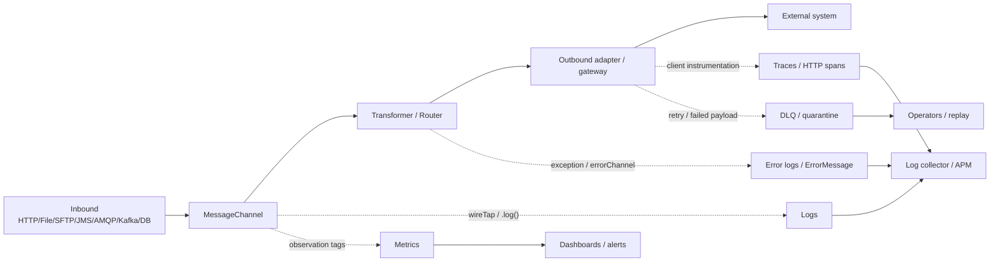
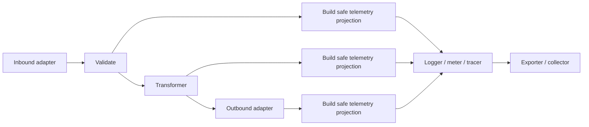
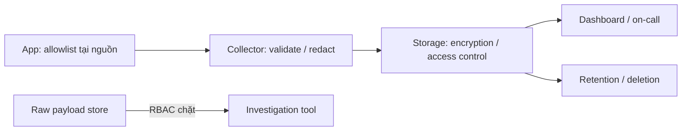
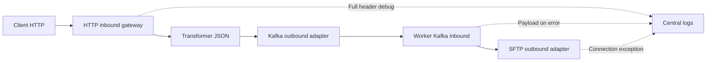

# Ẩn credential và dữ liệu nhạy cảm

## 1. Vì sao observability có thể trở thành đường rò rỉ dữ liệu?

Một hệ thống Spring Integration nhận thông tin khách hàng qua HTTP inbound gateway, chuyển đổi payload, gửi file qua SFTP, publish sự kiện sang Kafka rồi lưu trạng thái vào database. Khi phát sinh lỗi, kỹ sư bật log mức DEBUG và thêm một `wireTap` để quan sát toàn bộ `Message<?>`.

Những bản ghi xuất hiện rất hữu ích: request URL, headers, payload, response body, exception và thông tin định tuyến. Nhưng chúng cũng có thể chứa:

- Header `Authorization: Bearer ...`, `Cookie`, `Set-Cookie`, API key và client secret.
- Mật khẩu của connector SFTP hoặc connection URI có user/password.
- Nội dung hóa đơn, họ tên, địa chỉ, email, số điện thoại hay thông tin thanh toán.
- Kafka record body hoặc JMS/AMQP properties chứa dữ liệu nhạy cảm.
- Đường dẫn file mang mã khách hàng, tên người dùng hoặc dữ liệu hợp đồng.
- SQL bind parameters chứa dữ liệu cá nhân.
- Exception message/stack trace vô tình in raw payload hoặc full URL có token.

Log, trace, metric, DLQ và dashboard thường được **lưu lâu, sao chép, tìm kiếm và chia sẻ rộng hơn hệ thống nguồn**. Một thay đổi để “debug tạm” có thể biến thông tin bí mật thành dữ liệu truy cập được qua hệ thống tập trung.

**Ẩn credential và dữ liệu nhạy cảm trong observability** là thiết kế để **thu thập đủ bằng chứng về trạng thái luồng tích hợp** nhưng **không xuất lộ các giá trị không cần thiết** qua logging, tracing, metrics, cảnh báo, error channel, dead-letter hoặc công cụ vận hành.

Bài nằm trong chương **Observability**, module `SPRING_INTEGRATION_ADAPTERS`. Phạm vi là các **inbound/outbound adapter, gateway, poller và MessageChannel** kết nối File, SFTP, HTTP, JMS, AMQP, Kafka và database; chú trọng hợp đồng message, lỗi và vòng đời kết nối.

> **Quy tắc ưu tiên:** Không thu thập bí mật ngay từ đầu tốt hơn thu thập tất cả rồi dùng regex che lại sau. **Allowlist dữ liệu quan sát**, redaction tại nguồn và quyền truy cập phù hợp là những lớp kiểm soát bổ sung cho nhau.

## 2. Mục tiêu của một hệ thống observability an toàn

Observability không nhất thiết phải thấy raw business payload để trả lời những câu hỏi quan trọng:

1. Message đi qua adapter nào, channel nào và vào thời điểm nào?
2. Đã nhận, chuyển đổi, gửi, xác nhận hay thất bại ở bước nào?
3. Lỗi thuộc contract, authorization, network, timeout, serializer hay hệ thống đích?
4. Có retry, redelivery, backlog hoặc dead-letter không?
5. Message có đúng schema version và content type không?
6. Thời gian tại transformer, queue, poller và outbound I/O là bao nhiêu?
7. Bao nhiêu message bị xử lý trùng hoặc đến muộn?
8. Ai được phép xem dữ liệu chẩn đoán chi tiết khi phát sinh sự cố?

### So sánh log không an toàn và log có ích

**Không an toàn:**

```text
ERROR Sending request to https://partner.example/api?api_key=sk-live-EXAMPLE
headers={Authorization=Bearer eyJ..., Cookie=session=...}
payload={customerEmail="a@example.com", phone="+84...", paymentToken="..."}
java.lang.RuntimeException: Failed with request body {...}
```

**Hướng phù hợp hơn:**

```text
level=WARN event=integration.outbound.failed
flow=orders-export adapter=http-partner
messageRef=evt_7e91 correlationId=corr_81b2
payloadType=OrderExportV2 payloadBytes=842 schemaVersion=2
failureClass=TIMEOUT retryable=true attempt=2
elapsedMs=3000
```

Ví dụ có các ID giả, không chứa credential thật. Giá trị `messageRef` hoặc `correlationId` vẫn phải được **tạo/kiểm chứng an toàn**, không được lấy bất kỳ dữ liệu nhạy cảm nào rồi đổi tên thành “ID”.

## 3. Phân biệt credential, secret, dữ liệu nhạy cảm và metadata

| Nhóm | Ví dụ | Rủi ro khi lộ | Chính sách ghi nhận mặc định |
| --- | --- | --- | --- |
| **Credential xác thực** | Password, API key, private key, client secret | Chiếm quyền hoặc giả mạo client | Không log giá trị |
| **Bearer artifact** | OAuth access/refresh token, session cookie, PAT | Ai có token có thể dùng theo quyền còn hiệu lực | Không log; thu hồi nếu đã lộ |
| **Thông tin cá nhân** | Họ tên, email, điện thoại, địa chỉ | Lộ quyền riêng tư, liên kết danh tính | Không log payload; chỉ giữ dữ liệu tối thiểu có căn cứ |
| **Thông tin tài chính** | Số tài khoản, thẻ, hóa đơn, giá trị giao dịch | Gian lận, tiết lộ bí mật kinh doanh | Không log trực tiếp; áp dụng chính sách ngành/nghiệp vụ |
| **Thông tin tổ chức nhạy cảm** | Sơ đồ nội bộ, hostname riêng, chính sách phân quyền | Tiết lộ kiến trúc và bề mặt tấn công | Chỉ log khi có mục đích/giới hạn truy cập rõ |
| **Payload nhị phân** | PDF, ảnh, ZIP, CSV/JSON chứa dữ liệu khách hàng | Dữ liệu gốc bị sao chép ra telemetry | Ghi kích thước, loại và ID đã kiểm chứng, không dump bytes |
| **Metadata vận hành** | Adapter, stage, mã lỗi, retry count, duration | Thường ít nhạy cảm hơn nhưng vẫn có thể liên kết | Allowlist, kiểm soát cardinality và retention |
| **Định danh quan sát** | Opaque event ID, trace ID, correlation ID | Có thể bị dùng để truy vết hoặc liên kết dữ liệu | Đảm bảo không chứa PII, không dùng secret làm ID |

**Credential** là yếu tố có thể được dùng để chứng minh quyền; **secret** là thông tin cần giữ bí mật, có thể nhưng không luôn là credential. **PII/dữ liệu cá nhân** là thông tin có thể liên quan tới một cá nhân; một giá trị như customer ID cũng có thể trở thành dữ liệu cá nhân khi liên kết được với danh tính.

Không có danh sách từ khóa duy nhất phát hiện hết dữ liệu nhạy cảm. Cần **phân loại theo ngữ cảnh dữ liệu và mục đích xử lý**, không chỉ tìm chữ “password”.

## 4. Bề mặt rò rỉ trong Spring Integration



Những bản sao dữ liệu có thể xuất hiện ở:

- Spring Integration `.log()`, `LoggingHandler`, `wireTap` và logging channel;
- log framework SLF4J/Logback/Log4j với object `toString()`;
- `ErrorMessage`, `MessagingException.getFailedMessage()` và stack trace;
- HTTP client/server interceptors, request/response logging, HTTP wire logging;
- JMS message converters, AMQP listener errors, Kafka deserializer/recoverer;
- SFTP/file exception chứa đường dẫn, tên file hoặc URL;
- JDBC/ORM SQL logging và tham số bind;
- Micrometer observations, OpenTelemetry spans, baggage và exporter;
- error queue, dead-letter topic, quarantine, object storage và snapshot;
- support tickets, incident chat, alert payload và ảnh chụp dashboard.

**Một luồng bảo vệ đúng ở ứng dụng nhưng log collector lưu raw payload vẫn chưa an toàn.** Cần kiểm soát trên toàn đường đi của telemetry.

## 5. Chiến lược phòng vệ theo thứ tự ưu tiên

| Cách làm | Ý nghĩa | Ưu tiên |
| --- | --- | --- |
| **Không thu thập** | Không đưa secret/PII vào log/trace/metric | Cao nhất |
| **Allowlist** | Chỉ chọn field vận hành được phép | Rất cao |
| **Data minimization** | Chỉ giữ chi tiết cần thiết cho mục đích | Rất cao |
| **Redaction** | Loại bỏ toàn bộ giá trị, thay bằng hằng số | Cao |
| **Masking** | Chỉ hiển thị phần được phép, ví dụ `****` | Chỉ khi có nhu cầu cụ thể |
| **Pseudonymization/tokenization** | Dùng mã đại diện được quản trị | Tùy khả năng liên kết và rủi ro |
| **Hash/HMAC** | Tạo fingerprint khi cần đối soát | Xem nguy cơ tái nhận diện và key management |
| **RBAC cho telemetry** | Giới hạn ai xem log/traces/queue | Bắt buộc nhưng không thay thế redaction |
| **Encryption/retention** | Bảo vệ lưu trữ và tự động xóa sau hạn | Bắt buộc theo phân loại dữ liệu |
| **Redaction ở collector** | Bắt lỗi còn lọt từ nguồn | Hàng phòng vệ bổ sung, không phải lớp duy nhất |

### Redaction và masking khác nhau

- **Redaction:** `Authorization=[REDACTED]`; không cho biết độ dài hay phần giá trị.
- **Masking:** `account=****4321`; vẫn tiết lộ một phần, chỉ dùng nếu policy và mục đích cho phép.
- **Tokenization:** `customerRef=c_91f...`; cần đảm bảo mã không tự tiết lộ danh tính.
- **Hash:** `sha256(email)` có thể bị đoán lại từ tập email phổ biến. Nếu thực sự cần định danh ổn định mà không lộ dữ liệu gốc, cân nhắc **HMAC với khóa được quản lý** và phân tích rủi ro liên kết, nhưng tốt nhất vẫn là dùng opaque ID được sinh riêng.

**Không dùng Base64 hoặc mã hóa không có key như biện pháp ẩn thông tin.** Base64 giải mã được ngay.

## 6. Thiết kế hợp đồng quan sát riêng với hợp đồng message

Một `Message<Order>` có thể chứa toàn bộ dữ liệu nghiệp vụ. Hợp đồng observability nên là **bản ghi nhỏ, độc lập**.

| Trường quan sát | Có nên dùng? | Lý do |
| --- | --- | --- |
| `flowName`, `adapterName` | Có, nhưng giá trị phải thuộc tập đã quản trị | Biết nơi lỗi |
| `stage` | Có | Biết bước nhận/chuyển/gửi |
| `eventId` opaque | Có, nếu không chứa dữ liệu nhạy cảm | Truy vết và dedup |
| `correlationId` opaque | Có | Liên kết nhiều bước |
| `schemaVersion` | Có, từ schema được hỗ trợ | Tìm mismatch |
| `payloadType` | Có, loại đã whitelist | Tìm converter sai |
| `payloadBytes` | Có, nếu chỉ là kích thước | Theo dõi giới hạn |
| `durationMs`, `attempt`, `status` | Có | Đo reliability |
| `errorCode` đã chuẩn hóa | Có | Phân loại lỗi |
| `Authorization`, `Cookie` | Không | Credential |
| `customerEmail`, `phone` | Không mặc định | Dữ liệu cá nhân |
| `requestBody`, `responseBody` | Không mặc định | Có thể chứa secret/PII |
| `fullUrl` với query | Không mặc định | Query có thể chứa token/PII |
| `exception.getMessage()` | Không mặc định | Thường chép lại body, URL hoặc SQL |
| `headers.toString()`, `message.toString()` | Không | Có thể in toàn bộ nội dung |

### Một event log an toàn nên trả lời

```json
{
  "event": "integration.message.failed",
  "flow": "invoice-sftp-export",
  "adapter": "sftp",
  "stage": "upload",
  "messageRef": "evt_7e91",
  "payloadType": "InvoiceExport",
  "payloadBytes": 2048,
  "failureCode": "REMOTE_TIMEOUT",
  "retryable": true,
  "attempt": 3,
  "elapsedMs": 5000
}
```

Các giá trị là minh họa. Một logging pipeline có thể dùng JSON structured log nhưng **không được serialize toàn bộ Spring Message thành JSON** rồi coi như an toàn.

## 7. Nguồn dữ liệu và biên tin cậy của headers

Spring Messaging tách message thành `payload` và `MessageHeaders`; nhiều header do framework tạo, nhưng một số đến từ client hoặc adapter.

```text
Message<OrderCreated>
├── payload: {customerEmail, billingAddress, paymentToken, ...}
└── headers:
    ├── id
    ├── timestamp
    ├── correlationId
    ├── contentType
    ├── Authorization          <-- không an toàn
    ├── X-Api-Key              <-- không an toàn
    ├── remoteFileName         <-- có thể chứa PII
    └── replyChannel           <-- tham chiếu nội bộ
```

**Nguy cơ không chỉ ở payload.** Các vị trí khác nhau có thể chứa dữ liệu nhạy cảm:

- HTTP headers `Authorization`, `Proxy-Authorization`, `Cookie`, `Set-Cookie`, `X-API-Key`, custom signature;
- query parameters `token`, `code`, `signature`, `password`, `access_key`, email;
- Kafka headers, AMQP properties, JMS properties chứa business metadata hoặc secret;
- file name, remote path, object key được đặt theo họ tên/hợp đồng;
- correlation ID được producer tự đặt bằng email hoặc account number;
- `replyChannel`, `errorChannel`, connection/session context là đối tượng nội bộ không dành cho telemetry.

### Header allowlist thay cho blacklist

**Blacklist** cố đoán mọi tên secret: bỏ sót `PartnerAuth`, `x-session`, `SAS-token` hoặc khóa mới.

**Allowlist** chỉ nhận những field đã phê duyệt: `flow`, `stage`, `schemaVersion`, `eventId` đã validate và `attempt`. Các header khác **không được đem vào log** cho tới khi có đánh giá.

Ngay cả header nằm trong allowlist cũng phải kiểm tra **kiểu, độ dài và nội dung**, tránh client nhét newline, thông tin riêng tư hoặc giá trị siêu dài vào trường mang tên `correlationId`.

## 8. Spring Integration `.log()`, `wireTap` và `LoggingHandler`

Spring Integration có các công cụ quan sát message rất tiện:

- DSL `.log(...)` có thể chèn logging handler vào flow.
- `wireTap` có thể gửi bản sao message sang một channel phục vụ quan sát.
- `LoggingHandler` có thể định dạng và ghi thông tin message.
- `MessageHistory` có thể ghi dấu đường đi qua các component khi được kích hoạt.

Chúng hữu ích để debug nhưng **không nên mặc định gửi toàn bộ message tới log** nếu payload hoặc headers có thể chứa dữ liệu nhạy cảm.

### Anti-pattern

```java
// Ví dụ KHÔNG NÊN LÀM cho nguồn có dữ liệu nhạy cảm:
log.info("Received message: {}", message);
log.debug("Payload: {}", message.getPayload());
log.debug("Headers: {}", message.getHeaders());
```

Với DTO có `toString()` chứa email/token, object sẽ tự in ra log. Với `Message<?>`, việc log object có thể hiển thị cả payload và headers tùy implementation.

### Cẩn trọng với wireTap

```text
main flow -> wireTap(rawMessage) -> loggingChannel
                              -> logger(message.toString())
```

Mẫu trên **tạo thêm một luồng tiếp xúc với dữ liệu gốc**. Logging channel, queue hoặc handler có thể giữ message chứa secret. Nếu cần wireTap, hãy thiết kế kênh quan sát chỉ nhận **projection đã sanitize** thay vì raw message, hoặc một interceptor/handler không tạo bản sao bền vững chứa raw payload.

**MessageHistory** chủ yếu phục vụ đường đi của các component, nhưng tên component/channel hoặc thông tin gắn kèm vẫn có thể nhạy cảm. Không xem nó là bằng chứng cho phép tự do log mọi header.

## 9. Mẫu Java: Chỉ ghi những trường vận hành được cho phép

Để tránh phụ thuộc vào việc `Message.toString()` có in gì, tạo helper chỉ đọc trường được phép và **không chuyển payload thành String**.

```java
import java.nio.charset.StandardCharsets;
import java.util.Set;
import java.util.regex.Pattern;
import org.slf4j.Logger;
import org.slf4j.LoggerFactory;
import org.springframework.messaging.Message;

public final class SafeIntegrationTelemetry {
    private static final Logger log =
        LoggerFactory.getLogger(SafeIntegrationTelemetry.class);

    private static final Pattern OPAQUE_ID =
        Pattern.compile("[A-Za-z0-9_-]{1,64}");

    private static final Set<String> SAFE_STAGES =
        Set.of("received", "validated", "transformed",
               "sent", "failed", "quarantined");

    private SafeIntegrationTelemetry() {}

    public static void record(
            Message<?> message, String trustedFlow, String stage,
            String failureCode, long elapsedMs) {

        // trustedFlow phải lấy từ cấu hình/constant, không lấy từ client.
        if (!SAFE_STAGES.contains(stage)) {
            throw new IllegalArgumentException("Unsupported stage");
        }

        Object eventId = message.getHeaders().get("eventId");
        String messageRef = safeOpaqueId(eventId);

        Object payload = message.getPayload();
        String kind = payload instanceof byte[] ? "binary"
            : payload instanceof String ? "text"
            : "dto";

        long bytes = payload instanceof byte[] b ? b.length
            : payload instanceof String s
                ? s.getBytes(StandardCharsets.UTF_8).length
                : -1L;

        log.info(
            "integration.flow={} stage={} messageRef={} payloadKind={} " +
            "payloadBytes={} failureCode={} elapsedMs={}",
            trustedFlow,
            stage,
            messageRef,
            kind,
            bytes,
            safeFailureCode(failureCode),
            Math.max(0, elapsedMs)
        );
    }

    static String safeOpaqueId(Object raw) {
        if (!(raw instanceof String value)
                || !OPAQUE_ID.matcher(value).matches()) {
            return "unavailable";
        }
        return value;
    }

    static String safeFailureCode(String code) {
        return switch (code == null ? "NONE" : code) {
            case "NONE", "TIMEOUT", "CONTRACT_INVALID",
                 "REMOTE_DENIED", "BROKER_UNAVAILABLE" ->
                     code == null ? "NONE" : code;
            default -> "OTHER";
        };
    }
}
```

### Những giả định cần bảo vệ thêm

- `trustedFlow` là **constant đáng tin**, không lấy từ request header. Nếu nguồn không đáng tin, map vào danh sách flow cho phép.
- `eventId` chỉ được dùng nếu là **opaque ID** theo hợp đồng. Regex hợp lệ về cú pháp **không chứng minh** không chứa PII; cần ràng buộc tại nơi sinh ID.
- `payloadBytes=-1` nghĩa là **không đo được kích thước từ kiểu hiện tại**, không phải 0 byte.
- `failureCode` bị giới hạn thành mã đã biết, tránh chuỗi lỗi tùy ý chứa secret.
- Với payload rất lớn, `String.getBytes()` chỉ để đo kích thước có thể gây copy tốn memory; nên dùng kích thước đã đo ở codec/adapter thay vì encode lại chỉ để log.
- Mẫu dùng cú pháp Java hiện đại (`instanceof` pattern matching, switch expression); nếu JDK dự án cũ hơn cần điều chỉnh.
- Không tự động gắn helper này vào mọi channel: chọn điểm quan sát chính xác để tránh log trùng.

**Điểm quan trọng:** Code trên **không log `message`, `payload` hoặc `headers` nguyên vẹn**.

## 10. Gắn observability vào flow mà không lộ raw message

Một cách là ghi event an toàn ngay trước hoặc sau transformer/handler theo mục đích, không tạo một logging consumer nhận toàn bộ raw message.

Ví dụ dùng một hàm service để vừa quan sát, vừa trả lại object cho bước tiếp theo:

```java
public final class ObservedOrderTransformer {
    private final OrderExportMapper mapper;

    public ObservedOrderTransformer(OrderExportMapper mapper) {
        this.mapper = mapper;
    }

    public OrderExportDto convert(
            org.springframework.messaging.Message<Order> message) {
        OrderExportDto result = mapper.toExternalDto(message.getPayload());
        SafeIntegrationTelemetry.record(
            message, "orders-export", "transformed", "NONE", 0);
        return result;
    }
}
```

`Order`, `OrderExportDto` và `OrderExportMapper` là class của ứng dụng trong ví dụ, không phải API của Spring Integration. Khi thực hiện thật:

1. Đặt observation ở thời điểm chính xác (trước transform nên dùng stage `received`/`transforming`; chỉ dùng `transformed` sau khi hoàn tất như ví dụ).
2. Không chuyển DTO/payload sang logger để “quan sát”.
3. Nếu cần đo latency thực, đặt timer quanh thao tác chứ không hardcode `0`.
4. Nếu dùng `wireTap`, cân nhắc chỉ truyền một event DTO **đã được làm sạch**, không gửi lại raw business message.
5. Đảm bảo logging không làm thay đổi kết quả nghiệp vụ và không tạo retry vì lỗi telemetry không cần thiết.

### Mẫu flow logic



Những mũi tên sang telemetry là **projection đã chọn field** chứ không phải tự động sao chép message.

## 11. `errorChannel`, `ErrorMessage` và exception có thể làm lộ gì?

Trong Spring Integration, khi endpoint bất đồng bộ/polling gặp lỗi, một `ErrorMessage` có thể chứa `Throwable`. Ngoại lệ dạng `MessagingException` có thể tham chiếu tới **failed message** với toàn bộ payload/headers.

Nguy cơ:

```java
// Không phù hợp cho production khi message có dữ liệu nhạy cảm:
log.error("Integration failure: {}", errorMessage);
log.error("Failure", errorMessage.getPayload());
```

Lệnh thứ hai thường in **stack trace**. Stack trace tự nó không luôn chứa secret, nhưng exception message hoặc nested cause có thể chép URL có token, JSON body, SQL values hoặc headers.

### Quy tắc xử lý an toàn

- Chỉ log **error category/code, stage, adapter, messageRef**, retry attempt và thời điểm.
- Không ghi `Throwable.getMessage()` nguyên văn vào telemetry tập trung nếu chưa kiểm soát.
- Không ghi `MessagingException.getFailedMessage()` nguyên vẹn.
- Có thể dùng `exception.getClass().getSimpleName()` như tín hiệu phân loại, nhưng giới hạn tag/label và không lộ class nội bộ không cần thiết ở kênh public.
- Chi tiết phục vụ điều tra sâu nên được **lưu ở kho hạn chế**, có chính sách redaction/retention, không mặc định đi vào log chung.
- Nếu không lấy được ID do lỗi xảy ra trước khi tạo message, dùng ID vận hành từ adapter/container hoặc tạo correlation ID độc lập.

### Bản ghi lỗi an toàn mẫu

```text
WARN event=integration.message.failed
flow=invoice-upload adapter=sftp
messageRef=evt_a182 stage=remote-write
failureCode=REMOTE_PERMISSION_DENIED
attempt=1 retryable=false
```

Với lỗi `403` hoặc `permission denied`, không cần log mật khẩu hay full connection string để tìm nguyên nhân.

## 12. Mẫu Java: Xử lý ErrorMessage bằng mã lỗi được kiểm soát

```java
import org.slf4j.Logger;
import org.slf4j.LoggerFactory;
import org.springframework.integration.annotation.ServiceActivator;
import org.springframework.messaging.MessagingException;
import org.springframework.messaging.Message;
import org.springframework.messaging.support.ErrorMessage;
import org.springframework.stereotype.Component;

@Component
public class SafeIntegrationErrorObserver {
    private static final Logger log =
        LoggerFactory.getLogger(SafeIntegrationErrorObserver.class);

    @ServiceActivator(inputChannel = "integrationErrorChannel")
    public void observe(ErrorMessage error) {
        Throwable failure = error.getPayload();
        Message<?> failed = failure instanceof MessagingException e
                ? e.getFailedMessage()
                : null;

        String messageRef = failed == null
                ? "unavailable"
                : SafeIntegrationTelemetry.safeOpaqueId(
                      failed.getHeaders().get("eventId"));

        String category = classify(failure);

        // KHÔNG log 'failure' như Throwable, message hoặc headers.
        log.warn(
            "integration.failure flow={} category={} messageRef={}",
            "orders-export",
            category,
            messageRef
        );
    }

    private String classify(Throwable failure) {
        if (failure instanceof IllegalArgumentException) {
            return "CONTRACT_INVALID";
        }
        // Chính sách lỗi thực tế cần dựa vào class/causes tin cậy.
        return "UNCLASSIFIED";
    }
}
```

**Lưu ý bắt buộc:** bean trên chỉ nhận lỗi nếu endpoint/recoverer đã cấu hình đưa `ErrorMessage` vào `integrationErrorChannel`. Trong luồng `DirectChannel` đồng bộ, exception có thể truyền ngược tới caller; không nên nghĩ một listener error channel tự động quan sát tất cả.

Mẫu chỉ là **error observer**, không tự cung cấp retry, dead-letter durability hoặc acknowledgment. Nếu error handler có trách nhiệm lưu DLQ, cần tách phần lưu bền vững và kiểm tra commit trước khi coi lỗi đã được “parked”.

## 13. HTTP adapter và gateway: Những điểm nhạy cảm nhất

HTTP trao đổi URL, method, headers, request/response body và status. Khi dùng inbound/outbound gateway, lưu ý:

| Dữ liệu | Ví dụ nguy hiểm | Cách ghi an toàn |
| --- | --- | --- |
| `Authorization` | `Bearer token...` / Basic secret | Không log; chỉ log auth mode hoặc status |
| `Cookie` / `Set-Cookie` | Session ID | Không log |
| Custom API key header | `X-Api-Key: ...` | Không log |
| Query string | `?token=...&email=...` | Log route template, không log query |
| Full request URL | Signed URL/SAS query | Log host alias hoặc route ID do cấu hình |
| Request body | JSON chứa hồ sơ cá nhân | Chỉ log schema, kích thước và ID an toàn |
| Response body | API trả access token hoặc data | Chỉ log status, media type, kích thước |
| Redirect Location | URL chứa OAuth code/query | Không log nguyên giá trị |
| Exception message | Có thể chép full URL/body | Phân loại và redaction trước khi ghi |

### Không log Basic Auth dù “chỉ là Base64”

HTTP Basic credentials được mã hóa Base64 chứ không phải bảo vệ bằng mã hóa nội dung. In header Basic tức là in credential có thể giải mã.

### Route template tốt hơn full URL

Ví dụ:

```text
Không phù hợp:
requestUrl=https://api.example/customers/087.../orders?access_token=...

Phù hợp:
remoteSystem=customer-api
route=POST /customers/{customerId}/orders
status=429
durationMs=512
```

Ngay cả `customerId` trong path có thể là PII; thay bằng template hoặc mã tham chiếu an toàn, không ghi nguyên path thực.

### HTTP client wire logging

Một số HTTP client có chế độ wire/debug có thể ghi cả headers và body. **Không bật đại trà ở production** chỉ vì cần theo dõi latency. Nếu cần chẩn đoán tạm thời, áp dụng thời hạn, phạm vi hẹp, người phê duyệt, redaction tại nguồn và kiểm thử trước khi bật.

## 14. File và SFTP adapter: Tên file và đường dẫn cũng có thể nhạy cảm

Ví dụ file được đặt tên theo thông tin cá nhân:

```text
/sftp/out/customer-nguyen-van-a-2026-11-23-invoice.pdf
```

Ngay cả khi không log file content, đường dẫn đã chứa tên người và thông tin hóa đơn.

### Với File inbound/outbound

Không ghi:

- Nội dung file hoặc hex dump tùy ý.
- Đường dẫn tuyệt đối chứa thư mục người dùng, dữ liệu tenant, hợp đồng.
- Tên file nếu chính tên file chứa PII.
- Exception có thể chứa toàn bộ path hoặc payload.

Nên ghi:

```text
adapter=file-inbound stage=read
fileRef=file_98a5 extension=csv sizeBytes=182920
result=validated
```

`fileRef` phải là mã được tạo/ánh xạ an toàn, không đơn thuần là filename gốc.

### Với SFTP inbound/outbound

- Không ghi password, private key, passphrase hoặc full SFTP URI có credential.
- Không ghi host key/private key như dữ liệu debug.
- Có thể log `remoteAlias=supplier-a` thay vì toàn bộ host/path.
- Theo dõi session connect/disconnect, timeout, reconnect count và upload result.
- Không đưa raw remote path do client chọn vào log hoặc metric tag.
- Không dùng file name tự khai để tạo trace span name; dễ lộ PII và nổ cardinality.
- Kiểm soát log của SSH/SFTP client khi tăng DEBUG.

### Hợp đồng hoàn tất file

Khi upload sử dụng tên tạm rồi rename, có thể log `uploadStage=temp-written` và `uploadStage=rename-confirmed`. Không cần log nội dung file; cần phân biệt “đã ghi tạm” với “đã hoàn tất”.

## 15. JMS: Message body và properties là bề mặt rò rỉ

JMS message có body và properties/headers; tùy converter và listener, log có thể hiển thị nội dung `TextMessage` hoặc `BytesMessage`.

| Thành phần JMS | Cần tránh | Nên quan sát |
| --- | --- | --- |
| Body text/binary | In toàn bộ order/customer payload | Payload type, size, schema ID |
| JMS properties | Dump mọi property | Một số property đã allowlist |
| Message ID | Có thể dùng khi không chứa PII | Lưu ID với điều kiện an toàn |
| Correlation ID | Nếu do client đặt email/phone | Validate/đổi sang opaque ID |
| Destination | Dynamic destination nhạy cảm | Logical queue alias |
| Redelivery count | Không phải secret mặc định | Có thể đo retry và poison |
| Exception | Stack trace chứa message body | Safe category/stage |

**JMS broker DLQ cũng cần bảo vệ.** Nếu một message bị từ chối và được đưa vào DLQ, body vẫn có thể chứa dữ liệu nhạy cảm. DLQ không phải khu vực được phép bỏ qua kiểm soát truy cập và retention.

### Không log toàn bộ object chuyển đổi

Một DTO được deserialize từ `TextMessage` có thể có `toString()` tự sinh (record/data class) in mọi field. Tưởng “đã parse thành Java object” là an toàn để log là sai.

## 16. AMQP/RabbitMQ: Body, properties, headers và dead-letter

AMQP có body bytes và properties như content type, correlation và routing. Observability thường cần:

- Exchange/queue alias và routing outcome.
- Publish latency, confirm/return status.
- Redelivery/requeue rate, DLX traffic và oldest message age.
- Message schema version và size.
- Mã lỗi serialization/converter.

Không cần:

- Body JSON/bytes hoặc `x-death` metadata dump vô điều kiện.
- Credential kết nối RabbitMQ.
- Dynamic routing key nếu key chứa customer ID hoặc thông tin kinh doanh.
- Throwable message từ converter có raw payload.

### DLX không tự làm sạch nội dung

RabbitMQ chuyển message sang dead-letter exchange theo policy **không xóa PII trong body**. Nếu hệ thống vận hành có nhiều người được quyền đọc dead queue, phải giới hạn theo mức nhạy cảm của message gốc.

Nếu muốn lưu bản ghi lỗi đã sanitize, cần thiết kế **quarantine envelope** riêng, không đơn thuần trông chờ broker DLX che dữ liệu.

## 17. Kafka: Bảo vệ record key, value, headers và DLT

Kafka record có key, value, headers, topic, partition, offset. Nhiều trường quan sát rất hữu ích nhưng không phải trường nào cũng an toàn.

### Nên ghi gì?

```text
adapter=kafka-inbound
topicAlias=orders-events
partition=3 offset=81104
payloadBytes=928 schemaVersion=2
consumerGroupAlias=orders-handler
result=deserialization-failed
```

### Không nên ghi gì?

- Record value JSON, Avro decoded object hoặc raw bytes.
- Key nếu là email, số thẻ, tài khoản hay secret.
- Header auth, tenant credential, token hoặc raw schema payload.
- Exception deserialization chứa raw data.
- Topic name do nguồn không đáng tin tạo hoặc chứa thông tin cá nhân.

**Partition và offset** thường là metadata vận hành hữu ích trong phạm vi Kafka cluster/topic cụ thể. Nhưng khi log, kiểm tra chính sách tổ chức nếu việc tiết lộ cấu trúc hạ tầng là nhạy cảm.

### Kafka DLT và lỗi deserialization

Khi converter/deserializer lỗi **trước** khi tạo Spring message, lỗi có thể xuất hiện tại container/error handler. Chỉ đặt logger trong `IntegrationFlow` là không đủ. Cần cấu hình quan sát ở container/adapter, đồng thời tránh dump raw key/value khi lỗi.

DLT record có thể giữ original payload để replay. Đó là **kho dữ liệu nhạy cảm**, cần hạn quyền, retention, mã hóa khi phù hợp và audit việc đọc/phát lại.

### Tracing và Kafka headers

Không đặt email, JWT, API key vào Kafka trace baggage chỉ vì muốn chuyển context sang consumer. Propagate trace context chuẩn và các trường được phê duyệt; khi cần user correlation, dùng opaque reference với phạm vi và retention rõ.

## 18. JDBC và database: Query log, bind parameter và SQL exception

Database observability thường thu thập SQL text, thời gian thực thi, connection errors và số bản ghi. Cần phân biệt:

| Thành phần | Rủi ro | Giải pháp |
| --- | --- | --- |
| Query parameter | Dữ liệu khách hàng hoặc secret trong `WHERE`, `INSERT` | Không log bind values |
| Full SQL động | Có thể chứa literal nhạy cảm | Prepared statement và query template |
| Result row | Bản ghi cá nhân/tài chính | Không dump row |
| Database URL | Có thể chứa username/password hoặc token | Dùng datasource alias |
| Connection error | Có thể chép connection string | Phân loại error code, loại bỏ nguyên message |
| Schema/table name | Có thể nhạy cảm trong hệ thống đa tenant | Logical operation name |
| Slow query log | Có thể ghi literal/bind values tùy driver | Rà cấu hình database/driver/APM |

### SQL template thay vì giá trị thật

```text
Không phù hợp:
INSERT INTO payments (account, amount) VALUES ('1234...', 5000)

Phù hợp:
dbOperation=payments.insert
statementTemplate="INSERT INTO payments(account, amount) VALUES (?, ?)"
durationMs=81
rowsAffected=1
```

Đừng xem SQL template là tuyệt đối vô hại: tên bảng, cột hoặc cấu trúc schema có thể nhạy cảm theo chính sách, và SQL comment cũng có thể mang dữ liệu. Trong log dùng chung, **operation alias** thường dễ kiểm soát hơn.

### Khi JDBC là dead-letter store

Một bảng `integration_dead_letter` có thể lưu raw payload hoặc reference đến payload. Đừng bật logging các tham số INSERT vào bảng này: **nó sẽ vô tình xuất lại chính dữ liệu đang cần cách ly**.

## 19. Credential trong cấu hình connector và vòng đời kết nối

Một số credential không nằm trong payload nhưng xuất hiện khi connector khởi tạo hoặc lỗi:

- HTTP Basic/Bearer token, OAuth client secret hoặc certificate private key.
- SFTP username/password, private key, passphrase, host fingerprint.
- JMS/AMQP broker username/password và connection URI.
- Kafka SASL username/password, JAAS config, TLS keystore password.
- JDBC URL, DB password, cloud IAM token.
- Secret store URI hoặc signed URL có query token.

### Biện pháp kiểm soát

1. Đọc secret từ secret manager/environment/credential provider được quản trị; không hardcode hoặc commit vào repository.
2. Không dùng `toString()` của connection settings nếu implementation có thể lộ secret.
3. Không bật logger DEBUG của thư viện client mà chưa biết nội dung nó ghi.
4. Chỉ ghi **trạng thái kết nối**: connected, timeout, auth-failed, reconnect-count.
5. Đổi/thu hồi credential theo quy trình khi có nghi ngờ lộ, không chỉ che log mới.
6. Loại bỏ secret khỏi crash reports, dump và alert attachments.
7. Thực hiện least privilege và chia credential theo ứng dụng/môi trường.
8. Gắn owner, expiry/rotation policy phù hợp với service account/workload.

### Secret không nhất thiết nằm ở tên header quen thuộc

`Authorization` rất rõ, nhưng `partner-ticket`, `signed-url`, `sessionData` hoặc một field nghiệp vụ chứa token có thể không được blacklist. Chính vì vậy ưu tiên **không thu thập nội dung** và dùng allowlist.

## 20. JSON transformer và DTO: Không lộ field do serialization

Jackson `ObjectMapper` thường được dùng trong Spring Integration để serialize DTO trước HTTP/Kafka/JMS/AMQP.

Một DTO có thể chứa nhiều trường hơn hợp đồng xuất:

```java
public record Customer(
    String customerId,
    String email,
    String phone,
    String internalNote,
    String accessToken
) {}
```

Nếu log `customer`, Java record `toString()` có thể in tất cả trường. Nếu serializer đưa nguyên object ra JSON, dữ liệu nhạy cảm có thể ra cả **hệ thống đích**, không chỉ observability.

### Tách DTO outbound và telemetry DTO

```java
public record CustomerExport(
    String customerRef,
    String tier
) {}

public record IntegrationObservation(
    String eventType,
    String flow,
    String stage,
    String messageRef,
    String resultCode
) {}
```

Hai DTO phục vụ mục tiêu khác nhau:

- **Outbound DTO** tuân hợp đồng dữ liệu của consumer.
- **Observation DTO** tuân hợp đồng dữ liệu của hệ thống telemetry.

`@JsonIgnore` hoặc `@JsonProperty(access=...)` có thể hữu ích trong Jackson, nhưng **không thay thế** thiết kế DTO riêng và test JSON thực tế. Một đường serialization khác hoặc `toString()` vẫn có thể làm lộ dữ liệu.

## 21. Logging framework, MDC và structured logs

SLF4J/Logback/Log4j có thể in các trường được truyền từ ứng dụng. Không có API logging nào tự hiểu “đây là API key” trong mọi object Java.

### Nguy cơ từ interpolation

```java
// Không an toàn nếu object tự in dữ liệu nhạy cảm:
log.info("message={}", message);
log.warn("failed request={}", request);
log.error("handler failed", exception);
```

Log throwable là cần thiết trong một số bối cảnh điều tra, nhưng khi exception message có thể chứa secret, dùng log chi tiết ở kênh được kiểm soát và **redaction upstream**; không nên tự động đưa mọi throwable thô lên collector dùng chung.

### MDC – Mapped Diagnostic Context

MDC giúp gắn correlation context với các log trên thread:

```java
import org.slf4j.MDC;

public void processWithCorrelation(String safeCorrelationId, Runnable action) {
    try {
        MDC.put("correlationId", safeCorrelationId);
        action.run();
    } finally {
        MDC.remove("correlationId");
    }
}
```

**Điều kiện:** `safeCorrelationId` phải được kiểm chứng là opaque, không chứa email/token/newline và có độ dài giới hạn.

**Cẩn trọng với luồng async:** `QueueChannel`, executor channel, poller và listener có thể dùng thread khác. MDC không tự bảo đảm đúng context qua thread boundary; cần cơ chế propagation có kiểm soát và phải xóa MDC khi worker thread được tái sử dụng để tránh “dính” correlation của người trước.

### Log format chuẩn hóa

Thay vì message tự do, ưu tiên các field:

```text
event, flow, adapter, stage, correlationId,
payloadKind, payloadBytes, failureCode, attempt, durationMs
```

Các field nằm trong schema định sẵn giúp query tốt hơn và giảm việc kỹ sư tùy tiện thêm payload để debug.

## 22. Metrics với Micrometer: Tránh lộ dữ liệu qua labels

Metrics thường được xem là dữ liệu “chỉ có số”, nhưng **nhãn/tag** có thể chứa PII hoặc secret và còn gây bùng nổ cardinality.

### Không nên dùng làm metric tag

- `email`, `customerId`, `userId` hoặc `orderId` theo từng message.
- Full URL có query/path ID.
- Token, filename đầy đủ, remote path.
- Exception message nguyên văn.
- SQL statement có tham số.
- Kafka record key hoặc header tự khai.

### Tag nên có tập giá trị hữu hạn

| Metric | Tags phù hợp | Tránh |
| --- | --- | --- |
| `integration.messages.total` | `flow`, `adapter`, `outcome` | `eventId` |
| `integration.handler.duration` | `flow`, `stage` | `customerId` |
| `integration.retries.total` | `adapter`, `errorCode` | Full exception message |
| `integration.deadletter.total` | `sourceType`, `reasonCode` | Raw topic key |
| `integration.sftp.connections` | `remoteAlias`, `result` | Full URI/password |
| `integration.kafka.lag` | `consumerGroupAlias`, `topicAlias` | Per-message key |
| `integration.http.requests` | `routeTemplate`, `statusClass` | URL/query string |

### Tại sao cardinality cũng là rủi ro?

Nếu mỗi order ID tạo một time series, số series có thể tăng theo traffic, tốn bộ nhớ/chi phí và làm hệ thống giám sát quá tải. Đồng thời ID đó có thể xuất hiện trong dashboard/exporter. Tag càng **ít biến động và được kiểm soát**, hệ thống càng an toàn và dễ vận hành.

## 23. Tracing với Micrometer Observation và OpenTelemetry

Distributed tracing giúp nối các bước từ HTTP inbound, `MessageChannel`, transformer, Kafka producer tới consumer. Nhưng span name, attributes, events, baggage và exception recording cũng là nơi dữ liệu nhạy cảm có thể xuất hiện.

### Phân loại thành phần trace

| Thành phần | Nên chứa | Không nên chứa |
| --- | --- | --- |
| Trace/span ID | ID ngẫu nhiên/opaque do hệ thống tracing tạo | Token hoặc thông tin cá nhân |
| Span name | `http.client POST /orders/{id}`, `kafka.produce` | Full URL với query |
| Span attributes | Adapter, route template, status, error code | Request body, credentials |
| Span events | Retry, timeout, DLQ parked | Full exception message hoặc raw payload |
| Baggage | Chỉ context rất hạn chế nếu thực sự cần | Email, JWT, access token, secret |
| Exception recording | Loại lỗi có kiểm soát | Stack/body không sanitize gửi đi mặc định |

**Không đưa mọi Spring header vào trace baggage.** Baggage có thể được propagate xuyên process và sang hệ thống thứ ba, làm mở rộng phạm vi tiếp xúc của dữ liệu.

### Sampling không thay thế data protection

Lấy mẫu 1% trace **vẫn có thể thu được credential** của một request nhạy cảm. Redaction/minimization phải áp dụng **trước sampling** hoặc tại điểm tạo attribute, không trông chờ mẫu ít.

### Tracing và correlation

Một trace có thể mất qua batch/poller/asynchronous boundary; event ID/correlation ID theo business contract hỗ trợ đối chiếu. Nhưng ID cũng phải an toàn và không chứa dữ liệu cá nhân. Không dùng hash email làm trace ID một cách tùy tiện.

## 24. Observability khi retry, redelivery và circuit breaker

Khi một outbound adapter lỗi, cần theo dõi retry nhưng không in lại payload nhiều lần.

### Những giá trị nên quan sát

- `messageRef` ổn định qua retry.
- `attempt` và `maxAttempts` theo policy.
- `errorCode` đã chuẩn hóa.
- `backoffMs`, `retryable` và `circuitState`.
- `targetAlias` và `durationMs`.
- `finalOutcome`: sent, parked, failed-permanent, unknown.
- Cảnh báo khi retry storm hoặc queue backlog vượt ngưỡng.

### Vì sao log mỗi retry có thể nguy hiểm?

Nếu mỗi lần retry ghi lại body, một token hoặc PII có thể xuất hiện **hàng trăm lần**, phát tán sang nhiều index/backup. Log nên tập trung vào tình trạng xử lý và chỉ ghi một số sự kiện có ích, không nhân bản raw payload.

### Timeout không có nghĩa đích chưa xử lý

HTTP POST, Kafka publish hoặc DB transaction có thể thành công ở đích nhưng caller không nhận ACK. Log chỉ nên ghi `outcome=unknown` đến khi có bằng chứng; không thể kết luận “failed business operation” chỉ vì timeout.

## 25. Dead-letter và quarantine: Nơi chứa dữ liệu thất bại có độ rủi ro cao

DLQ/DLT/quarantine có thể chứa **payload gốc**, headers và lỗi. Một bản ghi bị dead-letter thường **không được redaction tự động** bởi broker.

- **JMS:** provider DLQ có thể giữ nguyên message body/properties.
- **RabbitMQ:** DLX có thể route message nguyên body sang dead queue.
- **Kafka:** DLT publisher/recoverer có thể gửi key/value gốc và error headers.
- **File/SFTP:** quarantine directory có thể chứa bản copy file đầy đủ.
- **HTTP/JDBC:** bảng hoặc object storage chứa failed request/binary data.

### Hai hướng triển khai cần phân biệt

1. **Full payload được bảo vệ:** giữ raw bytes để có thể replay chính xác. Kho phải có phân quyền hạn chế, mã hóa/retention và kiểm toán truy cập.
2. **Sanitized dead-letter envelope:** chỉ giữ metadata đã làm sạch và `payloadRef` trỏ tới kho dữ liệu gốc được bảo vệ.

Không nhầm “ẩn khỏi logs” với “xóa luôn thông tin cần cho replay”. Nếu nghiệp vụ yêu cầu bảo toàn dữ liệu, hãy **đưa bản gốc vào kho đúng phân loại** chứ không đẩy vào log hoặc dashboard chung.

### Bản ghi DLQ an toàn cho dashboard

```json
{
  "deadLetterId": "dlq_9182",
  "sourceAlias": "orders-kafka",
  "failureCode": "SCHEMA_UNSUPPORTED",
  "messageRef": "evt_7e91",
  "payloadBytes": 1093,
  "payloadRef": "restricted-store-record-id",
  "status": "QUARANTINED"
}
```

Không để `payloadRef` là public link có token truy cập trong query. Quyền **inspect payload** và quyền **replay** nên tách riêng nếu yêu cầu quản trị.

## 26. Redaction ở collector và APM: Lớp phòng vệ thứ hai

Một collector có thể áp dụng quy tắc xóa trường nhạy cảm từ structured log hoặc trace. Cách này hữu ích để chặn dữ liệu còn lọt ra từ thư viện bên thứ ba.

### Ví dụ pipeline vận hành



Điểm kiểm soát:

- Collector không thể che giá trị chưa biết nếu chỉ dùng vài regex.
- Lỗi cấu hình collector hoặc mất agent có thể khiến dữ liệu thô bị ghi ở nơi khác.
- Nếu ứng dụng log JSON bị escape hoặc nested text, regex có thể bỏ sót.
- Dữ liệu trước redaction có thể đi qua buffer hoặc disk spool; cũng cần bảo vệ.
- Redaction có thể làm mất dữ liệu hữu ích; phải dựa trên schema và test thực tế.
- Backup/index/retention cần xem lại khi phát hiện dữ liệu đã lộ trước đó.

**Không coi redaction ở collector là giấy phép log credential vào application stdout.**

## 27. Lưu trữ, quyền truy cập và dữ liệu quan sát xuyên môi trường

Một chính sách observability an toàn phải phân biệt:

| Môi trường/kênh | Nguyên tắc |
| --- | --- |
| Local development | Dùng dữ liệu giả; không copy production secrets sang test |
| CI/test | Không in secret từ pipeline, masked variables không thay thế kiểm soát mã nguồn |
| Staging | Dữ liệu đã giả lập/ẩn theo chính sách; không log credential tích hợp |
| Production application logs | Structured allowlist, hạn chế DEBUG raw |
| Central log platform | RBAC, encryption, retention, kiểm toán truy cập |
| APM/tracing | Safe span attributes, baggage policy, exporter allowlist |
| DLQ/quarantine | Phân loại như dữ liệu gốc, tách quyền đọc và replay |
| Incident ticket/chat | Chỉ đính kèm ID và mô tả đã sanitize |
| Export/backups | Kiểm soát dữ liệu đã được nhân bản và thời hạn lưu |

### Không có một thời gian lưu chung cho mọi dữ liệu

Retention cần phản ánh mục đích, phân loại và nghĩa vụ áp dụng. Log hiệu năng có thể giữ ngắn; audit bắt buộc có thời hạn khác; DLQ chứa payload cá nhân không nên tồn tại mãi chỉ vì “chưa ai xử lý”.

### Quyền truy cập tối thiểu

Người xem dashboard tổng hợp không nhất thiết được phép đọc raw file/quarantine. Người có quyền xem log không mặc định được quyền xem payload khách hàng hay phát lại giao dịch.

## 28. Khi có rò rỉ credential vào log: Quy trình ứng phó

Nếu phát hiện một API key, token hoặc password đã được ghi vào log/tracing, **đổi code để ngừng log là chưa đủ**.

### Trình tự ứng phó

1. **Kiềm chế:** ngừng nguồn ghi lộ, tắt chế độ debug raw hoặc chặn exporter không an toàn.
2. **Đánh giá loại bí mật:** token có còn hiệu lực, scope gì, môi trường nào, đã được truy cập bởi ai?
3. **Thu hồi/rotate:** revoke token, rotate API key/password/credential và xử lý session theo khả năng nền tảng.
4. **Điều tra phạm vi bản sao:** stdout, collector buffer, log index, APM, alert, incident chat, backup, data export.
5. **Giới hạn truy cập:** khóa quyền tới index, điều tra access logs của hệ thống telemetry, thông báo đầu mối an ninh.
6. **Xóa/giảm thiểu bản sao:** tuân thủ quy trình retention, deletion và nghĩa vụ pháp lý; không xóa bằng chứng cần cho điều tra ngoài thẩm quyền.
7. **Xác minh credential cũ không còn được chấp nhận** và hệ thống vẫn hoạt động với credential thay thế.
8. **Cải thiện kiểm soát:** thêm test chống rò rỉ, allowlist, policy logger và review thay đổi.

Không đăng token đã lộ vào ticket hoặc chat để “xin trợ giúp”. Dùng reference và kênh xử lý sự cố được kiểm soát.

### Nếu dữ liệu cá nhân lộ?

Phối hợp nhóm security/privacy/compliance để đánh giá dữ liệu, chủ thể bị ảnh hưởng, phạm vi, nghĩa vụ xử lý và thông báo theo quy định áp dụng. Không tự khẳng định mọi tình huống cần hoặc không cần báo cáo theo cùng một mốc thời gian.

## 29. Kiểm thử bảo đảm không lộ dữ liệu

Kiểm thử phải xác minh **output của logging/tracing thực tế**, không chỉ đọc code của helper.

### 29.1. Unit test hàm kiểm chứng ID

```java
import static org.junit.jupiter.api.Assertions.assertEquals;
import org.junit.jupiter.api.Test;

class SafeIntegrationTelemetryTest {

    @Test
    void acceptsOpaqueId() {
        assertEquals("evt_2401",
            SafeIntegrationTelemetry.safeOpaqueId("evt_2401"));
    }

    @Test
    void rejectsNewlineAndUnexpectedValue() {
        assertEquals("unavailable",
            SafeIntegrationTelemetry.safeOpaqueId("abc\nAuthorization:Bearer"));
        assertEquals("unavailable",
            SafeIntegrationTelemetry.safeOpaqueId(null));
    }
}
```

Test cho regex/format không chứng minh `eventId` không phải PII. Phải kiểm tra nguồn sinh ID và contract độc lập.

### 29.2. Canary test với giá trị giả có thể tìm kiếm

Trong môi trường test, dùng marker **không phải secret thật**:

```text
TEST_ONLY_DO_NOT_LOG_TOKEN_6f92
TEST_ONLY_DO_NOT_LOG_EMAIL_6f92@example.invalid
```

Gắn marker trong payload, headers, URL query, exception message, DLQ test input. Chạy các flow rồi assert:

- Không xuất hiện marker trong stdout/application logs.
- Không xuất hiện marker trong trace attributes, span event hoặc baggage.
- Không xuất hiện marker trong metrics labels.
- Không xuất hiện marker trong error alert/ticket.
- Nếu message được lưu raw để replay, marker chỉ xuất hiện trong **kho được phân quyền** chứ không phải telemetry phổ thông.

### 29.3. Integration tests theo adapter

| Adapter | Trường hợp cần kiểm tra |
| --- | --- |
| **HTTP** | Bearer token, Basic Auth, Cookie, signed URL query và body |
| **SFTP** | Connection credential, remote path chứa PII, host key error |
| **File** | Tên file chứa họ tên, nội dung PDF/CSV, file error |
| **JMS** | TextMessage/BytesMessage chứa secret, property bất ngờ |
| **AMQP** | Body, routing key, converter error, DLQ |
| **Kafka** | Key/value/header chứa PII, deserializer error, DLT |
| **JDBC** | SQL bind values, DB URL password, exception có dữ liệu |
| **Channel/Flow** | `.log()`, `wireTap`, MessageHistory và MDC propagation |
| **Collector/APM** | Attribute redaction, sampling, retention và quyền đọc |

### 29.4. Negative tests bắt buộc

- Log object `Message<?>` hoặc DTO `toString()` có bị cấm/review không?
- `errorChannel` có in `Throwable` chứa dữ liệu gốc không?
- Header mới tên lạ mang token có lọt qua whitelist không?
- Event ID có chứa email, dấu xuống dòng hoặc rất dài có bị từ chối không?
- Khi bật DEBUG, HTTP/JMS/Kafka/SFTP client có phát sinh body dump không?
- Khi DLQ sink lỗi, logger có ghi raw message để “cứu dữ liệu” không?
- Khi chuyển qua `QueueChannel`/executor, MDC có bị dính context giữa message không?
- Một metric label từ full URL có tăng cardinality và lộ query không?

### 29.5. Test toàn pipeline

Mẫu mock logging test có thể assert chuỗi marker không có trong log. Ngoài ra cần kiểm tra exporter/collector bằng integration test hoặc môi trường kiểm thử tích hợp vì **mã nguồn logger an toàn không bảo đảm tất cả thư viện tự động instrumentation cũng an toàn**.

## 30. Mã mẫu: Lọc dữ liệu trước khi gửi tới observability channel

Nếu kiến trúc cần một channel quan sát riêng, **đừng gửi nguyên Message chứa business payload** đến đó.

### DTO sự kiện quan sát

```java
public record SafeObservation(
    String flow,
    String stage,
    String messageRef,
    String payloadKind,
    long payloadBytes,
    String statusCode
) {}
```

### Tạo projection

```java
public final class ObservationProjector {

    private ObservationProjector() {}

    public static SafeObservation project(
            org.springframework.messaging.Message<?> source,
            String trustedFlow,
            String stage) {

        Object payload = source.getPayload();
        long size = payload instanceof byte[] b ? b.length : -1L;
        String kind = payload instanceof byte[] ? "binary" : "other";

        return new SafeObservation(
            trustedFlow,
            stage,
            SafeIntegrationTelemetry.safeOpaqueId(
                source.getHeaders().get("eventId")),
            kind,
            size,
            "OK"
        );
    }
}
```

Việc gọi `project` nên diễn ra **trước khi message đi vào kênh quan sát**. Khi đó `Message<SafeObservation>` không chứa raw payload và headers của request gốc.

Nếu dùng publish-subscribe channel hoặc `wireTap`, cần tránh cách mắc khiến **bản gốc** vẫn đi qua logging channel. Tạo projection bằng transformer/router riêng và test payload thực tế của kênh telemetry.

### Không đưa giá trị không tin cậy vào DTO quan sát

`trustedFlow`, `stage` và `statusCode` cũng phải là **constant hoặc enum đã quản trị**. Ví dụ code tập trung vào projection nhưng không thay thế kiểm soát provenance của các tham số này.

## 31. Các chỉ số vận hành hữu ích mà không cần lộ payload

Một dashboard Spring Integration Adapters có thể hiển thị:

| Chỉ số | Trục phân tích an toàn |
| --- | --- |
| Số message inbound/outbound | Adapter alias, flow, outcome |
| Độ trễ handler | Stage, adapter, success/failure |
| Queue depth và poll lag | Channel/source alias |
| HTTP response rate | Route template, status class |
| SFTP connection failures | Remote alias, failure code |
| JMS/AMQP redelivery | Queue alias, reason code |
| Kafka consumer lag | Consumer group/topic alias |
| JDBC error rate | Operation alias, error category |
| Retry/dead-letter count | Flow, retryable, reason |
| Payload size distribution | Message type/schema version |
| Correlation coverage | Flow, có/không có safe ID |
| Credential rotation health | Connector alias, trạng thái rotation (không log secret) |

### Ví dụ cảnh báo

```text
ALERT: sftp-upload-failure-rate-high
service=orders-export
adapter=sftp-partner-a
last5mFailureRate=0.18
topFailureCode=REMOTE_TIMEOUT
runbook=integration-sftp-failures
```

Cảnh báo đủ thông tin để đội vận hành hành động mà không cần đính kèm private key, mật khẩu, tên file mang dữ liệu cá nhân hoặc nội dung tài liệu.

## 32. Case study: Lộ token khi debug HTTP → Kafka → SFTP

Giả sử một doanh nghiệp có flow:



### Sự cố

Một developer bật:

```java
log.debug("incoming={}", message);
```

Đối với một request, `MessageHeaders` có cả bearer token và payload có email khách hàng. Khi SFTP timeout, exception được in kèm thông tin remote path có tên khách hàng. Một bản ghi Kafka lỗi đi vào DLT với nguyên raw payload, nhưng DLT có quyền đọc rộng hơn topic gốc.

### Chuỗi hậu quả

1. Token và thông tin khách hàng xuất hiện trong application log.
2. Log collector chuyển bản ghi sang index có thời hạn lưu dài.
3. On-call copy một đoạn log vào incident chat.
4. Bản sao DLT và trace có thể giữ thêm thông tin tương tự.
5. Xóa `log.debug(...)` chỉ ngăn log mới, **không xử lý các bản sao và token còn hiệu lực**.

### Kế hoạch sửa

- Thay full message logging bằng **structured safe event** chứa adapter, stage, mã lỗi và opaque ID.
- Bảo đảm HTTP auth header không vào observability projection.
- Thay log remote path bằng partner alias và fileRef; giữ mapping nhạy cảm ở store có quyền hạn.
- Kiểm tra DLT/quarantine như kho chứa raw dữ liệu, thu hẹp quyền và retention.
- Thu hồi/rotate token có khả năng bị lộ; rà soát session và log access.
- Kiểm tra log collector, trace, dashboard, incident chat và backup theo quy trình.
- Thêm canary tests với marker giả, kiểm thử sau khi bật DEBUG ở adapter.
- Dùng trace/correlation ID để điều tra mà không cần raw payload.

### Kết quả mong đợi

Kỹ sư vẫn xác định được lỗi SFTP timeout, thời gian retry, Kafka offset và trạng thái đơn hàng thông qua **opaque reference + nguồn dữ liệu có quyền truy cập tương ứng**, nhưng người xem dashboard chung không thể đọc token hoặc dữ liệu khách hàng.

## 33. Anti-pattern thường gặp

| Anti-pattern | Rủi ro | Thay bằng |
| --- | --- | --- |
| `log.info("{}", message)` | In payload và headers | Chỉ log safe projection |
| `log.debug("{}", payload)` | DTO `toString()` lộ PII | Log type/size/schema |
| `log.error("...", throwable)` không đánh giá nguồn | Exception message chứa secret | Error code, hạn chế chi tiết |
| `wireTap` raw sang logging channel | Nhân bản dữ liệu nhạy cảm | Chỉ gửi projection đã sanitize |
| Bật HTTP wire log trong production | Lộ Authorization, Cookie, body | Metrics, route template và safe tracing |
| Dump Kafka record key/value khi deserialize lỗi | Lộ dữ liệu giữa broker và logs | Source position, schema và safe cause |
| Log toàn bộ JMS/AMQP properties | Custom token lọt qua blacklist | Property allowlist |
| Dùng full SFTP path làm tag | PII và high cardinality | Partner/file alias |
| Log SQL bind parameters | Lộ PII hoặc credential | Query/operation template |
| Hash email thô để “ẩn” | Có thể đoán hoặc liên kết danh tính | Opaque ID, HMAC khi có căn cứ |
| Copy trace baggage từ toàn bộ headers | Propagate secret xuyên dịch vụ | Context allowlist |
| Sampling trace thay cho redaction | Vẫn thu secret trong mẫu | Redact trước khi thu |
| Dùng regex duy nhất ở collector | Bỏ sót cấu trúc/field lạ | Data minimization ở nguồn + defense in depth |
| Coi DLQ là log an toàn | Raw payload lưu lâu, đọc rộng | Quarantine được bảo vệ |
| Dùng Base64 để “bảo mật” token | Dễ giải mã | Không log; bảo vệ secret ở nguồn |
| Giữ DEBUG vô thời hạn | Tăng bề mặt lộ và chi phí | Time-bound diagnostics, phê duyệt |
| Dùng customer ID làm metric tag | Lộ PII, nổ cardinality | Tags hữu hạn |
| Không dọn MDC khi thread reuse | Gắn nhầm ngữ cảnh khác | `try/finally` và propagation có kiểm soát |
| Thấy token trong logs nhưng chỉ sửa code | Token vẫn có thể bị dùng, bản sao còn tồn tại | Revoke/rotate, điều tra, xử lý retention |
| Test logger nhưng không test APM/exporter | Tự động instrumentation vẫn lộ | End-to-end observability tests |

## 34. Bài tập tình huống và câu hỏi tự kiểm tra

### Tình huống A: Một `Message<?>` bị log khi converter lỗi

Flow nhận body JSON chứa `client_secret`, transformer ném exception. Error handler ghi `ErrorMessage.toString()`.

**Cần làm gì?** Không dump toàn bộ ErrorMessage hoặc failed message. Ghi flow/stage/error code/opaque ID; payload lỗi cần phục hồi thì lưu ở quarantine riêng có hạn quyền và retention. Kiểm thử với canary secret giả.

### Tình huống B: Lỗi SFTP chỉ xảy ra vào ban đêm

Kỹ sư muốn bật DEBUG toàn bộ SSH client cả tuần.

**Hướng xử lý:** ưu tiên timeout/connect/reconnect metrics và error code. Nếu thật sự cần verbose diagnostics, giới hạn thời gian/phạm vi, đánh giá logger output và quyền truy cập; không mặc định in credential hoặc remote path.

### Tình huống C: Metric `http.requests` dùng tag `url` đầy đủ

Một số URL có query `access_token=...` và path chứa customer ID.

**Hướng xử lý:** thay bằng route template và remote alias được quản trị, bỏ query/full path. Kiểm tra các time series đã được xuất trước đó theo retention.

### Tình huống D: Kafka DLT giữ raw record

Ops đề xuất cấp quyền đọc DLT cho mọi developer vì “dữ liệu lỗi”.

**Hướng xử lý:** xác định phân loại dữ liệu như topic gốc, tách dashboard metadata đã sanitize khỏi quyền inspect raw DLT, audit việc đọc và replay.

### Tình huống E: Dùng SHA-256(email) trong logs

Nhóm cho rằng email đã được ẩn hoàn toàn vì chỉ ghi hash.

**Hướng xử lý:** hash của tập đầu vào dễ đoán có thể bị đối chiếu. Ưu tiên opaque ID tách từ danh tính; nếu buộc phải liên kết, đánh giá HMAC có quản lý khóa, retention và quyền truy cập.

### Tình huống F: Exception được in với `logger.error("failed", ex)`

Exception của HTTP client có URL signed trong message.

**Hướng xử lý:** kiểm soát phần message/stack trong kênh telemetry, log error category an toàn và correlation; với điều tra sâu dùng kênh hạn chế và redaction. Rà lại exporter/alert downstream.

### Tình huống G: MDC chứa email người dùng

Một worker bất đồng bộ xử lý message kế tiếp và giữ MDC từ request trước.

**Hướng xử lý:** không đặt email vào MDC; dùng opaque correlation ID, quản lý propagation ở thread boundary và luôn cleanup.

### Tình huống H: API key đã bị ghi vào log ba ngày

Kỹ sư đã thay logger để che key và muốn đóng sự cố.

**Hướng xử lý:** chưa đủ. Cần thu hồi/rotate key, điều tra quyền truy cập và bản sao log/trace/alert, xử lý dữ liệu đã lộ và bổ sung kiểm thử để ngăn tái diễn.

## 35. Checklist trước khi bật observability cho adapter

1. Mỗi luồng có **danh mục trường được phép quan sát** thay vì log toàn bộ object chưa?
2. Đã phân loại credential, bearer token, PII, financial data và dữ liệu tổ chức chưa?
3. Có bảo đảm `Message<?>.toString()` và `headers.toString()` không được log tại biên nhạy cảm?
4. `.log()`, `LoggingHandler`, `wireTap` và `MessageHistory` đã được rà tác động dữ liệu chưa?
5. Log có dùng **flow/adapter/stage/error code** đã quản trị thay vì free-form raw values không?
6. `eventId`/`correlationId` là opaque ID, có kiểm tra provenance, ký tự và độ dài không?
7. HTTP request/response headers/body, query, signed URLs và cookies có được bảo vệ không?
8. File/SFTP filename/path có chứa PII không; có alias/reference an toàn không?
9. JMS/AMQP/Kafka body, key, properties và error message có được tránh dump không?
10. JDBC/SQL log có bỏ bind values, password trong URL và row data không?
11. Exception log và `ErrorMessage.getFailedMessage()` có thể chứa payload hoặc headers không?
12. Error handler có log **mã lỗi** thay vì raw throwable message khi nguồn có dữ liệu nhạy cảm không?
13. DLQ/DLT/quarantine có phân quyền và retention như dữ liệu gốc không?
14. Có tách quyền xem dashboard metadata và quyền xem raw payload/replay không?
15. Micrometer metric labels có **cardinality hữu hạn** và không chứa user/customer/event ID không?
16. Span names, attributes, events và baggage của OpenTelemetry có tránh secret/PII không?
17. Sampling có được hiểu là **không thay thế redaction** không?
18. MDC có được cleanup và propagate đúng qua poller/QueueChannel/executor không?
19. Collector/APM có defense-in-depth redaction và kiểm soát buffer/spool không?
20. Có bảo vệ log index, dashboard, exporter, backups và alert attachments không?
21. Có kiểm thử fake secret marker xuyên app logs, tracing, metrics, collector và DLQ không?
22. Có rà logger DEBUG/TRACE của HTTP, SFTP, JMS, AMQP, Kafka và DB client trước khi bật không?
23. Có quy trình xử lý token đã lộ: revoke/rotate, điều tra bản sao và xác minh không còn hiệu lực không?
24. Có quy định retention/xóa dữ liệu cá nhân và audit quyền truy cập log không?
25. Khi cần debug sâu, có cơ chế được duyệt, time-bound và thu hồi quyền sau điều tra không?

### Ghi nhớ

**Observability tốt không cần biết mật khẩu, bearer token hay toàn bộ payload nghiệp vụ.** Trong Spring Integration, các thành phần quan sát như logging handler, wireTap, errorChannel, Micrometer và tracing có thể vô tình nhân bản `Message`, headers và exception sang những hệ thống lưu trữ rộng. Biện pháp cốt lõi là **không thu thập secret**, chỉ xuất **metadata đã allowlist**, kiểm soát formatter/converter ở biên File/SFTP/HTTP/JMS/AMQP/Kafka/JDBC, bảo vệ DLQ và kho telemetry, đồng thời kiểm thử các đường rò rỉ trước khi chạy production.

Đích đến không phải “mọi log đều trống”, mà là **đủ thông tin để phát hiện, định vị và khắc phục sự cố nhưng không tạo thêm một con đường truy cập dữ liệu nhạy cảm ngoài ý muốn**.

