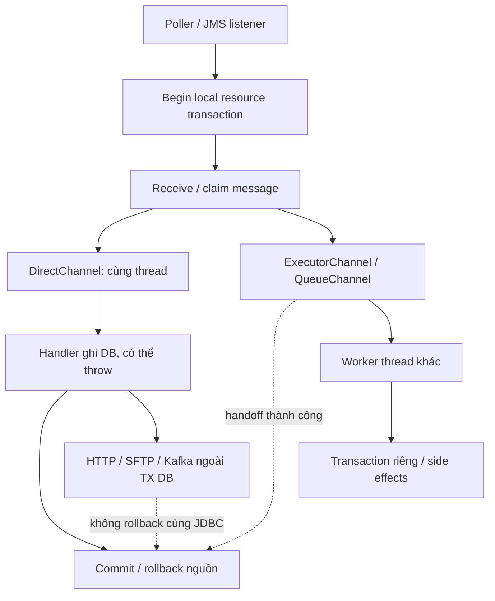
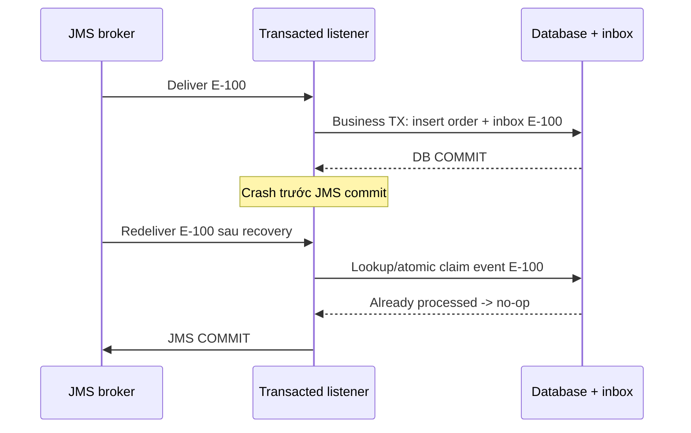
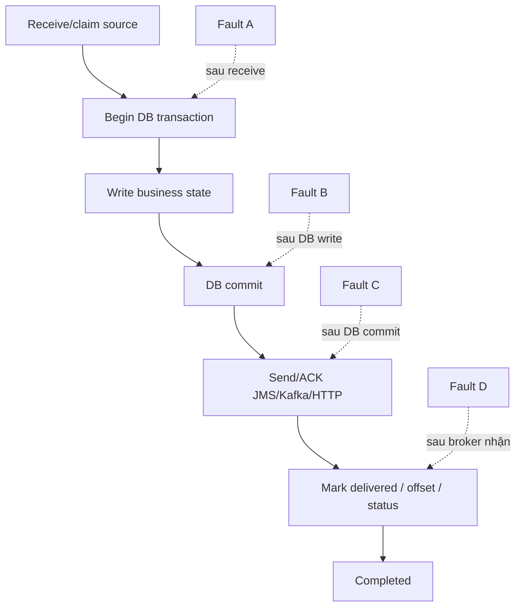

# Test transaction rollback trong Spring Integration Adapters

## 1. Vì sao phải kiểm thử rollback bằng dữ liệu thật?

Một luồng tích hợp thường đi qua nhiều thành phần:

1. Inbound adapter hoặc gateway nhận message từ JDBC, JMS, AMQP, Kafka, HTTP, File hoặc SFTP.
2. Transformer, filter, router và service activator xử lý payload.
3. Message được gửi qua một hoặc nhiều `MessageChannel`.
4. Handler cập nhật database, gửi broker message, gọi API hoặc ghi file.

Khi handler phát sinh lỗi, điều chúng ta muốn biết không chỉ là **JUnit nhận được exception hay không**, mà là:

- Row đã được inbound adapter đánh dấu nhận có thực sự rollback?
- Business table có còn thay đổi một phần sau lỗi?
- Broker đã acknowledge message hay có thể giao lại?
- Message gửi tới API/JMS/Kafka có còn ở đích dù database rollback?
- Nếu consumer nhận lại message, nghiệp vụ có bị thực hiện hai lần không?
- Lỗi có xảy ra **trong transaction boundary** hay ở một worker bất đồng bộ sau khi transaction gốc đã commit?

**Test transaction rollback** là quá trình tạo lỗi xác định tại một điểm xử lý, quan sát trạng thái trước và sau, đối chiếu với hợp đồng transaction/acknowledgment của từng adapter và chứng minh rằng hệ thống khôi phục đúng. Bài thuộc chương **Testing** trong module **SPRING_INTEGRATION_ADAPTERS**, nơi các inbound/outbound adapter, gateway, poller và `MessageChannel` được dùng để kết nối File, SFTP, HTTP, JMS, AMQP, Kafka và cơ sở dữ liệu.

### Ví dụ mở đầu

JDBC inbound adapter quét bảng `incoming_order` và cập nhật `status='CLAIMED'`, sau đó đẩy message qua `DirectChannel` tới handler. Handler ghi một dòng vào `order_ledger` rồi ném `IllegalStateException`.

Nếu **poller có transaction advice**, handler chạy **đồng bộ trên cùng thread** và dùng **cùng DataSource/transaction**, kỳ vọng sau lỗi:

- Row nguồn quay về `NEW`.
- Không có dòng `order_ledger` được commit.
- Lần poll tiếp theo có thể nhận lại row.
- Có exception/rollback telemetry và không có side effect ngoài transaction được báo nhầm là đã rollback.

Nếu chỉ kiểm `assertThrows` mà không đọc lại database, test chưa chứng minh những điều trên. Nếu handler gửi thêm HTTP POST thành công trước khi ném lỗi, **database có thể rollback nhưng HTTP side effect không tự biến mất**.

### Mục tiêu học tập

Sau bài này, bạn có thể:

1. Lập **rollback contract** cho từng tài nguyên và endpoint.
2. Kiểm thử transaction advice của JDBC poller và handler đồng bộ.
3. Phân biệt rollback thật với redelivery/retry ở JMS, AMQP và Kafka.
4. Phát hiện việc `ExecutorChannel`/`QueueChannel` hoặc asynchronous callback làm đứt ranh giới transaction.
5. Thiết kế các fault injection ở trước/sau commit, trước/sau acknowledgment.
6. Sử dụng test fixtures, transaction readback, event ID, idempotency ledger và outbox để chứng minh không mất hoặc nhân đôi tác động nghiệp vụ.
7. Xây dựng bộ integration tests, metrics và runbook phục hồi sau lỗi transaction.

## 2. Từ “rollback” đang nói về tài nguyên nào?

Một flow có thể chứa nhiều transaction riêng. Trước khi viết test, phải gọi đúng tên transaction và trạng thái cần xác minh.

| Ranh giới | Ví dụ | Rollback có thể bảo vệ | Không tự bảo vệ |
|---|---|---|---|
| JDBC local transaction | `DataSourceTransactionManager` / `JdbcTransactionManager` | Các SQL writes dùng đúng connection/tài nguyên thuộc transaction | HTTP POST, SFTP rename, Kafka publish |
| JPA transaction | `JpaTransactionManager` | Thay đổi entity/SQL thuộc persistence context và DB transaction phù hợp | Broker message không tham gia |
| JMS transacted session | `DefaultMessageListenerContainer` với `sessionTransacted=true` | Receive/send thuộc JMS transaction; broker redelivery khi rollback theo provider | JDBC đã commit ở transaction khác |
| AMQP consumer ack/transaction | Spring AMQP listener và broker channel | Ack/nack/requeue hoặc transaction trong phạm vi được hỗ trợ | DB, HTTP bên ngoài broker |
| Kafka producer/consumer transaction | Kafka transaction/offset theo cấu hình container | Các thao tác Kafka được protocol hỗ trợ trong phạm vi transaction | Database hoặc SaaS không enlist |
| Transaction synchronization | `afterCommit`, `afterRollback` | Gọi callback phản ánh kết quả transaction | Không biến file/SFTP/HTTP thành tài nguyên ACID |
| Pseudo transaction | `PseudoTransactionManager` | Lifecycle callbacks thành công/lỗi | Không rollback filesystem hay remote API |
| Outbox transaction | Business row + outbox row trong cùng DB | Bảo toàn ý định gửi cùng business state | Không ngăn broker nhận message trùng |

**Rollback cục bộ** là thao tác đảo/không chốt thay đổi của một transaction manager/tài nguyên. **Redelivery** là broker đưa message trở lại để thử xử lý; nó có thể xảy ra sau JMS rollback hoặc sau lỗi commit/ack. **Compensation** là một hành động nghiệp vụ khác cố gắng đảo side effect bên ngoài, không phải database rollback.

### 2.1 Không suy rollback từ tên annotation

`@Transactional` mặc định thường dùng một transaction manager được chọn theo cấu hình Spring. Nếu app có hai `DataSource` hoặc vừa JMS vừa JDBC, cần biết **manager nào được dùng**. Một service có annotation `@Transactional` không chứng minh JMS session nhận message được quản lý cùng database transaction.

Ngoài ra, Spring transaction thông thường gắn theo **thread**. Việc gọi xuống `ExecutorChannel`, sử dụng `@Async`, `CompletableFuture` hoặc đưa vào queue tách worker khiến lỗi xảy ra sau handoff không tự rollback transaction ở thread ban đầu.

## 3. Xác định rollback contract trước khi test

Một test tốt không bắt đầu bằng cách ném exception ngẫu nhiên. Nó bắt đầu bằng danh sách **điều phải giữ đúng** khi lỗi.

### 3.1 Positive và negative assertions

| Luồng | Khi thành công | Khi lỗi trước commit | Khi lỗi sau commit |
|---|---|---|---|
| JDBC poller + DB handler đồng bộ | Row nguồn CLAIMED/DONE theo thiết kế, business write commit | Cả source claim và business write rollback | DB đã commit không thể rollback lại chỉ vì handler khác lỗi sau đó |
| JMS transacted listener | Broker receive commit/ack | JMS rollback, redelivery theo provider | Có thể redelivery nếu kết quả commit không rõ, cần idempotency |
| HTTP outbound từ DB transaction | HTTP kết quả theo contract | HTTP side effect có thể đã thực hiện dù DB rollback | Cần đối soát/idempotency key |
| File inbound + DB processing | File được xử lý, source state xác nhận | DB rollback; file không tự trở lại trạng thái cũ | File move có thể thất bại sau DB commit |
| Kafka message-driven consumer | DB effect và offset/ack theo kiến trúc | Offset/DB có thể ở hai trạng thái khác nhau | Redelivery hoặc mất việc nếu commit sai thứ tự |

### 3.2 Ba cấp “đã hoàn tất”

Trong báo cáo test, nên phân biệt:

1. **Functional result:** handler đã trả về hoặc gửi response.
2. **Resource settlement:** transaction commit/rollback, broker ack/offset, file move.
3. **Business outcome:** trạng thái nghiệp vụ cuối cùng ở tất cả các đích có đúng không?

Ví dụ handler gửi vào `QueueChannel` thành công là **functional handoff**, không có nghĩa async consumer đã commit business outcome. Đừng đặt assert `queue.size()==0` làm bằng chứng toàn bộ nghiệp vụ hoàn tất.

### 3.3 Phạm vi “không mất dữ liệu”

Một phép kiểm rollback chỉ chứng minh đối tượng được chỉ ra không commit khi lỗi. Muốn kết luận **không mất message** còn phải kiểm:

- Nguồn còn có thể redeliver/re-poll/reprocess không?
- Có giới hạn retry và DLQ/quarantine cho message lỗi vĩnh viễn không?
- Khi replay, có duplicate business effect không?
- Có cơ chế đọc lại trạng thái đích với kết quả không rõ không?

## 4. Bản đồ transaction boundary của một integration flow



Sơ đồ chỉ là mô hình tổng quát. Thực tế có thể có `TransactionInterceptor` ở poller, `@Transactional` ở handler, JMS listener container transaction, broker acknowledgment và một hoặc nhiều outbound operations. **Vẽ từng transaction lên luồng thực** rồi đánh dấu nơi exception phải truyền ra.

### 4.1 Exception propagation là điều kiện cần

Spring transaction thông thường rollback với `RuntimeException` và `Error` theo rule mặc định; checked exception cần rule phù hợp nếu muốn rollback. Nếu handler bắt exception rồi trả về bình thường, transaction interceptor có thể commit.

```java
void unsafeHandler(OrderMessage message) {
    try {
        businessRepository.save(message);
        remoteGateway.send(message);
    } catch (Exception ex) {
        log.warn("Failed to process", ex);
        // Trả về bình thường: transaction có thể COMMIT.
    }
}
```

Với message không thể xử lý, cần chính sách rõ:

- **Lỗi transient:** ném lỗi đến đúng boundary để rollback/retry theo policy.
- **Lỗi permanent:** lưu trạng thái `FAILED/QUARANTINED` hoặc DLQ **bền vững**, rồi commit/ack theo hợp đồng để tránh vòng lặp vô hạn.
- **Kết quả remote chưa rõ:** dùng idempotency key và reconciliation, không khẳng định rollback đã đảo HTTP.

### 4.2 Transaction rollback-only và advice order

Một advice retry đặt **bên trong** transaction đã bị đánh dấu `rollback-only` có thể không giúp commit ở lần tiếp theo; một retry advice nằm **bên ngoài** transaction có thể mở transaction mới cho mỗi attempt. Trong cả hai cách, side effect đã gửi tới broker/API có thể bị lặp.

Khi test nên ghi lại:

- Thứ tự advice tại poller và handler.
- Transaction begin/commit/rollback từng attempt.
- Exception có bị wrap, swallow hay chuyển thành `ErrorMessage` không?
- Nơi tạo idempotency key và số lượng outbound sends thực tế.

## 5. Ví dụ nền tảng: JDBC inbound polling + DirectChannel

Đây là trường hợp dễ thấy nhất việc transaction advice ở **poller** khác annotation ở **handler**.

### 5.1 Chuẩn bị dữ liệu test

```sql
CREATE TABLE incoming_order (
    id BIGINT PRIMARY KEY,
    business_key VARCHAR(100) NOT NULL UNIQUE,
    payload VARCHAR(2000) NOT NULL,
    status VARCHAR(24) NOT NULL
);

CREATE TABLE order_ledger (
    id BIGINT GENERATED BY DEFAULT AS IDENTITY PRIMARY KEY,
    order_id BIGINT NOT NULL,
    event_id VARCHAR(100) NOT NULL UNIQUE,
    state VARCHAR(24) NOT NULL
);

INSERT INTO incoming_order(id, business_key, payload, status)
VALUES (101, 'order-101', '{"amount":150}', 'NEW');
```

DDL sử dụng các kiểu SQL minh họa, có thể cần thay cú pháp identity theo database. Không có broker hoặc HTTP trong ví dụ đầu tiên: mục đích là chứng minh **một local JDBC transaction**.

### 5.2 Cấu hình XML cho poller có transaction advice

```xml
<bean id="ordersTxManager"
      class="org.springframework.jdbc.datasource.DataSourceTransactionManager">
    <constructor-arg ref="dataSource"/>
</bean>

<int:channel id="ordersInput"/>

<int-jdbc:inbound-channel-adapter
        id="ordersPoller"
        data-source="dataSource"
        channel="ordersInput"
        query="SELECT id, business_key, payload
               FROM incoming_order WHERE status = 'NEW'"
        update="UPDATE incoming_order
                SET status = 'CLAIMED'
                WHERE id IN (:id)">
    <int:poller fixed-delay="250"
                max-messages-per-poll="1">
        <int:transactional transaction-manager="ordersTxManager"
                           propagation="REQUIRED"/>
    </int:poller>
</int-jdbc:inbound-channel-adapter>

<int:service-activator
        input-channel="ordersInput"
        ref="orderProcessingHandler"
        method="handle"/>
```

Đây là fragment namespace để minh họa; ứng dụng thực tế phải khai báo namespace, schema, DataSource và handler bean. Một JDBC inbound adapter thường tạo **một message chứa danh sách row** từ một lần `receive()`; handler phải nhận đúng payload type, không tự giả định một row = một message. Adapter `SELECT` rồi `UPDATE` có thể cùng ở transaction poller nếu dùng đúng DataSource và cấu hình transaction.

**Điều kiện test này phải kiểm:** `ordersInput` là `DirectChannel` mặc định khi khai báo không kèm queue/executor, handler xử lý đồng bộ và ghi ledger bằng **cùng DataSource** mà `ordersTxManager` quản lý.

### 5.3 Fault injection ở service activator

```java
// Ví dụ handler test có đầu vào JDBC List<Map<String,Object>>.
final class FailingOrderHandler {
    private final JdbcTemplate jdbc;
    private final AtomicBoolean failAfterWrite = new AtomicBoolean(true);

    FailingOrderHandler(JdbcTemplate jdbc) {
        this.jdbc = jdbc;
    }

    public void handle(List<Map<String, Object>> rows) {
        for (Map<String, Object> row : rows) {
            long id = ((Number) row.get("id")).longValue();
            String key = String.valueOf(row.get("business_key"));
            jdbc.update(
                "INSERT INTO order_ledger(order_id, event_id, state) " +
                "VALUES (?, ?, 'ACCEPTED')",
                id, key
            );
        }
        if (failAfterWrite.get()) {
            throw new IllegalStateException("TEST_INJECT_AFTER_DB_WRITE");
        }
    }

    void disableFault() {
        failAfterWrite.set(false);
    }

    void enableFault() {
        failAfterWrite.set(true);
    }
}
```

Đây là Java fragment cần imports, bean wiring và test lifecycle. Lỗi được ném **sau khi JDBC INSERT đã chạy nhưng trước khi transaction poller kết thúc**. Nó kiểm được rollback sâu hơn một validation exception ném ngay đầu handler.

### 5.4 Assertions bắt buộc sau rollback

```sql
-- Trước poll:
SELECT status FROM incoming_order WHERE id = 101;
-- NEW

-- Sau poll thất bại và rollback:
SELECT status FROM incoming_order WHERE id = 101;
-- Kỳ vọng: NEW

SELECT COUNT(*) FROM order_ledger WHERE order_id = 101;
-- Kỳ vọng: 0
```

Sau khi tắt fault và poll lại:

```sql
SELECT status FROM incoming_order WHERE id = 101;
-- Kỳ vọng sau commit theo flow minh họa: CLAIMED

SELECT COUNT(*) FROM order_ledger WHERE order_id = 101;
-- Kỳ vọng: 1
```

Một test PASS phải có bằng chứng **cả source claim lẫn ledger write** rollback trong lần lỗi. Nếu source trở lại NEW nhưng ledger còn 1 row, handler có thể dùng một transaction manager/DataSource khác hoặc `REQUIRES_NEW`. Nếu source là CLAIMED trong khi ledger = 0, có thể transaction không bao receive/claim, lỗi đã bị swallow, hoặc handler chạy bất đồng bộ.

## 6. Làm rõ cách test kích hoạt **poller thật**

### 6.1 Đừng chỉ gọi service method

```java
assertThrows(
    IllegalStateException.class,
    () -> failingOrderHandler.handle(testRows)
);
```

Đoạn kiểm này chỉ thử handler; nó **không chạy** `SourcePollingChannelAdapter`, `JdbcMessageSource.receive()`, `PollerMetadata` hoặc transaction advice. Không thể từ kết quả đó khẳng định JDBC source status rollback.

### 6.2 Không để test transaction che sai sót

Spring Test hỗ trợ chạy một test method trong `@Transactional` và tự rollback sau test. Nếu áp dụng tùy tiện:

- Fixture chưa commit có thể không xuất hiện với poller ở scheduler thread khác.
- Kết quả row được “rollback” vì **test method** rollback, không phải vì poller transaction hoạt động.
- Test có thể pass dù cấu hình poller sai.

Nên tạo fixture với **committed transaction**, kích hoạt poller thực, rồi dùng **kết nối/transaction đọc độc lập** để kiểm trạng thái cuối.

### 6.3 Hai cách điều khiển poller

**Cách A — Cho scheduler chạy với deadline:** sử dụng poller interval dài hơn trong test, bật endpoint, đợi bằng điều kiện có giới hạn thời gian và dừng endpoint sau khi đã quan sát kết quả cần thiết.

**Cách B — Điều khiển endpoint/trigger qua test seam:** cấu hình test-specific trigger hoặc test harness để chỉ thực hiện một poll có kiểm soát. Vẫn phải chạy **đúng advice chain và source/handler thực tế**, không gọi trực tiếp handler.

Tùy Spring Integration version, công cụ trong `spring-integration-test` như `@SpringIntegrationTest`, `MockIntegrationContext` hoặc endpoint lifecycle controls có thể giúp thay nguồn/handler và kiểm flow. Nhưng thay cả poller bằng mock có thể làm mất chính cơ chế transaction cần kiểm.

### 6.4 Đợi điều kiện, không dựa vào sleep cố định

Polling là bất đồng bộ với test thread. Một lệnh `Thread.sleep(1000)` có thể flaky trên CI hoặc máy tải cao. Cần deadline và điều kiện dừng:

```java
// Pseudocode: awaitCondition được dự án triển khai bằng polling có timeout,
// ví dụ một helper hoặc thư viện await condition.
awaitCondition(
    Duration.ofSeconds(10),
    () -> metrics.rollbackCountFor("ordersPoller") >= 1
);

assertEquals("NEW", jdbc.queryForObject(
    "SELECT status FROM incoming_order WHERE id = 101", String.class));
assertEquals(0, jdbc.queryForObject(
    "SELECT COUNT(*) FROM order_ledger WHERE order_id = 101", Integer.class));
```

`metrics.rollbackCountFor` là abstraction test/observability **do dự án tự tạo**, không phải API sẵn có của Spring Integration. Trạng thái DB phải được quan sát sau khi transaction đã hoàn tất; nếu poller vẫn retry liên tục, cần tạm dừng endpoint hoặc dùng một fault gate để tránh race giữa readback và poll tiếp theo.

## 7. Thử nghiệm đối chứng: bỏ advice hoặc đổi channel

Một rollback test mạnh nên có **positive control** và **negative control**, chứng minh nó sẽ thất bại khi mất điều kiện transaction.

| Thay đổi có chủ đích trong test environment | Kết quả cần phân tích | Bài học |
|---|---|---|
| Giữ poller advice + DirectChannel + cùng DB | Source và ledger rollback khi handler throw | Transaction scope đúng |
| Bỏ transaction advice khỏi poller | Source claim có thể được commit trước handler lỗi | Handler annotation không bọc source receive |
| Đổi sang `ExecutorChannel` | Poller commit sau handoff, worker lỗi muộn | Thread boundary làm đứt JDBC TX |
| Handler dùng `REQUIRES_NEW` với cùng DB | Inner transaction có thể commit riêng | Scope không còn atomic như kỳ vọng |
| Handler ghi DB khác | Poller rollback không bảo vệ DB khác | Sai transaction manager/tài nguyên |
| Handler nuốt exception | Poller có thể commit | Exception propagation quyết định rollback |
| Handler gọi HTTP trước khi throw | HTTP có thể đã tạo side effect | Local DB rollback không đảo tác động xa |
| Lỗi ném checked exception | Kết quả phụ thuộc rollback rules | Đừng mặc định mọi exception làm rollback |

**Không chỉnh cấu hình production để chạy các negative controls.** Hãy sử dụng môi trường test/cấu hình test riêng với fixtures cô lập và fault gates.

## 8. Test JMS transaction rollback và redelivery

JMS có local transaction trên `Session` và listener container do Spring JMS quản lý. Spring Integration **message-driven JMS inbound adapter** thường sử dụng một listener container, không phải JDBC `SourcePollingChannelAdapter` chạy poller.

### 8.1 Hai lớp cần kiểm

1. **JMS session settlement:** message đã được commit/ack hay bị rollback và eligible for redelivery?
2. **Database business outcome:** thao tác SQL đã commit, rollback hoặc bị thực hiện trùng?

Hai lớp **không mặc định chung một transaction**. `DefaultMessageListenerContainer` với `sessionTransacted=true` bảo vệ JMS nhận/gửi theo session; `@Transactional` trên handler với `DataSourceTransactionManager` bảo vệ DB riêng.

Khi sử dụng transaction abstraction của Spring JMS, `JmsTransactionManager` có thể quản lý local JMS transaction qua `ConnectionFactory` phù hợp. Điều này **khác** `DataSourceTransactionManager` quản lý JDBC; chỉ đặt cả hai bean trong Spring context không tạo atomic JMS + DB transaction. Muốn kiểm một cấu hình XA/JTA thật sự, phải kiểm transaction coordinator, JMS XA connection factory, XA DataSource, resource enlistment và crash recovery, thay vì suy đoán từ annotation.

### 8.2 Cấu hình container minh họa

```java
@Bean
DefaultMessageListenerContainer ordersListenerContainer(
        ConnectionFactory connectionFactory) {
    DefaultMessageListenerContainer container =
        new DefaultMessageListenerContainer();
    container.setConnectionFactory(connectionFactory);
    container.setDestinationName("orders.in");
    container.setSessionTransacted(true);
    container.setConcurrentConsumers(1); // Đơn giản hóa test ordering.
    return container;
}
```

Đoạn mã chưa gắn message listener hoặc Spring Integration endpoint cụ thể; flow cần liên kết adapter/gateway với container theo Java DSL hoặc namespace tương thích version. Trong test, kiểm bean container **thật sự** được endpoint sử dụng, không chỉ tồn tại trong application context.

### 8.3 Kịch bản rollback trước DB commit

1. Gửi message M chứa `eventId=E-100` vào test queue.
2. Handler bắt đầu DB transaction, ghi thử rồi ném `IllegalStateException` **trước DB commit**.
3. Lỗi phải truyền qua `DirectChannel` về listener container có transacted session.
4. DB transaction rollback; JMS session cũng rollback theo phạm vi của nó.
5. Broker redeliver M theo policy; log `JMSRedelivered` hoặc delivery count khi provider hỗ trợ.
6. Sau khi tắt fault, nhận lại M và commit: kiểm một business row, không nhiều hơn một.

**Kỳ vọng:** JMS transaction rollback và DB rollback là **hai outcome được kiểm riêng**, dù chúng cùng xảy ra trong test này.

### 8.4 Kịch bản DB đã commit, JMS chưa commit

Đây là bài thử quan trọng hơn:

1. Consumer nhận M.
2. Handler ghi business row và **DB commit**.
3. Inject crash hoặc lỗi khiến **JMS session chưa commit/ack**.
4. Broker có thể redeliver M sau recovery.
5. Lần nhận thứ hai dùng business event ID để phát hiện đã xử lý.
6. Consumer không ghi lặp, sau đó hoàn tất JMS commit theo policy.



Một test đòi **message chỉ delivery đúng một lần** có thể sai về bản chất. Tiêu chí đúng thường là **business effect chỉ một lần**, bất kể có bao nhiêu delivery hợp lệ do recovery.

### 8.5 So sánh các acknowledgment modes

| JMS mode | Điều cần thử | Không nên mặc định |
|---|---|---|
| `AUTO_ACKNOWLEDGE` | DMLC/container thực tế ack vào thời điểm nào; handler lỗi có redeliver không? | Handler `@Transactional` lỗi sẽ luôn gây redelivery |
| `CLIENT_ACKNOWLEDGE` | Ack trên một message có tác động tới các message khác trong cùng session không? | Ack một message là per-message independent |
| `DUPS_OK_ACKNOWLEDGE` | Broker/client trì hoãn ack, duplicate behavior | Không có duplicate vì provider tối ưu |
| `SESSION_TRANSACTED` | Listener throw -> rollback/redelivery; success -> commit | JDBC transaction tự cùng commit với JMS |

Với `DefaultMessageListenerContainer`, chế độ `AUTO_ACKNOWLEDGE` có thể acknowledge trước khi listener chạy nên không nên xem đây là phương án đảm bảo redelivery cho xử lý quan trọng. Cần test **đúng container/provider** thay vì dựa vào kỳ vọng chung của JMS API.

### 8.6 Một số assertion hữu ích

- Message có thể được nhận lại sau rollback trong khoảng deadline test.
- Database không có business effect trước khi lần xử lý hợp lệ commit.
- DLQ không tăng cho lỗi transient đã được khôi phục (theo policy).
- Nếu lỗi permanent vượt retry budget, message chuyển DLQ/quarantine đúng cấu hình.
- `JMSMessageID`, `JMSCorrelationID`, `JMSRedelivered` và businessEventId được log đúng, không làm lộ payload/credentials.

## 9. Test AMQP/RabbitMQ rollback, nack, requeue

Spring Integration AMQP inbound adapter thường làm việc với listener container của Spring AMQP. Ack/nack/requeue và broker-side delivery semantics **khác JMS**, nên không dùng `Session.CLIENT_ACKNOWLEDGE` để mô tả RabbitMQ consumer.

### 9.1 Các điểm cần kiểm

- Listener container cấu hình acknowledge mode gì?
- Một exception làm container tự nack/requeue, reject/DLQ hay commit một transaction cục bộ?
- Có retry advice ở listener, retry tại broker hoặc DLQ delay không?
- Nếu DB đã commit rồi broker redeliver, consumer có idempotent không?
- Publisher confirms/returns của outbound AMQP có được xử lý đúng?

### 9.2 Ma trận kiểm thử AMQP

| Fault injection | Kỳ vọng theo policy đã cấu hình | Bằng chứng |
|---|---|---|
| Handler throw trước business commit | DB rollback; broker nack/requeue hoặc DLQ theo cấu hình | DB readback, queue state |
| Handler return thành công | Message ack; business effect hoàn tất theo hợp đồng | Broker unacked count, DB |
| DB commit rồi consumer crash trước broker ACK | Có thể redeliver | Inbox ledger chống duplicate |
| Poison message permanent | Retry hữu hạn rồi DLQ/quarantine | Headers/attempts, DLQ message |
| Outbound AMQP publish không route tới queue | Không mark event SENT nếu contract yêu cầu routed delivery | Publisher returns/confirm |
| Kết nối broker gián đoạn | Container reconnect, pending messages còn có đường phục hồi | Broker/consumer logs |

Chế độ ack và retry behavior phụ thuộc `SimpleRabbitListenerContainer` hoặc `DirectMessageListenerContainer`, Spring AMQP version, broker config và error handler. Phải ghi cấu hình cụ thể vào test report.

### 9.3 Transaction manager không đủ để suy atomic DB+AMQP

Một listener transaction DB có thể rollback SQL khi handler throw, nhưng broker acknowledgment là tài nguyên riêng. Một số cấu hình Spring AMQP cho phép phối hợp theo kiểu best-effort; vẫn có cửa sổ lỗi giữa commit broker và DB. Nếu nghiệp vụ cần chống mất/trùng, dùng **idempotency, inbox/outbox hoặc transaction coordination** đã được chứng minh bằng test crash ở đúng điểm commit.

## 10. Test Kafka consumer offset, producer transaction và DB rollback

Kafka thường dùng **message-driven listener container**, không phải JMS session. Test cần phân biệt:

- Kafka consumer đã poll một record.
- Handler đã ghi database.
- Consumer offset đã được commit theo ack mode/container.
- Kafka producer đã publish event trong Kafka transaction (nếu có).
- Side effect HTTP/JDBC có nằm trong phạm vi đó hay không.

### 10.1 Ba cửa sổ commit quan trọng

| Trình tự | Khi xảy ra lỗi | Rủi ro |
|---|---|---|
| Offset commit trước DB commit | DB fail sau offset | Record có thể không được xử lý lại đúng cách, dẫn tới mất business work |
| DB commit trước offset commit | Crash giữa hai commit | Record có thể được đọc lại; duplicate business effect nếu không idempotent |
| Kafka transaction bao consume/produce | Kafka transaction rollback trong phạm vi được hỗ trợ | Database/HTTP bên ngoài Kafka không tự rollback |

Không lấy `@Transactional` của Spring cho JDBC rồi kết luận Kafka offset commit được bảo vệ nguyên tử. Cần xem cụ thể Spring Kafka listener container transaction manager, ack mode, error handler, producer transaction config, retry topic hoặc DLT.

### 10.2 Kịch bản thiết yếu

1. Gửi record `E-200` vào test topic.
2. Consumer ghi `processed_inbox` và business row trong cùng DB transaction.
3. Inject crash sau DB commit nhưng trước offset commit.
4. Sau restart/rebalance, record có thể được giao lại tùy vị trí committed offset.
5. Consumer nhận E-200 và thấy inbox đã xử lý, không thực hiện business effect nữa.
6. Offset được commit khi hoàn tất theo container policy.

**Tiêu chí PASS:** trạng thái business đúng, không duplicate effect, offset/progress có đường phục hồi và không mất event. Số lần callback listener được gọi có thể lớn hơn một.

### 10.3 Cẩn trọng với retry và dead-letter topic

Spring Kafka có nhiều chiến lược error handling, seek/retry, retry topics hoặc dead-letter publishing tùy version/cấu hình. Khi một record lỗi vĩnh viễn:

- Có thể retry một số lần rồi route DLT.
- Đừng commit offset coi là xử lý thành công trước khi record lỗi đã được ghi bền vững ở DLT/quarantine theo contract.
- Đừng tạo vô hạn retry dày khiến consumer lag tăng và rebalance thường xuyên.
- Khi reprocess từ DLT, giữ business event ID và idempotency.

Đối với thử nghiệm, ngoài kiểm DLT có message, phải kiểm **không có business effect sai/trùng** và audit ghi rõ lý do.

## 11. Test File/SFTP: transaction synchronization không phải ACID rollback

File và SFTP không có chung local DB transaction với handler. Spring Integration hỗ trợ các cơ chế như transaction synchronization hoặc `PseudoTransactionManager` để chạy callback theo kết quả xử lý, nhưng callback **không tự đảo thao tác filesystem/remote server**.

### 11.1 Bài toán file inbound

Luồng:

```text
File /data/incoming/order-101.csv
    -> File inbound polling adapter
    -> DirectChannel
    -> DB handler
    -> afterCommit move file to /data/done
    -> afterRollback move file to /data/failed (nếu policy chọn)
```

Nếu DB handler throw, DB transaction có thể rollback; tuy nhiên file có thể đã được đọc, metadata filter đã lưu state hoặc move thất bại. Kết quả phải được kiểm trên **cả DB và filesystem**.

### 11.2 Kịch bản kiểm thử

| Fault | DB outcome | File outcome cần xem | Kỳ vọng |
|---|---|---|---|
| Handler lỗi trước commit | DB rollback | File còn trong incoming hoặc được chuyển failed theo policy | Có đường reprocess |
| Handler commit, afterCommit move lỗi | DB đã commit | File vẫn ở incoming/temporary | Không double process khi poll lại |
| File bị ghi dở rồi poll | Chưa nên commit dữ liệu không hoàn chỉnh | Input file partial | Filter/temp-name/atomic rename bảo vệ |
| App crash sau DB commit, trước remote delete | DB committed | File remote vẫn tồn tại | Idempotency ngăn duplicate |
| SFTP timeout sau upload | DB không quyết định remote outcome | Remote file có thể đã hiện hữu | Kiểm remote state/checksum trước retry |

### 11.3 `PseudoTransactionManager` kiểm được gì?

Nó tạo bối cảnh transaction synchronization cho việc phát callback; **không có tài nguyên database/file system ACID thực sự được rollback bởi pseudo manager**. Nếu dùng pseudo manager để move file sau rollback:

- Test callback có được gọi đúng nhánh không.
- Test move/rename thực sự thành công không.
- Test khi callback lỗi có reconciliation/retry không.
- Test file filter/persistent metadata có ngăn file bị bỏ sót hoặc xử lý lại vô hạn không.

### 11.4 SFTP remote rename không tự đảo ngược

Ví dụ, SFTP inbound tải một file, DB đã ghi hóa đơn, sau đó đổi tên file remote thất bại vì mất kết nối. Lần poll sau file có thể được tải lại. Thiết kế cần manifest/content hash hoặc **business ID unique constraint** cùng cơ chế retry; không dùng `@Transactional` như bằng chứng SFTP rollback.

## 12. Test HTTP outbound và kết quả không xác định

HTTP là một ví dụ quan trọng của **non-transactional external side effect**. Một timeout không chứng minh remote server chưa xử lý request.

### 12.1 Kịch bản POST thành công rồi local rollback

1. JDBC poller claim row `NEW` và handler gọi HTTP POST tới test server.
2. Test server lưu một lần gọi/side effect, trả 200/201.
3. Handler sau đó ném exception khiến local DB transaction rollback.
4. Row trở về `NEW`, poller có thể gọi POST lần hai.

**Kết quả:** database rollback có thể đúng nhưng test phát hiện **hai HTTP side effects**. Đây là lỗi thiết kế hợp đồng nếu yêu cầu một tác động duy nhất.

### 12.2 Dùng idempotency key và mock server

Với API hỗ trợ `Idempotency-Key`, test server lưu kết quả theo key:

- Hai POST cùng key và cùng payload nên trả cùng kết quả hoặc theo hợp đồng API mà **không nhân đôi nghiệp vụ**.
- Key phải ổn định qua retry/rollback/restart.
- Thử timeout sau server commit rồi gửi lại.
- Kiểm server-side state, không chỉ status code ở client.

Có thể dùng MockWebServer, WireMock hoặc một test HTTP service có state. Chọn cách phù hợp với phiên bản dự án; việc cấu hình HTTP mock chỉ giúp kiểm rõ **kết quả ở server test**, không thay thế integration test với external API thật khi cần.

### 12.3 Outbox làm thay đổi điều gì?

Thay vì gọi HTTP trong JDBC poller transaction:

1. Commit business update và outbox intent trong cùng DB transaction.
2. Worker riêng gửi HTTP theo idempotency key.
3. Mark `SENT` sau mức xác nhận đã định.
4. Nếu worker crash sau HTTP success trước mark SENT, retry cùng key, không double side effect.

**Test outbox** phải cố ý crash tại cửa sổ giữa send và mark SENT, vì đây là nơi duplicate delivery hợp lệ xảy ra.

## 13. Bộ test mẫu: rollback contract cho transaction JDBC

Ví dụ tiếp theo cho thấy cách **tách transaction fixture khỏi transaction đang kiểm**. Nó sử dụng Spring Test, JDBC và một test probe để điều khiển poller thực. Mọi phần được đánh dấu abstraction phải được dự án hiện thực hóa; không coi ví dụ là mã đã chạy trong repository.

### 13.1 Tổ chức test fixture

Một bộ fixture tốt có:

- `eventId` và `orderId` duy nhất theo mỗi test case.
- Database rows được commit **trước** khi poller bắt đầu.
- Một test handler có fault gate bật/tắt được.
- Cách tạm dừng/khởi động endpoint có kiểm soát.
- Metrics hoặc latch xác nhận **transaction rollback đã hoàn tất**.
- Cách đọc database **bằng transaction độc lập**.
- Cleanup queue/file/DB sau từng test để tránh flaky vì state cũ.

### 13.2 JUnit 5 skeleton

```java
@SpringBootTest
class JdbcPollerRollbackIT {

    @Autowired JdbcTemplate jdbc;
    @Autowired TestPollerHarness poller;     // Bean test do dự án tạo
    @Autowired FailingOrderHandler handler; // Handler test mục 5

    @BeforeEach
    void prepare() {
        poller.stopAndAwait(); // Không poll trong khi tạo fixture
        jdbc.update("DELETE FROM order_ledger");
        jdbc.update("DELETE FROM incoming_order");
        jdbc.update(
            "INSERT INTO incoming_order " +
            "(id, business_key, payload, status) " +
            "VALUES (101, 'order-101', '{}', 'NEW')"
        );
        handler.enableFault();
    }

    @Test
    void rollsBackClaimAndLedgerWhenSynchronousHandlerThrows() {
        poller.startAndAwaitRollback(Duration.ofSeconds(10));
        poller.stopAndAwait();

        assertEquals("NEW", jdbc.queryForObject(
            "SELECT status FROM incoming_order WHERE id=101",
            String.class
        ));
        assertEquals(0, jdbc.queryForObject(
            "SELECT COUNT(*) FROM order_ledger WHERE order_id=101",
            Integer.class
        ));
    }

    @Test
    void commitsAfterFaultIsRemoved() {
        handler.disableFault();
        poller.startAndAwaitSuccessfulPoll(Duration.ofSeconds(10));
        poller.stopAndAwait();

        assertEquals("CLAIMED", jdbc.queryForObject(
            "SELECT status FROM incoming_order WHERE id=101",
            String.class
        ));
        assertEquals(1, jdbc.queryForObject(
            "SELECT COUNT(*) FROM order_ledger WHERE order_id=101",
            Integer.class
        ));
    }
}
```

`TestPollerHarness`, `startAndAwaitRollback`, `stopAndAwait`, `enableFault` là **helper giả định**, không phải API có sẵn của `spring-integration-test`. Mục tiêu là nêu rõ các điều kiện test phải điều khiển và quan sát. Để có test chạy được, team cần nối helper này với endpoint lifecycle, transaction event/tracing hoặc test synchronization tương ứng.

**Chú ý:** không chạy `@Transactional` trên test method nếu muốn nhìn kết quả commit/rollback độc lập. Với CI chạy song song, dùng event ID/row ID độc lập theo test, tránh `DELETE FROM` chung khiến test khác bị ảnh hưởng.

### 13.3 Tách kịch bản nhận lại khỏi rollback kịch bản đầu

Sau rollback, nếu poller vẫn được phép lặp, nó có thể nhận **cùng row nhiều lần** và làm test không ổn định. Nên:

1. Chặn poll khi đã ghi nhận một rollback.
2. Đọc lại DB.
3. Xóa fault gate.
4. Bật poll một lượt hợp lệ.
5. Kiểm số business rows cuối cùng và trạng thái nguồn.

Đó là một **recovery test** riêng, thay vì cố gắng suy từ số exception log.

### 13.4 Dùng cùng DataSource chưa chắc đã đủ

Một handler có thể gọi repository dùng `REQUIRES_NEW`, gọi stored procedure ở connection khác, hoặc sử dụng asynchronous DB client. Những thao tác đó có thể commit độc lập. Kiểm:

- Tất cả DB calls trong transaction cùng DataSource/connection association.
- Propagation của mỗi phương thức `@Transactional`.
- Có tự gọi method trong cùng bean làm proxy advice không được áp dụng?
- Có phát sinh `UnexpectedRollbackException` khi inner method đánh dấu rollback-only nhưng outer method cố commit?
- Có test đối chứng chứng minh cấu hình thiếu transaction thực sự làm fail assertions?

## 14. Test khôi phục sau crash và sự khác nhau giữa rollback với replay

Một exception Java xảy ra **trước commit** khác với crash process hoặc mất mạng tại ranh giới commit. Khi process chết, client có thể không biết tài nguyên đã commit hay chưa. Một hệ thống có thể cần replay message ngay cả khi phía ngoài đã thực hiện side effect.

### 14.1 Các mốc fault injection



Sơ đồ là timeline tổng quát; trong thực tế một số flow nhận từ JMS trước khi mở DB transaction, hoặc send broker nằm trong handler trước DB commit. Khi viết test, ghi **trình tự thực** để đặt fault gate chính xác.

### 14.2 Ma trận crash/restart

| Điểm crash | Trạng thái có thể | Recovery cần chứng minh |
|---|---|---|
| Trước source receive | Message vẫn ở nguồn | Poll/receive lần sau hoạt động |
| Sau claim, trước commit | Transaction rollback hoặc lease còn tạm | Row được nhận lại/reclaim; không mất việc |
| Sau DB write, trước DB commit | DB transaction thường rollback khi connection chết | Không có partial business row |
| Sau DB commit, trước broker send | Business state có, event chưa tới đích | Outbox hoặc durable pending state phát lại |
| Broker nhận, client chưa thấy ACK | Delivery outcome không rõ | Retry idempotent, xác nhận đích hoặc replay an toàn |
| Sau broker ACK, trước mark SENT | Event có thể được gửi lại | Inbox/deduplication ngăn business effect trùng |
| Sau mark SENT, trước downstream apply | Publisher đã bàn giao, consumer chưa xong | Broker/consumer retry và monitoring riêng |
| Sau consumer DB commit, trước broker ACK | Broker có thể redeliver | Consumer inbox và unique constraint |

**Rollback test** chỉ chứng minh phần transaction còn mở. **Crash recovery test** chứng minh kết quả khi transaction đã commit hoặc trạng thái commit không rõ. Cả hai đều cần thiết cho adapter có retry/redelivery.

### 14.3 Fault injection phải đúng điểm

Nếu muốn kiểm “DB commit thành công nhưng JMS chưa commit”, chỉ ném exception **trước DB commit** sẽ không có giá trị. Cần một test seam có tín hiệu **DB commit completed** rồi mới chặn JMS acknowledgment, hoặc mô phỏng crash tại cửa sổ đó bằng môi trường tích hợp có thể kiểm soát.

Có thể dùng:

- Test handler có latch/fault gate.
- Một wrapper/proxy được cho phép trong test quanh transport send/commit.
- Network fault injection với broker/database test.
- Kill/restart consumer process hoặc container thử nghiệm.
- Transaction synchronization hook để quan sát mốc commit, **không nhầm callback sau commit là có khả năng rollback**.

Đối với lỗi khó tái hiện, ít nhất phải lưu timeline của JDBC, broker và test controller. Không dùng một exception bất kỳ rồi tuyên bố đã thử crash ở cửa sổ đặc biệt.

## 15. Idempotency/inbox là tiêu chí an toàn sau rollback

### 15.1 Vì sao phải có unique business key?

Một consumer có thể xử lý event đúng hai lần do broker redeliver. Nếu ghi thẳng `INSERT` không có unique constraint, có thể tạo duplicate. Nếu có idempotency ledger **cùng DB transaction** với business update, lần xử lý thứ hai có thể no-op.

```sql
CREATE TABLE processed_inbox (
    consumer_name VARCHAR(80) NOT NULL,
    event_id VARCHAR(100) NOT NULL,
    processed_at TIMESTAMP NOT NULL,
    PRIMARY KEY (consumer_name, event_id)
);
```

### 15.2 Pseudocode consumer idempotent

```java
@Transactional(transactionManager = "businessTxManager")
public void handle(OrderCreated event) {
    // Atomic insert-if-absent dựa trên unique constraint.
    boolean first = inbox.tryInsertIfAbsent(
        "orders-consumer", event.eventId()
    );
    if (!first) {
        return;
    }

    orders.applyOrder(event);
    // Inbox insert và business update phải commit/rollback cùng nhau.
}
```

`tryInsertIfAbsent` là abstraction dự án, không phải Spring Data method sẵn có. Implement bằng database-specific atomic insert/upsert và xử lý race. `SELECT` rồi `INSERT` không khóa có thể không an toàn khi hai consumer xử lý trùng đồng thời.

### 15.3 Ba bài test idempotency

1. **Duplicate sequential:** gửi cùng `eventId` hai lần; business effect chỉ một.
2. **Duplicate concurrent:** hai consumers nhận cùng `eventId` song song; unique constraint bảo vệ.
3. **Rollback then retry:** lần đầu lỗi trước DB commit nên cả ledger và business write rollback; lần sau xử lý thật, không bị bỏ sót vì ledger giả.

Không tạo inbox row ở transaction độc lập rồi rollback business update, vì khi replay có thể thấy “already processed” dù nghiệp vụ chưa từng commit.

## 16. Transactional outbox trong các bài test rollback

Giả sử consumer nhận JMS, cập nhật database và cần phát `OrderAccepted` sang Kafka. Nếu gửi Kafka trực tiếp rồi DB rollback, event có thể đã tới consumer khác. **Transactional outbox** giải quyết việc lưu ý định gửi cùng DB transaction.

### 16.1 Test atomic business + outbox

```sql
CREATE TABLE integration_outbox (
    event_id VARCHAR(100) PRIMARY KEY,
    event_type VARCHAR(100) NOT NULL,
    payload VARCHAR(4000) NOT NULL,
    status VARCHAR(24) NOT NULL
);
```

Trong cùng một DB transaction:

- Ghi order thành trạng thái `ACCEPTED`.
- INSERT outbox `OrderAccepted` với `status='PENDING'`.
- Cố ý throw trước commit.

**Kỳ vọng:** **cả business state và outbox row rollback**. Nếu outbox row tồn tại sau khi business update rollback, rất có thể đã dùng transaction manager/DataSource khác hoặc propagation không phù hợp.

### 16.2 Test publish sau business commit

1. Commit business+outbox.
2. Dispatcher poll outbox PENDING.
3. Broker nhận event.
4. Fault trước khi mark `SENT`.
5. Dispatcher restart, nhận lại event và có thể gửi trùng.
6. Consumer inbox kiểm event ID, chỉ một business effect.

Đây là **PASS của at-least-once + idempotency** nếu event không mất và không tạo tác động trùng. Đừng đặt criterion “broker chỉ có đúng một copy” khi thiết kế chủ động chấp nhận retry.

### 16.3 Test `DirectChannel` và output acknowledgment

Một flow như:

```text
outbox JDBC poller
    -> DirectChannel
    -> Kafka outbound adapter (async producer)
    -> mark SENT
```

có thể mark SENT quá sớm nếu chỉ dựa vào `MessageChannel.send()==true`. Producer callback sau đó báo lỗi, nhưng database đã coi event hoàn thành.

**Test:** làm producer send future thất bại sau handoff, rồi kiểm outbox **chưa** chuyển SENT, có retry và event ID giữ nguyên. Sự thành công của bước vào channel không phải broker publish confirmation.

## 17. Chọn công cụ kiểm thử và cấp độ kiểm chứng

| Cấp test | Công cụ có thể dùng | Chứng minh được | Không chứng minh được |
|---|---|---|---|
| Unit | JUnit 5, Mockito | Rollback policy logic, exception classification | Poller/container transaction thật |
| Spring context integration | `@SpringBootTest`, `@SpringIntegrationTest` | Endpoint wiring, advice, channel path | Broker behavior nếu toàn mock |
| Database integration | Testcontainers DB hoặc DB thử tương đương | Commit/rollback SQL, locks, constraints | JMS/Kafka ack |
| Broker integration | Broker JMS/AMQP/Kafka thử nghiệm | Redelivery, ACK, offset, DLQ | External HTTP/SFTP side effects |
| HTTP integration | MockWebServer/WireMock/test server | Timeout, duplicate POST, idempotency key | Hoạt động thực của một external SaaS chưa test |
| SFTP/File integration | Sandbox SFTP, temp directories | Remote/local file outcome, metadata filters | Transaction ACID với DB nếu không có coordination |
| Crash/failover | Restart process/containers, network fault injection | Recovery sau commit/unknown outcome | Không nên làm ở production nếu chưa được phép |

### 17.1 Tại sao nên dùng broker và database thật trong integration test?

Một Mockito mock của `JmsTemplate.send()` trả về bình thường không có JMS session, broker acknowledgment hoặc redelivery. Một mock repository không có DB locks/transaction commit. Chúng có ích cho unit tests nhưng **không chứng minh property rollback của hệ thống tích hợp**.

Với Testcontainers, có thể chạy database và broker/container hỗ trợ trong CI. Chỉ thay thế khi không thể khởi chạy provider thật, và đánh dấu mức assurance của test cho rõ. Tính năng AMQP/JMS/Kafka cụ thể khác nhau theo broker version và configuration.

### 17.2 `spring-integration-test` giúp ở đâu?

Trong Spring Integration test support, các công cụ như `@SpringIntegrationTest`, `MockIntegrationContext`, test message handlers hoặc endpoint lifecycle utilities có thể giúp thay handler và quan sát flow. Nhưng nếu mục tiêu là **transaction advice của poller**, không được thay toàn bộ poller/source bằng một mock làm mất boundary đang kiểm.

Một test seam tốt có thể thay **handler sau `DirectChannel`** bằng handler ném exception, giữ source, poller, transaction manager và channel thật.

### 17.3 Định nghĩa test harness rõ

Nếu viết một helper `TestPollerHarness`, nên công bố:

- Nó start/stop **đúng endpoint bean name** nào?
- Nó đợi rollback/commit bằng event gì, với timeout bao nhiêu?
- Nó có ngăn poller tự nhận lại message trước khi readback không?
- Nó có sử dụng cùng transaction với test fixture không?
- Nó có cleanup connections, schedulers, broker subscriptions và threads không?
- Khi wait timeout, test có fail thật, không chỉ log cảnh báo?

Không nên giấu các giả định này trong một helper không được review.

## 18. Kiểm thử transaction rollback trong hệ thống đa instance

### 18.1 Hai JDBC poller cùng claim row

Ngay cả khi mỗi instance có transaction advice, cả hai có thể đọc cùng row nếu câu `SELECT`/`UPDATE` và isolation không bảo đảm claim nguyên tử. Test cần:

1. Chạy hai poller instances có cùng DB nhưng endpoint names khác.
2. Cấp một số test rows đã commit.
3. Dùng latch hoặc load để tạo race tại claim.
4. Đếm business effects theo unique ID.
5. Xác minh không có duplicate effect, không có stale lease và mọi row cuối cùng có trạng thái hợp lệ.

Giải pháp có thể gồm row locking, conditional updates, `SKIP LOCKED` nếu database hỗ trợ, optimistic locking hoặc claim lease. **Transaction advice không tự tạo cơ chế distributed work claiming**.

### 18.2 Concurrency trên broker

Khi tăng số consumers của JMS/AMQP/Kafka:

- Hai events cùng aggregate có thể đến gần nhau hoặc xử lý lệch thứ tự.
- Một rollback/redelivery có thể khiến event cũ xuất hiện sau event mới.
- Ordering theo partition, queue, message group hoặc aggregate version có các giới hạn riêng.
- Inbox unique constraint và optimistic versioning giúp ngăn tác động sai.

Ngoài test “mỗi event xử lý một lần”, cần kiểm business invariant như “không áp dụng trạng thái version 3 sau khi version 4 đã commit” theo domain contract.

### 18.3 Isolation và locking

Thay đổi `READ_COMMITTED`, `REPEATABLE_READ` hoặc `SERIALIZABLE` không thể được đoán là sửa mọi race condition. Mỗi database có MVCC/locking/phantom semantics và deadlock behavior khác nhau. Test phải quan sát query/locking thật trên DB vendor cụ thể, kể cả timeout, deadlock và retry.

## 19. Negative tests về exception và transaction propagation

Một bài rollback chỉ ném `RuntimeException` có thể bỏ sót nhiều đường lỗi. Nên kiểm riêng các biến thể:

### 19.1 Runtime exception

Trong cấu hình Spring transaction mặc định thông thường, `RuntimeException` khiến interceptor đánh dấu rollback nếu exception thoát ra khỏi scope. Nhưng điều này cần kiểm khi có error handler/advice khác.

```java
void failWithRuntimeException() {
    jdbc.update("UPDATE incoming_order SET status='CLAIMED' WHERE id=101");
    throw new IllegalStateException("TEST_RUNTIME_FAILURE");
}
```

### 19.2 Checked exception

Checked exception thường **không mặc định** khiến Spring transaction rollback nếu chưa cấu hình rule phù hợp. Ví dụ:

```java
@Transactional(
    transactionManager = "ordersTxManager",
    rollbackFor = IOException.class
)
public void processWithCheckedException() throws IOException {
    jdbc.update("UPDATE incoming_order SET status='CLAIMED' WHERE id=101");
    throw new IOException("TEST_CHECKED_FAILURE");
}
```

**Lưu ý:** annotation trên phương thức Java này áp dụng khi phương thức được gọi qua proxy/interceptor phù hợp. Nếu cần kiểm transaction advice trên **poller**, phải cấu hình rollback rules tại advice của poller và thực sự kích hoạt poll endpoint. Test handler annotation riêng không thay thế được test đó.

### 19.3 Catch rồi trả bình thường

Kịch bản:

1. Source claim row.
2. Handler ghi dữ liệu.
3. HTTP outbound lỗi.
4. Handler catch, log và return.
5. Poller thấy không có lỗi và có thể commit.

Negative assertion: test phải phát hiện trạng thái bị đánh dấu hoàn tất dù đích chưa nhận. Cách sửa không nhất thiết luôn là rethrow: có thể lưu một durable `PENDING_OUTBOUND`/outbox event để hoàn tất bằng retry sau.

### 19.4 `REQUIRES_NEW` và nested propagation

Một handler gọi một service dùng `REQUIRES_NEW` có thể tạo transaction độc lập. Inner commit trước khi outer poller rollback làm mất atomicity giữa source và ledger. Test:

- Ghi marker ở inner transaction.
- Ném exception ở outer handler.
- Quan sát marker có còn không.
- So sánh với kỳ vọng hợp đồng; nếu không được tồn tại, sửa propagation hoặc thiết kế state.

Đừng dùng `REQUIRES_NEW` để “chắc chắn lưu lại audit” rồi quên rằng audit record ấy có thể tồn tại khi business operation rollback. Điều này có thể đúng nếu audit chủ đích ghi **attempt/failure**, nhưng cần phân biệt với business completion.

### 19.5 Rollback-only không phải exception đã được giải quyết

Một inner method có thể đánh dấu transaction rollback-only, sau đó outer catch exception và trả bình thường. Lúc commit, Spring có thể phát sinh `UnexpectedRollbackException` vì outer tưởng commit nhưng transaction đã bị rollback. Test cần xác nhận **outcome cuối**, không coi việc handler đã return bình thường là commit thành công.

## 20. Error channel, retry advice và DLQ dưới góc nhìn test

### 20.1 Lỗi đồng bộ

Nếu handler chạy trên `DirectChannel` và exception thoát ra, transaction interceptor ở caller có thể thấy lỗi và rollback. Nhưng khi có error flow hoặc recoverer chuyển lỗi thành kết quả thành công, transaction có thể commit.

Một test cần cố ý đặt `errorChannel` hoặc retry advice như production và kiểm:

- Exception được route đi đâu?
- Error handler đã ack/commit source chưa?
- Có ErrorMessage chứa failed message/correlation ID không?
- Có durable error state, DLQ hoặc quarantine trước khi hoàn tất source không?
- Nếu error handler cũng lỗi, kết quả transaction/broker là gì?

### 20.2 Lỗi bất đồng bộ

`ExecutorChannel` hoặc producer callback ở thread khác có thể đưa exception vào một error path sau khi transaction nguồn đã kết thúc. Test phải xác định:

- Message đã được bàn giao vào queue/executor vào lúc nào?
- Có một retry/transaction boundary **riêng** cho worker không?
- Source đã được ack/commit trước khi worker trả lỗi chưa?
- Có idempotency khi worker retry?

Không dùng test đồng bộ để suy khả năng rollback ở flow bất đồng bộ.

### 20.3 Retry advice order

```text
Phương án 1:
retry advice
    -> transaction advice
        -> poll + synchronous processing

Phương án 2:
transaction advice
    -> retry advice
        -> poll + synchronous processing
```

Thứ tự trên là mô hình dễ hiểu; cách Spring Integration áp dụng chain và transaction attributes phụ thuộc cấu hình endpoint. Test phải kiểm **mỗi lần thử có transaction mới hay không**. Trong một transaction đã rollback-only, retry thêm có thể không cứu được commit; nếu retry tạo transaction mới, vẫn phải chống duplicate side effects ở hệ thống ngoài.

### 20.4 Poison message

Một bản ghi sai schema không thể được sửa bằng rollback/retry liên tục. Nếu cứ nhận lại, nó chiếm throughput và có thể làm backlog tăng. Test:

1. Gửi message không hợp lệ.
2. Đếm số attempts tới ngưỡng cấu hình.
3. Xác minh quarantine/DLQ có message, error reason và event ID.
4. Xác minh broker/source không tiếp tục retry vô hạn.
5. Kiểm các message hợp lệ khác vẫn được xử lý.
6. Reprocess sau khi sửa lỗi với ID ổn định, không tạo business effect trùng.

**Dừng retry** chỉ an toàn khi có **bằng chứng lưu bền vững** trạng thái lỗi theo hợp đồng. Nếu ghi DLQ thất bại, không được tự ack và bỏ mất dữ liệu quan trọng.

## 21. Thiết kế một test matrix duy nhất cho nhiều adapters

Để đội phát triển và SRE cùng hiểu kết quả, nên duy trì ma trận có **transaction owner**, **fault stage** và **expected resource outcomes**:

| ID | Endpoint | Transaction owner | Fault | Expected source | Expected business/target |
|---|---|---|---|---|---|
| RB-01 | JDBC inbound + DirectChannel | DataSource TX tại poller | Handler runtime throw | Claim rollback | Ledger rollback |
| RB-02 | JDBC inbound + DirectChannel | DataSource TX tại poller | Handler thành công | Claim commit | Ledger commit một lần |
| RB-03 | JDBC inbound + ExecutorChannel | TX poller riêng | Worker throw muộn | Có thể claim commit | Retry của worker, không kỳ vọng rollback nguồn |
| RB-04 | JDBC inbound | TX poller | Handler swallow lỗi | Nguồn có thể commit | Phát hiện sai contract, không pass |
| RB-05 | JMS message-driven inbound | JMS session TX | Handler throw trước DB commit | Redelivery theo broker | DB rollback |
| RB-06 | JMS + DB local TX | Hai TX local | Crash sau DB commit trước JMS commit | Có thể redelivery | Inbox ngăn double effect |
| RB-07 | AMQP inbound | Broker ack/nack policy | Handler throw | Requeue/DLQ theo policy | Không partial DB write |
| RB-08 | Kafka inbound | Offset/producer TX | Crash sau DB commit trước offset | Có thể reprocess | Inbox ngăn duplicate |
| RB-09 | File inbound + DB | DB TX + sync callbacks | Handler throw | File còn đường reprocess | DB rollback |
| RB-10 | SFTP inbound + DB | DB TX riêng | Remote rename timeout | Remote outcome uncertain | Reconcile/idempotent |
| RB-11 | JDBC → HTTP outbound | DB TX | HTTP success rồi handler throw | DB rollback | HTTP side effect không tự rollback |
| RB-12 | Outbox publisher | DB TX + outbound send riêng | Broker ACK trước mark SENT | Outbox còn retry | Consumer idempotent |
| RB-13 | Multi-instance poller | DB TX mỗi worker | Concurrent claim | Claim/lease/lock đúng | Một business effect |
| RB-14 | Dead-letter handling | Broker + error state | Poison message | Không retry vô hạn | Quarantine audit đầy đủ |

Đây là các **kịch bản tham chiếu**, không phải khẳng định tất cả công nghệ đều có hành vi mặc định giống nhau. Giá trị expected phải điều chỉnh theo adapter, framework version và cấu hình thật. Khi một tài nguyên không có rollback ACID, kết quả đúng có thể là **pending/retry/compensation**, không phải “mọi thứ trở về trạng thái cũ”.

### 21.1 Tiêu chí PASS/FAIL đa chiều

Một bài test nên có các trạng thái:

- `PASS`: tất cả invariant trong phạm vi đạt, có bằng chứng.
- `FAIL`: bất kỳ invariant bắt buộc nào bị vi phạm.
- `BLOCKED`: chưa thể thực thi vì môi trường/fixture chưa sẵn; không kết luận.
- `INCONCLUSIVE`: đã chạy nhưng thiếu dữ liệu xác minh resource outcome.

Ví dụ broker ACK không rõ và không có consumer readback là `INCONCLUSIVE`, không phải PASS vì handler không ném exception.

### 21.2 Bằng chứng tối thiểu

Tối thiểu lưu:

- Test ID, event ID, aggregate ID và correlation ID.
- Version framework, transaction manager, adapter, broker và DB.
- Cấu hình channel synchronous/async.
- Tên fault point và thời điểm inject.
- Trace của transaction begin/rollback/commit.
- DB queries trước và sau, trên connection/transaction độc lập.
- Broker delivery/ack/offset hoặc file/HTTP target state.
- Retry attempts, DLQ/quarantine và idempotency result.
- Final PASS/FAIL/BLOCKED/INCONCLUSIVE cùng giải thích.

Không lưu password, bearer token, JMS credentials, SFTP private key hoặc payload nhạy cảm thô vào test report.

## 22. Mẫu test plan YAML

Đây là **ví dụ tài liệu** cho một test plan, không phải cấu hình chuẩn mặc định của Spring Integration hay Testcontainers:

```yaml
rollbackTest:
  id: "SI-ROLLBACK-011"
  environment: "integration-test"
  target:
    endpoint: "ordersJdbcInbound"
    channel: "ordersInput"
    adapter: "JDBC inbound polling adapter"
  resources:
    transactionManager: "ordersTxManager"
    dataSource: "ordersDataSource"
  fixture:
    eventId: "rollback-evt-101"
    sourceRowId: 101
    initialStatus: "NEW"
  fault:
    point: "AFTER_LEDGER_INSERT_BEFORE_POLLER_COMMIT"
    exception: "IllegalStateException"
    attemptsToObserve: 1
  expected:
    sourceStatusAfterFailure: "NEW"
    ledgerRowsAfterFailure: 0
    redeliveryOrRePollPossible: true
    sourceStatusAfterRecovery: "CLAIMED"
    ledgerRowsAfterRecovery: 1
  controls:
    fixtureMustBeCommitted: true
    testMethodTransactional: false
    faultGateMustBeReset: true
    timeoutSeconds: 10
  evidence:
    - "transaction-timeline"
    - "database-readback"
    - "poller-invocations"
    - "error-events"
  cleanup:
    stopEndpoint: true
    deleteFixture: true
    clearMockState: true
```

Một hệ thống test automation thật nên kiểm `dataSource` trùng với transaction manager, endpoint name đúng, fault gate được reset và rollback/readback có bằng chứng. Boolean trong YAML không thay thế evidence.

## 23. Monitoring rollback trong môi trường thật

### 23.1 Metrics và logs

| Tín hiệu | Ý nghĩa | Khi nào đáng cảnh báo |
|---|---|---|
| `tx.commit.count` / `tx.rollback.count` | Kết quả transaction thực | Rollback rate tăng sau deploy |
| `poll.receive.duration` | Độ trễ source | Poller bị nghẽn, DB lock chậm |
| `poll.empty.count` | Không có message để poll | Phân biệt empty source với lỗi |
| `db.deadlocks` / `lock.wait` | Tranh chấp khi claim | Nhiều pollers hoặc isolation không phù hợp |
| `jms.redelivery.rate` | Broker giao lại | Poison message, listener crash |
| `amqp.nack.requeue.count` | Nack/requeue/rollback | Retry storm |
| `kafka.consumer.lag` | Consumer chưa xử lý kịp | Rebalance, retry, downstream outage |
| `dlq.depth` / `quarantine.age` | Công việc lỗi bền vững | Event lỗi không có owner |
| `outbox.pending.age` | Event đã commit nhưng chưa xuất | Publisher/broker lỗi |
| `inbox.duplicate.suppressed` | Trùng đã được chặn | Redelivery hoặc producer retry |
| `file.failed.move.count` | File callback không hoàn tất | Cần reconciliation |
| `http.unknown.outcome.count` | Timeout không rõ server đã xử lý | Idempotency/reconciliation |
| `active.transaction.duration.p99` | Transaction quá dài | Holding locks và pool pressure |

Tên metrics là **gợi ý**, không phải metrics sẵn có của mọi phiên bản Spring Integration. Cần instrument theo conventions dự án, giới hạn label cardinality và tách lỗi business/transport.

### 23.2 Một timeline dễ kiểm toán

```text
testId=SI-ROLLBACK-011
eventId=rollback-evt-101
endpoint=ordersJdbcInbound
thread=poller-1
txManager=ordersTxManager
stage=source-update
status=CLAIMED_UNCOMMITTED

testId=SI-ROLLBACK-011
eventId=rollback-evt-101
stage=handler-ledger-insert
fault=TEST_INJECT_AFTER_DB_WRITE
txOutcome=ROLLED_BACK

testId=SI-ROLLBACK-011
eventId=rollback-evt-101
stage=database-readback
sourceStatus=NEW
ledgerRows=0
```

Khi ghi log, không đưa connection password hoặc payload không cần thiết. Đừng log “rollback success” chỉ dựa trên exception đã xảy ra; phải có transaction outcome/readback theo tài nguyên.

## 24. Runbook khi transaction rollback bất thường

### Giai đoạn A — Khoanh vùng

1. Xác định lỗi đến từ poller, listener, adapter, handler, transformer hay outbound endpoint.
2. Kiểm channel path: `DirectChannel` hay đã handoff sang executor/queue.
3. Kiểm transaction manager nào thực sự active tại nguồn và handler.
4. Phân biệt `RuntimeException`, checked exception, timeout, broker disconnect và poison message.
5. Tìm khoảng thời gian/tài nguyên bị ảnh hưởng, event IDs và states chưa xác định.

### Giai đoạn B — Bảo vệ dữ liệu

1. Nếu cần, tạm dừng endpoint theo runbook/lifecycle control, không xóa queue hoặc nguồn dữ liệu.
2. Giới hạn retry storm, giảm concurrency nếu DB deadlock hoặc broker quá tải.
3. Giữ log/trace và sự kiện lỗi; tránh bỏ ACK/commit bừa chỉ để queue giảm.
4. Với HTTP/SFTP/file outcome chưa rõ, đối chiếu trạng thái remote trước khi replay.
5. Kiểm outbox, inbox, DLQ và quarantine có bản ghi bền vững.

### Giai đoạn C — Chẩn đoán

1. Tái hiện trong test environment với cùng phiên bản/config.
2. Tạo exception tại đúng stage, kiểm DB readback và broker ack/redelivery.
3. So sánh result với rollback contract và negative controls.
4. Xác định lỗi do thiếu advice, sai manager, propagation, exception swallowing, async handoff hay timeout.
5. Kiểm có duplicate business effects hoặc source row bị claim vĩnh viễn không.

### Giai đoạn D — Sửa và phục hồi

1. Sửa config/advice và thêm integration regression test.
2. Thiết kế idempotency/outbox nếu lỗi liên quan hai tài nguyên commit độc lập.
3. Reprocess những event có thể phục hồi theo event ID ổn định, với giới hạn và audit.
4. Đối soát source, database, broker, files, HTTP targets.
5. Theo dõi rollback rate, backlog, DLQ và duplicate suppression sau khôi phục.

### Giai đoạn E — Đóng incident

Ghi kết quả trước/sau, nguyên nhân, cửa sổ dữ liệu có nguy cơ mất/trùng, nguồn chịu ảnh hưởng, trạng thái compensation và các hành động ngăn tái diễn. Không tuyên bố “mọi message đã rollback” khi có non-transactional side effects.

## 25. Các anti-pattern trong rollback testing

**“JUnit `assertThrows` thành công tức là transaction đã rollback.”** Exception có thể xuất hiện sau khi source update/DB write commit. Phải đọc lại trạng thái tài nguyên.

**“Test handler đủ để kiểm transaction của JDBC inbound adapter.”** Handler test không chạy `MessageSource.receive()` và transaction advice ở poller.

**“Test method có `@Transactional` nên mọi write trong test sẽ rollback đúng.”** Test transaction của Spring Test có thể che lỗi hoặc làm poller khác thread không thấy fixture chưa commit.

**“`@Transactional` bảo vệ cả JMS, JDBC, Kafka, HTTP.”** Local transaction manager chỉ quản lý những resource thực sự tham gia.

**“Có `@Transactional` ở handler thì claim của adapter nằm trong transaction.”** Transaction cần bắt đầu trước khi `receive()` nếu source claim phải rollback cùng xử lý.

**“Chỉ cần kiểm một happy path.”** Phải inject lỗi trước/sau write, trước/sau commit, lỗi async và không rõ ACK để chứng minh recovery.

**“Một service activator ném lỗi thì listener luôn rollback.”** Error advice, error channel, retry handler hoặc async handoff có thể xử lý lỗi trước khi tới container.

**“Handler catch exception rồi log sẽ khiến transaction rollback.”** Nếu interceptor thấy return bình thường, nó có thể commit theo policy.

**“Checked exception luôn rollback như RuntimeException.”** Spring transaction mặc định thường khác nhau; cần kiểm rollback rule và thực thi proxy.

**“Đổi sang `ExecutorChannel` không ảnh hưởng transaction.”** Chuyển thread làm thay đổi ranh giới và thời điểm source commit/ack.

**“JMS rollback chắc chắn DB cũng rollback.”** JMS session và DataSource thường có local transaction độc lập, trừ coordination được cấu hình rõ.

**“Broker redelivery là lỗi của message broker.”** Nó thường là cơ chế recovery bình thường; nghiệp vụ cần idempotent.

**“Nếu queue rỗng thì tất cả message đã xử lý xong.”** Queue có thể đã ack sớm hoặc mới handoff, downstream business state vẫn sai.

**“`PseudoTransactionManager` rollback được File/SFTP.”** Nó hỗ trợ callbacks, không tạo filesystem/remote ACID rollback.

**“HTTP 500/timeout chứng minh remote chưa xử lý.”** Remote có thể đã commit rồi mất response; cần idempotency/readback.

**“Retry càng nhiều càng an toàn.”** Poison message có thể gây vòng lặp vô hạn, tăng backlog và lặp side effect; cần retry budget/DLQ.

**“Outbox bảo đảm broker chỉ nhận đúng một message.”** Outbox thường at-least-once; consumer phải dedupe.

**“Một lần integration test thành công áp dụng cho mọi broker/database.”** Provider version, isolation, transaction/ack mode và listener container có semantics khác nhau.

**“Có transaction active là đủ chứng minh tài nguyên rollback.”** `TransactionSynchronizationManager.isActualTransactionActive()` chỉ cho biết context, chưa chứng minh JDBC/JMS resource đã enlist.

**“Không cần kiểm concurrency vì test chạy một worker.”** Multi-instance poller có thể claim trùng, consumer redeliver và worker khác nhận cùng event.

## 26. Checklist trước khi công nhận rollback test PASS

### Chuẩn bị

- [ ] Đã xác định tài nguyên và transaction manager chịu trách nhiệm?
- [ ] Đã vẽ channel path, xác định `DirectChannel`/`ExecutorChannel`/`QueueChannel`?
- [ ] Đã khai báo expected state **trước và sau** lỗi ở nguồn, DB và target?
- [ ] Fixture có business event ID ổn định và đã commit trước khi poll?
- [ ] Có cách inject lỗi tại điểm **sau write, trước commit**?
- [ ] Có timeout/stop condition và cleanup cho poller, broker, file và DB?
- [ ] Đã phân biệt local rollback với retry/redelivery/compensation?

### Chạy kiểm thử

- [ ] Đã kích hoạt endpoint/poller/listener thật thay vì chỉ gọi handler?
- [ ] Đã chứng minh exception truyền tới đúng transaction boundary?
- [ ] Đã kiểm riêng RuntimeException, checked exception và swallowed error khi liên quan?
- [ ] Đã kiểm resource rollback bằng readback từ transaction độc lập?
- [ ] Đã xác nhận broker ACK/redelivery/offset hoặc file state sau lỗi?
- [ ] Đã thử handler đồng bộ và một async handoff đối chứng?
- [ ] Đã thử broker/HTTP unknown outcome và crash sau business commit?
- [ ] Đã thử retry/deduplication với business event ID ổn định?
- [ ] Đã thử concurrency/claim race theo topology production?

### Nghiệm thu

- [ ] Không có partial state trái hợp đồng trong transaction thật?
- [ ] Message được phép nhận lại hoặc có durable recovery state?
- [ ] Không có duplicate business effect ngoài phạm vi cho phép?
- [ ] Outbox/DLQ/quarantine có owner khi xảy ra lỗi vĩnh viễn?
- [ ] Test không dựa trên `@Transactional` rollback của test method để tạo false positive?
- [ ] Có evidence transaction outcome, DB readback và broker/source state?
- [ ] Kết quả được ghi PASS/FAIL/BLOCKED/INCONCLUSIVE theo tiêu chí đã đặt?
- [ ] Các lỗi phát hiện đã có remediation và regression test?

## 27. Bài tập tình huống

### Tình huống A — `assertThrows` PASS nhưng row vẫn CLAIMED

JDBC inbound adapter đọc `status=NEW` và đánh dấu CLAIMED. Handler có `@Transactional`, ghi ledger và ném exception. JUnit thấy exception như kỳ vọng. Sau đó row nguồn vẫn CLAIMED, ledger đã rollback.

**Yêu cầu:**

1. Giải thích vì sao rollback của handler không tự bao quanh `MessageSource.receive()`.
2. Chỉ ra vị trí đặt poller `TransactionInterceptor`.
3. Viết hai SQL readback để xác minh rollback của source và business table.
4. Thiết kế test đối chứng khi bỏ advice.

*Gợi ý:* Poller transaction bắt đầu trước receive, cùng DataSource/DirectChannel, committed test fixture.

### Tình huống B — Hệ thống đổi sang `ExecutorChannel`

Trước đây flow `JDBC source → DirectChannel → handler` rollback như mong muốn. Sau một tối ưu throughput, team đổi thành `JDBC source → ExecutorChannel → handler`. Handler lỗi nhưng row nguồn không quay lại NEW.

**Yêu cầu:**

1. Vẽ thread/transaction boundary mới.
2. Nêu lý do handler throw muộn không rollback transaction của poller.
3. Đề xuất durable queue/lease, retry và idempotency.
4. Thiết kế test xác minh không mất công việc sau worker crash.

*Gợi ý:* Handoff acknowledgement khác business completion; worker cần transaction riêng.

### Tình huống C — DB đã commit rồi JMS message được giao lại

JMS listener nhận event E501 trong session transacted. Handler ghi đơn vào DB transaction riêng và commit. App chết trước JMS session commit. Sau restart, broker redeliver E501.

**Yêu cầu:**

1. Giải thích vì sao JMS rollback không đảo DB commit.
2. Thiết kế inbox ledger và unique constraint.
3. Xác định các fault points và assertions chứng minh business effect chỉ một lần.
4. Đánh giá test sẽ PASS hay FAIL nếu listener được gọi hai lần nhưng DB chỉ có một order.

*Gợi ý:* At-least-once delivery và idempotent consumer.

### Tình huống D — Poison message làm JMS queue kẹt

Một payload JSON thiếu trường bắt buộc khiến handler ném `IllegalArgumentException`. Broker rollback và redeliver ngay; hàng nghìn attempts xuất hiện nhưng message hợp lệ phía sau không tiến triển.

**Yêu cầu:**

1. Phân biệt lỗi permanent và transient.
2. Đề xuất retry budget, delay, DLQ/quarantine và owner.
3. Khi nào được phép commit/ack message nguồn?
4. Viết test chứng minh DLQ lưu đủ thông tin và không tạo retry loop.

*Gợi ý:* Durable failure handling trước acknowledgment.

### Tình huống E — HTTP đã xử lý nhưng DB rollback

Poller có DB transaction gọi HTTP API tạo invoice. Server trả 201, sau đó handler ném exception do một bước validation. DB rollback; lần poll tiếp theo gọi HTTP lần nữa và có hai invoice.

**Yêu cầu:**

1. Vì sao local DB rollback không hủy invoice ở service khác?
2. Chọn idempotency key và cơ chế remote readback.
3. Đề xuất outbox hoặc saga/compensation khi cần.
4. Viết test với mock HTTP server có state.

*Gợi ý:* Unknown outcome và side effect không tham gia DataSource TX.

### Tình huống F — File đã move trong `afterCommit` nhưng database lỗi khác

Một file được đọc qua File inbound adapter, handler ghi DB. Callback `afterCommit` di chuyển file sang thư mục `done`. Thao tác move thất bại do permission trong khi DB đã commit.

**Yêu cầu:**

1. Callback sau commit có thể làm DB rollback lại không?
2. Thiết kế reconciliation để tìm file chưa move.
3. Đề xuất business ID hoặc checksum chống xử lý lại trùng.
4. Xác minh bằng integration test với temp directory và fault injection.

*Gợi ý:* Transaction synchronization không biến filesystem thành ACID.

### Tình huống G — Kafka offset đi trước DB commit

Consumer Kafka xác nhận offset trước khi transaction ghi DB hoàn tất. Ngay sau đó DB deadlock khiến write rollback. Sau restart, record không được xử lý lại như kỳ vọng.

**Yêu cầu:**

1. Xác định lỗi thứ tự commit.
2. Kiểm ack mode, error handler, offset state và DB transaction manager.
3. Thiết kế test fail DB sau offset commit.
4. Chọn lại chiến lược commit/retry sao cho không mất business work.

*Gợi ý:* Offset không phải database transaction; idempotency giải quyết duplicate nhưng không cứu việc commit offset quá sớm.

### Tình huống H — Outbox publisher gửi hai lần

Outbox worker publish E601 thành công tới AMQP nhưng mất kết nối trước khi đánh dấu SENT. Sau lease expiry, worker mới publish lại E601.

**Yêu cầu:**

1. Đây có phải lỗi outbox pattern không?
2. Giải thích at-least-once delivery.
3. Thiết kế fencing token cho outbox worker và consumer inbox ledger.
4. Viết assertions về broker message count và business effect count.

*Gợi ý:* Hai broker deliveries có thể hợp lệ nếu một business effect.

### Tình huống I — Test được bọc `@Transactional` toàn phương thức

JUnit test tạo row `NEW` nhưng chính test method có `@Transactional`. Poller scheduler chạy ở thread khác và luôn thấy không có row để xử lý. Team tăng `Thread.sleep` nhưng test vẫn thất thường.

**Yêu cầu:**

1. Vì sao fixture chưa commit khó được poller nhìn thấy?
2. Đề xuất setup transaction độc lập, explicit commit và await condition.
3. Phân biệt transaction của test và transaction thực của poller.
4. Thiết kế cleanup không ảnh hưởng test chạy song song.

*Gợi ý:* Visibility, thread-bound transaction và test isolation.

### Tình huống J — `CLIENT_ACKNOWLEDGE` hiểu nhầm

Một JMS consumer session nhận message A và B. Handler chỉ muốn ack B nhưng gọi `B.acknowledge()`. Sau đó app crash trước khi A được xử lý. Tùy session semantics, A cũng có thể đã được xác nhận.

**Yêu cầu:**

1. Nêu hợp đồng client acknowledgment và phạm vi session.
2. Thiết kế test kiểm số message thực sự còn có thể redeliver.
3. Đề xuất session transaction hoặc container policy phù hợp.

*Gợi ý:* Cumulative acknowledgment, không mặc định per-message independent ack.

## 28. Quy trình thực hành tổng hợp

Một mini-project thực tế có thể gồm **một database thử nghiệm, một broker JMS thử nghiệm và một service HTTP giả lập**:

### Giai đoạn 1 — JDBC rollback

1. Tạo bảng `incoming_order`, `order_ledger` và fixtures đã commit.
2. Cấu hình JDBC inbound adapter với poller transaction advice.
3. Dùng `DirectChannel` tới handler ghi ledger.
4. Inject `IllegalStateException` sau INSERT.
5. Dừng endpoint, đọc lại hai bảng và chứng minh rollback.
6. Tắt fault, re-poll, chứng minh commit một lần.

### Giai đoạn 2 — JMS redelivery

1. Tạo JMS transacted listener container, nối vào Spring Integration flow.
2. Gửi một business event có `eventId`.
3. Cho handler lỗi trước DB commit, xác minh rollback và redelivery.
4. Tạo kịch bản DB commit nhưng JMS chưa commit.
5. Thêm inbox ledger, kiểm replay không double effect.

### Giai đoạn 3 — Side effect không rollback

1. Thêm HTTP outbound gateway hoặc một test endpoint có state.
2. Inject exception **sau HTTP success** nhưng trước DB commit.
3. Quan sát DB rollback nhưng HTTP side effect vẫn tồn tại.
4. Bổ sung idempotency key hoặc transactional outbox.
5. Chạy lại test và kiểm kết quả nghiệp vụ không trùng.

### Giai đoạn 4 — Thay đổi channel và kiểm recovery

1. Thay `DirectChannel` bằng `ExecutorChannel` trong test configuration.
2. Inject lỗi ở worker, xác nhận poller transaction không tự rollback.
3. Thiết kế durable handoff/worker retry và test crash/restart.
4. Ghi timeline và quyết định lựa chọn kiến trúc theo yêu cầu business.

### Giai đoạn 5 — Báo cáo

Lưu một bảng tổng hợp theo từng test:

| Test | Source state | DB state | Broker/remote state | Business effect | Kết quả |
|---|---|---|---|---|---|
| JDBC DirectChannel throw | NEW | Ledger = 0 | Không có outbound | Chưa thực hiện | PASS rollback |
| JDBC DirectChannel success | CLAIMED | Ledger = 1 | Không có outbound | Một lần | PASS commit |
| JMS DB commit rồi redelivery | JMS receive lại | Order = 1, inbox E | Hai deliveries có thể xảy ra | Một lần | PASS idempotency |
| HTTP success rồi DB rollback | NEW | DB rollback | Remote side effect tồn tại | Có nguy cơ trùng | FAIL nếu contract yêu cầu atomic |
| Executor handoff rồi worker throw | Có thể CLAIMED | Worker chưa commit | Async error | Chưa hoàn tất | Cần retry/handoff contract |

**Không cố ép các kết quả khác nhau thành “rollback toàn bộ”.** Kết quả trung thực phải chỉ ra tài nguyên nào rollback được, tài nguyên nào cần retry, idempotency hay compensation.

## 29. Điều cần ghi nhớ

**Test transaction rollback** trong Spring Integration Adapters phải bắt đầu bằng câu hỏi **“rollback của tài nguyên nào, diễn ra trên thread nào và trước hay sau mốc commit/ack nào?”**. Với **JDBC polling adapter**, transaction advice trên poller có thể bao `receive()/claim` và handler đồng bộ qua `DirectChannel` nếu cùng tài nguyên transaction; chỉ có `@Transactional` ở handler không nhất thiết đủ. Với **JMS/AMQP/Kafka**, cần kiểm session acknowledgment, redelivery, offset và local broker transaction **riêng** với database. Với **File/SFTP/HTTP**, side effect bên ngoài không tự rollback theo JDBC. Vì vậy, một bài test đáng tin cậy cần **fault injection đúng điểm, resource readback, positive/negative controls, crash/restart, idempotency/inbox/outbox, retry/DLQ và bằng chứng nghiệp vụ cuối cùng** — không chỉ một exception hoặc một log rollback.

## Tài liệu tham khảo định hướng

- Spring Integration Reference — Transaction Support, Pollers, JDBC inbound channel adapter, Message Channels và Error Handling.
- Spring Integration Reference — JMS, AMQP, Kafka, HTTP, File/SFTP adapters và gateways.
- Spring Integration Reference — Testing Support, `@SpringIntegrationTest`, `MockIntegrationContext` và endpoint lifecycle testing.
- Spring Framework — Transaction Management, `PlatformTransactionManager`, transaction propagation và rollback rules.
- Spring Framework/Spring JMS — `DefaultMessageListenerContainer` và JMS session transactions.
- Spring Kafka và Spring AMQP — Listener container acknowledgment, error handlers, retry và broker integration.
- JUnit 5 / Testcontainers / Spring Boot Test — Integration testing, test fixtures và môi trường thử nghiệm.

Mọi XML/Java/test harness trong bài mang tính minh họa. Cần đối chiếu **phiên bản Spring Integration, Spring Framework, JMS/AMQP/Kafka provider, JDBC driver và transaction manager** đang dùng; bài chưa khẳng định những ví dụ này đã được biên dịch hoặc chạy trên dự án cụ thể.
