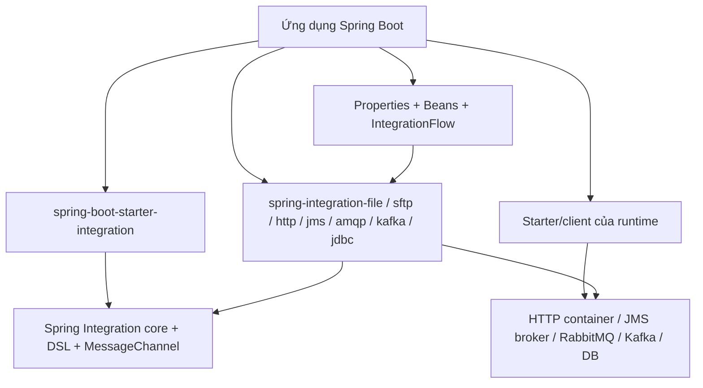
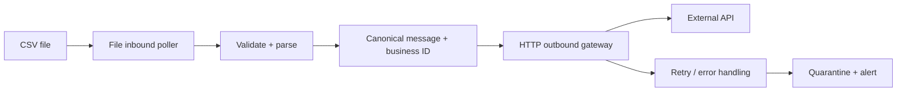

# Starter dependency cho từng adapter trong Spring Boot và Spring Integration

> **Chương:** Spring Boot  
> **Đề bài:** Starter dependency cho từng adapter  
> **Module:** `SPRING_INTEGRATION_ADAPTERS`  
> **Phạm vi:** Kết nối hệ thống ngoài với Spring Integration qua inbound/outbound adapter, gateway, poller và `MessageChannel`; thực hành File, SFTP, HTTP, JMS, AMQP/RabbitMQ, Kafka, JDBC cùng hợp đồng message, lỗi và vòng đời kết nối.  
> **Đối tượng:** Lập trình viên Java/Spring Boot đã biết Maven hoặc Gradle và các khái niệm bean, configuration, dependency injection.

## 1. Vấn đề: vì sao cần chọn đúng dependency?

Trong Spring Boot, một luồng tích hợp đơn giản có thể trông như sau:

```text
Thư mục File  --poll--> Spring Integration --transform--> MessageChannel
                                                        |
                                                        +--> xử lý nghiệp vụ
                                                        |
                                                        +--> ghi JDBC / gửi Kafka / gọi HTTP
```

Nhưng một ứng dụng dùng File adapter có phụ thuộc khác ứng dụng đọc SFTP hoặc tiêu thụ Kafka. Thêm sai starter dễ dẫn tới một trong các tình huống:

- Không tìm thấy class `FileReadingMessageSource` hoặc `Sftp` DSL.
- Bean `ConnectionFactory`, `KafkaTemplate`, `DataSource` hoặc HTTP server không có vì thiếu runtime client.
- Spring Boot tạo auto-configuration không mong muốn vì có thêm một starter broker/database mà chưa cấu hình kết nối.
- Thư viện Spring Integration và Spring Framework không tương thích do khai báo phiên bản thủ công.
- Tests chỉ kiểm tra message trong bộ nhớ nên chạy qua, nhưng adapter thực tế không khởi động vì thiếu driver/broker.

Mục tiêu bài này là **đọc yêu cầu tích hợp, xác định đúng các module cần khai báo**, phân biệt module adapter của Spring Integration với Spring Boot starter cho hạ tầng kết nối, rồi kiểm tra classpath và cấu hình trước khi vận hành.

### Sau bài học, bạn cần làm được

1. Giải thích khác nhau giữa `spring-boot-starter-integration`, `spring-integration-<adapter>` và starter/client hạ tầng như `spring-boot-starter-amqp`.
2. Chọn dependency tối thiểu cho File, SFTP, HTTP inbound/outbound, JMS, RabbitMQ/AMQP, Kafka và JDBC.
3. Viết cấu hình Maven, Gradle Java DSL và Gradle Kotlin DSL theo cùng một dependency matrix.
4. Xây một Spring Boot app dùng File inbound adapter, poller và `IntegrationFlow` để kiểm tra starter và auto-configuration cơ bản.
5. Biết khi nào cần broker, database, HTTP server hoặc driver ngoài; không nhầm có dependency với có dịch vụ đang chạy.
6. Phát hiện classpath conflict, thiếu `ConnectionFactory`/`DataSource`, nhầm inbound/outbound, lỗi profile và tác động của dependency transitively.
7. Thiết kế xử lý message contract, idempotency, retry, bảo mật, observability và shutdown khi bổ sung adapter.

## 2. Phân biệt ba lớp dependency

Không có nguyên tắc “mỗi adapter luôn có một `spring-boot-starter-*` riêng”. Với Spring Integration, một adapter thường được đóng gói thành **module Spring Integration** (ví dụ `spring-integration-sftp`), còn Spring Boot starter có thể cung cấp **auto-configuration** của runtime liên quan (ví dụ RabbitMQ hoặc JDBC).



### 2.1. Lớp 1 — Spring Integration core

**`org.springframework.boot:spring-boot-starter-integration`** là điểm khởi đầu thông dụng cho Spring Boot sử dụng Spring Integration. Nó mang vào các thành phần nền tảng và cơ chế auto-configuration liên quan; bạn vẫn phải thêm module adapter cụ thể khi dùng File/SFTP/JMS/Kafka v.v.

Các khái niệm core:

| Thành phần | Vai trò | Thường cần module transport riêng? |
|---|---|---|
| `Message<T>` và `MessageHeaders` | Hợp đồng payload + metadata | Không |
| `MessageChannel` | Ranh giới giao tiếp giữa endpoint | Không |
| `DirectChannel`, `QueueChannel`, `PublishSubscribeChannel` | Các cách phân phối message | Không |
| `IntegrationFlow` và Java DSL | Mô tả chuỗi xử lý | Không |
| `@MessagingGateway` / `@Gateway` | Gọi flow bằng interface nghiệp vụ | Không, trừ endpoint transport |
| `ServiceActivator`, `Transformer`, `Filter`, `Router` | Xử lý và điều phối message | Không |
| `Poller` / `Pollers` | Kích hoạt polling cho nguồn cần thăm dò | Không |
| File/SFTP/JMS/Kafka endpoint | Thực thi giao thức và mapping message | **Có** |

Với các phiên bản Spring Integration hiện đại dùng trong Spring Boot 3.x trở lên, Java DSL là thành phần tích hợp trong hệ sinh thái core; không mặc định thêm `spring-integration-java-dsl` phiên bản cũ chỉ vì ví dụ trên Internet đề cập đến nó.

### 2.2. Lớp 2 — Module adapter

Ví dụ:

```xml
<dependency>
    <groupId>org.springframework.integration</groupId>
    <artifactId>spring-integration-sftp</artifactId>
</dependency>
```

Đây là thư viện cung cấp endpoint/handler phù hợp giao thức SFTP; **không** có nghĩa Spring Boot tự biết địa chỉ host, tài khoản, private key, remote directory hoặc chính sách xác thực host key.

### 2.3. Lớp 3 — Starter hoặc client kết nối

Ví dụ sử dụng RabbitMQ thường gồm:

```xml
<dependency>
    <groupId>org.springframework.integration</groupId>
    <artifactId>spring-integration-amqp</artifactId>
</dependency>
<dependency>
    <groupId>org.springframework.boot</groupId>
    <artifactId>spring-boot-starter-amqp</artifactId>
</dependency>
```

`spring-integration-amqp` cung cấp adapter/gateway Integration; starter AMQP mang các thành phần Spring AMQP và auto-configuration cho RabbitMQ. Một `RabbitTemplate` hoặc `ConnectionFactory` không tự biến thành IntegrationFlow; chúng phục vụ lớp kết nối mà endpoint sử dụng.

**Quy tắc thực tế:** Xem hai lớp adapter và runtime là **các yêu cầu chức năng**. Nếu module đã mang runtime transitively, bạn không nhất thiết khai báo lại cùng một artifact; tuy nhiên starter thường có ích vì auto-configuration/đồng bộ properties, và dependency graph thực tế là nguồn kiểm chứng.

## 3. Ma trận chọn dependency cho từng adapter

Bảng dưới tập trung vào ứng dụng Spring Boot quản lý phiên bản qua BOM của Boot, không hard-code phiên bản từng module.

| Nhu cầu | Spring Integration module cần chú ý | Boot starter/runtime thường đi kèm | Điều kiện triển khai |
|---|---|---|---|
| **File inbound/outbound** | `spring-integration-file` | Thường chỉ cần core + file | Folder tồn tại/được phép tạo, filesystem volume, lọc file đã xử lý |
| **SFTP inbound/outbound** | `spring-integration-sftp` | SSH/SFTP client đến từ dependency tương thích của module | Host, port, credentials, host-key trust, session factory, network |
| **HTTP inbound (Servlet)** | `spring-integration-http` | `spring-boot-starter-web` (khi tự phục vụ HTTP bằng Servlet) | Web server, route mapping, authentication, request/reply |
| **HTTP outbound** | `spring-integration-http` | Spring HTTP client phù hợp; `spring-boot-starter-web` chỉ khi thật sự cần stack web Servlet | URL, TLS, timeout, auth, response mapping |
| **JMS inbound/outbound** | `spring-integration-jms` | `spring-boot-starter-artemis` hoặc starter/client JMS provider phù hợp | JMS `ConnectionFactory`, queue/topic, broker, destination |
| **AMQP/RabbitMQ** | `spring-integration-amqp` | `spring-boot-starter-amqp` | RabbitMQ, `CachingConnectionFactory`, exchange/queue/routing key |
| **Kafka** | `spring-integration-kafka` | `spring-kafka` (thường có theo module) + Spring Boot Kafka auto-configuration | Broker, topic, group ID, serializers/deserializers |
| **JDBC/database** | `spring-integration-jdbc` | `spring-boot-starter-jdbc` + driver DB | `DataSource`, bảng/schema, transaction và query |
| **Chỉ message in-memory/gateway** | Core/`spring-boot-starter-integration` | Không cần broker/database | Bean channels, error channel, message contract |

**Cách đọc bảng:** Chọn **module adapter theo giao thức**, sau đó chọn **runtime starter/client chỉ khi thực sự dùng kết nối đó**. Hầu hết Spring Integration transport module không có một Boot starter đặt tên theo adapter tương ứng. Không thêm tất cả dependency trong bảng vào mọi dự án.

### 3.1. Inbound, outbound, gateway và poller là thiết kế flow, không phải tên starter

Ví dụ cùng module File:

- **Inbound adapter:** thăm dò thư mục rồi đưa `File` vào một channel.
- **Outbound adapter:** nhận message rồi ghi file.
- **Inbound gateway/outbound gateway:** có mô hình request/reply theo loại adapter hỗ trợ.
- **Poller:** cần cho nguồn không tự phát sự kiện và được triển khai bằng endpoint/poller config của core.

`DirectChannel`, `ExecutorChannel` hoặc `QueueChannel` không làm phát sinh một “starter channel” khác. Sự thay đổi dependency thường đến từ **giao thức đầu vào/đầu ra và runtime cụ thể**, không phải từ việc đi theo hướng inbound hay outbound.

## 4. Maven: chiến lược quản lý phiên bản

Spring Boot cung cấp dependency management (qua parent POM hoặc BOM). Tránh ghi riêng các phiên bản Spring Integration khi không có nhu cầu tương thích đặc biệt; cùng một ứng dụng không nên tùy tiện phối trộn Spring Boot, Spring Framework, Spring Messaging và Spring Integration từ nhiều nhánh khác nhau.

### 4.1. Dự án Boot đang dùng parent/BOM

Trong dự án Maven đã tạo bởi Spring Initializr hoặc đã import Boot BOM, khai báo core và module như sau:

```xml
<dependencies>
    <!-- Spring Integration core / Boot integration support -->
    <dependency>
        <groupId>org.springframework.boot</groupId>
        <artifactId>spring-boot-starter-integration</artifactId>
    </dependency>

    <!-- Chỉ thêm khi thực sự đọc/ghi file -->
    <dependency>
        <groupId>org.springframework.integration</groupId>
        <artifactId>spring-integration-file</artifactId>
    </dependency>

    <!-- Test framework + Spring Integration test utilities -->
    <dependency>
        <groupId>org.springframework.boot</groupId>
        <artifactId>spring-boot-starter-test</artifactId>
        <scope>test</scope>
    </dependency>
    <dependency>
        <groupId>org.springframework.integration</groupId>
        <artifactId>spring-integration-test</artifactId>
        <scope>test</scope>
    </dependency>
</dependencies>
```

Đoạn XML là phần `<dependencies>` để chèn vào **một POM Boot hợp lệ đã có**; không phải toàn bộ `pom.xml` có thể build độc lập. Phiên bản được quản lý bởi BOM/parent của dự án. Nếu dự án không dùng Boot dependency management, bạn cần tự chọn **bộ phiên bản tương thích** và kiểm tra dependency tree, không chỉ bỏ `<version>`.

### 4.2. Cùng một ứng dụng có hai adapter

Nếu một flow đọc SFTP và xuất Kafka:

```xml
<dependencies>
    <dependency>
        <groupId>org.springframework.boot</groupId>
        <artifactId>spring-boot-starter-integration</artifactId>
    </dependency>
    <dependency>
        <groupId>org.springframework.integration</groupId>
        <artifactId>spring-integration-sftp</artifactId>
    </dependency>
    <dependency>
        <groupId>org.springframework.integration</groupId>
        <artifactId>spring-integration-kafka</artifactId>
    </dependency>
</dependencies>
```

Cần thêm cấu hình Kafka producer/consumer, SFTP session factory và credential/host trust. Nếu code trực tiếp dùng `KafkaTemplate` hoặc những API từ `spring-kafka`, có thể khai báo `spring-kafka` trực tiếp để bảo đảm dependency thể hiện rõ việc dùng thư viện — dù adapter có thể đã kéo nó transitively.

### 4.3. Không thay BOM bằng copy-paste version

Những anti-pattern thường gặp:

```xml
<!-- Ví dụ KHÔNG NÊN bắt chước: ép phiên bản từ một bài cũ -->
<dependency>
    <groupId>org.springframework.integration</groupId>
    <artifactId>spring-integration-http</artifactId>
    <version>OLD-UNRELATED-VERSION</version>
</dependency>
```

`OLD-UNRELATED-VERSION` chỉ là placeholder mô tả lỗi, không phải version hợp lệ. Việc bỏ phiên bản riêng để BOM quản lý thường tốt hơn; khi override bắt buộc, phải kiểm tra release compatibility, dependency convergence và test hệ thống tích hợp.


## 5. Bộ dependency mẫu cho từng giao thức

Tất cả snippets trong mục này **giả định đã có** `spring-boot-starter-integration` từ mục 4. Chọn đúng nhóm bạn cần, không thêm đồng loạt chỉ để thử. Hầu hết cấu hình mẫu được thiết kế cho **Spring Boot 3.x / Spring Integration 6.x**, những dự án Boot khác cần đối chiếu API/module/BOM phiên bản mục tiêu.

### 5.1. File adapter

```xml
<dependency>
    <groupId>org.springframework.integration</groupId>
    <artifactId>spring-integration-file</artifactId>
</dependency>
```

Các lớp và DSL thường gặp: `FileReadingMessageSource`, `FileWritingMessageHandler`, `Files.inboundAdapter(...)`, `Files.outboundAdapter(...)`. Không cần `spring-boot-starter-web` hay Kafka client khi chỉ xử lý file cục bộ.

**Inbound:** poll thư mục, lọc theo tên/metadata, đưa `File` vào `MessageChannel`. **Outbound:** lấy `String`/`byte[]`/`File` từ message, ghi thư mục đích theo policy đặt tên. Với file nguồn đang được một tiến trình khác ghi, cần quy ước **atomic rename/ready file** để tránh đọc file dở. Filter nhận file một lần trong bộ nhớ không tự cung cấp exactly-once sau restart; cần persistent metadata hoặc idempotency business key.

**Lỗi thường gặp:** thiếu quyền đọc/ghi volume, path tương đối thay đổi theo working directory, pattern filter không khớp, file được đọc lại sau restart, ghi file chưa hoàn tất rồi bị downstream thấy sớm.

### 5.2. SFTP adapter

```xml
<dependency>
    <groupId>org.springframework.integration</groupId>
    <artifactId>spring-integration-sftp</artifactId>
</dependency>
```

Các thành phần thường gặp: `DefaultSftpSessionFactory`, inbound file synchronizer hoặc streaming inbound adapter, SFTP outbound handler/gateway. Module SFTP mang các thành phần client SSH/SFTP tương thích trong dependency graph, nhưng **không tự kết nối tới server** nếu chưa có session factory và flow.

**Thông tin bắt buộc để thiết kế kết nối:** hostname/port, service credential hoặc private key từ secret manager, host-key fingerprint/trust store, remote directory, polling schedule và quy tắc rename/archive/checkpoint. Không cấu hình chế độ “accept unknown host key” tùy tiện trong production; cần xác thực host key để chống man-in-the-middle.

**Inbound sync khác streaming:** đồng bộ về local trước khi đưa vào flow giúp thao tác lại file ổn định nhưng cần lưu trữ staging. Streaming đọc trực tiếp qua session, cần đặc biệt chú ý vòng đời kết nối và việc xử lý lại khi stream thất bại.

**Lỗi thường gặp:** thiếu known_hosts, key không được phép, timeout, session bị server đóng, remote path sai, file chưa được upload xong, poll chồng nhau, rò rỉ connection khi consumer không đóng stream.

### 5.3. HTTP inbound và outbound

Để dùng HTTP adapter của Spring Integration:

```xml
<dependency>
    <groupId>org.springframework.integration</groupId>
    <artifactId>spring-integration-http</artifactId>
</dependency>
```

Nếu chính ứng dụng Spring Boot **nhận HTTP request qua Servlet stack**:

```xml
<dependency>
    <groupId>org.springframework.boot</groupId>
    <artifactId>spring-boot-starter-web</artifactId>
</dependency>
```

**Không tự động kết luận** outbound HTTP cần chạy embedded web server: nếu chỉ gọi API ngoài, thêm `spring-boot-starter-web` có thể làm mở ứng dụng Servlet không cần thiết. Kiểm tra client API và các transport dependency thực tế của phiên bản đang dùng. Với WebFlux/reactive, chọn stack/module phù hợp theo khả năng tương thích; không trộn `spring-integration-http` Servlet endpoint và reactive endpoint một cách tùy ý.

- **Inbound gateway:** HTTP request đi vào IntegrationFlow và trả HTTP response; cần request–reply semantics, timeout và mapping exception.
- **Outbound gateway:** flow gọi HTTP API và chờ response; cấu hình URI, method, headers, error mapping, timeout và retry.
- **Outbound adapter** dạng fire-and-forget phụ thuộc đặc tính endpoint; không giả định mọi HTTP call đều không cần response.

**Lỗi thường gặp:** thiếu Servlet context cho inbound handler, trùng route với MVC controller, không lọc inbound headers, forward Authorization header nhầm đích, timeout không đặt, retry POST không có idempotency key, 4xx bị coi là lỗi transient.

### 5.4. JMS adapter

```xml
<dependency>
    <groupId>org.springframework.integration</groupId>
    <artifactId>spring-integration-jms</artifactId>
</dependency>
```

Ví dụ chọn Apache ActiveMQ Artemis qua Spring Boot:

```xml
<dependency>
    <groupId>org.springframework.boot</groupId>
    <artifactId>spring-boot-starter-artemis</artifactId>
</dependency>
```

JMS adapter nhận/gửi message qua `jakarta.jms` trong những stack Boot hiện đại tương ứng. Cần một provider JMS có `ConnectionFactory`; Artemis chỉ là **một lựa chọn**, không bắt buộc nếu doanh nghiệp sử dụng provider khác. Khi đổi provider, dùng client/starter tương thích với **JMS API namespace** của phiên bản Spring Integration đang dùng. Không ghép client `javax.jms` cũ vào ứng dụng yêu cầu `jakarta.jms` rồi hy vọng class tương thích.

**Thông tin cần cấu hình:** broker URL, credentials, queue/topic, message converter, acknowledgement, transaction, concurrency, redelivery/DLQ, durable subscription nếu là topic.

**Lỗi thường gặp:** `No qualifying bean of type ConnectionFactory`, không có JMS broker, destination chưa tạo, listener nhận lặp vì rollback, message format không khớp converter, xử lý lỗi trước ACK và poison message lặp vô hạn.

### 5.5. AMQP/RabbitMQ adapter

```xml
<dependency>
    <groupId>org.springframework.integration</groupId>
    <artifactId>spring-integration-amqp</artifactId>
</dependency>
<dependency>
    <groupId>org.springframework.boot</groupId>
    <artifactId>spring-boot-starter-amqp</artifactId>
</dependency>
```

Module Integration xây inbound/outbound endpoint và gateway theo Spring AMQP; Boot starter hỗ trợ `RabbitTemplate`, `CachingConnectionFactory` và các bean cấu hình liên quan cho RabbitMQ. Cần broker RabbitMQ, vhost, exchange/queue/binding, routing key và cơ chế bảo mật.

**AMQP không đồng nghĩa JMS:** hai module khác nhau, dù đều truyền message. Không thêm `spring-integration-jms` khi hệ thống chỉ dùng RabbitMQ theo AMQP.

**Lỗi thường gặp:** RabbitMQ chưa chạy, sai vhost hoặc permission, queue/exchange không tồn tại, cấu hình manual ACK sai, consumer retry không có DLQ, confirm/return handling bị bỏ qua.

### 5.6. Kafka adapter

```xml
<dependency>
    <groupId>org.springframework.integration</groupId>
    <artifactId>spring-integration-kafka</artifactId>
</dependency>
```

Module Kafka dùng các thành phần Spring Kafka; dependency tree thường bao gồm `spring-kafka` và Kafka clients thông qua quan hệ phụ thuộc. Khi ứng dụng trực tiếp dùng `KafkaTemplate` hoặc listener API ngoài Spring Integration, khai báo thêm dependency trực tiếp để biểu đạt rõ ranh giới:

```xml
<dependency>
    <groupId>org.springframework.kafka</groupId>
    <artifactId>spring-kafka</artifactId>
</dependency>
```

Trong các dự án Spring Boot 3.x, Spring Kafka được Boot hỗ trợ auto-configuration qua classpath và các thuộc tính `spring.kafka.*`; không nên tự tưởng tượng cần một artifact `spring-boot-starter-kafka` theo quy tắc đặt tên chung. Kiểm tra danh sách starter **của đúng Boot version** thay vì suy tên.

**Thông tin cần cấu hình:** bootstrap servers, security protocol/SASL/TLS, topic, consumer group, serializer/deserializer, key strategy, error handling, offset commit, retry topic/DLT và idempotency. Kafka đảm bảo thứ tự trong **một partition**, không phải toàn topic. Không tuyên bố exactly-once toàn nghiệp vụ chỉ vì Kafka producer bật idempotence.

**Lỗi thường gặp:** broker advertised listener không truy cập được, sai consumer group, deserialize fail làm consumer loop, thiếu topic ACL, commit offset trước khi kết quả downstream bền vững, retry vô hạn một poison record.

### 5.7. JDBC adapter

```xml
<dependency>
    <groupId>org.springframework.integration</groupId>
    <artifactId>spring-integration-jdbc</artifactId>
</dependency>
<dependency>
    <groupId>org.springframework.boot</groupId>
    <artifactId>spring-boot-starter-jdbc</artifactId>
</dependency>
```

Thêm driver database ứng với hệ quản trị; ví dụ PostgreSQL:

```xml
<dependency>
    <groupId>org.postgresql</groupId>
    <artifactId>postgresql</artifactId>
    <scope>runtime</scope>
</dependency>
```

Module Integration JDBC hỗ trợ poll bảng, xử lý update/outbound và phối hợp message. Boot starter JDBC cấu hình `DataSource`, `JdbcTemplate` và transaction infrastructure khi có thông số hợp lệ. `spring-integration-jdbc` **không tạo bảng tự động** chỉ vì có dependency. Dùng migration tool/schema được quản trị cho bảng nghiệp vụ và metadata store.

**Thiết kế cần quyết định:** poll theo khóa/tiến trình, transaction boundary, mark-as-processed atomically, lock khi nhiều instance, pagination/batch, độ dài transaction và retry. Nếu đọc rows rồi gửi Kafka, không có atomic transaction duy nhất giữa PostgreSQL và Kafka; cân nhắc transactional outbox/CDC và idempotent consumer.

**Lỗi thường gặp:** thiếu JDBC driver, `DataSource` không tạo vì URL sai, không có bảng, SQL poll chọn lại hàng cũ, nhiều instance claim một row, transaction xử lý lâu gây lock, rò connection pool.

### 5.8. Gateway và channel không phụ thuộc giao thức

Một gateway interface nội bộ và `DirectChannel` không đòi hỏi thêm starter cho Kafka, JMS hay HTTP:

```java
import org.springframework.integration.annotation.Gateway;
import org.springframework.integration.annotation.MessagingGateway;

@MessagingGateway
public interface OrderGateway {
    @Gateway(requestChannel = "orderInput")
    void submit(String orderId);
}
```

Đây là **cửa gọi vào MessageChannel**, không tự đưa order lên broker; lời gọi có thể đồng bộ hoặc bất đồng bộ tùy loại channel và flow. Interface gateway còn cần được Spring đăng ký/quét (ví dụ `@IntegrationComponentScan` hoặc cách khai báo bean phù hợp với cấu hình ứng dụng). Chỉ khi một downstream endpoint thực sự sử dụng Kafka/JMS/AMQP/HTTP thì cần module transport tương ứng.

Nếu ứng dụng có nhiều adapter, hãy quản lý ranh giới bằng channel, payload type, header contract và flow endpoint rõ ràng; không để adapter mới tự động dùng payload format cũ mà không kiểm tra serialization.


## 6. Gradle: khai báo cùng bộ dependency

Nếu dùng dự án Gradle đã cấu hình Spring Boot plugin và dependency management/BOM, không cần ghi version riêng cho từng `spring-integration-*`. Dưới đây chỉ là phần `dependencies`, không thay thế toàn bộ `build.gradle` hoặc `build.gradle.kts`.

### 6.1. Gradle Groovy DSL

Ví dụ ứng dụng nhận file, gọi HTTP API và lưu JDBC:

```groovy
dependencies {
    implementation 'org.springframework.boot:spring-boot-starter-integration'

    implementation 'org.springframework.integration:spring-integration-file'
    implementation 'org.springframework.integration:spring-integration-http'
    implementation 'org.springframework.integration:spring-integration-jdbc'

    implementation 'org.springframework.boot:spring-boot-starter-jdbc'
    runtimeOnly 'org.postgresql:postgresql'

    testImplementation 'org.springframework.boot:spring-boot-starter-test'
    testImplementation 'org.springframework.integration:spring-integration-test'
}
```

Không thêm `spring-boot-starter-web` nếu ứng dụng **chỉ là batch/poller, gọi HTTP outbound và không cần embedded Servlet server**, trừ khi API thực tế bạn dùng cần phần web starter tương ứng. Kiểm tra dependency graph của client HTTP cụ thể thay vì dựa vào tên module.

### 6.2. Gradle Kotlin DSL

Ví dụ dùng SFTP và Kafka:

```kotlin
dependencies {
    implementation("org.springframework.boot:spring-boot-starter-integration")
    implementation("org.springframework.integration:spring-integration-sftp")
    implementation("org.springframework.integration:spring-integration-kafka")

    // Khai báo trực tiếp nếu source code sử dụng Spring Kafka API.
    implementation("org.springframework.kafka:spring-kafka")

    testImplementation("org.springframework.boot:spring-boot-starter-test")
    testImplementation("org.springframework.integration:spring-integration-test")
}
```

**Lưu ý:** Nếu dự án Gradle không áp dụng Boot dependency management hoặc không import BOM đúng cách, versionless module sẽ không resolve được. Khi đó kiểm tra plugin/BOM trước, đừng thêm ngẫu nhiên version cho từng adapter.

### 6.3. Maven/Gradle so sánh nhanh

| Nhu cầu | Maven scope | Gradle configuration |
|---|---|---|
| Adapter dùng khi chạy | `compile` mặc định | `implementation` |
| Driver chỉ dùng runtime | `runtime` | `runtimeOnly` |
| Spring Integration test utilities | `test` | `testImplementation` |
| Thư viện chỉ cần khi compile (hiếm trong lab) | `provided` (với ngữ cảnh Maven phù hợp) | `compileOnly` |

Giữ các phụ thuộc **không cần thiết** ra khỏi runtime classpath: ít thư viện hơn giúp giảm bề mặt lỗ hổng, rủi ro auto-configuration nhầm và thời gian tải ứng dụng.

## 7. Lab tối thiểu: File inbound adapter chạy với Spring Boot

### 7.1. Cấu trúc và phạm vi

Tạo một Spring Boot project Maven/Gradle bằng công cụ thông thường của bạn, chọn một phiên bản Boot **tương thích với JDK đang dùng** và thêm:

- `spring-boot-starter-integration`.
- `spring-integration-file`.
- `spring-boot-starter-test` và `spring-integration-test` với scope test nếu muốn kiểm thử tự động.

Thư mục minh họa:

```text
file-adapter-lab/
├── pom.xml hoặc build.gradle[.kts]
└── src/
    └── main/
        ├── java/com/example/integration/
        │   ├── AdapterLabApplication.java
        │   └── FileAdapterConfig.java
        └── resources/
            └── application.yml
```

Bạn có thể tạo `data/in` bên cạnh file build; flow sẽ cố tạo thư mục này nếu chưa tồn tại. **Không để chương trình bên ngoài ghi trực tiếp vào thư mục đang được poll trước khi file hoàn chỉnh**; dùng atomic rename hoặc staging.

### 7.2. Spring Boot application class

```java
package com.example.integration;

import org.springframework.boot.SpringApplication;
import org.springframework.boot.autoconfigure.SpringBootApplication;

@SpringBootApplication
public class AdapterLabApplication {
    public static void main(String[] args) {
        SpringApplication.run(AdapterLabApplication.class, args);
    }
}
```

`@SpringBootApplication` kích hoạt component scanning cho package tương ứng. `@Configuration` ở file tiếp theo được phát hiện vì cùng hoặc nằm dưới package ứng dụng.

### 7.3. File inbound flow với poller

```java
package com.example.integration;

import java.io.File;
import java.io.IOException;
import java.io.UncheckedIOException;
import java.nio.charset.StandardCharsets;
import java.time.Duration;

import org.slf4j.Logger;
import org.slf4j.LoggerFactory;
import org.springframework.context.annotation.Bean;
import org.springframework.context.annotation.Configuration;
import org.springframework.integration.dsl.IntegrationFlow;
import org.springframework.integration.dsl.Pollers;
import org.springframework.integration.file.dsl.Files;

@Configuration
public class FileAdapterConfig {
    private static final Logger log =
            LoggerFactory.getLogger(FileAdapterConfig.class);

    @Bean
    IntegrationFlow fileInboundFlow() {
        return IntegrationFlow
            .from(
                Files.inboundAdapter(new File("data/in"))
                     .autoCreateDirectory(true)
                     .patternFilter("*.txt"),
                endpoint -> endpoint.poller(
                    Pollers.fixedDelay(Duration.ofSeconds(2))
                           .maxMessagesPerPoll(10)
                )
            )
            .handle(message -> {
                File file = (File) message.getPayload();
                try {
                    String text = java.nio.file.Files.readString(
                        file.toPath(), StandardCharsets.UTF_8
                    );
                    log.info("File={} bytes={} text={}",
                             file.getName(), file.length(), text.trim());
                } catch (IOException ex) {
                    throw new UncheckedIOException(ex);
                }
            })
            .get();
    }
}
```

Ở đây:

- `Files.inboundAdapter(...)` thuộc module `spring-integration-file`, nhận nguồn file.
- `.poller(...)` dùng Spring Integration Java DSL để đánh thức endpoint mỗi hai giây, tối đa mười message một lần poll.
- Payload mặc định là đối tượng `java.io.File`; handler quyết định khi nào đọc nội dung. Không nên nhầm payload mặc định thành `String`.
- `.handle(...)` là endpoint xử lý cuối flow, ghi log tên và nội dung file. Nó không tự xuất sang Kafka, HTTP hoặc DB.
- Ngoại lệ I/O được bọc vào `UncheckedIOException` để flow error handling nhìn thấy; trong production cần recovery flow riêng.

Ví dụ này dùng working directory tương đối `data/in` để học. Production nên lấy path từ configuration và volume mount tường minh.

### 7.4. Cấu hình ứng dụng

```yaml
spring:
  application:
    name: file-adapter-lab
  main:
    web-application-type: none

logging:
  level:
    com.example.integration: INFO
    org.springframework.integration: INFO
```

`web-application-type: none` giúp minh họa app này **không cần chạy HTTP server**, dù vẫn sử dụng đầy đủ Spring Boot context. Nếu dự án của bạn đang thêm web starter cho nhu cầu khác, hãy bỏ phần cấu hình này khi thực sự cần nhận HTTP request.

### 7.5. Chạy và quan sát

Trong thư mục dự án, dùng một trong hai lệnh tùy build tool:

```bash
# Maven project
./mvnw spring-boot:run

# Gradle project
./gradlew bootRun
```

Trên Windows, wrapper thường là `mvnw.cmd` và `gradlew.bat`. Tạo file `data/in/sample.txt` với nội dung giả:

```text
ORDER-1001,tenant-a,created
```

Sau một chu kỳ poll, log ứng dụng dự kiến có chuỗi tương tự:

```text
File=sample.txt bytes=27 text=ORDER-1001,tenant-a,created
```

Giá trị `bytes` phụ thuộc nội dung và ký tự xuống dòng thực tế nên **không bắt buộc bằng 27**; tiêu chí đúng là handler nhận file, đọc UTF-8 và ghi đúng nội dung.

Tạo thêm `another.txt`, file sẽ được nhận qua poller. Thử tạo `ignore.csv`: vì `patternFilter("*.txt")`, file CSV không được đưa vào flow.

**Giới hạn cần nhận thức:** File inbound adapter có thể lọc những file đã phát trong vòng đời hiện tại, nhưng **không tự cung cấp exactly-once sau restart**. Không tự xóa file sau xử lý; nếu yêu cầu archive, move hoặc xóa file sau ACK, thiết kế bước riêng với idempotency và failure handling.

## 8. Cấu hình hạ tầng cho các adapter khác

Có dependency không đồng nghĩa có bean kết nối hợp lệ. Với các adapter ngoài, Spring Boot chỉ có thể auto-configure khi classpath và các điều kiện cấu hình phù hợp. Ví dụ properties dưới đây là cấu trúc **minh họa**; không chứa credential thật.

### 8.1. RabbitMQ/AMQP

```yaml
spring:
  rabbitmq:
    host: rabbitmq.internal.example
    port: 5672
    virtual-host: /
    # username/password lấy từ môi trường hoặc secret manager
```

Nếu khai báo module Integration AMQP và starter nhưng broker không thể kết nối, build Maven vẫn có thể thành công trong khi listener ở runtime lỗi hoặc retry liên tục. Phải kiểm tra queue/exchange binding, TTL, retry, DLQ và ownership. Không dùng `guest/guest` cho môi trường production.

### 8.2. Kafka

```yaml
spring:
  kafka:
    bootstrap-servers: kafka-1.internal.example:9092
    consumer:
      group-id: integration-worker
      auto-offset-reset: earliest
```

`auto-offset-reset` chỉ tác động khi nhóm không có offset hợp lệ; không phải nút “đọc lại mọi message”. Với Kafka integration, cần phân biệt cấu hình producer và consumer, serializer, security, offset/ack và cách quản lý retry. Kafka ACL có thể từ chối publish/consume dù bean đã khởi động thành công.

### 8.3. Artemis/JMS

```yaml
spring:
  artemis:
    mode: native
    broker-url: tcp://artemis.internal.example:61616
    # username/password: secret manager
```

Ví dụ chỉ phù hợp khi dự án dùng Artemis và starter tương ứng. Với provider JMS khác phải dùng cấu hình/ConnectionFactory do provider hỗ trợ; không đặt giả định Artemis URL sẽ làm việc với mọi JMS broker.

### 8.4. JDBC

```yaml
spring:
  datasource:
    url: jdbc:postgresql://db.internal.example:5432/integration
    username: integration_app
    # password lấy từ secret manager
    hikari:
      maximum-pool-size: 10
```

Ứng dụng còn cần driver PostgreSQL, schema/migration và quyền truy cập DB tối thiểu. Khi poll bằng JDBC, quyết định có dùng transaction và locking hay không là việc của flow design, không tự động do `spring-boot-starter-jdbc` giải quyết.

### 8.5. SFTP

SFTP không có nhóm thuộc tính `spring.sftp.*` chuẩn dùng chung cho mọi adapter của Spring Integration. Bạn thường khai báo **application-specific properties** cho host, port, user, remote path và trỏ session factory đến cấu hình đó. Ví dụ:

```yaml
app:
  sftp:
    host: sftp.internal.example
    port: 22
    remote-dir: /inbound
    # username, private key và host-key trust
    # được cấp bởi secret manager và policy deployment.
```

Những thuộc tính `app.sftp.*` **không tự tạo** `DefaultSftpSessionFactory`. Bạn phải tạo bean cấu hình nó hoặc sử dụng module/starter nội bộ của tổ chức đã làm việc đó; không coi tên property là một Spring Boot auto-configuration có sẵn.


## 9. Kiểm tra dependency graph và khởi động

### 9.1. Maven: xem dependency thực tế

Trong thư mục dự án Maven:

```bash
./mvnw dependency:tree
./mvnw help:effective-pom
```

Để thu hẹp phần Spring Integration, Maven Dependency Plugin hỗ trợ:

```bash
./mvnw dependency:tree -Dincludes=org.springframework.integration
```

Nếu trên Windows PowerShell, cách quote tham số phụ thuộc shell; dùng wrapper `mvnw.cmd` tương ứng và bảo đảm `-Dincludes` được chuyển chính xác tới Maven. Dependency tree phải chỉ ra các module bạn kỳ vọng và các phụ thuộc transitively của chúng. Nó không chứng minh broker/DB hoặc SFTP host có thể truy cập.

### 9.2. Gradle: runtime classpath và dependencyInsight

```bash
./gradlew dependencies --configuration runtimeClasspath
./gradlew dependencyInsight --configuration runtimeClasspath --dependency spring-integration-core
```

Từ output, xác minh:

- Không có nhiều phiên bản Spring Integration bị ép conflict với BOM.
- Có `spring-integration-file` khi gọi File DSL; có `spring-integration-sftp` khi dùng SFTP; tương tự cho Kafka/JMS/JDBC.
- Có client/runtime tương thích và JDBC driver khi cần.
- Không có starter broker/web không dùng tới, vốn có thể kích hoạt autoconfig hoặc dependency vulnerability không cần thiết.
- Scope test không bị đưa nhầm sang runtime.

### 9.3. Một dependency xuất hiện transitively nghĩa là gì?

Giả sử `spring-integration-kafka` kéo `spring-kafka` vào runtime. Code ứng dụng có thể build ngay cả khi không khai báo `spring-kafka` trực tiếp. Tuy vậy, khi class `KafkaTemplate` là dependency API trực tiếp của mã nguồn ứng dụng, khai báo direct dependency giúp làm rõ chủ đích và giảm rủi ro một bản nâng cấp thay đổi transitives.

Chiều ngược lại, chỉ thêm `spring-kafka` không tự cung cấp các Integration Kafka endpoint DSL. **Client library và Integration adapter không thay thế nhau.**

### 9.4. Chẩn đoán lỗi thường gặp

| Hiện tượng | Nguyên nhân ưu tiên kiểm tra | Hành động |
|---|---|---|
| `ClassNotFoundException` cho `FileReadingMessageSource` | Thiếu `spring-integration-file` hoặc scope sai | Kiểm tra compile/runtime classpath |
| Không resolve `IntegrationFlow` / `Pollers` | Thiếu/không tương thích core Spring Integration | Kiểm tra starter, BOM, import package |
| Bean `ConnectionFactory` không tồn tại | Chưa thêm provider JMS/AMQP hoặc chưa cấu hình đúng | Xác định đúng JMS vs AMQP, xem Boot condition report |
| Bean `DataSource` không có | Thiếu JDBC starter/driver/config hoặc auto-config bị loại | Kiểm tra URL, driver, profile, condition |
| File không được poll | Sai path, pattern filter, quyền filesystem, poller chưa chạy | Bật log flow, kiểm tra working directory |
| HTTP inbound 404 | Không có server/endpoint mapping, route khác hoặc servlet stack sai | Kiểm tra web starter, handler mapping và context |
| HTTP outbound timeout | DNS/TLS/network, proxy, endpoint hoặc timeout policy | Kiểm tra connection và error channel |
| SFTP failed handshake | Trust/host key, credential, cipher, network | Sửa host-key trust và secret, không tắt xác minh |
| JMS listener không nhận message | Queue/topic, broker, ACK, selector, consumer | Kiểm tra destination và broker metrics |
| RabbitMQ consumer loop | DLQ/retry thiếu, converter sai, nack/requeue không kiểm soát | Thiết kế poison-message handling |
| Kafka consumer không nhận record | Group offset, topic ACL, bootstrap listener, partitions | Kiểm tra cluster, group lag và partition assignment |
| JDBC poll trùng row | Query/predicate, transaction, multi-instance race | Lock/checkpoint hoặc outbox/CDC |
| `NoSuchMethodError` hoặc `NoClassDefFoundError` | Các version module không tương thích | Dùng cùng BOM, kiểm tra dependency convergence |

**Cách điều tra tốt:** đọc **nguyên nhân gốc** trong stack trace và report auto-configuration, không sửa bằng cách thêm hàng loạt starter chưa xác định mục tiêu.

## 10. Message contract, retry và vòng đời kết nối

Dependency đúng là điều kiện để flow chạy, **không đủ** để flow an toàn khi gặp lỗi.

### 10.1. Hợp đồng message chung

Với luồng file → transform → Kafka/JMS/HTTP, xác định hợp đồng cho từng channel:

```json
{
  "eventId": "evt-1001",
  "schemaVersion": 1,
  "tenantId": "tenant-a",
  "occurredAt": "2026-11-23T08:00:00Z",
  "type": "OrderCreated",
  "payload": {
    "orderId": "ORDER-1001",
    "status": "CREATED"
  }
}
```

Đây là schema JSON nghiệp vụ **minh họa**, không phải một payload bắt buộc của Spring Integration. Tách:

- **Business key/event ID:** dùng cho idempotency xuyên restart và retry.
- **Spring Integration message headers:** correlation ID, reply channel, error channel, sequence, content type hoặc transport headers; không tự đưa toàn bộ header framework lên broker công khai.
- **Transport metadata:** file path, SFTP remote path, HTTP status, JMS message ID, AMQP routing key hoặc Kafka topic/partition/offset — tùy adapter cung cấp.
- **Security context:** tenant, identity, authentication/authorization đã được xác minh; không tin một header do bên ngoài tự tuyên bố.

### 10.2. Error handling và retry theo loại nguồn

| Adapter | Failure mode | Ý tưởng hồi phục |
|---|---|---|
| File | File bị ghi dở, I/O error, restart đọc lại | Staging + atomic rename, persistent filter, archive và idempotent business handler |
| SFTP | Mất session, timeout, file remote chưa hoàn chỉnh | Reconnect, backoff, remote rename/marker, idempotent download |
| HTTP | 429/5xx/timeout, POST có thể đã được xử lý | Retry có giới hạn, `Retry-After`, idempotency key, circuit breaker |
| JMS | Consumer rollback, redelivery | Transaction/ACK policy, retry/DLQ, dedupe |
| AMQP | Nack/requeue, publisher confirm lỗi | Xử lý confirm/return, DLQ, poison message policy |
| Kafka | Offset commit trước/sau nghiệp vụ, deserialize failure | Error handler/DLT, idempotency, commit strategy, reprocessing |
| JDBC | Deadlock, timeout, poll nhận row lặp | Transaction/lock/checkpoint, backoff, outbox |

Một `MessageChannel` có thể đồng bộ hoặc bất đồng bộ; boundary ảnh hưởng tới exception propagation. Nếu xử lý qua `DirectChannel`, lỗi downstream thường đi ngược theo call stack đồng bộ. Với endpoint poller hoặc channel bất đồng bộ, lỗi có thể được chuyển tới `errorChannel`/error handler theo cấu hình; phải kiểm tra cách flow thật của bạn phát hành `ErrorMessage`.

**Không nhầm retry với exactly-once.** Dù adapter và broker retry được, doanh nghiệp vẫn cần idempotent consumer, transaction phù hợp hoặc outbox để không tạo invoice/tài khoản/giao dịch trùng.

### 10.3. Quản lý connection và shutdown

- **SFTP:** session factory có timeout, giới hạn kết nối và giải phóng stream/session; theo dõi server disconnect.
- **HTTP:** client pool, TLS, connect/read timeout, DNS/proxy, graceful cancel.
- **JMS/AMQP:** connection factory cache/pool, listener concurrency, redelivery, shutdown không bỏ message đang xử lý.
- **Kafka:** consumer group rebalance, offset commit, producer flush, record in-flight, shutdown timeout.
- **JDBC:** connection pool size, maximum lifetime, transaction length và đóng pool đúng cách.
- **File:** tránh poll song song quá mức, phân biệt thư mục staging/processing/archive và chính sách sau lỗi.

Tính **liveness** của bean không đảm bảo readiness của endpoint: app Boot có thể khởi động nhưng broker còn mất kết nối. Nếu cần, thêm `spring-boot-starter-actuator`, readiness/health indicator thích hợp, metrics và alert theo adapter.

## 11. Kiểm thử dependency và adapter

Để xác nhận module được thêm đúng, nên có ba tầng kiểm tra:

1. **Build/classpath:** resolver tìm thấy tất cả class và không conflict API.
2. **ApplicationContext:** bean adapter, `IntegrationFlow`, poller và connection factory khởi tạo đúng.
3. **Integration contract:** message thực đi qua transport với broker/SFTP/DB test instance, đúng payload, ACK, retry, security và shutdown.

### 11.1. Bộ test dành cho lab File

| Test | Chuẩn bị | Kết quả |
|---|---|---|
| Context boot | Core + file module, không cần web server | Boot application khởi động, flow bean tồn tại |
| File hợp lệ | Đặt `sample.txt` vào `data/in` | Có log nhận tên file và nội dung |
| File không hợp lệ | Đặt `ignore.csv` | File không được xử lý do pattern |
| Thư mục chưa tồn tại | Dọn thư mục test, app có quyền tạo | Adapter tạo được thư mục |
| I/O denied | Thư mục thiếu quyền đọc trong môi trường test | Có lỗi có thể điều tra, không được im lặng |
| Restart | Giữ file và khởi động lại | Ghi nhận khả năng xử lý lại; bổ sung cơ chế persistent filter khi cần |
| Nhiều file | Đặt hơn 10 file trong thư mục | Poller lấy từng batch theo maxMessagesPerPoll |
| Message contract | Tệp chứa payload giả hợp lệ | Handler/transformer nhận đúng charset và không mất dữ liệu |

**Lưu ý:** không kỳ vọng mỗi file luôn được xử lý đúng một lần xuyên mọi lần khởi động. Đối với những nghiệp vụ có tác dụng phụ, cần test riêng duplicate input và xử lý idempotent.

### 11.2. Test theo transport

| Giao thức | Cơ sở hạ tầng test | Điều cần quan sát |
|---|---|---|
| SFTP | SFTP server cô lập/test container | Host trust, authentication, file complete, download retry |
| HTTP | Mock web server hoặc app test endpoint | Request headers, response, timeout, 4xx/5xx và idempotency |
| JMS | Test broker tương thích provider | Receive/ACK/rollback/DLQ |
| AMQP | RabbitMQ test instance | Exchange binding, confirm, requeue, poison message |
| Kafka | Kafka test instance hoặc test framework phù hợp | Producer/consumer, offset, reprocess, DLT |
| JDBC | Cơ sở dữ liệu test cùng engine production nếu cần | Poll/query, transaction/lock, driver/schema |

Có thể sử dụng Testcontainers hoặc broker tích hợp để kiểm tra hành vi thật, nhưng chỉ thêm test dependency **cho những transport bạn kiểm thử**. Unit test chỉ mock `MessageChannel` không chứng minh SFTP handshake hoặc Kafka consumer group vận hành đúng.


### 11.3. Test thay đổi dependency

Khi thêm một starter vào ứng dụng đang chạy:

- So sánh dependency tree trước/sau.
- Xem Spring Boot condition evaluation và những bean auto-config mới.
- Test những profile chạy production/staging/test; đừng chỉ chạy default profile.
- Kiểm tra port mở, listener mới, health check và connection attempt phát sinh ngoài dự kiến.
- Rà soát vulnerability và license của các thư viện mới.
- Kiểm tra dependency loại bỏ có làm mất class do phụ thuộc transitively trước đó không.

## 12. Tình huống tổng hợp: từ yêu cầu tới dependency tối thiểu

### 12.1. Tình huống A — Đọc file CSV và gọi HTTP API

**Yêu cầu:** Mỗi phút nhận CSV từ `/data/in`, chuẩn hóa bản ghi và POST tới hệ thống quản lý đơn hàng bằng HTTPS. Không cần phục vụ HTTP request.

**Dependency tối thiểu ở cấp Integration:**

```xml
<dependency>
    <groupId>org.springframework.boot</groupId>
    <artifactId>spring-boot-starter-integration</artifactId>
</dependency>
<dependency>
    <groupId>org.springframework.integration</groupId>
    <artifactId>spring-integration-file</artifactId>
</dependency>
<dependency>
    <groupId>org.springframework.integration</groupId>
    <artifactId>spring-integration-http</artifactId>
</dependency>
```

Các phụ thuộc Spring HTTP client cụ thể cần có theo cách adapter được cấu hình. Không thêm `spring-boot-starter-web` chỉ với lý do có chữ HTTP nếu ứng dụng không phục vụ HTTP inbound. Thiết kế flow:



**Rủi ro trọng tâm:** Đọc file đang ghi dở, parser lỗi một dòng, HTTP timeout nhưng API đã nhận POST, retry tạo đơn trùng. Cần file readiness, record-level idempotency key, bounded retry, status mapping và quarantine.

### 12.2. Tình huống B — SFTP đến Kafka

**Yêu cầu:** Nhận tài liệu từ SFTP của đối tác, xác minh nội dung, xuất event `DocumentReceived` lên Kafka.

```xml
<dependency>
    <groupId>org.springframework.boot</groupId>
    <artifactId>spring-boot-starter-integration</artifactId>
</dependency>
<dependency>
    <groupId>org.springframework.integration</groupId>
    <artifactId>spring-integration-sftp</artifactId>
</dependency>
<dependency>
    <groupId>org.springframework.integration</groupId>
    <artifactId>spring-integration-kafka</artifactId>
</dependency>
```

Nếu flow cần **đồng bộ file xuống local staging** và sử dụng thêm file adapter/filters riêng, hãy xem API thực tế và khai báo `spring-integration-file` trực tiếp khi code có phụ thuộc vào module đó. Nếu ứng dụng dùng thêm Kafka listener/producer API trực tiếp, khai báo `spring-kafka` như một direct dependency có chủ đích.

**Quy tắc vận hành:** SFTP host key được xác thực, credentials không nằm trong Git, dữ liệu tải dở không được báo thành công, Kafka key ổn định theo business ID; phải lưu trạng thái checkpoint/ACK có thể khôi phục khi Kafka publish đã thành công nhưng SFTP session bị ngắt.

### 12.3. Tình huống C — Tiêu thụ JMS rồi cập nhật database

**Yêu cầu:** Đọc queue từ Artemis, ghi trạng thái vào PostgreSQL và ACK message sau khi transaction DB thành công.

```xml
<dependency>
    <groupId>org.springframework.boot</groupId>
    <artifactId>spring-boot-starter-integration</artifactId>
</dependency>
<dependency>
    <groupId>org.springframework.integration</groupId>
    <artifactId>spring-integration-jms</artifactId>
</dependency>
<dependency>
    <groupId>org.springframework.boot</groupId>
    <artifactId>spring-boot-starter-artemis</artifactId>
</dependency>
<dependency>
    <groupId>org.springframework.integration</groupId>
    <artifactId>spring-integration-jdbc</artifactId>
</dependency>
<dependency>
    <groupId>org.springframework.boot</groupId>
    <artifactId>spring-boot-starter-jdbc</artifactId>
</dependency>
<dependency>
    <groupId>org.postgresql</groupId>
    <artifactId>postgresql</artifactId>
    <scope>runtime</scope>
</dependency>
```

**Điểm cần phân tích:** Có JMS transaction và JDBC transaction không tự tạo một giao dịch toàn cục giữa broker và database. Khi xử lý commit/ACK phân tán, thiết kế cần chống message lặp, retry an toàn, khóa nghiệp vụ và quyết định có cần transaction coordinator/outbox hay không. Đừng tuyên bố “đã bảo đảm exactly once” chỉ nhờ hai starter.

### 12.4. Tình huống D — Nhận HTTP rồi gửi RabbitMQ

**Yêu cầu:** HTTP inbound request tạo integration message, sau đó gửi tới RabbitMQ exchange; trả HTTP response thể hiện kết quả.

- Integration core: `spring-boot-starter-integration`.
- HTTP endpoint: `spring-integration-http` cùng Servlet web starter nếu dùng Servlet HTTP inbound.
- AMQP handler: `spring-integration-amqp` cùng `spring-boot-starter-amqp`.
- Cấu hình thêm: route authorization, request validation, HTTP timeout, RabbitMQ confirms/returns và chiến lược chuyển lỗi sang status HTTP phù hợp.

Nếu API phải trả thành công **chỉ khi broker đã xác nhận publish**, phải thiết kế logic ACK/confirm rõ ràng; không trả `200 OK` ngay khi gửi message vào một channel nội bộ mà chưa rõ downstream đã bền vững.

## 13. Checklist quyết định dependency trước khi merge

### 13.1. Quy trình 8 bước

1. **Xác định ranh giới:** Nguồn message ở đâu và đích đi đâu? File, SFTP, HTTP, JMS, AMQP, Kafka hay database?
2. **Chọn Spring Integration module** cho từng endpoint; đừng bắt đầu từ việc tìm starter tên giống giao thức rồi suy nó đã đủ.
3. **Chọn runtime/client hoặc Boot starter** tương ứng với broker, driver hay web stack thật sự dùng.
4. **Giữ BOM nhất quán** với Boot baseline; chỉ override version khi đã kiểm tra tương thích.
5. **Kiểm tra inbound/outbound/gateway/poller** và payload/header contract; xác định xử lý đồng bộ hoặc bất đồng bộ.
6. **Cấu hình secrets, TLS và connection lifecycle** cho môi trường đích; không commit credential.
7. **Kiểm thử build, context và transport**; có kịch bản lỗi, retry, duplicate, timeouts và shutdown.
8. **Rà soát vận hành:** metrics, audit, alert, resource limits, owner và dependency/vulnerability changes.

### 13.2. Bảng tự chấm

| Năng lực | Điểm |
|---|---:|
| Chọn đúng dependency cho bảy adapter và phân biệt core/module/starter | 25 |
| Maven/Gradle quản lý version qua BOM và scope hợp lý | 15 |
| File inbound lab với poller và MessageChannel concepts | 20 |
| Cấu hình broker/DB/web/SFTP và bảo vệ secrets/connection | 15 |
| Hiểu message contract, retry, idempotency, error channel và ACK | 15 |
| Chẩn đoán dependency tree, auto-configuration và test transport | 10 |
| **Tổng** | **100** |

**Điều kiện đạt:** Học viên không thêm nhầm starter không dùng tới, giải thích được vì sao module Spring Integration chưa chắc đủ để kết nối broker/DB, viết được dependency snippet tối thiểu cho mỗi tình huống và xác minh được một flow File inbound có poller trên Spring Boot.

### 13.3. Câu hỏi ôn tập

1. Vì sao thêm `spring-boot-starter-integration` chưa đủ để dùng `FileReadingMessageSource`?
2. Một ứng dụng chỉ gọi outbound HTTP có cần mở embedded Servlet server không? Khi nào cần `spring-boot-starter-web`?
3. Tại sao `spring-integration-jms` không thay thế `ConnectionFactory` của JMS provider?
4. Khác biệt giữa `spring-integration-amqp` và `spring-integration-jms` khi cả hai đều có queue là gì?
5. Khi nào bạn khai báo trực tiếp `spring-kafka` dù `spring-integration-kafka` đã kéo nó transitively?
6. Spring Boot BOM giúp giảm rủi ro gì khi ứng dụng có nhiều module Spring Integration?
7. Vì sao restart File inbound flow hoặc retry Kafka/JMS consumer có thể tạo duplicate nghiệp vụ?
8. Nếu Maven build được nhưng SFTP host chưa tin cậy, đó là lỗi dependency hay cấu hình kết nối/bảo mật?
9. Sự khác biệt giữa compile-time classpath, runtime classpath và test classpath khi thêm adapter là gì?
10. Nếu thêm AMQP starter khiến app mở một listener ngoài dự kiến, cần xem những bean, profile và auto-config condition nào?

## Kết luận

**Starter dependency cho từng adapter** là bài toán **phân lớp trách nhiệm**: Spring Boot tạo nền tảng chạy và auto-configuration; Spring Integration core tạo Message, Channel, Gateway, Poller và IntegrationFlow; các module `spring-integration-*` cung cấp adapter; starter/client hạ tầng cung cấp transport và tài nguyên kết nối tương ứng.

Chọn đúng dependency giúp **flow có thể được biên dịch và khởi tạo**, nhưng muốn đưa vào production còn phải kiểm soát hợp đồng message, lỗi, retry/idempotency, credential, broker/DB readiness, quan sát và vòng đời kết nối. Bắt đầu bằng module tối thiểu, dùng BOM đồng nhất, rồi chỉ mở rộng khi mỗi endpoint thực sự cần thêm giao thức.


