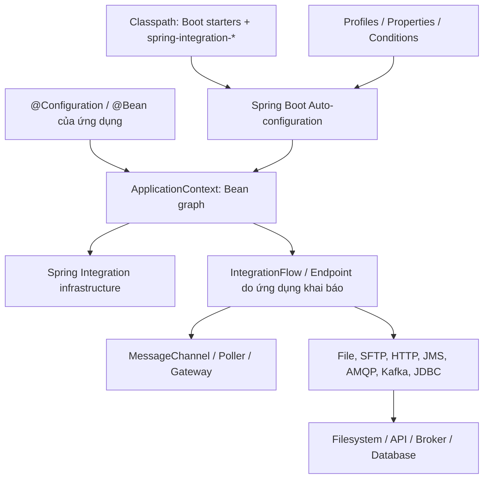
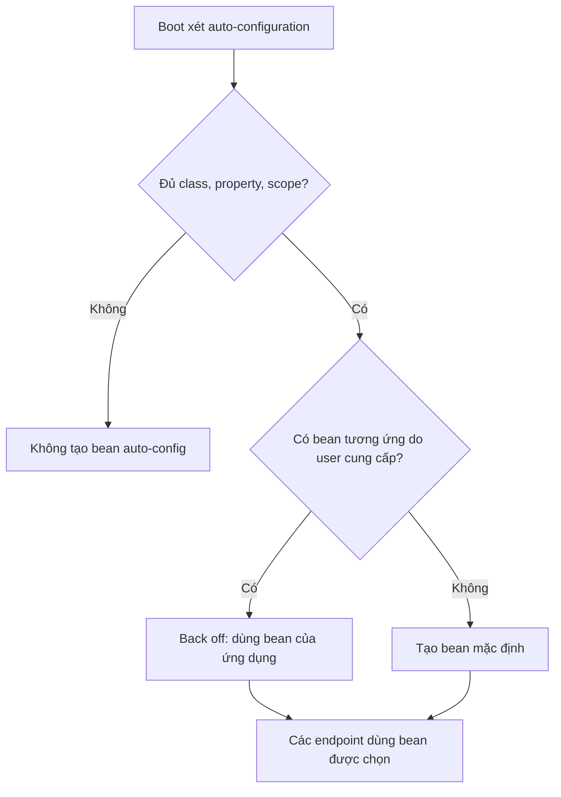

# Auto-configuration và bean override trong Spring Boot với Spring Integration Adapters

> **Chương:** Spring Boot  
> **Chủ đề:** Auto-configuration và bean override  
> **Module:** `SPRING_INTEGRATION_ADAPTERS` — kết nối hệ thống ngoài bằng inbound/outbound adapter, gateway, poller và `MessageChannel`; xử lý File, SFTP, HTTP, JMS, AMQP, Kafka, JDBC, hợp đồng message, lỗi và vòng đời kết nối.  
> **Đối tượng:** Lập trình viên Java/Spring Boot đã biết dependency injection, `@Bean`, `@Configuration` và Maven/Gradle.  
> **Môi trường thực hành gợi ý:** Java 17+, Spring Boot 3.x và Spring Integration 6.x theo BOM tương thích. Một số API, auto-configuration và starter có thể khác ở dòng phiên bản mới; đối chiếu dependency graph và condition report của **phiên bản dự án** trước khi áp dụng.

## 1. Bài toán: thêm adapter mà không hiểu các bean được tạo từ đâu

Một dịch vụ xử lý đơn hàng đang đọc file vào Spring Integration, gửi thông điệp qua `MessageChannel` và lưu trạng thái xuống database. Nhóm vận hành muốn bổ sung SFTP inbound, đẩy sự kiện sang Kafka và sử dụng một RabbitMQ `ConnectionFactory` khác mặc định. Sau khi thêm dependency, ứng dụng gặp ba lỗi:

1. Hai bean `MessageChannel` cùng kiểu khiến injection theo type mơ hồ.
2. Người phát triển tạo một `DataSource` thủ công rồi bất ngờ thấy cấu hình `spring.datasource.*` không còn được áp dụng như trước.
3. Một flow SFTP khởi chạy ở môi trường test do profile và điều kiện cấu hình chưa được xác định rõ, dẫn đến kết nối ra hệ thống đối tác.

Đây không chỉ là lỗi “thiếu dependency”. Phải hiểu **Spring Boot auto-configuration chọn tạo bean theo điều kiện nào**, khác gì **bean do ứng dụng tự khai báo**, và việc **override** ảnh hưởng thế nào đến adapter runtime.

**Mục tiêu bài:** điều khiển bean graph một cách có chủ đích, tránh âm thầm thay đổi cách định tuyến message, không dùng cơ chế ghi đè tên bean để chữa lỗi, và kiểm chứng startup qua condition report/test.

### Kết quả học tập

Sau bài này, bạn có thể:

- Phân biệt **Spring Boot auto-configuration**, **Spring Integration infrastructure**, **bean cấu hình ứng dụng** và **endpoint adapter**.
- Giải thích `@ConditionalOnClass`, `@ConditionalOnBean`, `@ConditionalOnMissingBean`, `@ConditionalOnProperty`, `@ConditionalOnSingleCandidate` và mối liên hệ với classpath, profile, property, thứ tự đăng ký bean.
- Hiểu **back-off** khi ứng dụng cung cấp bean tương thích; phân biệt **back-off**, **replacement**, **@Primary**, **@Qualifier** và **bean-definition overriding**.
- Thực hành khai báo `IntegrationFlow` đọc File inbound, poll theo cấu hình và gửi vào `DirectChannel` do ứng dụng đặt tên.
- Thiết kế mẫu auto-configuration cho một **starter nội bộ** có default channel và cách ứng dụng tùy biến an toàn.
- Phân tích tác động khi tùy biến `ConnectionFactory`, `DataSource` hoặc Kafka infrastructure đối với JMS, AMQP, Kafka, JDBC và SFTP.
- Dùng `--debug`, Actuator conditions, dependency tree và `ApplicationContextRunner` để kiểm chứng những bean xuất hiện hoặc không xuất hiện.
- Viết checklist cho retry, error channel, connection lifecycle, bảo mật cấu hình, metrics và shutdown.

## 2. Auto-configuration không đồng nghĩa adapter được tự khởi chạy

### 2.1. Bốn lớp trách nhiệm



| Lớp | Ví dụ | Điều gì được cấu hình? |
|---|---|---|
| **Classpath** | `spring-boot-starter-integration`, `spring-integration-file`, `spring-boot-starter-jdbc` | Có class để Boot và ứng dụng dùng; chưa chứng minh kết nối đã thành công |
| **Boot auto-configuration** | Hỗ trợ Integration, HTTP runtime, `DataSource`, Kafka/Rabbit infrastructure khi đủ điều kiện | Tạo các bean mặc định khi loại bean, properties và điều kiện phù hợp |
| **Spring Integration infrastructure** | `MessageChannel`, `IntegrationFlow`, endpoint lifecycle, error handling | Vận chuyển và xử lý message trong context |
| **Ứng dụng / adapter endpoint** | `Files.inboundAdapter(...)`, `Amqp.outboundAdapter(...)`, JMS gateway, SFTP session factory | Nguồn/đích thực tế, poller, tên channel, kết nối, mapping và error policy |

**Nguyên tắc:** Thêm `spring-integration-sftp` vào classpath không tự tạo một inbound flow để truy cập SFTP server. Thêm `spring-integration-kafka` không tự phát event nghiệp vụ. Bạn vẫn cần bean endpoint, topic, session factory/producer factory/consumer factory thích hợp và chính sách bảo mật.

### 2.2. Spring Boot đánh giá điều kiện như thế nào?

Một auto-configuration class có thể được kích hoạt khi class và dependency tồn tại, rồi tạo bean **chỉ khi thiếu một bean phù hợp**. Cú pháp minh họa:

```java
@AutoConfiguration
@ConditionalOnClass(SomeTransportClient.class)
class ExampleTransportAutoConfiguration {

    @Bean
    @ConditionalOnMissingBean(SomeConnectionFactory.class)
    SomeConnectionFactory exampleFactory() {
        return new SomeConnectionFactory();
    }
}
```

`SomeTransportClient`, `SomeConnectionFactory` và `ExampleTransportAutoConfiguration` là **tên giả để diễn giải điều kiện**, không phải API của Spring. Kết luận quan trọng là: một class có mặt **không bắt buộc** bean sẽ được tạo; còn một `@Bean` được ứng dụng cung cấp có thể khiến bean mặc định **back off**.

Các điều kiện được Spring Boot sử dụng phổ biến:

| Điều kiện | Kiểm tra điều gì? | Lỗi hay gặp |
|---|---|---|
| `@ConditionalOnClass` | Class tồn tại trên classpath | Chưa thêm adapter/provider dependency |
| `@ConditionalOnMissingClass` | Class không tồn tại | Một starter transitively kích hoạt nhánh không mong muốn |
| `@ConditionalOnBean` | Có bean phù hợp trong context đến thời điểm đánh giá | Phụ thuộc thứ tự cấu hình hoặc bean chưa được khai báo |
| `@ConditionalOnMissingBean` | Chưa có bean tương ứng theo type/name/annotation được cấu hình | Bean ứng dụng khiến default back off |
| `@ConditionalOnSingleCandidate` | Có đúng một ứng viên có thể chọn (kể cả khi có primary phù hợp) | Nhiều bean cùng type, không xác định ứng viên |
| `@ConditionalOnProperty` | Property có giá trị thỏa điều kiện | Sai prefix, profile, tên key, giá trị boolean |
| `@ConditionalOnResource` | Tài nguyên tồn tại | Sai đường dẫn classpath/file |
| `@Profile` | Spring profile đang active | Một flow bật nhầm trong test hoặc prod |

**Điểm tinh tế:** `@ConditionalOnMissingBean` không phải phép phủ định của “trong toàn bộ ứng dụng về sau sẽ có bean”. Khi viết auto-configuration, điều kiện được đánh giá dựa trên những bean definition đã được xử lý. Vì vậy nên đặt các cấu hình mặc định của **thư viện/starter** trong cơ chế Boot auto-configuration và để cấu hình ứng dụng đi trước, thay vì tạo nhiều `@Configuration` thông thường có thứ tự khó kiểm soát.

### 2.3. Hai giai đoạn cần phân biệt

- **Đăng ký BeanDefinition:** Spring đọc cấu hình, kiểm tra điều kiện, quyết định có định nghĩa bean hay không.
- **Khởi tạo/lifecycle:** Sau khi chọn bean, Spring tạo object, inject dependency, đăng ký endpoint và có thể kết nối/tạo consumer khi ứng dụng khởi chạy.

Một bean có thể **được đăng ký** nhưng bị lỗi ở lúc tạo vì thiếu properties; một Kafka listener hoặc SFTP poller có thể **đã khởi tạo** nhưng không kết nối broker/server được. Condition report chỉ giải thích việc chọn auto-configuration, **không thay thế readiness/health check** của hệ thống ngoài.

## 3. Ba khái niệm dễ nhầm: back-off, override, chọn bean

### 3.1. Back-off: Boot nhường cho cấu hình ứng dụng



Đây thường là cách **thay thế một bean mặc định đúng quy ước**: ứng dụng cung cấp một bean có type/name phù hợp; auto-configuration sử dụng `@ConditionalOnMissingBean` để không tạo thêm. Nó không cần và không nên bật tùy chọn ghi đè tên bean toàn cục.

Ví dụ khi Spring Boot cấu hình JDBC theo classpath và properties, việc ứng dụng khai báo `DataSource` tùy chỉnh có thể khiến DataSource auto-configuration không tạo mặc định. Hệ quả là **properties được Boot áp vào bean mặc định không tự động áp lên DataSource bạn tự viết**, trừ khi bạn chủ động bind.

### 3.2. `@Primary` chỉ chọn ưu tiên khi injection theo type

```java
@Configuration(proxyBeanMethods = false)
class ChannelSelectionConfig {

    @Bean("ordersChannel")
    @Primary
    MessageChannel ordersChannel() {
        return new DirectChannel();
    }

    @Bean("auditChannel")
    MessageChannel auditChannel() {
        return new PublishSubscribeChannel();
    }
}
```

Cần import `org.springframework.context.annotation.*`, `org.springframework.messaging.MessageChannel` và các channel của Spring Integration.

Có hai bean khác nhau. `@Primary` giúp Spring ưu tiên `ordersChannel` khi inject một `MessageChannel` **theo type** mà không có qualifier. Nó **không xóa** `auditChannel`, **không thay thế** auto-configuration và **không làm một flow đang gửi bằng tên `auditChannel` tự chuyển sang `ordersChannel`**.

### 3.3. `@Qualifier` chỉ rõ đúng ứng viên

```java
@Component
class OrderPublisher {
    private final MessageChannel ordersChannel;

    OrderPublisher(@Qualifier("ordersChannel") MessageChannel ordersChannel) {
        this.ordersChannel = ordersChannel;
    }

    void send(Message<?> message) {
        if (!ordersChannel.send(message)) {
            throw new IllegalStateException("Message was not accepted");
        }
    }
}
```

Trong ví dụ này cần import `@Component`, `@Qualifier`, `Message` và `MessageChannel`. Ưu tiên **tên bean/qualifier tường minh** khi một ứng dụng có nhiều channel hoặc ConnectionFactory cùng type. Không coi thứ tự trong source code là hợp đồng chọn bean.

### 3.4. Bean-definition overriding khác back-off

Khi hai cấu hình cố đăng ký **cùng tên bean** mà không có điều kiện phù hợp, Spring Boot mặc định có xu hướng **từ chối ghi đè bean definition** ở các phiên bản hiện đại, thường xuất hiện lỗi về trùng bean definition. Có thể thấy thuộc tính:

```yaml
spring:
  main:
    allow-bean-definition-overriding: false
```

**Không bật thành `true` chỉ để ứng dụng khởi động.** Ghi đè ngầm theo tên có thể che lỗi sai dependency, làm thay đổi message delivery hoặc vô tình vô hiệu hóa bảo mật. Cách sửa an toàn là sử dụng cơ chế back-off có chủ đích, tên khác, `@Qualifier`, `@Primary`, profile hoặc loại bỏ cấu hình không cần thiết.

### 3.5. Khi nào áp dụng cách nào?

| Tình huống | Nên dùng | Không nên dùng |
|---|---|---|
| Thay bean Boot mặc định mà auto-config hỗ trợ back-off | Một bean ứng dụng đúng type/name, kiểm tra condition report | Bật global bean definition overriding |
| Có nhiều `MessageChannel` cần định tuyến khác nhau | Đặt tên và `@Qualifier` / `.channel("name")` | Chọn theo thứ tự xuất hiện của bean |
| Có nhiều bean cùng type, một ứng viên mặc định khi inject | `@Primary` với lý do rõ ràng | Cho rằng `@Primary` xóa bean còn lại |
| Starter nội bộ cung cấp channel mặc định cho ứng dụng | `@AutoConfiguration` + `@ConditionalOnMissingBean(name = "...")` | Cấu hình thư viện thông thường tranh chấp với user config |
| Chỉ bật connector theo môi trường | `@ConditionalOnProperty`, `@Profile` và startup/readiness tests | Dựa vào việc broker “không truy cập được” để vô hiệu hóa |
| Muốn đổi poll interval | Cấu hình từng endpoint, `@ConfigurationProperties` | Thay toàn bộ integration infrastructure |

## 4. Mối quan hệ giữa Spring Boot và từng adapter

### 4.1. Dependency matrix và bean thường cần

| Adapter | Dependency Integration | Auto-config / tài nguyên nền tảng thường cần | Bean endpoint phải quyết định |
|---|---|---|---|
| **File** | `spring-integration-file` | Core Integration; filesystem/volume | File inbound/outbound source, filter, poller, path |
| **SFTP** | `spring-integration-sftp` | SSH client theo module, host/credential trust | `SessionFactory`, remote path, sync/stream adapter |
| **HTTP inbound** | `spring-integration-http` | Servlet web stack nếu dùng Servlet inbound | HTTP mapping, gateway, request/reply, auth policy |
| **HTTP outbound** | `spring-integration-http` | HTTP client phù hợp; không nhất thiết cần embedded server | URI, timeout, TLS, headers, reply/error mapping |
| **JMS** | `spring-integration-jms` | JMS provider `ConnectionFactory`, có thể dùng starter Artemis | Inbound/outbound/gateway, destination, ack/transaction |
| **AMQP/RabbitMQ** | `spring-integration-amqp` | `spring-boot-starter-amqp`, RabbitMQ `ConnectionFactory` / `RabbitTemplate` | Queue/exchange/routing key, listener/handler |
| **Kafka** | `spring-integration-kafka` | Spring Kafka producer/consumer factories, Boot config qua `spring.kafka.*` | Topic, group, deserializer, offset, retry |
| **JDBC** | `spring-integration-jdbc` | `spring-boot-starter-jdbc` + driver, `DataSource` / `JdbcTemplate` | Polling query, update, transaction, concurrency |

**Phân biệt:** Không phải adapter nào cũng có Boot starter cùng tên. Boot auto-configuration có thể tạo `DataSource` hay `RabbitTemplate`, nhưng **không tự biết workflow nghiệp vụ** của bạn. Thiết kế `IntegrationFlow`, `MessageChannel`, poller và endpoint vẫn là trách nhiệm ứng dụng hoặc thư viện tích hợp có chủ đích.

### 4.2. Ví dụ back-off có hệ quả thực tế

- **JDBC:** Tạo một `DataSource` thủ công có thể khiến bean mặc định do Boot tạo không xuất hiện. Trước khi làm vậy, xem lại pool sizing, driver, transaction manager, health/metrics và profile.
- **AMQP:** Tạo riêng một `ConnectionFactory` có thể làm bean factory mặc định bị thay. Các bean phụ thuộc như template/listener factory có thể vẫn được Boot tạo **dựa trên factory tùy chỉnh**, hoặc bị tác động bởi thêm điều kiện khác; đọc condition report để biết chính xác.
- **Kafka:** Có nhiều `ProducerFactory`, `ConsumerFactory` hoặc `KafkaTemplate` cần đặt tên/qualifier rõ. Custom bean có thể làm một số default bean không được tạo; code vẫn có thể khởi động nhưng dùng sai cluster.
- **SFTP:** `DefaultSftpSessionFactory` và known-host trust thường do ứng dụng khai báo, không phải Bean Boot mặc định chỉ vì có module SFTP. Cần quản lý lifecycle và secret.
- **HTTP:** Có `spring-boot-starter-web` có thể làm Boot khởi tạo web server; chỉ gọi HTTP outbound không nhất thiết phải mở cổng.
- **File:** Không cần transport factory; vấn đề thường là đường dẫn, filter, poller, bean channel và việc file được xử lý lại sau restart.

### 4.3. Tránh “override” những bean hạ tầng chỉ vì tên quen thuộc

Các bean hạ tầng của Spring Integration có quy ước tên như `errorChannel` và các cơ chế default poller, endpoint lifecycle. Việc khai báo bean trùng tên mà không hiểu thành phần nào đăng ký bean đó có thể phá flow khác. Cách ít rủi ro hơn:

1. Đặt **tên riêng** cho channel nghiệp vụ, ví dụ `orders.inbound`, `orders.errors`.
2. Cấu hình poller **ngay trên endpoint** đang cần lịch thăm dò.
3. Đưa error handler vào flow tương ứng và định nghĩa retry policy rõ ràng.
4. Chỉ tùy biến hạ tầng toàn cục khi hiểu tác động đến tất cả adapter và có integration tests.


## 5. Lab Spring Boot: bật/tắt File inbound flow theo property

Bài lab này dùng **một adapter thật** nhưng không phụ thuộc broker, DB hay SFTP server. Mục tiêu là nhìn thấy sự khác nhau giữa bean do ứng dụng chủ động khai báo, bean infrastructure được framework hỗ trợ và endpoint chỉ xuất hiện khi điều kiện bật.

### 5.1. Dependency tối thiểu

Dùng một dự án Spring Boot tương thích Java 17+ đã có parent hoặc dependency management BOM của Boot. Thêm vào `pom.xml` phần sau; **đây là khối dependencies**, không phải POM đầy đủ:

```xml
<dependencies>
    <dependency>
        <groupId>org.springframework.boot</groupId>
        <artifactId>spring-boot-starter-integration</artifactId>
    </dependency>
    <dependency>
        <groupId>org.springframework.integration</groupId>
        <artifactId>spring-integration-file</artifactId>
    </dependency>
    <dependency>
        <groupId>org.springframework.boot</groupId>
        <artifactId>spring-boot-starter-test</artifactId>
        <scope>test</scope>
    </dependency>
    <dependency>
        <groupId>org.springframework.integration</groupId>
        <artifactId>spring-integration-test</artifactId>
        <scope>test</scope>
    </dependency>
</dependencies>
```

Tương đương trong Gradle Groovy DSL **đã cấu hình BOM hoặc Boot plugin và dependency management**:

```groovy
dependencies {
    implementation 'org.springframework.boot:spring-boot-starter-integration'
    implementation 'org.springframework.integration:spring-integration-file'

    testImplementation 'org.springframework.boot:spring-boot-starter-test'
    testImplementation 'org.springframework.integration:spring-integration-test'
}
```

Không tự thêm phiên bản `spring-integration-file` lệch Spring Boot BOM. Khi không dùng Boot dependency management, việc bỏ version sẽ không tự resolve; phải cấu hình BOM hoặc bộ version tương thích trước.

### 5.2. Cấu trúc

```text
file-auto-config-lab/
├── pom.xml
└── src/
    ├── main/
    │   ├── java/com/example/adapter/
    │   │   ├── AdapterApplication.java
    │   │   ├── FileProperties.java
    │   │   └── FileFlowConfiguration.java
    │   └── resources/application.yml
    └── test/java/com/example/adapter/
        └── FileFlowContextTest.java
```

Khi chạy, dữ liệu file nằm ở `data/in` tính từ **working directory**. Không cấu hình endpoint production bằng đường dẫn tương đối thiếu kiểm soát; dùng absolute path, volume và tài khoản chạy app có quyền rõ ràng.

### 5.3. Spring Boot entry point

File `AdapterApplication.java`:

```java
package com.example.adapter;

import org.springframework.boot.SpringApplication;
import org.springframework.boot.autoconfigure.SpringBootApplication;

@SpringBootApplication
public class AdapterApplication {
    public static void main(String[] args) {
        SpringApplication.run(AdapterApplication.class, args);
    }
}
```

`@SpringBootApplication` bao gồm auto-configuration và component scan; nó không tự quét file vật lý hay tạo flow File. Những endpoint ấy nằm trong `FileFlowConfiguration`.

### 5.4. Bind cấu hình bằng record

File `FileProperties.java`:

```java
package com.example.adapter;

import java.nio.file.Path;
import java.time.Duration;

import org.springframework.boot.context.properties.ConfigurationProperties;

@ConfigurationProperties(prefix = "app.file")
public record FileProperties(
        Path inbox,
        Duration pollInterval
) {}
```

Boot binder chuyển property `poll-interval` thành `pollInterval` và parse `2s` thành `Duration`. Trong app production nên thêm kiểm tra `inbox` không null và poll interval dương, tránh bean khởi tạo với đường dẫn hoặc khoảng thời gian không hợp lệ.

### 5.5. Tạo channel có tên rõ ràng và flow phụ thuộc điều kiện

File `FileFlowConfiguration.java`:

```java
package com.example.adapter;

import java.io.File;

import org.slf4j.Logger;
import org.slf4j.LoggerFactory;
import org.springframework.boot.autoconfigure.condition.ConditionalOnProperty;
import org.springframework.boot.context.properties.EnableConfigurationProperties;
import org.springframework.context.annotation.Bean;
import org.springframework.context.annotation.Configuration;
import org.springframework.integration.channel.DirectChannel;
import org.springframework.integration.dsl.IntegrationFlow;
import org.springframework.integration.dsl.Pollers;
import org.springframework.integration.file.dsl.Files;
import org.springframework.messaging.MessageChannel;

@Configuration(proxyBeanMethods = false)
@EnableConfigurationProperties(FileProperties.class)
public class FileFlowConfiguration {

    private static final Logger log =
            LoggerFactory.getLogger(FileFlowConfiguration.class);

    @Bean("fileEvents")
    MessageChannel fileEvents() {
        return new DirectChannel();
    }

    @Bean
    @ConditionalOnProperty(
        prefix = "app.file",
        name = "enabled",
        havingValue = "true"
    )
    IntegrationFlow fileInboundFlow(FileProperties props) {
        return IntegrationFlow
            .from(
                Files.inboundAdapter(props.inbox().toFile())
                     .autoCreateDirectory(true)
                     .patternFilter("*.txt"),
                endpoint -> endpoint.poller(
                    Pollers.fixedDelay(props.pollInterval())
                           .maxMessagesPerPoll(5)
                )
            )
            .channel("fileEvents")
            .get();
    }

    @Bean
    IntegrationFlow fileLoggingFlow() {
        return IntegrationFlow
            .from("fileEvents")
            .handle(message -> {
                if (!(message.getPayload() instanceof File file)) {
                    throw new IllegalArgumentException(
                        "Expected java.io.File payload"
                    );
                }
                log.info("Received file name={} bytes={}",
                         file.getName(), file.length());
            })
            .get();
    }
}
```

Những điểm cần hiểu:

- `fileEvents` là **bean của ứng dụng**, có tên rõ ràng; Boot không cần tự tạo channel nghiệp vụ này.
- `fileInboundFlow` chỉ có **bean definition khi `app.file.enabled=true`**. Nếu false hoặc thiếu property (do `matchIfMissing` mặc định false), flow inbound không được đăng ký.
- `fileLoggingFlow` vẫn tồn tại khi inbound tắt; vì nó chỉ lắng nghe channel, không tự sinh file mới.
- `Files.inboundAdapter` trả payload kiểu `java.io.File`; chưa tự đọc nội dung thành `String`.
- `.channel("fileEvents")` chọn bean **bằng tên**. Dùng `@Primary` trên một channel khác không âm thầm chuyển route.
- Poller là của **endpoint này**, không thay đổi mọi inbound adapter trên hệ thống.
- File inbound filter giảm việc lặp lại trong một số tình huống, nhưng **không hứa exactly-once qua restart**. Với tác dụng phụ nghiệp vụ cần idempotency, persistent accept-once filter/checkpoint và quy trình archive.

### 5.6. Application properties

File `src/main/resources/application.yml`:

```yaml
spring:
  application:
    name: file-auto-config-lab
  main:
    web-application-type: none

app:
  file:
    enabled: true
    inbox: ./data/in
    poll-interval: 2s

logging:
  level:
    com.example.adapter: INFO
    org.springframework.integration: INFO
```

`web-application-type: none` tránh mở HTTP server trong một app chỉ poll File. Muốn nhận HTTP inbound cần web runtime phù hợp; khi đó **không** nên dùng lại lựa chọn không web này.

### 5.7. Chạy và thay đổi điều kiện

Trong Maven project đã có wrapper:

```bash
./mvnw spring-boot:run
```

Với Gradle project tương ứng:

```bash
./gradlew bootRun
```

Trên Windows dùng `mvnw.cmd` hoặc `gradlew.bat`. Tạo `data/in/order-001.txt` với nội dung giả:

```text
orderId=ORDER-001
tenantId=tenant-a
```

Khi inbound flow đang bật, handler sẽ ghi tên file và kích thước. File `ignore.csv` sẽ bị bỏ qua bởi pattern `*.txt`.

Đổi `app.file.enabled` sang `false`, **khởi động lại ApplicationContext**, rồi tạo thêm một file `order-002.txt`. Ứng dụng không được tạo thêm inbound consumer để poll file. `fileEvents` và `fileLoggingFlow` vẫn là bean hợp lệ. Đây là minh họa **điều kiện đăng ký bean**, không phải yêu cầu thử làm mất kết nối file để vô hiệu hóa endpoint.

**Quan trọng:** Thay đổi nội dung file YAML khi context đã chạy không tự làm `@ConditionalOnProperty` được đánh giá lại. Muốn điều khiển endpoint động lúc runtime phải có thiết kế lifecycle rõ ràng, ví dụ start/stop endpoint qua cơ chế được hỗ trợ, chứ không dựa vào auto-configuration tự refresh.

## 6. Bean override an toàn trong starter nội bộ

Ứng dụng ở mục 5 tự khai báo channel `fileEvents`. Bây giờ giả sử tổ chức phát hành một **internal starter** muốn cung cấp channel đó làm mặc định, nhưng vẫn cho phép từng ứng dụng tùy chọn bean riêng.

### 6.1. Tạo auto-configuration có back-off theo tên

Trong một thư viện Spring Boot **riêng** (ví dụ package `com.example.autoconfig`), khai báo:

```java
package com.example.autoconfig;

import org.springframework.boot.autoconfigure.AutoConfiguration;
import org.springframework.boot.autoconfigure.condition.ConditionalOnMissingBean;
import org.springframework.context.annotation.Bean;
import org.springframework.integration.channel.DirectChannel;
import org.springframework.messaging.MessageChannel;

@AutoConfiguration
public class AcmeFileChannelsAutoConfiguration {

    @Bean("fileEvents")
    @ConditionalOnMissingBean(name = "fileEvents")
    MessageChannel defaultFileEvents() {
        return new DirectChannel();
    }
}
```

Trong **JAR thư viện**, đăng ký auto-configuration bằng file:

```text
META-INF/spring/org.springframework.boot.autoconfigure.AutoConfiguration.imports
```

Nội dung file này là một dòng:

```text
com.example.autoconfig.AcmeFileChannelsAutoConfiguration
```

Khi thư viện đó được thêm vào Boot app:

- Nếu app **không** định nghĩa bean `fileEvents`, auto-configuration cung cấp `DirectChannel` mặc định.
- Nếu app **có** `@Bean("fileEvents")`, auto-configuration phải **back off**, không tạo bean cùng tên.
- Nếu app tạo `MessageChannel` có **tên khác**, conditional theo tên vẫn có thể tạo `fileEvents`. Đây là lý do phải hiểu rõ phạm vi của điều kiện.

`@ConditionalOnMissingBean(name = "fileEvents")` phù hợp ví dụ này hơn việc kiểm tra thiếu **mọi** `MessageChannel`, vì ứng dụng Spring Integration có thể có nhiều channel khác nhau. Với auto-config cấp transport, điều kiện theo type có thể phù hợp hơn nếu hợp đồng là “chỉ có một ConnectionFactory”; phải chọn type/name theo **ngữ nghĩa bean**.

**Giới hạn:** Ví dụ auto-configuration ở đây là code cho một starter/thư viện **khác**, không được đặt cùng package ứng dụng rồi mong luôn có hành vi về thứ tự giống auto-config thực. Spring Boot hỗ trợ đăng ký auto-config từ JAR qua `AutoConfiguration.imports` để chúng được xét theo vòng đời phù hợp.

### 6.2. Ứng dụng tùy biến bean và tác động tới flow

Khi tổ chức muốn publish một event tới nhiều subscriber, ứng dụng có thể cố ý cung cấp channel khác:

```java
@Configuration(proxyBeanMethods = false)
class CustomFileChannelConfig {

    @Bean("fileEvents")
    MessageChannel customFileEvents() {
        return new PublishSubscribeChannel();
    }
}
```

Với import tương ứng, bean này có cùng tên `fileEvents` và khiến internal auto-configuration ở mục 6.1 back off. **Tuy nhiên đây là thay đổi ngữ nghĩa**, không chỉ “ghi đè” hình thức:

| `DirectChannel` | `PublishSubscribeChannel` |
|---|---|
| Unicast tới một subscriber được dispatcher chọn | Phát thông điệp tới các subscriber |
| Thường đồng bộ với thread gửi | Có thể đồng bộ hoặc dùng executor theo cấu hình |
| Hợp lý cho một tuyến xử lý chính | Hợp lý cho fan-out khi mọi subscriber đều cần nhận |
| Không tự tạo hàng đợi bền vững | Không tự tạo hàng đợi bền vững |

Nếu flow File trước đây chỉ có một handler, fan-out có thể khiến nhiều tác dụng phụ xảy ra khi thêm subscriber. Cần test giao hàng, lỗi, đồng bộ/bất đồng bộ và yêu cầu idempotency **trước khi chọn kiểu channel mới**.

### 6.3. Tại sao không dùng `@Primary` để “override” channel theo tên?

`@Primary` chỉ ưu tiên cho injection theo type. Nếu DSL đang gọi:

```java
.channel("fileEvents")
```

thì tên `fileEvents` đã xác định đích. Một bean khác có `@Primary` không được tự động thay thế. Nếu muốn chuyển route, đổi cấu hình flow hoặc có giải pháp routing rõ ràng.

### 6.4. Chọn profile và property có chủ đích

Bạn có thể tổ chức config môi trường:

```java
@Configuration(proxyBeanMethods = false)
@Profile("partner-sftp")
class PartnerSftpFlowConfig {
    // Chỉ đăng ký những endpoint SFTP được phép cho profile này.
}
```

Cùng với `@ConditionalOnProperty` trên flow, profile nên được kiểm soát trong deployment. Không dùng “có SFTP dependency” làm tín hiệu tự động mở kết nối; có thể cần SFTP trong code test nhưng chỉ production profile mới kết nối đối tác.

**Không gắn `@ConditionalOnProperty` tùy tiện vào bean được các flow khác luôn bắt buộc inject.** Nếu condition làm bean mất đi nhưng downstream bean vẫn required constructor injection, startup sẽ lỗi. Thiết kế cả một nhóm flow/endpoints theo cùng feature toggle hoặc sử dụng dependency optional có chủ đích.


## 7. Back-off của bean hạ tầng: DataSource, JMS, AMQP và Kafka

Bean của ứng dụng **có thể thay đổi cả chuỗi auto-configuration**, không chỉ một object riêng lẻ. Khi tùy biến transport, hãy phân biệt:

1. **Factory/driver/client:** tạo kết nối tới nguồn ngoài.
2. **Template hoặc listener infrastructure:** gửi/nhận dữ liệu bằng factory đã có.
3. **Spring Integration endpoint:** nối transport với `MessageChannel`, áp dụng converter, retry, ACK và error handling.
4. **Business flow:** transform, route, persist và correlate message.

### 7.1. JDBC: một DataSource thủ công khiến Boot back off

Nếu có `spring-boot-starter-jdbc` và driver phù hợp, Spring Boot có khả năng cấu hình `DataSource` dựa trên `spring.datasource.*`. Khi ứng dụng cố ý khai báo một `DataSource` của riêng mình, bean mặc định thường không được tạo.

Ví dụ **chỉ dùng khi ứng dụng thực sự cần tùy biến** và có HikariCP trên classpath:

```java
package com.example.adapter;

import com.zaxxer.hikari.HikariDataSource;
import org.springframework.boot.context.properties.ConfigurationProperties;
import org.springframework.context.annotation.Bean;
import org.springframework.context.annotation.Configuration;
import org.springframework.context.annotation.Profile;

@Configuration(proxyBeanMethods = false)
@Profile("custom-jdbc")
public class CustomJdbcConfiguration {

    @Bean("dataSource")
    @ConfigurationProperties(prefix = "app.jdbc.pool")
    HikariDataSource dataSource() {
        return new HikariDataSource();
    }
}
```

Cấu hình riêng:

```yaml
app:
  jdbc:
    pool:
      jdbc-url: jdbc:postgresql://db.internal.example:5432/orders
      username: orders_app
      # Password lấy từ secret manager, không hard-code trong Git.
      maximum-pool-size: 8
```

Khi chạy profile `custom-jdbc`:

- `dataSource` là **bean do ứng dụng khai báo**.
- Trong trường hợp Boot DataSource auto-configuration có điều kiện thiếu `DataSource`, nhánh tạo mặc định sẽ back off.
- Các bean như `JdbcTemplate`, transaction manager hoặc health indicator **có thể** vẫn tự tạo nếu điều kiện riêng của chúng được đáp ứng bởi DataSource tùy chỉnh. Xem condition report, đừng giả định tất cả đều biến mất hoặc vẫn tồn tại.
- `spring.datasource.*` **không tự bind vào** bean custom này; ví dụ trên chủ động bind `app.jdbc.pool.*`.
- Module `spring-integration-jdbc` vẫn cần để dùng JDBC inbound/outbound Integration endpoint. Việc tạo `DataSource` không tự tạo JDBC poller.

**Lưu ý:** Có hai DataSource khác nhau không có nghĩa Boot sẽ cấu hình một mặc định rồi bạn thêm “một cái thứ hai”. Một bean tự khai báo có thể đã khiến nhánh mặc định back off. Nếu cần **multi-DataSource**, nên định nghĩa rõ cả hai, cách chọn bằng `@Primary`/`@Qualifier`, transaction manager riêng, repository và testing; tránh chọn database theo type một cách mơ hồ.

### 7.2. JMS và AMQP có hai loại ConnectionFactory khác nhau

Trong code Java:

- JMS: `jakarta.jms.ConnectionFactory`, tùy provider (ví dụ Artemis).
- RabbitMQ qua Spring AMQP: `org.springframework.amqp.rabbit.connection.ConnectionFactory`.

Hai interface này **không tương đương**, dù có cùng simple name `ConnectionFactory`. Import nhầm có thể khiến bean condition, constructor injection hoặc adapter DSL không tương thích.

Khi cấu hình AMQP:

```text
Spring Boot AMQP infrastructure
  └── Rabbit ConnectionFactory
       ├── RabbitTemplate
       ├── listener containers
       └── Spring Integration AMQP adapter / gateway
```

Nếu ứng dụng thay Rabbit `ConnectionFactory`, các bean phụ thuộc có thể dùng factory mới hoặc thay đổi điều kiện tạo bean. Không được chỉ nhìn “context started” mà suy queue đã sẵn sàng, publisher confirm đã bật hoặc broker reachable. Cần tests cho vhost, TLS, permissions, exchange/queue, retry/requeue và shutdown.

Một lựa chọn khác là **không override factory của Boot** mà tùy biến qua properties hoặc customizer do phiên bản Boot hỗ trợ. Chỉ tạo bean thủ công khi phải quản lý kết nối khác default (ví dụ nhiều cluster/vhost) và đã nắm rõ cấu hình thay thế.

### 7.3. Kafka: default ProducerFactory/ConsumerFactory không phải Integration endpoint

`spring-integration-kafka` dùng Spring Kafka infrastructure. Spring Boot có thể cung cấp bean mặc định cho `ProducerFactory`, `ConsumerFactory`, `KafkaTemplate` hoặc listener container factory theo classpath/điều kiện/phiên bản. Nhưng:

- Có `KafkaTemplate` **không tự publish** message từ channel.
- Có `ConsumerFactory` **không tự subscribe** vào topic của nghiệp vụ.
- Một `@Bean ProducerFactory<?, ?>` tùy chỉnh có thể khiến nhánh tạo bean mặc định back off, nhưng tác động cụ thể phải kiểm tra condition report của dự án.
- Khi có nhiều Kafka cluster, phải đặt tên/`@Qualifier` cho factory/template/adapter và cấu hình transactions, serializers, SASL/TLS riêng.

Bảo đảm thứ tự partition, offset commit và idempotency là thiết kế runtime, không phải hệ quả của bean override. Việc đổi producer factory còn có thể thay đổi cách serialize payload hoặc cluster đích dù `IntegrationFlow` không đổi.

### 7.4. SFTP: chủ động tạo SessionFactory thay vì mong Boot tự làm

Một SFTP inbound adapter thường cần:

- `SessionFactory` có host, port, user, host-key verification và credentials.
- File synchronizer hoặc streaming message source.
- Local/remote directory, filter, remote file completion policy.
- Poller, timeout, reconnect, retry và xử lý file nhận dở.

Không mặc định Spring Boot tạo SFTP `SessionFactory` chỉ vì có `spring-integration-sftp`. Nếu nhiều đối tác dùng nhiều SFTP server, dùng bean tên riêng `partnerASessionFactory`, `partnerBSessionFactory` và inject có qualifier. Đừng đặt `@Primary` lên một factory rồi hy vọng mọi endpoint sẽ tự chọn đúng đối tác.

### 7.5. HTTP: auto-configuration web server khác HTTP outbound client

Có Servlet web starter có thể kích hoạt embedded server và web MVC infrastructure; nhưng một HTTP outbound gateway chỉ cần HTTP client phù hợp, không nhất thiết cần HTTP inbound. Nếu ứng dụng là integration worker không phục vụ request, việc thêm web starter vô ý có thể mở cổng HTTP không cần thiết.

Khi custom HTTP client bean hoặc request factory, kiểm tra TLS trust, timeout, connection pooling, proxy, retry idempotency, header filtering và host allowlist. Không sao chép `Authorization` hoặc cookie từ inbound request sang mọi outbound call.

## 8. Diagnosing auto-configuration: xem lý do, không đoán

### 8.1. Condition evaluation report

Spring Boot có thể xuất báo cáo match/negative match của auto-configuration khi bật debug. Với Maven wrapper trong dự án Boot hợp lệ:

```bash
./mvnw spring-boot:run -Dspring-boot.run.arguments=--debug
```

Với Gradle:

```bash
./gradlew bootRun --args='--debug'
```

Các lệnh trên mang tính minh họa cho shell hỗ trợ cú pháp tương ứng; Windows dùng wrapper `mvnw.cmd`/`gradlew.bat` và cách quote phù hợp. Có thể kích hoạt tạm `debug: true` trong configuration cho môi trường cô lập.

Khi đọc report, tìm:

- **Positive matches:** class/property/bean condition nào đúng?
- **Negative matches:** thiếu class, property không thỏa, hoặc đã tồn tại bean cùng type/name?
- **Exclusions:** có vô tình loại bỏ auto-configuration cần thiết?
- **Bean graph hiện hành:** tên, type, qualifier, primary, scope và profile của bean được tạo.

Báo cáo **không** chứng minh kết nối tới RabbitMQ/Kafka/DB đã sẵn sàng; cần kiểm tra health/readiness hoặc thử transport độc lập.

### 8.2. Actuator conditions endpoint

Nếu ứng dụng có Actuator và expose `conditions` qua HTTP theo cấu hình, endpoint cho phép xem các điều kiện đã match. Không nên expose endpoint này công khai ở production vì có thể tiết lộ chi tiết cấu hình nội bộ.

Ví dụ cấu hình cho **môi trường test có HTTP server và kiểm soát truy cập**:

```yaml
management:
  endpoints:
    web:
      exposure:
        include: health,info,conditions
```

Ứng dụng lab mục 5 dùng `web-application-type: none` nên **không có Actuator HTTP endpoint** nếu không chủ động chuyển sang web application và thêm Actuator/web runtime phù hợp. Để học cơ chế, dùng debug report hoặc test runner vẫn đủ.

### 8.3. Dependency tree và runtime classpath

Maven:

```bash
./mvnw dependency:tree -Dincludes=org.springframework.integration
./mvnw dependency:tree -Dincludes=org.springframework.boot
```

Gradle:

```bash
./gradlew dependencies --configuration runtimeClasspath
./gradlew dependencyInsight --configuration runtimeClasspath --dependency spring-integration-core
```

Hãy đối chiếu với matrix module:

| Chức năng | Cần thấy trên classpath | Không nên tự giả định |
|---|---|---|
| File inbound | Integration core + `spring-integration-file` | Có poller hay có file source được khai báo |
| SFTP | `spring-integration-sftp` | Đã có session factory/known-host trust |
| HTTP inbound | `spring-integration-http` + web runtime phù hợp | Có route HTTP hợp lệ và authentication |
| JMS | `spring-integration-jms` + provider | Broker `ConnectionFactory` luôn đúng |
| AMQP | `spring-integration-amqp` + Spring AMQP | Đã có queue/binding và ACK policy |
| Kafka | `spring-integration-kafka` + Spring Kafka/client | Đã có topic/consumer group phù hợp |
| JDBC | `spring-integration-jdbc` + JDBC infrastructure/driver | Đã có schema và transaction boundary |

### 8.4. Quy trình điều tra một bean “biến mất”

1. Xác định **tên bean + kiểu đầy đủ** mà endpoint cần, không chỉ phần simple class name.
2. Xem Spring profile, `@ConditionalOnProperty` và effective properties trên môi trường lỗi.
3. Xem classpath (runtime, không chỉ compile).
4. Xem condition report: cấu hình bị skip hay một bean user đã khiến back-off?
5. Kiểm tra `@Primary` và qualifier có dẫn injection tới bean khác không.
6. Xem bean có được tạo nhưng thất bại lúc initialization vì thiếu secrets/broker/driver không.
7. Kiểm tra auto-configuration exclusion và lỗi trùng tên bean.
8. Viết test tái hiện từ một context nhỏ trước khi sửa production flow.

## 9. Test bean back-off và feature toggle

Unit test thông thường không đủ để xác minh điều kiện auto-configuration. Spring Boot cung cấp `ApplicationContextRunner` cho bài test context nhỏ, còn `@SpringBootTest` phù hợp khi cần xác nhận app đầy đủ.

### 9.1. ApplicationContextRunner kiểm tra internal starter

Trong **test của thư viện internal starter** mục 6, dùng ví dụ:

```java
package com.example.autoconfig;

import org.junit.jupiter.api.Test;
import org.springframework.boot.autoconfigure.AutoConfigurations;
import org.springframework.boot.test.context.runner.ApplicationContextRunner;
import org.springframework.context.annotation.Bean;
import org.springframework.context.annotation.Configuration;
import org.springframework.integration.channel.DirectChannel;
import org.springframework.integration.channel.PublishSubscribeChannel;
import org.springframework.messaging.MessageChannel;

import static org.assertj.core.api.Assertions.assertThat;

class AcmeFileChannelsAutoConfigurationTest {

    private final ApplicationContextRunner runner =
        new ApplicationContextRunner().withConfiguration(
            AutoConfigurations.of(AcmeFileChannelsAutoConfiguration.class)
        );

    @Test
    void createsDefaultWhenApplicationHasNoChannel() {
        runner.run(context -> {
            assertThat(context).hasBean("fileEvents");
            assertThat(context.getBean("fileEvents"))
                .isInstanceOf(DirectChannel.class);
        });
    }

    @Test
    void backsOffWhenApplicationProvidesBeanByName() {
        runner.withUserConfiguration(UserChannels.class)
            .run(context -> {
                assertThat(context).hasBean("fileEvents");
                assertThat(context.getBean("fileEvents"))
                    .isInstanceOf(PublishSubscribeChannel.class);
            });
    }

    @Configuration(proxyBeanMethods = false)
    static class UserChannels {
        @Bean("fileEvents")
        MessageChannel customFileEvents() {
            return new PublishSubscribeChannel();
        }
    }
}
```

Hai test chứng minh:

- Khi không có user bean, thư viện tạo channel mặc định.
- Khi user bean **cùng tên** đã được đăng ký, thư viện không tạo bean cạnh tranh và context không cần cho phép global overriding.

Test không gửi message nên **không chứng minh** hành vi fan-out hoặc back-pressure. Nếu có thay `DirectChannel` bằng `PublishSubscribeChannel`, cần integration test với nhiều subscriber và xử lý lỗi theo ngữ nghĩa thực tế.

### 9.2. @SpringBootTest kiểm tra flow không được bật

Trong dự án lab File mục 5, tạo `FileFlowContextTest.java`:

```java
package com.example.adapter;

import org.junit.jupiter.api.Test;
import org.springframework.beans.factory.annotation.Autowired;
import org.springframework.boot.test.context.SpringBootTest;
import org.springframework.context.ApplicationContext;
import org.springframework.integration.channel.DirectChannel;

import static org.assertj.core.api.Assertions.assertThat;

@SpringBootTest(properties = {
    "app.file.enabled=false",
    "app.file.inbox=./build/test-in",
    "app.file.poll-interval=2s",
    "spring.main.web-application-type=none"
})
class FileFlowContextTest {

    @Autowired
    ApplicationContext context;

    @Test
    void disablingFileAdapterDoesNotRemoveItsChannel() {
        assertThat(context.containsBean("fileInboundFlow")).isFalse();
        assertThat(context.containsBean("fileLoggingFlow")).isTrue();
        assertThat(context.getBean("fileEvents"))
            .isInstanceOf(DirectChannel.class);
    }
}
```

Đây là **kiểm tra bean graph** khi property tắt. Test khi flow bật cần dùng temp directory và chờ asynchronous poll có deadline; không dùng `Thread.sleep` cố định rồi kết luận fail khi CI chạy chậm.

### 9.3. Điều gì cần kiểm tra khi thay default transport bean?

| Thay đổi | Test tối thiểu |
|---|---|
| Custom `DataSource` | Condition report xác nhận default back-off; `JdbcTemplate`/transaction manager trỏ DB đúng |
| Rabbit ConnectionFactory mới | RabbitTemplate và listener dùng đúng broker/vhost, TLS, queue, ACK và shutdown |
| Kafka template/factory mới | Topic/cluster đúng, serializer và security đúng, consumer group không sai lệch |
| SFTP session factory nhiều đối tác | Bean qualifier đúng, host key validation, retry/reconnect, stream/session đóng |
| HTTP client tùy chỉnh | Timeout, TLS, headers, redirect, error 4xx/5xx và idempotent retry |
| Channel type đổi | Đúng subscriber, thứ tự/giao hàng, fan-out, propagation lỗi và thread model |
| Poller override | Tần suất, concurrency, batch, back-pressure, không chồng poll |

Mỗi test nên xác minh cả **cấu hình được chọn** và **hành vi khi runtime lỗi**. Chỉ khởi tạo context thành công chưa đủ làm bằng chứng adapter hoạt động đúng.


## 10. Bảng lỗi phổ biến và cách sửa theo đúng nguyên nhân

| Hiện tượng | Nhận định đầu tiên | Cách kiểm chứng và sửa |
|---|---|---|
| `BeanDefinitionOverrideException` | Hai cấu hình định nghĩa **cùng tên bean** | Xem nguồn bean, chỉ giữ một định nghĩa hoặc để auto-config back off; không bật ghi đè toàn cục |
| `NoUniqueBeanDefinitionException` | Nhiều bean cùng type, injection thiếu quy tắc | Đặt `@Qualifier`; `@Primary` chỉ khi có một default hợp lý |
| `NoSuchBeanDefinitionException` | Bean chưa được đăng ký | Kiểm tra profile, property, classpath, bean condition và tên/kiểu |
| Bean tùy chỉnh không được dùng | Injection trỏ theo tên/qualifier khác, hoặc auto-config đang được chọn | Xem actual bean reference và condition report |
| Tạo `DataSource` xong app dùng sai DB | Default back off, properties custom chưa bind hoặc nhiều DataSource | Xem effective config, JDBC URL, bean tên/qualifier và transaction manager |
| Kafka flow publish sang cluster khác | ProducerFactory/template mặc định bị thay hoặc ambiguity | Trace từ IntegrationFlow đến template, factory và bootstrap servers |
| Rabbit listener không nhận message | Broker/vhost/queue binding, listener/container bean hoặc profile sai | Kiểm tra context, broker topology, network/ACL và health |
| JMS không có factory | Thiếu provider hoặc import nhầm `ConnectionFactory` | Đối chiếu `jakarta.jms.ConnectionFactory` và bean thực |
| SFTP tự kết nối khi chạy test | Flow được bật vì profile/property cấu hình sai | Condition trên endpoint và test disabled-by-default |
| File inbound không poll | Property false, sai path/filter, thiếu poller hoặc flow chưa khởi tạo | Kiểm tra bean flow, directory, filesystem permissions và logs |
| Thêm `spring-boot-starter-web` làm mở server | Web auto-config kích hoạt vì classpath | Xem nhu cầu HTTP inbound, cấu hình web application type và actuator |
| Có bean nhưng kết nối thất bại | Auto-config chọn đúng nhưng server/broker không sẵn sàng | Kiểm tra readiness, TLS/host key, secret, connection timeout |
| Một flow bất ngờ fan-out | Đổi `DirectChannel` thành `PublishSubscribeChannel` | Kiểm tra subscribers và contract giao hàng |
| Poller xử lý lại message | Filter/checkpoint không bền vững, restart hoặc retry | Persistent metadata, business idempotency và archive |
| `ClassNotFoundException` / `NoSuchMethodError` | Thiếu module hoặc version conflict | Dùng Boot BOM, kiểm tra dependency tree/compatibility |
| Test pass, production fail | Test chỉ khởi động context nhưng không chạy transport thật | Tạo integration test theo profile, broker/DB/SFTP test instance |

### 10.1. Không dùng giải pháp làm mất khả năng quan sát

Các “cách chữa” dưới đây có thể che vấn đề ban đầu:

- Thêm tất cả starter để hết `ClassNotFoundException`: dễ tạo thêm auto-configuration ngoài dự kiến.
- Bật `spring.main.allow-bean-definition-overriding=true`: che tranh chấp tên, phụ thuộc vào thứ tự đăng ký bean.
- Đặt `@Primary` lên mọi factory: không có ý nghĩa nếu nhiều primary và không sửa route theo tên.
- Loại bỏ toàn bộ Boot auto-configuration Integration để dập lỗi một bean: có thể làm mất infrastructure chính của flow khác.
- Bỏ xác minh host key SFTP, tắt TLS hoặc hard-code secret để endpoint “kết nối được”.
- Dùng `@Lazy` để tránh lỗi kết nối vĩnh viễn: chỉ chuyển thời điểm lỗi; phải có readiness và retry phù hợp.
- Tăng queue/poller concurrency trước khi hiểu ACK và idempotency: có thể tăng tốc duplicate hoặc overload downstream.

## 11. Message contract và error flow khi thay bean

Một bean override có thể thay đổi **semantics của message flow** ngay cả khi signature Java không đổi.

### 11.1. Phân biệt loại channel

| Channel | Đặc điểm | Rủi ro khi thay vào một flow cũ |
|---|---|---|
| `DirectChannel` | Đồng bộ, unicast, thường chạy handler trong thread gửi | Exception có thể đi ngược caller, throughput chịu thời gian xử lý |
| `ExecutorChannel` | Dispatch qua executor, bất đồng bộ theo cấu hình | Thay đổi thời điểm ACK, giới hạn queue/thread, exception propagation |
| `QueueChannel` | Buffer message tới khi có consumer poll | Nếu không có poller/consumer, message tích tụ hoặc tắc nghẽn |
| `PublishSubscribeChannel` | Fan-out tới subscriber | Tác dụng phụ có thể bị thực hiện nhiều lần tại các downstream khác nhau |

Ví dụ: thay `DirectChannel` thành `QueueChannel` chỉ vì muốn “buffer” mà không bổ sung polling consumer có thể khiến flow **không xử lý message nữa**. Thay thành `ExecutorChannel` mà không quản lý executor/rejection policy có thể khiến thành công ở thread gửi không đồng nghĩa xử lý downstream đã xong.

### 11.2. Error handling theo ranh giới xử lý

- **Gateway request/reply:** xác định reply channel, timeout, exception mapping; không để HTTP caller chờ vô hạn.
- **Poller inbound:** lỗi thường phát sinh ở thread poller; cấu hình error handler/channel phù hợp.
- **Async channel:** lỗi ở executor/listener có thể không đi ngược thread gửi; cần `errorChannel`/`ErrorMessage` hoặc cơ chế DLQ/retry của transport.
- **JMS/AMQP/Kafka:** ACK/commit, requeue, transaction và dead-letter policy phải dựa trên kết quả xử lý cuối, không chỉ gửi vào channel.
- **File/SFTP:** checkpoint, staging, tên file và file-readiness; không xóa nguồn trước khi downstream xử lý thành công nếu nghiệp vụ yêu cầu bảo đảm.
- **JDBC:** transaction, lock và retry phải được thiết kế cho database thật, không tự động có đúng ngữ nghĩa vì chọn `DataSource` mới.

Có thể dành một channel riêng cho lỗi nghiệp vụ (ví dụ `orders.errors`) và đặt handler rõ ràng. Không ghi password, token, private key, full PII payload hoặc header bảo mật vào log lỗi.

### 11.3. Ví dụ message contract

```json
{
  "messageId": "evt-order-001",
  "schemaVersion": 1,
  "tenantId": "tenant-a",
  "eventType": "OrderImported",
  "occurredAt": "2026-11-23T08:00:00Z",
  "payload": {
    "orderId": "ORDER-001",
    "source": "sftp-partner-a"
  }
}
```

Đây là **payload nghiệp vụ giả lập**, không phải format bắt buộc của Spring Integration. Bảo toàn business ID cho dedupe và trace. Khi chuyển adapter File → HTTP → Kafka, cần có hợp đồng rõ với đối tác về content type, header nào được forward, field nào do backend xác thực và response/error mapping. Không đưa toàn bộ `MessageHeaders` của Spring Integration vào JSON gửi ra ngoài.

### 11.4. Graceful shutdown

Khi thay factory, executor, poller hoặc listener:

1. Xác định bean nào là lifecycle-managed bởi Spring, bean nào được tạo thủ công bằng `new`.
2. Đặt timeout kết nối/read/poll và pool size hợp lý.
3. Dừng nhận message mới rồi xử lý hoặc lưu bền vững in-flight message khi shutdown.
4. Đảm bảo ACK/commit chỉ xảy ra theo chính sách nghiệp vụ.
5. Đóng SFTP session, HTTP connection pool, JMS/RabbitMQ connections, Kafka producer/consumer, JDBC pool theo lifecycle.
6. Khởi động lại để kiểm tra không rò kết nối, không mất message và xử lý duplicate an toàn.

Bean có thể tồn tại trong ApplicationContext nhưng adapter **chưa sẵn sàng** vì broker chưa kết nối. Production readiness nên kiểm tra cả những phụ thuộc quan trọng cho đường xử lý, không chỉ “Spring Boot started”.

## 12. Tình huống áp dụng để luyện quyết định

### 12.1. Case A — Nhiều kênh trong cùng ứng dụng

App có `orders.inbound` và `audit.events`. Trưởng nhóm muốn thêm `@Primary` lên `audit.events` để mọi message được ghi log.

**Đánh giá:** `@Primary` không phải cách broadcast. Flow dùng `.channel("orders.inbound")` vẫn chọn đúng channel theo tên, không tự gửi sang audit. Nếu cần audit, khai báo một nhánh xử lý tường minh, dùng `wireTap` hoặc pub-sub theo mục tiêu và kiểm soát lỗi; không đổi global injection để giả lập routing.

### 12.2. Case B — Có hai PostgreSQL DataSource

App ghi orders vào database A và poll integration metadata từ database B. Một developer chỉ thêm `@Bean("metadataDataSource")` vào app đang dùng Boot `spring.datasource.*`.

**Đánh giá:** Sự xuất hiện của bean DataSource tùy chỉnh có thể khiến nhánh DataSource mặc định **back off**, nên database A không còn được cấu hình như trước. Thiết kế rõ cả hai bean, chọn `@Primary` cho đường mặc định hợp lệ, `@Qualifier` cho đường metadata, và xác định transaction manager mỗi nguồn. Viết test so sánh JDBC URLs/transaction boundaries; không đoán Boot vẫn tự sinh DataSource A.

### 12.3. Case C — Kafka thêm cluster dự phòng

Flow cũ xuất Kafka cluster A, app thêm ProducerFactory cho cluster B. Tên bean và `@Primary` bị dùng không nhất quán.

**Đánh giá:** Cần trace chính xác `IntegrationFlow → outbound handler → KafkaTemplate/ProducerFactory → bootstrap servers`. Mỗi cluster nên có bean và qualifier riêng; tách topic, serializer, auth, metrics và error handling. Không để một `KafkaTemplate` mặc định lặng lẽ chuyển traffic production sang cluster B.

### 12.4. Case D — SFTP chỉ được bật ở production

Thư viện có adapter SFTP; test CI không có đường tới server. Team định bỏ host-key validation để test “chạy được”.

**Đánh giá:** Chia profile/property bật connector; trong CI có thể **không đăng ký endpoint SFTP** hoặc dùng SFTP test server cô lập. Không thay chính sách SSH của production để chữa lỗi lifecycle. Kiểm thử profile production trong staging có secret và host key đáng tin.

### 12.5. Case E — RabbitMQ ConnectionFactory đổi nhưng consumer trùng

Cấu hình mặc định Boot đã có listener container. Developer tự tạo thêm container để tùy biến retry, khiến một message được nhiều consumer xử lý theo cách không mong muốn.

**Đánh giá:** Xác định bean listener/container nào thực sự được tạo, factory của nó và consumer group/queue semantics. Tránh tạo hai endpoint cùng một mục đích nếu flow không thiết kế competing consumers. Test ACK/redelivery và idempotency để không biến cấu hình bean thành lỗi nghiệp vụ.

## 13. Checklist nghiệm thu và bài tập

### 13.1. Các bước bắt buộc trước khi merge

- [ ] Xác định adapter, endpoint, channel, gateway, poller và runtime dependency cần dùng.
- [ ] Kiểm tra BOM/versions và classpath không có conflict.
- [ ] Liệt kê bean infrastructure **do Boot tạo** và bean **do ứng dụng tạo**, có tên/type/qualifier rõ.
- [ ] Xác nhận back-off bằng condition report/test; không bật bean-definition overriding toàn cục.
- [ ] Cấu hình feature toggle/profile cho connector ngoài, disabled ở môi trường không cho phép kết nối.
- [ ] Kiểm tra điều kiện false: endpoint không tồn tại nhưng bean chung và các flow khác vẫn hoạt động.
- [ ] Kiểm tra điều kiện true: endpoint được tạo và dữ liệu thực đi qua đúng channel.
- [ ] Nếu thay factory hoặc channel, kiểm tra toàn bộ consumer/producer và thay đổi semantics/ACK.
- [ ] Có timeout, retry, DLQ/error channel, idempotency, kiểm soát concurrency và readiness.
- [ ] Không hard-code secret, không bỏ TLS/SSH host validation để khởi chạy.
- [ ] Kiểm tra startup/shutdown, restart, duplicate messages và auto-configuration report ở các profile.
- [ ] Có observability về latency, error count, queue depth, consumer lag, connection state và alert owner.

### 13.2. Bài tập thực hành

1. Chạy lab File inbound khi `app.file.enabled=true`: chứng minh một `*.txt` được nhận, `*.csv` bị bỏ qua, message qua `fileEvents`.
2. Tắt `app.file.enabled`, khởi động lại và chạy `FileFlowContextTest`: ghi nhận bean inbound không tồn tại nhưng channel và sink flow vẫn có.
3. Tạo internal auto-configuration mục 6 với default `DirectChannel`, viết hai test `ApplicationContextRunner` và chứng minh user bean khiến default back off.
4. Đổi channel user thành `PublishSubscribeChannel`, thiết kế một subscriber phụ, mô tả thay đổi giao hàng và lỗi.
5. Thiết kế sơ đồ bean graph cho một tình huống có **hai JDBC DataSource** hoặc **hai Kafka clusters**; nêu `@Primary`/`@Qualifier` ở đâu và điều gì cần test.
6. Chọn một adapter SFTP/HTTP/JMS/AMQP/Kafka/JDBC: giải thích sự khác nhau giữa **bean xuất hiện**, **kết nối ready** và **message xử lý thành công**.
7. Thu thập condition report cho một trường hợp bean auto-config bị skip và viết nguyên nhân. Không cần in thông tin bí mật của môi trường thật.
8. Đề xuất runbook rollback khi thay ConnectionFactory/ProducerFactory làm traffic chạy sai cluster hoặc endpoint không khởi tạo.

### 13.3. Tiêu chí chấm điểm

| Tiêu chí | Điểm |
|---|---:|
| Giải thích classpath, conditions và auto-configuration/back-off đúng | 20 |
| Phân biệt back-off, bean override, `@Primary` và `@Qualifier` | 20 |
| File inbound lab có conditional flow, named channel và poller | 20 |
| Internal auto-config và ApplicationContextRunner tests | 15 |
| Phân tích tác động trên JDBC, AMQP/JMS, Kafka, SFTP/HTTP | 15 |
| Error handling, readiness, lifecycle, bảo mật và trình bày | 10 |
| **Tổng** | **100** |

**Điều kiện đạt:** Học viên chứng minh được một bean do user cung cấp làm default auto-config **back off có chủ đích**; không cần `allow-bean-definition-overriding=true`; phân biệt chọn bean theo type/name; kiểm tra `app.file.enabled=false` khiến File inbound flow không tồn tại; nhận biết rủi ro khi thay channel/factory đối với các adapter khác.

### 13.4. Câu hỏi ôn tập nâng cao

1. Vì sao `@ConditionalOnMissingBean` nên được dùng có kiểm soát trong auto-configuration của thư viện thay vì một `@Configuration` ứng dụng được import tùy thứ tự?
2. Có hai `MessageChannel` cùng type và một bean `@Primary`. Flow chọn channel bằng tên có bị đổi route không?
3. Vì sao khai báo một `DataSource` mới có thể khiến Boot không tạo DataSource cấu hình qua `spring.datasource.*`?
4. Thêm `spring-integration-sftp` có đủ để một poller tự kết nối partner không? Những bean nào vẫn cần do ứng dụng cung cấp?
5. Khi AMQP và JMS cùng có interface tên `ConnectionFactory`, cách nào tránh import nhầm?
6. Làm thế nào kiểm tra context đủ bean nhưng kết nối Kafka broker chưa ready?
7. Vì sao thay `DirectChannel` bằng `QueueChannel` có thể khiến flow không xử lý message dù startup vẫn thành công?
8. Tại sao bật global bean-definition overriding có thể gây lỗi vận hành nghiêm trọng khi deploy profile khác?
9. Có cần khởi động lại ApplicationContext khi đổi `@ConditionalOnProperty` trong file cấu hình thông thường không?
10. Điều kiện và bằng chứng nào chứng minh một adapter đã thu hồi kết nối, xử lý in-flight và tránh duplicate khi shutdown/restart?

## Kết luận

**Auto-configuration và bean override** trong Spring Boot là cơ chế điều khiển **bean graph** theo classpath, properties và điều kiện; trong Spring Integration, tác động của nó lan từ `MessageChannel`, poller và gateway tới các adapter File, SFTP, HTTP, JMS, AMQP, Kafka và JDBC.

Thiết kế bền vững là **để Boot tạo phần mặc định khi phù hợp, cho phép ứng dụng tùy biến qua back-off tường minh, đặt tên/qualifier rõ, kiểm tra flow và transport thật**, và không sử dụng ghi đè bean definition ngầm để che lỗi cấu hình. Sau mỗi thay đổi, phải chứng minh cả **context được tạo đúng**, **kết nối sẵn sàng** và **hợp đồng message/lỗi/vòng đời được giữ đúng**.


