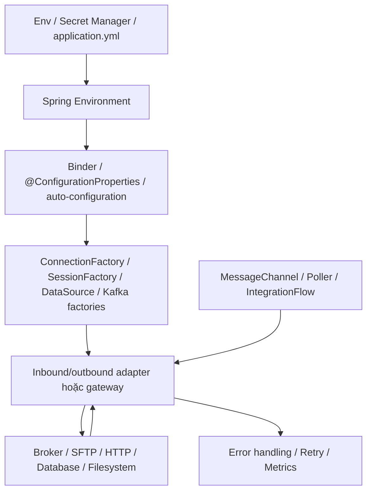
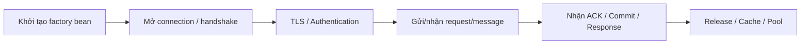
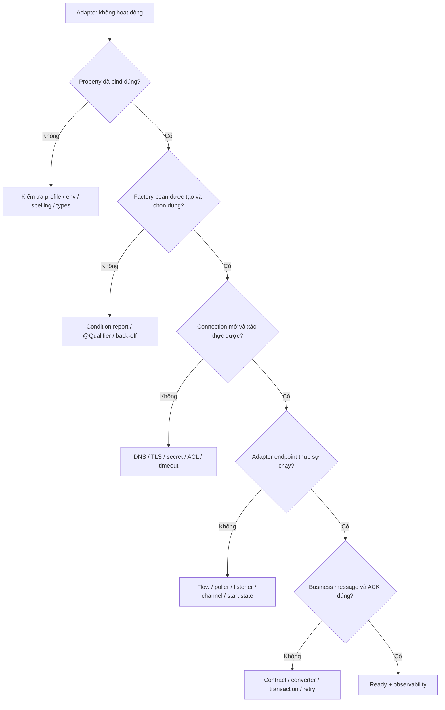
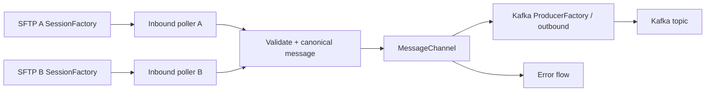

# Properties cho connection factory trong Spring Boot và Spring Integration Adapters

> **Chương:** Spring Boot  
> **Bài học:** Properties cho connection factory  
> **Module:** `SPRING_INTEGRATION_ADAPTERS` — kết nối hệ thống ngoài vào Spring Integration qua inbound/outbound adapter, gateway, poller và `MessageChannel`; thực hành File, SFTP, HTTP, JMS, AMQP/RabbitMQ, Kafka, JDBC cùng hợp đồng message, lỗi và vòng đời kết nối.  
> **Mức độ:** Trung cấp đến nâng cao. **Điều kiện tiên quyết:** Spring Boot `@Configuration`/`@Bean`, `application.yml`, Spring Integration `IntegrationFlow`, khái niệm transport và môi trường deployment.

## 1. Bài toán: có adapter nhưng kết nối sai đích

Một nhóm xây ứng dụng đồng bộ đơn hàng: nhận tệp từ SFTP đối tác, gọi HTTP API, phát event lên Kafka, gửi thông báo qua RabbitMQ và cập nhật trạng thái trong PostgreSQL. Các adapter đều có dependency phù hợp và ứng dụng biên dịch thành công, nhưng trên staging xuất hiện lỗi:

- SFTP trỏ về host production thay vì máy chủ thử nghiệm.
- RabbitMQ `ConnectionFactory` có host đúng nhưng sai virtual host, dẫn tới lỗi quyền truy cập.
- Kafka producer kết nối broker được nhưng producer và consumer dùng hai tập thông số TLS/SASL không đồng nhất.
- JDBC poller kết nối nhầm database do một bean `DataSource` tự định nghĩa không bind `spring.datasource.*` như dự đoán.
- HTTP outbound gateway gọi lại liên tục sau timeout, làm đối tác nhận một yêu cầu nghiệp vụ nhiều lần.

Các vấn đề này cùng có gốc rễ: **properties là dữ liệu cấu hình; connection factory là bean thực thi cấu hình; adapter/gateway là endpoint sử dụng bean đó**. Chúng không phải cùng một khái niệm và không thể thay thế nhau.

Bài học tập trung trả lời: *thuộc tính nào thuộc Spring Boot, thuộc tính nào cần ứng dụng định nghĩa, chúng được bind vào bean nào và làm sao chứng minh adapter đang dùng đúng kết nối?*

### 1.1. Mục tiêu học tập

Sau bài này, bạn có thể:

1. Phân biệt `Configuration Properties`, `ConnectionFactory`, `SessionFactory`, `DataSource`, `ProducerFactory`, `ConsumerFactory`, HTTP client và `MessageChannel`.
2. Chọn đúng namespace cấu hình của Spring Boot cho AMQP/RabbitMQ, JMS/Artemis, Kafka và JDBC; biết các adapter File, SFTP, HTTP có những điểm khác.
3. Sử dụng `application.yml`, biến môi trường, profile và `@ConfigurationProperties` để bind cấu hình có kiểu, có ranh giới tin cậy.
4. Tạo bean SFTP `SessionFactory` từ nhóm thuộc tính `app.sftp.*` do ứng dụng sở hữu, xác minh host key và quản lý bí mật.
5. Phân biệt connection timeout, read/request timeout, pool/cache, retry, transaction, poller và ACK; không đặt một property rồi nghĩ nó điều khiển toàn bộ.
6. Chứng minh bean factory và adapter chọn đúng endpoint/cluster/tenant bằng kiểm tra context, configuration binding và integration tests.
7. Xử lý lỗi startup, cấu hình nhầm profile, secrets bị lộ, kết nối chết, pool cạn và graceful shutdown.

### 1.2. Sơ đồ phân lớp



**Quy tắc vận hành:** Log “bean đã được tạo” không đồng nghĩa “kết nối đã được thiết lập” hoặc “đã có quyền sử dụng đích”. Với nhiều client, kết nối mở **lazy** ở lần gọi đầu tiên; với listener, kết nối có thể mở ngay lúc startup. Vì vậy cần tách ba phép kiểm tra: **properties bind đúng → factory chọn đúng → endpoint thật sự hoạt động**.

## 2. Các khái niệm phải phân biệt

### 2.1. Property là cấu hình, không phải kết nối

Ví dụ:

```yaml
spring:
  rabbitmq:
    host: rabbitmq.internal.example
    port: 5672
    virtual-host: /orders
```

Đây là **dữ liệu** Spring Boot có thể dùng để cấu hình RabbitMQ infrastructure khi starter/classpath và điều kiện auto-configuration cho phép. Tệp YAML **không** tự tạo một IntegrationFlow gửi đơn hàng. Nếu bạn cung cấp một `ConnectionFactory` thủ công, bean đó cần được cấu hình riêng; không mặc định mọi trường `spring.rabbitmq.*` đều được áp dụng vào mọi bean tự tạo.

### 2.2. “Factory” có nghĩa khác nhau theo giao thức

| Adapter/hệ thống | Khái niệm hạ tầng chính | Đầu ra của factory/provider | Property quan trọng |
|---|---|---|---|
| **AMQP/RabbitMQ** | Spring AMQP `ConnectionFactory`, thường `CachingConnectionFactory` | Connection/channel tới RabbitMQ | Host/addresses, port, vhost, credential, TLS, heartbeat, cache |
| **JMS** | `jakarta.jms.ConnectionFactory` của provider | JMS connection/session | Broker URL, credential, TLS, pool/provider options |
| **SFTP** | Spring Integration `SessionFactory` cho SFTP | Session SSH/SFTP | Host, port, user, key/password, known_hosts, timeout |
| **Kafka** | `ProducerFactory`, `ConsumerFactory` | Kafka producer/consumer | Bootstrap servers, security, serializers, group, client ID |
| **JDBC** | `javax.sql.DataSource` | JDBC connection | JDBC URL, driver, account, TLS, pool, validation |
| **HTTP outbound** | HTTP client/request factory hoặc pooled client | HTTP request/connection | Base URI, TLS, connect/read timeout, proxy, pool |
| **File local** | Không có network connection factory | `File`/filesystem access | Đường dẫn, filter, poll interval, quyền volume |

**Quan trọng:** Kafka không dùng Spring AMQP `ConnectionFactory`; JDBC cũng không có một `ConnectionFactory` giao thức chung cho các adapter. Các lớp đặt tên tương tự có ngữ nghĩa, cơ chế retry và vòng đời khác nhau. Không đưa một YAML prefix duy nhất cho mọi protocol rồi kỳ vọng Spring Boot tự hiểu.

### 2.3. Phân biệt ba loại cấu hình

- **Connection properties:** chọn endpoint và cách kết nối (host, URL, TLS, credential, pool).
- **Adapter properties:** chọn queue/topic/path, destination, converter, transaction/ACK và cách map message.
- **Flow properties:** `MessageChannel`, poller, retry/error handling, idempotency, concurrency, routing, business timeouts.

Ví dụ, `spring.kafka.bootstrap-servers` không quyết định topic nào một IntegrationFlow phải publish. `spring.rabbitmq.host` không tự khai báo queue/binding. `app.sftp.host` không tự chạy một poller. Những quyết định đó cần cấu hình endpoint cụ thể.

## 3. Configuration Properties trong Spring Boot

### 3.1. Nguồn giá trị và thứ tự ưu tiên

Spring Boot tập hợp cấu hình vào `Environment` từ nhiều nguồn: cấu hình đóng gói trong JAR, file cấu hình ngoài ứng dụng, các tài liệu cấu hình theo profile, biến môi trường, system properties, command-line arguments và một số cơ chế import như `configtree:`. **Nguồn có ưu tiên cao hơn có thể ghi đè nguồn thấp hơn**. Thứ tự đầy đủ phụ thuộc phiên bản Boot, cách load config data và cách khởi chạy; đừng đoán chỉ từ thứ tự xuất hiện trong một file YAML.

Trong bài lab này, dùng quy ước:

- `application.yml`: cấu hình cơ bản không chứa bí mật.
- `application-local.yml` và `application-staging.yml`: khác biệt theo môi trường, không chứa credential thật.
- Biến môi trường hoặc secret mount: username/password/private key/TLS secret.
- Command-line override: dành cho chạy thử có kiểm soát; không đưa password vào shell history.
- `@ConfigurationProperties`: gom nhóm và bind thành object có kiểu thay vì dùng rải rác `@Value`.

Ví dụ:

```yaml
# application.yml — KHÔNG chứa mật khẩu thực
app:
  sftp:
    enabled: false
    port: 22
    remote-dir: /inbound
```

```yaml
# application-staging.yml — chỉ dùng khi profile staging được bật
app:
  sftp:
    enabled: true
    host: sftp.staging.example
    username: integration-staging
    known-hosts: file:/run/config/sftp_known_hosts
```

Không thêm `spring.profiles.active: staging` trực tiếp vào cấu hình đóng gói chung nếu có nguy cơ vô tình bật kết nối production/staging. Profile phải do deployment kiểm soát và được kiểm tra trong CI/CD.

### 3.2. Relaxed binding và kiểu dữ liệu

Spring Boot hỗ trợ các dạng đặt tên gần nhau, ví dụ `poll-interval` trong YAML có thể bind vào trường `pollInterval` của Java. Với các cấu hình có kiểu:

- `Duration` nhận các giá trị có đơn vị như `5s`, `250ms`.
- `DataSize` nhận kích thước như `10MB` (khi trường khai báo đúng kiểu).
- `boolean` nhận `true`/`false`, nhưng nên tránh để mặc định mơ hồ cho feature flag kết nối ngoài.
- `Path` hoặc `Resource` có thể đại diện file/cấu hình, nhưng kiểm tra tồn tại/quyền truy cập phải xử lý riêng.
- Với số nguyên đại diện port, kiểm tra khoảng 1–65535 và không biến số 0 thành “default port” vô tình.

**Không trộn đơn vị timeout tùy tiện.** `Duration` trong record ứng dụng có thể dùng `3s`, nhưng một property của driver hoặc HikariCP có thể yêu cầu **milliseconds dạng số**. Hãy đọc hợp đồng property của đúng component/version thay vì áp cùng cách diễn giải.

### 3.3. `@ConfigurationProperties` khác `@Value`

`@Value("${app.sftp.host}")` tiện cho một giá trị nhưng khó quản lý khi connection có 10–20 trường. `@ConfigurationProperties(prefix = "app.sftp")` tạo một **hợp đồng cấu hình** gom host, port, credential, trust và đường dẫn, dễ kiểm thử và validate.

Dùng record immutable cho tập thuộc tính cố định; dùng class với getter/setter khi cần binding phức tạp hoặc cập nhật theo thiết kế riêng. Trong production, đặt tên rõ: `app.partner-a.sftp`, `app.partner-b.sftp` khi hai kết nối khác nhau, hoặc khai báo danh sách đối tác có key duy nhất. Không dùng cùng một `app.sftp.host` để tùy ý đổi tenant trong quá trình xử lý message.

### 3.4. Bí mật và metadata không mật

| Nhóm | Có thể để trong config thông thường? | Khuyến nghị |
|---|---|---|
| Host, port, tên queue/topic | Thường có, theo phân loại nội bộ | Quản lý bằng config có review |
| Username/service identity | Có thể nhạy cảm tùy môi trường | Hạn chế hiển thị, không giả định công khai |
| Password, API token, TLS private key, SFTP private key/passphrase | **Không** | Secret manager/secret mount, IAM policy least privilege |
| Trust store / known_hosts | Có thể là file cấu hình riêng | Bảo vệ tính toàn vẹn, kiểm tra thay đổi |
| Connection timeout/pool size | Có | Tuning theo tải và SLA |
| JDBC URL có nhúng password | **Không nên** | Tách URL và credential, tránh log URI bí mật |

Đừng log toàn bộ object `@ConfigurationProperties` bằng `toString()` khi chứa secret (record tự sinh `toString` có thể in password). Đừng hiển thị full `Environment` hoặc Actuator `/env`, `/configprops` ra mạng công cộng; những endpoint này có thể tiết lộ metadata nhạy cảm ngay cả khi một số giá trị được mask.

## 4. Quy tắc chung cho connection factory

### 4.1. Connection timeout, operation timeout và health



| Timeout/giới hạn | Phạm vi | Cần phân biệt với |
|---|---|---|
| **Connect timeout** | Thiết lập kết nối TCP tới đích | Read/response timeout |
| **TLS/handshake timeout** | Thỏa thuận bảo mật/xác thực | Broker ACK timeout |
| **Read/response timeout** | Đợi dữ liệu hoặc phản hồi | Timeout của toàn workflow |
| **Request/reply timeout** | Đợi response của gateway trong IntegrationFlow | Timeout mạng riêng của client |
| **Connection acquisition timeout** | Đợi lấy connection từ pool | Connect tới server mới |
| **Poll interval** | Khoảng cách các lần kiểm tra nguồn | Timeout của một lần poll |
| **Retry backoff** | Chờ trước lần thử lại | Heartbeat hoặc keep-alive |
| **Idle/max lifetime** | Vòng đời connection trong pool | TTL của message hoặc token |

Nếu HTTP timeout sau khi hệ thống ngoài đã xử lý yêu cầu, retry có thể tạo **tác dụng phụ trùng**. Nếu JMS consumer ACK trước khi transaction DB commit, message có thể mất. Connection properties chỉ hỗ trợ cơ chế vận chuyển; độ an toàn end-to-end cần contract/idempotency/transaction phù hợp.

### 4.2. Cache/pool không đồng nghĩa concurrency

- **Connection pool:** số connection được giữ và cấp cho các thread.
- **Channel/session cache:** có thể tái sử dụng channel hoặc session; giới hạn cache không phải luôn là trần concurrency.
- **Listener concurrency:** số consumer xử lý song song, có thể tạo thêm connection/session tùy thư viện.
- **Poller executor:** số tác vụ poll có thể chồng nhau.
- **Back-pressure:** chính sách khi downstream chậm hoặc pool cạn.

Tăng pool mà không xét giới hạn broker, DB và rate limit có thể tăng lỗi chứ không tăng throughput. Đặt metric queue depth, connection acquisition wait, active/idle connections, reconnect và throughput để điều chỉnh.

### 4.3. Fail fast hay kết nối lazy?

Hai mô hình đều có ứng dụng hợp lệ:

- **Fail fast:** kiểm tra dependency quan trọng lúc startup; nếu không thể phục vụ nghiệp vụ, ứng dụng bị đánh dấu không ready hoặc không khởi chạy.
- **Lazy/reconnect:** factory được tạo trước, connection thật được mở khi poll/send/receive; phù hợp nơi dịch vụ ngoài đôi lúc gián đoạn, nhưng cần readiness/alert và bounded retry.

Một bean đã có mặt trong `ApplicationContext` **không chứng minh** dịch vụ ngoài đang ready. Không dùng `@Lazy` như cách giấu lỗi dài hạn; nếu cần lazy, phải có observability và chính sách xử lý outage.


## 5. AMQP/RabbitMQ: `spring.rabbitmq.*` và `ConnectionFactory`

### 5.1. Chọn đúng lớp thư viện

Một ứng dụng Spring Integration xuất message ra RabbitMQ thường cần:

```xml
<dependency>
    <groupId>org.springframework.boot</groupId>
    <artifactId>spring-boot-starter-integration</artifactId>
</dependency>
<dependency>
    <groupId>org.springframework.integration</groupId>
    <artifactId>spring-integration-amqp</artifactId>
</dependency>
<dependency>
    <groupId>org.springframework.boot</groupId>
    <artifactId>spring-boot-starter-amqp</artifactId>
</dependency>
```

Boot có thể cấu hình `org.springframework.amqp.rabbit.connection.ConnectionFactory` và `RabbitTemplate` khi classpath/bean conditions phù hợp. Spring Integration AMQP sử dụng những thành phần đó để triển khai outbound/inbound adapter hoặc gateway; bạn vẫn phải xác định **queue, exchange, routing key, listener và message converter**.

### 5.2. Ví dụ property cho môi trường thử nghiệm

```yaml
spring:
  rabbitmq:
    host: rabbitmq.test.example
    port: 5671
    virtual-host: /orders
    username: ${RABBITMQ_USERNAME}
    password: ${RABBITMQ_PASSWORD}
    connection-timeout: 5s
    requested-heartbeat: 30s
    ssl:
      enabled: true
    cache:
      channel:
        size: 25
```

Các biến `RABBITMQ_USERNAME` và `RABBITMQ_PASSWORD` phải được cấp từ môi trường/secret manager. Đây là **cấu hình minh họa**, không phải một endpoint thực đang hoạt động. `ssl.enabled=true` chỉ là một phần của cấu hình TLS: phải thiết lập CA/trust, hostname verification và chính sách certificate theo stack đang dùng. Không bỏ xác minh certificate chỉ để kết nối thành công.

| Property | Ý nghĩa | Dễ hiểu nhầm |
|---|---|---|
| `spring.rabbitmq.host` và `port` | Endpoint RabbitMQ khi cấu hình theo host/port | Không phải queue đích |
| `spring.rabbitmq.addresses` | Danh sách địa chỉ broker khi dùng nhiều node theo khả năng client | Khi khai báo, có thể thay vai trò của host/port; không phối hợp mâu thuẫn |
| `virtual-host` | Namespace/vhost của broker | Không phải tenant business tự động được bảo vệ |
| `username/password` | Identity client tới broker | Không nên đưa vào log, Git, command history |
| `connection-timeout` | Thời gian mở kết nối | Không phải thời gian đợi publisher confirm |
| `requested-heartbeat` | Heartbeat đàm phán với broker | Không thay thế network/read timeout |
| `ssl.enabled` | Bật đường truyền TLS | Không đủ nếu trust/hostname validation sai |
| `cache.channel.size` | Kích thước cache channel theo cấu hình Spring AMQP | Không mặc nhiên giới hạn số consumer hoặc throughput |

**Nhớ:** Các property `spring.rabbitmq.*` có hiệu lực cho những bean do Boot cấu hình theo điều kiện; nếu ứng dụng cung cấp `ConnectionFactory` riêng, cần xem condition report và kiểm tra bean thật sự được dùng. Một bean tùy chỉnh có thể khiến default back off, trong khi template/listener vẫn được tạo từ factory của ứng dụng.

### 5.3. Hai cluster, hai factory

Khi gửi một số event tới RabbitMQ cluster A và audit tới cluster B, **đừng** đổi `spring.rabbitmq.host` theo message. Mỗi cluster cần factory/template hoặc cấu hình routing riêng, có tên và owner rõ ràng. Với nhiều bean cùng interface:

- `@Qualifier("ordersRabbitConnectionFactory")` cho flow Orders.
- `@Qualifier("auditRabbitConnectionFactory")` cho flow Audit.
- Test chứng minh từng outbound handler thực sự dùng factory đúng.
- Đánh giá TLS, vhost, ACL, publisher confirms, returns và shutdown của **từng** cluster.

`@Primary` chỉ chọn ứng viên khi injection theo type chưa xác định; nó không thay thế route đã chọn bằng tên.

## 6. JMS: `spring.artemis.*` khác `spring.jms.*`

Spring Integration JMS dùng API `jakarta.jms` ở stack Spring hiện đại và cần provider tương thích. Nếu chọn Artemis với starter của Spring Boot:

```xml
<dependency>
    <groupId>org.springframework.integration</groupId>
    <artifactId>spring-integration-jms</artifactId>
</dependency>
<dependency>
    <groupId>org.springframework.boot</groupId>
    <artifactId>spring-boot-starter-artemis</artifactId>
</dependency>
```

Cấu hình cơ bản:

```yaml
spring:
  artemis:
    mode: native
    broker-url: tcp://artemis.test.example:61616
    user: ${ARTEMIS_USER}
    password: ${ARTEMIS_PASSWORD}
```

Trong cách dùng này:

- `spring.artemis.*` chứa cấu hình provider Artemis: broker URL, thông tin đăng nhập và một số lựa chọn provider/pooling theo stack/phiên bản.
- `spring.jms.*` dành cho các đặc tính thuộc lớp Spring JMS như listener/template khi Boot hỗ trợ; không thay thế URL của một provider.
- `jakarta.jms.ConnectionFactory` là **JMS factory**, khác `org.springframework.amqp.rabbit.connection.ConnectionFactory` của RabbitMQ.
- `Destination`, queue/topic, selector, concurrency, redelivery và DLQ không được suy ra chỉ từ broker URL.

**TLS và provider:** `tcp://` ở ví dụ trên **không biểu thị kênh TLS**. Ở môi trường thực, phải cấu hình transport TLS và certificate theo tài liệu provider/broker, không tự đổi sang một scheme tùy ý rồi cho rằng an toàn. Một số môi trường dùng Jakarta Messaging provider khác Artemis: cấu hình `spring.artemis.*` không thể áp dụng cho client/provider khác.

**Phân biệt ACK và transaction:** Property của connection factory không quyết định liệu một message đã commit vào database khác hay chưa. JMS session transaction, listener container, downstream JDBC transaction, dead-letter/retry và `MessageChannel` có ranh giới riêng. Trước khi đặt concurrency lớn, hãy làm rõ at-least-once, redelivery và idempotent business processing.

## 7. Kafka: producer/consumer factory không phải RabbitMQ connection factory

Kafka client sử dụng `bootstrap.servers` để tìm metadata cluster, sau đó kết nối broker theo metadata được quảng bá. Trong Spring Boot, `spring.kafka.*` có thể cấu hình client/factory khi classpath và điều kiện tương ứng được đáp ứng; Spring Integration Kafka sử dụng những factory/template để làm inbound/outbound.

### 7.1. Ví dụ producer và consumer

```yaml
spring:
  kafka:
    bootstrap-servers:
      - kafka-a.test.example:9093
      - kafka-b.test.example:9093
    client-id: adapter-worker
    properties:
      security.protocol: SSL
    producer:
      acks: all
      key-serializer: org.apache.kafka.common.serialization.StringSerializer
      value-serializer: org.apache.kafka.common.serialization.StringSerializer
    consumer:
      group-id: order-importer
      enable-auto-commit: false
      key-deserializer: org.apache.kafka.common.serialization.StringDeserializer
      value-deserializer: org.apache.kafka.common.serialization.StringDeserializer
```

**Chú ý:** `security.protocol=SSL` cần trust/certificate được cấu hình đúng cho client Kafka. Ví dụ bỏ qua chi tiết này vì nơi lưu trust store và cách cung cấp khóa tùy nền tảng, SSL bundle, Kafka client và phiên bản Boot. Không chạy cấu hình production bằng cách tắt certificate validation.

| Nhóm property | Áp dụng chủ yếu cho | Không tự giải quyết |
|---|---|---|
| `spring.kafka.bootstrap-servers` | Metadata bootstrap của client | Topic routing, ACL, network advertised listeners |
| `spring.kafka.client-id` | Nhận diện client/metrics/log | Business event ID/idempotency key |
| `spring.kafka.properties.*` | Cấu hình Kafka client dùng chung khi phù hợp | Phân biệt mọi producer/consumer custom ngoài Boot |
| `spring.kafka.producer.*` | Producer serializer, ACK và cấu hình gửi | Consumer group/offset commit |
| `spring.kafka.consumer.*` | Consumer group, deserializer, offset và polling | Publisher durability hoặc việc ghi DB downstream |
| `spring.kafka.listener.*` | Một số thông số listener do Boot hỗ trợ | Một IntegrationFlow tự động được tạo |
| `spring.kafka.ssl.*` hoặc cấu hình TLS tương ứng | TLS client theo phiên bản | Phân quyền topic và secret rotation |

Với một service chỉ **publish outbound** có thể không cần chạy consumer. Đừng coi `consumer.group-id` là bắt buộc cho producer. Với consumer nhận từ Kafka rồi ghi JDBC, `enable-auto-commit=false` **không tự bảo đảm** commit offset sau khi DB commit; bạn còn phải cấu hình cách listener/container và IntegrationFlow phối hợp ACK, transaction và xử lý lỗi.

### 7.2. Nhiều Kafka cluster

Nếu app vừa tiêu thụ từ cluster nội bộ vừa publish sang cluster đối tác, một nhóm `spring.kafka.bootstrap-servers` chung không đủ. Cần cấu hình riêng cho mỗi `ProducerFactory`/`ConsumerFactory`, client ID, trust/credential, topic và template/adapter.

Hệ quả của bean override cần kiểm tra:

1. Bean mặc định có còn được tạo không, hay đã back off khi có factory custom?
2. `KafkaTemplate`/listener adapter đang inject bean nào?
3. Serializer/deserializer và `security.protocol` có đúng **từng cluster**?
4. Topic ACL và partitions có khớp?
5. Retry/offset/transaction có đúng hành vi khi một cluster mất kết nối?

Đừng dùng thay đổi `@Primary` trên factory để “chuyển tạm” traffic mà không đánh giá mọi endpoint phụ thuộc.

## 8. JDBC: `spring.datasource.*` và HikariCP

Với JDBC adapter, **`DataSource` là provider kết nối**, không phải một `ConnectionFactory` chung của Spring Messaging. Một ứng dụng thường dùng:

```xml
<dependency>
    <groupId>org.springframework.integration</groupId>
    <artifactId>spring-integration-jdbc</artifactId>
</dependency>
<dependency>
    <groupId>org.springframework.boot</groupId>
    <artifactId>spring-boot-starter-jdbc</artifactId>
</dependency>
<dependency>
    <groupId>org.postgresql</groupId>
    <artifactId>postgresql</artifactId>
    <scope>runtime</scope>
</dependency>
```

Ví dụ cấu hình với PostgreSQL và HikariCP:

```yaml
spring:
  datasource:
    url: jdbc:postgresql://db.test.example:5432/integration
    username: ${DB_USERNAME}
    password: ${DB_PASSWORD}
    hikari:
      pool-name: integration-db
      maximum-pool-size: 10
      minimum-idle: 2
      connection-timeout: 30000
      max-lifetime: 1800000
```

**Đơn vị:** HikariCP thường diễn giải `connection-timeout` và `max-lifetime` ở trên theo **mili giây**. Vì vậy `30000` tương đương 30 giây, `1800000` tương đương 30 phút. Đây là **thời gian đợi lấy connection từ pool** và giới hạn vòng đời connection, không phải query timeout cho một lệnh SQL hay HTTP request timeout.

### 8.1. Nguồn lỗi thường gặp

- Quên JDBC driver, dẫn tới việc cấu hình `DataSource` thất bại.
- URL đúng host nhưng sai database/schema hoặc thiếu quyền SQL.
- Pool có tối đa 10 connection nhưng cho poller chạy 50 transaction lâu → cạn pool.
- Database load balancer đóng connection sớm hơn `max-lifetime` → lỗi connection stale.
- Tạo `@Bean DataSource` thủ công khiến phần auto-configuration `spring.datasource.*` back off, nhưng bean custom không bind lại những property này.
- Nhiều `DataSource` cùng type; Integration JDBC adapter/transaction manager được inject nhầm sang DB khác.

**Lưu ý quan trọng:** `spring-integration-jdbc` chưa tạo bảng nghiệp vụ, poller query hoặc idempotency metadata store. Muốn đọc hàng mới cần SQL, transaction/poll interval, lock và chiến lược đánh dấu đã xử lý. Với flow JDBC → Kafka, việc commit cả database và broker không tự trở thành một giao dịch nguyên tử; cân nhắc outbox/CDC và idempotency.

### 8.2. Bảo vệ kết nối JDBC

TLS tới database phải dựa trên cấu hình JDBC driver phù hợp (ví dụ SSL mode và trust bundle), không chỉ dựa vào việc database ở mạng nội bộ. Tách quyền tài khoản DB: worker đọc/outbox nên có scope hẹp, không cấp superuser. Không chép JDBC URL chứa password vào lỗi/log, metric labels hoặc message headers.

### 8.3. Nhiều DataSource

Nếu có một DB vận hành và một DB metadata tích hợp:

- Dùng bean tên rõ: `businessDataSource`, `integrationMetadataDataSource`.
- Cấu hình transaction manager phù hợp từng DB.
- `@Qualifier` cho gateway/handler/poller; chỉ dùng `@Primary` khi thật sự có đường mặc định rõ.
- Rà soát condition report vì một bean `DataSource` custom có thể khiến bean mặc định từ Boot không được tạo.
- Integration test phải chứng minh SQL chạy đúng DB và rollback/commit đúng ranh giới.

## 9. SFTP: custom `@ConfigurationProperties` cho `SessionFactory`

Khác RabbitMQ hoặc JDBC, không nên mặc định có một namespace Spring Boot `spring.sftp.*` dùng chung và tự tạo SFTP `SessionFactory` cho mọi ứng dụng. Với Spring Integration SFTP, ứng dụng thường **tự sở hữu nhóm thuộc tính**, bean session factory và endpoint.

### 9.1. Cấu hình theo từng đối tác, disabled by default

Ví dụ `application.yml`:

```yaml
app:
  partner:
    sftp:
      enabled: false
      host: sftp.test.example
      port: 22
      username: adapter-user
      password: ${PARTNER_SFTP_PASSWORD}
      known-hosts: file:/run/config/partner_known_hosts
      remote-directory: /incoming
      poll-interval: 15s
```

**Chỉ bật `enabled: true`** trong profile/deployment đã được phép kết nối và đã được cấp credential/trust. Với một số cấu hình, property placeholder `${PARTNER_SFTP_PASSWORD}` được resolve ngay khi bind dù endpoint bị tắt; nếu environment chưa cấp biến, ứng dụng có thể khởi động thất bại. Để môi trường test không cần secret thật, đặt các property nhạy cảm **chỉ trong profile bật connector** hoặc dùng cấu hình tách biệt không cố resolve khi disabled.

Ví dụ phần override trong `application-partner-test.yml`:

```yaml
app:
  partner:
    sftp:
      enabled: true
      host: sftp.partner-test.example
      port: 22
      username: adapter-test
      password: ${PARTNER_SFTP_PASSWORD}
      known-hosts: file:/run/config/partner_known_hosts
      remote-directory: /incoming
```

Đây là dữ liệu minh họa; host không phải server thật để bạn kết nối. Trong production nên cân nhắc **SSH key authentication**, key passphrase được bảo vệ, rotate credential và known-host pinning. Không bật `allowUnknownKeys=true` để “sửa lỗi kết nối”.

### 9.2. Bind thành record có kiểu

Giả định dự án dùng Spring Boot 3.x với Spring Integration SFTP 6.x tương thích. Tạo `PartnerSftpProperties.java`:

```java
package com.example.adapter;

import java.time.Duration;
import org.springframework.boot.context.properties.ConfigurationProperties;
import org.springframework.core.io.Resource;

@ConfigurationProperties(prefix = "app.partner.sftp")
public record PartnerSftpProperties(
        boolean enabled,
        String host,
        Integer port,
        String username,
        String password,
        Resource knownHosts,
        String remoteDirectory,
        Duration pollInterval
) {
    public PartnerSftpProperties {
        if (enabled) {
            if (host == null || host.isBlank()) {
                throw new IllegalArgumentException("SFTP host is required");
            }
            if (port == null || port < 1 || port > 65535) {
                throw new IllegalArgumentException("Invalid SFTP port");
            }
            if (username == null || username.isBlank()) {
                throw new IllegalArgumentException("SFTP user is required");
            }
            if (knownHosts == null) {
                throw new IllegalArgumentException("Known hosts is required");
            }
            if (pollInterval == null || pollInterval.isNegative()
                    || pollInterval.isZero()) {
                throw new IllegalArgumentException("Invalid poll interval");
            }
        }
    }
}
```

Record cho phép bind `port`, `known-hosts` và `poll-interval` theo kiểu Java. Constructor kiểm tra những trường **bắt buộc khi connector bật**, không buộc môi trường chỉ sử dụng File adapter phải có cấu hình SFTP đầy đủ. Trong ví dụ password chưa được bắt buộc vì thiết kế production có thể chuyển sang xác thực bằng khóa; factory ở dưới sử dụng password cho lab, vì vậy khi bật với phương thức đó cần bảo đảm secret có mặt.

**Giới hạn của ví dụ:** Constructor record có thể tạo thông báo lỗi kèm giá trị nếu developer tự thêm logging. Không in `password` hoặc cả record ra console; record mặc định có `toString()` chứa mọi field.

### 9.3. Tạo `SessionFactory` khi connector bật

Tạo `PartnerSftpConfiguration.java`:

```java
package com.example.adapter;

import org.apache.sshd.sftp.client.SftpClient;
import org.springframework.boot.autoconfigure.condition.ConditionalOnProperty;
import org.springframework.boot.context.properties.EnableConfigurationProperties;
import org.springframework.context.annotation.Bean;
import org.springframework.context.annotation.Configuration;
import org.springframework.integration.file.remote.session.CachingSessionFactory;
import org.springframework.integration.file.remote.session.SessionFactory;
import org.springframework.integration.sftp.session.DefaultSftpSessionFactory;

@Configuration(proxyBeanMethods = false)
@EnableConfigurationProperties(PartnerSftpProperties.class)
public class PartnerSftpConfiguration {

    @Bean("partnerSftpSessionFactory")
    @ConditionalOnProperty(
        prefix = "app.partner.sftp",
        name = "enabled",
        havingValue = "true"
    )
    SessionFactory<SftpClient.DirEntry> partnerSftpSessionFactory(
            PartnerSftpProperties props) {

        DefaultSftpSessionFactory delegate =
                new DefaultSftpSessionFactory();

        delegate.setHost(props.host());
        delegate.setPort(props.port());
        delegate.setUser(props.username());
        delegate.setPassword(props.password());
        delegate.setKnownHostsResource(props.knownHosts());
        delegate.setAllowUnknownKeys(false);

        // Caching sessions phục vụ việc tái sử dụng;
        // pool/cache size phải được test với tải và server thật.
        return new CachingSessionFactory<>(delegate, 4);
    }
}
```

Đoạn code minh họa API SFTP thuộc họ Spring Integration 6.x, nên cần đối chiếu chính xác phiên bản dependency nếu dùng ở một dự án khác. **Factory bean không tự tạo một inbound adapter hoặc tự poll remote directory.** Một `IntegrationFlow` phải sử dụng `partnerSftpSessionFactory` theo tên/qualifier, tự thiết kế streaming hoặc synchronized inbound, directory/filter, poller và error handling.

Lưu ý `setPassword` chỉ mô tả xác thực password trong lab. Khi dùng key auth, thiết kế bean với `setPrivateKey(...)`, `setPrivateKeyPassphrase(...)` theo API và secret storage tương ứng; không tự duy trì cả password lẫn private key nếu không cần. Một `known_hosts` đáng tin phải được cấp phát từ ngoài và được bảo vệ khỏi sửa trái phép.

### 9.4. Những lỗi của SFTP factory không phải lỗi dependency

| Triệu chứng | Nguyên nhân có thể | Cần kiểm tra |
|---|---|---|
| `NoSuchBeanDefinitionException` cho factory | `enabled=false`, sai profile/bean name | Effective properties, condition report, qualifier |
| `UnknownHostException` | DNS/host chưa tồn tại | Host, DNS, môi trường |
| Host-key verification failed | `known_hosts` thiếu/sai, server đổi key | Xác minh out-of-band, cập nhật có phê duyệt |
| Permission denied | User/key/remote ACL không đủ | Identity đối tác, quyền remote path |
| Timeout tại session | Firewall, port, SSH handshake | Network, connect timeout, proxy/jump host |
| Stream đóng bất ngờ | Session hết hạn hoặc stream lifecycle sai | Caching strategy, stream close, retry |
| File được tải hai lần | Filter/checkpoint không bền vững | Idempotency, persistent metadata, remote rename |
| Kết nối nhầm đối tác | Config prefix chung hoặc inject nhầm factory | Bean name, tenant/partner routing, test từng profile |

Không log thông tin xác thực SFTP hoặc đặt đối tác thật trong unit test. Dùng một SFTP test server cô lập cho integration test.

## 10. HTTP và File: những ngoại lệ cần biết

### 10.1. HTTP outbound dùng client/request factory

HTTP outbound adapter/gateway của Spring Integration làm việc qua hạ tầng HTTP client tương ứng, không có một `spring.http.connection-factory` thống nhất cho mọi phiên bản Boot, Servlet/Reactive stack và HTTP client implementation.

Ví dụ namespace **do ứng dụng tự định nghĩa** là `app.partner.http.*`; đây không phải namespace connection factory chuẩn do Spring Boot tự cấu hình:

```yaml
app:
  partner:
    http:
      base-url: https://api.partner.test.example
      connect-timeout: 3s
      read-timeout: 8s
```

Với `RestTemplate` và request factory JDK cơ bản, có thể bind property trong record:

```java
package com.example.adapter;

import java.net.URI;
import java.time.Duration;
import org.springframework.boot.context.properties.ConfigurationProperties;

@ConfigurationProperties(prefix = "app.partner.http")
public record PartnerHttpProperties(
        URI baseUrl,
        Duration connectTimeout,
        Duration readTimeout
) {}
```

Và tạo bean:

```java
package com.example.adapter;

import org.springframework.boot.context.properties.EnableConfigurationProperties;
import org.springframework.context.annotation.Bean;
import org.springframework.context.annotation.Configuration;
import org.springframework.http.client.SimpleClientHttpRequestFactory;
import org.springframework.web.client.RestTemplate;

@Configuration(proxyBeanMethods = false)
@EnableConfigurationProperties(PartnerHttpProperties.class)
class PartnerHttpClientConfiguration {

    @Bean("partnerRestTemplate")
    RestTemplate partnerRestTemplate(PartnerHttpProperties props) {
        SimpleClientHttpRequestFactory requestFactory =
                new SimpleClientHttpRequestFactory();
        requestFactory.setConnectTimeout(
                Math.toIntExact(props.connectTimeout().toMillis()));
        requestFactory.setReadTimeout(
                Math.toIntExact(props.readTimeout().toMillis()));
        return new RestTemplate(requestFactory);
    }
}
```

Đây là minh họa **binding timeout vào một HTTP client bean**, không phải toàn bộ IntegrationFlow. `baseUrl` được dùng khi cấu hình URI của outbound gateway, không tự biến thành URL mặc định của `RestTemplate` trên. `SimpleClientHttpRequestFactory` không có tính năng connection pooling mạnh; production cần HTTP client phù hợp với pooling/TLS/observability và timeout được kiểm tra theo phiên bản. Nếu dùng reactive WebClient hoặc API khác, factory và property mapping sẽ khác.

Phân biệt:

- **Inbound HTTP:** cần web server/route/authentication, request/reply mapping và giới hạn payload.
- **Outbound HTTP:** cần base URL, xác thực máy–máy, TLS, timeout, mapping 4xx/5xx, redirect policy và idempotency key.
- **Gateway timeout:** thời gian chờ reply trong Spring Integration không đồng nhất với HTTP connect/read timeout.
- **Retry POST:** sau network timeout, đối tác có thể đã thực hiện hành động; chỉ retry khi có idempotency hoặc quy tắc an toàn.

### 10.2. File adapter không có network connection factory

File inbound thường cần **đường dẫn và poller**, không phải một broker connection pool.

```yaml
app:
  file:
    enabled: true
    inbound-dir: /data/in
    archive-dir: /data/archive
    pattern: "*.csv"
    poll-interval: 5s
    max-messages-per-poll: 20
```

Đây là namespace `app.file.*` tự định nghĩa. Chỉ viết YAML **không tự tạo** `FileReadingMessageSource`, `IntegrationFlow` hoặc poller; ứng dụng phải bind `@ConfigurationProperties` và áp giá trị vào cấu hình endpoint. Những rủi ro chính:

- Thư mục chưa có hoặc không được mount vào container.
- Quyền filesystem, symbolic link và vấn đề path traversal khi lấy tên file từ message không tin cậy.
- Đọc file khi tiến trình khác vẫn đang ghi; cần staging/atomic rename/ready marker.
- File được đọc lại sau restart nếu bộ lọc không lưu trạng thái bền vững.
- Poll quá nhanh, batch quá lớn hoặc không có back-pressure khiến downstream nghẽn.

Vì vậy **trường hợp File là bài học quan trọng**: không phải adapter nào cũng cần `ConnectionFactory`. Properties cần được thiết kế theo năng lực thực sự của endpoint.


## 11. Lab: kiểm tra binding và điều kiện tạo SFTP connection factory

Thực hành này không cần kết nối SFTP thật, phù hợp để người học hiểu **properties → binder → bean** trước khi thêm network. Chúng ta tận dụng record `PartnerSftpProperties` và cấu hình `PartnerSftpConfiguration` ở mục 9.

### 11.1. Dependency và cấu trúc

Trong một Spring Boot project đã có Boot parent/BOM, khai báo:

```xml
<dependencies>
    <dependency>
        <groupId>org.springframework.boot</groupId>
        <artifactId>spring-boot-starter-integration</artifactId>
    </dependency>
    <dependency>
        <groupId>org.springframework.integration</groupId>
        <artifactId>spring-integration-sftp</artifactId>
    </dependency>
    <dependency>
        <groupId>org.springframework.boot</groupId>
        <artifactId>spring-boot-starter-test</artifactId>
        <scope>test</scope>
    </dependency>
</dependencies>
```

Mỗi dependency không ghi `<version>` vì project đã quản lý phiên bản theo Boot BOM. Nếu project không có dependency management, cần thêm BOM hoặc dùng bộ version tương thích rõ ràng; **không chắp vá các version Spring Framework/Integration từ nhiều nhánh**.

Cấu trúc file minh họa:

```text
connection-properties-lab/
├── pom.xml
└── src/
    ├── main/
    │   ├── java/com/example/adapter/
    │   │   ├── ConnectionPropertiesLabApplication.java
    │   │   ├── PartnerSftpProperties.java
    │   │   └── PartnerSftpConfiguration.java
    │   └── resources/application.yml
    └── test/java/com/example/adapter/
        └── PartnerSftpPropertiesContextTest.java
```

`ConnectionPropertiesLabApplication.java`:

```java
package com.example.adapter;

import org.springframework.boot.SpringApplication;
import org.springframework.boot.autoconfigure.SpringBootApplication;

@SpringBootApplication
public class ConnectionPropertiesLabApplication {
    public static void main(String[] args) {
        SpringApplication.run(
            ConnectionPropertiesLabApplication.class, args
        );
    }
}
```

`application.yml` của **lab chỉ kiểm tra binding** nên để connector disabled, không cần password:

```yaml
spring:
  application:
    name: connection-properties-lab
  main:
    web-application-type: none

app:
  partner:
    sftp:
      enabled: false
      host: sftp.test.example
      port: 22
      username: adapter-test
      remote-directory: /incoming
      poll-interval: 15s
```

Không tạo `known_hosts` giả để đánh lừa cơ chế xác thực. Khi connector disabled, factory không được tạo; bài chỉ chứng minh typed binding. Khi cần test kết nối thật, phải dùng SFTP test server và host key của chính server đó.

### 11.2. `ApplicationContextRunner` kiểm tra trường và bean condition

File `PartnerSftpPropertiesContextTest.java`:

```java
package com.example.adapter;

import java.time.Duration;

import org.junit.jupiter.api.Test;
import org.springframework.boot.test.context.runner.ApplicationContextRunner;

import static org.assertj.core.api.Assertions.assertThat;

class PartnerSftpPropertiesContextTest {

    private final ApplicationContextRunner runner =
        new ApplicationContextRunner()
            .withUserConfiguration(PartnerSftpConfiguration.class);

    @Test
    void disabledConnectorBindsPropertiesButCreatesNoFactory() {
        runner
            .withPropertyValues(
                "app.partner.sftp.enabled=false",
                "app.partner.sftp.host=sftp.test.example",
                "app.partner.sftp.port=22",
                "app.partner.sftp.poll-interval=15s"
            )
            .run(context -> {
                assertThat(context).hasSingleBean(
                    PartnerSftpProperties.class
                );
                assertThat(context.getBean(
                    PartnerSftpProperties.class
                ).pollInterval()).isEqualTo(Duration.ofSeconds(15));

                assertThat(context).doesNotHaveBean(
                    "partnerSftpSessionFactory"
                );
            });
    }

    @Test
    void enabledConnectorRejectsMissingTrustConfiguration() {
        runner
            .withPropertyValues(
                "app.partner.sftp.enabled=true",
                "app.partner.sftp.host=sftp.test.example",
                "app.partner.sftp.port=22",
                "app.partner.sftp.username=adapter-test",
                "app.partner.sftp.poll-interval=15s"
            )
            .run(context -> {
                assertThat(context.getStartupFailure())
                    .isNotNull();
            });
    }
}
```

**Giải thích:**

- Test thứ nhất chứng minh `15s` được bind thành `Duration.ofSeconds(15)`, và `@ConditionalOnProperty` làm bean factory **vắng mặt** khi `enabled=false`.
- Test thứ hai cố ý bật connector nhưng bỏ `known-hosts`; record validation từ chối cấu hình chưa an toàn. Nó **không** chứng minh host SFTP có tồn tại hay không.
- Để kiểm tra factory **khi enabled=true**, tạo cấu hình đầy đủ với file `known_hosts` hợp lệ của test server. Khi đó test bean graph xác nhận factory được tạo, rồi integration test xác nhận được SSH handshake và file transfer.
- Chỉ thấy `SessionFactory` trong context không có nghĩa đã connect thành công; một factory có thể mở session lazy khi adapter poll lần đầu.

### 11.3. Property priority: làm sao tránh sai môi trường?

Giả sử `application.yml` khai báo `app.partner.sftp.host=sftp.test.example`, còn deployment cho staging cấp biến môi trường `APP_PARTNER_SFTP_HOST=sftp.staging.example`. Spring Boot relaxed binding có thể áp dụng biến này theo cơ chế mapping property name của Environment. Để chứng minh giá trị cuối:

1. Xem **effective properties** của profile thực sự được bật bằng test/binder, không dựa vào tên file.
2. Đọc `PartnerSftpProperties.host()` trong test dưới dạng **địa chỉ được phép hiển thị**, không dump toàn bộ record vì nó có password.
3. Đối chiếu host với allowlist environment trong deployment configuration.
4. Kiểm tra biến môi trường có bị hệ thống orchestration inject từ namespace sai không.
5. Kiểm tra Secret Manager version và credential được cấp đúng phạm vi.

Ví dụ biến môi trường dễ hiểu:

| YAML property | Biến môi trường thường dùng |
|---|---|
| `spring.rabbitmq.host` | `SPRING_RABBITMQ_HOST` |
| `spring.datasource.url` | `SPRING_DATASOURCE_URL` |
| `spring.kafka.bootstrap-servers` | `SPRING_KAFKA_BOOTSTRAPSERVERS` |
| `app.partner.sftp.host` | `APP_PARTNER_SFTP_HOST` |

Với thuộc tính có dấu gạch ngang trong **tên** (như `bootstrap-servers`), quy tắc canonical environment variable mapping của Spring Boot thường **bỏ dấu gạch ngang**, nên tên `SPRING_KAFKA_BOOTSTRAPSERVERS` là ví dụ phù hợp. Dùng binding test ở phiên bản Boot thực tế để kiểm chứng thay vì tùy tiện biến đổi tên thành nhiều dấu gạch dưới.

### 11.4. Tránh test làm phát sinh kết nối thật

Không nên đặt SFTP/Gateway/Kafka listener production trong profile mặc định của test. Cân nhắc `@ConditionalOnProperty` ở endpoint, mock factory đúng ranh giới hoặc Testcontainers. Unit test configuration binding chỉ cần bean graph; integration test thực sự mới khởi động broker/test server, kết nối và kiểm tra retry/shutdown.

Khi test cần dữ liệu nhạy cảm, dùng credential riêng chỉ dành cho test, do CI secret store cấp, có thể thu hồi; tuyệt đối không lấy key production rồi chép vào `src/test/resources`.

## 12. Diagnosing: phát hiện properties không được áp dụng

### 12.1. Xem condition evaluation thay vì đoán

Các lệnh ví dụ với wrapper ở thư mục project Spring Boot:

```bash
# Maven wrapper
./mvnw spring-boot:run -Dspring-boot.run.arguments=--debug

# Gradle wrapper
./gradlew bootRun --args='--debug'
```

Sử dụng wrapper `mvnw.cmd`/`gradlew.bat` trên Windows và điều chỉnh cách quote theo shell. Condition report cho biết auto-configuration nào match/không match và nguyên nhân. Nếu một `DataSource` hoặc RabbitMQ `ConnectionFactory` do ứng dụng tự định nghĩa làm nhánh default back off, đó là thông tin quan trọng hơn việc nhìn một YAML key.

Đối với ứng dụng web có `spring-boot-starter-actuator`, endpoint `/actuator/conditions` có thể giúp quan sát cấu hình tự động theo chính sách quản trị; **không mở endpoint này công khai**. Lab không web dùng log `--debug` và `ApplicationContextRunner` là đủ.

### 12.2. Phân lớp chẩn đoán



### 12.3. Bảng lỗi từ cấu hình tới runtime

| Triệu chứng | Tầng lỗi | Cách kiểm tra |
|---|---|---|
| `Could not resolve placeholder${...}` | Giá trị bí mật thiếu ở Environment | Xem secret injection/profile, không in secret |
| `Failed to bind properties` | Kiểu dữ liệu, Duration, port hoặc tên property sai | Đối chiếu canonical key và validation |
| `NoSuchBeanDefinitionException` | Bean không được đăng ký theo classpath/condition | Condition report, dependency tree |
| `NoUniqueBeanDefinitionException` | Nhiều factory/bean cùng type | `@Qualifier`, bean name, tenant mapping |
| Bean config đúng nhưng tới server sai | Property source ưu tiên cao ghi đè host hoặc factory khác được chọn | So sánh effective host, routing flow, bean identity |
| SFTP `host key mismatch` | SSH trust | Xác minh key thật và known_hosts, không tắt check |
| RabbitMQ `ACCESS_REFUSED` | Credential hoặc virtual host/ACL | Xem vhost, user, permission, secret version |
| JMS thiếu `ConnectionFactory` | Chưa có provider hoặc import nhầm API | `jakarta.jms` vs Spring AMQP, starter provider |
| Kafka timeout khi gửi | Advertised listeners, DNS, TLS, topic ACL, broker | Kiểm tra metadata path, producer error, broker |
| Kafka consumer không nhận | Group, offset, topic, ACL, deserializer | Consumer group lag, assignment, error handler |
| JDBC `connection acquisition timeout` | Pool cạn hoặc connection leak | Active/idle pool, query latency, transaction |
| HTTP connect timeout | TCP/DNS/route/firewall | Reachability và connect timeout |
| HTTP read timeout | Đích chậm hoặc response không về | Read timeout, upstream SLA, retries |
| File poll không chạy | Không có network factory; path/filter/poller/config sai | File source, volume mount, permissions |
| Gửi message trùng sau retry | Timeout/ACK boundary không gắn business idempotency | Event ID, retry policy, outbox |
| App startup PASS nhưng readiness FAIL | Factory lazy và broker đang unreachable | Test connection, health, retry, alert |

**Không chữa bằng cách** bật toàn cục `spring.main.allow-bean-definition-overriding=true`, xóa TLS/SSH validation, tăng timeout vô hạn, hoặc thêm tất cả starter. Các cách đó có thể che lỗi ban đầu và tạo rủi ro lâu dài.

### 12.4. Quan sát và audit thay đổi cấu hình

Khi có sự cố, nên ghi trong audit vận hành (không ghi secret):

- Tên adapter, bean name và property namespace.
- Environment/profile, deployment version và configuration revision.
- Endpoint đã **được phép công bố**, role/tenant/partner scope và mã ticket thay đổi.
- Loại lỗi (DNS, handshake, auth, timeout, ACK, message conversion).
- Retry count, backoff, connection active/idle, consumer lag, queue depth.
- Kết quả remediation: quay lại endpoint đúng, reconnect thành công và message được xử lý an toàn.

Không ghi full ConnectionFactory properties/`Environment` vào log; password, token hoặc connection string chứa credential có thể bị lộ. Khi nghi credential bị lộ, rotate và thu hồi nó theo chính sách, không chỉ xóa dòng log.


## 13. Tình huống tổng hợp: chọn properties và boundary đúng

### 13.1. Case A — SFTP nhận file rồi publish Kafka

**Yêu cầu:** Nhận file từ đối tác A mỗi 30 giây, kiểm tra schema, publish event `OrderImported` sang Kafka; đối tác B chạy trên SFTP server khác.

**Thiết kế đề xuất:**



Chia property group:

- `app.partner-a.sftp.*`, `app.partner-b.sftp.*`: host, port, SSH identity, known_hosts, remote directory, poll interval.
- `spring.kafka.*` hoặc `app.kafka.partner-cluster.*` nếu có nhiều cluster: bootstrap servers, TLS, producer serializers/ACK.
- `app.integration.*`: schema version, idempotency key, retry policy, dead-letter/quarantine.
- `spring.integration.*` chỉ ở những tùy chọn framework thật sự được phiên bản hỗ trợ, **không** suy đây là namespace có mọi property của adapter.

**Không làm:** Inject mặc định một `SessionFactory` có `@Primary` rồi dùng cho cả hai partner; như vậy có thể truy cập sai server dù cả hai factory hợp lệ. Mỗi IntegrationFlow nên dùng factory **đúng tên/qualifier** và có test đối chiếu target.

Nếu Kafka publish timeout sau khi broker đã nhận message, việc SFTP download lại có thể phát message trùng. Tính idempotency từ `partnerId + remoteFileId/version` hoặc business key; không dựa vào tên connection factory để bảo đảm exactly-once.

### 13.2. Case B — Hai RabbitMQ virtual hosts

Ứng dụng có queue nghiệp vụ trong `/orders` và queue audit trong `/audit`. Nếu chỉ có một `spring.rabbitmq.virtual-host`, không thể mặc định kết nối cả hai vhost bằng một bean factory. Cần factory/template khác nhau hoặc mô hình routing được cấu hình rõ.

**Rủi ro:** Sai `ConnectionFactory` có thể gửi dữ liệu audit nhầm queue nghiệp vụ, hoặc bị từ chối bởi ACL và gây retry loop. Kiểm tra broker vhost, exchange, routing key, credential và bean name; `@Primary` không tự sửa endpoint đã inject bean khác.

### 13.3. Case C — JDBC pool bão hòa khi tăng poller concurrency

Ứng dụng tăng poller từ một worker lên 20 workers, trong khi HikariCP tối đa 10 connections. Kết quả: `connection acquisition timeout`, độ trễ lớn và nhiều message retry.

**Phân tích:** Không chỉ tăng `maximum-pool-size`. Cần xem transaction length, DB connection limit, poll query, lock contention, concurrency thực tế và back-pressure. Nếu transaction chờ HTTP dài, hãy tách hợp đồng xử lý và dùng outbox thay vì giữ connection DB trong lúc đợi network.

### 13.4. Case D — HTTP đổi endpoint nhưng retry tạo request trùng

Một partner chuyển API từ `api-old.example` sang `api-new.example`. App đã đổi `base-url` nhưng một RestTemplate custom vẫn giữ URL cũ ở cấu hình outbound gateway.

**Phân tích:** Property bind đúng chưa đủ; kiểm tra endpoint handler đang sử dụng base URL được chọn. Với request tạo đơn, cần idempotency key và quy tắc retry cho timeout/5xx; không tự retry mọi 4xx hoặc mọi POST không có bảo đảm.

### 13.5. Case E — JMS và AMQP cùng được bật trong một app

Cùng project có `spring-integration-jms`, `spring-integration-amqp`, Artemis và RabbitMQ. Một developer inject `ConnectionFactory` không fully-qualified.

**Phân tích:** JMS dùng `jakarta.jms.ConnectionFactory`; RabbitMQ dùng `org.springframework.amqp.rabbit.connection.ConnectionFactory`. Chọn import và qualifier theo bean chính xác, cấu hình namespace tương ứng. Không dùng tên viết tắt trùng để đoán backend.

### 13.6. Case F — File local không có broker

Một nhóm muốn thêm `spring.rabbitmq.*` cho inbound File vì họ thấy khái niệm connection factory trong dự án khác.

**Phân tích:** File adapter truy cập filesystem; cấu hình path, filter, poller và filesystem permissions, không cần RabbitMQ ConnectionFactory. Chỉ thêm RabbitMQ khi **downstream thực sự gửi message lên broker**. Tránh tạo hạ tầng không cần, làm tăng attack surface và độ phức tạp deployment.

## 14. Checklist triển khai và bài tự đánh giá

### 14.1. Checklist trước khi merge cấu hình

- [ ] Xác định giao thức, inbound/outbound/gateway, `MessageChannel`, poller và adapter cụ thể.
- [ ] Phân biệt connection factory/provider với endpoint và handler.
- [ ] Dùng đúng namespace Boot có sẵn, không tự đặt `spring.sftp.*` rồi mong auto-config.
- [ ] Với property custom, có `@ConfigurationProperties`, kiểu `Duration`/`Resource` phù hợp và validation.
- [ ] Profile/test không vô tình mở kết nối đối tác production; connector ngoài disabled by default khi phù hợp.
- [ ] Credential lấy từ nguồn an toàn; không in password, key, bearer token trong logs hay test output.
- [ ] TLS/SSH host trust được kiểm chứng, không cho phép certificate/host key không tin cậy.
- [ ] Bean factory tên/qualifier rõ trong hệ thống đa cluster, đa tenant, đa đối tác.
- [ ] Kiểm tra auto-configuration/back-off nếu ứng dụng tạo factory custom.
- [ ] Timeout connect/operation/gateway/retry được hiểu đúng **đơn vị và ranh giới**.
- [ ] Cache/pool/concurrency phù hợp giới hạn broker, server và database.
- [ ] Adapter có error channel/handler, retry có giới hạn, DLQ/quarantine và idempotency.
- [ ] Test ba lớp: config binding, bean graph, kết nối/operation thật.
- [ ] Có metrics readiness, pool, reconnect, consumer lag/queue depth và alert.
- [ ] Có graceful shutdown, xử lý in-flight, ACK/commit và chống trùng sau restart.
- [ ] Thay đổi endpoint hoặc secret có change approval, kế hoạch rollback, kiểm tra sau deploy.

### 14.2. Bài tập bắt buộc

1. **Vẽ bảng ánh xạ:** File, SFTP, HTTP, JMS, AMQP, Kafka, JDBC → property prefix → factory/provider → adapter/gateway → dependency ngoài.
2. **Chạy lab SFTP binding:** thêm ba file Java ở mục 9/11, chạy `PartnerSftpPropertiesContextTest`; ghi lý do factory vắng khi disabled và startup fail khi trust thiếu.
3. **Mô tả RabbitMQ profile:** một config local dùng `/test`, một config production dùng `/orders`; chỉ rõ secret, TLS và cách chứng minh connector không kết nối nhầm.
4. **Phân tích Kafka:** với producer outbound và consumer inbound, tách property cho serializer/deserializer, group và ACK; giải thích vì sao cùng bootstrap servers không đủ.
5. **Phân tích JDBC pool:** dự đoán điều gì xảy ra khi số poller tăng nhưng Hikari pool không tăng và transaction chậm; đề xuất metric để chứng minh.
6. **Xây HTTP outbound config:** bind base URL/timeout, tách timeout mạng và gateway reply, thêm idempotency key cho retry POST.
7. **Đề xuất runbook:** SFTP host key thay đổi, RabbitMQ credential rotation hoặc Kafka cluster migration; yêu cầu rollback và kiểm chứng.
8. **Chọn một case đa tenant:** giải thích việc dùng factory nhầm có thể gây rò dữ liệu và cách đặt qualifier/routing/authorization để tránh.

### 14.3. Kết quả nghiệm thu

| Tiêu chí | Điểm |
|---|---:|
| Phân biệt đúng property, binder, factory, adapter và flow | 20 |
| Chọn namespace AMQP/JMS/Kafka/JDBC và custom SFTP/HTTP/File đúng | 20 |
| Kiểm soát credentials, SSH/TLS trust, profile và property precedence | 20 |
| Lab `@ConfigurationProperties`, condition, validation và test context | 15 |
| Hiểu timeout, pool/cache, ACK, retry, idempotency và lifecycle | 15 |
| Chẩn đoán, vận hành, rollback và tài liệu | 10 |
| **Tổng** | **100** |

**Điều kiện đạt:** Học viên không nhầm namespace property giữa các giao thức, biết khi nào Boot auto-config factory và khi nào ứng dụng phải tự khai báo, kiểm chứng được thuộc tính bind theo kiểu, không đưa credential vào source, và có kế hoạch xác minh kết nối thực tế thay vì chỉ nhìn context khởi động.

### 14.4. Câu hỏi ôn tập

1. Nếu có `spring.rabbitmq.host` trong YAML, ứng dụng đã có `MessageChannel` gửi message tới RabbitMQ chưa? Vì sao?
2. Sự khác nhau giữa `jakarta.jms.ConnectionFactory` và `org.springframework.amqp.rabbit.connection.ConnectionFactory` là gì?
3. Kafka sử dụng những factory nào, và thuộc tính `spring.kafka.consumer.group-id` có ảnh hưởng trực tiếp tới producer không?
4. Một bean `DataSource` tùy chỉnh có thể làm gì với nhánh default của Boot; làm sao biết `spring.datasource.*` còn được áp dụng không?
5. Vì sao `@ConfigurationProperties` cho SFTP phù hợp hơn việc rải 10 `@Value` trên nhiều class?
6. Nếu SFTP enabled=false nhưng password placeholder chưa có giá trị, tại sao context đôi khi vẫn lỗi binding?
7. Connection timeout, read timeout, gateway reply timeout và retry backoff khác nhau thế nào?
8. Tại sao tăng `spring.rabbitmq.cache.channel.size` không đồng nghĩa tăng tối đa consumer concurrency?
9. Khi một factory dùng nhiều cluster hoặc tenant, vì sao `@Qualifier` và kiểm tra endpoint đích quan trọng hơn một `@Primary` chung?
10. Khi connector đã khởi tạo bean nhưng broker unreachable, bạn cần quan sát gì để chẩn đoán?
11. Vì sao File inbound không cần connection factory, nhưng vẫn cần kiểm soát quyền filesystem và idempotency?
12. Khi một request outbound HTTP timeout rồi được retry, điều kiện nào có thể khiến nghiệp vụ tạo dữ liệu trùng?

## Kết luận

**Properties cho connection factory** là cầu nối giữa cấu hình môi trường và các kết nối thực mà Spring Integration adapter sử dụng. Cần hiểu chính xác **namespace → property binding → bean factory/provider → adapter/gateway → transport**: RabbitMQ và JMS có những `ConnectionFactory` khác nhau, Kafka có `ProducerFactory`/`ConsumerFactory`, JDBC dùng `DataSource`, SFTP dùng `SessionFactory`, HTTP phụ thuộc client và File không có network factory.

Một cấu hình tốt phải **đúng môi trường, đúng bean, bảo mật credential, xác minh TLS/SSH, có timeout/pool hợp lý, có thử nghiệm và cơ chế quan sát**. Thành công không phải chỉ là ứng dụng khởi động: dữ liệu phải đến đúng hệ thống, giữ nguyên hợp đồng message, xử lý lỗi an toàn và giải phóng kết nối đúng vòng đời.


