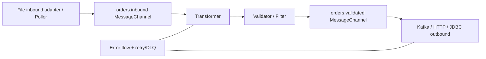
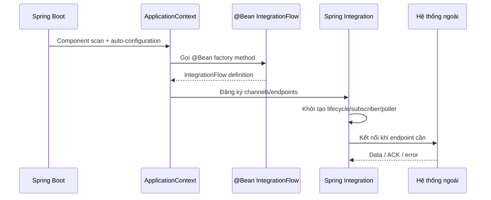
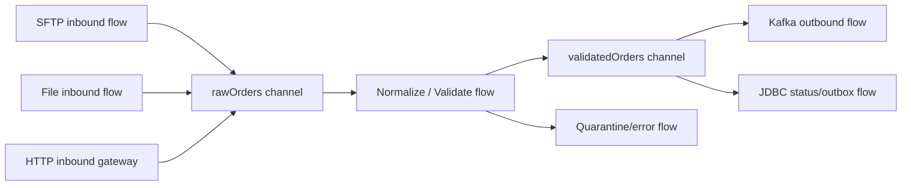
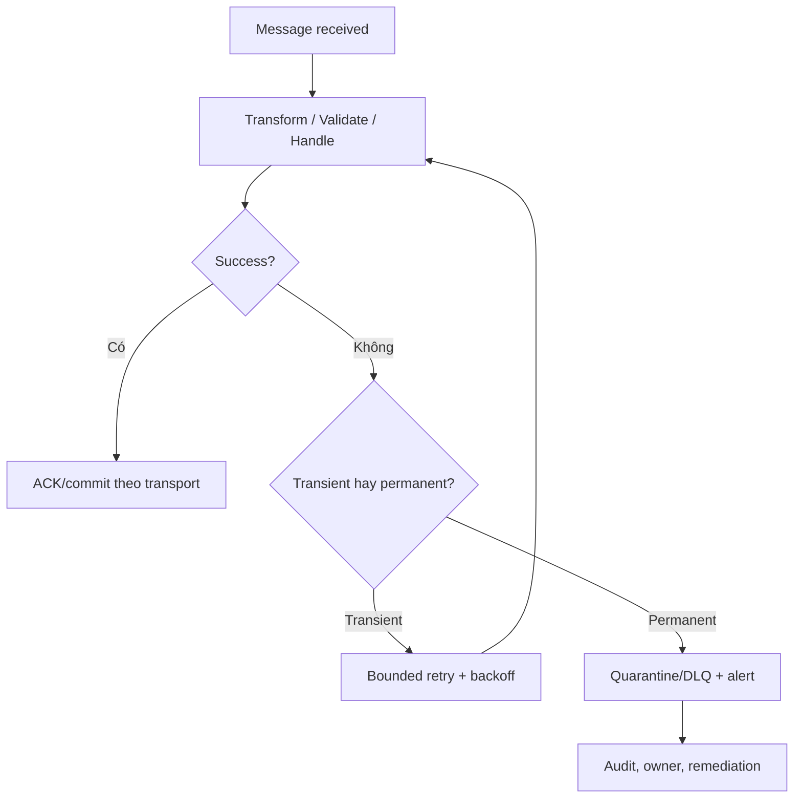
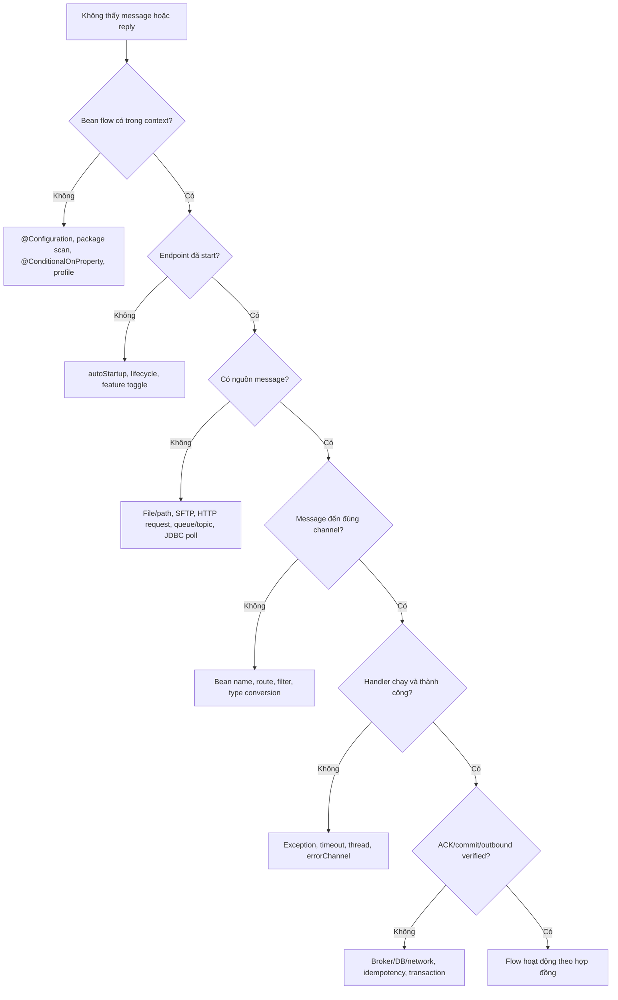

# IntegrationFlow bean trong Spring Boot: thiết kế, đăng ký và vận hành adapter

> **Chương:** Spring Boot  
> **Bài học:** IntegrationFlow bean trong Boot  
> **Module:** `SPRING_INTEGRATION_ADAPTERS` — kết nối hệ thống ngoài bằng inbound/outbound adapter, gateway, poller và `MessageChannel`; triển khai luồng File, SFTP, HTTP, JMS, AMQP/RabbitMQ, Kafka, JDBC cùng message contract, lỗi và vòng đời kết nối.  
> **Mức độ:** Trung cấp. **Kiến thức nền:** Bean và dependency injection trong Spring, cấu hình Spring Boot, Maven/Gradle, các mẫu Integration EIP cơ bản.  
> **Stack minh họa:** Java 17+, Spring Boot 3.x, Spring Integration 6.x theo bộ phiên bản tương thích do Boot BOM quản lý. Một số API có thể khác khi nâng cấp; cần đối chiếu phiên bản dự án trước khi sử dụng production.

## 1. IntegrationFlow bean giải quyết bài toán gì?

Giả sử hệ thống nhận tệp đơn hàng từ đối tác, chuẩn hóa nội dung, gửi kết quả tới một kênh nội bộ, sau đó gọi HTTP API hoặc publish Kafka. Nếu viết tất cả trong một vòng lặp Java, lập trình viên sẽ phải tự giải quyết lịch polling, định tuyến dữ liệu, trao đổi request–reply, kết nối, quản lý thread và lỗi. **Spring Integration** cung cấp các mẫu Enterprise Integration Patterns (EIP), còn **Spring Boot** cung cấp cách đăng ký và vận hành chúng như các bean trong `ApplicationContext`.

Với Java DSL, một `IntegrationFlow` mô tả **đường đi của message qua các endpoint**:



Thay vì tự ghép object handler và poller thủ công, bạn khai báo một `@Bean` có kiểu `IntegrationFlow`, sử dụng `IntegrationFlow.from(...)` và các phép DSL như `.channel(...)`, `.filter(...)`, `.transform(...)`, `.route(...)`, `.handle(...)`. Spring xử lý việc xây endpoint bean, đăng ký subscription và kết nối lifecycle vào context.

**Điểm quan trọng:** `IntegrationFlow` là **định nghĩa topology và endpoint**, không phải message, không phải bản thân `MessageChannel` và cũng không đồng nghĩa “mọi kết nối ngoài đã sẵn sàng”. Một flow có thể đăng ký thành công nhưng nguồn SFTP hoặc broker Kafka vẫn mất kết nối lúc runtime.

### 1.1. Kết quả học tập

Hoàn thành bài này, bạn có thể:

1. Mô tả sự khác nhau giữa `IntegrationFlow`, `IntegrationFlowBuilder`, `MessageChannel`, message endpoint và transport adapter.
2. Khai báo `@Bean IntegrationFlow` trong Boot và hiểu tác dụng của component scan, auto-configuration, Java DSL và bean name.
3. Xây một **request–reply flow** qua `@MessagingGateway`, `DirectChannel` và transformer không cần broker.
4. Xây một **File inbound flow có poller**, tách channel và consumer flow; chỉ bật flow theo property/profile.
5. Biết cách thêm outbound endpoint cho HTTP, SFTP, JMS, AMQP, Kafka hoặc JDBC mà không trộn lẫn logic nghiệp vụ với transport.
6. Giải thích điểm khác nhau giữa đồng bộ/bất đồng bộ, request–reply/one-way, error channel, retry và transaction.
7. Kiểm thử bean graph, message contract và luồng thực, tìm nguyên nhân lỗi khi endpoint không nhận message.
8. Đảm bảo lifecycle khi startup, shutdown, restart, thay đổi cấu hình và kết nối tới hệ thống ngoài.

### 1.2. Khi nào nên dùng IntegrationFlow bean?

- **Có:** cần tạo luồng message EIP gồm nguồn, kênh, transformation, validation, routing và endpoint được Spring quản lý; cấu hình theo Boot profile/condition.
- **Có:** cần nối adapter từ File/SFTP/HTTP/JMS/AMQP/Kafka/JDBC bằng những ranh giới trách nhiệm rõ ràng.
- **Không cần bắt buộc:** một hàm nghiệp vụ đồng bộ đơn giản không có nhu cầu tích hợp thì Spring Service thông thường có thể là đủ.
- **Không thay thế:** transaction DB, broker retry, idempotency nghiệp vụ, authentication/authorization hoặc monitoring của hệ thống ngoài.

## 2. Các đối tượng cốt lõi trong một IntegrationFlow

### 2.1. Message và MessageChannel

`Message<?>` gồm **payload** và **headers**. Payload có thể là `File`, `String`, `byte[]`, bản ghi nghiệp vụ hoặc một object đã được serialize. Header có thể chứa correlation ID, content type, thông tin file hoặc transport metadata. Không nên gửi toàn bộ framework headers ra ngoài mà không có allowlist.

`MessageChannel` là hợp đồng chuyển giao message; kiểu channel chi phối threading và hành vi gửi/nhận:

| Loại channel | Cách truyền | Tác động đến flow |
|---|---|---|
| `DirectChannel` | Point-to-point, dispatch đồng bộ tới một subscriber | Lỗi downstream có thể propagate về thread gửi; phù hợp gateway đồng bộ |
| `PublishSubscribeChannel` | Fan-out tới các subscribers | Không mặc định bền vững hoặc guaranteed delivery cho mọi subscriber |
| `QueueChannel` | Buffer có thể được poll bởi consumer | Cần consumer/poller; in-memory queue không tự bảo đảm persistence |
| `ExecutorChannel` | Dispatch qua task executor | Thay đổi thread và thời điểm xử lý; cần cấu hình rejection/back-pressure |
| `PriorityChannel` | Buffer và ưu tiên thứ tự theo policy | Có thể ảnh hưởng fairness và khả năng starvation |

Channel **không phải broker**. Một `QueueChannel` trong JVM không thay thế Kafka, RabbitMQ hoặc JMS cho hàng đợi bền vững liên tiến trình.

### 2.2. Endpoint của một flow

| DSL / endpoint | Chức năng | Ví dụ |
|---|---|---|
| `.from(...)` | Khởi đầu từ channel hoặc inbound message source | `Files.inboundAdapter(...)`, `"ordersInput"` |
| `.channel(...)` | Gửi message sang channel đã chọn | `.channel("ordersValid")` |
| `.transform(...)` | Thay đổi payload hoặc cấu trúc message | `File → String`, JSON → event DTO |
| `.filter(...)` | Cho qua/từ chối theo điều kiện | Loại bản ghi không hợp lệ |
| `.route(...)` | Chọn đích theo header/payload | Route theo tenant hoặc event type |
| `.handle(...)` | Gọi handler, service activator, outbound adapter/gateway | Lưu DB, publish event, ghi file |
| `.enrichHeaders(...)` | Bổ sung metadata được kiểm soát | correlation ID, source system |
| `.split(...)` / `.aggregate(...)` | Tách/gộp message với correlation | File chứa nhiều record |
| `.bridge(...)` | Nối hai ranh giới message | Kết nối channels theo policy |
| `.log(...)` | Ghi nhận thông tin được phép | Message ID, type, latency; **không** log secret |

Một `IntegrationFlow` có thể chỉ vài bước hoặc nhiều bước. Khi topology phức tạp, nên chia thành **nhiều flow có hợp đồng channel tường minh** thay vì một DSL chain dài khó quan sát.

### 2.3. Inbound adapter, outbound adapter và gateway

- **Inbound channel adapter**: đưa dữ liệu vào Spring Integration, thường **one-way**. File polling, SFTP polling hoặc broker listener là các ví dụ.
- **Outbound channel adapter**: nhận message rồi gửi tới hệ thống ngoài, thường **không yêu cầu reply**.
- **Inbound gateway**: nhận request từ transport, đưa vào flow, chờ reply, rồi trả response ra transport (ví dụ HTTP request → HTTP response).
- **Outbound gateway**: nhận request từ flow, gọi hệ thống ngoài và gửi response tiếp trong flow (ví dụ HTTP API, JMS request–reply).
- **Messaging gateway interface**: ứng dụng gọi phương thức Java như `normalize(String input)`, framework đưa message vào flow và nhận reply; nó không phải một network adapter trừ khi flow phía sau có transport endpoint.

Việc phân biệt **one-way** và **request–reply** giúp tránh lỗi chờ reply không tồn tại hoặc mất message khi flow chưa có subscriber.

### 2.4. Poller là cấu hình endpoint

File, nhiều loại SFTP và JDBC polling source cần poller để quyết định **khi nào nhận message**. Ví dụ:

```java
endpoint -> endpoint.poller(
    Pollers.fixedDelay(Duration.ofSeconds(2))
           .maxMessagesPerPoll(10)
)
```

Lưu ý:

- `fixedDelay` dựa vào thời gian giữa các lượt poll theo scheduler; nó không phải TCP timeout.
- `maxMessagesPerPoll` giới hạn số message một lượt poll của endpoint đó, không giới hạn tổng throughput của downstream.
- Poller mặc định không tạo exactly-once. Nếu một file/DB row vẫn đủ điều kiện sau restart, có thể được nhận lại.
- Nếu dùng task executor hoặc nhiều instance, concurrency/locking/checkpoint phải được thiết kế riêng.

## 3. Spring Boot đăng ký IntegrationFlow bean như thế nào?

### 3.1. Từ @Bean tới endpoint đang hoạt động



Lớp cấu hình Boot điển hình:

```java
@Configuration(proxyBeanMethods = false)
class OrderFlows {

    @Bean
    IntegrationFlow ordersFlow() {
        return IntegrationFlow.from("ordersInput")
            .transform(String.class, String::trim)
            .get();
    }
}
```

Cần import `@Configuration`, `@Bean` và `IntegrationFlow`. Tên `ordersFlow` là **tên bean flow** nếu không đặt tên khác. `"ordersInput"` là **tên channel đầu vào**; chúng không phải cùng một bean. Spring Integration có cơ chế tạo/resolve channel trong những trường hợp DSL nhất định, nhưng với channel là hợp đồng công khai giữa nhiều flow, **nên khai báo bean có tên rõ ràng** để tránh bất ngờ.

Khi context được tạo, Spring Integration chuyển cấu hình DSL thành các bean endpoint thích hợp. **Gọi phương thức `ordersFlow()` bằng tay không phải cách gửi message**; cần gửi qua channel hoặc gọi gateway đã đăng ký.

### 3.2. Boot auto-configuration và Java DSL

Thông thường dự án Boot khai báo:

```xml
<dependency>
    <groupId>org.springframework.boot</groupId>
    <artifactId>spring-boot-starter-integration</artifactId>
</dependency>
```

Starter hỗ trợ Integration infrastructure/auto-configuration phù hợp phiên bản. Với Boot/Spring Integration hiện đại, Java DSL là thành phần tích hợp; không lấy một ví dụ cũ rồi tự thêm module `spring-integration-java-dsl` phiên bản không tương thích.

**Có core không có nghĩa đã có adapter**: cần thêm `spring-integration-file` khi dùng `Files.inboundAdapter`, `spring-integration-sftp` cho SFTP, `spring-integration-kafka` cho Kafka. Boot có thể tự cấu hình `DataSource` hoặc Rabbit `ConnectionFactory`, nhưng không tự suy ra flow nghiệp vụ của bạn.

### 3.3. Component scanning và gateway interface

`@SpringBootApplication` kích hoạt component scan theo package ứng dụng. Với interface sử dụng `@MessagingGateway`, nên đăng ký rõ bằng `@IntegrationComponentScan` hoặc cấu hình gateway được framework hỗ trợ, thay vì tự giả định mọi interface tự thành Spring bean.

```java
@SpringBootApplication
@IntegrationComponentScan
public class AdapterApplication {
    public static void main(String[] args) {
        SpringApplication.run(AdapterApplication.class, args);
    }
}
```

Imports: `org.springframework.boot.autoconfigure.SpringBootApplication`, `org.springframework.integration.annotation.IntegrationComponentScan` và `org.springframework.boot.SpringApplication`.

### 3.4. @Bean name, endpoint ID và channel name khác nhau

| Tên | Vai trò | Ví dụ |
|---|---|---|
| `@Bean("fileInboundFlow")` | Định danh flow trong context | Dùng khi kiểm tra condition hoặc lifecycle |
| `.from("fileInput")` | Channel nhập của flow | Dùng để kết nối các flow |
| `.channel("fileReady")` | Channel đích của bước hiện tại | Hợp đồng liên flow |
| `endpoint.id("filePollerEndpoint")` | Định danh endpoint do DSL tạo, khi cần quản trị | Theo dõi endpoint/start-stop/metrics |
| `@MessagingGateway` | Proxy interface chuyển phương thức sang message | Gọi từ controller/service |

Không đặt tên bean trùng nhau giữa các adapter chỉ vì chúng cùng xử lý file. Đừng sử dụng `spring.main.allow-bean-definition-overriding=true` như giải pháp cho trùng tên; thay bằng tên/qualifier và điều kiện đăng ký phù hợp.


## 4. Chuẩn bị dự án Spring Boot cho lab

Bài lab gồm hai phần có thể chạy trên máy cá nhân:

- **Flow A – Gateway request–reply:** Java service gọi `NormalizeGateway`, message đi qua `DirectChannel` và transformer rồi nhận reply; không cần network.
- **Flow B – File inbound:** poll thư mục local, gửi `File` vào channel, biến đổi nội dung và xử lý; không dùng broker thật.

### 4.1. Dependency Maven

Dùng Spring Boot parent POM hoặc import Spring Boot BOM với phiên bản **phù hợp JDK và Spring Integration**. Đây chỉ là đoạn `<dependencies>`, không phải POM đầy đủ:

```xml
<dependencies>
    <dependency>
        <groupId>org.springframework.boot</groupId>
        <artifactId>spring-boot-starter-integration</artifactId>
    </dependency>
    <dependency>
        <groupId>org.springframework.integration</groupId>
        <artifactId>spring-integration-file</artifactId>
    </dependency>
    <dependency>
        <groupId>org.springframework.boot</groupId>
        <artifactId>spring-boot-starter-test</artifactId>
        <scope>test</scope>
    </dependency>
    <dependency>
        <groupId>org.springframework.integration</groupId>
        <artifactId>spring-integration-test</artifactId>
        <scope>test</scope>
    </dependency>
</dependencies>
```

Đối với Gradle Groovy DSL đã quản lý phiên bản theo Boot BOM:

```groovy
dependencies {
    implementation 'org.springframework.boot:spring-boot-starter-integration'
    implementation 'org.springframework.integration:spring-integration-file'

    testImplementation 'org.springframework.boot:spring-boot-starter-test'
    testImplementation 'org.springframework.integration:spring-integration-test'
}
```

Không thêm các module SFTP, JMS, Kafka và JDBC chỉ vì chủ đề nằm trong module adapters: hai lab đầu **chỉ** dùng Integration core và File adapter. Khi mở rộng sang giao thức thật, bổ sung đúng module và runtime tương thích; kiểm tra dependency tree thay vì suy đoán transitive dependency.

### 4.2. Cấu trúc project

```text
integration-flow-boot-lab/
├── pom.xml
└── src/
    ├── main/
    │   ├── java/com/example/flows/
    │   │   ├── FlowBootApplication.java
    │   │   ├── NormalizeGateway.java
    │   │   ├── NormalizeFlowConfig.java
    │   │   ├── FileImportProperties.java
    │   │   └── FileImportFlowConfig.java
    │   └── resources/
    │       └── application.yml
    └── test/java/com/example/flows/
        ├── NormalizeFlowTest.java
        └── FileImportDisabledTest.java
```

Mọi class phải ở package `com.example.flows` hoặc package con của entry point để component scan tìm thấy. Chạy Maven/Gradle từ thư mục gốc project. Với Windows dùng wrapper `mvnw.cmd`/`gradlew.bat` nếu project có cung cấp.

### 4.3. Entry point

File `FlowBootApplication.java`:

```java
package com.example.flows;

import org.springframework.boot.SpringApplication;
import org.springframework.boot.autoconfigure.SpringBootApplication;
import org.springframework.integration.annotation.IntegrationComponentScan;

@SpringBootApplication
@IntegrationComponentScan
public class FlowBootApplication {
    public static void main(String[] args) {
        SpringApplication.run(FlowBootApplication.class, args);
    }
}
```

`@IntegrationComponentScan` giúp đăng ký interface `@MessagingGateway` trong các package ứng dụng. Với flow cấu hình qua `@Bean` thông thường, Spring component scan đã hỗ trợ tìm lớp `@Configuration`, nhưng interface gateway cần cơ chế đăng ký phù hợp.

## 5. Flow A: @MessagingGateway và request–reply trong Boot

Đây là ví dụ tối thiểu để thấy rõ một `IntegrationFlow` trở thành đường xử lý có thể được gọi từ Java, không cần JMS/Kafka/HTTP hay filesystem.

### 5.1. Định nghĩa gateway interface

File `NormalizeGateway.java`:

```java
package com.example.flows;

import org.springframework.integration.annotation.Gateway;
import org.springframework.integration.annotation.MessagingGateway;

@MessagingGateway
public interface NormalizeGateway {

    @Gateway(requestChannel = "normalizeInput")
    String normalize(String rawOrderId);
}
```

Khi ứng dụng chạy, Spring Integration đăng ký một **gateway proxy bean**. Code nghiệp vụ chỉ gọi `normalize(" order-001 ")`. Proxy xây message, gửi đến channel `normalizeInput` và chờ reply theo hợp đồng request–reply.

Một gateway interface không tạo connection ra ngoài. Nếu sau này flow sử dụng HTTP outbound gateway, JMS hoặc Kafka, đó là chuyện của endpoint downstream và dependency transport tương ứng.

### 5.2. Đăng ký channel và IntegrationFlow

File `NormalizeFlowConfig.java`:

```java
package com.example.flows;

import java.util.Locale;

import org.springframework.context.annotation.Bean;
import org.springframework.context.annotation.Configuration;
import org.springframework.integration.channel.DirectChannel;
import org.springframework.integration.dsl.IntegrationFlow;
import org.springframework.messaging.MessageChannel;

@Configuration(proxyBeanMethods = false)
public class NormalizeFlowConfig {

    @Bean("normalizeInput")
    MessageChannel normalizeInput() {
        return new DirectChannel();
    }

    @Bean("normalizeFlow")
    IntegrationFlow normalizeFlow() {
        return IntegrationFlow
            .from("normalizeInput")
            .<String, String>transform(String::trim)
            .<String, String>transform(
                text -> text.toUpperCase(Locale.ROOT)
            )
            .get();
    }
}
```

**Cơ chế:**

1. `@Bean("normalizeInput")` tạo một `DirectChannel` cụ thể.
2. `IntegrationFlow.from("normalizeInput")` đăng ký endpoint tiêu thụ từ channel đã đặt tên.
3. Hai bước `transform` lần lượt xóa khoảng trắng đầu/cuối và chuẩn hóa thành chữ hoa.
4. Transformer là thành phần có thể phát reply; trong request–reply flow này, kết quả được trả về `replyChannel` mà gateway đã gắn vào message request.
5. Không có adapter nào bên ngoài: đây là **in-memory request–reply IntegrationFlow**.

**Tại sao không dùng `.handle(message -> log.info(...))` để làm kết thúc của gateway này?** Một one-way handler chỉ ghi log không tạo reply, nên lời gọi gateway trả `String` có thể chờ đến timeout hoặc thất bại vì thiếu reply. Nếu nghiệp vụ cần kết quả, phải có một handler/transformer trả message thích hợp, hoặc thiết kế gateway trả `void` cho one-way.

### 5.3. Ví dụ sử dụng từ service khác

Một bean trong cùng context có thể inject gateway:

```java
package com.example.flows;

import org.springframework.boot.ApplicationRunner;
import org.springframework.context.annotation.Bean;
import org.springframework.context.annotation.Configuration;

@Configuration(proxyBeanMethods = false)
class DemoRunnerConfig {

    @Bean
    ApplicationRunner demoNormalize(NormalizeGateway gateway) {
        return args -> {
            String result = gateway.normalize("  order-001  ");
            System.out.println("NORMALIZED=" + result);
        };
    }
}
```

Chạy app, output dự kiến:

```text
NORMALIZED=ORDER-001
```

Đây là chuỗi giả, không chứa dữ liệu cá nhân hay secret. Trong ứng dụng production, dùng structured logging phù hợp thay vì in dữ liệu nghiệp vụ tuỳ ý vào stdout.

### 5.4. Test gateway không cần broker

File `NormalizeFlowTest.java`:

```java
package com.example.flows;

import org.junit.jupiter.api.Test;
import org.springframework.beans.factory.annotation.Autowired;
import org.springframework.boot.test.context.SpringBootTest;

import static org.assertj.core.api.Assertions.assertThat;

@SpringBootTest(properties = {
    "app.file.enabled=false",
    "spring.main.web-application-type=none"
})
class NormalizeFlowTest {

    @Autowired
    NormalizeGateway gateway;

    @Test
    void gatewayReturnsTransformedReply() {
        assertThat(gateway.normalize("  order-001  "))
            .isEqualTo("ORDER-001");
    }
}
```

Bài test chứng minh gateway proxy, channel, transformer và reply kết hợp được trong context. Nó **không** chứng minh kết nối Kafka, JMS, SFTP hoặc database; kiểm thử transport phải triển khai riêng khi đưa adapter ngoài vào.

### 5.5. Những lỗi thường gặp với gateway

| Triệu chứng | Nguyên nhân có thể | Kiểm chứng |
|---|---|---|
| `NoSuchBeanDefinitionException: NormalizeGateway` | Chưa scan/register `@MessagingGateway` | Kiểm tra `@IntegrationComponentScan`, package |
| `Dispatcher has no subscribers` | Channel chưa có consumer flow | Xem bean `normalizeFlow`, profile/condition |
| `Reply timed out` | Handler one-way, downstream async lâu hoặc lỗi | Kiểm tra reply path, timeout, error channel |
| `ClassCastException` trong transformer | Payload không phải `String` | Xác định message contract, converter |
| Kết quả bị thay bởi flow khác | Nhiều endpoint cùng subscribe một `DirectChannel` | Kiểm tra topology và channel subscriptions |
| Flow cùng tên bean | Trùng `@Bean` name | Dùng tên duy nhất; không bật global bean override |

## 6. Flow B: File inbound adapter với @Bean IntegrationFlow và poller

Flow thứ hai hoạt động độc lập với request–reply gateway. Mục đích là hiểu rõ **message source**, **polling endpoint**, **channel tách biệt** và **consumer flow**.

### 6.1. Các properties thuộc ứng dụng

File `FileImportProperties.java`:

```java
package com.example.flows;

import java.nio.file.Path;
import java.time.Duration;

import org.springframework.boot.context.properties.ConfigurationProperties;

@ConfigurationProperties(prefix = "app.file")
public record FileImportProperties(
    boolean enabled,
    Path inbox,
    Duration pollDelay
) {
    public FileImportProperties {
        if (enabled && (inbox == null
                || pollDelay == null
                || pollDelay.isNegative()
                || pollDelay.isZero())) {
            throw new IllegalArgumentException(
                "File import requires inbox and positive poll-delay"
            );
        }
    }
}
```

Đây là `app.file.*` **tự định nghĩa**, không phải namespace mặc định làm Spring Boot tự sinh File adapter. Cần một bean `@EnableConfigurationProperties` hoặc cơ chế scan để binder tạo object.

File `application.yml`:

```yaml
spring:
  application:
    name: integration-flow-boot-lab
  main:
    web-application-type: none

app:
  file:
    enabled: true
    inbox: ./data/in
    poll-delay: 2s

logging:
  level:
    com.example.flows: INFO
    org.springframework.integration: INFO
```

**Quan trọng với test:** `@SpringBootTest(properties="app.file.enabled=false")` ghi đè file cấu hình và làm endpoint inbound không được đăng ký. Đừng để test thử unit/gateway vô tình poll một thư mục production. Spring Boot relaxed binding chuyển `poll-delay` thành `pollDelay` với kiểu `Duration`.

### 6.2. Ba bean phục vụ một flow có ranh giới rõ

File `FileImportFlowConfig.java`:

```java
package com.example.flows;

import java.io.File;
import java.io.IOException;
import java.io.UncheckedIOException;
import java.nio.charset.StandardCharsets;

import org.slf4j.Logger;
import org.slf4j.LoggerFactory;
import org.springframework.boot.autoconfigure.condition.ConditionalOnProperty;
import org.springframework.boot.context.properties.EnableConfigurationProperties;
import org.springframework.context.annotation.Bean;
import org.springframework.context.annotation.Configuration;
import org.springframework.integration.channel.DirectChannel;
import org.springframework.integration.dsl.IntegrationFlow;
import org.springframework.integration.dsl.Pollers;
import org.springframework.integration.file.dsl.Files;
import org.springframework.messaging.MessageChannel;

@Configuration(proxyBeanMethods = false)
@EnableConfigurationProperties(FileImportProperties.class)
public class FileImportFlowConfig {
    private static final Logger log =
        LoggerFactory.getLogger(FileImportFlowConfig.class);

    @Bean("fileReceived")
    MessageChannel fileReceived() {
        return new DirectChannel();
    }

    @Bean("fileInboundFlow")
    @ConditionalOnProperty(
        prefix = "app.file",
        name = "enabled",
        havingValue = "true"
    )
    IntegrationFlow fileInboundFlow(FileImportProperties props) {
        return IntegrationFlow
            .from(
                Files.inboundAdapter(props.inbox().toFile())
                    .autoCreateDirectory(true)
                    .patternFilter("*.txt"),
                endpoint -> endpoint.poller(
                    Pollers.fixedDelay(props.pollDelay())
                        .maxMessagesPerPoll(5)
                )
            )
            .channel("fileReceived")
            .get();
    }

    @Bean("fileProcessingFlow")
    IntegrationFlow fileProcessingFlow() {
        return IntegrationFlow
            .from("fileReceived")
            .transform(File.class, file -> {
                try {
                    return java.nio.file.Files.readString(
                        file.toPath(), StandardCharsets.UTF_8
                    );
                } catch (IOException ex) {
                    throw new UncheckedIOException(ex);
                }
            })
            .<String, String>transform(String::trim)
            .handle(message -> {
                String value = (String) message.getPayload();
                // Không ghi toàn bộ nội dung nếu chứa dữ liệu nhạy cảm.
                log.info("File message received, chars={}", value.length());
            })
            .get();
    }
}
```

Trong cấu hình này:

- `fileReceived` là channel do ứng dụng tạo và chia sẻ giữa hai `IntegrationFlow`.
- `fileInboundFlow` chỉ được đăng ký khi `app.file.enabled=true`.
- Endpoint nguồn File dùng poller fixed delay để lấy tối đa năm file mỗi lượt.
- `fileProcessingFlow` đăng ký **dù inbound tắt**, nhưng nó không sinh message. Không có nguồn thì chỉ nằm chờ trên channel.
- Payload ban đầu là `java.io.File`; transformer đọc UTF-8 rồi chuyển thành `String`, handler ghi độ dài thay vì log toàn bộ nội dung.
- Dùng `DirectChannel` nên phần consumer thường chạy trong thread đang gửi từ poller; đây là một điểm cần lưu ý khi downstream chậm.

**Lưu ý về vận hành:** Đoạn lab không xóa/di chuyển file, cũng không có persistent accept-once filter, giao dịch hay business idempotency. Nếu ứng dụng restart, file có thể được chọn lại tùy filter/metadata hiện hành. Chưa được coi flow này là quy trình exactly-once.

### 6.3. Chạy thử

Dùng wrapper của project:

```bash
./mvnw spring-boot:run
# Hoặc trong Gradle project:
./gradlew bootRun
```

Đặt một file `data/in/order-001.txt` có nội dung:

```text
orderId=ORDER-001
tenantId=tenant-a
```

Sau khi poll, output của handler có thể tương tự:

```text
File message received, chars=35
```

`chars` phụ thuộc nội dung và dấu xuống dòng thực tế, không bắt buộc phải bằng 35. Đặt `ignore.csv` vào cùng thư mục: File inbound filter chỉ nhận `*.txt`.

Tắt `app.file.enabled` rồi **khởi động lại context**. Bây giờ không có bean `fileInboundFlow`, nhưng `fileReceived` và `fileProcessingFlow` vẫn tồn tại. Chỉ sửa YAML trong khi ứng dụng đang chạy không khiến `@ConditionalOnProperty` được tự động đánh giá lại.


## 7. Kiểm thử bean graph, channel và File flow

### 7.1. Kiểm tra flow không được đăng ký khi property tắt

File `FileImportDisabledTest.java`:

```java
package com.example.flows;

import org.junit.jupiter.api.Test;
import org.springframework.beans.factory.annotation.Autowired;
import org.springframework.boot.test.context.SpringBootTest;
import org.springframework.context.ApplicationContext;

import static org.assertj.core.api.Assertions.assertThat;

@SpringBootTest(properties = {
    "app.file.enabled=false",
    "app.file.inbox=./build/test-in",
    "app.file.poll-delay=1s",
    "spring.main.web-application-type=none"
})
class FileImportDisabledTest {

    @Autowired
    ApplicationContext context;

    @Test
    void inboundFlowIsAbsentWhenFeatureDisabled() {
        assertThat(context.containsBean("fileInboundFlow")).isFalse();
        assertThat(context.containsBean("fileReceived")).isTrue();
        assertThat(context.containsBean("fileProcessingFlow")).isTrue();
    }
}
```

Đây là **context test**, không cần tạo file hoặc kết nối bên ngoài. Nó chứng minh điều kiện đã ảnh hưởng đúng tới **bean definition** của inbound endpoint; không chứng minh dữ liệu đã đi qua filesystem khi bật.

### 7.2. Kiểm tra File end-to-end khi enabled

Một integration test có thể:

1. Dùng thư mục tạm riêng cho test, không trỏ tới volume nghiệp vụ.
2. Set `app.file.enabled=true`, `app.file.inbox` bằng đường dẫn tạm **trước khi ApplicationContext khởi động**.
3. Tạo `valid-001.txt` bằng cách ghi file tạm rồi **atomic rename** vào inbox, để poller không đọc tệp chưa hoàn chỉnh.
4. Dùng test handler hoặc wire tap có cơ chế ghi kết quả để chờ với **timeout hữu hạn**, không phụ thuộc vào một `Thread.sleep` đoán trước.
5. Assert nhận đúng payload UTF-8, filter bỏ `ignore.csv`, không có exception, và bean flow/endpoint đã khởi động.
6. Dừng context; khởi động lại để quan sát khả năng file được nhận lần nữa, từ đó thiết kế persistent metadata/idempotency theo nhu cầu.

Không dùng test singleton mutable để chia sẻ dữ liệu giữa nhiều `ApplicationContext` hoặc tests song song. Với File adapter, đường dẫn tạm và vòng đời poller là thành phần quan trọng của tính tái hiện.

### 7.3. Gửi trực tiếp vào channel để kiểm thử processor

Khi không cần kiểm thử filesystem, bạn có thể gửi message `File` vào `fileReceived` và xác minh consumer flow.

Ý tưởng test:

```java
MessageChannel channel =
    context.getBean("fileReceived", MessageChannel.class);

File input = new File("path/to/test-fixture.txt");
boolean accepted = channel.send(
    MessageBuilder.withPayload(input).build()
);
assertThat(accepted).isTrue();
```

Imports cần có: `java.io.File`, `org.springframework.messaging.MessageChannel`, `org.springframework.messaging.support.MessageBuilder` và `assertThat`. Dùng một fixture thực sự tồn tại, nội dung UTF-8 hợp lệ. `send(...)` trả true cho biết channel chấp nhận delivery theo contract của channel; **không tự chứng minh nghiệp vụ downstream đã commit** nếu sau này chuyển sang asynchronous channel.

Với `DirectChannel` và handler đồng bộ như lab, lỗi I/O có thể propagate ngay tại `send(...)`. Khi đổi sang `ExecutorChannel`, cách quan sát lỗi phải chuyển sang error channel/test sink và đồng bộ kết quả có deadline.

### 7.4. Test gateway và File không thay thế integration test transport

| Loại test | Chứng minh được | Chưa chứng minh được |
|---|---|---|
| `NormalizeFlowTest` | Proxy gateway, channel, transformer và reply | Không có transport thật |
| `FileImportDisabledTest` | Conditional bean registration | Không có file được poll khi enabled |
| File context/inbox test | Poller, pattern, payload, handler cơ bản | Exactly-once qua crash/restart |
| SFTP test server | SSH authentication, host trust, file transfer | Production partner availability |
| HTTP mock server | Status, headers, timeout, payload mapping | Internet latency/identity provider thật |
| JMS/AMQP test broker | Listener, ACK, redelivery, binding | Broker HA/chaos production |
| Kafka test cluster | Topic, serialization, consumer offset/lag | End-to-end exactly-once với DB |
| Database test | JDBC schema, lock, transaction | Transaction nguyên tử với broker ngoài |

### 7.5. Quan sát số endpoint và subscriber

Nếu `fileInboundFlow` đã được tạo nhưng `fileProcessingFlow` bị điều kiện hóa sai hoặc package không được scan, `fileReceived` có thể không có subscriber. Với `DirectChannel`, gửi message khi không có handler phù hợp sẽ thất bại. Kiểm tra:

- `ApplicationContext.containsBean("fileInboundFlow")` và tên các bean liên quan.
- Channel có đúng type và có subscription tương ứng.
- `spring.integration` log level trong môi trường test để thấy endpoint và polling.
- File path, filter, quyền filesystem, working directory và biến môi trường.
- Flow có bị `autoStartup(false)` hoặc bị dừng bởi lifecycle controller không.

**Tránh ép tất cả endpoint `autoStartup=true` chỉ để dập triệu chứng.** Một connector bên ngoài có thể được cố tình disabled bởi profile hoặc security policy.

## 8. Từ IntegrationFlow bean tới các adapter ngoài

Một `IntegrationFlow` mô tả topology; khi nguồn/đích là hệ thống bên ngoài, adapter module và connection infrastructure phải được cấu hình riêng. **Không có quy tắc mỗi adapter luôn có một Spring Boot starter riêng theo tên giao thức.**

### 8.1. Ma trận nguồn, đích và dependency

| Kết nối | Module Spring Integration | Bean/infrastructure thường cần | Kiểu flow |
|---|---|---|---|
| **File** | `spring-integration-file` | `FileReadingMessageSource`, file handler, folder/filter | Polling inbound hoặc file outbound |
| **SFTP** | `spring-integration-sftp` | SSH/SFTP `SessionFactory`, known_hosts, remote filters | Polling/sync/streaming inbound, outbound |
| **HTTP inbound** | `spring-integration-http` | Servlet web runtime nếu dùng Servlet, request mapping/auth | Gateway nhận request–reply |
| **HTTP outbound** | `spring-integration-http` | HTTP client, URL, TLS, timeout | Outbound gateway/adapter |
| **JMS** | `spring-integration-jms` | Provider `jakarta.jms.ConnectionFactory`, destinations | Message-driven inbound, outbound/gateway |
| **AMQP/RabbitMQ** | `spring-integration-amqp` | Spring AMQP `ConnectionFactory`, `RabbitTemplate` | Queue listener, outbound adapter/gateway |
| **Kafka** | `spring-integration-kafka` | Producer/Consumer factories, templates, broker config | Producer outbound, message-driven inbound |
| **JDBC** | `spring-integration-jdbc` | `DataSource`, SQL/schema, transaction manager | Poll rows, outbound update |
| **Chỉ channel/gateway nội bộ** | Integration core/starter | Direct/Queue/Executor channel | In-memory flow |

Không dùng một YAML chung `spring.integration.kafka.host`, `spring.integration.sftp.user` v.v. như thể đây là bộ properties chuẩn áp dụng cho mọi adapter. Boot có `spring.kafka.*`, `spring.rabbitmq.*`, `spring.datasource.*` và các namespace runtime khác; SFTP nhiều khi cần `app.partner.sftp.*` do ứng dụng tự bind.

### 8.2. Tách inbound flow, business flow và outbound flow

Khi hệ thống kết nối hơn một transport, một topology dễ quan sát là:



**Chú ý về fan-out:** Nếu `validatedOrders` là `DirectChannel` và bạn gắn **hai subscriber**, mặc định nó là **competing consumers** (một subscriber được chọn), không phải “mọi event vừa đến Kafka vừa tới DB”. Để thật sự fan-out, dùng một `PublishSubscribeChannel` hoặc thiết kế routing/wire tap/outbox tường minh với ngữ nghĩa lỗi rõ ràng.

Đây là một nguồn bug nghiêm trọng khi chia flow: **cùng một tên channel không có nghĩa là broadcast**. Quyết định channel type và số subscriber phải xuất phát từ business contract.

### 8.3. HTTP outbound gateway: khác file inbound handler

Ví dụ mở rộng khi project đã có `spring-integration-http` và HTTP client thích hợp:

```java
@Bean("ordersHttpFlow")
IntegrationFlow ordersHttpFlow() {
    return IntegrationFlow
        .from("ordersToHttp")
        .handle(
            Http.outboundGateway("https://api.partner.example.test/orders")
                .httpMethod(HttpMethod.POST)
                .expectedResponseType(String.class)
        )
        .channel("ordersHttpResponses")
        .get();
}
```

Imports chính: `org.springframework.integration.dsl.IntegrationFlow`, `org.springframework.integration.http.dsl.Http`, `org.springframework.http.HttpMethod` và `org.springframework.context.annotation.Bean`. Đây là **ví dụ cấu trúc**, chưa có authentication, trust config, request converter, timeout, idempotency hay endpoint thật — không gửi dữ liệu thực tới URL ví dụ.

Trước khi chạy production, cấu hình endpoint/credential từ secret và allowlist, kiểm tra content type, headers được phép forward, response/status mapping, TLS, retry theo loại lỗi và request idempotency. Gateway có **reply**, khác outbound adapter one-way; nếu downstream không cần phản hồi, hãy chọn endpoint và flow tương ứng.

### 8.4. JMS và AMQP: dùng đúng ConnectionFactory

Hai thư viện đều có interface tên `ConnectionFactory` nhưng **không tương đương**:

- JMS: `jakarta.jms.ConnectionFactory` của provider (ví dụ Artemis).
- RabbitMQ/AMQP: `org.springframework.amqp.rabbit.connection.ConnectionFactory`.

Trong IntegrationFlow, JMS/AMQP outbound adapter và inbound listener sử dụng runtime factory/container tương ứng; Spring Boot có thể auto-configure một số bean khi có starter/provider và properties. Không tạo bean tên `connectionFactory` rồi tưởng các giao thức sẽ tự nhận đúng.

Cần thiết kế destination/queue, concurrency, message converter, transaction/ACK, redelivery/DLQ. Khi đổi flow từ JMS sang AMQP, không chỉ thay import trong Java DSL; các đặc tính broker, confirm, routing, transaction và thông điệp phải được đánh giá lại.

### 8.5. Kafka: producer/consumer và commit offset

IntegrationFlow tiêu thụ từ Kafka có thể dùng message-driven adapter; flow phát ra Kafka cần outbound handler/template được cấu hình với producer factory. Cần tách:

- **Producer:** serializers, partition/key, ACK, retries, idempotence, topic ACL.
- **Consumer:** group, deserializers, poll, offset commit, rebalance, error handler/DLT.
- **Business flow:** schema version, idempotency key, transaction/outbox, correlation và routing.

Nếu listener đã chuyển message vào async channel, ACK/commit ở consumer có thể diễn ra **trước khi nghiệp vụ downstream bền vững**, tùy cách thiết kế. Do đó không coi “IntegrationFlow hoạt động” là bằng chứng exactly-once. Test failure tại ranh giới DB/Kafka và restart/rebalance.

### 8.6. SFTP và JDBC: polling & checkpoint

SFTP inbound cần session factory, remote directory, đồng bộ/streaming choice, known-host verification, file readiness, remote/local filters và retry/reconnect. JDBC inbound cần data source, SQL chọn bản ghi đủ điều kiện, locking/transaction, cách đánh dấu đã xử lý và poller.

Trong cả hai, **poller chỉ quyết định khi nào lấy dữ liệu**, không tự biến nguồn thành hàng đợi một lần vĩnh viễn. Khi nhiều instance cùng chạy, cần shared metadata store/lock, remote file renaming hoặc DB claim semantics tùy nguồn. Với JDBC → Kafka, cân nhắc transactional outbox/CDC nếu cần tránh mất sự kiện giữa hai hệ thống.

### 8.7. File outbound: đừng quên naming và commit

Khi muốn ghi file sau một transformer, ví dụ DSL cấu trúc:

```java
@Bean("exportFileFlow")
IntegrationFlow exportFileFlow() {
    return IntegrationFlow
        .from("exportFiles")
        .handle(
            Files.outboundAdapter(new File("./data/out"))
                .autoCreateDirectory(true)
        )
        .get();
}
```

Cần import `java.io.File`, `org.springframework.integration.file.dsl.Files`, `org.springframework.integration.dsl.IntegrationFlow` và `@Bean`. Để thực sự hoạt động đúng nghiệp vụ, phải xác định payload mà File writer hỗ trợ, file name generator, encoding, file-exists policy, atomic write/temp suffix, fsync nếu cần, đường dẫn/permission và error handling.

Flow trên là **mảnh mở rộng độc lập**, chưa được nối với `fileReceived` của lab. Muốn dữ liệu tới `exportFiles`, cần thêm processor/gateway gửi message có payload hợp lệ và đặt tên file được kiểm soát.


## 9. Thiết kế message contract khi tách IntegrationFlow bean

Mỗi channel nối các flow là một **ranh giới hợp đồng**: dữ liệu đi vào phải có payload type, headers và quy tắc lỗi mà cả producer/consumer hiểu giống nhau. Đặt hai flow chung tên channel mà không có contract có thể khiến converter sai kiểu, mất correlation hoặc lộ dữ liệu khi đổi outbound adapter.

### 9.1. Hợp đồng ví dụ cho OrderImported

```json
{
  "eventId": "evt-order-0001",
  "schemaVersion": 1,
  "eventType": "OrderImported",
  "tenantId": "tenant-a",
  "occurredAt": "2026-11-23T08:00:00Z",
  "payload": {
    "orderId": "ORDER-0001",
    "status": "VALIDATED"
  }
}
```

Đây là **schema nghiệp vụ minh họa**, không phải kiểu message tự động sinh bởi Spring Integration. Một ứng dụng cần tự triển khai parser, schema validation, mapping sang DTO, và chỉ phát event khi hợp lệ. Không cho client tự đặt `tenantId` để vượt quyền của tenant đã được xác minh ở server.

### 9.2. Phân biệt business ID, message ID và transport offset

| Loại định danh | Mục đích | Không nên dùng thay cho |
|---|---|---|
| `eventId`/business key | Dedupe nghiệp vụ xuyên retry/restart | Message ID sinh mỗi lần trong framework |
| Spring Integration message ID | Correlation nội bộ trong JVM | Business idempotency toàn hệ thống |
| `correlationId` và sequence headers | Ghép các message bị split/aggregate | Authorization subject hoặc tenant verified |
| File path/name | Chỉ vị trí hoặc nhận diện file | Dedupe bản ghi nếu tên có thể tái sử dụng |
| Kafka topic/partition/offset | Vị trí record trong log Kafka | Khóa nghiệp vụ giữa nhiều topic/partition |
| JMS/AMQP message ID | Nhận diện bản tin do broker cung cấp | Định danh người dùng hoặc transaction |
| HTTP request ID | Trace request ở API | Bằng chứng HTTP POST chưa bị áp dụng hai lần |
| DB primary key | Nhận diện row trong DB | Hợp đồng toàn bộ event nếu row tái tạo/version đổi |

Trong một topology File → Kafka, có thể tạo event ID từ khóa bền vững của đơn hàng cộng version nghiệp vụ. **Không** lấy ngẫu nhiên `UUID.randomUUID()` trên mỗi lần retry rồi gọi đó là idempotency key: retry sẽ có ID mới và có thể tạo duplicate.

### 9.3. Chia flow theo trách nhiệm

Một kiến trúc có thể tách các bean:

```text
fileInboundFlow
    ↓
rawFileChannel                payload: File
    ↓
fileParseFlow                 payload: ValidatedOrder
    ↓
ordersValidatedChannel        payload: ValidatedOrder
    ├── publishKafkaFlow      payload: serialized event
    └── auditPersistenceFlow  payload: outbox/event record
```

Ở sơ đồ trên, dấu nhánh chỉ thể hiện **ý định nghiệp vụ**. Nếu dùng `DirectChannel` với hai subscriber, message không mặc nhiên tới cả hai. Muốn thực hiện **fan-out**, phải chọn `PublishSubscribeChannel`, bridge/wire tap phù hợp hoặc thiết kế outbox, và kiểm tra xử lý khi một nhánh thành công, nhánh khác thất bại.

### 9.4. Không forward headers bừa bãi

Spring Integration có một số header dành cho giao tiếp framework, chẳng hạn reply/error channel hoặc metadata của File/JMS/AMQP/Kafka. Khi gửi sang transport khác, phải xây **allowlist** những trường được phép, ví dụ event ID, schemaVersion, tenant đã xác thực và correlation ID.

Đặc biệt không forward bừa:

- Authorization bearer token hoặc session cookie nhận từ HTTP.
- `replyChannel` chứa reference đối tượng trong JVM.
- Exception stack trace có thể chứa credential/URI nội bộ.
- Full filesystem path, local username hoặc secret metadata.
- Header `tenantId`/`role` do đối tác bên ngoài khai báo mà backend chưa xác minh.

Với sự kiện gửi Kafka/JMS, schema version phải có chính sách backward/forward compatibility; không dựa vào runtime class name của một Java object như hợp đồng công khai.

## 10. Lỗi, retry và ranh giới transaction

### 10.1. Lỗi trong DirectChannel khác lỗi trong poller

Trong lab:

- Gateway gửi vào `normalizeInput` là lời gọi đồng bộ. Nếu transformer ném exception, caller thường nhận exception thông qua gateway path.
- File poller chạy do scheduler; nếu đọc file thất bại, không có Java caller đang đợi return. Lỗi cần được log/chuyển qua cơ chế error handler phù hợp với poller.
- Với `ExecutorChannel`, lỗi xảy ra ở thread khác; `try/catch` của thread gửi không đủ để theo dõi tác dụng phụ downstream.

Vì vậy chiến lược error flow phải đi cùng **thread model và endpoint contract**.



### 10.2. ErrorChannel và ErrorMessage

Spring Integration có cơ chế `ErrorMessage` và `errorChannel`; các poller, endpoint bất đồng bộ hoặc gateway có thể sử dụng cách xử lý lỗi khác nhau tùy loại endpoint và cấu hình. Không giả định **mọi exception** của synchronous flow đều tự động xuất hiện ở `errorChannel` nếu chúng đã propagate về caller.

Khi thiết kế error handling:

1. Xác định lỗi phát sinh tại **source**, transformer, service activator hay outbound transport.
2. Xác định thread chứa exception và bên nào chịu trách nhiệm ACK/commit.
3. Gắn error handler/channel vào đúng poller/endpoint khi cần.
4. Giữ business correlation ID và event ID trong log lỗi; loại bỏ secret và PII không cần thiết.
5. Phân loại lỗi retry được (network timeout, broker tạm mất) và lỗi không retry được (schema sai, permission denied, validation).
6. Không retry vô hạn hoặc dùng DLQ nhưng không có owner xử lý.

### 10.3. Retry cần bảo đảm idempotency

| Transport | Failure mode | Cách giảm rủi ro |
|---|---|---|
| **File** | Restart đọc lại file đã xử lý | Persistent accept-once filter, archive và business idempotency |
| **SFTP** | Mất session giữa chừng, remote file chưa hoàn tất | Remote staging/rename, retry có giới hạn, checkpoint |
| **HTTP** | Timeout sau khi server có thể đã nhận POST | Idempotency key, retry theo status, hạn chế 4xx |
| **JMS** | Rollback dẫn tới redelivery | ACK/transaction hợp lý, DLQ, duplicate detection |
| **AMQP** | Nack/requeue vô hạn | Retry/backoff, DLQ, publisher confirms |
| **Kafka** | Consumer rebalance/offset commit không đồng bộ downstream | DLT, offset strategy, transactional outbox, idempotent consumer |
| **JDBC** | Poller chọn lại row, nhiều instance claim cùng row | Lock/claim, transaction, persistent checkpoint |

Một thử nghiệm có retry thành công không đủ chứng minh **exactly-once ở nghiệp vụ**. Cần mô phỏng timeout ở giữa hành động downstream thành công nhưng source chưa ACK; sau khi retry, kiểm tra không phát sinh thêm đơn hàng/bản ghi trùng.

### 10.4. Request–reply cần timeout và kết quả rõ

Nếu `@MessagingGateway` trả `String` mà flow chỉ ghi vào `log` rồi kết thúc, caller sẽ không nhận reply mong muốn. Nếu downstream HTTP trả 500, phải quyết định propagate exception, trả business error hoặc đưa vào retry, không silently trả “OK”.

Đối với flow nhập HTTP → ghi database → trả HTTP response, timeout của gateway nên được thiết kế cùng HTTP server timeout, JDBC timeout và SLA nghiệp vụ. Không đặt timeout gateway dài vô hạn chỉ vì muốn “đợi đến khi xử lý xong”.

### 10.5. Transaction không tự lan qua mọi endpoint

Một `DirectChannel` đồng bộ có thể giữ một số context trên cùng thread, nhưng điều đó **không tạo** một distributed transaction giữa DB, Kafka, HTTP và SFTP. Khi chuyển sang `ExecutorChannel`, thread boundary còn có thể cắt sự truyền ngữ cảnh transaction.

Ví dụ JDBC commit rồi Kafka publish fail: bạn cần outbox, retry bền vững và idempotent consumer nếu muốn tránh mất event. Broker ACK chỉ là bảo đảm của transport tương ứng, không chứng minh nghiệp vụ cuối cùng đã hoàn tất.

## 11. Lifecycle: khởi tạo, điều kiện bật và graceful shutdown

### 11.1. Khác biệt giữa bean registration và endpoint runtime

| Trạng thái | Có nghĩa là | Không có nghĩa là |
|---|---|---|
| Bean `IntegrationFlow` được tạo | Topology/configuration được đăng ký | SFTP/Kafka/DB đã sẵn sàng |
| Endpoint `autoStartup=true` | Endpoint được phép khởi động cùng context theo lifecycle | Server đích đã xác thực thành công |
| Poller đang chạy | Scheduler đang gọi nguồn | Có file/row mới hoặc xử lý nghiệp vụ thành công |
| Gateway bean tồn tại | Caller có proxy để gửi message | Flow có subscriber/reply hợp lệ |
| Broker connection established | Có transport connection | Có quyền publish/consume đúng topic/queue |
| Boot application `Started` | Context đã khởi tạo | Toàn bộ adapters đạt readiness |

### 11.2. Feature toggle bằng @ConditionalOnProperty

`@ConditionalOnProperty` được đánh giá khi **ApplicationContext được tạo**. Với `fileInboundFlow` trong lab:

- `app.file.enabled=true`: tạo flow inbound và poller.
- `app.file.enabled=false`: không đăng ký bean inbound.
- Thay đổi YAML khi app đang chạy không làm Spring tự tái đánh giá điều kiện.

Để **điều khiển runtime** cần thiết kế riêng, chẳng hạn dùng lifecycle của endpoint (`SmartLifecycle`/`IntegrationFlowContext`), actuator/control API có xác thực và audit. Đừng nhầm “tắt bean khi restart” với “dừng ngay tất cả in-flight messages”. Các thao tác start/stop phải có bảo vệ authorization, trạng thái và rollback.

### 11.3. Dynamic IntegrationFlow registration

Spring Integration có khả năng đăng ký flow động qua `IntegrationFlowContext` khi trường hợp sử dụng cần tạo một tuyến tích hợp theo tenant/đối tác tại runtime. Tuy nhiên điều này **không nên là lựa chọn mặc định** cho mọi connector:

- Cần cấp ID duy nhất và ổn định, lưu registration để stop/destroy khi không dùng.
- Kiểm soát số flow, poller, thread pool, connection factory và metric cardinality.
- Xác minh tenant/partner binding trước khi đăng ký, không cho input bên ngoài tạo endpoint arbitrary URL.
- Bảo đảm unregister dừng nhận message mới, xử lý in-flight và giải phóng session/broker resources.
- Tái khởi động app phải dựng lại topology từ nguồn cấu hình được phê duyệt, không dựa vào state chỉ ở bộ nhớ.

Với vài adapter cấu hình tĩnh, `@Bean IntegrationFlow` + `@ConditionalOnProperty` thường đơn giản và dễ kiểm toán hơn.

### 11.4. Graceful shutdown từng nguồn

| Nguồn/đích | Cần lưu ý khi dừng |
|---|---|
| File/SFTP polling | Ngừng poll mới, hoàn tất/đánh dấu file đang xử lý, đóng stream/session |
| HTTP inbound | Ngừng nhận request mới, trả trạng thái phù hợp, xử lý request in-flight |
| JMS/AMQP listener | Dừng consumer đúng thứ tự, ACK/nack/redelivery theo policy |
| Kafka consumer | Hoàn tất xử lý/commit offset phù hợp, rebalance, đóng consumer/producer |
| JDBC poller | Hoàn tất hoặc rollback transaction, trả connection pool |
| Async channels | Drain hoặc lưu bền vững queue; không mất message do executor shutdown đột ngột |

Đặt **timeout hữu hạn** và metrics cho shutdown; thử restart trong lúc có message đang xử lý. Nếu tính bền vững cần thiết, in-memory channel/queue không đủ; phải dùng broker/outbox hoặc cơ chế lưu bền vững theo thiết kế.

### 11.5. Readiness, metrics và audit

Một `IntegrationFlow` nên có owner và observability theo ranh giới endpoint:

- Poll interval, số message nhận, latency từng bước, error count và queue/backlog.
- Kết nối SFTP/JMS/AMQP/Kafka/JDBC sẵn sàng hay retry.
- Consumer lag, DLQ depth, broker disconnect, file age và unprocessed rows.
- Correlation/event ID, source system, operation outcome; không log secret/header nhạy cảm.
- Cảnh báo khi flow đáng ra hoạt động nhưng không thấy event hoặc endpoint bị stop không có phê duyệt.

Spring Boot Actuator/Micrometer có thể cung cấp health/metrics tùy module, cấu hình và phiên bản; thêm `spring-boot-starter-actuator` khi cần, nhưng **không mở** endpoint nhạy cảm công khai. Kiểm tra mức độ metric thực tế của từng adapter và bổ sung custom indicators nếu cần.


## 12. Troubleshooting: vì sao IntegrationFlow bean không hoạt động?

### 12.1. Quy trình điều tra theo từng lớp



### 12.2. Các lỗi điển hình

| Triệu chứng | Nguyên nhân ưu tiên | Cách kiểm tra và sửa |
|---|---|---|
| `No bean of type IntegrationFlow` | Configuration chưa được scan hoặc condition false | Kiểm tra package, `@Bean`, active profiles, properties |
| Gateway interface không inject được | Chưa đăng ký `@MessagingGateway` | `@IntegrationComponentScan`/config tương ứng |
| Gateway bị `Reply timed out` | Handler không trả reply, async flow chậm | Kiểm tra reply path và gateway timeout |
| `Dispatcher has no subscribers` | DirectChannel không có endpoint consumer | Kiểm tra flow downstream, bean definition và lifecycle |
| File adapter không phát message | Path sai, filter bỏ file, poller disabled | Kiểm tra working directory, pattern, permissions, poller |
| SFTP không nhận file | Session factory/trust, remote directory, remote filter | Kiểm tra host key, credential, network, stream |
| HTTP inbound 404 | Web runtime/endpoint mapping chưa đúng | Kiểm tra Servlet stack, route, security |
| HTTP outbound timeout | Client hoặc đích chậm, DNS/TLS/proxy | Tách connect vs read timeout, retry policy |
| JMS connection không tạo | Thiếu provider hoặc `jakarta.jms.ConnectionFactory` | Starter/provider và bean thật |
| RabbitMQ nhận/gửi lỗi | Exchange, queue binding, ACL/vhost, nack | Broker topology, confirms, DLQ |
| Kafka consumer không nhận | Topic/group/offset, ACL, deserializer | Consumer assignment, lag, error handler |
| JDBC poll lặp vô hạn | Thiếu claim/checkpoint, transaction sai | Query, lock, idempotency |
| Bean trùng tên | Hai flow cùng `@Bean("...")` | Đặt tên riêng, điều kiện back-off; không bật overriding |
| Message sai kiểu | Transformer/converter không đồng nhất | Xác minh payload ở mỗi channel |
| Hai subscriber nhưng một nhánh không nhận | `DirectChannel` unicast, nhầm với pub-sub | Chọn topology fan-out có chủ đích |
| Đổi sang `QueueChannel` rồi flow đứng | Thiếu poller cho consumer | Xem pollable channel và endpoint |
| App Boot started nhưng adapter mất kết nối | Factory lazy, broker/server down | Readiness, reconnect, transport tests |
| Lỗi chỉ khi shutdown | In-flight message, ACK/commit chưa hoàn tất | Graceful stop, timeout, drain/persistence |

### 12.3. Dependency và condition report

Maven:

```bash
./mvnw dependency:tree -Dincludes=org.springframework.integration
./mvnw spring-boot:run -Dspring-boot.run.arguments=--debug
```

Gradle:

```bash
./gradlew dependencies --configuration runtimeClasspath
./gradlew bootRun --args='--debug'
```

Các lệnh là ví dụ chạy trong dự án có Maven/Gradle wrapper; Windows cần `mvnw.cmd`/`gradlew.bat` và cách quote tương ứng. **Theo giới hạn bước biên soạn này, không chạy build/test ngay trong bước viết tài liệu**; học viên hoặc bước QA chuyên môn sẽ chạy trên môi trường thích hợp.

Khi đọc condition report:

- **Positive match:** điều kiện classpath/property/bean được đáp ứng.
- **Negative match:** thiếu dependency, profile/property false, đã có bean khiến auto-configuration back off.
- **Exclusion:** một auto-configuration bị loại bỏ có chủ đích hoặc nhầm lẫn.
- **Runtime bean graph:** flow/channel/endpoint tồn tại nhưng có thể chưa ready.

`@Bean IntegrationFlow` do người dùng tự viết không tự động biến mất vì Spring Boot tạo một default `MessageChannel`; vấn đề cần kiểm tra là **tên và type bean**, thứ tự đăng ký, qualifier, condition, số subscriber và trạng thái lifecycle.

### 12.4. Phân biệt ba tầng thành công

1. **Configuration PASS:** phụ thuộc đúng, class load được, bean flow tồn tại.
2. **Transport PASS:** endpoint kết nối được, xác thực thành công, có data và response/ACK.
3. **Business PASS:** payload đúng schema, ủy quyền hợp lệ, idempotency/transaction bảo đảm, trạng thái downstream thực sự thay đổi đúng một lần theo hợp đồng.

Chỉ ghi “application started successfully” là chưa đủ để nghiệm thu một adapter JMS/Kafka/SFTP hoặc một pipeline File → database.

## 13. Bài tập mở rộng và bộ kiểm thử nghiệm thu

### 13.1. Các nhiệm vụ thực hành

1. **Gateway cơ bản:** tạo `NormalizeGateway` và `normalizeFlow`. Gọi phương thức với chuỗi có khoảng trắng, đối chiếu reply; giải thích vai trò `replyChannel`.
2. **File inbound:** tạo `FileImportFlowConfig`, bật `app.file.enabled`, đưa file `*.txt` vào thư mục; chứng minh handler nhận `File`, đọc thành `String` và ghi đúng length.
3. **Property condition:** tắt File inbound rồi khởi động lại context; chứng minh chỉ bean `fileInboundFlow` biến mất, channel và processor flow vẫn tồn tại.
4. **Sai kiểu message:** gửi payload không phải `File` vào `fileReceived`. Ghi nhận lỗi, bổ sung validator/error flow và tránh làm cả poller ngừng không kiểm soát.
5. **Điều kiện filter:** tạo `ignore.csv` và giải thích vì sao file không được xử lý; đề xuất cách phát hiện file không hợp lệ thay vì để nó nằm mãi không có owner.
6. **Fan-out:** thiết kế `validatedOrders` để vừa xuất Kafka vừa lưu DB. Giải thích tại sao `DirectChannel` với hai subscriber chưa bảo đảm broadcast, đề xuất pub-sub hoặc outbox.
7. **SFTP/Kafka:** vẽ topology SFTP inbound → validated message → Kafka outbound; liệt kê các bean `SessionFactory`, producer factory, poller, error channel và thông số bảo mật.
8. **HTTP gateway:** đưa một request nghiệp vụ vào flow, gọi mock HTTP API, nhận response; đề xuất timeout, idempotency key và hành vi khi 429, 500, timeout.
9. **JMS/AMQP:** giải thích sự khác nhau giữa factory hai giao thức, ACK/rollback và DLQ; mô phỏng một message lỗi để tránh redelivery vô hạn.
10. **JDBC:** thiết kế poller lấy tối đa N row mỗi lần; chỉ rõ transaction boundary, checkpoint, multi-instance lock và outbox nếu downstream là Kafka.
11. **Lifecycle:** mô tả cách dừng endpoint có message in-flight, khôi phục khi restart và xác minh không mất hoặc nhân đôi tác dụng phụ.
12. **Observability:** liệt kê metric/dashboard/alert cần để biết flow đã bật, adapter sẵn sàng, backlog/lag tăng và retry vượt ngưỡng.

### 13.2. Bộ test tối thiểu

| Test | Điều kiện | Kỳ vọng |
|---|---|---|
| Gateway reply | `gateway.normalize(" a-001 ")` | Nhận `"A-001"`, không timeout |
| Gateway missing subscriber | Flow consumer bị tắt trong context thử nghiệm độc lập | Thấy lỗi chuyển giao/reply rõ, không silently success |
| File enabled | `app.file.enabled=true`, folder có `x.txt` | Một event đến consumer, file được đọc |
| File disabled | `app.file.enabled=false` | Không có inbound flow, processor/channel vẫn có |
| Filename filter | Có `x.csv` | Không được đưa vào flow `*.txt` |
| Unicode content | Tệp UTF-8 có ký tự tiếng Việt | Transformer không làm hỏng charset |
| File I/O error | File không thể đọc | Có lỗi nhận diện được, không mất dấu vết |
| Duplicate replay | Restart với file đã xử lý | Nhận diện nguy cơ duplicate, có kế hoạch idempotency |
| Wrong payload | Gửi kiểu không hợp lệ vào channel | Không xử lý nhầm, có error classification |
| Channel fan-out | Hai subscriber trên DirectChannel vs PubSub | Giải thích và quan sát khác biệt |
| Remote unavailable | SFTP/broker test server down | Retry bounded + cảnh báo readiness |
| Shutdown | Dừng app lúc message in-flight | Không ACK sớm trái hợp đồng; khôi phục được |

### 13.3. Thang điểm gợi ý

| Tiêu chí | Điểm |
|---|---:|
| Hiểu bean lifecycle, ApplicationContext và Java DSL | 15 |
| Request–reply `@MessagingGateway`, `DirectChannel` và transformer | 20 |
| File inbound `IntegrationFlow`, poller, feature toggle và processor flow | 20 |
| Thiết kế channel, message contract và fan-out đúng | 15 |
| Mở rộng adapter SFTP/HTTP/JMS/AMQP/Kafka/JDBC phù hợp | 10 |
| Error handling, retry, idempotency, transaction và shutdown | 10 |
| Kiểm thử, troubleshooting, observability và báo cáo | 10 |
| **Tổng** | **100** |

**Điều kiện đạt:** Học viên tạo được ít nhất hai `IntegrationFlow` được Boot đăng ký, kiểm chứng gateway trả reply đúng và File inbound poll qua channel tới consumer. Người học phải giải thích tại sao một bean có mặt không chứng minh transport ready, tại sao không thể dùng `DirectChannel` làm fan-out mặc định, và cách bảo vệ message contract khi chuyển sang adapter ngoài.

## 14. Checklist trước khi triển khai production

### 14.1. Thiết kế

- [ ] Nguồn và đích của mọi flow có owner và use case rõ ràng.
- [ ] Inbound vs outbound, adapter vs gateway, one-way vs request–reply được chọn đúng.
- [ ] Channel type, tên, payload schema, headers và tenant trust được tài liệu hóa.
- [ ] Không có hai subscribers ngoài ý muốn trên DirectChannel; fan-out có thiết kế và test.
- [ ] Poller, queue bounds, concurrency, back-pressure và startup/shutdown theo nhu cầu thực.
- [ ] Bean `IntegrationFlow` và endpoint ID không trùng, `@ConditionalOnProperty`/`@Profile` không bật nhầm môi trường.
- [ ] Dependency adapters và Boot BOM tương thích; không thêm starter không dùng tới.

### 14.2. Bảo mật và độ tin cậy

- [ ] SFTP xác thực host key; broker/HTTP/DB sử dụng TLS phù hợp.
- [ ] Credentials do secret manager cung cấp, phân quyền tối thiểu và có rotation.
- [ ] HTTP inbound xác thực, kiểm tra authorization và giới hạn kích thước request.
- [ ] Input không tin cậy được parse/validate trước khi vào nghiệp vụ hoặc định tuyến theo tenant.
- [ ] Có business idempotency key, retry policy, quarantine/DLQ và quy trình xử lý poison message.
- [ ] Không nhầm kết quả gửi vào MessageChannel với commit/ACK ở downstream.
- [ ] Transaction boundaries và timeout rõ; có outbox nếu cần nhất quán giữa DB và broker.
- [ ] Không log payload chứa PII/secret hoặc toàn bộ framework message headers.

### 14.3. Quan sát và vòng đời

- [ ] Có test bean graph, contract và integration transport trên môi trường cô lập.
- [ ] Có dashboard flow status, message count, error rate, latency, backlog/consumer lag.
- [ ] Có alert khi poller dừng, endpoint disabled ngoài dự kiến, broker unreachable hoặc retry quá ngưỡng.
- [ ] Endpoint đóng/giải phóng connection trong graceful shutdown; có test restart và replay.
- [ ] Có rollout/rollback rõ và kiểm tra lại topic, queue, remote path, DB target sau deploy.
- [ ] Có bằng chứng kết quả nghiệp vụ, không chỉ “Spring Boot started”.

### 14.4. Câu hỏi ôn tập

1. Khác biệt giữa bean `IntegrationFlow`, bean `MessageChannel` và endpoint do DSL tạo ra là gì?
2. Tại sao `IntegrationFlow.from("ordersInput")` không đủ để nhận message nếu không ai gửi vào `ordersInput`?
3. Vì sao một gateway có return type `String` có thể timeout nếu flow kết thúc bằng one-way handler?
4. Khi chia File inbound và processor thành hai flow, cách nào xác định channel giao tiếp giữa chúng?
5. Một flow có hai subscribers trên `DirectChannel` có bảo đảm cả hai được gọi không?
6. Nếu chuyển `DirectChannel` sang `ExecutorChannel`, điều gì thay đổi trong exception propagation và thời điểm ACK?
7. Tại sao `@ConditionalOnProperty` không tự dừng một poller đang chạy khi YAML thay đổi?
8. SFTP `SessionFactory` và JDBC `DataSource` có tự tạo IntegrationFlow khi thêm dependency không?
9. Nếu Kafka consumer đã ACK nhưng JDBC downstream fail, bạn sẽ xử lý độ tin cậy end-to-end ra sao?
10. Vì sao lưu file nguồn và dùng filter in-memory chưa đủ chứng minh exactly-once sau restart?
11. Khi một gateway trả HTTP response nhưng outbound Kafka publish đang retry, nên mô tả hợp đồng nhất quán và timeout thế nào?
12. Dấu hiệu nào chứng minh một endpoint thật sự hoạt động, thay vì chỉ có bean trong context?

## Kết luận

**`IntegrationFlow` bean trong Spring Boot** là công cụ mô tả và đăng ký các chuỗi xử lý message một cách rõ ràng, được Spring quản lý theo dependency injection, configuration, endpoint lifecycle và observability. Nhờ tách **channel**, **transformer/handler**, **poller**, **gateway** và **adapter**, một ứng dụng có thể kết hợp File, SFTP, HTTP, JMS, AMQP, Kafka và JDBC mà vẫn giữ hợp đồng nghiệp vụ có thể kiểm thử.

Triển khai thành công không dừng ở việc tạo được `@Bean IntegrationFlow`: phải chứng minh **message đi đúng channel và đúng endpoint**, reply/ACK đúng ngữ nghĩa, lỗi được xử lý an toàn, kết nối có bảo mật và lifecycle được kiểm soát, đặc biệt khi retry, shutdown hoặc khởi động lại.


