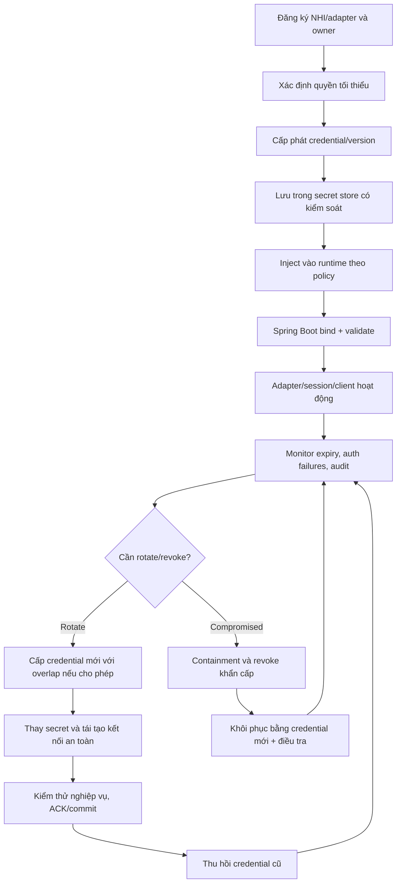

# Quản lý credential bằng configuration trong Spring Boot và Spring Integration Adapters

## 1. Vì sao credential phải được quản lý như một phần của kiến trúc tích hợp?

Một ứng dụng Spring Integration có thể vận hành nhiều kết nối cùng lúc:

- **SFTP inbound adapter** tải file bằng tài khoản SSH hoặc private key.
- **HTTP outbound gateway** gọi API bên ngoài bằng API key, OAuth 2.0 access token hoặc mTLS client certificate.
- **JMS/AMQP adapter** kết nối message broker với username/password hoặc cơ chế TLS/SASL phù hợp.
- **Kafka producer/consumer** dùng SASL, TLS hoặc workload identity để truy cập cluster.
- **JDBC inbound/outbound adapter** dùng tài khoản cơ sở dữ liệu, có thể cần password, token ngắn hạn hay chứng chỉ.
- **File adapter** dựa vào quyền filesystem của tiến trình và các mount do nền tảng cấp.

Các adapter này đều cần **configuration**: endpoint, port, đường dẫn, timeout, tên queue/topic và một số thông tin xác thực. Nếu credential bị hard-code trong Java, lưu thẳng vào Git hoặc in vào log, một thay đổi nhỏ về môi trường hoặc một lần lộ secret có thể làm ảnh hưởng nhiều hệ thống.

Trong chương **Spring Boot** của mô-đun `SPRING_INTEGRATION_ADAPTERS`, mục tiêu của bài **“Quản lý credential bằng configuration”** là biết cách phân tách **cấu hình kết nối** với **bí mật xác thực**, sử dụng hệ thống cấu hình ngoài (*externalized configuration*) của Spring Boot, kiểm tra dữ liệu lúc khởi động và lập quy trình **cấp phát, xoay vòng, thu hồi, kiểm toán** mà không làm hỏng vòng đời kết nối hay hợp đồng message.

Bài này tập trung vào Spring Boot và Spring Integration: **inbound/outbound adapter, gateway, poller, MessageChannel, luồng File/SFTP/HTTP/JMS/AMQP/Kafka/JDBC và xử lý lỗi khi credential thay đổi**.

### Kết quả học tập

Sau bài học, bạn có thể:

1. Phân biệt tham số cấu hình thông thường với secret và danh tính máy.
2. Chọn nguồn credential hợp lý: biến môi trường, file secret được mount, config tree hoặc secret manager.
3. Sử dụng `application.yml`, `@ConfigurationProperties`, validation và bean wiring để cấu hình adapter.
4. Không để password, API key hoặc private key xuất hiện trong source, message payload, header hoặc telemetry.
5. Hiểu giới hạn của việc cập nhật secret khi ứng dụng và session/connection pool đang chạy.
6. Thiết kế rotation/rollback cho SFTP, Kafka, JMS, AMQP, HTTP và JDBC.
7. Kiểm thử trường hợp thiếu credential, credential sai, hết hạn, bị thu hồi và lỗi secret provider.

> **Nguyên tắc chính:** configuration nên mô tả **cách tìm và dùng credential**; credential thật phải đi qua kênh bảo vệ có giới hạn quyền truy cập, vòng đời, kiểm toán và quy trình rotation. Việc đặt password trong `application.yml` rồi đẩy lên Git **không trở nên an toàn** chỉ vì Spring Boot đọc được file đó.

## 2. Credential, identity và configuration khác nhau như thế nào?

| Thành phần | Ví dụ | Có phải secret? | Cách quản trị |
|---|---|---|---|
| Endpoint host/port | `sftp.partner.example:22` | Thường không, nhưng vẫn là metadata nội bộ | Cấu hình theo môi trường |
| Tên topic/queue | `orders.created`, `billing.requests` | Thường không | Configuration có version |
| Username/service principal ID | `svc-order-export` | Không phải mật khẩu; có thể nhạy cảm tùy hệ thống | Gắn owner và phạm vi dùng |
| Password/secret key | SFTP password, DB password | **Có** | Secret store, rotation, least privilege |
| Private key | SSH key, TLS client private key | **Có** | File/vault được bảo vệ, hạn chế truy cập, rotation |
| Public certificate/known hosts | Certificate public, SFTP host fingerprint | Không phải secret nhưng **cần bảo vệ tính toàn vẹn** | Trust configuration được kiểm soát |
| API key | Header `X-API-Key` hoặc bearer key | **Có** | Secret manager hoặc credential provider |
| OAuth access token | Token ngắn hạn để gọi API | **Có** | Token provider, giới hạn TTL/scope, không lưu Git |
| OAuth client secret | Secret của confidential client | **Có** | Secret store/identity provider |
| Database URL | `jdbc:postgresql://db:5432/orders` | Có thể lộ metadata; đặc biệt nguy hiểm nếu chứa password | Cấu hình tách credential khỏi URL |
| File path | `/data/incoming` | Không phải credential nhưng có thể nhạy cảm | Cấu hình, filesystem ACL |

**Identity** là chủ thể được hệ thống ngoài công nhận; **credential** là phương tiện chứng minh danh tính; **authorization** là quyền thao tác tại đích. Đổi credential không tự đổi quyền. Đổi quyền cũng không chắc thu hồi ngay những session/token đã tồn tại.

Đối với **non-human identity (NHI)** như service account, workload identity và bot, nên duy trì:

- Owner nghiệp vụ và owner kỹ thuật rõ ràng.
- Mục đích sử dụng, adapter/flow được phép dùng.
- Quyền tối thiểu theo API, queue, topic, bucket, directory hoặc database schema.
- Ngày hết hạn, chính sách rotation, phương án khôi phục và cách thu hồi.
- Audit các lần cấp phát, đọc secret (theo khả năng provider), thay đổi và sử dụng bất thường.

Không nên dùng **một tài khoản quản trị chung** cho tất cả inbound/outbound adapters vì tiện cấu hình.

## 3. Spring Boot externalized configuration giải quyết điều gì?

Spring Boot cho phép lấy property từ nhiều nguồn, tùy phiên bản và môi trường, ví dụ:

- `application.yml` hoặc `application.properties` trong artifact/config location.
- File cấu hình bên ngoài artifact, profile-specific configuration.
- **Environment variables** do runtime cung cấp.
- **System properties** hoặc command-line arguments.
- Nguồn `spring.config.import`, bao gồm **config tree** từ secret files được mount.
- Tích hợp riêng với **secret manager** hoặc configuration server qua thư viện phù hợp.

Điểm mạnh là **code adapter không cần biết credential được lưu ở đâu**, chỉ nhận một đối tượng configuration đã được bind và xác thực.

```mermaid
flowchart LR
    A[Secret manager / deployment] --> B[Env hoặc mounted secret files]
    B --> C[Spring Boot Environment / ConfigData]
    D[application.yml: host, port, timeout] --> C
    C --> E[@ConfigurationProperties + validation]
    E --> F[SessionFactory / Client / ConnectionFactory]
    F --> G[Spring Integration inbound / outbound adapter]
    G --> H[(External system)]
    I[Audit / Health / Metrics] -. quan sát đã lọc dữ liệu .-> F
```

Sơ đồ là mô hình kiến trúc, không phải Spring Boot tự tích hợp mọi secret manager. Khi dùng Vault, cloud secret manager hoặc workload identity, cần starter/SDK/agent/cấu hình phù hợp và kiểm tra khả năng làm mới.

### 3.1. Cấu hình thường và secret nên tách thế nào?

Một `application.yml` được phép version-control có thể mô tả **tên property cần được cung cấp** chứ không chứa giá trị thật:

```yaml
integration:
  sftp:
    host: "sftp.partner.example"
    port: 22
    remote-directory: "/exports/orders"
    username: ${PARTNER_SFTP_USERNAME}
    password: ${PARTNER_SFTP_PASSWORD}
    known-hosts-file: "/etc/integration/ssh_known_hosts"
```

Trong ví dụ, `${PARTNER_SFTP_USERNAME}` và `${PARTNER_SFTP_PASSWORD}` là **placeholder của Spring Boot**. Mã nguồn có thể lưu tên biến, nhưng giá trị credential thật chỉ được cung cấp qua môi trường chạy hoặc hệ thống quản lý secret có kiểm soát.

**Không đặt giá trị mặc định kiểu `password: ${PARTNER_SFTP_PASSWORD:changeme}` trong môi trường production.** Nếu secret không có, nên **fail startup hoặc fail readiness theo chính sách**, không âm thầm dùng password mặc định yếu.

Một ví dụ dùng environment variables do deployment cấp:

```text
PARTNER_SFTP_USERNAME  -> integration.sftp.username
PARTNER_SFTP_PASSWORD  -> integration.sftp.password
```

Đây là ánh xạ khi chúng được dùng làm placeholder trong YAML. Nếu muốn bind trực tiếp environment variables theo tên property chuẩn, dùng quy tắc relaxed binding của Spring Boot, chẳng hạn:

```text
INTEGRATION_SFTP_HOST
INTEGRATION_SFTP_USERNAME
INTEGRATION_SFTP_PASSWORD
```

**Không dựa vào một thứ tự ưu tiên property source giản lược** nếu có `spring.config.import`, profile và biến môi trường đồng thời; xác nhận effective configuration theo phiên bản và profile, nhưng không in giá trị secret để kiểm tra.

### 3.2. Tại sao environment variables không phải vault?

Biến môi trường tiện triển khai và được Spring Boot hỗ trợ rộng, nhưng **không tự là nơi lưu bí mật an toàn**:

- Quyền quản trị process/container hoặc hệ thống diagnostic có thể đọc được.
- Một số hệ thống tạo crash report/support bundle có thể thu thập environment.
- Nếu được gán qua shell command, giá trị có thể rơi vào shell history hoặc pipeline log.
- Khi rotate, **environment của process đang chạy thường không tự cập nhật**.
- Truyền secret qua command-line argument còn có nguy cơ bị lộ trong process list hoặc deployment metadata.

Nếu nền tảng hỗ trợ, **mounted secrets** hoặc cơ chế identity-based secret fetching có thể giảm một số rủi ro, nhưng vẫn cần phân quyền, TTL và vòng đời rotation.

## 4. Bind configuration bằng @ConfigurationProperties

Thay vì dùng nhiều `@Value` rời rạc trong từng adapter, **`@ConfigurationProperties`** gom các property có liên quan thành một hợp đồng cấu hình có kiểu dữ liệu và validation.

Ví dụ dưới đây dùng **Java 17+, Spring Boot 3.x / Jakarta Bean Validation** và **SFTP password authentication** cho mục đích giảng dạy. Khi ứng dụng thực dùng private key hoặc token, mô hình properties cần thích ứng. Ví dụ không triển khai luồng adapter đầy đủ.

```java
import jakarta.validation.constraints.Max;
import jakarta.validation.constraints.Min;
import jakarta.validation.constraints.NotBlank;

import org.springframework.boot.context.properties.ConfigurationProperties;
import org.springframework.validation.annotation.Validated;

@Validated
@ConfigurationProperties(prefix = "integration.sftp")
public record PartnerSftpProperties(
        @NotBlank String host,
        @Min(1) @Max(65535) int port,
        @NotBlank String remoteDirectory,
        @NotBlank String username,
        @NotBlank String password,
        @NotBlank String knownHostsFile) {
}
```

Để đăng ký properties, có thể dùng `@EnableConfigurationProperties` trên configuration:

```java
import org.springframework.boot.context.properties.EnableConfigurationProperties;
import org.springframework.context.annotation.Configuration;

@Configuration
@EnableConfigurationProperties(PartnerSftpProperties.class)
public class SftpPropertiesConfiguration {
}
```

Khi `password` thiếu hoặc rỗng và validation được kích hoạt với dependency tương ứng, Spring Boot có thể **từ chối khởi động** thay vì tạo một adapter không có credential phù hợp.

**Điểm cần nhớ:**

- `@NotBlank` chỉ kiểm tra sự hiện diện và ký tự trắng, **không chứng minh** password còn hiệu lực trên server SFTP.
- Dùng `@Min/@Max` cho port, không để port 0 vì giá trị mặc định của primitive.
- Không tạo `toString()`, `log.info("props={}", props)` hay thông báo lỗi có thể in **record chứa password**.
- Nếu dùng authentication bằng key, không bắt buộc vừa password vừa private key trong mọi môi trường; sử dụng validation theo chế độ xác thực được chọn.
- Có thể dùng kiểu `Resource`, `Path`, `Duration`, `URI` cho property phù hợp, nhưng phải kiểm tra conversion, quyền đọc và validation.
- `@ConfigurationProperties` bind/validate lúc tạo bean, **không hứa tự làm mới object, pool hoặc session** khi secret phía ngoài thay đổi.

### 4.1. Tạo một SFTP session factory từ configuration

Với **Spring Integration 6.x** dùng Apache MINA SSHD, một kiểu cấu hình minh họa:

```java
import org.springframework.context.annotation.Bean;
import org.springframework.context.annotation.Configuration;
import org.springframework.core.io.FileSystemResource;
import org.springframework.integration.sftp.session.DefaultSftpSessionFactory;

@Configuration
public class PartnerSftpSessionConfiguration {

    @Bean
    DefaultSftpSessionFactory partnerSftpSessionFactory(
            PartnerSftpProperties props) {

        DefaultSftpSessionFactory factory =
                new DefaultSftpSessionFactory();

        factory.setHost(props.host());
        factory.setPort(props.port());
        factory.setUser(props.username());
        factory.setPassword(props.password());

        // Chỉ chấp nhận host key được tin cậy theo tệp known_hosts.
        factory.setKnownHostsResource(
                new FileSystemResource(props.knownHostsFile()));
        factory.setAllowUnknownKeys(false);

        return factory;
    }
}
```

Ở flow thực tế, bean session factory này sẽ được truyền vào **SFTP inbound/outbound adapter**; adapter dùng connection/session theo lifecycle, retry và caching của cấu hình ứng dụng.

**Giới hạn của ví dụ:** API của `DefaultSftpSessionFactory`, backend SSH, package và các khả năng TLS/SSH có thể khác giữa phiên bản Spring Integration. Cần đối chiếu API và biên dịch trong project đích trước khi triển khai. **Không** dùng `setAllowUnknownKeys(true)` để “sửa” lỗi host key trong production; phải cập nhật trust material đã xác minh nguồn gốc.

### 4.2. Không truyền credential qua payload hoặc headers

Ví dụ **không phù hợp**:

```java
// Tránh: credential biến thành dữ liệu business message.
MessageBuilder.withPayload(file)
        .setHeader("sftpPassword", password)
        .build();
```

Message có thể được log qua wire tap, đưa vào `errorChannel`, retry queue, dead-letter hay trace attributes. Credential phải thuộc **cấu hình của client/session factory**, không thuộc business payload hoặc header được phân phối.

Khi cần thay credential theo từng tenant/partner, thiết kế một **credential selector/provider đã kiểm soát** dựa trên identifier hợp lệ, không chấp nhận raw secret từ message của client để dựng kết nối tùy ý.

## 5. Mounted secrets và Spring Boot config tree

Container/Kubernetes có thể mount secret thành file. Spring Boot hỗ trợ dạng **config tree** trong hệ thống ConfigData, với `spring.config.import`.

Ví dụ production:

```yaml
spring:
  config:
    import: "configtree:/run/secrets/"
```

Giả sử thư mục được mount chứa những **tệp chỉ được process đọc theo quyền thích hợp**:

```text
/run/secrets/
    integration.sftp.username
    integration.sftp.password
```

Tên file đóng vai trò property key và nội dung file là property value theo quy tắc của config tree. Các trường host/port/remote directory có thể nằm ở `application.yml` thường; secret được cung cấp từ file mount.

Nếu muốn cho phép môi trường phát triển **không có mount**, có thể dùng:

```yaml
spring:
  config:
    import: "optional:configtree:/run/secrets/"
```

Từ khóa `optional:` chỉ làm **thiếu location không gây lỗi import ngay**; nó **không có nghĩa ứng dụng production được phép chạy khi credential bắt buộc không tồn tại**. Validation và chính sách startup vẫn phải xác nhận secret.

### 5.1. Quy tắc bảo vệ file secret

- File owner/group và permission chỉ cho tài khoản process cần đọc.
- Mount readonly nếu nền tảng cho phép.
- Không đóng gói private key hoặc secret file vào JAR/container image.
- Không commit file secret, file backup hay `.env` chứa giá trị thật vào Git.
- Không dùng debug file dump, `cat /run/secrets/*` trong CI log hoặc support ticket.
- Giới hạn pod/service account có quyền mount đúng secret cần thiết.
- Kiểm tra behavior khi mount chưa sẵn sàng, secret thiếu, lỗi encoding hoặc ký tự newline không mong đợi.
- Thay file trên volume **không bảo đảm** Bean/connection factory đã chạy sẽ tự nạp lại secret.

**Config tree chỉ là cách Spring Boot lấy value từ file**, không phải secret manager có sẵn tính năng rotation, audit, access policy và thu hồi. Các nghĩa vụ đó vẫn thuộc hệ thống phát secret, nền tảng chạy và ứng dụng tiêu thụ.

## 6. Lựa chọn nguồn credential theo môi trường

| Nguồn | Ưu điểm | Đánh đổi hoặc rủi ro | Khi phù hợp |
|---|---|---|---|
| Environment variables | Dễ triển khai và bind | Có thể lộ qua diagnostic, khó refresh trong process | Dev/test hoặc runtime có quản lý env an toàn |
| Mounted secret file | Giới hạn quyền đọc, tách khỏi image | Cần bảo vệ filesystem, xử lý rotation/reload | Kubernetes, VM, container |
| Config tree | Bind nhất quán vào Spring Environment | Không tự cấp phát/rotate/audit | Mount secrets dưới dạng property files |
| Vault/secret manager | ACL, version, audit, TTL, rotation tùy provider | Tăng dependency, latency, bootstrap auth | Production có yêu cầu quản trị bí mật |
| Workload identity/federation | Giảm credential dài hạn, lấy token theo danh tính runtime | Cần trust, token renewal và adapter hỗ trợ | Cloud/cluster có federation |
| Keystore/truststore | Quản lý key/cert, mTLS và trust | Vòng đời file/password/cert và reload phức tạp | SFTP SSH keys, TLS/mTLS, Kafka/broker/JDBC |
| Local dev profile | Phát triển dễ tái hiện | Dễ vô ý dùng secret thật hoặc publish file | Dev với credential giả, bị giới hạn phạm vi |

### 6.1. Bootstrap secret manager mà không tạo vòng lặp bí mật

Nếu ứng dụng gọi secret manager để lấy password của SFTP, nó phải **xác thực với secret manager**. Không nên giải quyết bằng cách hard-code một “master password” mới trong source.

Các lựa chọn phù hợp gồm **workload identity**, service account gắn với nền tảng, short-lived token hoặc cơ chế machine identity có kiểm soát. Quyền đọc secret phải giới hạn theo path/namespace của ứng dụng.

**Secret manager không sẵn sàng** cũng là một tình huống cần thiết kế:

- Khi startup và chưa có secret bắt buộc: thường **fail fast** hoặc không nhận công việc.
- Khi đang chạy và có cached credential còn hợp lệ: cân nhắc sử dụng trong TTL/scope được phê duyệt.
- Khi credential đã hết hạn hoặc bị thu hồi: không “fail open” bằng secret cũ ngoài chính sách.
- Có retry/backoff/jitter và giám sát, tránh mọi replica đồng loạt flood secret manager.
- Không in response body/exception chứa secret để hỗ trợ debug.

## 7. Bảng credential theo từng adapter và transport

| Transport | Credential điển hình | Component tiêu thụ | Điểm dễ sai |
|---|---|---|---|
| **File** | OS identity, filesystem/mount permissions | File inbound/outbound adapter | Đọc/ghi bằng quyền root, mount rộng |
| **SFTP** | Username + password hoặc SSH private key/passphrase | `DefaultSftpSessionFactory`, session cache | Bỏ host-key check, private key trong Git |
| **HTTP** | API key, OAuth bearer, mTLS client certificate | HTTP outbound gateway/client | Token hết hạn, header/log làm lộ secret |
| **JMS** | Broker identity + password, cert/mTLS hoặc provider auth | JMS `ConnectionFactory` | Shared admin account, lỗi session/ack khi rotate |
| **AMQP** | Broker username/password, TLS cert | Rabbit/AMQP connection factory | Quyền quá rộng, sai vhost, DLQ/config |
| **Kafka** | SASL SCRAM/OAUTHBEARER, TLS/mTLS | Producer/consumer/admin clients | JAAS config lộ vào log, đổi credentials nhưng client cũ chưa refresh |
| **JDBC** | DB username/password, token, TLS cert | `DataSource` và connection pool | Rotated password nhưng pool còn connection cũ |
| **Shared outbound proxy** | Proxy credential, certificate | HTTP/SFTP/Kafka client tùy network | Credential nằm trong URL hoặc env debug |

Không có một property chung `integration.password` cho mọi adapter. Mỗi connector nên có **identity, secret path, policy quyền và rotation plan riêng**.

## 8. HTTP outbound: API key, Bearer token và mTLS

Một HTTP outbound gateway có thể cần **API key**, **OAuth2 client credentials token**, hoặc **mTLS**. Các credential này có vòng đời khác nhau:

- **API key tĩnh:** lưu secret store, rotate theo version; đừng gắn cứng ở code hoặc URI query.
- **OAuth2 access token:** có thời hạn ngắn; nên dùng token manager/provider lấy mới khi cần, cache tới hạn an toàn và xử lý 401 theo policy.
- **Client secret:** thuộc confidential client, được bảo vệ tương tự password; chỉ dùng để xin token tại identity provider.
- **mTLS private key:** dùng keystore/key material được cấp phát an toàn, cập nhật certificate và trust chain theo quy trình.

### 8.1. Không tạo RestClient với một access token bất biến

Một cách không nên dùng lâu dài:

```java
// Tránh: token được lấy một lần rồi giữ nguyên tới khi process restart.
String token = tokenProvider.currentAccessToken();
RestClient client = RestClient.builder()
        .defaultHeader("Authorization", "Bearer " + token)
        .build();
```

Nếu token hết hạn sau 15 phút, mọi request tiếp theo có thể bị 401.

### 8.2. Lấy token ở thời điểm request bằng provider

Ví dụ **Spring Framework 6.1+/Spring Boot phù hợp**, chỉ mô tả cơ chế tiêu thụ credential:

```java
import org.springframework.context.annotation.Bean;
import org.springframework.context.annotation.Configuration;
import org.springframework.web.client.RestClient;

interface PartnerTokenProvider {
    String currentAccessToken();
}

@Configuration
public class PartnerHttpClientConfiguration {

    @Bean
    RestClient partnerRestClient(
            RestClient.Builder builder,
            PartnerTokenProvider tokenProvider) {

        return builder
                .baseUrl("https://partner-api.example")
                .requestInterceptor((request, body, execution) -> {
                    // Provider phải bảo đảm token còn hạn, đúng audience/scope.
                    request.getHeaders().setBearerAuth(
                            tokenProvider.currentAccessToken());
                    return execution.execute(request, body);
                })
                .build();
    }
}
```

**Giới hạn của ví dụ:** `PartnerTokenProvider` là interface ứng dụng tự triển khai, không phải class có sẵn tự cung cấp token. Production cần triển khai refresh có lock/chống đồng loạt refresh, timeout, secret storage, policy 401, retry có giới hạn và kiểm tra audience/scope. Nếu dùng **Spring Security OAuth2 Client**, ưu tiên cơ chế authorized-client/token management phù hợp thay vì tự viết mọi thứ.

**Không dùng token của người dùng A để gọi thay cho người dùng B** chỉ vì đang có token cached trong một singleton. Nếu phải chuyển token theo request, cần ranh giới tenant/user và authorization hợp lệ.

## 9. Kafka: cấu hình SASL/TLS mà không đưa password vào repository

Spring Boot hỗ trợ cấu hình Kafka client qua `spring.kafka.*`. Ví dụ dùng **SASL_SSL** cùng **SCRAM-SHA-512**:

```yaml
spring:
  kafka:
    bootstrap-servers: "kafka-1.example:9093,kafka-2.example:9093"
    properties:
      security.protocol: SASL_SSL
      sasl.mechanism: SCRAM-SHA-512
      sasl.jaas.config: ${KAFKA_JAAS_CONFIG}
```

`KAFKA_JAAS_CONFIG` là **cả chuỗi cấu hình JAAS** được cung cấp ở runtime, không phải mật khẩu cần để trong Git. Giá trị JAAS thường có định dạng đặc thù theo login module, username và password, cần bảo đảm **escaping/quoting** đúng để Kafka client parse. Tránh đưa chuỗi đó vào logs, startup diagnostics, actuator hoặc exception messages.

### 9.1. Producer, consumer và admin client có thể có quyền khác nhau

- Producer cần quyền publish tới topic đã chỉ định.
- Consumer cần quyền đọc topic và consumer-group tương ứng.
- Admin/metadata client cần quyền xem metadata; không nhất thiết phải có quyền tạo/xóa topic.
- Retry/DLT publishers có thể cần quyền với topic khác; đừng vô ý cấp admin cho toàn bộ ứng dụng chỉ để sửa lỗi DLT.

Nếu một process vừa producer vừa consumer, có thể vẫn cần phân tách credentials khi chính sách yêu cầu. Việc dùng chung `spring.kafka.properties.*` là tiện lợi nhưng có thể **vượt phạm vi quyền tối thiểu**; cân nhắc producer/consumer-specific properties và client factories riêng khi cần.

### 9.2. Khi rotate Kafka credential

Client có thể giữ connection đã xác thực, credential provider có cache hoặc cần tạo producer/consumer mới. Không giả định việc secret file thay đổi sẽ tự cập nhật `ProducerFactory`, `ConsumerFactory`, listener container và connection đang hoạt động.

Cần xác minh:

1. Credential mới có hiệu lực và đúng ACL.
2. Producer publish thành công theo ACK/transaction policy.
3. Consumer rejoin và assignment/offset xử lý đúng.
4. Không tạo xử lý trùng ngoài cơ chế at-least-once/idempotency.
5. Retry/DLT và admin metadata có quyền cần thiết.
6. Credential cũ chỉ bị revoke **sau khi** giai đoạn chuyển giao an toàn được xác nhận, trừ trường hợp compromise đòi thu hồi khẩn cấp.


## 10. JMS, AMQP và JDBC: properties chuẩn và phạm vi quyền

### 10.1. JMS: cấu hình phụ thuộc provider

JMS là **API**, không quy định một mẫu property duy nhất cho mọi broker. Spring Boot có thể cung cấp auto-configuration tùy driver/provider và starter được cài.

Ví dụ cấu hình minh họa cho **ActiveMQ Classic** trong một hệ thống dùng phiên bản Spring Boot hỗ trợ các properties tương ứng:

```yaml
spring:
  activemq:
    broker-url: "tcp://broker.internal.example:61616"
    user: ${JMS_BROKER_USERNAME}
    password: ${JMS_BROKER_PASSWORD}
```

Nếu sử dụng **Artemis**, các property thường thuộc nhóm `spring.artemis.*`, với cơ chế kết nối và embedded/native configuration khác. Với JMS provider khác, có thể phải tự khai báo `ConnectionFactory` và map credential từ `@ConfigurationProperties` riêng.

**Không chuyển nguyên mẫu `spring.activemq.*` sang Artemis hoặc một provider khác rồi giả định có hiệu lực.** Kiểm tra tên property và hỗ trợ auto-configuration của phiên bản Spring Boot sử dụng.

Quy tắc vận hành:

- Dùng identity riêng với quyền **send/receive** cần thiết; không dùng account quản trị broker.
- Phân quyền theo queue/topic, selector hoặc client ID nếu có.
- Cân nhắc **TLS** và broker certificate trust theo nền tảng.
- Khi thay password, xem khả năng phục hồi/khởi tạo lại connection, session và listener container.
- Kiểm tra ACK/transaction, redelivery và DLQ khi rolling restart.
- Đừng in `ConnectionFactory`, connection URI hoặc exception chứa mật khẩu để debug.

### 10.2. AMQP: RabbitMQ username/password và TLS

Spring Boot thường có nhóm `spring.rabbitmq.*` khi dùng auto-configuration tương ứng:

```yaml
spring:
  rabbitmq:
    host: "rabbitmq.internal.example"
    port: 5671
    virtual-host: "orders"
    username: ${RABBITMQ_USERNAME}
    password: ${RABBITMQ_PASSWORD}
    ssl:
      enabled: true
```

Cấu hình trên là **mẫu ý tưởng**. Trong production, cần bảo đảm **TLS hostname verification và trust material** phù hợp phiên bản/client; chỉ `ssl.enabled=true` chưa đủ mô tả toàn bộ chính sách chứng chỉ.

Phân biệt các quyền:

| Thành phần | Quyền thường cần |
|---|---|
| Inbound listener | Đọc/consume từ queue, theo chính sách |
| Outbound publisher | Publish vào exchange/routing phù hợp |
| Retry/DLX publisher | Publish tới exchange/queue xử lý lỗi nếu kiến trúc yêu cầu |
| Health/admin check | Quyền xem metadata tối thiểu, không mặc định quyền sửa/xóa |

Với rotation, **connection đã mở có thể vẫn dùng phiên xác thực cũ**, còn connection mới sẽ dùng credential được bind khi client/factory được tạo. Phải có kế hoạch tạo connection mới an toàn và quan sát publisher confirm, consumer ACK, DLQ, prefetch và backlog.

### 10.3. JDBC: DataSource và connection pool

Ví dụ Spring Boot `DataSource`:

```yaml
spring:
  datasource:
    url: "jdbc:postgresql://db.internal.example:5432/orders"
    username: ${ORDER_DB_USERNAME}
    password: ${ORDER_DB_PASSWORD}
    hikari:
      maximum-pool-size: 10
```

Với `DataSource` và connection pool:

- Password thường được dùng khi **tạo kết nối mới**, không phải được kiểm tra lại ở mỗi câu lệnh trên connection đã mở.
- Khi password bị đổi, connection cũ có thể còn hoạt động theo cơ chế DB; connection mới với credential cũ có thể thất bại.
- Rotation muốn hạn chế downtime cần chiến lược **overlap credentials/roles**, cập nhật secret, tạo lại/rotate pool hoặc rolling restart theo chính sách.
- HikariCP hoặc pool khác có lifecycle và cách quản lý riêng; không giả định thay environment variable là pool đã cập nhật.
- DB account chỉ cần quyền **SELECT/INSERT/UPDATE** ở schema/tables tương ứng; migration/admin tasks nên dùng identity riêng.
- Query `SELECT 1` thành công không chứng minh tài khoản có quyền ghi dữ liệu ứng dụng.

### 10.4. File adapter: không có password nhưng vẫn có identity

**File inbound/outbound adapter** thường chạy dưới **OS/process identity**. Nó có thể đọc/ghi nhờ ACL, user/group, volume mount hoặc quyền của service account cấp cho filesystem.

Không phải vì không có `password` trong `application.yml` mà File adapter **không có vấn đề credential hoặc quyền**. Những kiểm soát quan trọng:

- Container/process không chạy bằng root trừ khi có lý do và kiểm soát chặt.
- Thư mục inbound/outbound chỉ cấp read/write đúng mức.
- Phân biệt mount readonly và writable.
- Bảo vệ secret files **khác thư mục payload**.
- Không để inbound poller tự đọc private key/credential đang được mount rồi đẩy thành message nghiệp vụ.
- Kiểm tra quota, ownership và cleanup khi đổi runtime identity.

## 11. SSH private key và trust material cho SFTP

SFTP có thể dùng **public-key authentication** thay cho password. Các thành phần có ý nghĩa khác nhau:

| Vật liệu | Mục đích | Bảo vệ |
|---|---|---|
| Client private key | Chứng minh danh tính service account | Secret, file permission nghiêm ngặt |
| Private-key passphrase | Bảo vệ private key nếu key được mã hóa | Secret riêng, không hard-code |
| Server host key / known_hosts | Xác minh đang kết nối đúng SFTP server | Bảo vệ tính toàn vẹn, quản lý fingerprint |
| Username | Chọn danh tính đăng nhập phía SFTP | Config theo tenant/partner |
| Remote path | Chỉ định khu vực xử lý file | Config, validation và quyền tối thiểu |

Cấu hình Java **minh họa ý tưởng**, không đồng thời cấu hình password nếu phương thức được chọn chỉ dùng SSH key:

```java
DefaultSftpSessionFactory factory =
        new DefaultSftpSessionFactory();

factory.setHost(props.host());
factory.setPort(props.port());
factory.setUser(props.username());

factory.setPrivateKey(
        new FileSystemResource("/run/secrets/sftp/client_key"));
factory.setKnownHostsResource(
        new FileSystemResource(props.knownHostsFile()));
factory.setAllowUnknownKeys(false);

// Nếu private key có passphrase:
// factory.setPrivateKeyPassphrase(passphraseFromSecretProvider);
```

Khi host key của đối tác thay đổi, cần xác minh fingerprint qua kênh đáng tin, cập nhật trust material có kiểm soát rồi kiểm tra kết nối. **Không sửa bằng cách chấp nhận mọi host key**.

Khi private key bị compromise, phải **thu hồi public key cũ ở SFTP server**, không chỉ xóa file key khỏi một pod. Trong thời gian chuyển tiếp, xác định rõ chỗ nào còn session/credential tồn tại.

## 12. Vòng đời credential: từ cấp phát đến thu hồi

Credential có **vòng đời riêng**, không chỉ là một property được nạp lúc startup.



**Vòng đời bao gồm ít nhất:**

1. **Request và approval:** ứng dụng/flow cần credential gì, trong bao lâu, cho phép thao tác nào?
2. **Provision:** tạo danh tính máy và credential theo chính sách.
3. **Distribute:** cấp quyền đọc cho đúng workload/instance, hạn chế người vận hành có thể thấy plaintext.
4. **Use:** client/session factory thực hiện authentication với target.
5. **Observe:** audit truy cập secret, connection/auth failures, expiry và sử dụng bất thường.
6. **Rotate:** cấp phiên bản mới, chuyển client sang dùng, xác minh và thu hồi phiên bản cũ.
7. **Revoke:** thu hồi quyền ở đích khi flow ngừng hoặc NHI bị xóa; không chỉ gỡ secret khỏi configuration.
8. **Retire:** xóa grant và backup/metadata không còn cần thiết theo retention policy.

### 12.1. Configuration reload khác connection reload

Một sai lầm phổ biến là giả định **secret file đổi** đồng nghĩa **adapter đang chạy dùng password mới**.

| Lớp | Khi credential ở secret store thay đổi | Điều cần xác minh |
|---|---|---|
| Secret store | Version mới sẵn sàng | Identity của workload có quyền đọc version mới |
| Mounted file/env | Runtime đã nhìn thấy giá trị mới? | Mount propagation, env thường không tự thay |
| Spring Environment | Property source được reload chưa? | Cơ chế ConfigData/refresh thực tế |
| `@ConfigurationProperties` bean | Bean có rebind hay đang giữ value cũ? | Refresh semantics theo phiên bản/giải pháp |
| Session/connection factory | Factory có giá trị mới? | Tái tạo/refresh factory nếu cần |
| Pooled connections | Connection cũ có được thay an toàn? | Pool eviction, retry, drain |
| Adapter/gateway/listener | Đã dùng connection mới và hoạt động đúng? | Probe, publish/consume, readback, transaction |

**Spring Boot `@ConfigurationProperties` không mặc nhiên hot-reload sau khi file trong volume đổi**. Một số hệ thống có refresh scope/SDK/provider riêng, nhưng cần kiểm tra chặt lifecycle và concurrency; không nên xem đó là bảo đảm chung.

### 12.2. Rotation không gián đoạn: thứ tự đề xuất

Giả sử một broker cho phép hai credential/version cùng hợp lệ trong thời gian ngắn:

1. **Tạo credential mới** với quyền đúng, chưa revoke credential cũ.
2. **Kiểm chứng quyền mới** bằng canary không gây side effect trong phạm vi cho phép.
3. **Cập nhật secret source**, xác minh các instance đã nhận đúng version.
4. **Tái tạo các client/session** cần thiết: SFTP sessions, Kafka factories, JMS/AMQP connections hoặc JDBC pools; có thể rolling restart từng replica.
5. **Theo dõi in-flight/ACK/offset/DB transaction**, đảm bảo không mất hoặc nhân đôi tác vụ ngoài hợp đồng.
6. **Xác minh các adapter thực sự dùng credential mới** và target báo success.
7. **Thu hồi credential cũ** ở hệ thống đích, kiểm tra rằng nó không thể tạo session mới.
8. **Ghi audit**: change ID, actor, version (không phải secret), timestamp, outcome và rollback.
9. **Giữ log cảnh báo** sau chuyển đổi để phát hiện instance bị bỏ sót.

Nếu target không hỗ trợ overlap, phải thiết kế **maintenance window** hoặc cơ chế chuyển đổi có kiểm soát phù hợp khả năng thực tế. Đừng hứa “zero downtime” nếu provider hoặc phiên bản adapter không cho phép.

### 12.3. Thu hồi khẩn cấp khi bị lộ credential

Khi key/token/password bị nghi lộ:

- Ưu tiên **containment**: ngừng cấp thêm quyền nguy hiểm, khóa/revoke credential ở target theo playbook.
- Không chờ mọi pod đồng bộ xong rồi mới thu hồi nếu rủi ro bị khai thác quá cao.
- Cấp credential mới từ nguồn đáng tin, thay key/cert, kiểm tra truy cập bằng identity mới.
- Kiểm tra log truy cập, token/session, các hệ thống có thể đã nhận credential cũ.
- Điều tra nơi lộ: CI logs, URL query, bug reports, actuator details, message headers, backups hoặc repository.
- Không khôi phục secret cũ từ backup rồi vô tình tái kích hoạt.
- Cập nhật incident record và chính sách rotation để giảm tái diễn.

## 13. Secret trong logs, Actuator và observability

Một secret có thể bị lộ **ngay cả khi không ở trong Git**: qua `toString()`, debug log, exception message, request/response capture, wire tap, message history hoặc Actuator management endpoints.

### 13.1. Các điểm dễ lộ trong Spring Boot

| Nơi quan sát | Rủi ro | Kiểm soát |
|---|---|---|
| `/actuator/env` | Expose environment và effective properties | Bảo vệ endpoint, không show sensitive values |
| `/actuator/configprops` | Expose bound configuration beans | Sanitization, giới hạn quyền, hạn chế exposure |
| Startup logs | In properties, connection URI, exception chứa secret | Structured logging có allowlist |
| Debug request/response HTTP | In `Authorization`, cookies, API keys | Redaction trước log |
| JMS/AMQP/Kafka headers | Mang metadata/baggage không được kiểm soát | Header allowlist, không đưa secret vào message |
| Wire Tap | Log toàn bộ `Message<?>` hoặc payload | Chỉ log loại payload, correlation ID an toàn |
| Trace attributes/baggage | Token/PII lan qua nhiều service | Không đưa secret vào baggage/span |
| CI/CD logs | In environment, command arguments, test fixtures | Masking, secrets scanning, hạn chế log |
| Support bundles/heap dumps | Memory của JVM có String credential | Quyền truy cập, encryption, retention, incident response |

Một cấu hình Actuator có thể dùng **chế độ không hiển thị values** và hạn chế exposure theo Spring Boot version, nhưng **chỉ dựa vào masking là chưa đủ**. Nên:

- Chỉ expose các management endpoints cần thiết.
- Bảo vệ bằng TLS, authentication/authorization và network segmentation.
- Kiểm tra cấu hình `show-values` của `env`/`configprops` theo phiên bản.
- Không log object `PartnerSftpProperties` hoặc nguyên `Environment`.
- Kiểm tra logging của cả client libraries khi bật `DEBUG`/`TRACE`.
- Áp dụng redaction ở nơi tạo log, không chỉ ở hệ thống thu nhận.
- Kiểm soát retention và ai có quyền tải heap dump, thread dump, support archive.

### 13.2. Secret dưới dạng String có giới hạn gì?

Java `String` là immutable và không cung cấp một cơ chế đơn giản để chủ động xóa nội dung khỏi mọi nơi nó được lưu trong heap. Do đó:

- Giảm số lần copy credential và hạn chế thời gian giữ trong memory.
- Không chuyển sang `char[]` chỉ để “an toàn” nếu client API lại bắt buộc tạo String mới.
- Dùng provider/SDK phù hợp cho token ngắn hạn, key material và khả năng refresh.
- Giới hạn heap dump, debug attachment và vận hành có đặc quyền.
- Đừng tuyên bố secret được “xóa sạch khỏi RAM” nếu không kiểm chứng được toàn bộ đường đi.

### 13.3. Audit hành động và đừng log giá trị secret

Một sự kiện audit về rotation có thể gồm:

```json
{
  "event": "integration.credential.rotated",
  "flow": "orders-import",
  "adapter": "sftp",
  "credentialRef": "secrets/orders/sftp",
  "version": "v18",
  "actor": "automation",
  "outcome": "VERIFIED",
  "occurredAt": "2026-11-23T16:00:00+07:00"
}
```

JSON này là **schema minh họa**, không phải output mặc định của Spring. Nó ghi **reference/version**, không ghi plaintext password, SSH private key, bearer token hoặc nội dung credential.

## 14. Credential và hợp đồng message: tại sao phải tách?

Spring Integration dùng `Message<?>` chứa payload và headers. Một inbound gateway có thể chuyển HTTP headers sang Spring Message; Kafka/JMS/AMQP adapters cũng có header mapping. Nếu credential được đưa trực tiếp vào message, nó có thể lan tới:

- Logs hoặc `WireTap`.
- Một route không mong muốn khi thay đổi router/filter.
- ErrorMessage hoặc DLQ/DLT.
- Outbox, persistent QueueChannel hoặc message store.
- HTTP request gửi sang đối tác khác.
- Tracing baggage hoặc support incident dump.

**Nên tách:**

- **Business message:** nội dung và metadata nghiệp vụ cần vận chuyển.
- **Adapter configuration:** endpoint, timeout, authentication scheme, secret reference.
- **Credential provider:** đọc/refresh secret hoặc token với least privilege.
- **Security context:** kiểm tra quyền, trust boundary và tenant policy.
- **Observability:** ID, loại lỗi, latency, trạng thái; không có plaintext secret.

Nếu một HTTP inbound request chứa bearer token của user, gateway có thể cần xử lý theo **authorization policy**. Việc **forward** token đó sang outbound API phải là quyết định có chủ đích, đúng audience/scope và consent/trust boundary. Không copy mọi HTTP header sang broker hoặc API khác.

### 14.1. Poller và gateway có thể dùng credential ở thời điểm khác nhau

- **Poller** có thể mở session khi đến lịch, rồi dùng lại session từ cache.
- **Inbound listener** có thể giữ connection lâu dài tới broker.
- **HTTP outbound gateway** thường thực hiện authentication theo request; token provider có thể làm mới giữa hai request.
- **JDBC pool** tạo và tái sử dụng các connection.
- **Kafka producer/consumer** có client lifecycle riêng với session/token/metadata refresh.

Vì vậy, cùng một thao tác `rotate secret` cần quy trình **khác nhau theo adapter**. Một biến môi trường mới không có tác dụng với client đã được tạo từ property cũ trừ khi có cơ chế refresh/recreation thực tế.

## 15. Kiểm thử configuration và hành vi authentication

Không cần một hệ production thật để kiểm tra **binding và validation**. Bài test đầu tiên nên xác minh startup configuration:

### 15.1. Test binding bằng ApplicationContextRunner

Ví dụ JUnit 5, Spring Boot Test và AssertJ; cấu hình `PartnerSftpProperties` từ mục 4:

```java
import static org.assertj.core.api.Assertions.assertThat;

import org.junit.jupiter.api.Test;
import org.springframework.boot.test.context.runner.ApplicationContextRunner;

class SftpCredentialBindingTest {

    private final ApplicationContextRunner runner =
            new ApplicationContextRunner()
                    .withUserConfiguration(
                            SftpPropertiesConfiguration.class);

    @Test
    void validConfigurationBindsProperties() {
        runner.withPropertyValues(
                    "integration.sftp.host=sftp.example",
                    "integration.sftp.port=22",
                    "integration.sftp.remote-directory=/in",
                    "integration.sftp.username=svc-test",
                    "integration.sftp.password=test-only-placeholder",
                    "integration.sftp.known-hosts-file=/tmp/test-known-hosts")
                .run(context -> {
                    assertThat(context).hasSingleBean(
                            PartnerSftpProperties.class);
                    assertThat(context.getBean(
                            PartnerSftpProperties.class).port())
                            .isEqualTo(22);
                });
    }

    @Test
    void blankPasswordFailsValidation() {
        runner.withPropertyValues(
                    "integration.sftp.host=sftp.example",
                    "integration.sftp.port=22",
                    "integration.sftp.remote-directory=/in",
                    "integration.sftp.username=svc-test",
                    "integration.sftp.password=",
                    "integration.sftp.known-hosts-file=/tmp/test-known-hosts")
                .run(context -> assertThat(context)
                        .hasFailed());
    }
}
```

**Điều kiện:** phải có **Jakarta Bean Validation provider** trên test classpath để `@Validated`/`@NotBlank` có hiệu lực theo cấu hình Spring Boot. Nếu thiếu dependency, test validation có thể không chạy như kỳ vọng; khi đó cần sửa cấu hình test chứ không chấp nhận secret rỗng.

Test trên không mở SFTP session; nó chỉ chứng minh **binding và validation**. Không dùng credential thật trong unit test, không commit fixture secret thật. Nếu biết log/test reporter sẽ in giá trị property khi lỗi, tiếp tục chỉ dùng dữ liệu giả.

### 15.2. Integration tests theo transport

| Transport | Ca kiểm thử quan trọng |
|---|---|
| **File** | Process identity không đọc ngoài directory, permission denied có xử lý đúng |
| **SFTP** | Password/key đúng/sai, host-key mismatch, rotation, cached session và reconnect |
| **HTTP** | Token valid/expired, refresh, 401/403, mTLS certificate wrong/trust failure |
| **JMS** | Broker auth failure, listener reconnect, ACK/redelivery và DLQ sau restart |
| **AMQP** | Sai username/vhost, publisher confirm, consumer ack, credential rotation |
| **Kafka** | SASL/TLS error, topic/ACL, consumer rebalance, offset, retry/DLT |
| **JDBC** | Password sai, pool exhausted, rotate, rollback, transaction commit |
| **Config tree** | File thiếu, permission denied, update file, startup/refresh behavior |

Test nên có thêm trường hợp **secret manager mất kết nối**, **credential mới chưa được cấp quyền**, **credential cũ bị revoke** và **rollout nhiều replica chưa đồng bộ**.

### 15.3. Tiêu chí nghiệm thu không được chỉ là “đăng nhập được”

Một probe `session connected` mới chứng minh khả năng kết nối ở một mức; để đánh giá rotation thành công cần theo ngữ nghĩa adapter:

- SFTP: có thể list/read/write một canary resource được phép và xác minh host key.
- Kafka: producer publish có broker ACK; consumer xử lý record theo contract mà không làm sai offset.
- JMS/AMQP: queue/topic permission, publish/consume/ack đúng nghĩa.
- HTTP: API thực tế nhận token đúng scope/audience và trả kết quả hợp lệ.
- JDBC: transaction kiểm soát commit được trên schema cần thiết.
- File: process OS identity có đúng quyền đọc/ghi và không được quyền ngoài phạm vi.

Khi test một message có thể bị retry nhiều lần, cần **business idempotency key** hoặc cơ chế deduplication phù hợp. Thay password không phải lý do để tạo đơn hàng hai lần.

## 16. Runbook: rotation SFTP credential khi adapter đang chạy

Giả sử SFTP inbound dùng password, có poller mỗi phút và session cache.

| Mốc | Thao tác | Bằng chứng cần giữ |
|---|---|---|
| **T-1** | Xác định owner, phiên bản secret, lịch và những replica dùng credential | Inventory, change ticket |
| **T-2** | Kiểm tra SFTP server hỗ trợ overlap hai credential không | Tài liệu/provider confirmation |
| **T-3** | Cấp credential mới, kiểm tra đúng remote path/permission | Canary login và operation |
| **T0** | Cập nhật secret source an toàn, có kiểm toán | Version, actor, timestamp |
| **T+1** | Tái tạo session factory/connection hoặc rolling restart theo policy | Instance/bean version, no credential logs |
| **T+2** | Theo dõi poll, file size/checksum, retry và error channel | Job outcome, source/target state |
| **T+3** | Xác nhận tất cả replica dùng credential mới | Verification per instance |
| **T+4** | Thu hồi credential cũ trên SFTP server | Auth rejection với credential cũ ở môi trường test được phép |
| **T+5** | Theo dõi backlog, duplicate và sự cố tái phát | Metrics, alert, incident notes |

Nếu SFTP server **không hỗ trợ overlap**, cần maintenance window phù hợp. Trước khi dừng poller, xác định in-flight download, temp files, remote filter và metadata store. Sau resume phải tránh **nhập lại file đã xử lý** nếu hợp đồng yêu cầu.

**Không dùng Control Bus để chuyển raw password qua message**. Control Bus có thể điều khiển lifecycle endpoint nhưng không thay thế secret manager hoặc cơ chế refresh credential.

## 17. Runbook: credential lỗi sau deploy

Triệu chứng ví dụ: ứng dụng Spring Boot start bình thường nhưng Kafka producer bị authentication error và HTTP outbound bắt đầu trả 401.

**Bước 1 — Khoanh vùng:** instance, build, profile, flow, adapter, mốc lỗi, số message ảnh hưởng và tài nguyên đích.

**Bước 2 — Không in credential:** chỉ ghi secret reference/version, reason code, client ID và timestamp đã được phép công bố. Không dump `Environment`, `ConfigProps` hoặc JAAS string.

**Bước 3 — Kiểm tra effective source:** properties nào được bind từ env, config tree, secret manager; có override sai theo profile hoặc import không? Chỉ xác minh key tồn tại và version, không in value.

**Bước 4 — Kiểm tra cấu hình target:** host/port, truststore/known_hosts, Kafka mechanism, topic/group ACL, OAuth scope/audience, DB schema permission.

**Bước 5 — Kiểm tra secret validity:** secret còn hiệu lực/đã revoked? Token/cert đã hết hạn? Provider có rotate bất ngờ? Workload có quyền đọc secret mới?

**Bước 6 — Kiểm tra lifecycle:** client/session/pool còn dùng credential cũ không; listener/poller bị dừng hay còn retry; số replica nhận config khác nhau không?

**Bước 7 — Containment:** giới hạn retry/backpressure, không tạo backlog vô hạn, bảo vệ message chưa được xử lý. Nếu nghi lộ secret, kích hoạt quy trình revoke khẩn.

**Bước 8 — Khôi phục:** cấp/configure credential đúng, tạo lại connection an toàn hoặc rolling restart có kiểm soát theo adapter, xác minh transport và outcome.

**Bước 9 — Reconcile:** kiểm tra offset, ACK, transaction, file metadata store, duplicate/retry và các message nằm ở DLQ/error channel.

**Bước 10 — Hậu kiểm:** cập nhật owner, alert về expiry, runbook và kiểm soát CI/secret injection.

### 17.1. Bảng triệu chứng thường gặp

| Triệu chứng | Khả năng cần kiểm tra |
|---|---|
| Spring Boot startup fail vì property thiếu | Env/configtree mount, placeholder, validation, active profile |
| Startup OK nhưng SFTP auth fail | Username/password/key version, known_hosts, account permission |
| SFTP hoạt động sau restart nhưng không sau secret update | Session factory/cache không hot-reload |
| Kafka SASL authentication fail | Mechanism, JAAS formatting, TLS, ACL, client credential version |
| Kafka producer OK nhưng consumer lỗi | Consumer/group/topic permissions khác producer |
| HTTP 401 sau một thời gian hoạt động | Access token hết hạn, refresh lỗi hoặc clock skew |
| HTTP 403 dù token hợp lệ | Scope/role/audience không phù hợp |
| AMQP connection cũ sống, connection mới lỗi | Credential mới chưa áp dụng hoặc tài khoản cũ bị revoke |
| JDBC pool thỉnh thoảng lỗi authentication | Pool còn connection/credentials cũ sau rotation |
| Một replica khỏe, một replica lỗi | Secret injection/refresh/config khác nhau |
| Actuator trả secret value | Endpoint exposure, sanitization và quyền quản trị sai |
| Hệ thống không có message khi credential lỗi | Poller/listener retry/health cần quan sát độc lập |

## 18. Các anti-pattern thường gặp

1. **Hard-code password/API key vào Java:** bị commit/review/backup rộng. Dùng externalized configuration từ nguồn quản lý bí mật.
2. **Đưa secret thật vào `application.yml` trong Git:** property binding không làm nó an toàn; dùng placeholder hoặc external source.
3. **Đặt password vào JDBC URL hoặc HTTP query:** dễ xuất hiện trong logs, proxy và monitoring; cấu hình credential riêng.
4. **Dùng một admin service account cho mọi adapter:** làm tăng blast radius; tách identity theo connector và quyền tối thiểu.
5. **Truyền secret trong Spring MessageHeaders:** có thể bị wire tap, retry, DLQ hoặc HTTP bridge làm lộ.
6. **In `@ConfigurationProperties` record vào log:** record `toString()` có thể chứa password.
7. **Tin environment variables tự cập nhật trong process:** không có hot reload mặc định.
8. **Đổi mounted file rồi coi session pool đã rotate:** bean/client cũ có thể giữ credential trước đó.
9. **Tắt SSH host-key check hoặc TLS verify để qua lỗi:** biến authentication thành kết nối không đáng tin.
10. **Không kiểm tra target ACL sau rotation:** đăng nhập được nhưng không có quyền topic/queue/path/schema.
11. **Revoke credential cũ trước khi tất cả clients dùng version mới mà không có plan:** gây outage không cần thiết.
12. **Giữ credential cũ vô hạn để tránh rủi ro:** mất mục tiêu rotation; cần hạn và xác minh thu hồi.
13. **Dùng token OAuth hết hạn cho singleton client:** cần token provider/refresh theo request.
14. **Tạo secret mới trên mỗi message:** gây tải provider và không nhất thiết tăng bảo mật; dùng cache TTL hợp lý.
15. **Dùng trace ID làm credential selector:** trace chỉ là dữ liệu quan sát, không phải identity/authorization.
16. **Đưa secret vào `baggage` hoặc span attribute:** telemetry có thể lan sang backend/đối tác.
17. **Bật Actuator env/configprops công khai:** có nguy cơ lộ effective config; hạn chế exposure và values.
18. **Tự tạo retry vô hạn khi broker authentication fail:** auth sai không tự hết khi retry nhanh, có thể gây khóa account.
19. **Không theo dõi token/cert expiry:** một lần hết hạn có thể dừng đồng loạt nhiều flow.
20. **Coi connection UP là business complete:** phải kiểm tra ACK/offset, target write, DB commit.
21. **Không tách dev/test/prod identities:** secret thử nghiệm có thể truy cập production hoặc ngược lại.
22. **Không gắn owner cho service account:** credential bị bỏ quên sau khi adapter ngừng hoạt động.
23. **Lưu secret trong image layer hoặc `.env` vô tình upload:** cần kiểm tra build artifacts và secret scanning.
24. **Không kiểm thử rotation/failure:** chỉ biết cấu hình hoạt động ở lần khởi động đầu tiên.
25. **Không kiểm tra toàn cluster sau thay secret:** replica chưa reload vẫn dùng key cũ.

## 19. Câu hỏi tự kiểm tra

**Câu 1.** Vì sao không nên commit `spring.datasource.password=real-password` vào `application.properties` dù repository là private?

**Đáp án:** Nhiều vai trò, CI, bản sao, artifact và lịch sử Git có thể tiếp cận giá trị. Khi secret bị lộ còn phải thay trên DB và kiểm tra lịch sử truy cập. Nên inject bằng secret store/mounted file/env được bảo vệ.

**Câu 2.** `@ConfigurationProperties` có tự cập nhật SFTP session factory khi file secret đổi không?

**Đáp án:** **Không mặc nhiên.** Phải biết cơ chế reload của property source, rebind bean, session factory và session cache; có thể cần rolling restart hoặc provider hỗ trợ refresh.

**Câu 3.** Kafka dùng `SASL_SSL` và có JAAS config. Vì sao không log `sasl.jaas.config` để debug?

**Đáp án:** Chuỗi JAAS thường chứa username/password hoặc thông tin nhạy cảm. Chỉ log mechanism, endpoint, reason code và secret version/reference ở mức cho phép.

**Câu 4.** HTTP outbound client được tạo với một bearer token lấy tại startup và sau 15 phút nhận 401. Sai ở đâu?

**Đáp án:** Token có thời hạn nhưng bị cố định trong client. Dùng token provider/authorized client manager kiểm soát refresh và gắn token hợp lệ theo request.

**Câu 5.** SFTP client vượt qua lỗi host-key mismatch khi đặt `allowUnknownKeys=true`. Điều này có chấp nhận được không?

**Đáp án:** **Không trong production.** Cần xác minh fingerprint/known_hosts theo kênh đáng tin, cập nhật trust material rồi kết nối lại; không bỏ kiểm tra danh tính server.

**Câu 6.** Rotated DB password đã cập nhật trong secret manager nhưng một số connection vẫn hoạt động còn một số báo lỗi. Giải thích?

**Đáp án:** Pool có thể giữ connection cũ, tạo connection mới bằng credential cũ, hoặc các replica có version khác nhau. Cần kiểm tra effective config, pool refresh/recreation và trạng thái database.

**Câu 7.** Một ứng dụng có File inbound, SFTP outbound và Kafka consumer. Có nên dùng cùng service account admin cho cả ba?

**Đáp án:** Không. File dùng OS identity, SFTP cần credential có quyền đúng thư mục, Kafka consumer cần ACL topic/group. Phân tách quyền để giảm blast radius.

**Câu 8.** Nếu SFTP session mở được sau rotation, có thể kết luận luồng nhập file hoàn tất không?

**Đáp án:** Chưa. Cần kiểm tra remote path, quyền đọc, poll/filter, file download/transform, target write và xác nhận nghiệp vụ, kể cả duplicate/metadata store.

**Câu 9.** K8s mount secret file mới. Có thể kết luận tất cả replica đã dùng password mới khi không còn cảnh báo không?

**Đáp án:** Không. Phải xác minh secret/version theo instance, trạng thái connection và auth sử dụng credential mới; silence của monitor có thể do poller ngừng.

**Câu 10.** Khi secret manager đang down, có nên mặc định dùng password hard-coded trong source để ứng dụng tiếp tục chạy?

**Đáp án:** Không. Dùng policy cache TTL/credential còn hợp lệ, retry/backoff hoặc fail startup/readiness theo rủi ro; không có fallback bí mật hard-code.

**Câu 11.** Một OAuth token có scope chỉ đọc nhưng flow outbound cần ghi dữ liệu, HTTP trả 403. Có phải secret sai?

**Đáp án:** Có thể authentication hợp lệ nhưng **authorization không đủ**. Cần kiểm tra audience/scope/role và quyền nghiệp vụ thay vì chỉ thay token.

**Câu 12.** Một password cũ bị revoke sau rotation, nhưng trace cho thấy broker message đã đi vào channel. Có thể coi adapter đã thành công?

**Đáp án:** Chưa. Trace/channel cho biết một bước xử lý; phải xác minh broker ACK, consumer processing, offset/transaction và target side effect theo hợp đồng.

## 20. Checklist triển khai production

- [ ] Mỗi adapter/flow có owner, danh tính máy và phạm vi quyền tối thiểu.
- [ ] Credential thật **không** nằm trong Git, image, test fixtures hoặc code.
- [ ] Source của credential được xác định rõ: env, configtree, secret store hoặc workload identity.
- [ ] Spring Boot bind properties có validation, không có password mặc định yếu.
- [ ] Tên property và auto-configuration đúng phiên bản Spring Boot/Spring Integration.
- [ ] SFTP xác minh host key, private key/passphrase được bảo vệ.
- [ ] HTTP token provider xử lý TTL, refresh, scope/audience và 401/403.
- [ ] JMS/AMQP/Kafka bảo vệ connection, SASL/TLS và ACL theo topic/queue/vhost.
- [ ] JDBC account chỉ có quyền schema/table cần thiết, pool có kế hoạch refresh.
- [ ] File adapter và secret mount có OS ACL phù hợp, process không dùng quyền quá rộng.
- [ ] Không chuyển password/token vào MessageHeaders, payload, logs, traces hoặc baggage.
- [ ] Management endpoints được giới hạn, Actuator không xuất plaintext secret.
- [ ] Có secret expiry/rotation alerts, audit truy cập và kế hoạch revoke.
- [ ] Có phương án reload/recreate session factory/client/connection pool được kiểm thử.
- [ ] Có quy trình rollout từng replica, đo backlog, retries, ACK/offset/commit và idempotency.
- [ ] Đã kiểm thử thiếu/sai/hết hạn credential, network outage và secret manager down.
- [ ] Khi rotate/restart, hệ thống không nhân đôi hoặc mất message ngoài hợp đồng.
- [ ] Đã xác minh credential mới có đúng **quyền nghiệp vụ** ở target, không chỉ mở session.
- [ ] Có runbook containment và rotation khẩn khi secret bị lộ.
- [ ] Không giữ secret cũ hợp lệ vô thời hạn sau khi chuyển giao hoàn tất.
- [ ] Audit kết quả có credential reference/version, không có giá trị secret.

## Ghi nhớ

**Quản lý credential bằng configuration** trong Spring Boot là khả năng **lấy, bind và kiểm tra cấu hình từ nguồn ngoài** để các **Spring Integration adapters** sử dụng đúng danh tính máy, secret và trust material. Hãy kết hợp `@ConfigurationProperties`, validation, **environment variables hoặc config tree/secret manager**, quyền tối thiểu, kiểm soát logs/Actuator, và quy trình **rotation–reconnect–verify–revoke**. Đặc biệt, cập nhật secret không đồng nghĩa **SFTP session, Kafka/JMS/AMQP client, HTTP token provider hay JDBC connection pool** đã đổi credential; phải kiểm chứng trên hành vi thật qua File/SFTP/HTTP/JMS/AMQP/Kafka/JDBC. Mục tiêu cuối cùng là **bảo vệ secret mà vẫn giữ đúng hợp đồng message, retry, ACK/transaction và vòng đời kết nối**.

