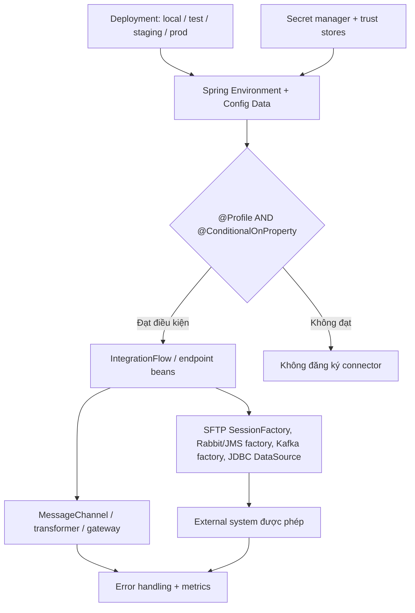
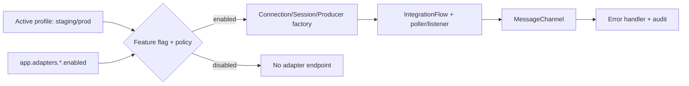
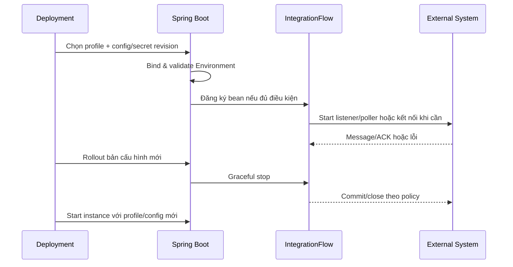
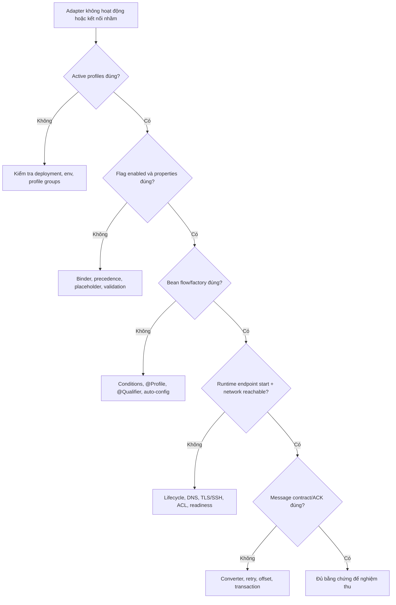

# Profile cho môi trường adapter trong Spring Boot và Spring Integration

> **Chương:** Spring Boot  
> **Chủ đề trực tiếp:** Profile cho môi trường adapter  
> **Module:** `SPRING_INTEGRATION_ADAPTERS` — kết nối hệ thống ngoài vào Spring Integration bằng inbound/outbound adapter, gateway, poller và `MessageChannel`; trao đổi qua File, SFTP, HTTP, JMS, AMQP/RabbitMQ, Kafka và cơ sở dữ liệu; kiểm soát message contract, lỗi và vòng đời kết nối.  
> **Đối tượng:** Java/Spring Boot developer, integration engineer, người vận hành các connector theo môi trường local/test/staging/production.  
> **Phạm vi kỹ thuật:** Ví dụ theo Java 17+, Spring Boot 3.x và Spring Integration 6.x dùng phiên bản tương thích từ Boot BOM. Đối với dòng Boot khác, đối chiếu API và tài liệu cấu hình của phiên bản thực tế.

## 1. Vì sao adapter cần chiến lược profile riêng?

Một ứng dụng `order-integration` có bốn đường trao đổi:

1. Trên máy lập trình viên, đọc file đơn hàng giả từ thư mục local.
2. Trên staging, nhận file SFTP của đối tác thử nghiệm.
3. Trên production, đọc queue RabbitMQ, ghi database và publish sự kiện Kafka.
4. Từ mọi môi trường được phép, gọi HTTP API nhưng tới **host khác nhau** và sử dụng credential khác nhau.

Code `IntegrationFlow` có thể giống nhau về nghiệp vụ, nhưng nguồn/đích, secret, lịch poll, transaction, error policy, số consumer, quan sát và thẩm quyền truy cập **không thể dùng chung mù quáng**. Nếu staging vô tình mở SFTP production hoặc test CI phát message thật lên Kafka, lỗi không nằm ở Java syntax: đó là lỗi **quản trị môi trường và bean lifecycle**.

**Spring profiles** cho phép chọn nhóm bean và tài liệu cấu hình khi một môi trường được kích hoạt. Tuy nhiên, profile không phải cơ chế security boundary độc lập: một giá trị profile có thể bị khai báo sai, và trong một số thiết kế vẫn có bean connection factory được tạo do auto-configuration. Cần kết hợp **profile + feature flag + phân quyền network/secret + kiểm thử**.

### 1.1. Đầu ra của bài học

Sau bài này, bạn có thể:

- Giải thích `spring.profiles.active`, default profile, `@Profile`, biểu thức profile, `application-<profile>.yml` và `spring.config.activate.on-profile`.
- Phân biệt **môi trường** (`local`, `test`, `staging`, `prod`) với **tính năng connector** (`file.enabled`, `sftp.enabled`, `kafka.consumer.enabled`); không dùng tên profile làm toàn bộ hợp đồng.
- Đặt cấu hình **fail-closed**: adapter ngoài mặc định không kết nối, chỉ mở khi môi trường và property cùng thỏa.
- Tổ chức bean `IntegrationFlow`, `SessionFactory`, `ConnectionFactory`, `DataSource`, poller, HTTP gateway và broker consumer theo profile có chủ đích.
- Xây lab Spring Boot với File inbound `IntegrationFlow` chạy ở local, bị loại khỏi test/staging/prod, có test xác minh **bean vắng mặt khi bị vô hiệu hóa**.
- Hiểu thứ tự ưu tiên nguồn cấu hình, profile group, secrets, property validation, rủi ro endpoint sai và điều kiện startup/readiness.
- Viết ma trận kiểm thử nhiều profile và runbook deploy/rollback khi đổi adapter endpoint.

### 1.2. Một mô hình phân tách đúng



**Phân biệt:** Không tạo bean flow là một cách **không kích hoạt endpoint**, nhưng không luôn ngăn **mọi bean hạ tầng do starter auto-configure** được tạo. Để bảo đảm CI không gọi production, còn phải giới hạn network egress, cấp đúng secret theo môi trường và kiểm soát những bean khác có thể kết nối lúc startup.

## 2. Các khái niệm Spring Profile cần biết

### 2.1. Active profiles và default profile

Spring Boot nhận danh sách profile đang active thông qua Environment. Ví dụ khi chạy app:

```bash
# Chạy JAR trong môi trường local (một lệnh minh họa).
java -jar app.jar --spring.profiles.active=local

# Hoặc cấp bằng environment của process.
SPRING_PROFILES_ACTIVE=staging
```

Dòng `SPRING_PROFILES_ACTIVE=staging` biểu thị giá trị một biến môi trường được **hệ thống chạy ứng dụng** cấp; trên Windows, cách gán biến khác shell POSIX. Không gửi credential trong command line vì có thể vào history/process inspection.

Khi không có profile nào được chỉ định, Spring có **default profile** (thường tên là `default`). Profile `default` không đồng nghĩa `local` hoặc `test` và không nên mặc định mở kết nối đối tác.

**Lưu ý về nhiều profile:** Có thể kích hoạt nhiều profile, ví dụ `staging,metrics`. Nếu các file cấu hình ghi đè cùng một key, kết quả phụ thuộc cơ chế ưu tiên Config Data, thứ tự/profile groups và nguồn cấu hình. Không dùng việc “profile nào đứng cuối” như một cơ chế security policy không được test.

### 2.2. `@Profile` chọn bean hoặc cấu hình

```java
@Configuration(proxyBeanMethods = false)
@Profile("local")
class LocalOnlyFlowConfiguration {
    // Các @Bean trong class chỉ được đăng ký khi profile local active.
}
```

`@Profile` có thể đặt trên class `@Configuration` hoặc phương thức `@Bean`. Một số biểu thức hợp lệ:

| Biểu thức | Ý nghĩa | Rủi ro nếu dùng thiếu cân nhắc |
|---|---|---|
| `@Profile("local")` | Chỉ khi `local` active | Không có flow ở staging dù có cấu hình khác |
| `@Profile("staging | prod")` | Staging **hoặc** prod | Cần thêm feature flag cho connector nhạy cảm |
| `@Profile("staging & partner-a")` | **Cả hai** profile cùng active | Dễ thiếu profile thứ hai khi deploy |
| `@Profile("!prod")` | Bất kỳ môi trường **không** active `prod` | CI/test/staging/default có thể vô tình bật connector |
| `@Profile("!(prod | staging)")` | Không active cả prod lẫn staging | Vẫn có thể bật ở môi trường chưa được khai báo |

**Không dùng `!prod` làm rào chắn an toàn mặc định** cho một connector có thể truy cập hệ thống ngoài. Nó có nghĩa “mọi nơi không phải prod”, không phải “chỉ local”.

### 2.3. `@ConditionalOnProperty` là công tắc khác với profile

```java
@Bean
@Profile("local")
@ConditionalOnProperty(
    prefix = "app.adapters.file",
    name = "enabled",
    havingValue = "true"
)
IntegrationFlow localFileInboundFlow(...) {
    // ...
}
```

Bean này được đăng ký **chỉ khi cả hai điều kiện cùng đúng**: profile `local` đang active **và** `app.adapters.file.enabled=true`. Khi property thiếu, với `matchIfMissing=false` mặc định, điều kiện không đạt; đây là cách bật connector có chủ đích.

`@Profile` có thể phù hợp để giới hạn môi trường. `@ConditionalOnProperty` phù hợp để bật/tắt một connector **trong chính môi trường đó**. Nếu muốn phép OR/AND của profile, biểu thức phải được viết rõ; nếu muốn kết hợp profile với property, đặt **cả hai annotation**, không mặc nhiên một annotation suy ra annotation kia.

**Lưu ý:** Hai annotation được kiểm tra khi **ApplicationContext xây dựng bean definitions**, không tự động chạy lại khi operator sửa YAML đã được load. Muốn bật/tắt ở runtime cần cơ chế quản lý endpoint lifecycle riêng, không chỉ sửa file.

### 2.4. Profile-specific config file

Các file thường có tên:

```text
src/main/resources/
├── application.yml
├── application-local.yml
├── application-test.yml
├── application-staging.yml
└── application-prod.yml
```

Khi profile `local` active, Boot có thể nạp `application-local.yml` cùng với cấu hình chung. Trong đa số ứng dụng, một giá trị ở profile file sẽ ghi đè giá trị cấu hình cơ sở tương ứng, nhưng **biến môi trường, system property, command line và external config** có thể có ưu tiên cao hơn. Cần xác minh **effective properties** của runtime thật.

Trong file `application-local.yml`, không tự chèn `spring.profiles.active: local` để “kích hoạt chính mình”. Profile activation là trách nhiệm của deployment hoặc tài liệu cấu hình **không phụ thuộc profile**.

### 2.5. Nhiều tài liệu YAML với `spring.config.activate.on-profile`

Một lựa chọn khác cho ứng dụng nhỏ là dùng nhiều tài liệu YAML trong `application.yml`:

```yaml
# Tài liệu không phụ thuộc profile.
app:
  adapters:
    file:
      enabled: false
---
spring:
  config:
    activate:
      on-profile: local
app:
  adapters:
    file:
      enabled: true
      inbox: ./data/local-in
      poll-interval: 2s
---
spring:
  config:
    activate:
      on-profile: "staging | prod"
app:
  adapters:
    file:
      enabled: false
```

Dấu `---` tách **YAML documents**. Chỉ tài liệu có `on-profile` phù hợp mới góp property vào Environment. Hình thức này tương đương về mục đích chọn cấu hình với `application-local.yml`, nhưng nên chọn **một chiến lược rõ ràng** để tránh nhiều bản ghi cùng key phân tán.

**Quan trọng:** Không đặt `spring.profiles.active`, `spring.profiles.default` hay `spring.profiles.group.*` trong một document đã bị giới hạn bằng `spring.config.activate.on-profile` hoặc profile-specific file; những thuộc tính **điều khiển kích hoạt profile** phải được định nghĩa ở tài liệu không phụ thuộc profile hoặc từ deployment.

### 2.6. Profile groups: nhóm đặc tính, không phải chứng nhận an toàn

Ví dụ đặt trong phần `application.yml` **không phụ thuộc profile**:

```yaml
spring:
  profiles:
    group:
      staging:
        - telemetry
        - shared-infrastructure
      prod:
        - telemetry
        - hardened
```

Khi `staging` active, Boot có thể mở rộng nhóm profile `telemetry` và `shared-infrastructure`. Cách này giúp tái sử dụng cấu hình/bean, **không** bảo đảm các bean connector đã được cấp phép. Nếu profile `telemetry` chứa cấu hình chạm network, nó vẫn có thể tạo kết nối; profile groups nên được review như cấu hình deployment.

Đừng dùng profile group để tráo `staging` và `prod` cho cùng một secret hoặc broker. Mọi kết nối ra ngoài vẫn cần endpoint, permission và network allowlist theo môi trường.

## 3. Tách môi trường khỏi năng lực adapter

### 3.1. Hai trục độc lập

| Trục | Câu hỏi | Ví dụ |
|---|---|---|
| **Environment profile** | Ứng dụng đang chạy **ở đâu**? | `local`, `test`, `staging`, `prod` |
| **Connector feature flag** | Có cho phép **endpoint nào** chạy? | `app.adapters.file.enabled`, `app.adapters.sftp.enabled`, `app.adapters.kafka-consumer.enabled` |
| **Connection configuration** | Khi được phép chạy, endpoint nối **đích nào**? | SFTP host/known_hosts, Kafka bootstrap, DB JDBC URL |
| **Authorization và security** | Workload có quyền gì trên hệ thống đích? | Secret scope, mTLS, SSH key, broker ACL, DB role |
| **Runtime lifecycle** | Khi nào endpoint start/stop? | `autoStartup`, scheduler, readiness, graceful shutdown |

Không dùng một property `app.environment=prod` do message inbound tự khai để định tuyến tới cluster thật. Môi trường phải do deployment tin cậy xác định, còn tenant/partner routing phải dựa trên nguồn được kiểm chứng và phân quyền riêng.

### 3.2. Ma trận môi trường được phê duyệt (ví dụ)

| Adapter | Local | Test/CI | Staging | Prod |
|---|---|---|---|---|
| File inbound | Bật với thư mục local | Bật trong test riêng/temp dir hoặc tắt mặc định | Tắt trừ khi có use case | Bật chỉ khi có nhiệm vụ batch đã duyệt |
| SFTP inbound | Tắt hoặc dùng server cô lập | Tắt trong unit test, test server trong integration test | Chỉ tới SFTP staging | Chỉ tới SFTP prod được phê duyệt |
| HTTP inbound | Mock hoặc local server | MockWebServer/test server | Service endpoint staging có TLS/auth | HTTPS, auth, WAF/rate limit |
| HTTP outbound | Local mock | Mock HTTP service, không internet prod | Sandbox API | Production API đã allowlist |
| JMS/Artemis | Container/dev broker | Test broker | Queue staging | Queue production |
| AMQP/RabbitMQ | Container/dev broker | Test broker | Vhost/credentials staging | Vhost/credentials production |
| Kafka | Local/test Kafka | Test cluster/testcontainers | Cluster/topic staging | Cluster/topic prod |
| JDBC | Local/test DB | Temp DB/container | Staging DB | Production DB, DB role tối thiểu |

Ma trận là **policy ví dụ**, không phải giá trị mặc định của Spring Boot. Từng tổ chức phải gắn owner, quyền phê duyệt, network policies, SLAs và retention. “Tắt mặc định” là cách bảo vệ có ích cho những connector **không bắt buộc để app phục vụ luồng hiện tại**; nếu một connector là chức năng cốt lõi ở prod, cấu hình phải fail fast/readiness fail khi chưa được bật hoặc chưa kết nối, chứ không âm thầm báo healthy.

### 3.3. Vì sao chỉ dựa vào `@Profile` chưa đủ?

- Một ai đó có thể khởi chạy production JAR với `--spring.profiles.active=local`.
- CI có thể kích hoạt profile `staging` nhầm từ biến môi trường.
- Một Spring Boot starter có thể tạo `ConnectionFactory` hoặc health check dù không có `IntegrationFlow`.
- Một bean `@PostConstruct` tự gọi HTTP/SFTP dù endpoint listener đã bị `@Profile` loại bỏ.
- Một flow khác vẫn dùng chung bean factory, hoặc có một listener tự khởi động ngoài flow đang xét.

Vì vậy **phòng thủ nhiều lớp**: CI không có production secret, network deny egress tới production, role/ACL theo môi trường, endpoint allowlist và integration test quan sát bean/runtime.

## 4. Thiết kế cấu hình an toàn, rõ nguồn và có thể kiểm toán

### 4.1. Cấu hình cơ sở: các adapter ngoài mặc định tắt

Ví dụ `src/main/resources/application.yml` cho lab hoặc worker tích hợp đa giao thức:

```yaml
spring:
  application:
    name: adapters-profile-lab
  main:
    web-application-type: none

app:
  adapters:
    file:
      enabled: false
    sftp:
      enabled: false
    http-outbound:
      enabled: false
    jms-consumer:
      enabled: false
    rabbit-consumer:
      enabled: false
    kafka-consumer:
      enabled: false
    jdbc-poller:
      enabled: false

logging:
  level:
    com.example.adapters: INFO
```

`web-application-type: none` là lựa chọn **cho worker không nhận HTTP inbound**. Nếu ứng dụng có HTTP inbound gateway/controller, cần cấu hình web stack và loại bỏ lựa chọn này. Đặt mọi flag là false giúp một app chạy thiếu profile không tự kết nối hệ thống ngoài.

### 4.2. Cấu hình local: chỉ bật File inbound

`application-local.yml`:

```yaml
app:
  adapters:
    file:
      enabled: true
      inbox: ./data/local-in
      poll-interval: 2s
```

Không đưa SFTP password, Kafka SASL secret hoặc JDBC production URL vào file local. Nếu local cần thử Kafka/Rabbit, tạo profile dev-broker riêng và broker container cô lập; không dùng profile “local” để truy cập production.

### 4.3. Cấu hình test/CI: tránh kết nối ngoài

`application-test.yml`:

```yaml
app:
  adapters:
    file:
      enabled: false
    sftp:
      enabled: false
    rabbit-consumer:
      enabled: false
    kafka-consumer:
      enabled: false
    jdbc-poller:
      enabled: false
```

Unit test chỉ kiểm tra transformer/gateway/bean graph không cần kết nối broker thật. Integration test nên bật adapter cụ thể **trong test scope**, cấp endpoint của Testcontainers/test server và kiểm soát cleanup/timeout. Không dùng secret từ staging/prod trong CI thông thường.

### 4.4. Cấu hình staging và prod phải tách credential

`application-staging.yml` minh họa cấu hình không chứa secret:

```yaml
app:
  adapters:
    sftp:
      enabled: ${SFTP_ENABLED:false}
      host: ${PARTNER_SFTP_HOST:}
      remote-dir: /incoming-test
    kafka-consumer:
      enabled: ${KAFKA_CONSUMER_ENABLED:false}

spring:
  kafka:
    bootstrap-servers: ${STAGING_KAFKA_BOOTSTRAP:}
```

`application-prod.yml` cũng chỉ khai báo đường cấu hình **do deployment cấp**, tránh giá trị production hard-code trong Git:

```yaml
app:
  adapters:
    sftp:
      enabled: ${SFTP_ENABLED:false}
      host: ${PARTNER_SFTP_HOST:}
      remote-dir: ${PARTNER_REMOTE_DIR:}
    kafka-consumer:
      enabled: ${KAFKA_CONSUMER_ENABLED:false}

spring:
  kafka:
    bootstrap-servers: ${PROD_KAFKA_BOOTSTRAP:}
```

Biểu thức placeholder `${NAME:}` chỉ thể hiện nơi nhận giá trị môi trường, không chứng minh dữ liệu đã hợp lệ. **Nếu enabled=true mà host, certificate, secret hoặc topic thiếu, phải từ chối startup/đánh dấu not ready thay vì chọn host mặc định ngẫu nhiên.** Không sử dụng localhost hay broker production làm fallback im lặng.

**Lưu ý:** `spring.kafka.*` có thể khiến Spring Kafka infrastructure được auto-configure theo classpath, kể cả khi IntegrationFlow consumer chưa bật. Nếu yêu cầu tuyệt đối không phát sinh kết nối, phải kiểm tra cả auto-start listeners, health checks và các bean custom khác, đồng thời áp dụng network egress policy.

### 4.5. Cấu hình có kiểu và validation

Ví dụ khai báo file properties dùng `@ConfigurationProperties`:

```java
package com.example.adapters;

import java.nio.file.Path;
import java.time.Duration;
import org.springframework.boot.context.properties.ConfigurationProperties;

@ConfigurationProperties(prefix = "app.adapters.file")
public record FileAdapterProperties(
        boolean enabled,
        Path inbox,
        Duration pollInterval
) {
    public FileAdapterProperties {
        if (enabled && (inbox == null || pollInterval == null
                || pollInterval.isZero() || pollInterval.isNegative())) {
            throw new IllegalArgumentException(
                "Enabled file adapter requires inbox and positive poll-interval"
            );
        }
    }
}
```

- Khi `enabled=false`, bean properties có thể tồn tại nhưng không cần path/interval.
- Khi `enabled=true`, validate sớm các trường bắt buộc, không để poller chạy với `null` hoặc `0`.
- Các khóa YAML `poll-interval` được bind vào `pollInterval` qua relaxed binding; thời gian `2s` vào kiểu `Duration`.
- Không đưa secret vào record rồi log `record.toString()`; record có thể in toàn bộ field.

Một record tương tự cho SFTP/Kafka nên có **validation chặt hơn** và tránh khởi tạo khi connector tắt nếu có placeholder secret chưa được cấp. Validate giá trị không thay thế bảo mật runtime của host key, broker ACL hoặc tenant isolation.


## 5. Lab: chỉ khởi động File inbound IntegrationFlow ở local

Lab dùng file hệ thống để chứng minh cách phối hợp profile và property. Nó **không cần Kafka/Rabbit/JMS/SFTP/HTTP server/DB**. Mọi đường dẫn chỉ dùng dữ liệu giả, không truy cập thư mục làm việc của hệ thống thật.

### 5.1. Dependency và cấu trúc

Dùng Maven project Spring Boot 3.x có parent hoặc BOM, Java 17+. Khai báo phần `<dependencies>` sau trong POM hợp lệ (không phải toàn bộ `pom.xml`):

```xml
<dependencies>
    <dependency>
        <groupId>org.springframework.boot</groupId>
        <artifactId>spring-boot-starter-integration</artifactId>
    </dependency>
    <dependency>
        <groupId>org.springframework.integration</groupId>
        <artifactId>spring-integration-file</artifactId>
    </dependency>
    <dependency>
        <groupId>org.springframework.boot</groupId>
        <artifactId>spring-boot-starter-test</artifactId>
        <scope>test</scope>
    </dependency>
    <dependency>
        <groupId>org.springframework.integration</groupId>
        <artifactId>spring-integration-test</artifactId>
        <scope>test</scope>
    </dependency>
</dependencies>
```

Tương đương Gradle Groovy DSL khi đã cấu hình Boot BOM/dependency management:

```groovy
dependencies {
    implementation 'org.springframework.boot:spring-boot-starter-integration'
    implementation 'org.springframework.integration:spring-integration-file'
    testImplementation 'org.springframework.boot:spring-boot-starter-test'
    testImplementation 'org.springframework.integration:spring-integration-test'
}
```

BOM giúp đồng bộ các phiên bản Spring Framework/Integration với Boot. Đừng trộn một module Integration phiên bản khác nhánh chỉ để lấy một API từ hướng dẫn cũ.

```text
adapters-profile-lab/
├── pom.xml
└── src/
    ├── main/
    │   ├── java/com/example/adapters/
    │   │   ├── AdaptersProfileApplication.java
    │   │   ├── FileAdapterProperties.java
    │   │   └── FileAdapterConfiguration.java
    │   └── resources/
    │       ├── application.yml
    │       ├── application-local.yml
    │       └── application-test.yml
    └── test/java/com/example/adapters/
        ├── LocalDisabledFlowTest.java
        ├── TestProfileCannotStartLocalFlowTest.java
        └── LocalEnabledFlowContextTest.java
```

Các file cấu hình sử dụng nội dung mục 4; để chạy lab, chỉ cần các flag và property liên quan tới File. File `application.yml` đặt `app.adapters.file.enabled=false`, file `application-local.yml` bật và đặt `inbox`, `poll-interval`.

### 5.2. Spring Boot application

Tạo `AdaptersProfileApplication.java`:

```java
package com.example.adapters;

import org.springframework.boot.SpringApplication;
import org.springframework.boot.autoconfigure.SpringBootApplication;

@SpringBootApplication
public class AdaptersProfileApplication {
    public static void main(String[] args) {
        SpringApplication.run(AdaptersProfileApplication.class, args);
    }
}
```

File `FileAdapterProperties.java` lấy nguyên record ở mục 4.5. `@EnableConfigurationProperties` ở cấu hình dưới sẽ tạo bean typed properties.

### 5.3. Named channel và hai IntegrationFlow beans

Tạo `FileAdapterConfiguration.java`:

```java
package com.example.adapters;

import java.io.File;
import java.time.Duration;

import org.slf4j.Logger;
import org.slf4j.LoggerFactory;
import org.springframework.boot.autoconfigure.condition.ConditionalOnProperty;
import org.springframework.boot.context.properties.EnableConfigurationProperties;
import org.springframework.context.annotation.Bean;
import org.springframework.context.annotation.Configuration;
import org.springframework.context.annotation.Profile;
import org.springframework.integration.channel.DirectChannel;
import org.springframework.integration.dsl.IntegrationFlow;
import org.springframework.integration.dsl.Pollers;
import org.springframework.integration.file.dsl.Files;
import org.springframework.messaging.MessageChannel;

@Configuration(proxyBeanMethods = false)
@EnableConfigurationProperties(FileAdapterProperties.class)
public class FileAdapterConfiguration {

    private static final Logger log =
            LoggerFactory.getLogger(FileAdapterConfiguration.class);

    @Bean("fileInput")
    MessageChannel fileInput() {
        return new DirectChannel();
    }

    @Bean("fileProcessingFlow")
    IntegrationFlow fileProcessingFlow() {
        return IntegrationFlow.from("fileInput")
            .handle(message -> {
                if (!(message.getPayload() instanceof File file)) {
                    throw new IllegalArgumentException(
                        "Expected java.io.File payload"
                    );
                }
                // Chỉ ghi metadata giả lập, tránh log nội dung nhạy cảm.
                log.info("Received file={} size={}",
                         file.getName(), file.length());
            })
            .get();
    }

    @Bean("localFileInboundFlow")
    @Profile("local")
    @ConditionalOnProperty(
        prefix = "app.adapters.file",
        name = "enabled",
        havingValue = "true"
    )
    IntegrationFlow localFileInboundFlow(FileAdapterProperties props) {
        return IntegrationFlow.from(
                Files.inboundAdapter(props.inbox().toFile())
                    .autoCreateDirectory(true)
                    .patternFilter("*.txt"),
                endpoint -> endpoint.poller(
                    Pollers.fixedDelay(props.pollInterval())
                        .maxMessagesPerPoll(5)
                )
            )
            .channel("fileInput")
            .get();
    }
}
```

Ba bean có trách nhiệm rõ ràng:

| Bean | Khi nào tồn tại? | Mục đích |
|---|---|---|
| `fileInput` (`DirectChannel`) | Mọi profile khi config class được scan | Kênh liên kết giữa inbound và consumer |
| `fileProcessingFlow` | Mọi profile | Kiểm tra payload `File` và xử lý metadata |
| `localFileInboundFlow` | **`local` active VÀ `enabled=true`** | Đọc file `*.txt` qua poller, gửi tới `fileInput` |

Đặt `@Profile("local")` trên **bean inbound**, không trên toàn bộ `FileAdapterConfiguration`. Nhờ vậy test/prod vẫn có thể giữ processor flow/channel để kiểm tra riêng mà **không có source polling**. Nếu cần cấm luôn processor ở ngoài local, chuyển annotation sang class hoặc khai báo condition riêng, nhưng phải tính tới các bean phụ thuộc.

**Kiểm soát message contract:** `Files.inboundAdapter` tạo payload kiểu `File` theo API tương ứng. Handler ở đây không mở/đọc nội dung file, chỉ quan sát tên và kích thước. Trong ứng dụng thật cần quy tắc file readiness, safe path, charset, parse và schema validation; không để tên file từ nguồn không tin cậy điều khiển đường dẫn tùy ý.

### 5.4. Chạy app ở local

Với Maven wrapper đã được tạo cho project:

```bash
./mvnw spring-boot:run -Dspring-boot.run.arguments=--spring.profiles.active=local
```

Hoặc khi đã build JAR:

```bash
java -jar target/adapters-profile-lab.jar --spring.profiles.active=local
```

Tên JAR phụ thuộc artifact ID/version của project; thay bằng tên thật của bản build. Không chạy lệnh JAR minh họa nếu chưa build đúng tên.

Đặt file hoàn chỉnh vào `data/local-in/order-001.txt`:

```text
orderId=ORDER-001
tenant=tenant-a
```

Log handler dự kiến có dòng như:

```text
Received file=order-001.txt size=...
```

Vì poller chạy mỗi hai giây, có thể cần chờ tối đa một vài chu kỳ để thấy log. Kích thước byte phụ thuộc nội dung thực và ký tự xuống dòng. Thêm `ignore.csv` sẽ không được flow này nhận do filter `*.txt`.

### 5.5. Chạy app không có profile và ở test

Không đặt profile:

```bash
java -jar target/adapters-profile-lab.jar
```

hoặc chọn `test`:

```bash
java -jar target/adapters-profile-lab.jar --spring.profiles.active=test
```

Ở hai trường hợp, `localFileInboundFlow` **không được đăng ký** vì `@Profile("local")` không thỏa. Ngay cả nếu ai đó đặt `app.adapters.file.enabled=true` trong profile `test`, điều kiện profile vẫn chặn bean.

**Đừng kiểm chứng bằng cách cố chạm mạng production.** Có thể dùng context test (mục 6), condition report và các quyền hạn network để chứng minh adapter không hoạt động.

### 5.6. Điều kiện chính xác: bảng chân trị

| Active profile | `app.adapters.file.enabled` | `localFileInboundFlow` | Giải thích |
|---|---|---|---|
| Không có / `default` | Không có | **Không** | Profile local không active, flag mặc định false |
| `local` | `true` | **Có** | Cả hai điều kiện cùng đúng |
| `local` | `false` | **Không** | Property tắt |
| `local` | Không khai báo | **Không** | `@ConditionalOnProperty` mặc định không match nếu thiếu |
| `test` | `true` | **Không** | Profile local không active |
| `staging` | `true` | **Không** | Profile local không active |
| `prod` | `true` | **Không** | Profile local không active |
| `local,prod` | `true` | **Có** | **Nguy hiểm:** local vẫn active, không phải phép “chỉ một profile” |

Hàng cuối là lời nhắc quan trọng: `@Profile("local")` chỉ yêu cầu **local nằm trong tập active profiles**, không cấm `prod` cùng lúc. Vì vậy không coi một annotation là rào chắn tuyệt đối. Có thể tăng bảo vệ bằng **biểu thức** `@Profile("local & !prod & !staging")`, **nhưng vẫn cần** deployment validation/egress/secret boundaries để không bị cấu hình sai. Với tổ chức có các profile môi trường độc quyền, hãy thêm startup guard kiểm tra chỉ một môi trường được chọn, hoặc enforce ở deployment.

## 6. Kiểm thử profile và điều kiện bean

### 6.1. Test local với flag tắt

Tạo `LocalDisabledFlowTest.java`:

```java
package com.example.adapters;

import org.junit.jupiter.api.Test;
import org.springframework.beans.factory.annotation.Autowired;
import org.springframework.boot.test.context.SpringBootTest;
import org.springframework.context.ApplicationContext;
import org.springframework.test.context.ActiveProfiles;

import static org.assertj.core.api.Assertions.assertThat;

@SpringBootTest(properties = {
    "app.adapters.file.enabled=false",
    "app.adapters.file.inbox=./target/disabled-test-in",
    "app.adapters.file.poll-interval=1s",
    "spring.main.web-application-type=none"
})
@ActiveProfiles("local")
class LocalDisabledFlowTest {

    @Autowired
    ApplicationContext context;

    @Test
    void localWithoutEnabledFlagHasNoInboundFlow() {
        assertThat(context.containsBean("localFileInboundFlow")).isFalse();
        assertThat(context.containsBean("fileInput")).isTrue();
        assertThat(context.containsBean("fileProcessingFlow")).isTrue();
    }
}
```

`@ActiveProfiles` quyết định profile trong Spring Test context. Test đặt `enabled=false` để không đọc filesystem. Nó chỉ kiểm tra **bean graph**, không kiểm tra file transfer.

### 6.2. Test profile test không thể mở local inbound

Tạo `TestProfileCannotStartLocalFlowTest.java`:

```java
package com.example.adapters;

import org.junit.jupiter.api.Test;
import org.springframework.beans.factory.annotation.Autowired;
import org.springframework.boot.test.context.SpringBootTest;
import org.springframework.context.ApplicationContext;
import org.springframework.test.context.ActiveProfiles;

import static org.assertj.core.api.Assertions.assertThat;

@SpringBootTest(properties = {
    "app.adapters.file.enabled=true",
    "app.adapters.file.inbox=./target/test-profile-in",
    "app.adapters.file.poll-interval=1s",
    "spring.main.web-application-type=none"
})
@ActiveProfiles("test")
class TestProfileCannotStartLocalFlowTest {

    @Autowired
    ApplicationContext context;

    @Test
    void testProfileDoesNotCreateLocalInbound() {
        assertThat(context.containsBean("localFileInboundFlow")).isFalse();
    }
}
```

Test này chủ động đặt `enabled=true` để chứng minh **flag không thể tự vượt qua profile condition**. Record properties vẫn bind các giá trị hợp lệ; tuy vậy không có File source do thiếu profile local.

### 6.3. Test local khi flag bật

Tạo `LocalEnabledFlowContextTest.java`:

```java
package com.example.adapters;

import org.junit.jupiter.api.Test;
import org.springframework.beans.factory.annotation.Autowired;
import org.springframework.boot.test.context.SpringBootTest;
import org.springframework.context.ApplicationContext;
import org.springframework.test.context.ActiveProfiles;

import static org.assertj.core.api.Assertions.assertThat;

@SpringBootTest(properties = {
    "app.adapters.file.enabled=true",
    "app.adapters.file.inbox=./target/local-enabled-test-in",
    "app.adapters.file.poll-interval=1s",
    "spring.main.web-application-type=none"
})
@ActiveProfiles("local")
class LocalEnabledFlowContextTest {

    @Autowired
    ApplicationContext context;

    @Test
    void localAndEnabledCreatesInboundFlow() {
        assertThat(context.containsBean("localFileInboundFlow")).isTrue();
        assertThat(context.containsBean("fileInput")).isTrue();
        assertThat(context.containsBean("fileProcessingFlow")).isTrue();
    }
}
```

Đây là **context test dương**. File inbound có thể tạo thư mục `target/local-enabled-test-in` và poll trong lúc test, nhưng không chạm network. Muốn kiểm chứng end-to-end, dùng thư mục tạm, tạo file bằng cách atomic rename, chờ handler theo bounded timeout, rồi kiểm tra message; tránh khẳng định “flow bean có mặt” là “file chắc chắn đã xử lý”.

### 6.4. Phép kiểm thử với nhiều profile

Thêm các case sau vào test plan:

| Case | Active profiles | Flag | Expected |
|---|---|---|---|
| T1 | `local` | file=true | Tạo File inbound |
| T2 | `local` | file=false | Không tạo File inbound |
| T3 | `test` | file=true | Không tạo File inbound |
| T4 | `staging` | file=true | Không tạo File inbound |
| T5 | `prod` | file=true | Không tạo File inbound |
| T6 | `local,prod` | file=true | Cảnh báo cấu hình trái policy; `@Profile("local")` đơn lẻ **vẫn match** |
| T7 | default | file thiếu | Không tạo File inbound |
| T8 | `staging` | sftp=false | Không tạo SFTP endpoint; kiểm tra không có outbound connection khác |

Nếu yêu cầu bảo đảm không thể kết hợp `local` và `prod`, chỉ thêm `@Profile("local & !prod")` là một lớp phòng thủ; cần policy chặn cấu hình profile trái phép ở deployment và secret/network restrictions. Các test production thực sự phải chạy trong môi trường cô lập.

## 7. Áp dụng sang SFTP, HTTP, JMS, AMQP, Kafka và JDBC

### 7.1. Mỗi connector có ít nhất ba điểm quyết định

- **Environment:** bean nào chỉ được tạo ở `staging` hoặc `prod`?
- **Feature flag:** connector đó có được phép khởi động trong môi trường này không?
- **Connection binding:** nếu tạo, bean/session/factory được cấu hình tới **đúng host, broker, database, tenant** và bằng identity nào?



**Không nhất thiết điều kiện hóa toàn bộ factory theo cùng cách:** Spring Boot có thể tạo factory dùng chung cho các bean khác. Bạn cần xác định connector đang được chặn ở lớp bean factory, listener endpoint, IntegrationFlow, network và secret; “flow này bị tắt” không chứng minh mọi consumer trong app đã tắt.

### 7.2. SFTP: staging/prod mới cho phép kết nối đối tác

Mẫu ranh giới cấu hình:

```java
@Configuration(proxyBeanMethods = false)
@Profile("staging | prod")
class PartnerSftpConfiguration {

    // Mô tả bean; khi triển khai, thêm dependency SFTP
    // và tạo SessionFactory với host-key verification, secret.
    //
    // @Bean("partnerSftpSessionFactory")
    // @ConditionalOnProperty(
    //     prefix = "app.adapters.sftp",
    //     name = "enabled", havingValue = "true")
    // SessionFactory<SftpClient.DirEntry> sessionFactory(...) { ... }
    //
    // Một @Bean IntegrationFlow inbound riêng chỉ khởi động
    // khi cùng profile và enabled=true.
}
```

Đây là **skeleton minh họa kiến trúc**, không phải file SFTP hoàn chỉnh để biên dịch; nó cố ý không tạo network bean thật. Với ứng dụng thực tế, cần `spring-integration-sftp`, `DefaultSftpSessionFactory`/`SessionFactory`, known_hosts, xác thực bằng key/password từ secret manager, path, remote filters, file completion policy, poller và error channel.

Ở `staging`, chỉ dùng host key/credential staging; ở `prod`, chỉ dùng credential production. **Không bật “accept unknown host key”** để thay cho cấu hình trust. Nếu `enabled=true` nhưng host/trust thiếu, fail startup/readiness thay vì rơi về một server khác.

### 7.3. HTTP: inbound và outbound không cùng profile policy

- **HTTP inbound:** nếu app có HTTP gateway/controller nhận request, cần Servlet hoặc reactive web stack phù hợp, HTTPS, authentication, authorization, CSRF theo kiến trúc và request limits. `spring.main.web-application-type=none` của lab File sẽ khiến web inbound không hoạt động.
- **HTTP outbound:** một `Http.outboundGateway(...)` chỉ cần HTTP client và config phù hợp; không nhất thiết mở embedded web server. Dùng base URL theo môi trường, token máy–máy riêng, mTLS nếu cần, connect/read timeout và idempotency key cho request tạo dữ liệu.
- **Test:** mock HTTP server, không gọi sandbox của đối tác khi đang chạy unit test. Test riêng status 2xx/4xx/5xx, timeout, header filtering và retry.

Ví dụ properties do ứng dụng sở hữu:

```yaml
app:
  adapters:
    http-outbound:
      enabled: false
      base-url: https://api.sandbox.example.test
      connect-timeout: 3s
      read-timeout: 8s
```

Tên `app.adapters.http-outbound.*` là **custom**, không tự động bind vào một HTTP client của Boot. Phải có `@ConfigurationProperties`/config bean và IntegrationFlow dùng nó.

### 7.4. JMS và AMQP: profile bật listener, không chỉ đổi host

| Giao thức | Bean kết nối | Cấu hình Boot thường gặp | Lỗi nếu tách profile sai |
|---|---|---|---|
| JMS/Artemis | `jakarta.jms.ConnectionFactory` | `spring.artemis.*` và các lựa chọn Spring JMS | Listener kết nối queue thật trong CI |
| AMQP/RabbitMQ | `org.springframework.amqp.rabbit.connection.ConnectionFactory` | `spring.rabbitmq.*` | Consumer nối nhầm vhost, DLQ/retry tác động dữ liệu prod |

`spring-integration-jms` và `spring-integration-amqp` cung cấp các endpoint tương ứng; starter/provider tạo cơ sở kết nối. Bật listener theo profile/property rõ ràng, cấu hình destinations, ACK/transaction, redelivery và DLQ; dùng credential/broker riêng cho từng môi trường.

**Lưu ý:** Hai API đều có simple name `ConnectionFactory` nhưng không cùng interface. Không trộn hoặc đoán đúng bean theo tên ngắn. Một factory có thể được tạo trước khi listener start, và hoạt động của health check cũng có thể phát sinh kết nối; test phải quan sát cả hai.

### 7.5. Kafka: consumer group và topic phải cách ly môi trường

`spring.kafka.bootstrap-servers` chọn metadata bootstrap cho Kafka, còn consumer group, topic, serializer, ACL và listener được cấu hình riêng. Ví dụ staging:

```yaml
spring:
  kafka:
    bootstrap-servers: ${STAGING_KAFKA_BOOTSTRAP:}
    consumer:
      group-id: orders-staging
      auto-offset-reset: earliest

app:
  adapters:
    kafka-consumer:
      enabled: ${KAFKA_CONSUMER_ENABLED:false}
```

Khi bật một Kafka Integration inbound flow:

- Xác định consumer factory/container được tạo theo profile nào, có bị `autoStartup` của listener hoặc cấu hình khác vượt qua feature flag không.
- Không tái sử dụng `orders-prod` consumer group/topic trong test/staging.
- Cấu hình TLS/SASL, ACL, offset commit, error handler/DLT và dedupe nghiệp vụ.
- Khi flow dùng async channel, ACK/offset commit có thể xảy ra **trước khi downstream hoàn tất** nếu thiết kế không giữ ranh giới đúng.

Kafka producer outbound cũng nên có feature flag/target policy và test cluster riêng. Không nghĩ mọi producer cần `group-id`; đó là thuộc tính phía consumer.

### 7.6. JDBC: tránh cấu hình DataSource production trong test

`spring.datasource.*` có thể khiến Boot tạo `DataSource` khi classpath và điều kiện thỏa. Bật/tắt một `IntegrationFlow` JDBC poller **không tự loại bỏ mọi DataSource**: các service/repository khác có thể vẫn dùng DB. Với một worker chỉ cần DB ở prod, cân nhắc dependency/classpath, profile cho JDBC config riêng, và fail-fast/readiness policy.

Ví dụ ứng dụng chỉ khai báo config staging qua deployment:

```yaml
spring:
  datasource:
    url: ${STAGING_JDBC_URL:}
    username: ${STAGING_DB_USER:}
    # password: secret manager, không ghi trong Git

app:
  adapters:
    jdbc-poller:
      enabled: ${JDBC_POLLER_ENABLED:false}
```

Cần driver, SQL schema, transaction, locking/checkpoint và pool config. Nếu vô tình dùng một bean `DataSource` custom, Boot có thể back off và không áp những property như kỳ vọng. Test không chỉ đo bean tồn tại: phải xác minh **JDBC URL/DB role**, và với integration test, kết nối **DB cô lập**.

### 7.7. File: profile theo thư mục/volume, không có connection factory

File inbound/outbound đọc/ghi filesystem, không cần network `ConnectionFactory`. Khi dùng profile:

- `local` chỉ đọc `./data/local-in` và tạo folder trong workspace.
- `test` dùng temporary directory riêng và dọn sau test.
- `staging/prod` chỉ sử dụng volume được cho phép, với quy ước staging/processing/archive.
- Không dùng một đường dẫn production cứng trong code rồi dựa vào property `enabled=false` để hy vọng an toàn.
- Có persistent accept-once filter, checkpoint hoặc business idempotency khi file không được xử lý trùng; filename/path không luôn là business ID.


## 8. Đọc effective configuration và kiểm chứng sự khác biệt môi trường

### 8.1. Cùng một JAR, nhiều hành vi

Mục tiêu của profile không phải build ra một JAR khác cho từng môi trường rồi lưu secret trong JAR. Một bản binary đã được kiểm thử nên có thể triển khai nhiều nơi với **cấu hình ngoài ứng dụng và quyền truy cập thích hợp**. Tuy nhiên, sự khác nhau ở profile/beans có thể lớn đến mức phải test mỗi tổ hợp quan trọng: local chỉ File, staging SFTP, prod Kafka+JDBC là các topology khác nhau.

**Ba lớp bằng chứng cần thu:**

1. **Effective Environment:** active profiles và các property đã được resolve (chỉ những trường không nhạy cảm).
2. **Bean graph:** những `IntegrationFlow`, `MessageChannel`, listener/connection factory nào hiện diện; flow nào bị loại bởi profile/condition.
3. **Runtime behavior:** endpoint có start, kết nối đúng host/vhost/topic/DB, message contract/ACK/retry đúng hay không.

`ApplicationContext` khởi động thành công chỉ chứng minh lớp 2 một phần; chưa đủ chứng minh runtime target đúng. Ngay cả trạng thái “kết nối được” cũng chưa chứng minh payload/business transaction được thực hiện đúng.

### 8.2. Condition evaluation report

Có thể bật điều kiện debug khi chạy ứng dụng lab:

```bash
./mvnw spring-boot:run -Dspring-boot.run.arguments=--debug
```

Hoặc Gradle project:

```bash
./gradlew bootRun --args='--debug'
```

Các lệnh là ví dụ; cần wrapper thực tế và cách quote tương ứng với shell. Report giúp hiểu auto-configuration nào match/not match. Với bean ứng dụng gắn `@Profile`/`@ConditionalOnProperty`, kiểm tra **bean hiện diện trong context**, cộng log/condition của các bean do Spring Boot điều khiển.

Nếu thêm Actuator, endpoint `conditions` hoặc `configprops` có thể hỗ trợ điều tra trong môi trường được bảo vệ, nhưng **không expose công khai**. Các endpoint có thể làm lộ tên nguồn kết nối, cấu hình nội bộ hoặc dữ liệu nhạy cảm. Không dump `Environment`/password/connection string ra log để debug.

### 8.3. Property precedence và nguồn cấu hình

Các nguồn như profile-specific Config Data, biến môi trường, Java system properties và command-line có thứ tự ưu tiên; giá trị từ nguồn cao hơn có thể làm khác điều đã ghi trong YAML.

Ví dụ:

```text
application.yml:         app.adapters.file.enabled=false
application-local.yml:   app.adapters.file.enabled=true
deployment env:          APP_ADAPTERS_FILE_ENABLED=false
runtime:                 enabled có thể thành false
```

Nếu deployment gán biến môi trường như trên, cần **kiểm tra giá trị cuối qua binder/context test**, không chỉ đọc file YAML trong repository. Tránh sử dụng nhiều cấu hình mâu thuẫn cùng một key ở Config Data, env, Helm chart hoặc command line.

Với Boot relaxed binding, `app.adapters.file.enabled` có dạng biến môi trường thường dùng `APP_ADAPTERS_FILE_ENABLED`. Trong các tên có dấu gạch ngang, quy tắc ánh xạ sang environment variable có thể khác trực giác; luôn kiểm chứng bằng một test `@ConfigurationProperties` thay vì đoán kiểu đặt tên.

### 8.4. Khi một connector không được bật

Với một connector disabled, ghi nhận:

- Bean `IntegrationFlow` inbound/outbound tương ứng **không tồn tại**, hoặc endpoint đang dừng theo thiết kế.
- Factory/listener khác trong application **không tự mở kết nối trái policy**.
- Không có secret production trong environment của CI/local.
- Network egress tới production bị chặn bằng chính sách ngoài ứng dụng.
- Không có traffic xuống hệ thống đích ngoài ý muốn, theo giám sát ở network hoặc broker.
- Không có retry loop lặng lẽ vì một bean khác đang cố kết nối.

Đối với một connector bắt buộc ở production, “disabled” có thể là lỗi triển khai cần làm deployment **fail** hoặc **not ready** thay vì bỏ qua. Thiết kế startup policy phải phân biệt **optional adapter** và **required adapter**.

## 9. Profile, message contract và hành vi lỗi

### 9.1. Cùng một hợp đồng nghiệp vụ, endpoint khác nhau

Ví dụ một message chuẩn hóa:

```json
{
  "eventId": "evt-order-0001",
  "schemaVersion": 1,
  "eventType": "OrderImported",
  "tenantId": "tenant-a",
  "occurredAt": "2026-11-23T08:00:00Z",
  "payload": {
    "orderId": "ORDER-0001",
    "status": "VALIDATED"
  }
}
```

Khi chuyển giữa profile, phần **ngữ nghĩa** của `eventId`, `schemaVersion`, tenant được xác minh và cách báo lỗi phải nhất quán. Không để local xử lý `String` từ file, staging phát `Map`, production publish JSON với field khác mà không có contract/versioning.

### 9.2. Contract riêng cho adapter

| Giao thức | Metadata cần hiểu | Thất bại thường gặp |
|---|---|---|
| File | Path, filename, encoding, modification time, business ID | Đọc file chưa xong, đọc lại sau restart |
| SFTP | Remote path, partner ID, session, file completion marker | Host key lỗi, stream rớt, remote file trùng |
| HTTP | Method, URI, headers allowlist, status, correlation | Timeout sau khi server đã xử lý POST |
| JMS | Message ID, destination, ACK mode, redelivery | Queue rollback, poison message |
| AMQP | Exchange, routing key, delivery tag, confirm | Requeue vô hạn, publisher confirms không xử lý |
| Kafka | Topic, partition, offset, key, group | Offset commit trước khi business commit |
| JDBC | Primary key, transaction, poll watermark, locking | Hai worker claim cùng row, DB pool cạn |

Một thông điệp được gửi thành công vào `MessageChannel` không chứng minh bản ghi DB đã commit hoặc broker đã xác nhận. Nếu staging dùng in-memory channel để giả lập Kafka, test đó chỉ bao phủ topology nội bộ; cần integration test riêng cho Kafka transport.

### 9.3. Error flow không nên phụ thuộc một profile tình cờ

Ví dụ: production bật `kafka-consumer` nhưng error handler chỉ được khai báo trong profile `local`. Khi consumer lỗi, thông điệp không đi đúng quarantine/DLT.

Giải pháp:

1. Chia **business validation/error contract chung** khỏi transport-specific error handlers.
2. Đặt retry/DLQ hoặc DLT cho đúng listener/gateway/poller đang hoạt động.
3. Có test lỗi ở mỗi profile quan trọng: broker timeout, auth failed, schema invalid, downstream unavailable.
4. Phân biệt transient và permanent failure; retry có giới hạn/backoff.
5. Không log credential, bearer token, SFTP private key hoặc dữ liệu cá nhân trong `ErrorMessage`.
6. Theo dõi messages đã nhận, đã xử lý, retry, dead-letter và khả năng replay.

### 9.4. Idempotency phải giữ qua mọi môi trường

- **Local File:** Tên file có thể bị xử lý lại khi restart; filter bộ nhớ không đủ cho exactly-once.
- **SFTP:** Một phiên rớt giữa chừng có thể tải lại file; cần checkpoint/remote rename.
- **HTTP:** Timeout có thể xảy ra sau khi server đã nhận POST; dùng idempotency key.
- **JMS/AMQP:** Redelivery/ACK và DLQ tùy broker; consumer cần xử lý trùng an toàn.
- **Kafka:** Consumer rebalance hoặc offset commit trễ có thể replay; dùng khóa nghiệp vụ và outbox khi cần.
- **JDBC:** Poller cần transaction/locking/claim/checkpoint để tránh đọc lại hoặc cạnh tranh nhiều instance.

Profiles không sửa được vấn đề mất/nhân đôi dữ liệu. Chúng chỉ quyết định **đường xử lý nào được đăng ký và cấu hình thế nào**; tính tin cậy cần thiết kế riêng theo transport.

### 9.5. Request–reply và polling có yêu cầu vận hành khác nhau

Nếu trong môi trường prod bật HTTP inbound gateway, request đến từ user và phải có response hoặc error theo timeout. Nếu staging chỉ có SFTP poller, không có HTTP caller đợi reply. Không copy cấu hình gateway timeout làm poll interval hoặc coi lỗi polling như HTTP 500. Với `DirectChannel` đồng bộ, exception có thể propagate về caller; với poller/async endpoint, cần error handling ở thread/transport phù hợp.

## 10. Secrets, egress và multi-tenant security

### 10.1. Tách secret theo môi trường

| Hạng mục | Local/test | Staging | Prod |
|---|---|---|---|
| HTTP API credential | Mock hoặc token thử nghiệm | Token sandbox | Token production với scope tối thiểu |
| SFTP SSH key | Test server key | Key staging | Key production, rotation/audit |
| Rabbit/JMS user | Dev broker ACL | Staging vhost/queue ACL | Prod vhost/queue ACL |
| Kafka SASL/TLS | Test cluster | Staging client identity | Prod client identity/topic ACL |
| JDBC user | Test database | Staging least-privilege role | Prod least-privilege role |
| Trust store | Test CA/host keys | CA/host keys staging | CA/host keys prod được kiểm tra |

Không commit password, token, private key, keystore password hoặc connection URI chứa credential vào repository. Sử dụng secret manager hoặc secret mount được kiểm soát, có encryption, rotation và audit. Khi connector **disabled**, không nên bắt buộc environment phải có secret của connector đó chỉ để tạo properties bean; đặt placeholder nhạy cảm trong profile bật connector hoặc điều kiện hóa bean/binder có chủ đích.

### 10.2. Network egress và DNS

Chỉ dùng `@Profile("staging")` không ngăn process kết nối một production hostname được cấu hình nhầm. Đặt network policies, firewall, security group, service account identity và allowlist DNS/endpoint ngoài JVM để giới hạn quyền kết nối. Với cloud workload, service account cho staging không được có quyền production.

Nếu IP của production API nằm chung dải mạng, cân nhắc mTLS/identity-aware authorization ngoài DNS. Không suy hostname `staging` từ chuỗi hiển thị là bảo đảm an toàn.

### 10.3. Profile không đồng nghĩa tenant

**Môi trường** và **tenant** là hai chiều khác nhau. Một app production có thể phục vụ nhiều tenant, nhưng không nên tạo profile `tenant-a`, `tenant-b` để chọn dữ liệu dựa trên input từ khách hàng. Thay vào đó:

- Ràng buộc tenant từ authentication/authorization context đáng tin.
- Xác định routing policy/connection pool riêng khi cần per-tenant isolation.
- Kiểm tra tenant scope của Kafka topic, DB schema, SFTP partner session và HTTP endpoint.
- Không để message header do đối tác tự khai có thể chọn factory production khác.
- Quản lý số lượng factory/flow, credential và metric cardinality khi có nhiều tenant.

Nếu một tenant mới được onboard, chỉ thêm profile runtime có thể không phù hợp; cần một quy trình provisioning/configuration có phê duyệt, kiểm thử và rollback.

### 10.4. Guardrails trước khi tạo connector

Một policy deploy có thể yêu cầu:

- **Đúng một environment profile chính** trong `local/test/staging/prod`; không cho `local,prod` cùng lúc.
- Các connector có `enabled=true` đều thuộc danh sách cho phép của môi trường đó.
- Mỗi connector có endpoint, credentials và trust config hợp lệ trước khi khởi động.
- CI/test không thể nhận production secrets và không có network egress production.
- Không dùng exception ngầm `@Profile("!prod")` để quyết định an toàn.
- Khi cần fail-fast trước mọi connection, kiểm tra cấu hình ở giai đoạn **sớm hơn endpoint lifecycle** hoặc ngay trong deployment policy. Chỉ kiểm tra bằng `ApplicationRunner` có thể quá muộn: listener/poller có thể đã start trước runner.

**Bảo vệ theo tầng** giúp ngăn cấu hình profile sai gây tác động thật. Nếu một connector required mà thiếu config, startup phải báo lỗi rõ; không fallback sang endpoint khác hoặc silently disable.

## 11. Vòng đời endpoint khi thay profile

### 11.1. Profile là quyết định lúc tạo context

Mỗi lần ứng dụng được khởi chạy, các bean conditions được đánh giá. Khi thay `spring.profiles.active` hoặc cấu hình profile và deploy lại, bean graph có thể khác:



Việc thay cấu hình của một instance đang chạy không tự reload `@Profile` hoặc `@ConditionalOnProperty`. Nếu dự án có cơ chế refresh riêng, phải thiết kế rõ các bean nào refresh được và cách xử lý in-flight, không suy mọi IntegrationFlow có thể thay đổi an toàn khi runtime.

### 11.2. Các bước graceful stop theo transport

| Adapter | Trước khi dừng | Khi khởi động lại |
|---|---|---|
| File/SFTP | Dừng poll, hoàn tất/đánh dấu file, đóng stream/session | Đối soát checkpoint, file đã đọc nhưng chưa ACK |
| HTTP inbound | Dừng nhận request mới, cho request in-flight hoàn tất có giới hạn | Giữ idempotency cho request có thể retry |
| JMS/AMQP | Dừng listener, xử lý ACK/nack/transaction theo policy | Chấp nhận redelivery và dedupe |
| Kafka | Dừng consumer, commit theo transaction/handler hoàn tất | Rebalance, offset replay an toàn |
| JDBC poller | Hoàn tất hoặc rollback transaction, trả pool | Claim row lại có idempotency |
| HTTP outbound | Không tạo request mới, chờ/huỷ in-flight đúng timeout | Retry với idempotency key |

**Quan trọng:** Đổi profile từ `staging` sang `prod` không phải là quy trình migrate data. Không tự trỏ một process đang chạy vào production broker rồi coi mọi message chưa ACK được chuyển an toàn; cần cutover plan, drain, checkpoint, dữ liệu chuyển tiếp và rollback.

### 11.3. Runtime enable/disable khác profile

Nếu người vận hành cần tạm dừng một listener mà không restart, có thể dùng lifecycle/management API có kiểm soát. Hệ thống cần:

- Phân quyền operator, audit ai stop/start, lý do và thời điểm.
- Lưu intended state và actual state; có thể mất trạng thái động sau restart.
- Đảm bảo pause không bỏ ACK/commit sai khi in-flight đang xử lý.
- Đặt timeout và circuit breaker phù hợp, không retry vô hạn.
- Có cảnh báo khi connector required bị stop lâu hơn SLA.

Không xây một endpoint điều khiển công khai cho phép user gửi tên arbitrary bean rồi gọi `stop()`. Dùng allowlist và identity có thẩm quyền.

### 11.4. Metrics cần tách theo môi trường

- **Bean/flow readiness:** số endpoint required đang running, số connector disabled theo thiết kế.
- **Transport:** connection healthy, TLS/SSH handshake failures, broker disconnect, DB pool saturation.
- **Message:** receive/send success, retries, DLQ/DLT depth, backlog, consumer lag, file age.
- **Correctness:** schema errors, duplicate rate, reconciliation mismatch, downstream ACK delay.
- **Deployment:** active profiles, config revision ID, adapter flag version và endpoint owner.

Tránh gắn secret hoặc payload PII vào metric label. Không tạo cardinality cao từ message ID/session ID trên mỗi event.

## 12. Troubleshooting profile và auto-configuration

### 12.1. Quy trình tìm nguyên nhân



### 12.2. Bảng lỗi và xử lý

| Dấu hiệu | Nguyên nhân khả dĩ | Cách xác nhận |
|---|---|---|
| Không có `localFileInboundFlow` | Chưa active `local`, flag false, package không scan | Active profiles, conditional annotations, bean graph |
| File bị poll trong CI | CI kích hoạt local hoặc flow khác không có guard | Effective profiles và danh sách source endpoint |
| App tạo SFTP session trong test | Bean khác tạo session, starter/custom config khác | Kiểm tra session factory/listener/health indicator, egress |
| Có `local,prod` cùng lúc | Deployment cho phép nhiều environment profiles | Guardrails và test cấu hình trái policy |
| `spring.profiles.active` không có tác dụng | Đặt trong tài liệu profile-specific/on-profile không hợp lệ | Chuyển về non-profile document/deployment |
| Cấu hình staging bị prod override | Env/system/command line ưu tiên cao hơn YAML | Hiển thị có chọn lọc effective properties, không log secret |
| Thiếu secret khi connector disabled | Placeholder được resolve quá sớm | Tách config secret vào profile bật, điều kiện hóa binder |
| Bean factory vẫn có khi flag false | Factory do Boot auto-configure hoặc flow khác dùng | Xem condition report và dependency graph |
| JMS/Rabbit `ConnectionFactory` bị nhầm | Dùng sai interface/qualifier | `jakarta.jms` vs Spring AMQP factory |
| SFTP host key mismatch | Trust store không khớp server | Xác minh fingerprint out-of-band, không tắt SSH verify |
| Kafka consumer tới topic sai | Topic/group/cluster được config từ nguồn không đúng | Bean name, effective settings, broker ACL |
| JDBC trỏ nhầm DB | DataSource custom/back-off hoặc ENV override | JDBC URL, bean ID, DB role, integration test |
| HTTP outbound gọi production trong test | Base URL fallback sai hoặc mock profile chưa được bật | Mock server, allowlist và egress deny |
| Context started nhưng broker unreachable | Factory lazy hoặc listener retry | Health/readiness, broker/network metrics |
| Restart làm file/message lặp | Chưa có persistent checkpoint/idempotency | Test replay, archive, outbox/dedupe |

### 12.3. Cách chẩn đoán không làm lộ dữ liệu

- In **tên profile** và **tên bean**; tránh in password/private key hoặc toàn bộ connection string.
- Kiểm tra condition report và dependency tree để biết bean nào được tạo vì starter/classpath.
- Với Spring Boot Actuator, chỉ expose health/conditions/configprops cho người có quyền, đúng môi trường; nhiều endpoint không mặc định công khai.
- Xem application logs, request ID, trace ID và metric theo connector; không log full `Message<?>` nếu headers chứa secret hoặc user data.
- Nếu nghi cấu hình đã nối sai production, khoanh vùng credential/network, dừng endpoint an toàn, xác minh message đã tác động rồi mới rollback.


## 13. Tình huống thực tế và kiểm thử âm

### 13.1. Tình huống A — local vô tình đi cùng prod

Deployment tạo biến `SPRING_PROFILES_ACTIVE=local,prod` để “dùng config local bổ sung”. `@Profile("local")` trong lab sẽ match, và nếu `app.adapters.file.enabled=true` thì local file poller được tạo, dù đang chạy trên máy prod.

**Cách xử lý:** Không coi các profile môi trường có thể tổ hợp tùy ý. Kiểm tra đầu vào deployment, từ chối profile môi trường xung đột **trước khi listener/poller start**, và kết hợp rào chắn ngoài ứng dụng. Nếu dùng thêm biểu thức `@Profile("local & !prod & !staging")`, phải test chính xác behavior khi nhiều profile cùng active; đừng suy nó đã thay thế network/secret policy.

### 13.2. Tình huống B — CI có biến môi trường staging

Máy CI có biến `SPRING_PROFILES_ACTIVE=staging` do một job khác để lại, trong khi test chỉ ghi `application-test.yml` và không chủ động chọn `test`. Kết quả: bean staging có thể xuất hiện.

**Cách xử lý:** Dùng `@ActiveProfiles("test")` cho Spring tests, test config mặc định fail-closed, cấp secret chỉ cho job được phép và chặn egress. Kiểm tra active profiles trong logs/test reporting (không in credential), dọn environment của job và tách workspace.

### 13.3. Tình huống C — properties cho SFTP tắt nhưng app vẫn kết nối

`app.adapters.sftp.enabled=false`, nhưng có một bean SFTP khác được định nghĩa ngoài configuration class được guard; hoặc factory khởi tạo session ngay trong `@PostConstruct`.

**Cách xử lý:** Tìm tất cả bean liên quan tới SFTP, không chỉ một `IntegrationFlow`. Xác định nguồn kết nối thật (listener, health, factory, scheduled job, custom startup hook). Điều kiện hóa các endpoint và factory phù hợp, rồi xác minh bằng egress logs/test network isolation. Đừng bật profile test mà cấp secret prod để xem có kết nối hay không.

### 13.4. Tình huống D — cùng file YAML nhưng hai Kafka clusters

`application-staging.yml` khai báo bootstrap staging, nhưng deployment inject `SPRING_KAFKA_BOOTSTRAPSERVERS` trỏ prod. Consumer vô tình dùng group/topic có quyền prod.

**Cách xử lý:** Xem effective binder settings theo nguồn, kiểm tra client identity, broker ACL, topic, group và outbound endpoint được phép. Áp chính sách network + secret sao cho workload staging không có quyền prod. Sau sự cố, điều tra offsets/messages đã consume/publish, có kế hoạch replay hoặc compensating action.

### 13.5. Tình huống E — HTTP mock chuyển thành production API

Trong local, HTTP outbound gateway trỏ mock server. Khi chuyển sang prod, một bean custom RestTemplate giữ base URL từ local, trong khi YAML prod đúng.

**Cách xử lý:** Kiểm tra **thực tế IntegrationFlow dùng bean client nào**, base URL nằm ở gateway URI hay client properties, TLS, proxy, credential. Có contract test ở staging và health/readiness ở prod. Retry POST phải dùng idempotency key nếu cần, không được nhân đôi đơn hàng vì failover/timeout.

### 13.6. Tình huống F — chuyển từ File sang JDBC

Dịch vụ bản đầu chỉ File local; bản production cần JDBC poller. Team chỉ đổi `spring.profiles.active=prod` và thêm `spring.datasource.url`.

**Cách xử lý:** Phải có `spring-integration-jdbc`, DataSource/driver/schema, `IntegrationFlow` JDBC inbound được đăng ký theo điều kiện prod, SQL/transaction/lock/checkpoint. Profiles không tự tạo endpoint JDBC nghiệp vụ. Test schema, read/mark-as-processed, failover, duplicate và DB pool dưới tải.

### 13.7. Bộ kiểm thử nghiệm thu có thể tái hiện

| Test | Đầu vào | Kết quả bắt buộc |
|---|---|---|
| Local happy path | `local` + file.enabled=true + `*.txt` | Có inbound bean, poll file đúng path |
| Local disabled | `local` + file.enabled=false | Không có inbound bean |
| Default fail-closed | Không active environment profile | Không có connector ngoài tự chạy |
| Test resists flag | `test` + file.enabled=true | Không có `localFileInboundFlow` |
| Staging resists flag | `staging` + file.enabled=true | Không có `localFileInboundFlow` |
| Production resists flag | `prod` + file.enabled=true | Không có `localFileInboundFlow` |
| Conflicting profiles | `local,prod` | Deployment policy báo sai; không cho chạy thật |
| Missing required values | connector.enabled=true nhưng thiếu host/trust | Fail startup/not ready theo thiết kế |
| Secret absent while disabled | connector.enabled=false, không có secret | Không bắt buộc tạo kết nối hoặc resolve secret |
| Property precedence | YAML local=true, env override=false | Không có inbound bean; xác minh effective value |
| SFTP host-key mismatch | Server test đổi key ngoài phê duyệt | Từ chối handshake, không tắt verification |
| Wrong broker topic | Staging client cấu hình topic prod | Test/security policy chặn; không phát dữ liệu thật |
| File duplicate | Restart với file cũ còn trong inbox | Có cơ chế phát hiện/replay/idempotency đã thiết kế |
| Error handling | Payload sai schema hoặc timeout downstream | Có error classification, bounded retry, quarantine |
| Shutdown | Dừng khi message in-flight | Theo dõi ACK/commit, không silent loss |
| Observability | Connector required bị stop | Readiness/alert phản ánh đúng trạng thái |

**Nguyên tắc PASS:** Với adapter bên ngoài, “không thấy event ở local” chưa đủ — phải có bằng chứng endpoint không được đăng ký/không có quyền kết nối và monitoring không ghi nhận outbound traffic trái phép. Khi test được thực hiện bằng Testcontainers/mocks, ghi rõ điểm nào chưa bao phủ transport production.

## 14. Checklist và bài tập tự đánh giá

### 14.1. Checklist thiết kế profile

- [ ] Đã định nghĩa environment chính: `local`, `test`, `staging`, `prod`; có owner.
- [ ] Có quy tắc cấm tổ hợp environment profiles mâu thuẫn (ví dụ `local,prod`).
- [ ] `application.yml` có cấu hình nền an toàn; optional external adapters disabled mặc định.
- [ ] Không đặt `spring.profiles.active`/`group` trong profile-specific file hoặc on-profile document.
- [ ] `@Profile` gắn ở đúng bean/configuration; `@ConditionalOnProperty` gắn ở đúng endpoint.
- [ ] Khi connector bị tắt, không có bean khác tự mở kết nối ngoài ý muốn.
- [ ] Có `@ConfigurationProperties` với validation cho host, port, URL, trust, poll interval.
- [ ] Host/broker/topic/queue/DB path được kiểm tra theo môi trường; không có fallback sang prod.
- [ ] Mỗi environment có secret/identity, TLS/SSH trust và ACL riêng.
- [ ] CI/test thiếu production secrets và bị network policy chặn truy cập production.
- [ ] Không dựa vào `@Profile("!prod")` như một bảo đảm chỉ-local.
- [ ] Có test positive/negative cho bean graph, message contract và connector transport.
- [ ] Có retry/DLQ hoặc quarantine, idempotency, transaction/ACK policy theo adapter.
- [ ] Có graceful shutdown, restart, rollback và reconciliation sau deploy.
- [ ] Có metrics/logs/audit với profile/config version nhưng không tiết lộ secret.

### 14.2. Nhiệm vụ cho học viên

1. Tạo một Boot project với `FileAdapterConfiguration` ở mục 5, xác nhận `localFileInboundFlow` chỉ có ở local khi flag true.
2. Chạy ba Spring tests trong mục 6. Giải thích tại sao test `test` với flag true vẫn không khởi tạo local inbound.
3. Đổi `@Profile("local")` thành `@Profile("!prod")` trong bản sao bài lab và phân tích nguy cơ ở `default`, `test`, `staging`; sau đó trả lại cấu hình an toàn.
4. Xây một ma trận 4 môi trường × 7 adapter với cột owner, endpoint, source credential, required/optional và expected bean readiness.
5. Chọn SFTP hoặc Kafka, tạo skeleton configuration có profile và flag. Viết hai test: connector disabled không có endpoint, enabled thiếu secret/trust phải fail.
6. Tạo một tình huống env override YAML. Chứng minh giá trị bind cuối (chỉ hiển thị trường không nhạy cảm), thay vì suy từ file profile.
7. Thiết kế một guardrail **trước endpoint startup** để không cho `local` và `prod` cùng active. Không dùng `ApplicationRunner` sau startup làm lớp bảo vệ duy nhất.
8. Lập runbook rollout staging → prod: validate config/secret, test connectivity, startup, canary, rollback, kiểm tra message in-flight và idempotency.
9. Giải thích vì sao tắt `IntegrationFlow` không luôn xóa `ConnectionFactory` hoặc tắt health check do Boot tạo.
10. Viết một đoạn hậu kiểm giả lập khi Kafka staging trỏ nhầm production: xác định phạm vi, log cần kiểm tra, credential cần thu hồi và dữ liệu cần đối soát.

### 14.3. Thang điểm gợi ý

| Tiêu chí | Điểm |
|---|---:|
| Hiểu active/default profiles, `@Profile` và profile config | 20 |
| Tách profile, feature flag, factory và endpoint đúng | 20 |
| File inbound lab, named channel và ba context tests | 20 |
| Thiết kế staging/prod cách ly SFTP/HTTP/JMS/AMQP/Kafka/JDBC | 15 |
| Bảo mật secret, egress, profile conflict và fail-closed | 15 |
| Troubleshooting, retry/lifecycle, báo cáo và rollback | 10 |
| **Tổng** | **100** |

**Điều kiện đạt:** Học viên giải thích và kiểm chứng được **tập active profiles + property flag** quyết định có tạo một inbound `IntegrationFlow` hay không; không nhầm profile với security boundary; chứng minh test/staging/prod không khởi động local File connector; thiết kế được cách ly endpoint/secret và kế hoạch vận hành khi mở các adapter ngoài.

### 14.4. Câu hỏi ôn tập

1. `@Profile("local")` khác `@ConditionalOnProperty(name="enabled")` như thế nào?
2. Nếu `local` và `prod` cùng active, bean `@Profile("local")` có được tạo không? Vì sao?
3. Tại sao đặt `spring.profiles.active` trong một YAML document có `on-profile` là sai?
4. Khi nào nên dùng `application-local.yml`, khi nào nên dùng `spring.config.activate.on-profile`?
5. Profile group giải quyết bài toán gì, và nó có cho phép bỏ qua network/secret policy không?
6. Vì sao chỉ tắt `kafka-consumer.enabled` không chứng minh mọi Kafka client đã ngừng kết nối?
7. Một SFTP `SessionFactory` có thể tồn tại dù inbound poller chưa start không?
8. Với HTTP outbound, đâu là sự khác nhau giữa URL cấu hình, HTTP client, Integration gateway và endpoint thực sự?
9. Vì sao một `DataSource` do Boot auto-configure có thể tồn tại dù JDBC `IntegrationFlow` bị disabled?
10. Làm sao test CI không thể chạm queue, topic, database production dù profile bị gán nhầm?
11. Nếu File poller được bật lại sau restart, tại sao một file cũ có thể bị xử lý lần nữa?
12. Khi đổi profile staging → prod, cần những bước nào để không mất message in-flight hoặc gửi sai hệ thống?

## Kết luận

**Profile cho môi trường adapter** là cách Spring Boot chọn cấu hình và bean graph theo bối cảnh triển khai. Trong Spring Integration, dùng profile có chủ đích để quyết định **khi nào tạo inbound/outbound IntegrationFlow, gateway, listener và poller**, kết hợp `@ConditionalOnProperty` để bật một connector, `@ConfigurationProperties` để bind/validate tham số và cơ chế secret/network riêng cho từng môi trường.

Để an toàn và vận hành được, không dừng ở việc đặt `spring.profiles.active`: cần **mặc định không kết nối ngoài khi chưa được phép, kiểm tra conflict profiles, chống nhầm endpoint, kiểm thử bean/runtime/contract, xử lý lỗi và graceful shutdown**. Một connector chỉ thực sự đạt khi message đi đúng nơi, được bảo vệ và có bằng chứng xử lý đúng trong môi trường đã phê duyệt.


