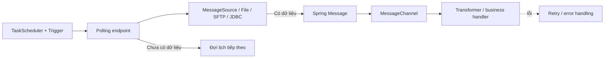
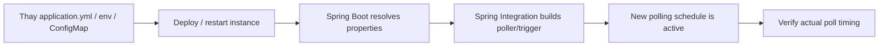
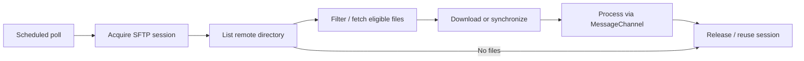

# Thay đổi polling interval qua properties trong Spring Boot và Spring Integration

Trong các ứng dụng tích hợp, **polling** là cách một thành phần chủ động kiểm tra nguồn dữ liệu theo lịch để tìm công việc mới. Ví dụ: cứ 5 giây kiểm tra thư mục chứa file, cứ 30 giây truy vấn bảng outbox hoặc cứ 1 phút tìm file mới trên SFTP. Nếu khoảng thời gian cố định bị viết trực tiếp trong mã Java, mỗi lần điều chỉnh tải hoặc độ trễ cần sửa code và triển khai lại. **Spring Boot properties** giúp tách chu kỳ polling khỏi logic xử lý để cấu hình theo môi trường, adapter và nhu cầu vận hành.

Bài **“Thay đổi polling interval qua properties”** thuộc chương **Spring Boot**, trong module **SPRING_INTEGRATION_ADAPTERS**. Module tập trung vào việc đưa các hệ thống ngoài vào **inbound/outbound adapter**, **gateway**, **poller** và **MessageChannel**, với các transport như **file, SFTP, HTTP, JMS, AMQP, Kafka và cơ sở dữ liệu**. Vì vậy, thay đổi polling interval cần được hiểu trong toàn bộ hợp đồng message, xử lý lỗi và vòng đời kết nối, chứ không chỉ là thay một con số trong `application.yml`.

> **Phân biệt cốt lõi:** Thay đổi một property và **khởi động lại ứng dụng** thường làm poller mới nhận cấu hình mới. Nhưng chỉ sửa file cấu hình hoặc refresh một `Environment` đang chạy **không có nghĩa** lịch của poller hiện hữu sẽ tự thay đổi. Muốn thay chu kỳ **ngay trong runtime**, phải thiết kế cơ chế trigger có thể cập nhật hoặc tái cấu hình endpoint một cách có kiểm soát.

## 1. Mục tiêu học tập

Sau bài này, người học có thể:

1. Phân biệt **polling interval**, `fixedDelay`, `fixedRate`, `cron`, `initialDelay` và thời gian xử lý một lượt poll.
2. Giải thích quan hệ giữa **Spring Boot externalized configuration**, `@Poller`, `MessageSource`, `MessageChannel` và adapter.
3. Chuyển một polling interval viết cứng thành **property** trong `application.yml` hoặc `application.properties`.
4. Dùng placeholder như `${app.integration.file.poll-delay-ms:5000}` trong cấu hình poller bằng annotation.
5. Hiểu khi nào dùng giá trị **milliseconds** và khi nào dùng Spring Boot **Duration** như `5s`, `250ms` hay `1m`.
6. Tách cấu hình lịch cho file, SFTP, JDBC và các endpoint khác để tránh tác động ngoài ý muốn.
7. Phân biệt việc thay property khi **restart/redeploy** với thay lịch **tại runtime**.
8. Hiểu tương quan giữa interval, `maxMessagesPerPoll`, tốc độ xử lý, concurrency, backpressure và độ trễ.
9. Thiết kế lỗi/retry/idempotency để thay interval không làm xử lý trùng hoặc bỏ sót dữ liệu.
10. Xây dựng kiểm thử, số đo vận hành, runbook và kế hoạch rollback cấu hình polling an toàn.

## 2. Poller trong Spring Integration là gì?

Một **poller** yêu cầu một **message source** (hoặc endpoint sử dụng polling) kiểm tra xem có dữ liệu/công việc mới hay không, theo lịch do **trigger** điều khiển.

Ví dụ:



Những khái niệm phải tách bạch:

| Thành phần | Vai trò | Có quyết định polling interval không? |
| --- | --- | --- |
| `MessageSource<T>` | Lấy message từ nguồn khi được gọi. | Thông thường không tự quyết định lịch. |
| Inbound channel adapter | Gọi source và gửi message vào channel. | Có thể được gắn poller. |
| `Trigger` | Tính thời điểm gọi tiếp theo. | **Có**, là một yếu tố chính. |
| `TaskScheduler` | Sắp xếp và thực thi tác vụ theo trigger. | Sở hữu lịch và tài nguyên thread. |
| `MessageChannel` | Chuyển message giữa endpoint. | **Không** tự điều chỉnh chu kỳ. |
| `maxMessagesPerPoll` | Giới hạn số message xử lý trong một lượt poll. | Không phải khoảng thời gian giữa các lượt poll. |
| `TaskExecutor` / concurrency | Có thể ảnh hưởng thời gian thực thi và xử lý song song. | Không thay thế trigger; có thể ảnh hưởng hiệu năng thực tế. |

Một poller chạy nhanh hơn **không** đồng nghĩa hệ thống có nhiều công việc hơn hoặc throughput tự động cao hơn: nguồn có thể rỗng, downstream có thể chậm hoặc một connection pool có thể đang hết tài nguyên.

## 3. Phân biệt polling với mô hình event-driven

Không phải adapter nào cũng dùng Spring Integration poller.

| Tích hợp | Cách nhận dữ liệu thường gặp | Có nên chỉnh Spring Integration polling interval? |
| --- | --- | --- |
| **Local file inbound** | Poll thư mục để phát hiện file mới. | **Có**, nếu dùng polling inbound adapter. |
| **SFTP inbound** | Poll remote directory hoặc nguồn file được đồng bộ. | **Có**, nếu flow sử dụng poller. |
| **JDBC/database inbound** | Truy vấn định kỳ bảng công việc hoặc outbox. | **Có**, nếu dùng polling JDBC adapter. |
| **HTTP inbound gateway** | Nhận request HTTP do client gửi. | Thường **không**; đây là event-driven request. |
| **HTTP outbound gateway** | Gọi khi có message cần gửi. | Không có polling interval riêng trừ khi upstream poller kích hoạt. |
| **JMS/AMQP message-driven** | Listener/container nhận message từ broker. | Thường không dùng poller của Spring Integration theo cách này. |
| **Kafka message-driven** | Consumer client có cơ chế `poll()` nội bộ. | Không đồng nhất với `@Poller` của Spring Integration. |
| **JMS/AMQP polling adapter** | Một endpoint được thiết kế rõ để lấy từng message theo lịch. | Có thể dùng poller nếu adapter thuộc kiểu polling. |

**Sai lầm phổ biến:** tăng `@Poller(fixedDelay=...)` ở một file adapter rồi cho rằng đã thay Kafka consumer `pollTimeout` hoặc HTTP client timeout. Đó là những cấu hình **khác cơ chế**.

## 4. Interval không chỉ có một nghĩa

Spring Integration sử dụng trigger để quyết định lịch thực thi. Những mô hình phổ biến:

### 4.1. Fixed delay

**Fixed delay** tính thời gian đợi từ khi một lượt poll **hoàn tất** đến khi lượt kế tiếp bắt đầu, theo semantics của trigger và scheduler được sử dụng.

```text
Lượt poll 1: [bắt đầu ---- xử lý xong]
                                   <--- delay 5s --->
Lượt poll 2:                                      [bắt đầu ...]
```

Nếu xử lý một lượt mất 2 giây và delay là 5 giây, hai lần bắt đầu có thể cách nhau khoảng **7 giây**, chưa tính scheduler contention. Vì vậy `fixedDelay=5000` không nhất thiết là cứ đúng 5 giây lại có một lần bắt đầu.

### 4.2. Fixed rate

**Fixed rate** lập lịch theo chu kỳ tính từ các mốc bắt đầu dự kiến:

```text
Mốc lịch:      00s       05s       10s       15s
              |         |         |         |
Poll task:    [----]    [--------] [--] ...
```

Nếu tác vụ lâu hơn chu kỳ hoặc scheduler không đủ thread, các lần thực thi có thể bị trễ; mức độ chồng lấn thực tế phụ thuộc cấu hình executor/scheduler, endpoint và concurrency. **Đừng coi fixed rate là cơ chế chống chạy song song.**

### 4.3. Cron

Cron cho phép lịch theo thời điểm, ví dụ mỗi 15 phút hoặc trong giờ hành chính. Nó cần xét:

- Time zone của lịch.
- Thời điểm bắt đầu/hoàn tất.
- Lịch ngày nghỉ và thay đổi DST ở nơi áp dụng.
- Trường hợp một lần chạy trước chưa xong.
- Nhiều instance cùng thực hiện cùng lịch.

Nếu mục tiêu là “kiểm tra sau khi lần trước xử lý xong 10 giây”, `fixedDelay` thường dễ hiểu hơn một biểu thức cron.

### 4.4. Initial delay

`initialDelay` xác định khoảng đợi trước lần poll đầu tiên ở những trigger hỗ trợ nó. Đây là tham số **khác** với chu kỳ định kỳ; chỉnh nó không nhất thiết thay tần suất sau khởi động.

## 5. Cấu hình trong Spring Boot: application.yml

Một cấu hình dễ đọc có thể là:

```yaml
app:
  integration:
    file:
      inbox: ./data/inbox
      poll-delay-ms: 5000
      max-messages-per-poll: 10
    sftp:
      poll-delay-ms: 30000
      max-messages-per-poll: 20
    jdbc:
      poll-delay-ms: 10000
      max-messages-per-poll: 5
```

Ở đây:

- `poll-delay-ms` là **milliseconds**, dùng cho cấu hình annotation cần số dạng chuỗi.
- `max-messages-per-poll` là **số message mà một lượt polling được phép nhận/xử lý** theo semantics endpoint.
- Các adapter có **namespace property riêng**, tránh thay một cấu hình chung rồi gây tải lên mọi hệ thống.
- `inbox` chỉ là đường dẫn ví dụ; sản phẩm thật cần xác định quyền truy cập, volume và khả năng tồn tại của thư mục.

### 5.1. Bản tương đương application.properties

```properties
app.integration.file.inbox=./data/inbox
app.integration.file.poll-delay-ms=5000
app.integration.file.max-messages-per-poll=10
app.integration.sftp.poll-delay-ms=30000
app.integration.sftp.max-messages-per-poll=20
app.integration.jdbc.poll-delay-ms=10000
app.integration.jdbc.max-messages-per-poll=5
```

Spring Boot hỗ trợ nhiều nguồn **externalized configuration**. Cần quyết định quy tắc override cho profile, environment variables, command-line arguments và hệ thống triển khai, không lưu ý định vận hành chỉ ở một `application.yml` trong source control.

## 6. Ví dụ đơn giản nhất: @Poller đọc placeholder

Một inbound file adapter có thể dùng annotation để nhận interval từ properties:

```java
import java.io.File;
import org.springframework.beans.factory.annotation.Value;
import org.springframework.context.annotation.Bean;
import org.springframework.context.annotation.Configuration;
import org.springframework.integration.annotation.InboundChannelAdapter;
import org.springframework.integration.annotation.Poller;
import org.springframework.integration.file.FileReadingMessageSource;
import org.springframework.integration.file.filters.AcceptOnceFileListFilter;

@Configuration
public class FilePollingConfiguration {

    @Bean
    @InboundChannelAdapter(
        channel = "rawFileChannel",
        poller = @Poller(
            fixedDelay = "${app.integration.file.poll-delay-ms:5000}",
            maxMessagesPerPoll =
                "${app.integration.file.max-messages-per-poll:10}"
        )
    )
    public FileReadingMessageSource fileMessageSource(
        @Value("${app.integration.file.inbox:./data/inbox}")
        File directory
    ) {
        FileReadingMessageSource source =
            new FileReadingMessageSource();

        source.setDirectory(directory);
        source.setFilter(new AcceptOnceFileListFilter<>());
        return source;
    }
}
```

**Lưu ý cách đọc mã:** trong Markdown Java trên, cú pháp Spring placeholder thực tế là `${...}`; các dấu này nằm trong chuỗi annotation Java và được Spring giải quyết từ `Environment` tại thời điểm xây dựng endpoint.

Nếu `application.yml` đặt `poll-delay-ms: 5000`, mỗi lượt poll được lập lịch theo **fixed delay 5.000 ms**. Sau khi thay giá trị thành `15000` và khởi động lại ứng dụng, lịch mới là khoảng **15 giây sau khi lượt trước hoàn tất** (trong điều kiện scheduler vận hành bình thường).

### 6.1. Vì sao viết giá trị mặc định sau dấu hai chấm?

```java
fixedDelay = "${app.integration.file.poll-delay-ms:5000}"
```

`5000` là giá trị fallback nếu property không được cung cấp. Chỉ nên dùng fallback khi đã phê duyệt về vận hành; với một tích hợp có chi phí lớn hoặc rủi ro cao, **fail fast khi thiếu property** có thể tốt hơn việc ngầm chạy với tần suất không mong muốn.

### 6.2. Các điều kiện để ví dụ hoạt động

- Ứng dụng có Spring Boot và Spring Integration cùng các module cần thiết.
- Component/configuration được Spring phát hiện.
- Có bean channel `rawFileChannel` hoặc một tên channel được framework khởi tạo phù hợp.
- Directory có thật hoặc có cơ chế chuẩn bị nó, với quyền đọc cần thiết.
- File filter được cấu hình phù hợp với bài toán nhận file, tính bền của metadata và restart.
- Có consumer cho message trong `rawFileChannel`.
- Không có hai endpoint khác cùng claim một file mà thiếu cơ chế coordination.

**Annotation chỉ là phần cấu hình polling**; nó không tự bảo đảm idempotency, file readiness hay xử lý lỗi.

## 7. Khai báo channel và handler

Ví dụ phần còn lại của luồng file:

```java
import java.io.File;
import org.springframework.context.annotation.Bean;
import org.springframework.context.annotation.Configuration;
import org.springframework.integration.annotation.ServiceActivator;
import org.springframework.integration.channel.DirectChannel;
import org.springframework.messaging.Message;
import org.springframework.messaging.MessageChannel;
import org.springframework.stereotype.Component;

@Configuration
class FileChannelConfiguration {

    @Bean
    MessageChannel rawFileChannel() {
        return new DirectChannel();
    }
}

@Component
class FileMessageHandler {

    @ServiceActivator(inputChannel = "rawFileChannel")
    public void handle(Message<File> message) {
        File file = message.getPayload();

        // Ví dụ minh họa:
        // 1. Kiểm tra file readiness, kích thước và contract.
        // 2. Đọc và parse theo charset/schema đã thỏa thuận.
        // 3. Ghi kết quả theo transaction/idempotency phù hợp.
        // 4. Quản lý archive/quarantine sau kết quả được xác nhận.
    }
}
```

Trong mô hình này:

1. Poller quyết định **khi nào source được hỏi**.
2. `FileReadingMessageSource` quyết định **chọn file nào**.
3. `MessageChannel` chuyển message.
4. `ServiceActivator` xử lý.
5. Transaction, retry và lifecycle file cần thiết kế riêng.

Khi `DirectChannel` xử lý đồng bộ, thời gian xử lý handler có thể kéo dài chính lượt poll, làm ảnh hưởng nhịp fixed-delay thực tế. Nếu dùng executor channel, semantics về thời gian kết thúc công việc và backpressure có thể khác; cần đo thay vì suy từ interval.

## 8. Chỉnh property theo môi trường

Một cùng binary có thể dùng các chu kỳ khác nhau:

```yaml
# application-dev.yml
app:
  integration:
    file:
      poll-delay-ms: 1000
      max-messages-per-poll: 2
```

```yaml
# application-prod.yml
app:
  integration:
    file:
      poll-delay-ms: 10000
      max-messages-per-poll: 25
```

Khi chạy với profile tương ứng, Spring Boot hợp nhất các nguồn cấu hình theo quy tắc ưu tiên của nó.

### 8.1. Environment variable

Một ví dụ override bằng environment variable:

```text
APP_INTEGRATION_FILE_POLL_DELAY_MS=3000
```

Tên environment variable minh họa quy tắc chuyển từ canonical property `app.integration.file.poll-delay-ms`. Cần kiểm tra trong môi trường triển khai cụ thể để chắc chắn cấu hình được bind/resolve như mong đợi.

### 8.2. Command-line argument

```text
java -jar integration-app.jar --app.integration.file.poll-delay-ms=7500
```

Giá trị override sẽ có hiệu lực **trong quá trình ứng dụng xây dựng cấu hình poller mới**, không phải phép thay đổi tức thì của một process đã chạy.

### 8.3. Kubernetes ConfigMap và biến môi trường

Trong container orchestrator, property có thể đến từ:

- Environment variables lúc pod khởi động.
- ConfigMap mounted file được đọc lúc startup.
- Hệ thống cấu hình tập trung có phiên bản và phân quyền.
- GitOps/Helm manifest.

Một ConfigMap được cập nhật **không mặc nhiên khiến Spring Integration poller đang chạy đổi interval**. Với environment variables, process không tự cập nhật giá trị môi trường sau khởi động. Với mounted files, Spring Boot/endpoint cần có **cơ chế refresh/rebind/restart** được hỗ trợ mới dùng giá trị mới.

## 9. Kiểu Duration của Spring Boot: dễ đọc, ít nhầm đơn vị

Trong một ứng dụng có nhiều tham số thời gian, dạng:

```yaml
app:
  integration:
    poll:
      file-interval: 5s
      sftp-interval: 30s
      jdbc-interval: 250ms
```

thường dễ hiểu hơn:

```yaml
file-delay: 5000
sftp-delay: 30000
jdbc-delay: 250
```

Spring Boot hỗ trợ bind các giá trị duration như `250ms`, `5s`, `1m` sang `java.time.Duration` trong `@ConfigurationProperties`.

### 9.1. Ví dụ typed properties

```java
import java.time.Duration;
import org.springframework.boot.context.properties.ConfigurationProperties;

@ConfigurationProperties(prefix = "app.integration.poll")
public record PollingProperties(
    Duration fileInterval,
    Duration sftpInterval,
    Duration jdbcInterval
) {}
```

Đăng ký binding:

```java
import org.springframework.boot.context.properties.EnableConfigurationProperties;
import org.springframework.context.annotation.Configuration;

@Configuration
@EnableConfigurationProperties(PollingProperties.class)
class PollingPropertiesConfiguration {}
```

Cấu hình tương ứng:

```yaml
app:
  integration:
    poll:
      file-interval: 5s
      sftp-interval: 30s
      jdbc-interval: 250ms
```

Có thể bổ sung bean validation, giá trị mặc định, ràng buộc min/max và các phép kiểm tra cross-field phù hợp. Không nên giả định một `Duration` bất kỳ đều hợp lệ cho lịch polling: `0s`, số âm hoặc giá trị quá nhỏ có thể tạo hành vi không mong muốn.

### 9.2. @Poller và Duration khác nhau ở đâu?

Trong ví dụ annotation, `@Poller(fixedDelay = "...")` nhận chuỗi biểu thức mà poller diễn giải như **số milliseconds** theo API tương ứng. Với kiểu Duration của Spring Boot, nên dùng một cấu hình **programmatic/DSL** chấp nhận Duration hoặc chủ động chuyển đổi sang milliseconds.

**Tránh trộn hai cơ chế** mà không kiểm chứng:

```text
@Poller(fixedDelay = "${app.poll.interval}")
app.poll.interval = 5s
```

Tùy phiên bản và cách giải quyết placeholder, đây không phải cấu hình tương đương chắc chắn với giá trị `5000` milliseconds. Cách ít mơ hồ là dùng property có hậu tố `-ms` cho annotation, còn `Duration` cho API typed.

## 10. Programmatic poller dùng Duration

Với **Java DSL** của Spring Integration, có thể định nghĩa poller theo Duration từ một bean configuration properties:

```java
import java.io.File;
import org.springframework.beans.factory.annotation.Value;
import org.springframework.context.annotation.Bean;
import org.springframework.context.annotation.Configuration;
import org.springframework.integration.dsl.IntegrationFlow;
import org.springframework.integration.dsl.Pollers;
import org.springframework.integration.file.dsl.Files;

@Configuration
class FilePollingFlowConfiguration {

    @Bean
    IntegrationFlow filePollingFlow(
        PollingProperties props,
        @Value("${app.integration.file.inbox:./data/inbox}")
        File directory
    ) {
        return IntegrationFlow
            .from(
                Files.inboundAdapter(directory)
                    .patternFilter("*.csv"),
                endpoint -> endpoint.poller(
                    Pollers.fixedDelay(props.fileInterval())
                        .maxMessagesPerPoll(10)
                )
            )
            .channel("rawFileChannel")
            .get();
    }
}
```

**Ý nghĩa:** chu kỳ lấy từ `Duration` đã được Spring Boot bind, nên `5s` rõ đơn vị. Đoạn mã là mẫu Spring Integration Java DSL cho các phiên bản hỗ trợ overload `Duration`; khi đưa vào dự án thật cần đối chiếu chữ ký API với phiên bản đã dùng.

### 10.1. Đừng khai báo hai inbound endpoint cho cùng một nguồn nếu không có chủ đích

Ví dụ annotation ở mục 6 và DSL ở mục 10 là **hai lựa chọn thay thế**, không phải cấu hình cần bật đồng thời. Nếu cả hai cùng quét một thư mục, có thể xảy ra duplicate processing hoặc tranh chấp file.

Chọn **một** mẫu cho một adapter trong triển khai thực tế, hoặc dùng cơ chế claim/coordination rõ khi chủ động chạy nhiều instance.

## 11. Thay interval theo chiều nào mới hợp lý?

Có hai mục tiêu thường bị gộp:

1. **Giảm độ trễ phát hiện công việc:** giảm khoảng đợi giữa các lượt poll.
2. **Tăng throughput:** xử lý nhiều message hơn trong một đơn vị thời gian.

Giảm interval giúp nguồn được kiểm tra thường xuyên hơn nhưng **không đảm bảo throughput cao hơn** nếu giới hạn nằm ở batch size, logic xử lý hoặc dependency.

Ví dụ giả định mỗi poll có tối đa 10 message:

| Fixed delay | Số lượt poll tối đa trong 1 phút nếu mỗi lượt tức thì | Tổng message lý thuyết với 10 message/lượt |
| --- | ---: | ---: |
| 1 giây | Khoảng 60 | Khoảng 600 |
| 5 giây | Khoảng 12 | Khoảng 120 |
| 10 giây | Khoảng 6 | Khoảng 60 |
| 30 giây | Khoảng 2 | Khoảng 20 |

Các số liệu **chỉ minh họa** khi poll không mất thời gian, nguồn luôn có message và scheduler đáp ứng chính xác. Với fixed delay, thời gian xử lý phải được cộng vào khoảng cách giữa các lượt bắt đầu; số đo thực tế có thể thấp hơn nhiều.

### 11.1. Công thức ước lượng gần đúng

```text
poll_cycle_seconds ~= poll_execution_seconds + fixed_delay_seconds

polls_per_minute ~= 60 / poll_cycle_seconds

upper_bound_messages_per_minute
    ~= polls_per_minute * max_messages_per_poll
```

Đây là ước lượng lý tưởng hóa, chưa tính I/O, transaction, scheduler lag, queue contention, retry, multi-instance và thời gian source trả null.

## 12. maxMessagesPerPoll không thay thế interval

Tham số `maxMessagesPerPoll` kiểm soát số message lấy/xử lý trong **một vòng polling** ở endpoint tương ứng.

Ví dụ:

```yaml
app:
  integration:
    file:
      poll-delay-ms: 5000
      max-messages-per-poll: 1
```

Có thể nhận **một file mỗi vòng**, dù còn 1.000 file trong thư mục. Đổi `poll-delay-ms` từ 5000 sang 500 mà vẫn giữ `maxMessagesPerPoll=1` sẽ tăng số lần kiểm tra nhưng có thể tạo nhiều I/O/scheduler overhead.

Ngược lại, tăng `maxMessagesPerPoll` quá cao có thể khiến một lượt polling chiếm nhiều thời gian và tài nguyên, làm trễ lịch tiếp theo hoặc vượt giới hạn downstream.

### 12.1. Các câu hỏi trước khi chỉnh

- Một lượt poll có thể lấy nhiều message thật không, hay source chỉ trả tối đa một?
- Downstream xử lý đồng bộ hay bất đồng bộ?
- Có giới hạn API/SFTP/JDBC connection hoặc broker rate?
- Nếu một record lỗi, các record sau cùng batch có bị chặn?
- Batch lớn có tăng lock duration hoặc transaction timeout không?
- Có cần bảo đảm ordering theo source hoặc aggregate không?

Các giá trị đặc biệt của `maxMessagesPerPoll` (nếu dùng) phải được hiểu theo **phiên bản Spring Integration và endpoint**; không nên tùy tiện cấu hình số 0 hoặc số âm để “tăng tốc” khi chưa kiểm chứng semantics.

## 13. Fixed delay và thời gian xử lý chậm

Giả sử:

```text
poll-delay = 5s
mỗi lượt source + handler xử lý = 4s

Lượt A:
  start=00s, finish=04s
Lượt B:
  start~09s, finish~13s
Lượt C:
  start~18s, finish~22s
```

Với fixed delay, việc xử lý chậm **tự kéo giãn khoảng cách giữa các lần bắt đầu**. Nếu doanh nghiệp cần phát hiện dữ liệu trong 1 giây, chỉ chỉnh từ 5s xuống 1s sẽ không đủ khi mỗi lượt vẫn xử lý 4s đồng bộ.

Các lựa chọn cần đánh giá:

- Tối ưu nguồn truy vấn hoặc kích thước batch.
- Tách polling và downstream processing bằng channel/buffer có giới hạn.
- Cấp thêm worker có backpressure và idempotency.
- Thay mô hình polling bằng event-driven nếu nguồn hỗ trợ.
- Chấp nhận trade-off latency/throughput/tài nguyên.

**Không bật concurrency tùy tiện** khi nguồn yêu cầu thứ tự hoặc không có khả năng claim record/file an toàn.

## 14. Spring TaskScheduler và tài nguyên thread

Poller cần scheduler. Một ứng dụng có nhiều inbound poller có thể cạnh tranh tài nguyên scheduling.

Dấu hiệu scheduler quá tải:

- Poll interval cấu hình 1 giây nhưng lần kiểm tra thực tế cách nhau 5–10 giây.
- Poll task chờ thread rảnh.
- SFTP/DB poll chiếm thread vì timeout dài.
- Đổi interval ít hiệu quả vì bottleneck nằm ở scheduler.
- Những endpoint khác bị chậm cùng lúc.

### 14.1. Phân biệt scheduler delay với source latency

```text
scheduled_at  = thời điểm trigger dự kiến chạy
started_at    = thời điểm task thực sự bắt đầu
completed_at  = thời điểm task xong

scheduler_lag = started_at - scheduled_at
poll_duration = completed_at - started_at
```

Chỉ nhìn một metric “polling interval” không đủ: nếu polling bị chậm, có thể là **lịch chậm**, **source chậm** hoặc **handler chậm**.

### 14.2. Tăng pool không phải lời giải mặc định

Tăng scheduler threads có thể giúp nhiều poller độc lập hoạt động đúng lịch, nhưng có thể làm:

- Nhiều query DB chạy đồng thời hơn.
- Nhiều session SFTP cùng mở hơn.
- Tăng cạnh tranh lock hoặc API rate limits.
- Tạo duplicate claim nếu nhiều instance cùng lấy dữ liệu.

Phải đánh giá cả capacity của nguồn và downstream, không tối ưu scheduler một cách cô lập.

## 15. Thay đổi property: restart và runtime là hai việc khác nhau

Đây là phần quan trọng nhất khi vận hành.

### 15.1. Thay tại startup/restart

Trình tự:



Đây là cách triển khai đơn giản, dễ kiểm chứng và phù hợp nhiều ứng dụng.

### 15.2. Chỉ sửa file trên đĩa

Nếu một process đã đọc properties lúc startup:

```text
T0: Application starts, poll-delay-ms = 5000
T1: Engineer edits application.yml to 1000
T2: Existing process still uses trigger constructed at startup
```

Không nên tuyên bố poller sẽ tự chạy mỗi 1 giây. Cần cơ chế refresh/rebuild/trigger mutation **được thiết kế riêng** nếu muốn thay trong runtime.

### 15.3. Refresh Environment chưa chắc refresh poller

Một số hệ thống dùng Spring Cloud Config, actuator refresh hoặc cấu hình tập trung. Việc có thể cập nhật bean/properties trong runtime **không tự bảo đảm** một `@Poller` đã tạo `Trigger` từ placeholder sẽ thay đổi lịch.

Cần xác định rõ:

- Bean nào được refresh/rebind?
- Trigger hiện hữu có đọc giá trị mới ở mỗi lần tính lịch không?
- Endpoint cần stop/start để nhận trigger mới không?
- Trigger đã schedule lần kế tiếp có được tính lại ngay không?
- Có giữ trạng thái file filter, offset, session và idempotency không?

**Không coi POST tới endpoint refresh nào đó là bằng chứng lịch polling đã đổi** nếu chưa đo hoặc đọc được trạng thái trigger thực.

## 16. Ba chiến lược thay polling interval

| Chiến lược | Tình huống phù hợp | Lưu ý |
| --- | --- | --- |
| **Restart/redeploy với property mới** | Đa số ứng dụng có rolling deployment được kiểm soát. | Cần readiness, drain, coordination và kiểm thử không xử lý trùng. |
| **Mutable/dynamic Trigger** | Cần chỉnh lịch khi process đang chạy. | Cần cơ chế cập nhật thread-safe, validation, audit và kiểm tra thời điểm hiệu lực. |
| **Rebuild/restart endpoint/flow** | Cần thay toàn bộ cấu hình poller hoặc source. | Cần lifecycle control, tránh trùng endpoint và giữ metadata state. |

Không nên bắt mọi đội triển khai dynamic trigger nếu chỉ cần đổi interval vài lần mỗi quý. Mỗi tính năng cập nhật nóng tạo thêm bề mặt vận hành cần giám sát và kiểm thử.

## 17. Ví dụ runtime: Mutable fixed-delay trigger

Để hiểu cập nhật nóng, có thể viết một `Trigger` đọc khoảng delay từ một giá trị thread-safe thay vì giữ cố định từ startup.

Đoạn ví dụ sau dùng API `Trigger`/`TriggerContext` của các phiên bản Spring Framework hiện đại:

```java
import java.time.Duration;
import java.time.Instant;
import java.util.concurrent.atomic.AtomicReference;
import org.springframework.scheduling.Trigger;
import org.springframework.scheduling.TriggerContext;

public final class MutableFixedDelayTrigger implements Trigger {

    private static final Duration MIN = Duration.ofMillis(250);
    private static final Duration MAX = Duration.ofMinutes(15);

    private final AtomicReference<Duration> delay;

    public MutableFixedDelayTrigger(Duration initial) {
        this.delay = new AtomicReference<>(validated(initial));
    }

    public Duration currentDelay() {
        return delay.get();
    }

    public void updateDelay(Duration next) {
        delay.set(validated(next));
    }

    @Override
    public Instant nextExecution(TriggerContext context) {
        Instant lastCompletion = context.lastCompletion();

        Instant base = lastCompletion != null
            ? lastCompletion
            : context.getClock().instant();

        return base.plus(delay.get());
    }

    private static Duration validated(Duration duration) {
        if (duration == null
                || duration.compareTo(MIN) < 0
                || duration.compareTo(MAX) > 0) {
            throw new IllegalArgumentException(
                "Polling delay must be between 250ms and 15m"
            );
        }
        return duration;
    }
}
```

### 17.1. Ví dụ giải thích gì?

- `AtomicReference<Duration>` cho phép thay giá trị mà không tạo data race đơn giản.
- `nextExecution(...)` tính mốc tiếp theo theo **lần hoàn tất gần nhất**, mô phỏng fixed-delay.
- Kiểm tra min/max ngăn nhập 0, âm hoặc quá nhanh.
- Giá trị ban đầu có thể đến từ `@ConfigurationProperties`.
- Giá trị mới phải đi qua một service vận hành có **quyền, audit và rollback**, không đọc thẳng từ một header do producer gửi.

### 17.2. Điều không được hứa về hiệu lực tức thì

Thay `delay` không nhất thiết hủy một lần poll **đã được scheduler lên lịch từ trước**. Trigger thường được hỏi lại để tính **lần thực thi tiếp theo** tại thời điểm scheduler reschedule. Vì vậy, thay đổi có thể chỉ quan sát được sau một lượt tiếp theo, tùy scheduler và endpoint.

Nếu yêu cầu “áp dụng ngay, kể cả lịch hiện tại”, cần xem xét một quy trình **cancel/reschedule/stop-start** được framework hỗ trợ và kiểm thử cẩn thận, thay vì cho rằng một `AtomicReference` tự điều khiển lịch đã queue.

## 18. Gắn Trigger động vào IntegrationFlow

Một mẫu Java DSL có thể dùng một bean trigger được chia sẻ với dịch vụ cấu hình:

```java
import java.io.File;
import org.springframework.beans.factory.annotation.Value;
import org.springframework.context.annotation.Bean;
import org.springframework.context.annotation.Configuration;
import org.springframework.integration.dsl.IntegrationFlow;
import org.springframework.integration.dsl.Pollers;
import org.springframework.integration.file.dsl.Files;

@Configuration
class DynamicFileFlowConfiguration {

    @Bean
    MutableFixedDelayTrigger fileDelayTrigger(PollingProperties props) {
        return new MutableFixedDelayTrigger(props.fileInterval());
    }

    @Bean
    IntegrationFlow dynamicFileFlow(
        MutableFixedDelayTrigger trigger,
        @Value("${app.integration.file.inbox:./data/inbox}")
        File inbox
    ) {
        return IntegrationFlow
            .from(
                Files.inboundAdapter(inbox)
                    .patternFilter("*.csv"),
                endpoint -> endpoint.poller(
                    Pollers.trigger(trigger)
                        .maxMessagesPerPoll(10)
                )
            )
            .channel("rawFileChannel")
            .get();
    }
}
```

Đây là **mẫu kiến trúc** cho Spring Integration Java DSL hỗ trợ `Pollers.trigger(Trigger)`; API cụ thể cần đối chiếu phiên bản trước khi dùng production.

### 18.1. Dịch vụ quản trị cập nhật delay

```java
import java.time.Duration;
import org.springframework.stereotype.Service;

@Service
public class FilePollingControlService {

    private final MutableFixedDelayTrigger trigger;

    public FilePollingControlService(MutableFixedDelayTrigger trigger) {
        this.trigger = trigger;
    }

    public void changeDelay(Duration approvedDelay) {
        // Gọi sau bước authentication/authorization,
        // validation cấu hình và audit bởi tầng quản trị.
        trigger.updateDelay(approvedDelay);
    }

    public Duration currentDelay() {
        return trigger.currentDelay();
    }
}
```

Đừng trực tiếp expose method này làm một API công khai không có kiểm soát. Khi nhiều instance chạy, update một `AtomicReference` **chỉ thay đổi trong JVM đó**. Nếu cần nhất quán cluster, phải có distributed configuration/coordination, quan sát từng instance và trạng thái mong muốn được lưu bền.

### 18.2. Kiểm tra quyền và audit

Mỗi lần đổi hot interval nên lưu:

```json
{
  "event": "POLLING_INTERVAL_UPDATED",
  "adapter": "file-inbound-orders",
  "instance": "integration-worker-3",
  "previous": "PT5S",
  "requested": "PT2S",
  "approvedBy": "ops-approver",
  "source": "managed-configuration",
  "result": "APPLIED_TO_TRIGGER",
  "effectiveObservation": "PENDING_NEXT_SCHEDULE"
}
```

Dữ liệu chỉ minh họa. Không tuyên bố “đã áp dụng ngay cho tất cả instance” nếu mới thay giá trị trên một node.

## 19. Thay runtime bằng stop/start endpoint

Một số thay đổi phức tạp hơn interval, ví dụ đổi polling trigger cùng `maxMessagesPerPoll`, file source, cron expression hoặc queue capacity. Khi đó có thể cân nhắc:

1. Xác định **endpoint ID** cần thay.
2. Đánh giá task đang chạy và nơi lưu trạng thái.
3. Dừng hoặc drain endpoint theo lifecycle phù hợp.
4. Thay cấu hình bằng cơ chế framework cho phép hoặc rebuild flow.
5. Khởi động lại.
6. Kiểm tra lịch thực tế và số lượng message processed.
7. Rollback nếu gây backlog, duplicate hoặc lỗi kết nối.

### 19.1. Không tự gọi setTrigger lên endpoint đang chạy khi chưa rõ contract

Không phải mọi poller implementation cho phép thay trigger sau initialization. Dù API có setter, thao tác đó có thể **không reschedule** task hiện hữu, hoặc gây trạng thái race nếu gọi giữa lúc poll.

Cần làm rõ một trong hai hướng đã được kiểm thử:

- Trigger mutable với scheduler đọc giá trị khi tính lịch tiếp theo.
- Lifecycle quản trị endpoint/flow với stop–reconfigure–start theo cơ chế phiên bản đang dùng.

## 20. Quan hệ giữa interval và vòng đời kết nối SFTP

SFTP polling có thêm chi phí và giới hạn của kết nối từ xa:



Giảm `sftp.poll-delay-ms` từ 30.000 xuống 1.000 có thể làm:

- Tăng số lần list directory.
- Tăng session churn nếu không dùng cache/pooled session phù hợp.
- Đụng giới hạn connection hoặc rate của máy chủ.
- Tăng chi phí network/latency khi remote directory lớn.
- Gây các lượt kiểm tra không có dữ liệu rất thường xuyên.

### 20.1. Cần kiểm tra những cấu hình đi kèm

- Remote file readiness (upload xong rồi rename/marker).
- Local/remote filter và metadata store có bền sau restart không.
- Giới hạn số file fetch mỗi lượt và số message gửi xuống flow.
- Session cache/pool, timeout và reconnect behavior.
- Max connections/rate limits theo thỏa thuận với đối tác.
- Xử lý file lớn và transaction nghiệp vụ.
- Archive/quarantine và ngăn đọc lại file lỗi vô hạn.

**Polling interval không phải connection timeout.** Một request SFTP có thể mất 20 giây dù interval là 1 giây; cần timeout riêng và cơ chế không chồng lịch ngoài kiểm soát.

## 21. Database/JDBC poller: interval và load trên cơ sở dữ liệu

Một JDBC inbound adapter định kỳ truy vấn bảng công việc:

```sql
SELECT event_id, payload_json
FROM integration_outbox
WHERE status = 'NEW'
ORDER BY created_at
LIMIT 100;
```

Nếu chạy nhiều instance hoặc cần claim bản ghi, câu query minh họa trên **chưa đủ** để ngăn hai poller lấy cùng row. Cần cơ chế lock/claim/lease, phù hợp DBMS và transaction.

### 21.1. Giảm interval có thể tăng số truy vấn rỗng

Ví dụ nếu bảng chỉ có một batch mới mỗi phút nhưng poll mỗi 200ms, hệ thống có thể thực hiện rất nhiều query không trả kết quả, tăng:

- Connection pool usage.
- Lock/index pressure.
- Database CPU và network.
- Lượng log, tracing và monitoring.
- Tác động lên workload nghiệp vụ khác.

### 21.2. Điều cần xem cùng với interval

| Cấu hình | Tác động |
| --- | --- |
| Query/predicate/index | Quyết định chi phí một lần poll. |
| Max rows hoặc `maxMessagesPerPoll` | Số record có thể đưa vào flow. |
| Transaction boundary | Thời gian giữ lock và tính nhất quán. |
| Claim/lease strategy | Ngăn hai instance xử lý cùng row. |
| Retry/DLQ | Xử lý row lỗi không chặn toàn bộ poller. |
| Connection pool | Capacity khi nhiều poller cùng chạy. |
| Backpressure | Không đọc nhanh hơn khả năng downstream. |
| Retention/outbox cleanup | Bảng không tăng không giới hạn. |

### 21.3. Workload thay đổi theo giờ

Nếu tải có giờ cao điểm, có thể dùng lịch cron hoặc cấu hình interval theo profile/môi trường. Nhưng thay interval liên tục theo dashboard mà không có guardrails có thể tạo feedback loop: backlog cao → poll nhanh hơn → DB quá tải → backlog càng cao.

## 22. HTTP, JMS, AMQP và Kafka: không nhầm loại polling

### 22.1. HTTP inbound

HTTP inbound gateway nhận request khi client gửi; không có `fixedDelay` của inbound gateway theo nghĩa một file poller. Nếu muốn chủ động lấy dữ liệu từ một HTTP API theo lịch, có thể có **polling message source/upstream scheduler** tạo lệnh cho outbound HTTP gateway.

Ví dụ:

```text
Poller every 30s
   -> Source emits "fetch pending orders" command
   -> Outbound HTTP gateway GET /orders/pending
   -> Transform response
   -> Process events
```

Nếu giảm interval, cần xem **rate limit, token lifetime, pagination, ETag/If-Modified-Since, duplicate events và HTTP timeout**, không chỉ số lần gọi.

### 22.2. JMS và AMQP

Listener kiểu message-driven thường nhận dữ liệu do broker đẩy/trao khi có message và theo cơ chế listener container. Không thay tốc độ bằng file `@Poller` nếu integration không dùng polling JMS/AMQP adapter.

Các tham số liên quan có thể là concurrency, prefetch, receive timeout, redelivery, batch và broker backpressure. **Đừng dùng chung tên `poll-interval` cho cơ chế không cùng bản chất.**

### 22.3. Kafka

Kafka consumer client có thao tác `poll()` và các timeout như `pollTimeout`, `max.poll.interval.ms` và session/heartbeat settings theo mô hình Kafka. Những tham số này **khác** `fixedDelay` của Spring Integration source polling endpoint.

Đặc biệt, `max.poll.interval.ms` là một ràng buộc về thời gian giữa các lần consumer poll theo giao thức/coordinator, **không phải tần suất “cứ X milliseconds kiểm tra Kafka”** để thay bằng giá trị tùy ý.

### 22.4. Database và file đúng nghĩa poller

File/SFTP/JDBC inbound adapter dùng `MessageSource` hoặc endpoint polling là những nơi trực tiếp phù hợp với `@Poller`/`Pollers.fixedDelay(...)`.

## 23. Polling interval ảnh hưởng độ trễ như thế nào?

Với một nguồn thỉnh thoảng xuất hiện dữ liệu, độ trễ phát hiện phụ thuộc vào thời điểm dữ liệu đến so với các mốc poll.

Nếu nguồn phát dữ liệu đều theo thời gian và poll chạy đều, độ trễ phát hiện trung bình **có thể xấp xỉ nửa chu kỳ**, nhưng đây chỉ là một giả định lý tưởng. Thực tế chịu ảnh hưởng bởi:

- Time-to-complete của lượt poll.
- Scheduler lag và số thread có sẵn.
- Độ trễ source list/query.
- Thời gian dữ liệu trở nên “ready” hoặc được commit.
- Max messages per poll và backlog.
- Thời gian xử lý downstream.
- Retry, lỗi kết nối và timeout.
- Nhiều instances và coordination.

### 23.1. Độ trễ quan trọng là end-to-end

```text
source_event_created_at
    -> source_ready_at
    -> poll_detected_at
    -> message_dispatched_at
    -> business_committed_at

detection_latency = poll_detected_at - source_ready_at
end_to_end_latency = business_committed_at - source_event_created_at
```

Một hệ thống có `detection_latency` thấp nhưng business queue backlog lớn vẫn có `end_to_end_latency` cao. Vì thế không tối ưu interval dựa trên một metric duy nhất.

## 24. Tránh xử lý trùng khi thay polling interval

Giảm chu kỳ polling hoặc rolling restart có thể làm tăng khả năng hai instance thấy cùng message/file/row nếu thiếu coordination.

### 24.1. File/SFTP

Một file đã được xử lý nghiệp vụ nhưng chưa archive có thể xuất hiện lại ở lượt poll sau hoặc sau restart. Cần:

- Idempotent file/record processing.
- Persistent file filter hoặc metadata store theo chiến lược phù hợp.
- File claim và readiness để không đọc tệp upload dở.
- Archive/quarantine sau mốc commit được xác nhận.
- Tránh chỉ dựa vào tên file khi đối tác có thể ghi đè nội dung.

### 24.2. JDBC/outbox

Hai poller có thể cùng query row `NEW`. Cần unique business event ID, transaction, claim/lock hoặc inbox/dedup tùy bài toán.

### 24.3. Gateway/HTTP

Nếu interval được giảm, outbound gateway có thể gửi lại cùng “fetch” hoặc command khi response chưa tới. Với request có side effects, **timeout không chứng minh lần trước chưa commit**; phải dùng idempotency key, trạng thái hoặc reconciliation.

### 24.4. Một quy tắc bền vững

**Polling frequency không phải bảo đảm giao hàng exactly-once.** Dù interval là 500ms hay 5 phút, thiết kế vẫn cần chịu được retry, crash, redelivery và nguồn dữ liệu trùng.

## 25. Điều chỉnh interval và retry backoff là hai cấu hình khác nhau

Giả sử:

```yaml
app:
  integration:
    sftp:
      poll-delay-ms: 30000
      retry:
        initial-backoff-ms: 1000
        max-attempts: 3
```

Ý nghĩa:

- `poll-delay-ms`: khoảng chờ bình thường giữa các lượt kiểm tra nguồn.
- `initial-backoff-ms`: khoảng chờ **sau lỗi** trước lần thử lại theo policy.
- `max-attempts`: giới hạn retry của một operation hoặc message.

Nếu poll thất bại và cả poller lẫn retry advice cùng thử lại, số lần kết nối có thể tăng nhanh. Cần xác định lớp nào sở hữu retry, ràng buộc budget và tránh retry storm.

### 25.1. Lỗi nào không nên retry liên tục?

- CSV/JSON/XML sai schema hoặc charset.
- File sai contract, không đổi nội dung qua các lượt poll.
- HTTP `400` do request không hợp lệ.
- Một row outbox bị lỗi dữ liệu cố định.
- Credential bị từ chối do cấu hình sai.
- Một SFTP path không tồn tại vì cấu hình sai.

Với những trường hợp đó, giảm interval thường **tăng số lần báo lỗi mà không cải thiện kết quả**. Cần quarantine, cảnh báo và khắc phục nguyên nhân.

## 26. Vòng đời application khi deploy interval mới

Đổi properties thường được áp dụng khi một pod/process khởi động lại. Có thể phát sinh:

1. Pod A đang xử lý một file lớn.
2. Pod B khởi động với interval mới.
3. Cả A và B nhìn thấy file hoặc row đang chờ.
4. A bị dừng trước khi archive.
5. B đọc lại file.
6. Nếu handler không idempotent, side effect bị nhân đôi.

Một rollout nên có:

- Readiness/liveness hợp lý.
- Graceful shutdown và drain những task đang chạy theo khả năng framework.
- Persistent metadata store hoặc distributed claim nếu nhiều instance.
- Idempotent handler và transaction phù hợp.
- Giới hạn số poller active cho nguồn không hỗ trợ concurrency.
- Cơ chế verify sau deploy và rollback cấu hình.

### 26.1. Shutdown không phải ACK

Dừng poller chỉ ngăn tiếp tục lập lịch theo lifecycle; không tự quyết định rằng file/row/message vừa xử lý đã commit. Phải biết mốc hoàn tất nghiệp vụ và cơ chế ACK/mark processed của nguồn.

## 27. Ước lượng cấu hình tối thiểu và tối đa

Trước khi cho phép đội vận hành chỉnh interval, cần đặt guardrails:

| Ràng buộc | Ví dụ minh họa | Mục đích |
| --- | --- | --- |
| Min delay | 250ms cho một source local nhẹ | Ngăn busy polling quá nhanh. |
| Max delay | 15 phút | Ngăn backlog quá lâu nếu hợp đồng yêu cầu phát hiện nhanh. |
| Max messages per poll | 50 | Giới hạn burst load. |
| SFTP concurrent sessions | Theo giới hạn đối tác | Không gây connection exhaustion. |
| JDBC query timeout | Nhỏ hơn giới hạn tác vụ theo policy | Không treo scheduler vô hạn. |
| Poll task timeout | Theo SLA/source contract | Phát hiện poll bị kẹt. |
| Source backlog alert | Ví dụ 500 messages hoặc 10 phút | Phát hiện cấu hình quá chậm. |
| Allowed change scope | Một adapter/instance/wave | Tránh thay hàng loạt ngoài dự kiến. |

Các giá trị là **ví dụ**, không phải defaults hoặc giới hạn chuẩn của Spring Integration. Phải hiệu chỉnh theo tải thực, chính sách vận hành và trách nhiệm đối tác.

## 28. Validation properties để fail fast

Một cấu hình `poll-delay-ms: -1` hoặc `0` có thể không đạt ý định nghiệp vụ. Nên kiểm tra trước khi dùng.

Ví dụ service cấu hình typed:

```java
import java.time.Duration;

public final class PollingConfigChecks {

    private static final Duration MIN = Duration.ofMillis(250);
    private static final Duration MAX = Duration.ofMinutes(15);

    private PollingConfigChecks() {}

    public static Duration requireDelay(Duration requested) {
        if (requested == null
                || requested.compareTo(MIN) < 0
                || requested.compareTo(MAX) > 0) {
            throw new IllegalArgumentException(
                "poll interval must be between 250ms and 15m"
            );
        }
        return requested;
    }

    public static int requireBatch(int maxMessagesPerPoll) {
        if (maxMessagesPerPoll < 1 || maxMessagesPerPoll > 50) {
            throw new IllegalArgumentException(
                "maxMessagesPerPoll must be in [1,50]"
            );
        }
        return maxMessagesPerPoll;
    }
}
```

Có thể tích hợp kiểm tra vào `@ConfigurationProperties` validation hoặc bean startup checks. Những min/max này nên là **quyết định quản trị có lý do**, không copy một cách máy móc.

### 28.1. Đừng lẫn timeout với interval

Một source có thể:

```text
poll interval:       5s
connection timeout:  10s
read timeout:        20s
business timeout:    30s
```

Nếu một poll treo 20 giây thì không thể mong fixed-delay poll lại 5 giây sau **khi lần trước bắt đầu**. Timeout độc lập phải được quản lý để scheduler không bị chiếm quá lâu.

## 29. Cấu hình profile theo SLO thay vì tùy hứng

Chọn interval từ nhu cầu nghiệp vụ:

- Dữ liệu thanh toán cần cập nhật nhanh hơn dữ liệu báo cáo ban đêm?
- Có nghĩa vụ kiểm tra file từ đối tác mỗi 1 phút hay mỗi 15 phút?
- Số lượng dữ liệu giờ cao điểm và lượng backlog cho phép?
- Chi phí một lần mở SFTP session hoặc query DB?
- Lỗi nguồn có làm các adapter khác thiếu thread?
- Mỗi đợt polling có thể hoàn tất kịp trước đợt kế tiếp?
- Có phương án chuyển sang event-driven giảm polling không?

Nên đặt mục tiêu:

```text
SLO: 99% file hợp lệ được phát hiện trong <= 60s
Constraint: <= 2 concurrent SFTP sessions
Constraint: poll errors không retry vô hạn
Constraint: business processing idempotent
```

Số liệu SLO chỉ minh họa. Sau đó dùng monitoring để chọn interval và batch thay vì đổi 1000/5000/10000 theo cảm giác.

## 30. Monitoring: xác nhận poller thực sự chạy theo lịch mới

Việc properties đã đổi trong config repository **chưa đủ để xác nhận thay đổi**. Cần đo:

| Metric/quan sát | Ý nghĩa |
| --- | --- |
| `poll_configured_interval_seconds` | Giá trị đang được cấu hình ở instance/endpoint. |
| `poll_effective_interval_seconds` | Khoảng cách đo được giữa các lượt chạy thực tế. |
| `poll_duration_seconds` | Thời gian một lượt poll. |
| `poll_scheduler_lag_seconds` | Độ trễ so với lịch dự kiến, nếu instrument được. |
| `poll_empty_total` | Số lượt không có dữ liệu. |
| `poll_messages_received_total` | Số message tạo từ poller. |
| `poll_error_total{adapter,reason}` | Lỗi nguồn, conversion, business hoặc timeout. |
| `source_backlog_messages` | Công việc tồn đọng của nguồn. |
| `oldest_unprocessed_age_seconds` | Tuổi record/file cũ nhất chưa xử lý. |
| `downstream_processing_latency_seconds` | Thời gian xử lý sau khi poll. |
| `sftp_session_errors_total` | Lỗi session/kết nối riêng của SFTP. |
| `jdbc_poll_query_duration_seconds` | Thời gian DB query. |

Tên metrics là **gợi ý thiết kế**, không phải tất cả được framework tự phát hành sẵn. Có thể dùng Micrometer/Actuator cùng hooks thích hợp và giới hạn metric labels để tránh cardinality cao.

### 30.1. Log cấu hình khi khởi động

Một log an toàn:

```json
{
  "event": "POLLING_CONFIGURATION_ACTIVE",
  "instance": "integration-node-2",
  "endpoint": "file-orders-inbound",
  "triggerType": "FIXED_DELAY",
  "configuredInterval": "PT5S",
  "maxMessagesPerPoll": 10,
  "configurationVersion": "deploy-2026-11-23.1"
}
```

Không log passwords, SFTP credentials hoặc full environment. Có thể ghi config version và hash cấu hình không nhạy cảm để phân biệt các instance đang chạy hai giá trị khác nhau trong rolling deployment.

## 31. Actuator và cấu hình tập trung

Spring Boot Actuator hỗ trợ nhiều endpoint quan sát tùy dependencies và cấu hình expose. Tuy nhiên:

- Có Actuator **không tự tạo API đổi lịch** cho `@Poller`.
- Một endpoint hiển thị Environment có thể chứa thông tin nhạy cảm; cần giới hạn quyền/truy cập.
- Nếu dùng Spring Cloud Config và refresh, vẫn phải kiểm tra **bean/trigger cụ thể** có nhận và thực hiện thay đổi runtime không.
- Metric/liveness thành công không tự chứng minh backlog, dedup và throughput đúng.
- Không expose một endpoint quản trị “set interval” cho mọi client hoặc cho data producer tự điều khiển tốc độ poll.

Một hệ thống cấu hình tập trung hợp lý nên có **phê duyệt, lịch sử thay đổi, giới hạn phạm vi, audit, rollback, kiểm thử và trạng thái áp dụng theo từng instance**.

## 32. Chiến lược thay đổi an toàn từng bước

Một runbook triển khai có thể là:

1. **Xác định endpoint:** file-orders, sftp-partner-a, jdbc-outbox hay source khác.
2. **Xác minh cấu hình hiện hành:** giá trị runtime quan sát được, trigger type, maxMessagesPerPoll, concurrency.
3. **Đọc tác động tải:** poll duration, empty polls, backlog, source latency, connection errors.
4. **Chọn giá trị mới:** dựa trên SLO và giới hạn nguồn, không vượt min/max.
5. **Đánh giá retry/idempotency:** đảm bảo tần suất cao hơn không nhân đôi side effect.
6. **Chọn cách áp dụng:** restart/redeploy, mutable trigger hoặc lifecycle endpoint.
7. **Thay đổi trong một wave/instance:** tránh toàn bộ cluster đổi cùng lúc nếu rủi ro cao.
8. **Quan sát thực tế:** khoảng cách giữa các lần poll, số file/row nhận, backlog và lỗi.
9. **Kiểm thử xử lý trùng:** file/row có bị claim hai lần khi cùng tồn tại pod cũ/mới?
10. **Xác nhận kết quả:** log config version, metrics và dấu vết phê duyệt.
11. **Rollback:** trả interval cũ và kiểm tra lại nguồn, filter, trạng thái session/transaction.
12. **Bàn giao:** cập nhật runbook/SLO và owner chịu trách nhiệm cấu hình.

### 32.1. Điều kiện rollback

Có thể rollback khi:

- Empty poll/query rate tăng đột biến và nguồn bị quá tải.
- Lỗi connection/session tăng.
- Scheduler lag hoặc downstream backlog tăng.
- Message/file duplicate tăng vượt ngưỡng.
- Lỗi transaction/lock timeout xuất hiện sau đổi interval.
- Người vận hành không chứng minh được endpoint đang dùng cấu hình mong muốn.

Rollback interval có thể giảm tải, nhưng **không đảo ngược side effect đã tạo**. Cần điều tra và khắc phục riêng nếu có duplicate hoặc mất message.

## 33. Kiểm thử cấu hình properties

Không chỉ kiểm tra bean đọc được giá trị, cần kiểm tra **lịch poll thực tế** và hành vi của adapter.

### 33.1. Kiểm thử placeholder khi khởi động

Ví dụ Spring Boot test xác nhận property được cung cấp:

```java
import static org.assertj.core.api.Assertions.assertThat;

import org.junit.jupiter.api.Test;
import org.springframework.beans.factory.annotation.Value;
import org.springframework.boot.test.context.SpringBootTest;

@SpringBootTest(properties = {
    "app.integration.file.poll-delay-ms=250",
    "app.integration.file.max-messages-per-poll=2"
})
class PollingPropertyBindingTest {

    @Value("${app.integration.file.poll-delay-ms}")
    private long configuredDelayMs;

    @Value("${app.integration.file.max-messages-per-poll}")
    private int maxMessagesPerPoll;

    @Test
    void readsPollingOverrides() {
        assertThat(configuredDelayMs).isEqualTo(250L);
        assertThat(maxMessagesPerPoll).isEqualTo(2);
    }
}
```

Test này xác minh **placeholder/value binding**, **chưa chứng minh** poller thật bắt đầu theo chu kỳ 250ms. Trong integration test hoàn chỉnh cần chuẩn bị directory hoặc mock/stub source, có cleanup và tránh poller khác chạy ngoài ý muốn.

### 33.2. Kiểm thử Duration binding

```java
import static org.junit.jupiter.api.Assertions.assertEquals;

import java.time.Duration;
import org.junit.jupiter.api.Test;
import org.springframework.beans.factory.annotation.Autowired;
import org.springframework.boot.test.context.SpringBootTest;

@SpringBootTest(properties = {
    "app.integration.poll.file-interval=750ms",
    "app.integration.poll.sftp-interval=30s",
    "app.integration.poll.jdbc-interval=1m"
})
class PollingDurationBindingTest {

    @Autowired
    PollingProperties props;

    @Test
    void bindsHumanReadableDurations() {
        assertEquals(Duration.ofMillis(750), props.fileInterval());
        assertEquals(Duration.ofSeconds(30), props.sftpInterval());
        assertEquals(Duration.ofMinutes(1), props.jdbcInterval());
    }
}
```

Đây là test minh họa dựa trên `@EnableConfigurationProperties` của ví dụ trước.

### 33.3. Kiểm thử timing thực tế

Một test dạng integration có thể:

1. Đưa stub `MessageSource` ghi thời điểm mỗi lần `receive()`.
2. Cấu hình delay nhỏ nhưng lớn hơn jitter thông thường của CI.
3. Thu thập nhiều lần poll và xác minh interval theo **khoảng dung sai**.
4. Thử một lượt poll xử lý chậm để phân biệt fixedDelay/fixedRate.
5. Tránh assert “đúng chính xác 250ms” trên CI vì scheduler không realtime.
6. Dừng endpoint và xác nhận không còn phát message mới theo lifecycle.
7. Đổi property rồi restart context và xác nhận chu kỳ mới.

## 34. Kiểm thử runtime dynamic trigger

Nếu có mutable trigger, cần các test riêng:

| Case | Hành động | Kỳ vọng |
| --- | --- | --- |
| Giá trị ban đầu hợp lệ | Tạo trigger 5s | `currentDelay()` trả 5s. |
| Giá trị quá nhỏ | Update 10ms khi min 250ms | Reject, giữ delay cũ. |
| Giá trị âm/zero | Update 0s hoặc âm | Reject rõ ràng. |
| Update hợp lệ | 5s → 2s | Trigger giữ 2s cho lần tính lịch tiếp theo. |
| Update giữa lúc một lần poll đang chờ | Gọi update trong runtime | Không crash/race; thời điểm hiệu lực được quan sát theo scheduler. |
| Nhiều thread update | Các update hợp lệ đồng thời | Không tạo giá trị hỏng; có policy thứ tự/version. |
| Multi-instance | Update node A | Không nhầm là node B cũng đã cập nhật. |
| Restart node | Process restart | Delay lấy lại từ nguồn cấu hình bền vững. |
| Endpoint stop/start | Dừng rồi khởi động lại | Không chạy hai scheduler cho một source. |
| Lỗi source khi đổi delay | SFTP/JDBC gặp timeout | Error handling và retry budget vẫn đúng. |

### 34.1. Kiểm thử trigger thuần Java

Có thể unit test logic của `nextExecution(...)` bằng một `TriggerContext` stub với các mốc thời gian xác định. Điều này kiểm tra công thức thời gian mà **không cần chờ thật**. Sau đó integration test mới xác minh cách scheduler của phiên bản Spring đang dùng gọi trigger.

## 35. Kiểm thử tải và backlog

Một kịch bản tải mẫu:

```text
Input rate:            100 records/phút
Handler capacity:      80 records/phút
Desired poll delay:    1 giây
maxMessagesPerPoll:    10
```

Dù giảm poll delay về 100ms, **handler capacity chỉ 80 records/phút** vẫn khiến backlog tăng khoảng 20 records/phút nếu tốc độ nguồn giữ nguyên. Tối ưu đúng có thể là:

- Tăng năng lực xử lý downstream.
- Tách xử lý khỏi poller bằng buffer có giới hạn.
- Scale worker trong phạm vi idempotency/ordering.
- Giảm chi phí transform/DB transaction.
- Điều chỉnh batch hợp lý.
- Thương lượng giảm input hoặc backpressure.

**Không nên đọc nhanh hơn khả năng xử lý bền vững** rồi giữ backlog vô hạn trong bộ nhớ.

## 36. Security và multi-tenant khi chỉnh polling

Polling interval có thể ảnh hưởng đến nhiều đối tác hoặc tenant. Nếu một client tự gửi header `pollInterval=10ms` và hệ thống áp dụng ngay, họ có thể buộc ứng dụng mở rất nhiều request tới SFTP/API/DB.

Các nguyên tắc:

1. Cấu hình chỉ thay qua **operator/config management** có quyền.
2. Property từ producer message là **dữ liệu không đáng tin**, không được dùng như lệnh thay trigger.
3. Có allowlist adapter/tenant và giới hạn min/max rõ ràng.
4. Audit người thay, phiên bản config, thời điểm, instance, giá trị trước/sau.
5. Không log credential hoặc toàn bộ Environment.
6. Multi-tenant có thể cần quota khác nhau nhưng không gây starvation giữa tenant.
7. Có cơ chế rollback khi tạo tải bất thường.
8. Bảo vệ administrative endpoints và configuration store.

## 37. Thực hành: thay interval theo ba môi trường

### 37.1. Môi trường development

Yêu cầu: thấy file mới nhanh để thử nghiệm.

```yaml
app:
  integration:
    file:
      poll-delay-ms: 1000
      max-messages-per-poll: 2
```

Mong đợi: poller kiểm tra thường xuyên, nhưng vẫn dùng file filter/idempotency để tránh đọc lại file.

### 37.2. Môi trường staging

Yêu cầu: mô phỏng tải tương đối giống production nhưng có khoảng chờ đủ quan sát.

```yaml
app:
  integration:
    file:
      poll-delay-ms: 5000
      max-messages-per-poll: 10
```

Mong đợi: kiểm thử restart, batch và backlog; đo interval thực, không chỉ đọc properties.

### 37.3. Môi trường production

Yêu cầu: tránh quá tải một SFTP server đối tác.

```yaml
app:
  integration:
    sftp:
      poll-delay-ms: 30000
      max-messages-per-poll: 20
```

Mong đợi: giảm số lần remote listing, kiểm tra session reuse và phát hiện file trong SLO thỏa thuận.

**Không có giá trị interval “chuẩn” cho mọi môi trường**; ví dụ nhằm minh họa cách tách cấu hình và kiểm chứng thay đổi.

## 38. Tình huống thực hành

### Tình huống A – Sửa application.yml nhưng poller không đổi

Ứng dụng đang chạy với `poll-delay-ms=5000`. Đội vận hành sửa file trên máy thành `1000` nhưng các poll vẫn cách nhau khoảng 5 giây.

**Câu hỏi:** Vì sao? Cần xác nhận điều gì?

**Gợi ý:** Property thường được resolve khi bean/poller được xây dựng. Kiểm tra effective configuration và deployment, restart hoặc cơ chế dynamic trigger đã thiết kế. Không giả định chỉnh file disk tự reschedule.

### Tình huống B – Đơn vị 5s bị hiểu sai

Một kỹ sư viết `@Poller(fixedDelay = "${app.poll.delay}")` và đặt property `app.poll.delay=5s`. Ứng dụng không tạo lịch như kỳ vọng.

**Câu hỏi:** Thiết kế nào ít mơ hồ hơn?

**Gợi ý:** Dùng `poll-delay-ms=5000` cho annotation cần milliseconds; hoặc dùng `@ConfigurationProperties Duration` với Java DSL và API typed tương thích.

### Tình huống C – SFTP bị quá nhiều kết nối

Giảm poll delay từ 30s xuống 100ms. SFTP server bắt đầu từ chối kết nối dù file đến chỉ vài phút một lần.

**Câu hỏi:** Lỗi nằm ở converter hay tần suất nguồn?

**Gợi ý:** Kiểm tra remote listing/session churn, caching, rate limits và source readiness; dùng polling interval phù hợp SLO chứ không phải càng nhanh càng tốt.

### Tình huống D – JDBC polling hai instance

Sau rolling deploy, instance A và B đều query một row `status=NEW` trước khi row được mark processing.

**Câu hỏi:** Có thể sửa bằng cách tăng delay từ 1s lên 10s không?

**Gợi ý:** Có thể giảm xác suất race nhưng không bảo đảm correctness. Cần atomic claim/transaction/locking và idempotency, cùng quy trình deploy không xử lý trùng.

### Tình huống E – maxMessagesPerPoll bị hiểu như timeout

Một nhóm đặt `maxMessagesPerPoll=1000` vì muốn “poll mỗi 1 giây”. Poller nhận nhiều file hơn mong muốn và handler tắc.

**Câu hỏi:** Hai tham số khác nhau ra sao?

**Gợi ý:** Interval là khoảng lịch, maxMessagesPerPoll là số message cho một lượt. Phải đo cycle duration và capacity downstream.

### Tình huống F – Runtime refresh không đổi lịch

Spring Boot nhận bean properties mới qua một cơ chế cấu hình động, nhưng poller vẫn tính lịch theo `PeriodicTrigger` cũ.

**Câu hỏi:** Cần bổ sung cơ chế nào?

**Gợi ý:** Mutable Trigger được scheduler hỏi lại hoặc lifecycle reconfigure/restart endpoint có kiểm chứng; không mặc định refresh Environment đủ.

### Tình huống G – Dynamic trigger đổi delay ở một node

Cụm có ba replica. Admin gọi một API nội bộ trên node A để đổi 5s thành 1s. Node B và C vẫn chạy 5s.

**Câu hỏi:** Đây có phải bug của AtomicReference không?

**Gợi ý:** Không; nó chỉ thay state một JVM. Cần nguồn config tập trung, version/ack của từng instance hoặc đồng bộ điều phối, cùng chứng cứ effective interval trên mỗi replica.

### Tình huống H – Giảm interval nhưng backlog vẫn tăng

Nguồn có 100 record/phút, handler chỉ xử lý 80 record/phút. Poll delay giảm từ 5s còn 500ms nhưng backlog không giảm.

**Câu hỏi:** Vì sao?

**Gợi ý:** Throughput bottleneck ở handler/DB; cần cải thiện năng lực xử lý, batch, concurrency có kiểm soát hoặc backpressure. Poll nhanh hơn chỉ kiểm tra nguồn thường hơn.

### Tình huống I – Poller đụng file chưa upload xong

Đối tác SFTP upload file trong 10 giây; ứng dụng đổi interval thành 500ms và lấy file khi mới có một phần nội dung.

**Câu hỏi:** Cần thêm hợp đồng nào?

**Gợi ý:** File readiness marker/atomic rename, age filter theo policy và xử lý khi upload chưa hoàn tất. Interval nhỏ không thể thay readiness protocol.

### Tình huống J – Kafka bị cấu hình nhầm

Một người chỉnh property `app.integration.file.poll-delay-ms` vì muốn Kafka consumer đọc nhanh hơn.

**Câu hỏi:** Vì sao không có tác dụng?

**Gợi ý:** Kafka message-driven consumer có poll loop/timeout riêng ở Kafka client/container. Phải xác định đúng adapter và bottleneck: `max.poll.interval.ms` cũng không phải fixed-delay của Integration poller.

### Tình huống K – Thay property gây tăng DLQ

Sau khi giảm JDBC poll delay, một row lỗi schema bị đọc và retry rất thường xuyên, DLQ tăng vọt.

**Câu hỏi:** Có nên giảm interval hơn nữa?

**Gợi ý:** Không. Phải phân loại permanent validation failure, quarantine/mark invalid row, giới hạn retry và xử lý nguyên nhân nguồn, thay vì lặp lại bản ghi lỗi với tần suất cao.

### Tình huống L – Giá trị config mới có hiệu lực nhưng SLA vẫn trễ

Trong logs, `configuredInterval=PT2S` đã xuất hiện, nhưng file được xử lý sau 90 giây.

**Câu hỏi:** Cần đo gì tiếp theo?

**Gợi ý:** Source readiness, actual poll timestamps, scheduler lag, SFTP listing latency, maxMessagesPerPoll, backlog downstream và commit latency. Không đánh đồng chu kỳ cấu hình với end-to-end latency.

## 39. Anti-pattern và cách khắc phục

| Anti-pattern | Hậu quả | Cách tốt hơn |
| --- | --- | --- |
| Hard-code `fixedDelay="5000"` ở mọi adapter | Khó thay theo môi trường. | Externalized properties với tên rõ đơn vị. |
| Dùng property `pollInterval=5` không đơn vị | Nhầm ms/s, gây poll storm. | `-ms` hoặc `Duration` với hậu tố. |
| Chỉnh file config rồi khẳng định runtime tự đổi | Báo cáo sai, lịch không đổi. | Restart hoặc dynamic trigger được kiểm chứng. |
| Coi Spring Cloud refresh tự reschedule mọi poller | Trigger cũ còn chạy. | Kiểm tra trigger/endpoint lifecycle. |
| Một property global điều khiển mọi poller | SFTP/JDBC cùng đổi ngoài ý muốn. | Tách namespace theo adapter và endpoint. |
| Giảm interval mà không xét thời gian một poll | Scheduler/connection pool quá tải. | Đo poll duration và source cost. |
| Tăng maxMessagesPerPoll vô hạn | Batch lớn, backlog trong heap, lock lâu. | Giới hạn và backpressure. |
| Bật fixedRate để “chắc chắn không trùng” | Có thể cạnh tranh xử lý; không tạo idempotency. | Atomic claim/dedup/transaction. |
| Cho rằng Kafka max.poll.interval.ms là SI fixed-delay | Cấu hình sai cơ chế. | Hiểu tầng transport/container tương ứng. |
| Chỉnh interval để sửa lỗi schema cố định | Retry storm không giải quyết lỗi. | Permanent error → quarantine/owner. |
| Dùng accept-once filter in-memory làm business guarantee | Restart có thể đọc lại hoặc mất công việc. | Persistent metadata + business idempotency. |
| Update delay trong một JVM rồi coi toàn cluster đã đổi | Các instance lệch cấu hình. | Central config, rollout và per-instance verification. |
| Expose public API đổi polling interval | Có thể bị lạm dụng gây DoS hoặc vượt quota. | Admin-controlled updates và min/max. |
| Chỉ log property mong muốn, không đo actual polling | Không phát hiện scheduler lag. | Metrics effective interval và backlog. |
| Đổi interval khi deploy mà bỏ qua graceful drain | File/row bị xử lý trùng. | Coordination, idempotency và rollback plan. |

## 40. Checklist trước khi triển khai

- [ ] Biết chắc endpoint có **Spring Integration poller** hay là message-driven listener.
- [ ] Có property riêng cho mỗi adapter/flow cần điều chỉnh.
- [ ] Property có tên và đơn vị rõ: milliseconds hoặc typed Duration.
- [ ] Có default được phê duyệt hoặc fail fast khi thiếu cấu hình.
- [ ] Min/max interval và maxMessagesPerPoll được validate.
- [ ] Đã chọn fixedDelay, fixedRate hoặc cron đúng ý nghĩa nghiệp vụ.
- [ ] Có test property binding và test lịch poll thực tế với dung sai phù hợp.
- [ ] Có nguồn xác minh configuration version ở mỗi instance.
- [ ] Đã phân biệt restart/redeploy với cập nhật động trong runtime.
- [ ] Nếu runtime update, trigger và thời điểm áp dụng được kiểm thử.
- [ ] Nếu nhiều replicas, có điều phối áp dụng/rollback theo cluster.
- [ ] Không có hai inbound flow vô tình scan cùng source.
- [ ] SFTP có file readiness, session limits, filter và retry policy.
- [ ] JDBC có index/query hiệu quả, atomic claim và transaction phù hợp.
- [ ] Kafka/JMS/AMQP message-driven không bị cấu hình nhầm bằng file poller property.
- [ ] Đã kiểm tra request/connection timeout độc lập với interval.
- [ ] Có idempotency và cơ chế chống xử lý trùng khi crash/restart.
- [ ] Poller và downstream có giới hạn tải/backpressure.
- [ ] Lỗi permanent được quarantine, không retry vô hạn.
- [ ] Có metrics configured/effective interval, poll duration, scheduler lag và backlog.
- [ ] Có cảnh báo source overload, duplicate, connection errors và backlog age.
- [ ] Config management có quyền, audit, phê duyệt và rollback.
- [ ] Có test failure/restart trong rolling deployment.
- [ ] Đã cập nhật runbook và giao owner vận hành.

## 41. Ghi nhớ

**Thay đổi polling interval qua properties** là phương pháp tách chu kỳ kiểm tra nguồn khỏi mã xử lý của **Spring Integration** để dễ thay đổi theo Spring Boot profile, environment variables và cấu hình triển khai. Cách đơn giản nhất là dùng `@Poller(fixedDelay = "${...}")` với giá trị milliseconds; khi cần cấu hình thời gian dễ đọc, có thể dùng `@ConfigurationProperties Duration` và Java DSL thích hợp.

Quan trọng hơn, **interval không phải tốc độ xử lý**, cũng không phải timeout, retry backoff hoặc cấu hình Kafka consumer poll. Poller nhận việc dựa trên `Trigger` và `TaskScheduler`, còn `maxMessagesPerPoll`, thời gian xử lý, tài nguyên kết nối và backlog quyết định thông lượng thực tế. Thay property ở startup/restart khác với cập nhật trigger tại runtime; refresh cấu hình không mặc nhiên reschedule.

Với file/SFTP và JDBC, giảm interval phải đi kèm **file readiness, idempotency, atomic claim, transaction, error handling, giới hạn kết nối và quan sát hiệu năng**. HTTP/JMS/AMQP/Kafka message-driven có cơ chế khác, nên luôn xác định đúng tầng đang điều chỉnh.

**Bốn câu hỏi cuối cùng:**

1. **Chu kỳ đang điều chỉnh thuộc poller nào, và nó được tính từ lúc bắt đầu hay hoàn tất lượt xử lý?**
2. **Property mới thực sự được áp dụng qua restart, mutable trigger hay lifecycle endpoint, và bằng chứng nào xác nhận điều đó?**
3. **Nếu poll diễn ra thường xuyên hơn, source, scheduler, downstream và các đối tác có chịu được tải không?**
4. **Khi restart, retry hoặc chạy nhiều replica, file/row/message có bị xử lý trùng hoặc bỏ sót không?**

Một thay đổi polling interval đáng tin cậy là thay đổi **được cấu hình minh bạch, kiểm tra được thời điểm hiệu lực, đáp ứng SLO mà không gây quá tải và không làm sai ngữ nghĩa xử lý message**.
