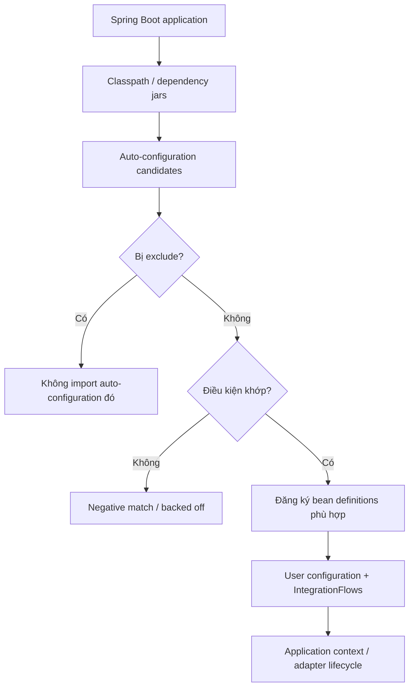
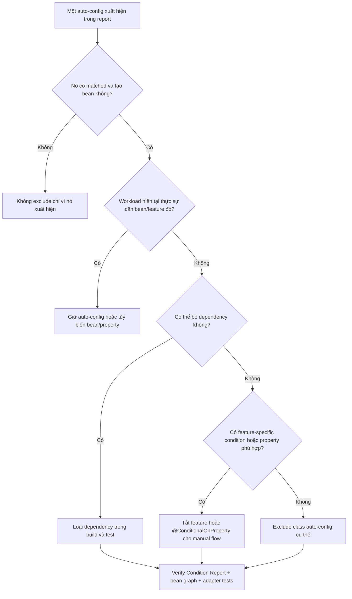
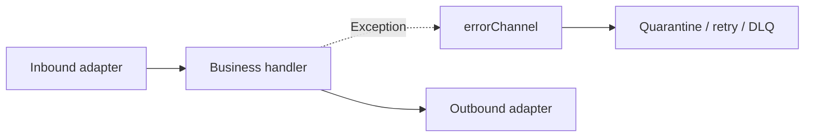

# Exclude auto-configuration không cần thiết trong Spring Boot cho Spring Integration Adapters

> **Chương:** Spring Boot  
> **Module:** `SPRING_INTEGRATION_ADAPTERS`  
> **Bối cảnh học tập:** Kết nối hệ thống ngoài bằng **inbound/outbound adapter, gateway, poller, MessageChannel** và các luồng **file, SFTP, HTTP, JMS, AMQP, Kafka, JDBC/database**; quản lý hợp đồng message, lỗi và vòng đời kết nối.  
> **Mục tiêu:** Xác định **auto-configuration nào thực sự không cần**, loại đúng bằng `exclude`, `excludeName` hoặc `spring.autoconfigure.exclude`; chứng minh tác động bằng điều kiện khởi tạo, Spring beans, integration flows, connectivity, health và integration tests, mà không vô tình làm hỏng các adapter đang hoạt động.

## 1. Bài toán: Starter tiện lợi nhưng không có nghĩa mọi kết nối đều cần bật

Một ứng dụng Spring Boot dùng Spring Integration có thể triển khai các flow khác nhau:

- `fileOrdersFlow` đọc CSV từ một thư mục, validate và chuyển tới HTTP API.
- `inventorySftpFlow` nhận file từ SFTP vào vùng staging, rồi ghi database.
- `jmsPaymentsFlow` tiêu thụ JMS và gửi request tới hệ thống thanh toán.
- `amqpNotificationsFlow` nhận thông báo RabbitMQ và xử lý.
- `kafkaEventsFlow` phát các sự kiện sau khi JDBC commit.
- `httpCommandFlow` nhận yêu cầu từ HTTP inbound gateway.

Một artifact có thể chứa nhiều starters vì lịch sử phát triển, thư viện dùng chung, test dependency hoặc một adapter chỉ được dùng ở một môi trường. Khi startup, Spring Boot **xem classpath, properties và beans** để áp dụng auto-configuration. Có trường hợp thư viện của một transport xuất hiện khiến các beans kết nối, templates, health contributors hoặc hạ tầng liên quan được đăng ký dù flow đó không được chạy trong deployment hiện tại.

Điều này có thể dẫn đến:

1. Startup thất bại vì datasource/credentials chưa được cấu hình.
2. Ứng dụng cố tạo hạ tầng message broker không cần thiết trong profile offline.
3. Health/readiness gây nhiễu vì một phụ thuộc không thuộc workload của instance.
4. Hai cấu hình mặc định và thủ công cạnh tranh bean/qualifier.
5. Thời gian khởi động, số thành phần quản trị và diện tích cấu hình tăng.
6. Người vận hành không biết transport nào thực sự được phép kết nối.
7. Một profile test vô tình khởi tạo listener hoặc poller production.

Tuy nhiên, **thấy một auto-configuration trong Condition Evaluation Report không có nghĩa phải loại nó**. Nếu class được đánh giá nhưng điều kiện không khớp, Spring Boot đã không khởi tạo phần đó. Việc thêm một exclude vô căn cứ có thể làm khó bảo trì hoặc khiến chức năng bị mất ở lần nâng cấp sau.

### 1.1. Tình huống minh họa

Workload `file-only-importer` chỉ đọc file từ local filesystem và gửi request HTTP. Nhưng dependency transitively mang `spring-boot-starter-jdbc`; Boot thử cấu hình datasource và báo thiếu connection configuration. Một hướng xử lý có thể là:

- **Tốt nhất khi làm chủ build:** bỏ dependency JDBC không còn sử dụng.
- **Nếu classpath vẫn buộc phải chứa JDBC nhưng app này không dùng DB:** loại đúng `DataSourceAutoConfiguration` (theo version) và test rằng file/HTTP flow vẫn hoạt động.
- **Nếu một adapter khác vẫn cần JDBC:** không loại datasource toàn cục; chỉnh điều kiện của flow hoặc cấu hình datasource đúng.

Cùng một lỗi startup, cách xử lý tùy **mục đích của artifact** chứ không chỉ thông báo exception.

## 2. Auto-configuration hoạt động như thế nào?

`@SpringBootApplication` bao gồm cơ chế bật auto-configuration. Spring Boot tìm các auto-configuration candidates trong dependency jars, đánh giá conditions rồi đăng ký những cấu hình phù hợp.



Các điều kiện phổ biến:

| Condition | Ý nghĩa | Tác động |
|---|---|---|
| `@ConditionalOnClass` | Chỉ áp dụng khi có class liên quan | Không có client library thì auto-config thường không khớp |
| `@ConditionalOnMissingBean` | Không tạo bean mặc định nếu user đã cung cấp bean tương ứng | Ưu tiên cấu hình thủ công khi thích hợp |
| `@ConditionalOnBean` | Cần bean nền tảng đã tồn tại | Một số config phụ thuộc connector/factory |
| `@ConditionalOnProperty` | Dùng một property để quyết định đăng ký config | Cho phép bật/tắt một phần theo cấu hình nếu class được thiết kế hỗ trợ |
| `@ConditionalOnWebApplication` | Chỉ áp dụng cho loại web application phù hợp | Ảnh hưởng HTTP/web server config |
| `@ConditionalOnResource` | Kiểm tra resource | Phụ thuộc môi trường/packaging |

**Exclude** là cơ chế chặn một **auto-configuration class** trước khi áp dụng nó. Đây là mức can thiệp khác với chỉnh một property của adapter hoặc thêm bean tùy biến để một phần auto-config **back off**.

### 2.1. Thứ tự ưu tiên trong suy nghĩ

Trước khi exclude, hãy hỏi:

1. Auto-configuration đó **thật sự matched** hay chỉ là candidate?
2. Có cách **bỏ dependency không dùng** không?
3. Có property chính thức để **tắt tính năng con** không?
4. Có thể khai báo **bean riêng** để auto-config chỉ back off phần mặc định không?
5. Có thể giữ auto-config chung và **tắt một IntegrationFlow** bằng condition?
6. Chỉ sau đó mới exclude **toàn bộ auto-configuration class** nếu phù hợp.

Không dùng exclude như một cách che mọi exception khi startup.

## 3. Exclude loại cái gì và không loại cái gì?

Một lệnh exclude tác động tới **đường import của auto-configuration được chỉ định**, không phải một công tắc toàn năng.

| Exclude có thể làm | Exclude không tự làm |
|---|---|
| Chặn một auto-config candidate được chỉ định | Xóa dependency jar khỏi classpath |
| Ngăn các bean chỉ được tạo bởi auto-config đó | Xóa `@Bean` do người dùng tự khai báo |
| Ngăn một số cấu hình mặc định theo điều kiện | Vô hiệu hóa mọi `@Configuration` cùng công nghệ |
| Loại một auto-config không phù hợp workload | Dừng một listener đã được cấu hình thủ công |
| Giảm số thành phần của context khi thực sự không dùng | Bảo đảm startup nhanh hơn hay giảm memory theo một mức cố định |
| Làm một vài health/configuration contributions không còn xuất hiện | Xóa mọi health indicator hoặc metric liên quan |
| Đơn giản hóa context theo phạm vi xác minh | Thay thế authentication, firewall, secret rotation |
| Làm ứng dụng không tạo bean mặc định cho transport đó | Đảm bảo không còn kết nối network từ code ngoài Spring Boot |

Ví dụ nếu tự khai báo:

```java
@Bean
IntegrationFlow inventorySftpFlow(...) {
    // Custom SFTP adapter and handler.
    // ...
}
```

thì exclude một auto-configuration khác **không chắc ngăn bean này được scan và tạo**, càng không chắc ngăn endpoint của nó tự start khi context refresh.

### 3.1. Phân biệt ba khái niệm

**Dependency exclusion** (Gradle/Maven) tác động **build/runtime classpath**.

**Auto-configuration exclusion** (`@SpringBootApplication(exclude=...)` hoặc property) tác động **Boot auto-config selection**.

**Flow enable/disable** (`@ConditionalOnProperty`, profile hoặc lifecycle management) tác động **IntegrationFlow, endpoint và adapter do ứng dụng sở hữu**.

Ba thao tác giải quyết ba bài toán khác nhau. Một bài học tốt phải thể hiện ranh giới này trước khi chỉ người đọc sao chép mã.

## 4. Khi nào nên exclude? Cây quyết định



### 4.1. Các dấu hiệu có thể justify exclude

- Một app dùng file/SFTP nhưng **không cần database** và classpath vẫn mang JDBC.
- Một variant ứng dụng không dùng Kafka nhưng thư viện chung mang Kafka auto-config.
- Một CLI/batch importer không cần web server mà Boot đang tạo web context.
- Một transport được provision và cấu hình **hoàn toàn thủ công**, Boot auto-config mặc định gây xung đột không thể giải quyết gọn hơn bằng bean/customizer.
- Một feature đang được tách sang deployment khác và đã có **bằng chứng không còn consumer**.

### 4.2. Các dấu hiệu nên dừng lại và điều tra

- Exclude vì “dependency không healthy” dù flow đó là thành phần quan trọng.
- Exclude `IntegrationAutoConfiguration` để làm hết lỗi của một Kafka consumer.
- Exclude Datasource dù JDBC inbound poller vẫn dùng `JdbcTemplate`.
- Exclude Rabbit auto-config nhưng vẫn có `@RabbitListener` cần connection factory.
- Exclude một class theo bài viết về Boot phiên bản cũ mà không tra class chính xác.
- Exclude luôn cả security/actuator mà không đánh giá ảnh hưởng đến vận hành.

## 5. Preflight: Inventory lớp auto-config và các IntegrationFlow

Trước khi sửa annotation hoặc YAML, lập bản đồ:

| Trường | Cần tìm |
|---|---|
| Boot version | Dùng dòng 3.x hay 4.x, tên package thực tế |
| `artifactId` / variant | Một jar chạy tất cả transport hay nhiều deployment |
| Starter/dependency source | Direct hay transitive, vì sao có trên classpath |
| Auto-config class | Fully qualified class name từ docs/report của version |
| Condition result | Positive/negative match, lý do cụ thể |
| Beans được tạo | ConnectionFactory, KafkaTemplate, DataSource, health contributor, listener factories |
| User-defined beans | `@Bean`, `@Configuration`, `@Import`, custom IntegrationFlows |
| Inbound endpoints | Poller, message-driven adapter, HTTP gateway |
| Outbound endpoints | HTTP, JMS/AMQP/Kafka, JDBC, SFTP |
| External connections | Host alias, credentials source, protocol, owner |
| Lifecycle | `autoStartup`, `SmartLifecycle`, readiness, shutdown |
| Error handling | `errorChannel`, broker retry/DLQ, callback channels |
| Test coverage | Bean graph, flow startup, integration and negative cases |

### 5.1. Ví dụ bảng inventory

| Workload | Cần | Không cần | Hành động ứng viên |
|---|---|---|---|
| `file-only-importer` | File, HTTP outbound, validation | JDBC, JMS, Kafka | Bỏ dependency hoặc exclude riêng sau test |
| `jms-payment-worker` | JMS listener, DB, HTTP | Kafka, Rabbit | Giữ JMS+JDBC; xem Kafka/Rabbit có matched không |
| `kafka-event-publisher` | JDBC outbox, Kafka producer | HTTP inbound server, JMS | Giữ Kafka+JDBC, tắt web nếu chỉ worker |
| `sftp-inventory-loader` | SFTP, local staging, JDBC | Rabbit | Không tắt Integration/JDBC |
| `http-adapter-api` | HTTP inbound, auth, service handlers | File pollers | Tắt manual pollers theo profile/property |

Đây là danh mục minh họa. Không suy rằng Spring Boot có một auto-configuration tên `SftpAutoConfiguration` chỉ vì module sử dụng SFTP.

## 6. Cách 1: `@SpringBootApplication(exclude = ...)`

Khi class auto-configuration tồn tại trên classpath, có thể loại trực tiếp trong main application class.

**Ví dụ dành cho Spring Boot 3.5.x (đúng package dòng 3.x):**

```java
package com.example.fileimport;

import org.springframework.boot.SpringApplication;
import org.springframework.boot.autoconfigure.SpringBootApplication;
import org.springframework.boot.autoconfigure.jdbc.DataSourceAutoConfiguration;

@SpringBootApplication(exclude = DataSourceAutoConfiguration.class)
public class FileOnlyImporterApplication {

    public static void main(String[] args) {
        SpringApplication.run(FileOnlyImporterApplication.class, args);
    }
}
```

Trong ví dụ, ta chủ ý **không dùng datasource**, nhưng một dependency ngoài ý muốn vẫn khiến Boot cân nhắc JDBC auto-config. Exclude ngăn **DataSourceAutoConfiguration được áp dụng** trong context này.

### 6.1. Những điều kiện để ví dụ hợp lý

- Không có inbound/outbound JDBC flow cần DataSource.
- Không có `JdbcTemplate`/repository/transaction manager phụ thuộc datasource auto-config đó.
- Không có auto-config khác hoặc user bean tạo DataSource độc lập.
- Kiểm thử Boot context và tất cả file/HTTP paths.
- Việc xóa dependency không khả thi hoặc đã được đánh giá.

**Không sao chép import dòng 3.x sang Boot 4.x:** nhiều auto-config class đã di chuyển package trong Boot 4, xem Mục 10.

### 6.2. Loại nhiều class

```java
// Spring Boot 3.x: ví dụ cấu hình riêng của một worker không dùng DB/Kafka.
@SpringBootApplication(exclude = {
    org.springframework.boot.autoconfigure.jdbc.DataSourceAutoConfiguration.class,
    org.springframework.boot.autoconfigure.kafka.KafkaAutoConfiguration.class
})
public class TransportLimitedApplication {
    // main method ...
}
```

Đoạn này chỉ minh họa cú pháp, **không phải danh sách loại nên áp dụng chung**. Nếu trong app có KafkaTemplate/IntegrationFlow Kafka hay JDBC, việc exclude có thể làm fail startup hoặc hỏng chức năng mà compile không phát hiện.

### 6.3. Khi nào nên tránh annotation-level exclude?

- Deployment variants của cùng artifact có tính năng khác nhau.
- Muốn dễ đối chiếu thay đổi trong `application-*.yml`.
- Cần thay danh sách theo môi trường mà không đổi source.
- Cần rollout/canary trước khi đưa vào source code chung.

Annotation-level exclusion có tính **toàn cục cho application class**. Profile không dễ “bật lại” một auto-config đã bị hard-code exclude; cân nhắc đặt ở đâu để policy rõ ràng.

## 7. Cách 2: `excludeName` để chỉ định fully qualified class name

Spring Boot hỗ trợ `excludeName` dùng **chuỗi tên đầy đủ** của auto-configuration class:

```java
import org.springframework.boot.autoconfigure.SpringBootApplication;

@SpringBootApplication(excludeName = {
    "org.springframework.boot.autoconfigure.jdbc.DataSourceAutoConfiguration"
})
public class FileOnlyImporterApplication {
    // Ví dụ Spring Boot 3.x, tên class phải phù hợp version.
}
```

Cách này hữu ích khi không muốn import class ở source hoặc class không trực tiếp có trên compile classpath theo tình huống mà Boot hỗ trợ.

### 7.1. Vì sao vẫn phải xác minh class name?

- Spring Boot 3.x và 4.x có thể dùng **package khác nhau**.
- Đổi package nhưng giữ chuỗi cũ có thể không loại class đang được áp dụng.
- Tên nhập sai hoặc không phải auto-config candidate có thể dẫn tới lỗi startup/không có tác dụng theo cơ chế import của phiên bản.
- Chỉ nên exclude **top-level auto-configuration classes** mà tài liệu hỗ trợ, không lấy tên inner config hoặc bean method từ source và coi đó là API ổn định.

**Nguyên tắc:** lấy tên từ docs/API của dependency đang dùng và Condition Evaluation Report, không suy từ tên starter.

### 7.2. `@EnableAutoConfiguration` có cùng khả năng exclude

Khi một ứng dụng không dùng `@SpringBootApplication` mà chủ động khai báo `@EnableAutoConfiguration`, annotation này cũng có `exclude` và `excludeName`. Thông thường chỉ có **một điểm bật auto-configuration chính** trên application, tránh lặp annotation ở nhiều configuration classes gây khó quản lý.

## 8. Cách 3: Property `spring.autoconfigure.exclude`

Đây là cách phù hợp khi cấu hình theo deployment hoặc profile.

**Ví dụ Spring Boot 3.x, một worker file-only:**

```yaml
spring:
  autoconfigure:
    exclude:
      - org.springframework.boot.autoconfigure.jdbc.DataSourceAutoConfiguration
      - org.springframework.boot.autoconfigure.kafka.KafkaAutoConfiguration
```

Cú pháp `spring.autoconfigure.exclude` là danh sách **fully qualified class names**. Khi startup, Boot lấy danh sách cùng các exclude khác, rồi loại candidates liên quan.

### 8.1. Dạng properties

```properties
spring.autoconfigure.exclude=\
org.springframework.boot.autoconfigure.jdbc.DataSourceAutoConfiguration,\
org.springframework.boot.autoconfigure.kafka.KafkaAutoConfiguration
```

Đoạn này thể hiện format property kiểu Java; cách xuống dòng và escape thực tế cần đúng parser và source configuration dùng trong dự án.

### 8.2. Command-line override để thử trong môi trường kiểm soát

```text
java -jar adapters.jar --spring.autoconfigure.exclude=org.springframework.boot.autoconfigure.jdbc.DataSourceAutoConfiguration
```

Tham số trên minh họa startup của Boot 3.x. Không chạy tùy tiện trong production để “thử” khi chưa kiểm tra impact; nên dùng môi trường test/canary và bảo đảm class name đúng.

### 8.3. Khi dùng property và annotation cùng lúc

Tài liệu Boot cho phép **định nghĩa exclusions ở annotation và property**. Đừng suy rằng một profile YAML có thể làm **undo** mọi exclusion đã khai báo trong annotation.

Vì config properties có thể bị override theo precedence giữa các sources, cần kiểm tra **effective value** của `spring.autoconfigure.exclude`, nhất là khi một file profile định nghĩa lại toàn bộ list. Một danh sách trong profile có thể thay danh sách ở nguồn có precedence thấp, thay vì tự động merge theo mong muốn.

## 9. Exclusions theo profile và deployment variant

Giả sử có hai deployment cùng artifact:

- `worker-file`: chỉ File + HTTP.
- `worker-payments`: JMS + HTTP + JDBC.

Một ví dụ tổ chức:

```yaml
# application-file.yml (dòng Boot 3.x: ví dụ)
spring:
  autoconfigure:
    exclude:
      - org.springframework.boot.autoconfigure.jdbc.DataSourceAutoConfiguration
      - org.springframework.boot.autoconfigure.jms.JmsAutoConfiguration
      - org.springframework.boot.autoconfigure.kafka.KafkaAutoConfiguration

app:
  adapters:
    file:
      enabled: true
    payments-jms:
      enabled: false
```

```yaml
# application-payments.yml
app:
  adapters:
    file:
      enabled: false
    payments-jms:
      enabled: true

# Không exclude JMS/JDBC nếu deployment này cần chúng.
```

### 9.1. Vẫn phải tắt manual IntegrationFlows

Một property `app.adapters.file.enabled=false` **không có tác dụng** nếu ứng dụng không dùng nó trong condition để quyết định đăng ký `fileOrdersFlow`. Boot không tự hiểu property nghiệp vụ do ta tự đặt.

### 9.2. Profile là lựa chọn deployment, không phải cơ chế pause runtime

`@Profile` hoặc `@ConditionalOnProperty` thường được đánh giá khi Spring context được tạo. Đổi biến môi trường khi ứng dụng đang chạy không tự hủy bean/consumer. Nếu cần pause/resume động, dùng lifecycle management phù hợp với Spring Integration, broker consumer và vận hành, không coi profile là công tắc runtime.

### 9.3. Tránh cấu hình làm hệ thống “vô tình hoạt động” trong test

Một profile test có thể dùng fake HTTP server, local file directory và in-memory source thay vì tạo connection tới Kafka/JMS production. Điều này cần vừa **disable manual flow** vừa kiểm soát auto-config và credentials; exclude không thay thế test isolation.

## 10. Khác biệt Spring Boot 3.x và 4.x: Không sao chép import cũ

**Đây là cảnh báo quan trọng đối với code example trong một khóa học dài hạn.** Spring Boot 4 modular hóa và thay đổi package của một số auto-config classes. Tên package chính xác phải được đối chiếu với dependency đang chạy.

| Auto-config | Ví dụ package Boot 3.5.x | Ví dụ package Boot 4.x đã có trong API |
|---|---|---|
| Spring Integration | `org.springframework.boot.autoconfigure.integration.IntegrationAutoConfiguration` | `org.springframework.boot.integration.autoconfigure.IntegrationAutoConfiguration` |
| JDBC DataSource | `org.springframework.boot.autoconfigure.jdbc.DataSourceAutoConfiguration` | `org.springframework.boot.jdbc.autoconfigure.DataSourceAutoConfiguration` |
| Kafka | `org.springframework.boot.autoconfigure.kafka.KafkaAutoConfiguration` | `org.springframework.boot.kafka.autoconfigure.KafkaAutoConfiguration` |
| JMS | `org.springframework.boot.autoconfigure.jms.JmsAutoConfiguration` | `org.springframework.boot.jms.autoconfigure.JmsAutoConfiguration` |
| RabbitMQ | `org.springframework.boot.autoconfigure.amqp.RabbitAutoConfiguration` | Package có thể thay đổi theo dòng Boot 4 và module; tra API đúng bản, không tự suy |
 
Không nên làm tài liệu quy định rằng một tên Boot 3.x luôn đúng cho Boot 4.x. Đối với các auto-config khác, cách kiểm tra cũng giống nhau: **lấy class name từ API/conditions report của version**.

### 10.1. Ví dụ tương đương về DataSource ở Boot 4.x

```java
import org.springframework.boot.autoconfigure.SpringBootApplication;
import org.springframework.boot.jdbc.autoconfigure.DataSourceAutoConfiguration;

@SpringBootApplication(exclude = DataSourceAutoConfiguration.class)
public class FileOnlyImporterApplication {
}
```

Mục đích của ví dụ chỉ là minh họa **package khác nhau**, không khẳng định mọi dependency và starter trong Boot 4 đều được đặt giống Boot 3.

### 10.2. Khi nâng cấp major version

1. Xem release notes và dependency BOM.
2. Liệt kê auto-configuration candidates thực tế.
3. Thay FQCN ở `excludeName`/`spring.autoconfigure.exclude` và import.
4. Kiểm tra lớp bị exclude **đúng là class candidate**.
5. Chạy startup/conditions tests.
6. Kiểm tra bean graph, inbound/outbound adapters và lỗi.
7. Xác minh shutdown/health/observability, không chỉ compile.

## 11. Tuyệt đối thận trọng với `IntegrationAutoConfiguration`

Trong module này, Spring Integration là **hạ tầng trung tâm**, không phải một tính năng ngoài lề. Auto-config của Boot cho Integration có thể hỗ trợ bật cấu hình nền, scanning và các thành phần quản trị/management tùy phiên bản.

```text
Spring Boot
  +-- IntegrationAutoConfiguration
        +-- Integration infrastructure/management (tùy conditions)
             |
             +-- MessageChannels
             +-- Pollers / Inbound endpoints
             +-- Gateways / Service activators
             +-- Error handling
```

Không kết luận tất cả các bean đó đều do một auto-config trực tiếp tạo; các `IntegrationFlow` và `@Bean` thủ công có thể tạo nhiều thành phần riêng. Sơ đồ nhấn mạnh **phụ thuộc vận hành**.

### 11.1. Ví dụ anti-pattern

```java
// Không nên dùng chỉ để "sửa" lỗi Kafka hoặc SFTP:
@SpringBootApplication(
    excludeName =
        "org.springframework.boot.autoconfigure.integration.IntegrationAutoConfiguration")
class AdapterApplication {
}
```

Đoạn trên minh họa **sai lầm có thể gặp với Boot 3.x**. Việc exclude IntegrationAutoConfiguration có thể làm thiếu cấu hình hạ tầng kỳ vọng. Nếu mục tiêu là tắt Kafka hoặc SFTP, hãy **điều chỉnh đúng transport hoặc flow**.

### 11.2. Khi nào có thể chủ động loại Integration auto-config?

Chỉ khi ứng dụng có thiết kế khác thay thế đầy đủ nền Spring Integration hoặc thực sự **không dùng Spring Integration trong variant đó**, và có test bao phủ:

- Đăng ký `@MessagingGateway` và service activators.
- `MessageChannel`, endpoints, pollers, task scheduler.
- `errorChannel` và error handling.
- Lifecycle/startup/shutdown.
- Integration management/graph khi cần.
- Các adapter file/SFTP/HTTP/JMS/AMQP/Kafka/JDBC thực tế.

Nếu không có kế hoạch kiểm thử như vậy, đừng dùng exclude toàn bộ Integration như một “mẹo tối ưu startup”.

## 12. Bảng lựa chọn theo transport: Tắt đúng thứ đang không dùng

| Adapter/transport | Hạ tầng có thể liên quan | Tắt gì trước khi nghĩ tới exclude? | Rủi ro nếu loại sai |
|---|---|---|---|
| File inbound/outbound | `spring-integration-file`, poller, file filter | `@ConditionalOnProperty` của file flow, lịch poll | File không được xử lý hoặc duplicate khi bật lại |
| SFTP inbound/outbound | `spring-integration-sftp`, session factory, credentials | Manual SFTP flow và session lifecycle | Không kết nối/không đóng session đúng, metadata sai |
| HTTP inbound | Web server, HTTP Integration endpoint, security | Có thực sự cần web context không? | API không còn lắng nghe hoặc health endpoint mất |
| HTTP outbound | HTTP client và flow handler | Manual outbound flow/bean client | Không gửi request, timeout/fallback sai |
| JMS | JMS auto-config, connection factory và listener | Listener/adapter có cần ở variant không? | Broker consumer không start, ack/transaction thay đổi |
| AMQP/RabbitMQ | Rabbit auto-config, connection factory, listener container | Rabbit flow/consumer, topology | Queue không consume, DLQ/retry mất |
| Kafka | Kafka auto-config, producer/consumer, listener | Kafka IntegrationFlows và factories | Producer không publish, offset/retry/DLT sai |
| JDBC | DataSource, JdbcTemplate, transaction manager | JDBC flow hoặc dependency, datasource cần không? | Poller query fail, outbox/transactions mất |
| Integration core | Integration infrastructure | Chỉ cân nhắc khi cả variant không dùng SI | Gateway, poller, error channel/lifecycle thiếu |

Điểm quan trọng: Spring Boot **không nhất thiết có một auto-config ứng với mỗi Spring Integration adapter**. Nhiều endpoint, session factories, pollers được tạo **bằng code của ứng dụng**, không chỉ từ Boot auto-configuration.

## 13. JDBC: Vì sao `DataSourceAutoConfiguration` thường bị exclude nhầm?

Trong một importer chỉ dùng file và HTTP, DataSource có thể không cần. Nhưng nhiều IntegrationFlow khác sử dụng:

- `JdbcTemplate` và JDBC outbound adapter.
- JDBC inbound channel adapter lấy các row theo lịch.
- Persistent `MetadataStore` hoặc `MessageStore` dựa trên database.
- Transaction manager để phối hợp business update.
- Outbox/inbox deduplication và replay state.
- Quarantine store dựa trên SQL.

### 13.1. Khi không có JDBC consumer

Ứng dụng chỉ dùng file → HTTP, không có `DataSource` tự khai báo và không cần DB. Có thể:

- Bỏ `spring-boot-starter-jdbc` khỏi build nếu không cần.
- Hoặc exclude `DataSourceAutoConfiguration` trong variant cụ thể.
- Xác nhận không có bean phụ thuộc `JdbcTemplate`/`DataSource`.
- Test file ingestion, HTTP sender và error channel chạy bình thường.

### 13.2. Khi vẫn dùng database

Nếu có `JdbcChannelMessageStore`, JDBC poller hoặc business/outbox records, loại DataSource có thể khiến lỗi không chỉ lúc startup mà **khi chạy tác vụ**. Cần giữ auto-config hoặc khai báo DataSource đúng; lỗi connection refused nên xử lý config/network/secret, không “cứ exclude cho app xanh”.

### 13.3. Không nhầm với JPA hoặc Spring Data

`DataSourceAutoConfiguration` là một lớp liên quan DataSource; các cấu hình JDBC repositories, transaction, JPA, migration có điều kiện riêng. Loại một auto-config **không cam kết** toàn bộ persistence layer biến mất. Kiểm tra report và bean graph.

## 14. Kafka: Chỉ loại khi thực sự không còn producer/consumer

Một Kafka IntegrationFlow có thể dùng:

- `KafkaTemplate`, `ProducerFactory`, `ConsumerFactory`.
- Kafka inbound adapter hoặc message-driven channel adapter.
- Kafka outbound adapter, producer confirmation/failure callback.
- Topic/partition/offset, transaction/ack và DLT.
- Outbox publisher đọc database rồi phát Kafka.

### 14.1. Workload không cần Kafka

Nếu dependency Kafka xuất hiện nhưng app không còn bất kỳ producer/consumer hoặc quản trị Kafka nào, có thể cân nhắc bỏ dependency hoặc exclude đúng `KafkaAutoConfiguration`.

### 14.2. Workload có Kafka

Không exclude chỉ vì broker tạm không kết nối được. Phải kiểm tra:

- Bootstrap servers, DNS/TLS/authentication.
- Producer/consumer factories, serializers.
- Consumer group, offset commit, retries/DLT.
- Manual `KafkaTemplate` và IntegrationFlows.
- Outbox và error/failure channels.
- Startup readiness và policy xử lý khi broker down.

### 14.3. Một error khó phát hiện

Auto-config bị loại nhưng có `KafkaTemplate` thủ công nên app vẫn start. Tuy nhiên một listener factory khác mất, hoặc metrics/health của producer không còn như dự kiến. Vì vậy đừng chỉ assert “context loads”; phải **gửi/nhận một record test** và kiểm tra confirmation/offset tùy flow.

## 15. JMS: Không loại chỉ vì muốn tránh kết nối broker ở test

JMS auto-config có thể đăng ký templates, listener infrastructure hoặc connection-related beans theo classpath/conditions. Nhưng actual behavior còn phụ thuộc JMS provider, connection factory và Spring Integration JMS adapters.

### 15.1. Trong production JMS worker

Cần giữ và kiểm tra:
 
- `ConnectionFactory`, template/adapter.
- Listener/consumer lifecycle.
- Credentials/TLS.
- Transaction/acknowledgement.
- Broker redelivery/DLQ.
- Error channel/callback và idempotency.
- Shutdown/cancel listener.

Loại `JmsAutoConfiguration` có thể khiến những beans mặc định bị thiếu mà flow cần. Nếu muốn ngừng **một consumer** vì triển khai phased rollout, tắt **consumer/flow** ở ứng dụng thay vì loại mọi JMS infrastructure.

### 15.2. Test không có broker

Hướng phù hợp có thể là:

- Dùng container test hoặc broker giả phù hợp.
- Tạo profile/test configuration không đăng ký manual JMS flow.
- Mock một boundary ở unit test.
- Exclude transport auto-config **chỉ khi test thật sự không dùng JMS**, đồng thời không che regression của production path.

## 16. AMQP/RabbitMQ: Connection factory, listener và DLQ

RabbitMQ auto-config được áp dụng khi thư viện liên quan hiện diện và các conditions khớp. Ở Boot 3.5, ví dụ class là `org.springframework.boot.autoconfigure.amqp.RabbitAutoConfiguration`; package Boot 4 phải đối chiếu theo version.

### 16.1. Phần nào có thể bị ảnh hưởng?

- `RabbitTemplate` và connection factory.
- Listener container factories và consumers.
- Auto-declaration/`AmqpAdmin` trong trường hợp tương ứng.
- Health/metrics contributions liên quan.
- Spring Integration AMQP endpoints phụ thuộc những beans này.

Nếu đã tạo `RabbitTemplate` hoặc `ConnectionFactory` riêng, một số auto-config có thể **back off**; exclude toàn bộ không phải luôn cần.

### 16.2. Đừng “tắt Rabbit” bằng cách phá retry/DLQ

Một workflow có AMQP consumer với ack/requeue và dead-letter exchange. Nếu loại config khiến listener không tạo nhưng app vẫn chạy, có thể xuất hiện **backlog âm thầm** ở queue. Kiểm tra consumer registration, publish confirmation và DLQ behavior ở test phù hợp.

## 17. HTTP: Tắt web server khác với tắt HTTP outbound

Một ứng dụng chỉ dùng HTTP **outbound gateway** để gọi API khác không nhất thiết cần mở HTTP **inbound server**.

### 17.1. Non-web worker

Có thể cấu hình:

```yaml
spring:
  main:
    web-application-type: none
```

Property này chọn loại application context **không phải web server**. Nó không phải `spring.autoconfigure.exclude`; đôi khi giải quyết đúng mục tiêu hơn việc loại hàng loạt web auto-config classes.

### 17.2. Nhưng đừng dùng khi có HTTP inbound gateway

Nếu ứng dụng dùng HTTP inbound adapter/gateway để nhận request, `web-application-type: none` có thể làm không có web server để phục vụ endpoint. Khi ấy cần giữ web infrastructure và chỉ điều chỉnh những auto-config/endpoint thực sự không dùng.

### 17.3. HTTP outbound vẫn có dependencies riêng

HTTP outbound flow có thể dùng `RestClient`, `WebClient` hoặc các client factories tùy phiên bản/lựa chọn. Không suy rằng tắt web server đồng nghĩa xóa mọi HTTP client hoặc cấm outbound network. Những beans outbound có thể được cấu hình thủ công hoặc auto-config theo classpath.

## 18. File và SFTP: Nhiều khi không có gì ở Boot để exclude

Điểm đặc trưng của module Spring Integration Adapters là **không phải mọi adapter đều có một Boot auto-configuration class riêng mà ta nên loại**.

Một file/SFTP flow thường được tạo như:

```java
@Configuration(proxyBeanMethods = false)
class InventoryFileFlows {

    @Bean
    IntegrationFlow inventoryImportFlow(...) {
        // Files.inboundAdapter(...) hoặc SFTP DSL,
        // poller, filter, transformer, handler...
        return /* IntegrationFlow đã cấu hình */;
    }
}
```

Đoạn trên là **sơ đồ chữ ký** (cố ý không biên dịch), chỉ nhấn mạnh ownership của application. Trong các mục sau sẽ có code compile-oriented để điều kiện hóa flow mà không exclude Integration core.

### 18.1. Vì sao exclude không ngăn một poller chạy?

`@Bean IntegrationFlow` được user configuration khai báo có thể vẫn đăng ký khi context start. Nếu muốn tắt poller:

- Dùng `@ConditionalOnProperty` cho configuration/bean cụ thể.
- Hoặc `@Profile` cho một nhóm flow.
- Hoặc cấu hình `autoStartup` phù hợp nếu cần đăng ký nhưng chưa chạy.
- Với runtime, quản lý lifecycle/endpoint theo chính sách.

Exclusion của `JmsAutoConfiguration` không có liên hệ trực tiếp với một `Files.inboundAdapter(...)` tự khai báo; và ngược lại, exclude Integration core có thể gây hại rộng hơn cần thiết.

### 18.2. Đảm bảo không tạo kết nối khi flag off

Khi `@ConditionalOnProperty` không khớp, Spring không nên tạo `SftpRemoteFileTemplate`/session factory của feature ấy nếu chúng chỉ thuộc configuration có condition. Nếu beans được định nghĩa ở class không có condition, chúng vẫn có thể khởi tạo và mở tài nguyên.

Test phải kiểm tra **không có bean** hoặc không có connection attempts, không chỉ “không có log đọc file”.

## 19. Điều kiện hóa manual IntegrationFlow bằng `@ConditionalOnProperty`

Ví dụ tách riêng một flow có thể bật/tắt khi startup, không phải toàn bộ Integration infrastructure.

```java
import org.springframework.boot.autoconfigure.condition.ConditionalOnProperty;
import org.springframework.context.annotation.Bean;
import org.springframework.context.annotation.Configuration;
import org.springframework.integration.dsl.IntegrationFlow;

@Configuration(proxyBeanMethods = false)
@ConditionalOnProperty(
    prefix = "app.adapters.orders",
    name = "enabled",
    havingValue = "true",
    matchIfMissing = false)
class OrdersAdapterConfiguration {

    @Bean
    IntegrationFlow ordersFlow(OrderProcessor processor) {
        return IntegrationFlow
            .from("ordersInputChannel")
            .handle(String.class, (payload, headers) -> {
                processor.process(payload);
                return null; // Không có business reply từ handler này.
            })
            .get();
    }
}

interface OrderProcessor {
    void process(String payload);
}
```

Trong cấu hình trên, `ordersFlow` chỉ đăng ký khi property phù hợp. `ordersInputChannel` ở đây là một channel name do Integration DSL có thể tạo/resolve theo configuration; ứng dụng thực cần đảm bảo đúng nguồn gửi và graph.

### 19.1. Property cho deployment

```yaml
app:
  adapters:
    orders:
      enabled: false
```

`matchIfMissing=false` khiến feature **tắt mặc định** khi thiếu property. Với connector có side effect/credential, cách này phù hợp để tránh việc vô tình khởi động ở môi trường mới.

### 19.2. Nhưng đừng ẩn lỗi cấu hình quan trọng

Nếu một workload **bắt buộc** phải xử lý orders, flag false có thể giúp context xanh nhưng nghiệp vụ không chạy. Cần check startup invariants: “profile payments phải có JMS consumer”, “profile file-import phải có file poller”... Một cờ tắt tiện lợi không thay thế **readiness/contract**.

## 20. `@Profile`, bean conditions và manual adapters

Có nhiều cách kiểm soát IntegrationFlow do ứng dụng tự khai báo, khác với loại toàn bộ auto-configuration:

| Cách | Trường hợp phù hợp | Giới hạn |
|---|---|---|
| `@Profile("sftp-import")` | Tách deployment role | Không tự thay đổi runtime khi đổi biến môi trường |
| `@ConditionalOnProperty` | Feature có flag bật/tắt tại startup | Phải áp dụng cho đúng configuration/bean |
| `@ConditionalOnBean` | Flow chỉ cần tồn tại khi hạ tầng đã được tạo | Không chứng minh connection thực sự healthy |
| `@ConditionalOnClass` | Chỉ đăng ký khi có client library | Không tự cung cấp credential |
| `@ConditionalOnMissingBean` | Cho phép custom bean thay default | Chỉ ảnh hưởng phạm vi condition |
| Endpoint `autoStartup=false` | Bean được đăng ký nhưng tạm chưa chạy | Cần start/stop có kiểm soát |

```java
@Configuration(proxyBeanMethods = false)
@Profile("sftp-import")
class SftpImportConfiguration {
    // Beans cho session factory, poller, filter và SFTP flow.
}
```

Nếu profile không active, configuration này không tạo bean; nhưng một flow SFTP khai báo ở class khác **vẫn có thể được tạo**. Vì vậy hãy kiểm tra toàn bộ application context.

### 20.1. Không để service xanh nhưng không làm việc

Một JMS worker bắt buộc phải consume payments. Nếu cấu hình flag sai làm thiếu listener, context vẫn có thể start. Cần một capability invariant/readiness test xác nhận **đúng listener, handler, error flow** hiện diện theo deployment role.

## 21. Build dependency exclusion khác auto-configuration exclusion

| Mục tiêu | Giải pháp | Xác minh |
|---|---|---|
| Thư viện hoàn toàn không dùng | Bỏ dependency khỏi Gradle/Maven | Dependency tree và tests |
| Vẫn cần jar, không cần Boot default beans | `spring.autoconfigure.exclude` hoặc annotation | Conditions report, beans |
| Integration framework cần nhưng flow không dùng | `@ConditionalOnProperty` hoặc profile | Flow/endpoint absence |
| Worker chỉ có HTTP outbound | `web-application-type=none` khi hợp lệ | HTTP inbound/management không bắt buộc |
| Muốn thay default connection factory | User `@Bean` hoặc customizer được hỗ trợ | Back-off và behavior |
| Muốn tạm dừng consumer runtime | Integration endpoint lifecycle | Drain/ack/shutdown test |

Ví dụ Gradle mô tả dependency tối thiểu:

```gradle
dependencies {
    implementation("org.springframework.boot:spring-boot-starter-integration")
    implementation("org.springframework.integration:spring-integration-file")

    // Chỉ thêm khi JDBC thật sự được sử dụng:
    // implementation("org.springframework.boot:spring-boot-starter-jdbc")
}
```

Tên starter có thể được tổ chức lại theo Boot major version; ví dụ cần đối chiếu với BOM và artifact thực tế.

**Không xóa một transitive library mà adapter cần chỉ để làm mất một auto-config.** Khi có thể loại dependency không dùng, đây thường là lựa chọn đơn giản hơn việc giữ jar và thêm exclude.

## 22. Dùng `--debug` và Condition Evaluation Report

Có thể chạy ứng dụng thử trong môi trường kiểm soát:

```text
java -jar adapters.jar --debug
```

Spring Boot ghi thông tin **điều kiện auto-configuration** để giải thích vì sao một phần matched hoặc không matched.

| Nhóm thông tin | Ý nghĩa |
|---|---|
| Positive matches | Các điều kiện đã được thỏa |
| Negative matches | Điều kiện không thỏa; phần tương ứng thường không được áp dụng |
| Exclusions | Danh sách auto-config bị loại |
| Unconditional classes | Những classes được Boot liệt kê theo loại cấu hình |

### 22.1. Checklist đọc báo cáo

1. `DataSourceAutoConfiguration` có matched không, hay đã back off do custom DataSource?
2. `KafkaAutoConfiguration` có tạo producer/consumer-related beans không?
3. `IntegrationAutoConfiguration` và hạ tầng core có còn được áp dụng không?
4. Exclusions list có class đúng FQCN của Boot line không?
5. Có manual `@Bean` nằm ngoài phạm vi báo cáo vẫn tạo connection không?
6. Những bean bị thiếu là bắt buộc hay ngoài phạm vi của deployment?
7. Adapter/poller có thể mở network connection ở thời điểm khác sau startup không?

Một positive match **không mặc nhiên chứng minh có kết nối mạng đang mở**. Việc kết nối có thể xảy ra khi producer, consumer hoặc endpoint start.

### 22.2. Khi ứng dụng startup fail

Debug report có thể xuất hiện trong startup logs. Cần hạn chế chia sẻ logs ra nơi công khai, vì URL, host, account metadata và exception cause có thể tiết lộ thông tin nội bộ.

## 23. Actuator: `conditions`, `beans` và `integrationgraph`

Khi có Spring Boot Actuator và quyền/exposure phù hợp:

- `/actuator/conditions` giải thích condition matches và reasons.
- `/actuator/beans` cho biết Spring beans được đăng ký.
- `/actuator/integrationgraph` mô tả Spring Integration channels và endpoints khi đủ dependency/configuration.
- `/actuator/health` thể hiện health theo contributors hiện có và policy.
- `/actuator/configprops` cung cấp thông tin properties đã bind với cơ chế bảo vệ dữ liệu.

**Không bật công khai tất cả Actuator endpoints chỉ để debug exclude.** Bean graph và condition report có thể lộ topology, class names, connection details. Hãy dùng mạng nội bộ, authentication, authorization và audit.

### 23.1. So sánh trước/sau

Một exclusion được coi là kiểm chứng tốt khi:

1. Class được xác nhận trong exclusions.
2. Bean từ auto-config đó không còn nếu không có replacement.
3. Manual beans cần thiết vẫn tồn tại.
4. IntegrationFlow bắt buộc còn trong graph.
5. Adapter cần thiết xử lý message thật thành công.
6. Error handler và recovery store tiếp tục hoạt động.
7. Health/readiness thể hiện đúng phụ thuộc bắt buộc.

## 24. Worker không cần HTTP inbound: Cân nhắc `web-application-type`

Một Kafka/JMS/SFTP worker không dùng embedded web server có thể cấu hình:

```yaml
spring:
  main:
    web-application-type: none
```

Đây là lựa chọn **loại application context**, không phải danh sách auto-config exclusion. Nó không tự xóa HTTP outbound client hoặc ngăn app gửi HTTP request.

**Cảnh báo:** Nếu deployment dùng HTTP inbound gateway hoặc HTTP Actuator readiness, cấu hình này có thể làm mất endpoint cần thiết. Không sao chép property từ batch worker sang API service mà thiếu integration test.

## 25. Test context: Excluded beans vắng mặt, beans cần vẫn tồn tại

Ví dụ Boot 3.5.x tại Mục 6 đã exclude `DataSourceAutoConfiguration` và không tự khai báo DataSource. Có thể test:

```java
import static org.assertj.core.api.Assertions.assertThat;

import javax.sql.DataSource;

import org.junit.jupiter.api.Test;
import org.springframework.beans.factory.annotation.Autowired;
import org.springframework.boot.test.context.SpringBootTest;
import org.springframework.context.ApplicationContext;

@SpringBootTest(classes = FileOnlyImporterApplication.class)
class FileOnlyImporterTest {

    @Autowired
    ApplicationContext context;

    @Test
    void doesNotHaveUnneededDataSource() {
        assertThat(context.getBeansOfType(DataSource.class)).isEmpty();
    }
}
```

**Phạm vi assertion:** nếu ứng dụng có custom DataSource, test trên sẽ fail dù exclude đã thành công. Khi đó hãy kiểm tra chính **nguồn tạo bean**, không kết luận exclusion bị bỏ qua.

### 25.1. Thử năng lực bắt buộc

Không dừng ở `contextLoads`. Test phải xác nhận file/SFTP poller, HTTP/JMS/AMQP/Kafka/JDBC flow theo role có hoạt động và gửi/nhận message đúng.

## 26. `ApplicationContextRunner` cho điều kiện bật/tắt feature

`ApplicationContextRunner` phù hợp để kiểm tra registration của manual configuration khi property thay đổi:

```java
import static org.assertj.core.api.Assertions.assertThat;

import org.junit.jupiter.api.Test;
import org.springframework.boot.autoconfigure.condition.ConditionalOnProperty;
import org.springframework.boot.test.context.runner.ApplicationContextRunner;
import org.springframework.context.annotation.Bean;
import org.springframework.context.annotation.Configuration;

class OptionalOrdersFeatureTest {

    private final ApplicationContextRunner runner =
        new ApplicationContextRunner()
            .withUserConfiguration(OrdersFeatureConfiguration.class);

    @Test
    void absentPropertyDisablesFeature() {
        runner.run(ctx ->
            assertThat(ctx).doesNotHaveBean("ordersFeatureMarker"));
    }

    @Test
    void truePropertyEnablesFeature() {
        runner.withPropertyValues("app.adapters.orders.enabled=true")
            .run(ctx -> assertThat(ctx).hasBean("ordersFeatureMarker"));
    }

    @Configuration(proxyBeanMethods = false)
    @ConditionalOnProperty(
        prefix = "app.adapters.orders",
        name = "enabled",
        havingValue = "true")
    static class OrdersFeatureConfiguration {

        @Bean
        String ordersFeatureMarker() {
            return "enabled";
        }
    }
}
```

Đây là test **feature-specific condition**, không phải test đầy đủ Spring Boot exclusions. Runner cũng hỗ trợ auto-config tests, `AutoConfigurations.of(...)`, `FilteredClassLoader` và web context runners theo tài liệu.

### 26.1. Không nhầm runner với hệ thống production

Runner tạo một context thử nghiệm; nó không chứng minh connection tới Kafka, JMS, AMQP, SFTP hoặc JDBC hoạt động, không xác nhận broker ack/offset và không thay integration tests.

## 27. Ma trận integration tests theo transport

| Deployment | Phải có | Phải không có | Test |
|---|---|---|---|
| File-only | File poller, HTTP outbound, quarantine | JDBC/Kafka/JMS ngoài scope | File → HTTP mock → archive |
| SFTP import | SFTP session/poller, JDBC | Rabbit listener ngoài scope | SFTP server test → DB |
| JMS payments | JMS listener, transaction/error policy | SFTP poller ngoài scope | Broker redelivery/DLQ |
| AMQP worker | Rabbit connection/listener | Kafka consumer ngoài scope | Ack/requeue/DLQ |
| Kafka outbox | JDBC outbox, Kafka producer | HTTP inbound nếu không cần | Publish confirmation/failure |
| HTTP API | HTTP gateway, auth, response mapping | File poller ngoài scope | 2xx/4xx/5xx response |
| JDBC polling | DataSource, poller, lease/transaction | JMS listener ngoài scope | Claim row → update state |

Bao gồm **happy path**, failure path, cold startup, shutdown, retries, idempotency và privacy/security logs. Chỉ test bean presence không xác nhận được business correctness.

## 28. Exclude nhầm có thể làm mất error recovery



Ví dụ:

- Exclude DataSource có thể làm mất SQL-backed `MetadataStore` hoặc quarantine records.
- Exclude Kafka có thể làm mất producer factory cho DLT/outbox.
- Exclude JMS có thể làm thiếu listener/container.
- Exclude Rabbit config có thể ảnh hưởng connection và topology.
- Exclude Integration core có thể làm hỏng poller, gateway hoặc error infrastructure.
- Tắt web context có thể mất HTTP error reply endpoint.

Tác động chính xác phụ thuộc **bean graph và user-defined configuration**; không suy từ tên exclusion. Luôn fault-inject lỗi và xác minh **message được bảo toàn** khi quarantine writer thất bại.

## 29. Đo kết quả thay đổi trước/sau

| Chỉ số | Cần giải thích |
|---|---|
| Startup duration | Có thực sự nhanh hơn? |
| Bean/endpoint counts | Loại đúng thành phần không cần? |
| Thread/connection counts | Có bớt resource sử dụng? |
| Heap/CPU | Có cải thiện dưới workload thực tế? |
| Flow throughput/latency | Có regression? |
| Error path và DLQ backlog | Có lỗi mới hoặc mất message? |
| Readiness/shutdown | Rolling deployment có an toàn? |
| Integration graph | Flow nào biến mất? |
| Conditions report | Exclusion có hiệu lực đúng version? |

Không hứa hẹn tỷ lệ cải thiện cố định; một auto-config vốn không matched có thể gần như không tốn runtime resources.

## 30. Khi nâng Spring Boot major line

Spring Boot 4.x đã thay package của một số auto-config classes so với 3.x. Ví dụ `IntegrationAutoConfiguration` và `DataSourceAutoConfiguration`; không copy FQCN cũ khi đổi version.

Quy trình:

1. Kiểm tra BOM/dependency versions.
2. Lấy tên auto-config candidate từ API/conditions của version đó.
3. Cập nhật import, `excludeName` và `spring.autoconfigure.exclude`.
4. Không liệt kê cả tên 3.x và 4.x một cách tùy tiện nếu một tên không phải candidate hợp lệ.
5. Chạy context tests, beans, IntegrationFlow graph.
6. Kiểm tra JMS/AMQP/Kafka transactions, offsets, retries, file/SFTP pollers.
7. Xác nhận monitoring, readiness và rollback.

Với custom starter, `@AutoConfiguration` và `AutoConfiguration.imports` là cơ chế công bố auto-config; không nhập trực tiếp inner configuration/bean methods không được xem là API bền vững.

## 31. Startup validation: Chống service “xanh giả”

Một application có thể start dù thiếu consumer bắt buộc do exclude và property flag.

```yaml
# Capability contract minh họa, không phải Spring Boot tự thực thi.
deploymentRole: kafka-outbox-publisher
required:
  - kafkaPublisherFlow
  - kafkaProducerFactory
  - outboxDataSource
  - outboxRetryHandler
forbidden:
  - sftpInboundPoller
  - billingRabbitListener
```

Application hoặc deployment test phải xác minh capability contract. Nếu role yêu cầu Kafka nhưng publisher không tồn tại, readiness nên báo lỗi thay vì trả healthy chỉ vì không có exception startup.

## 32. Runbook: Startup lỗi khi thêm JDBC dependency

1. Xác định Boot version và dependency vừa thêm.
2. Đọc root cause và condition report.
3. Tìm JDBC adapter, metadata store, transaction manager, quarantine writer.
4. Nếu JDBC không dùng, ưu tiên bỏ dependency.
5. Nếu cần giữ jar nhưng không dùng DB, exclude đúng `DataSourceAutoConfiguration`.
6. Nếu DB cần cho flow, sửa datasource/credential thay vì exclude.
7. Test context, file/HTTP flow và error handling.
8. So sánh bean graph trước/sau và readiness.
9. Có owner, canary metrics, rollback plan.

Đừng coi app start thành công là đủ nếu error handling từng dùng database nay không còn kho lưu bền vững.

## 33. Runbook: Exclude Kafka nhưng manual producer vẫn chạy

`KafkaAutoConfiguration` đã bị exclude, nhưng app có `@Bean KafkaTemplate` và `IntegrationFlow kafkaEventsFlow` thủ công.

- Exclusion không xóa các beans này.
- Producer có thể vẫn kết nối broker khi flow chạy.
- Health/listener factories khác có thể bị tác động.
- Context pass không chứng minh Kafka feature đã tắt.

Hãy condition hóa **Kafka-specific user configuration**, xác nhận no flow/no connection và kiểm tra các flow khác vẫn bình thường. Nếu không còn dùng Kafka, cân nhắc bỏ dependency và code theo kế hoạch.

## 34. Runbook: HTTP API bị tắt web context

Một API variant vô tình nhận `spring.main.web-application-type=none` từ batch profile. HTTP inbound gateway không còn phục vụ request.

1. Xác định role ứng dụng có inbound HTTP không.
2. Kiểm tra web server và HTTP Integration endpoint beans.
3. Kiểm tra management/health endpoints.
4. Sửa profile hoặc chia deployment configurations.
5. Test HTTP 2xx/4xx/5xx và security.
6. Đừng tắt cả web stack chỉ vì có HTTP outbound.

## 35. Rollout và rollback có kiểm soát

Trước rollout, ghi rõ FQCN và lý do exclude, classpath, bean graph, source/target flows và test cases. Dùng canary để theo dõi:

- Message backlog, consumer lag, file polling rate.
- Retry/DLQ/quarantine và lỗi recovery.
- Broker connections ngoài phạm vi.
- Readiness và graceful shutdown.
- Kafka producer callbacks, JMS/AMQP redelivery, HTTP failure rates.

Khi rollback, khôi phục source annotation/property/dependency hoặc feature flag theo đúng cơ chế đã thay. Kiểm tra không vô tình tạo **hai consumers cùng nguồn** hoặc replay message đã xử lý khi metadata store/offset thay đổi.

## 36. Anti-pattern thường gặp

**“Có starter thì chắc có connection.”** Chưa chắc; phải xét conditions và lifecycle.

**“Startup lỗi cứ exclude.”** Có thể che một hạ tầng bắt buộc.

**“Exclude nghĩa là xóa jar.”** Không, classpath vẫn còn.

**“Exclude Kafka sẽ tắt mọi Kafka flow.”** Manual bean vẫn có thể hoạt động.

**“File/SFTP luôn có một Boot auto-config riêng.”** Không được suy class name từ tên adapter.

**“Tắt IntegrationAutoConfiguration để xử lý lỗi một connector.”** Có thể phá core infrastructure.

**“Import Boot 3.x áp nguyên sang Boot 4.x.”** Một số packages đã thay.

**“Profile property thay runtime là poller tự dừng.”** Không tự động.

**“Health xanh nghĩa là worker đang consume.”** Có thể thiếu listener và workload bị vô hiệu.

**“DataSource không healthy thì tắt nó.”** Nếu JDBC là bắt buộc, phải sửa kết nối.

**“Condition positive match nghĩa là network đã kết nối.”** Không nhất thiết.

**“Một contextLoads test đủ.”** Không test retry, ack, offset hoặc DLQ.

**“Auto-config exclusion luôn giảm nhiều RAM.”** Cần đo thực tế.

**“Actuator diagnostics có thể public.”** Có thể lộ topology và cấu hình.

**“Property exclusion tự gộp qua mọi profile.”** Cần kiểm tra effective property và precedence.

## 37. Checklist review thay đổi

| Câu hỏi | Bằng chứng |
|---|---|
| Deployment role nào chịu ảnh hưởng? | Capability contract |
| Boot version và FQCN đúng chưa? | API docs + conditions report |
| Auto-config đó thực sự matched? | Positive/negative matches |
| Có thể bỏ dependency thay vì exclude? | Dependency review |
| Có custom beans vẫn tạo resource? | Bean graph |
| Có IntegrationFlow thủ công tiếp tục chạy? | Integration graph |
| Integration core còn đủ? | Gateway/channel/poller tests |
| File/SFTP vẫn hoạt động và replay đúng? | Adapter integration tests |
| HTTP inbound/outbound có đúng contract? | Response/client tests |
| JMS/AMQP có ack/rollback/DLQ đúng? | Broker tests |
| Kafka producer/consumer, DLT/offset đúng? | Kafka tests |
| JDBC/metadata/outbox không bị mất? | DB/transaction tests |
| Cờ bật/tắt và profiles được test? | Two-context assertions |
| Transport tắt không còn network attempts? | Negative test |
| Error channel/quarantine vẫn bền vững? | Fault injection |
| Actuator endpoints được bảo vệ? | Authorization check |
| Readiness phản ánh capability bắt buộc? | Startup validation |
| Upgrade Boot không phá exclusions? | CI matrix |
| Performance có đo trước/sau? | Baseline |
| Có rollback/owner? | Change record |

## 38. Bài thực hành tổng hợp: File-only importer

Một Spring Boot application có Spring Integration File, Kafka, JDBC dependencies. Role này chỉ đọc CSV, gọi HTTP outbound, archive/quarantine. Có một custom Kafka IntegrationFlow được khai báo thủ công.

**Nhiệm vụ:**

1. Dùng condition report xem JDBC/Kafka auto-config có matched.
2. Xác định dependency có thể bỏ.
3. Nếu cần giữ jar, exclude classes đúng Boot version.
4. Dùng `@ConditionalOnProperty` để tắt manual Kafka flow.
5. Giữ Spring Integration infrastructure và file/HTTP flow.
6. Test một file hợp lệ, một CSV sai schema và một HTTP timeout.
7. Test không có Kafka producer ngoài scope.
8. Kiểm tra error channel và quarantine store.
9. Chuẩn bị canary và rollback.

Một cấu hình minh họa cho **Boot 3.x**:

```yaml
spring:
  autoconfigure:
    exclude:
      - org.springframework.boot.autoconfigure.jdbc.DataSourceAutoConfiguration
      - org.springframework.boot.autoconfigure.kafka.KafkaAutoConfiguration
app:
  adapters:
    kafka:
      enabled: false
```

```java
@Configuration(proxyBeanMethods = false)
@ConditionalOnProperty(
    prefix = "app.adapters.kafka",
    name = "enabled",
    havingValue = "true",
    matchIfMissing = false)
class OptionalKafkaIntegrationConfiguration {
    // Chỉ đăng ký Kafka-specific beans và IntegrationFlows khi flag true.
}
```

Nếu cả artifact không dùng JDBC/Kafka, bỏ dependency thường phù hợp hơn. Dùng đúng class names của Boot 4.x khi upgrade.

**Câu hỏi:** Exclude KafkaAutoConfiguration có xóa KafkaTemplate tự khai báo không? Tại sao contextLoads chưa đủ? Khi nào web-application-type none không an toàn? Làm sao chứng minh DLQ/quarantine còn hoạt động?

## 39. Ghi nhớ

Spring Boot hỗ trợ loại auto-configuration cụ thể qua `@SpringBootApplication(exclude=...)`, `excludeName` và `spring.autoconfigure.exclude`. Chỉ nên làm khi đã biết **đúng class ứng với Boot version** và lý do nó không cần cho workload.

**Exclude không xóa dependency, không tắt các IntegrationFlow tự khai báo và không đảm bảo mọi network connection biến mất.** Với module **Spring Integration Adapters**, ưu tiên giữ Integration core và điều khiển các flow file/SFTP/HTTP/JMS/AMQP/Kafka/JDBC theo yêu cầu của từng deployment.

Một thay đổi chỉ đạt yêu cầu khi **conditions/bean graph xác nhận thành phần không cần đã mất**, đồng thời **transport cần thiết vẫn xử lý message thành công, error handling/retry/quarantine còn đúng, readiness phản ánh chức năng và có rollback an toàn**.

### Tài liệu tham khảo

- [Spring Boot Reference — Auto-configuration](https://docs.spring.io/spring-boot/reference/using/auto-configuration.html): các cơ chế exclude và `--debug`.
- [Spring Boot API 3.5 — EnableAutoConfiguration](https://docs.spring.io/spring-boot/3.5/api/java/org/springframework/boot/autoconfigure/EnableAutoConfiguration.html): exclusion và contract.
- [Spring Boot API 4.x — EnableAutoConfiguration](https://docs.spring.io/spring-boot/api/java/org/springframework/boot/autoconfigure/EnableAutoConfiguration.html): phiên bản mới.
- [Spring Boot API 3.5 — IntegrationAutoConfiguration](https://docs.spring.io/spring-boot/3.5/api/java/org/springframework/boot/autoconfigure/integration/package-summary.html): Integration auto-config.
- [Spring Boot Reference — Creating Your Own Auto-configuration](https://docs.spring.io/spring-boot/reference/features/developing-auto-configuration.html): conditions và `ApplicationContextRunner`.
- [Spring Boot Reference — Actuator Endpoints](https://docs.spring.io/spring-boot/reference/actuator/endpoints.html): `conditions`, `beans`, `integrationgraph`.
- [Spring Boot Reference — Testing Spring Boot Applications](https://docs.spring.io/spring-boot/reference/testing/spring-boot-applications.html): context tests và test slices.
- [Spring Integration Reference — Java DSL](https://docs.spring.io/spring-integration/reference/dsl.html): cấu hình IntegrationFlow.
- [Spring Integration Reference — Error Handling](https://docs.spring.io/spring-integration/reference/error-handling.html): đường lỗi Spring Integration.
- [Spring Integration Reference — File](https://docs.spring.io/spring-integration/reference/file.html), [SFTP](https://docs.spring.io/spring-integration/reference/sftp.html), [HTTP](https://docs.spring.io/spring-integration/reference/http.html), [JMS](https://docs.spring.io/spring-integration/reference/jms.html), [AMQP](https://docs.spring.io/spring-integration/reference/amqp.html), [Kafka](https://docs.spring.io/spring-integration/reference/kafka.html) và [JDBC](https://docs.spring.io/spring-integration/reference/jdbc.html): các adapter.

> **Lưu ý phiên bản:** Các đoạn code minh họa thiên về Spring Boot 3.5.x; Spring Boot 4.x có thay đổi package. Khi dùng, phải kiểm tra dependency đang chạy và xác nhận bằng build/context/integration tests. STEP 4 chỉ ghi bài học, chưa làm Content QA chuyên sâu.
