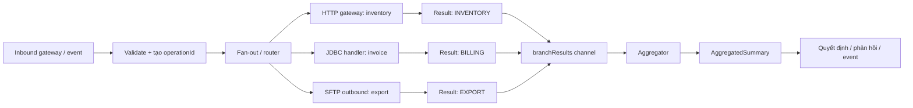
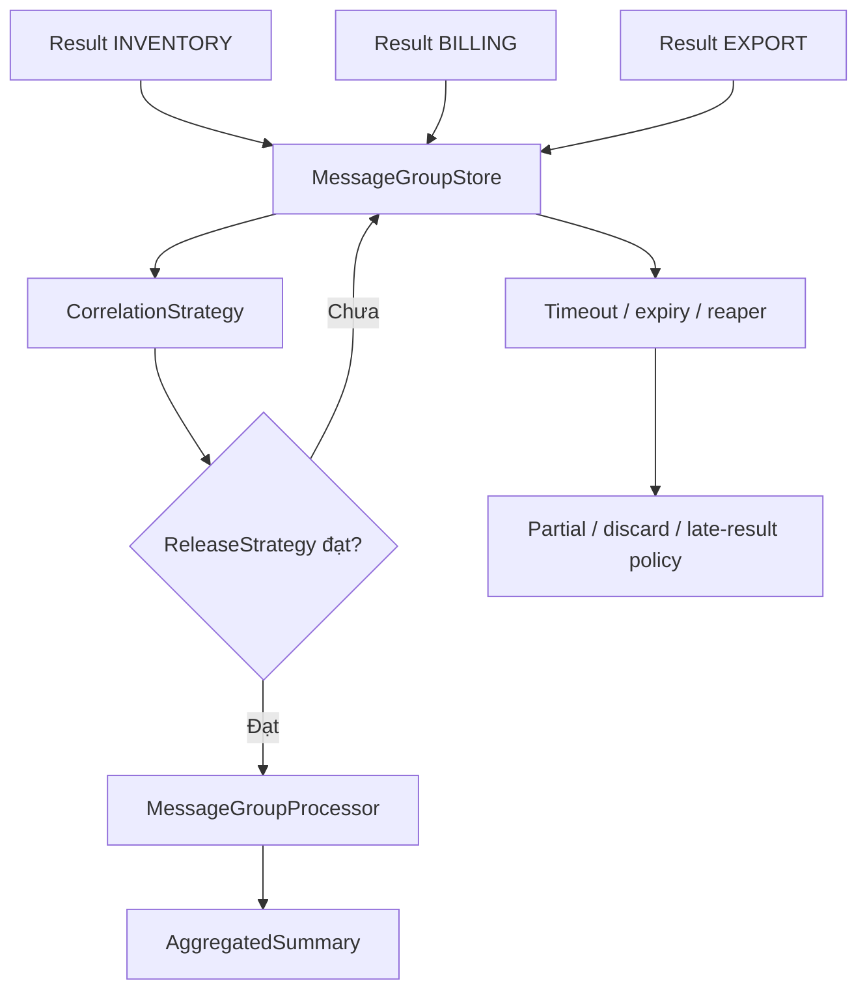
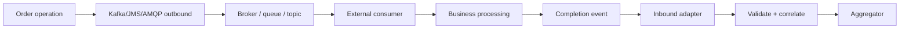
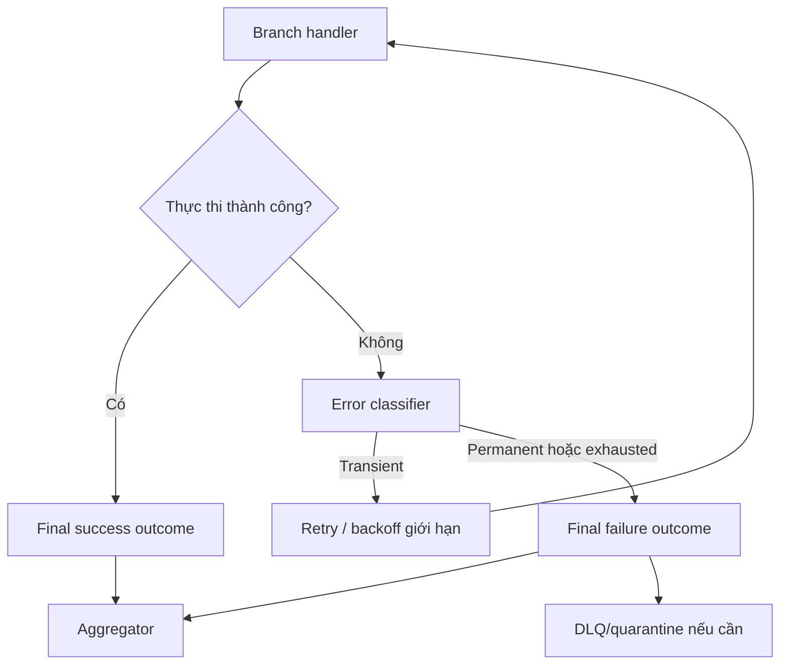
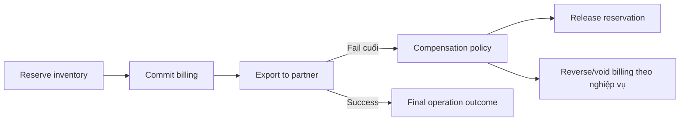

# Aggregator sau nhiều adapter

## 1. Bài toán: Một yêu cầu cần kết quả từ nhiều hệ thống

Một nền tảng thương mại nhận yêu cầu `ConfirmOrder`. Để hoàn tất bước chuẩn bị, hệ thống phải thực hiện ba công việc:

1. **Kiểm tra tồn kho** qua HTTP outbound gateway tới inventory service.
2. **Ghi nhận hóa đơn** qua JDBC outbound adapter hoặc một dịch vụ lưu trữ có transaction.
3. **Xuất dữ liệu cho đối tác** bằng File/SFTP outbound adapter.

Các nhánh có thể có thời gian xử lý khác nhau: HTTP trả lời sau 80 ms, database commit sau 120 ms, SFTP mất 2 giây. Nếu cùng một yêu cầu được xử lý qua nhiều adapter, hệ thống cần trả lời:

- Làm sao biết ba kết quả thuộc **cùng đơn hàng và cùng lượt xử lý**?
- Khi nào được kết luận đủ kết quả?
- Nếu hai nhánh thành công, một nhánh lỗi hoặc không phản hồi thì làm gì?
- Nếu kết quả từ một nhánh đến hai lần do retry thì có được tính là hai nhánh không?
- Nếu một kết quả đến sau timeout thì lưu, bỏ qua hay sửa kết luận?
- Nếu service restart khi đang chờ thì nhóm kết quả có bị mất?
- HTTP 202, Kafka producer ACK hoặc SFTP upload xong có đủ để coi **nghiệp vụ phía nhận** đã hoàn tất không?

Trong Enterprise Integration Patterns, **Aggregator** là thành phần **gom những message có liên quan thành một kết quả** khi điều kiện hoàn tất đã đạt. Đặt aggregator **sau nhiều adapter** là trường hợp *fan-out/fan-in* (phát ra nhiều nhánh rồi gom kết quả), còn được liên hệ với **Scatter–Gather** khi phát yêu cầu tới nhiều bên và tập hợp phản hồi.

Bài thuộc chương **Design patterns** trong module `SPRING_INTEGRATION_ADAPTERS`: kết nối hệ thống ngoài qua **inbound/outbound adapter, gateway, poller, MessageChannel**, thực hành File, SFTP, HTTP, JMS, AMQP, Kafka và database, cùng việc quản lý hợp đồng message, lỗi và vòng đời kết nối.

> **Điểm quyết định:** Một outbound **adapter một chiều** không tự sinh ra phản hồi nghiệp vụ để aggregator gom. Chỉ khi các nhánh **phát message kết quả** — từ gateway, completion event, callback hoặc một endpoint xác nhận — thì mới có dữ liệu đúng để aggregate.

## 2. Mô hình fan-out/fan-in trong Spring Integration



Sơ đồ mô tả một kiến trúc **mẫu**. Mỗi nhánh phải chủ động phát **một sự kiện kết quả đã được định nghĩa**. Chẳng hạn JDBC handler không tự phát kết quả trên `branchResults` chỉ vì câu lệnh SQL chạy xong; cần một wrapper/service activator hoặc cơ chế completion phù hợp.

### Đầu vào và đầu ra

```text
Input:
  operationId = op-8721
  orderId     = ORD-1001

Branch outcomes (thứ tự đến bất kỳ):
  {operationId: op-8721, branch: BILLING,   status: SUCCEEDED}
  {operationId: op-8721, branch: EXPORT,    status: SUCCEEDED}
  {operationId: op-8721, branch: INVENTORY, status: SUCCEEDED}

Aggregate:
  {operationId: op-8721, completed: 3/3, overall: SUCCEEDED}
```

Kết quả tổng hợp phải có **ý nghĩa nghiệp vụ đã được thống nhất**. Trong ví dụ, `EXPORT=SUCCEEDED` có thể chỉ nghĩa **file đã upload xong**, không chứng minh hệ thống đối tác đã import thành công. Nếu cần biết đối tác xử lý xong, phải chọn milestone khác — ví dụ `PARTNER_IMPORTED` từ một callback hoặc inbound confirmation.

## 3. Phân biệt Aggregator, Splitter, Router và Publish–Subscribe

| Pattern/component | Việc chính | Liên hệ với bài toán |
| --- | --- | --- |
| **Splitter** | Một message chứa tập phần tử → nhiều message | Một batch 100 đơn thành 100 tác vụ |
| **Router** | Chọn một hoặc nhiều đường đi theo điều kiện | Phân phối công việc tới nhánh tương ứng |
| **Recipient-list router** | Gửi tới một danh sách recipient được chọn | Fan-out linh hoạt theo cấu hình |
| **Publish–Subscribe channel** | Phát message tới các subscriber | Fan-out nhiều nhánh, có thể cấu hình executor |
| **Transformer** | Đổi representation của payload | `Order` → JSON/CSV/SQL parameters |
| **Gateway** | Request–reply với hệ thống ngoài hoặc ứng dụng | HTTP gọi rồi nhận kết quả |
| **Outbound adapter** | Gửi/ghi một chiều | SFTP upload, Kafka/JMS publish, ghi file |
| **Aggregator** | Gom message theo khóa và điều kiện | Nhận đủ các `BranchOutcome` |
| **Resequencer** | Sắp xếp lại message theo trình tự | Chỉ cần nếu downstream đòi đúng thứ tự |
| **Barrier** | Giữ nhiều luồng đến khi được phép đi tiếp | Đồng bộ tác vụ, chưa chắc phải tính summary |

Một aggregator thường đứng sau splitter. Nhưng ở bài này **những message đến từ nhiều adapter/nhánh** có thể khác kiểu, khác thời gian và không chia sẻ sẵn metadata trình tự; vì vậy cần contract thống nhất.

### Scatter–Gather có phải luôn đồng bộ?

Không. Scatter–Gather có thể diễn ra:

- **Đồng bộ:** nhiều gateway gọi và trả reply trong một khoảng timeout được kiểm soát.
- **Bất đồng bộ:** gửi qua Kafka/JMS/AMQP hoặc File/SFTP, rồi chờ completion event khác tới sau.
- **Kết hợp:** hai gateway trả ngay, một nhánh file/broker có kết quả muộn.

Aggregator xử lý nhóm message; **thời điểm phát kết quả, việc lưu trạng thái và cách ack nguồn** phải được thiết kế cho kiểu luồng thực tế.

## 4. Adapter và gateway: Điều gì thực sự tạo ra “kết quả”?

| Hệ thống | Tín hiệu có thể nhận được | Tín hiệu đó **không tự chứng minh** |
| --- | --- | --- |
| **HTTP outbound gateway** | HTTP status, body hoặc response được map | Toàn bộ nghiệp vụ async phía server đã hoàn thành, nhất là `202` |
| **File outbound adapter** | File được ghi theo handler và trạng thái local | Consumer bên ngoài đã đọc file |
| **SFTP outbound adapter** | Upload/rename hoàn tất theo thao tác adapter | Đối tác đã import file |
| **JMS outbound adapter** | Gửi tới JMS provider theo semantics cấu hình | JMS consumer đã commit nghiệp vụ |
| **AMQP outbound adapter** | Publish/confirm/return tùy cấu hình | Message đã được consumer xử lý |
| **Kafka outbound adapter** | Producer acknowledgment theo cấu hình | Consumer downstream đã xử lý |
| **JDBC outbound adapter** | Lệnh được thực thi/commit theo transaction thực tế | Các hệ thống khác đã thấy hoặc xử lý event |
| **Database inbound polling** | Bản ghi đáp ứng điều kiện query | Tác vụ phía ngoài đã commit nếu không có contract xác nhận |

**Chỉ aggregate những tín hiệu cùng cấp độ ý nghĩa.** Nếu nhánh A là “business validated”, nhánh B là “broker accepted”, nhánh C là “file uploaded”, phải đặt tên summary tương ứng, không gắn nhãn “all business completed” một cách đánh tráo.

### Mốc có thể lựa chọn

- **Accepted:** request/event đã được hệ thống đích nhận.
- **Transport completed:** gửi/ghi thành công ở transport.
- **Business completed:** phía đích xác nhận xử lý nghiệp vụ.
- **Compensated:** tác động trước đó được bù trừ khi quy trình thất bại.

Nếu yêu cầu thật là **business completed**, nhánh publish Kafka phải chờ một inbound completion event hoặc quan sát state đã được xác nhận, không chỉ chờ producer ACK.

## 5. Mẫu hợp đồng `BranchOutcome` dùng chung giữa các nhánh

Tạo một cấu trúc chuẩn để aggregator không cần hiểu HTTP response, Kafka record hay SFTP session cụ thể.

```json
{
  "operationId": "op-8721",
  "resultEventId": "result-2b09",
  "branch": "INVENTORY",
  "milestone": "BUSINESS_COMPLETED",
  "outcome": "SUCCEEDED",
  "code": "STOCK_RESERVED",
  "completedAt": "2026-11-23T09:00:01Z",
  "schemaVersion": 1
}
```

| Trường | Vai trò | Điều cần lưu ý |
| --- | --- | --- |
| `operationId` | Khóa gom **của một lượt xử lý** | Không dùng email hoặc orderId đơn thuần nếu một đơn có nhiều lần chạy |
| `resultEventId` | Định danh event kết quả riêng | Giữ ổn định khi redelivery/retry cùng event |
| `branch` | Nhánh gửi kết quả | Thuộc enum/danh sách cho phép |
| `milestone` | Mức độ kết quả được xác nhận | Không nhập nhằng transport với business |
| `outcome` | `SUCCEEDED`, `FAILED` hoặc trạng thái chưa cuối | Chỉ trạng thái cuối mới đáp ứng điều kiện release nếu contract yêu cầu |
| `code` | Mã nghiệp vụ/lỗi chuẩn hóa | Tránh raw exception và dữ liệu nhạy cảm |
| `completedAt` | Thời điểm xác nhận kết quả | Không dùng làm khóa duy nhất |
| `schemaVersion` | Version của contract | Hỗ trợ schema evolution |

Bản ghi thực tế có thể cần `tenantId` đã xác minh, `deadlineAt`, `requiredBranches` và tham chiếu chứng cứ. Không đưa token, password, signed URL hoặc payload khách hàng vào outcome chỉ để “dễ debug”.

### Phân biệt request ID với business ID

- `orderId=ORD-1001` có thể tồn tại qua nhiều đợt sửa/đồng bộ.
- `operationId=op-8721` mô tả **một lần phối hợp cụ thể**.
- `resultEventId=result-2b09` giúp nhận ra một kết quả bị giao lặp.
- Spring message `id` có thể được tạo mới khi chuyển đổi; **không phù hợp làm khóa nghiệp vụ ổn định xuyên nhiều hệ thống**.

## 6. Correlation: Ghép đúng kết quả cùng một operation

Spring Integration Aggregator mặc định có cơ chế nhóm message theo header **`CORRELATION_ID`**. Có thể thay bằng **CorrelationStrategy**.

Trong flow nhiều adapter, nên tạo **một operation ID đáng tin tại điểm ingress/orchestration**, rồi truyền nó qua mọi nhánh:

```text
operationId: op-8721
    ├─ HTTP inventory request    → outcome(operationId=op-8721)
    ├─ JDBC invoice operation    → outcome(operationId=op-8721)
    └─ SFTP export operation     → outcome(operationId=op-8721)
```

**Không tạo một UUID khác cho từng branch nếu muốn chúng cùng nhóm.** Có thể mỗi branch có `resultEventId` riêng, nhưng **operationId phải giữ nguyên**.

### CorrelationStrategy tùy biến

```java
// Ví dụ ý tưởng của chiến lược gom:
Object correlationKey(Message<?> message) {
    BranchOutcome result = (BranchOutcome) message.getPayload();
    return result.operationId();
}
```

Nếu nhiều tenant có thể sinh cùng operation ID, khóa phải bao gồm namespace đáng tin: `(tenantId, operationId)`. Tránh dùng chuỗi ghép không có escaping vì có thể tạo collision; dùng record khóa có cấu trúc hoặc encode chuẩn.

### Khi nào mặc định correlationId đủ?

Nếu toàn bộ đường đi preserve `CORRELATION_ID` theo cùng một sequence, dùng mặc định có thể đủ. Với kết quả callback/Kafka đến từ một process khác, header framework ban đầu thường không còn; cần ánh xạ **business operation ID** thành header correlation hoặc custom strategy tại điểm nhận.

## 7. Sequence headers và `applySequence(true)`

Spring Integration có các header liên quan tới trình tự:

- `CORRELATION_ID`: nhóm các message cùng một sequence.
- `SEQUENCE_NUMBER`: vị trí của message trong sequence.
- `SEQUENCE_SIZE`: số phần tử được dự kiến trong sequence.

Aggregator mặc định dùng **sequence size/sequence number** để xác định lúc nào đủ message. Khi dùng **Splitter**, sequence metadata thường được thêm theo cơ chế của splitter; với **PublishSubscribeChannel** hoặc recipient-list router, cần bật **`applySequence`** nếu muốn dùng release mặc định theo sequence.

Ví dụ ý tưởng:

```java
@Bean
MessageChannel fanOutChannel() {
    PublishSubscribeChannel channel = new PublishSubscribeChannel();
    channel.setApplySequence(true);
    return channel;
}
```

Đoạn code thể hiện cấu hình fan-out tại channel; khi dùng phiên bản/thư viện khác phải kiểm tra API và wiring phù hợp.

### Giới hạn của sequence mặc định

- `SEQUENCE_SIZE=3` có ý nghĩa khi **thật sự có 3 message kết quả tương ứng**.
- Nếu một nhánh **filter/drop** mà không phát result, aggregator có thể chờ mãi.
- Nếu branch gửi lỗi tại adapter một chiều nhưng không phát outcome, sequence không hoàn thành.
- Nếu một branch phát hai kết quả do retry, cách đếm đơn giản có thể sai.
- Nếu callback từ Kafka/SFTP là **message mới** không giữ sequence ban đầu, metadata có thể không đủ để join.

**Trong bài toán nhiều adapter bất đồng bộ, custom CorrelationStrategy và ReleaseStrategy theo tên nhánh/operation thường rõ ràng hơn việc dựa toàn bộ vào `sequenceSize`.**

## 8. Aggregator giữ trạng thái như thế nào?

Aggregator là một thành phần **stateful**: cần giữ message trong **MessageGroup** chờ đủ điều kiện.



Các vai trò:

| Thành phần | Câu hỏi trả lời |
| --- | --- |
| `CorrelationStrategy` | Message thuộc nhóm nào? |
| `MessageGroupStore` | Nhóm/message được lưu ở đâu? |
| `ReleaseStrategy` | Nhóm đủ điều kiện xuất kết quả chưa? |
| `MessageGroupProcessor` | Từ những kết quả nhánh, tạo summary gì? |
| `groupTimeout` / reaper | Nhóm không bao giờ đủ phải được xử lý khi nào? |
| `discardChannel` | Kết quả không hợp lệ/quá muộn phải đi đâu? |
| `expireGroupsUponCompletion` | Giữ tombstone nhóm hoàn tất hay xóa để tái sử dụng khóa? |

Một `MessageGroup` được đánh giá khi message mới tới; nếu không có cơ chế timeout/expiry, **nhóm thiếu kết quả có thể tồn tại vô hạn**.

### Mặc định in-memory không đủ cho mọi production use case

`SimpleMessageStore` tiện cho demo nhưng không giải quyết yêu cầu tồn tại sau restart. Với luồng dài và dữ liệu quan trọng, cần đánh giá persistent store, độ bền giao dịch, serialization, concurrent access, retention và kích thước nhóm.

## 9. Thiết kế ReleaseStrategy đúng cho nhiều nhánh

Ba cách phổ biến:

| Chính sách | Khi release | Ví dụ |
| --- | --- | --- |
| **All required** | Đã có kết quả cuối từ mọi nhánh bắt buộc | Inventory + billing + export |
| **Quorum** | Đủ số phiếu/kết quả theo trọng số | Ít nhất 2/3 nhà cung cấp tra cứu độc lập |
| **Deadline / partial** | Hết thời gian chờ; xuất summary thiếu nhánh | Trả `PARTIAL` khi hết 15 giây |
| **First useful result** | Có một kết quả đáp ứng điều kiện | Race giữa các read-replica |
| **Dynamic expected set** | Đủ các nhánh đã thực sự được dispatch | Bỏ qua branch không được chọn theo business rule |

### Vì sao `group.size() == 3` thường không đủ?

Giả sử:

```text
[INVENTORY: OK]
[INVENTORY: OK]  <-- redelivery trùng
[BILLING: OK]
# EXPORT chưa gửi kết quả
```

`group.size()==3` có thể trả `true` nhưng **thiếu EXPORT**. Phải đếm **tập branch đã hoàn thành**, không chỉ số message.

### Nhánh `FAILED` có tính là hoàn thành?

Tùy contract:

- Nếu mỗi branch phải trả một **kết quả cuối** `SUCCEEDED/FAILED`, cả hai đều tính là **đã phản hồi**, và summary quyết định success/failure.
- Nếu quy trình yêu cầu “cả ba thành công”, có thể fail-fast khi một nhánh trả final failure; nhưng vẫn phải quản lý các nhánh đang chạy, side effect và compensation.
- Một nhánh chỉ trả `ACCEPTED` chưa được tính là business completed nếu milestone yêu cầu kết quả nghiệp vụ.
- Lỗi bị filter/drop mà **không phát failure outcome** thường khiến group chờ hoặc timeout; cần một failure-path có chủ đích.

**Lỗi không nhất thiết đồng nghĩa thiếu message.** Một message kết quả `FAILED` có thể là dữ liệu hợp lệ cho aggregator và cần được ghi nhận để tổng hợp.

## 10. Định nghĩa mô hình Java của kết quả nhánh

Ví dụ Java 17+ dùng record và enum:

```java
import java.time.Instant;

enum Branch {
    INVENTORY, BILLING, EXPORT
}

enum Outcome {
    SUCCEEDED, FAILED
}

record BranchOutcome(
    String operationId,
    Branch branch,
    String resultEventId,
    Outcome outcome,
    String code,
    Instant completedAt
) {}

record AggregatedSummary(
    String operationId,
    java.util.Map<Branch, Outcome> results,
    boolean allSucceeded
) {}
```

Những ràng buộc nên kiểm tra **trước khi gửi outcome vào aggregator**:

1. `operationId` không rỗng, thuộc request được phép và namespace/tenant đúng.
2. `branch` nằm trong tập branch đã dispatch cho operation.
3. `resultEventId` ổn định cho cùng kết quả và không trùng với event khác.
4. `outcome` là **kết quả cuối** tại milestone đang gom.
5. `code` thuộc danh sách mã hợp lệ, không chứa raw exception hoặc secret.
6. Nếu có nhiều outcome cho cùng branch, phải có quy tắc dedup/conflict rõ.
7. `completedAt` có timezone; không dùng timestamp như bằng chứng tuyệt đối về thứ tự cross-system.

Một bảng operation bền vững có thể lưu danh sách branch đã dispatch và deadline, tránh tin hoàn toàn `expectedCount` do message gửi tới tự khai.

## 11. Ví dụ Java: Custom ReleaseStrategy theo tập branch

Sử dụng `MessageGroup` để xem các payload nhánh đã nhận. Ví dụ:

```java
import java.util.EnumSet;
import org.springframework.integration.store.MessageGroup;
import org.springframework.messaging.Message;

public final class BranchAggregationRules {

    private static final EnumSet<Branch> REQUIRED =
        EnumSet.of(Branch.INVENTORY, Branch.BILLING, Branch.EXPORT);

    private BranchAggregationRules() {}

    public static boolean canRelease(MessageGroup group) {
        EnumSet<Branch> present = EnumSet.noneOf(Branch.class);

        for (Message<?> message : group.getMessages()) {
            BranchOutcome outcome =
                (BranchOutcome) message.getPayload();

            // Nhóm chỉ nên chứa outcome cuối đã được validate.
            present.add(outcome.branch());
        }

        return present.containsAll(REQUIRED);
    }
}
```

Hàm không chỉ đếm message: trùng `INVENTORY` vẫn không thay cho `EXPORT`.

### Nhưng code này chưa giải quyết tất cả

- Nếu có outcome **giả mạo branch**, cần xác thực nguồn và quyền trước aggregator.
- Nếu một branch trả `FAILED` rồi sau đó `SUCCEEDED`, phải xác định đó là retry trong cùng attempt hay **một lần xử lý mới**.
- Nếu expected branches thay đổi theo operation, `REQUIRED` cố định không phù hợp; nên đọc expected set từ **operation context đáng tin**.
- Nếu một kết quả trùng lặp được đưa vào group, phép release vẫn đúng về tập nhưng output processor phải xử lý duplicate hoặc nên dedup trước đó.

**ReleaseStrategy chỉ trả lời “đủ điều kiện gom chưa?”; nó không thay thế validation và idempotency.**

## 12. Ví dụ Java: Gộp nhóm thành một summary bất biến

Một hàm xử lý nhóm có thể tạo `AggregatedSummary` với một kết quả cuối cho mỗi branch:

```java
import java.util.EnumMap;
import java.util.Map;
import org.springframework.integration.store.MessageGroup;
import org.springframework.messaging.Message;

public final class BranchSummaryProcessor {

    private BranchSummaryProcessor() {}

    public static AggregatedSummary summarize(MessageGroup group) {
        Map<Branch, Outcome> byBranch = new EnumMap<>(Branch.class);
        String operationId = null;

        for (Message<?> message : group.getMessages()) {
            BranchOutcome result =
                (BranchOutcome) message.getPayload();

            if (operationId == null) {
                operationId = result.operationId();
            } else if (!operationId.equals(result.operationId())) {
                throw new IllegalStateException(
                    "Mixed operation IDs in a group");
            }

            Outcome previous =
                byBranch.putIfAbsent(result.branch(), result.outcome());

            if (previous != null && previous != result.outcome()) {
                throw new IllegalStateException(
                    "Conflicting final results for one branch");
            }
        }

        boolean complete =
            byBranch.keySet().containsAll(
                java.util.EnumSet.of(
                    Branch.INVENTORY, Branch.BILLING, Branch.EXPORT));

        if (!complete) {
            throw new IllegalStateException("Incomplete branch group");
        }

        boolean allSucceeded =
            byBranch.values().stream()
                .allMatch(v -> v == Outcome.SUCCEEDED);

        return new AggregatedSummary(
            operationId, Map.copyOf(byBranch), allSucceeded);
    }
}
```

Mẫu này từ chối **kết quả cuối mâu thuẫn** của cùng branch. Nó chấp nhận hai thông báo lặp có cùng `outcome`, nhưng không có nghĩa mọi duplicate đều vô hại: khi có code, version hoặc side effect khác nhau vẫn cần so sánh `resultEventId` và kiểm soát nguồn.

### Vì sao tạo summary bất biến?

Nhóm trong `MessageGroupStore` có lifecycle riêng và có thể bị dọn sau release. Không nên trả trực tiếp một `Collection<Message<?>>` từ store rồi kỳ vọng collection đó còn nguyên mãi. Tạo DTO summary mới làm ranh giới rõ ràng, tránh phụ thuộc vào nội bộ MessageGroup.

## 13. Java DSL: Ghép kết quả về một channel

Ví dụ dưới đây minh họa một flow dành riêng cho **message kết quả nhánh**, không trực tiếp chạy ba adapter.

```java
import org.springframework.context.annotation.Bean;
import org.springframework.context.annotation.Configuration;
import org.springframework.integration.dsl.IntegrationFlow;
import org.springframework.integration.store.MessageGroupStore;

@Configuration
public class FanInConfiguration {

    @Bean
    IntegrationFlow aggregateBranchResults(
            MessageGroupStore branchResultGroupStore) {

        return IntegrationFlow.from("branchResults")
            .aggregate(a -> a
                .correlationStrategy(message ->
                    ((BranchOutcome) message.getPayload()).operationId())
                .releaseStrategy(
                    BranchAggregationRules::canRelease)
                .outputProcessor(
                    BranchSummaryProcessor::summarize)
                .messageStore(branchResultGroupStore)
                // Giữ metadata nhóm hoàn tất để xử lý late reply
                // trong cửa sổ đã thiết kế.
                .expireGroupsUponCompletion(false))
            .channel("aggregatedSummaries")
            .get();
    }
}
```

### Điều đoạn code thực hiện

1. `branchResults` là channel **hội tụ** từ tất cả branch result producers.
2. `correlationStrategy` gom theo `operationId`.
3. `releaseStrategy` chờ đủ `INVENTORY`, `BILLING` và `EXPORT`.
4. `outputProcessor` tạo một `AggregatedSummary`.
5. `MessageGroupStore` lưu nhóm trong thời gian chờ.
6. `aggregatedSummaries` nhận kết quả sau release.
7. Giữ metadata nhóm hoàn tất giúp **có khả năng từ chối late message trong thời hạn giữ trạng thái**; vẫn phải cấu hình dọn nhóm và xử lý replay.

**Đây là ví dụ Java DSL cho lớp Aggregator** theo cấu trúc API quen thuộc của Spring Integration. Cần chọn implementation `MessageGroupStore`, khai báo các channel/producer/consumer và kiểm tra phiên bản dependency hiện dùng. Ví dụ **không tự tạo ba adapter**, không cài timeout hay bảo đảm transaction/cross-system exactly-once.

### Không bật `expireGroupsUponCompletion(true)` vô tư

Nếu xóa toàn bộ group ngay sau release, **message đến muộn mang cùng operation ID có thể tạo nhóm mới**. Nếu giữ tombstone vô hạn lại gây tăng state. Cần thiết kế **cửa sổ late replies, dọn trạng thái và dedup bền vững**.

## 14. Fan-out nhiều nhánh trong Java DSL

Có thể dùng `PublishSubscribeChannel` hoặc recipient-list router để phát message đến những flow xử lý khác nhau.

Ví dụ minh họa **bước fan-out**:

```java
@Bean
IntegrationFlow distributeOrderOperations(BranchHandlers handlers) {
    return IntegrationFlow.from("orderOperations")
        .publishSubscribeChannel(s -> s
            .applySequence(true)
            .subscribe(f -> f.handle(handlers, "inventory"))
            .subscribe(f -> f.handle(handlers, "billing"))
            .subscribe(f -> f.handle(handlers, "export")))
        .get();
}
```

Trong đó `BranchHandlers` là service **do ứng dụng tự định nghĩa**. Mỗi handler:

- nhận request mang `operationId` và dữ liệu được phép;
- thực hiện công việc qua gateway/adapter tương ứng;
- khi có **outcome cuối đáng tin**, phát một `BranchOutcome` tới `branchResults`;
- nếu lỗi cố định, phát failure outcome hoặc chuyển sang chính sách retry/dead-letter có khả năng làm group kết thúc;
- không để result trùng tạo side effect lần nữa.

**Cảnh báo về semantics:** `publishSubscribeChannel` gửi bản sao message yêu cầu tới subscriber, nhưng **không tự lấy return value của ba `handle(...)` và gom thành ba outcome**. Phải có đường **kết quả nhánh → channel hội tụ**. `applySequence(true)` đánh số các bản sao fan-out tại đó; message outcome phát muộn qua broker có thể là message khác và không còn giữ sequence headers ban đầu.

### Nếu nhánh có điều kiện

Giả sử đơn hàng B2B không cần SFTP export, `REQUIRED={INVENTORY,BILLING}`; trong khi B2C có đủ ba branch. Khi đó **expected set phải được chốt theo từng operation** sau khi router quyết định, không hardcode `3` hoặc tin một header tùy ý.

## 15. Từ adapter/gateway đến `BranchOutcome` thế nào?

Thiết kế một bộ **result producer** cho từng nhánh. Có thể dùng một service activator sau gateway, callback từ adapter hoặc event consumer.

### HTTP gateway: Nhận response rồi chuẩn hóa

```text
Message<CheckInventoryRequest>
    -> HTTP outbound gateway
    -> HTTP response (status + body)
    -> validate response contract
    -> BranchOutcome(INVENTORY, SUCCEEDED/FAILED)
    -> branchResults
```

Cần phân biệt:

- `200` trả business result xác nhận stock reserved theo API → có thể coi branch completed.
- `202 Accepted` → mới accepted, cần poll/callback nếu business result còn pending.
- `503`/timeout → retry policy; timeout không bảo đảm server chưa xử lý.
- `400/422` → thường là lỗi dữ liệu, có thể tạo final failure sau phân loại.

### JDBC: Ghi nhận theo transaction

```text
Message<InvoiceCommand>
    -> JDBC outbound handler
    -> commit confirmed
    -> BranchOutcome(BILLING, SUCCEEDED)
    -> branchResults
```

Không phát success **trước commit**. Nếu JDBC timeout sau commit có trạng thái không chắc chắn, phải dùng khóa nghiệp vụ/idempotency hoặc đọc trạng thái để tránh ghi lại hóa đơn trước khi tạo outcome.

### SFTP: Upload xong chưa phải partner processed

```text
Message<ExportFile>
    -> SFTP outbound adapter
    -> remote write + final rename confirmed
    -> BranchOutcome(EXPORT, SUCCEEDED at UPLOAD_COMPLETED)
    -> branchResults
```

Nếu contract cần `PARTNER_IMPORT_COMPLETED`, chưa được phát branch outcome cuối từ upload. Chờ inbound file acknowledgment, HTTP callback, message queue hoặc cơ chế truy vấn trạng thái được đối tác hỗ trợ.

## 16. Kết quả bất đồng bộ từ Kafka, JMS và AMQP

Một-way message adapter thường chỉ biết **publish**. Để gom kết quả nghiệp vụ:



Ví dụ Kafka:

```text
orders.commands:
  key      = operationId
  payload  = {operationId, orderId, action: "CHECK_STOCK"}

orders.results:
  key      = operationId
  payload  = {
    operationId, branch: "INVENTORY",
    resultEventId, outcome: "SUCCEEDED"
  }
```

Không đồng nhất producer ACK với `BranchOutcome(INVENTORY, SUCCEEDED)` nếu mong chờ consumer hoàn thành công việc.

### Các điều kiện bổ sung

- Consumer phải giữ/mapping lại `operationId` khi phát result.
- Result inbound adapter phải deserialize theo schema/version được hỗ trợ.
- Kết quả đến lặp do at-least-once delivery cần dedup.
- Result từ operation đã bị hủy hoặc hết deadline cần chính sách late arrival.
- AuthN/AuthZ cần xác minh bên phát result được phép báo outcome cho branch tương ứng.
- Khi kết quả sai tenant, không được nối vào group đúng operation ID của tenant khác.

## 17. Khi nào nên chờ đủ, fail-fast hay trả partial?

### All required

Phù hợp với lệnh chỉ được coi thành công khi **mọi công việc bắt buộc** hoàn tất.

```text
Inventory: SUCCEEDED
Billing:   SUCCEEDED
Export:    SUCCEEDED
=> READY / SUCCEEDED (theo milestone đã chốt)
```

### Fail-fast

Nếu kiểm tra tồn kho trả `FAILED` và mọi bước khác không còn nên thực hiện, có thể chấm dứt sớm và **hủy hoặc bù trừ** những nhánh còn lại theo chính sách.

Nhưng fail-fast **không tự thu hồi side effect** đã được commit tại DB hoặc SFTP. Một branch đã gửi sẽ không biến mất khi aggregator kết luận fail.

### Partial result

Trong dashboard hoặc báo cáo không bắt buộc đầy đủ, có thể xuất:

```json
{
  "operationId": "op-8721",
  "state": "PARTIAL",
  "results": {
    "INVENTORY": "SUCCEEDED",
    "BILLING": "SUCCEEDED"
  },
  "missingBranches": ["EXPORT"],
  "reason": "DEADLINE_EXCEEDED"
}
```

**Không gắn `allSucceeded=true` cho partial group.** Partial cũng không nên tự động kích hoạt side effect yêu cầu đủ ba bước, trừ khi nghiệp vụ chấp nhận.

### Quorum

Có thể chọn “2/3 thành công” cho truy vấn nhiều nguồn độc lập. **Không dùng quorum cho ba side effect bắt buộc** chỉ vì nó làm response nhanh hơn: điều này có thể để một hệ thống chưa được cập nhật.

## 18. Timeout: Không để nhóm chờ mãi

Nếu một branch không trả outcome, release strategy thuần có thể không bao giờ trả `true`. Cần có **deadline** và chính sách rõ.

### Hai loại timeout khác nhau

1. **Adapter timeout:** HTTP request, SFTP upload, JDBC query hoặc broker send không hoàn thành trong thời gian cho phép.
2. **Aggregation timeout:** cả **operation** không nhận đủ final outcomes trong deadline.

Ví dụ: HTTP 3 giây, SFTP 10 giây, nhưng operation deadline 30 giây. Các giá trị phải phù hợp SLA và chiến lược retry; không áp dụng con số chung cho mọi nơi.

### Cơ chế Spring Integration

Aggregator hỗ trợ **group timeout** và có thể kết hợp `sendPartialResultOnExpiry` để phát nhóm chưa đủ khi hết hạn. Ngoài ra có `MessageGroupStoreReaper` cho việc quét/expire nhóm theo lịch. **Timeout của một group có thể được tính lại theo message đến**, tùy cách cấu hình; không mặc định tương đương **deadline tuyệt đối tính từ operation start**.

Cần kiểm tra:

- TaskScheduler có chạy và xử lý lỗi không?
- Timeout có tính từ creation, từ lần message gần nhất hay theo expression?
- Khi timeout, group bị discard hay phát partial result?
- Summary processor có chịu được group thiếu nhánh?
- Khi service restart, nhóm persisted có được expire đúng không?
- Khi scheduled timeout handler lỗi, lỗi được đưa vào đâu?

### Deadline tuyệt đối

Nếu nghiệp vụ yêu cầu “không quá 30 giây kể từ khi nhận request”, lưu `deadlineAt` cùng operation và dùng scheduler/state machine có khả năng khôi phục. Không dựa vào `groupTimeout` tương đối nếu cứ có một message mới lại kéo dài chờ.

## 19. Late replies: Sau khi release xảy ra điều gì?

Hai kết quả quan trọng về lifecycle nhóm:

| Hành vi | Lợi | Rủi ro |
| --- | --- | --- |
| Giữ metadata nhóm hoàn tất (`expireGroupsUponCompletion=false`) | Có cơ sở từ chối message đến muộn trong thời hạn lưu | Tombstone tốn storage, cần cleanup |
| Xóa toàn bộ group sau hoàn tất (`true`) | Giải phóng state sớm | Late reply cùng correlation có thể khởi tạo group mới |

Khi một group bị expire do timeout, hành vi mặc định và các lựa chọn `expireGroupsUponTimeout`/`sendPartialResultOnExpiry` cũng ảnh hưởng message đến muộn.

### Vì sao cần hơn một flag?

Nếu operation đã trả kết quả `PARTIAL` lúc 30 giây, nhánh EXPORT gửi success vào giây 31, hệ thống phải quyết định:

- **Bỏ qua** như late result và ghi audit.
- **Cập nhật trạng thái operation** thành completed, phát một **revision event** có version.
- **Bù trừ** hoặc xử lý cleanup nếu kết quả muộn trái chính sách.
- **Escalate** nếu result gây nguy cơ dữ liệu không nhất quán.

Không được để một group mới âm thầm phát thêm `AggregatedSummary` như thể đây là operation mới. Với yêu cầu tin cậy cao, lưu một **operation ledger** bền vững theo `operationId` và trạng thái cuối, không dựa duy nhất vào metadata của aggregator.

## 20. MessageGroupStore bền vững và ảnh hưởng của restart

Bài toán aggregator có thể kéo dài vài giây hoặc vài giờ. Nếu process restart khi mới nhận 2/3 kết quả:

```text
Trước restart:
  operationId=op-8721
  inventory=OK
  billing=OK
  export=pending

Sau restart:
  export=OK tới
```

Nếu hai result đầu chỉ nằm trong memory, aggregator không thể tạo summary đầy đủ dù nhánh EXPORT hoạt động đúng.

### Chọn MessageGroupStore

| Lựa chọn | Khi phù hợp | Lưu ý |
| --- | --- | --- |
| `SimpleMessageStore` in-memory | Demo, test, môi trường có thể chấp nhận mất state | Restart mất nhóm chưa hoàn tất |
| JDBC-backed `MessageGroupStore` | Workflows cần durability/restart và hỗ trợ DB | Kiểu payload/header phải serialize được; transaction/index/cleanup |
| Redis/Mongo-backed store | Theo hạ tầng và nhu cầu triển khai | Persistence, HA, TTL/locking, recovery |
| Operation ledger riêng + aggregator | Quy trình nghiệp vụ nhiều nhánh quan trọng | Trạng thái tổng hợp và event dedup cần phối hợp transaction |

### Thận trọng với persisted headers

Message Spring có thể mang `replyChannel`, `errorChannel` hoặc object do adapter cung cấp không dễ serialize qua persistent store. Không mặc định một gateway request–reply vẫn giữ được **temporary reply channel** xuyên process restart.

Để workflow lâu dài, ưu tiên **operation ID + reply topic/callback/status API** thay vì trông chờ một thread HTTP request chờ bất tận.

### Không dùng chung group store tùy ý

Một `MessageGroupStore` dùng cho nhiều aggregator có thể gây nhầm group/expiry callbacks. Đặt namespace/region và ownership phù hợp theo khả năng implementation; đánh giá cảnh báo của framework và không dùng store cùng instance cho các aggregator có expiry độc lập nếu không được hỗ trợ.

## 21. Idempotency và kết quả nhánh bị giao lặp

Trong hệ thống phân tán, duplicate là tình huống bình thường: producer retry, broker redelivery, HTTP callback lặp, poller đọc lại file hoặc ứng dụng crash trước khi commit.

```text
op-8721:
  inventory resultEventId=result-a1  SUCCEEDED
  inventory resultEventId=result-a1  SUCCEEDED  <- duplicate
  billing   resultEventId=result-b1  SUCCEEDED
  export    resultEventId=result-c1  SUCCEEDED
```

### Cần hai lớp chống trùng

1. **Event dedup:** result event đã được nhận trước đó chưa?
2. **Business outcome dedup:** một operation/branch chỉ được có một final outcome theo policy chưa?

Có thể lưu unique keys:

```text
unique(resultEventId)
unique(operationId, branch, completionEpoch)
```

Đây là ví dụ khóa logic; `completionEpoch` phải được định nghĩa khi có retry nghiệp vụ thật sự. Nếu branch có nhiều attempt, nên có một state machine quyết định **final outcome** thay vì xem mọi attempt result là kết quả cuối.

### Không coi producer idempotence là đủ

Kafka producer idempotence có phạm vi của producer/broker; nó không bảo đảm consumer side effect hoặc toàn bộ fan-in exactly-once. Consumer phải có cách chống xử lý trùng phù hợp khi retry/redelivery.

## 22. Hai kết quả mâu thuẫn từ cùng branch

Giả sử một kết quả tới:

```text
(op-8721, INVENTORY, FAILED)
```

sau đó:

```text
(op-8721, INVENTORY, SUCCEEDED)
```

Có ít nhất ba cách hiểu:

1. **Attempt trước thất bại**, attempt sau thành công; outcome đầu chưa phải final.
2. **Callback bị phát sai** hoặc contract không phân biệt accepted/final.
3. **Một bên giả mạo/sai tương quan**, hoặc operation ID bị tái sử dụng.

Không được chọn “message đến sau thắng” chỉ vì timestamp lớn hơn. Clock các hệ thống có thể lệch; broker delivery order không phải thứ tự sự kiện nghiệp vụ toàn cục.

### Chính sách rõ ràng

- Result final phải mang `branch` và `operationId` đã xác thực.
- Phân biệt `attemptId`, `attemptStatus` với `branchFinalStatus`.
- Nếu một final result đã được ghi, result khác mâu thuẫn phải được kiểm tra/đưa vào error flow.
- Nếu nghiệp vụ cho phép revision, có `revision` hoặc `stateVersion` tăng đơn điệu và quy tắc chuyển trạng thái.
- Báo alert cho mâu thuẫn, không lặng lẽ thay dữ liệu group.

## 23. Error flow, retry và dead-letter trong fan-in

Một lỗi trong nhánh có thể diễn ra **trước khi message outcome được phát**, ví dụ converter ném exception, HTTP timeout hoặc SFTP permission denied.



**Error channel không tự thay thế outcome contract**. `ErrorMessage` thường chứa exception và có thể giữ failed message; aggregator đang chờ `BranchOutcome` vẫn thiếu kết quả nếu không có một recoverer phát final failure đúng cách.

### Chọn nơi tạo failure outcome

- Nếu lỗi chỉ tạm thời, **đừng phát final FAILED** trước khi retry budget kết thúc.
- Khi retry hết, xác định đây là **business failure** hay **technical unresolved**; một số workflow nên trả `INDETERMINATE` thay vì coi như chắc chắn thất bại.
- Nếu nhánh đã có side effect nhưng mất ACK, cần reconcile trước khi phát outcome cuối.
- Nếu không thể tạo outcome vì mất operation ID, chuyển lỗi vào quarantine với source reference, cảnh báo và cho group deadline xử lý thiếu nhánh.
- Nếu error handler/DLQ cũng lỗi, đừng ghi “đã parked” giả; tránh mất thông điệp nguồn theo ack policy.

### Đồng bộ so với bất đồng bộ

Với `DirectChannel`, exception có thể truyền ngược caller. Với poller, executor channel hoặc adapter async, lỗi có thể đi vào `errorChannel`. Cần kiểm tra từng endpoint và advice, không chỉ tạo một global error handler rồi mặc định bắt mọi exception.

## 24. Fan-in và transaction: Aggregator không phải distributed transaction

Ba branch có thể cùng làm side effect:

```text
Inventory reserved    -> thành công
Invoice committed     -> thành công
SFTP export           -> thất bại
```

Aggregator chỉ biết **tổng hợp outcome**, không thể tự rollback inventory reservation và hóa đơn. Đây là vấn đề **workflow consistency**.

### Khi nào cần Saga hoặc compensation?

- Có thay đổi trạng thái trên nhiều hệ thống độc lập.
- Không có transaction chung bao trùm HTTP, SFTP, broker và DB.
- Một nhánh thành công, nhánh khác thất bại.
- Nghiệp vụ quy định phải hủy hoặc bù trừ những bước đã hoàn thành.

Ví dụ:



**Không gọi mọi compensation là rollback kỹ thuật.** Hoàn tiền hoặc hủy hóa đơn là hành động nghiệp vụ mới, có audit và có thể thất bại riêng.

### Có phải aggregator là saga orchestrator?

Không mặc định. Aggregator **gom tín hiệu trạng thái**; saga/process manager **điều khiển bước tiếp theo, hủy, bù trừ, timeout và recovery**. Có thể dùng aggregator bên trong một saga, nhưng không nên nhầm hai trách nhiệm.

## 25. Aggregator cho batch khác aggregator cho nhiều adapter

Hai trường hợp đều dùng aggregator nhưng khóa và điều kiện hoàn tất rất khác.

| Tình huống | Group key | Điều kiện release |
| --- | --- | --- |
| **Nhiều adapter cho một order** | `operationId` | Đủ kết quả cuối từ các branch bắt buộc |
| **Nhiều record thành một file CSV** | `batchId` | Đủ record hoặc batch closed marker |
| **Nhiều HTTP responses** | `requestId` | Đủ các service bắt buộc hoặc deadline |
| **Nhiều Kafka results của một job** | `jobId` | Tất cả task shards báo final |
| **Nhiều file cùng một shipment** | `shipmentId` | Manifest báo đủ file hoặc completion marker |

### Ví dụ batch CSV qua File/SFTP

```text
Database polling -> 100 rows
       -> Splitter
       -> Transformer: row to CSV line
       -> Aggregator(batchId, expected=100)
       -> CSV document
       -> File/SFTP outbound adapter
```

Ở ví dụ này aggregator **đứng trước** adapter và gom 100 dòng. Bài hiện tại tập trung trường hợp **sau nhiều adapter**, nơi aggregator chờ **các result event từ các nhánh**. Không được áp dụng nguyên công thức `sequenceSize=100` cho nhánh business có kết quả đến trễ/mất.

### Filter làm mất message

Nếu splitter tạo 100 record nhưng filter loại 5 mà không điều chỉnh release policy, aggregator mặc định có thể chờ đủ 100 mãi. Cần expected count thực tế hoặc compensation/skip result theo hợp đồng.

## 26. Định dạng và headers khi hội tụ từ nhiều giao thức

Một aggregator nhận kết quả từ các nguồn khác nhau nên được đặt **sau bước chuẩn hóa**.

```text
HTTP response DTO ────────────┐
JDBC commit status ──────────┤
SFTP delivery completion ────┤
Kafka business result ───────┼─> Normalize to BranchOutcome ─> Aggregate
JMS/AMQP consumer response ──┘
```

### Tại biên protocol

| Nguồn | Format đầu vào | Việc nên làm trước aggregator |
| --- | --- | --- |
| HTTP gateway | DTO/JSON/String/bytes tùy converter | Validate HTTP contract; map final result |
| File/SFTP | File, path hoặc completion event | Kiểm tra file hoàn chỉnh, metadata và quyền |
| JMS | TextMessage/BytesMessage qua converter | Decode, validate schema, correlation |
| AMQP | Body bytes + properties | Validate routing/source, decode version |
| Kafka | Key/value/headers/offset | Deserialize, kiểm tra event ID và source |
| JDBC | Record/row/map | Xác minh transaction outcome và business key |

**Không đưa nguyên HTTP response, `JmsMessage`, Kafka record hoặc Throwable vào chung MessageGroup** nếu output processor không có contract rõ. Tạo DTO kết quả bất biến để giảm coupling, tránh headers không serializable trong persistent store.

### Cẩn thận với các header framework

`replyChannel`, `errorChannel` và những object nội bộ không nên bị serialize vào Kafka hoặc persistent store tùy ý. Chỉ truyền **operationId, resultEventId, branch, schemaVersion** và trace context được phê duyệt.

## 27. Observability cho aggregator: Chờ ở đâu, thiếu ai?

Để xử lý sự cố, không cần log toàn bộ payload của từng nhánh. Cần biết trạng thái nhóm.

| Metric/log | Ý nghĩa |
| --- | --- |
| `aggregation.groups.active` | Có bao nhiêu operation chưa release? |
| `aggregation.group.age` | Nhóm đang chờ bao lâu? |
| `aggregation.branch.completed` | Bao nhiêu outcome cuối theo branch? |
| `aggregation.branch.failed` | Nhánh nào thường thất bại? |
| `aggregation.release.total` | Complete/partial/fail-fast count |
| `aggregation.timeout.total` | Bao nhiêu group hết deadline? |
| `aggregation.late.results` | Có result đến sau khi đã đóng? |
| `aggregation.duplicate.results` | Có redelivery/duplicate? |
| `aggregation.conflicting.results` | Có hai final outcome mâu thuẫn? |
| `aggregation.store.errors` | MessageGroupStore có lỗi? |
| `aggregation.oldest.pending.age` | Nguy cơ backlog tồn lâu |
| `aggregation.output.errors` | Summary phát ra nhưng downstream xử lý lỗi |
| `aggregation.missing.branch` | Nhánh nào thiếu tại thời điểm deadline? |

### Log an toàn mẫu

```text
event=aggregation.group.waiting
operationRef=op-8721 expectedBranches=3 observedBranches=2
missing=EXPORT ageMs=12100

event=aggregation.group.released
operationRef=op-8721 outcome=PARTIAL
missing=EXPORT deadlineExceeded=true
```

**Không dùng `operationId` chưa kiểm chứng, email khách hàng, file path, Kafka key tùy ý hoặc raw API response làm metric label.** Metrics tags phải có cardinality hữu hạn; ID chi tiết chỉ xuất hiện ở log/trace đã phân quyền nếu cần.

### Trace xuyên nhánh

Traces có thể tạo các span con cho HTTP/JDBC/SFTP và một span liên quan đến aggregator. Kết quả callback đến sau HTTP request có thể không giữ cùng trace span parent; có thể dùng **span links** hoặc operation correlation có kiểm soát. Không truyền credential hoặc PII vào trace baggage.

## 28. Kiểm thử chiến lược release và tổng hợp

### 28.1. Unit test ReleaseStrategy

Phải kiểm tra:

- Nhận đủ 3 branch khác thứ tự → release.
- Chỉ nhận 2/3 → chưa release.
- Nhận 2 outcome trùng `INVENTORY` + 1 `BILLING` → **không release** nếu thiếu EXPORT.
- Nhận một branch `FAILED` cuối và hai branch `SUCCEEDED` → release đầy đủ nhưng overall failed.
- Kết quả cùng operation nhưng khác tenant → từ chối trước aggregator.
- Một final result mâu thuẫn → quarantine/cảnh báo.
- `operationId` rỗng hoặc không ổn định → bị reject.

### 28.2. Test contract output

```json
{
  "operationId": "op-8721",
  "results": {
    "INVENTORY": "SUCCEEDED",
    "BILLING": "SUCCEEDED",
    "EXPORT": "FAILED"
  },
  "allSucceeded": false
}
```

Đây là trường hợp hợp lệ về **độ đầy đủ kết quả**, nhưng là **kết quả nghiệp vụ không đạt**; không nên vứt message chỉ vì một branch thất bại.

### 28.3. Kiểm thử IntegrationFlow

Dùng test channel hoặc endpoint mock để gửi `BranchOutcome` theo thứ tự khác nhau. Kiểm tra `aggregatedSummaries` chỉ nhận summary khi đủ điều kiện. Có thể dùng store in-memory để unit/integration test, sau đó chạy bài kiểm thử riêng với persistent store thật.

### 28.4. Test theo adapter

| Nhánh | Tình huống lỗi | Xác minh |
| --- | --- | --- |
| HTTP | `202` không phải final, `503`/timeout, response sai schema | Không phát success sai hoặc wait vô hạn |
| JDBC | Commit thành công nhưng caller timeout | Không ghi trùng, outcome dựa trên reconciliation |
| File/SFTP | Upload dở, rename chưa xong, duplicate filename | Không coi file tạm là completed |
| JMS | Message redelivery, converter lỗi | Outcome ID ổn định, group không đếm trùng |
| AMQP | Publisher confirm nhưng consumer chưa xử lý | Không đánh dấu business complete |
| Kafka | Producer ACK, DLT, callback muộn, duplicate result | Group đúng operation, late/duplicate policies |
| Poller | Đọc lại file/row sau restart | Không tạo operation ID mới cho cùng tác vụ chưa hoàn tất |

### 28.5. Failure injection

Thử crash tại các điểm:

1. Sau khi nhận 2/3 outcome nhưng trước outcome cuối.
2. Sau khi store ghi outcome cuối nhưng trước khi summary publish.
3. Sau khi summary publish nhưng trước khi ghi trạng thái completed.
4. Sau khi group timeout nhưng trước khi lưu partial result.
5. Khi MessageGroupStore hoặc DB tạm lỗi.
6. Khi result đến rất muộn sau expiry/tombstone cleanup.

Mục tiêu là phát hiện nơi có thể mất group, phát hai summary hoặc bỏ lọt side effect.

## 29. Tình huống end-to-end: Tổng hợp 3 adapter khi một nhánh đến muộn

Giả sử `operationId=op-8721` có deadline 20 giây và ba nhánh bắt buộc.

### Mốc thời gian giả định

| Thời điểm | Sự kiện | Group hiện có |
| --- | --- | --- |
| `t=0` | Dispatch INVENTORY, BILLING, EXPORT | Chưa có final outcome |
| `t=80ms` | HTTP inventory trả success cuối | INVENTORY |
| `t=150ms` | JDBC billing commit, phát result | INVENTORY + BILLING |
| `t=4s` | SFTP timeout; retry theo policy | Vẫn 2 branch |
| `t=20s` | Operation deadline đến | Thiếu EXPORT |
| `t=20s+` | Phát `PARTIAL/TIMED_OUT` theo contract | Ledger ghi trạng thái đã quyết định |
| `t=23s` | SFTP retry thành công và result đến | Late result phải đi qua policy |

### Hai chính sách có thể chọn

**Chính sách A — kết thúc cứng:**
Operation bị timeout, record late result để audit và xử lý cleanup; không phát thêm summary thành công. Phù hợp khi lời hứa với caller là quyết định cuối tại deadline.

**Chính sách B — trạng thái được cập nhật:**
Trả partial tại deadline, sau đó ledger chuyển thành completed khi có late result và phát `operation.completed.v2`. Phù hợp với workflow dài, có kênh callback/tracking; không phù hợp nếu consumer tưởng partial là final bất biến.

**Không được đồng thời áp dụng hai chính sách một cách ngẫu nhiên.** Contract phải xác định liệu một summary có thể được revised, version và idempotency của event revision.

## 30. Các anti-pattern phổ biến

| Anti-pattern | Hậu quả | Cách làm tốt hơn |
| --- | --- | --- |
| “Outbound adapter gửi xong = branch business success” | Kết luận trước khi consumer xử lý | Định nghĩa milestone và nhận final event thật |
| Dùng `message.id` làm operation key xuyên hệ thống | Group không ghép được sau transform/broker | Tạo operationId ổn định trước fan-out |
| Dùng `orderId` duy nhất dù đơn được chạy nhiều lần | Kết quả các attempt trộn nhau | Operation ID + namespace/epoch |
| Không bật `applySequence` nhưng trông chờ release mặc định | Group thiếu sequence metadata | Chọn sequence đúng hoặc custom strategy |
| `group.size()==3` với duplicate | Release dù thiếu branch | Đếm distinct branch và dedup |
| Filter bỏ message không phát result | Aggregator chờ vô hạn | Phát skip/failure outcome hoặc đổi expected set |
| Không có timeout/reaper | Nhóm rác tăng mãi | Deadline, expiry và cleanup |
| Dùng `SimpleMessageStore` cho workflow nhiều giờ | Restart làm mất state | Persistent group store/ledger |
| Giữ tombstone vĩnh viễn | Store phình to | Late-reply window và cleanup |
| Xóa tombstone ngay rồi tin không có late result | Group mới phát summary trùng | Ledger/dedup hoặc giữ metadata có thời hạn |
| Gửi raw HTTP/JMS/Kafka object vào group | Coupling, header không serialize được | Normalize BranchOutcome |
| Tin client tự khai branch/operationId | Ghép sai group, có thể giả mạo outcome | Xác thực nguồn + authorization |
| Retry làm tạo resultEventId mới | Event trùng không được nhận ra | ID ổn định qua retry |
| Coi `FAILED` outcome là lỗi aggregator | Bỏ mất thông tin cần quyết định | Aggregate cả final success/failure |
| Khi một branch fail thì “rollback” mọi nơi | Side effect không thể tự đảo ngược | Saga/compensation có audit |
| HTTP gateway chờ vô hạn ba callback | Cạn thread và timeout client | Async operation/status/callback |
| Dùng metric tag là operationId | Cardinality bùng nổ, có thể lộ PII | Tags hữu hạn, ID trong log an toàn |
| Chỉ test 3 kết quả đúng thứ tự | Bỏ qua duplicate, race, timeout | Negative tests và failure injection |
| Một global store cho nhiều aggregator có expiry | Nhóm bị expire nhầm hoặc xung đột | Store/region/ownership rõ |

## 31. Bài tập tự kiểm tra

### Câu 1: Ba adapter nhưng chỉ một gateway có reply

HTTP gateway trả response, Kafka outbound adapter và SFTP outbound adapter chỉ gửi một chiều. Có thể cấu hình aggregator chờ `SEQUENCE_SIZE=3` rồi kỳ vọng nhận đủ không?

**Trả lời:** Không thể chỉ dựa vào outbound send. Phải thiết kế nhánh Kafka/SFTP phát outcome sau milestone xác định, có thể từ callback/consumer confirmation, rồi gửi chúng tới input aggregator với cùng correlation.

### Câu 2: Duplicate branch và release nhầm

MessageGroup chứa INVENTORY, INVENTORY, BILLING, thiếu EXPORT. Release theo `group.size()>=3` có đúng không?

**Trả lời:** Không. Phải xét tập branch bắt buộc và loại duplicate; kích thước nhóm không tương đương số kết quả độc lập.

### Câu 3: Timeout sau 30 giây

Operation deadline là 30 giây từ lúc nhận request. Có thể mặc định `groupTimeout(30000)` luôn đúng deadline tuyệt đối không?

**Trả lời:** Không; timeout của group có thể tính lại theo message/biểu thức/cấu hình. Với deadline tuyệt đối cần lưu creation/deadlineAt bền vững và thiết kế scheduler đúng.

### Câu 4: Late reply khi group đã bị xóa

Aggregator `expireGroupsUponCompletion(true)`; một result cũ đến sau khi group đã bị xóa. Rủi ro gì?

**Trả lời:** Result có thể tạo group mới cùng ID, dẫn tới nhóm rác hoặc summary lặp trong những điều kiện nhất định. Cần ledger/tombstone/dedup và late-result policy.

### Câu 5: Một nhánh báo FAILED

Nếu cả ba branch đều có final outcome, trong đó EXPORT=FAILED, aggregator có nên trả một summary không?

**Trả lời:** Thường có. “Đủ kết quả” và “mọi kết quả đều thành công” là hai điều khác nhau. Summary thể hiện business failure và có thể kích hoạt compensation.

### Câu 6: Tại sao không giữ temporary HTTP replyChannel lâu dài?

Vì flow bất đồng bộ qua broker/persistent store có thể sống lâu hơn connection HTTP và object reply channel trong JVM. Nên dùng operation ID cùng status API/callback/reply event cho workflow dài.

### Câu 7: Xử lý JDBC commit thành công nhưng caller timeout?

Không gọi lại INSERT bừa bãi. Cần idempotent key, kiểm tra trạng thái commit nếu có và chỉ phát final outcome khi đã xác minh.

### Câu 8: Khi nào dùng aggregator thay vì saga?

Aggregator phù hợp **gom kết quả**; saga/process manager cần thiết khi phải **điều phối các bước, xử lý partial side effects và compensation**. Chúng có thể kết hợp.

## 32. Checklist triển khai Aggregator sau nhiều adapter

1. Mục tiêu là **gom phản hồi transport**, **business completion** hay một milestone đã định nghĩa rõ?
2. Mỗi outbound adapter/gateway có đường tạo **BranchOutcome cuối** đáng tin không?
3. `operationId` có sinh trước fan-out và được giữ xuyên các nhánh/giao thức không?
4. Có phân biệt `operationId`, `resultEventId`, `orderId` và `message.id` không?
5. Tenant/namespace và quyền của nguồn kết quả có được kiểm tra trước khi join không?
6. Có xác định tập nhánh bắt buộc, nhánh tùy chọn và nhánh động theo operation không?
7. Khi dùng splitter/pub-sub/recipient list, sequence headers và `applySequence` có đúng semantics không?
8. Có custom `CorrelationStrategy` nếu kết quả đến từ process/broker khác không?
9. `ReleaseStrategy` dựa trên **distinct final branches**, không chỉ `group.size()`, đúng không?
10. Kết quả `FAILED`, `ACCEPTED`, `INDETERMINATE` có được phân biệt theo contract không?
11. Có xử lý duplicate `resultEventId` và final outcome mâu thuẫn của cùng branch không?
12. Có phân biệt timeout adapter với timeout **của toàn operation** không?
13. `groupTimeout`/reaper và scheduler có được kiểm thử khi thiếu nhánh không?
14. Partial result có state/missing branches rõ, không được coi như thành công không?
15. Late reply có chính sách discard, revision hay compensation rõ ràng không?
16. `expireGroupsUponCompletion`/`expireGroupsUponTimeout` và tombstone cleanup có được thiết kế không?
17. `MessageGroupStore` có durability phù hợp, kiểm soát serialization/locking và restart không?
18. Có operation ledger/idempotency store cho workflow quan trọng nếu cần không?
19. Có chặn việc raw headers/secret và payload không serializable được lưu vào group store không?
20. File/SFTP có tín hiệu completion đúng cấp độ và không nhầm upload với import không?
21. HTTP có xử lý `202`, timeout, idempotency và gateway reply semantics không?
22. JMS/AMQP/Kafka có final business result event khi thật sự cần không?
23. JDBC có phát success sau commit và xử lý transaction ambiguous không?
24. Error/retry/dead-letter flow có thể tạo final failure outcome hoặc điều kiện timeout hợp lệ không?
25. Khi một nhánh có side effect rồi nhánh khác fail, có saga/compensation policy không?
26. Trạng thái summary có được persist/emit idempotently để tránh gửi trùng sau crash không?
27. Logs/metrics/traces có group age, missing branch, duplicate, late results mà không lộ PII không?
28. Kiểm thử đã bao gồm out-of-order, duplicates, filter/drop, partial, timeout, crash/restart chưa?
29. Có phân biệt ACK transport với outcome cuối và đọc lại trạng thái tại hệ thống đích khi cần không?
30. Chủ vận hành biết khi nào xử lý lại, bù trừ, hủy hoặc đóng một operation đang chờ không?

## 33. Tài liệu tham khảo chính thức

- [Spring Integration Reference — Aggregator](https://docs.spring.io/spring-integration/reference/aggregator.html): correlation, release strategy, message group lifecycle, timeouts và late messages.
- [Spring Integration Reference — Java DSL Aggregators and Resequencers](https://docs.spring.io/spring-integration/reference/6.2/dsl/java-aggregators.html): cú pháp aggregator trong Java DSL.
- [Spring Integration Reference — Message Store](https://docs.spring.io/spring-integration/reference/message-store.html): lựa chọn store bền vững và các lưu ý về serialization/header.

Các ví dụ Java trong bài mô tả **mẫu kiến trúc và API ở mức tham khảo**; khi triển khai phải đối chiếu phiên bản Spring Integration/Spring Boot/JDK đang dùng, cấu hình adapter và hợp đồng của hệ thống đối tác, sau đó compile và kiểm thử thực tế.

### Ghi nhớ

**Aggregator sau nhiều adapter** giải quyết việc **hội tụ các kết quả được gửi về ở những thời điểm khác nhau**, không biến giao tiếp một chiều thành request–reply một cách tự động. Muốn làm đúng cần thiết kế **operation ID ổn định, outcome contract, correlation strategy, release strategy theo từng nhánh, MessageGroupStore, timeout, late-result policy và idempotency**. Trong Spring Integration, những yếu tố đó kết hợp với **MessageChannel, gateway, outbound/inbound adapter, poller, error channel và persistent store** để tạo luồng fan-out/fan-in đáng tin.

Điều quan trọng nhất là **gom đúng những kết quả có cùng ý nghĩa nghiệp vụ**: một HTTP 202, một Kafka ACK hoặc một lần upload SFTP thành công không tự chứng minh consumer đã xử lý xong. Khi cần quyết định cuối, hãy chờ **completion event đúng hợp đồng**, xác minh state tại hệ thống đích khi cần và xử lý trường hợp thiếu, trùng, muộn hoặc thất bại theo chính sách rõ ràng.

