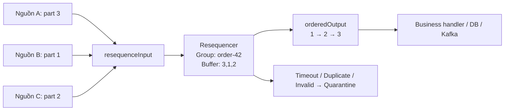
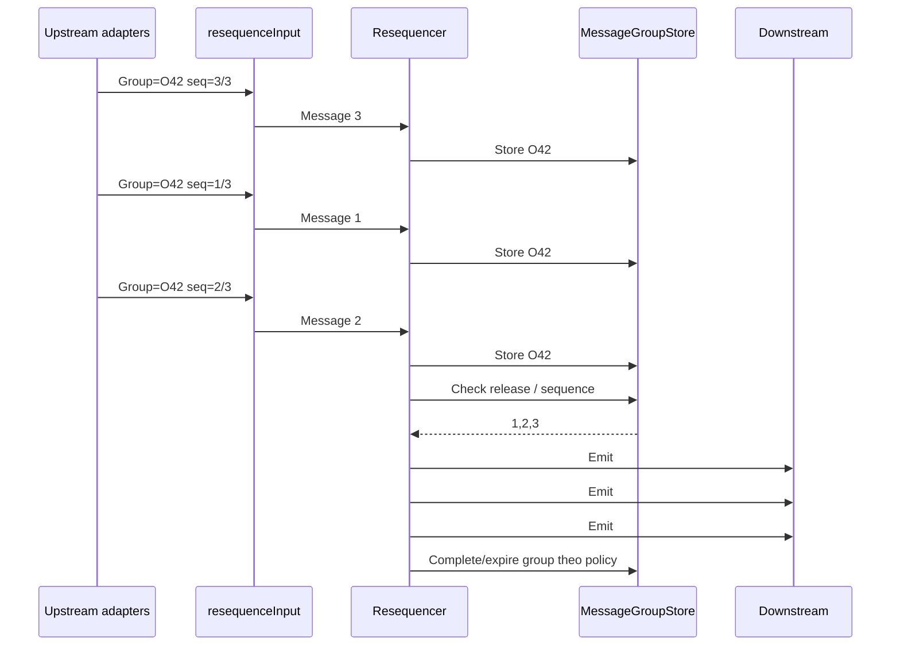
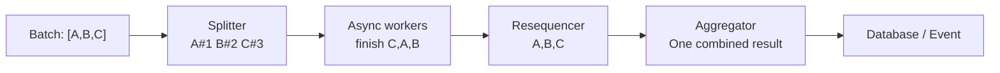
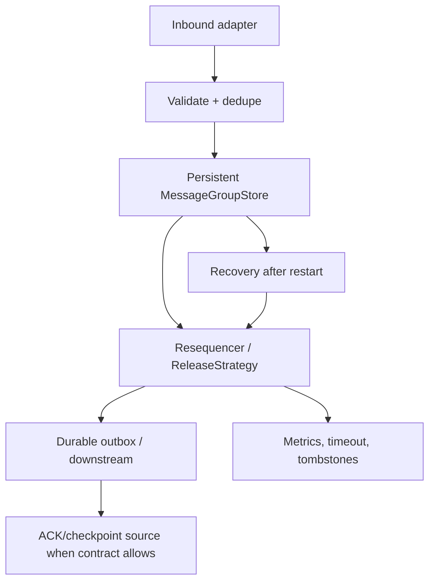
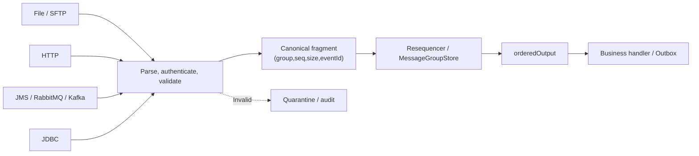
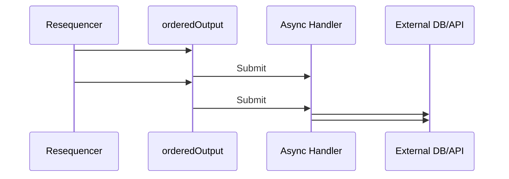

# Resequencer cho message đến lệch thứ tự trong Spring Integration

> **Chương:** Design patterns  
> **Bài học:** Resequencer cho message đến lệch thứ tự  
> **Module:** `SPRING_INTEGRATION_ADAPTERS` — kết nối hệ thống ngoài với Spring Integration qua inbound/outbound adapter, gateway, poller và `MessageChannel`, bao gồm File, SFTP, HTTP, JMS, AMQP/RabbitMQ, Kafka, JDBC cùng hợp đồng message, lỗi và vòng đời kết nối.  
> **Đối tượng:** Java/Spring Boot developer, integration engineer, người thiết kế luồng EIP và hệ thống xử lý thông điệp bất đồng bộ.  
> **Ngữ cảnh mã minh họa:** Java 17+, Spring Boot 3.x và Spring Integration 6.x dùng các phiên bản được quản lý tương thích bởi Boot BOM. Cú pháp DSL và chính sách release/store cần đối chiếu phiên bản ứng dụng trước khi triển khai thực tế.

## 1. Bài toán: dữ liệu đúng nhưng thứ tự đến sai

Một đối tác gửi đơn hàng gồm ba phần: `HEADER`, `DETAILS` và `SUMMARY`. Dù bên gửi tạo theo thứ tự 1 → 2 → 3, hệ thống nhận có thể thấy 3 → 1 → 2. Lý do có thể là nhiều Kafka partitions, nhiều JMS/AMQP consumers, file SFTP hoàn tất ở thời điểm khác nhau, HTTP callbacks về không cùng thứ tự hoặc retry một fragment chậm hơn fragment khác.

Nếu bộ xử lý lưu `SUMMARY` trước `HEADER`, nó có thể ghi sai trạng thái đơn hàng, tính tổng tiền khi chưa có chi tiết hoặc phát event hoàn thành quá sớm.

**Resequencer** là mẫu Enterprise Integration Pattern (EIP) dùng để **gom theo khóa tương quan (correlation), giữ các message đến lệch thứ tự và phát lại theo số thứ tự (sequence)** trước khi chuyển cho downstream.



**Resequencer không biến một giao thức mất thứ tự thành hệ thống exactly-once.** Nó chỉ giải bài toán **thứ tự phát ra trong phạm vi nhóm** và trong các điều kiện metadata/store/release đã cấu hình. Đảm bảo không mất dữ liệu, không xử lý trùng, transaction và thời điểm ACK của adapter cần thiết kế riêng.

### 1.1. Kết quả học tập

Sau bài này, bạn có thể:

1. Giải thích khi nào cần Resequencer, khác gì Aggregator, Splitter, Router, Sort và Queue.
2. Xác định contract `correlationId`, `sequenceNumber`, `sequenceSize`, khóa tenant/batch/version và điều kiện phát message.
3. Dùng `IntegrationFlow.resequence()` để nhận message từ `MessageChannel`, group theo correlation và phát theo thứ tự.
4. Viết bài lab Spring Boot có dữ liệu thử cố ý gửi thứ tự **3 → 1 → 2**, kiểm tra đầu ra **1 → 2 → 3**.
5. Biết những điểm dễ sai: thiếu fragment, trùng số thứ tự, sequence size không nhất quán, fragment đến muộn, group không bao giờ hoàn tất.
6. Thiết kế release/timeout/expiry, `MessageGroupStore`, bounded memory, back-pressure và xử lý khi restart.
7. Liên hệ Resequencer với File, SFTP, HTTP, JMS, AMQP, Kafka, JDBC, bao gồm ACK/offset/checkpoint.
8. Đưa ra tiêu chí nghiệm thu, metrics/alert, runbook và kiểm thử lỗi trong production.

### 1.2. Bốn giới hạn phải ghi nhớ

- **Thứ tự theo nhóm, không phải toàn hệ thống:** `order-42` có thể hoàn thành xen kẽ `order-43`, miễn mỗi nhóm phát theo trình tự của chính nó.
- **Thứ tự phải được định nghĩa rõ:** `sequenceNumber=2` chỉ có ý nghĩa khi nguồn phát quy định 1,2,3,...; không thể “đoán” trình tự nghiệp vụ đáng tin từ thời gian nhận.
- **Đến đủ message không đồng nghĩa đã xử lý bền vững:** sau Resequencer còn handler, broker, database và ACK.
- **Phải định nghĩa chính sách khi thiếu/đến muộn:** giữ mãi làm kẹt nhóm; bỏ qua tùy tiện có thể phá hợp đồng nghiệp vụ.

## 2. Resequencer hoạt động như thế nào?

### 2.1. Các bước logic

Một Resequencer thường thực hiện chu trình:

1. **Nhận message** từ inbound channel.
2. **Xác định correlation key** để biết message thuộc nhóm nào.
3. **Đọc sequence metadata** và xác minh hợp lệ.
4. **Ghi vào message group store** tương ứng, có thể ở bộ nhớ hoặc lưu bền vững.
5. **Đánh giá release policy:** đã đủ và liên tục từ vị trí mong đợi hay chưa? Có cho phép partial release không?
6. **Phát các message theo trình tự**, giữ nguyên payload/headers cần thiết.
7. **Cập nhật hoặc xóa group state** theo expiry/completion policy, thu dọn phần còn lại.
8. **Ghi metrics/audit** khi duplicate, timeout, late arrival hoặc metadata không nhất quán.



Sơ đồ giả định **chính sách giữ tới khi đủ nhóm**. Một số cấu hình Resequencer hỗ trợ phát từng dải liên tục (partial sequences) sớm hơn, ví dụ khi đã có #1 có thể phát #1 mà chưa cần #2/#3. Do đó phải phân biệt **“đầu ra luôn có thứ tự”** và **“chỉ phát khi đủ N phần”**; hai yêu cầu khác nhau.

### 2.2. Sequence group và bộ đệm

Cho ba message:

| Thời điểm nhận | Correlation key | Sequence number | Sequence size | Payload |
|---|---|---:|---:|---|
| 10:00:01 | `tenant-a:order-42:v1` | 3 | 3 | `SUMMARY` |
| 10:00:02 | `tenant-a:order-42:v1` | 1 | 3 | `HEADER` |
| 10:00:03 | `tenant-a:order-42:v1` | 2 | 3 | `DETAILS` |

Resequencer phải phát ra 1,2,3 theo chính sách release. Nếu có thêm message từ `tenant-b:order-42:v1`, đó phải là **một group khác**, vì tenant là một phần identity của nhóm.

### 2.3. Correlation không phải thứ tự

- **Correlation ID:** xác định message nào thuộc cùng một nhóm.
- **Sequence number:** chỉ vị trí của mỗi message trong nhóm.
- **Sequence size:** chỉ kích thước nhóm kỳ vọng, nếu biết trước.
- **Message ID:** nhận dạng một message instance trong framework, không phải khóa dedupe nghiệp vụ xuyên retry.
- **Event ID / fragment ID:** nhận diện cùng một fragment khi bị giao lại, phải bền vững qua các lần nhận.
- **Tenant/partner/batch:** là ràng buộc namespace, kiểm tra quyền, tránh gộp chéo khách hàng hoặc đợt xử lý.

Một message từ HTTP có header `correlationId=order-42` không nhất thiết đáng tin. Nếu user tự điền correlation/tenant, backend phải xác minh và dựng khóa canonical từ identity/authorization context đáng tin trước khi nhập Resequencer.

## 3. Message contract tối thiểu và cách xác minh

### 3.1. Header Spring Integration

Trong các phiên bản Spring Integration hiện đại, nhóm header thông dụng bao gồm:

| Header | Loại giá trị điển hình | Ví dụ | Công dụng |
|---|---|---|---|
| `correlationId` | Object/String | `tenant-a:O42:v1` | Chọn message group |
| `sequenceNumber` | Integer | `2` | Vị trí fragment |
| `sequenceSize` | Integer | `3` | Số fragment kỳ vọng |
| `id` | UUID do framework cấp | Một UUID mỗi message | Trace nội bộ, không phải fragment key |
| `timestamp` | Timestamp khi tạo message | Epoch millisecond | Hỗ trợ quan sát, không tự quyết định thứ tự |
| `eventId` | Chuỗi nghiệp vụ do app quản lý | `O42-p2-v1` | Idempotent dedupe |
| `tenantId` | Chuỗi đã xác minh | `tenant-a` | Isolation/authorization |

Tên key và kiểu header thực phải theo Spring Integration version. Trong Java, tránh tự viết magic string khi có hằng số tương ứng, ví dụ `IntegrationMessageHeaderAccessor.CORRELATION_ID`, `SEQUENCE_NUMBER` và `SEQUENCE_SIZE`. Những header này thường được tạo bởi **Splitter** chuẩn, nhưng **không phải mọi inbound transport đều tự cung cấp**.

### 3.2. Schema fragment ví dụ

```json
{
  "eventId": "O42-part-02-v1",
  "groupKey": "tenant-a:O42:v1",
  "sequenceNumber": 2,
  "sequenceSize": 3,
  "schemaVersion": 1,
  "tenantId": "tenant-a",
  "payload": {
    "kind": "DETAILS",
    "orderId": "O42",
    "items": [{"sku": "P100", "quantity": 2}]
  }
}
```

Đây là hợp đồng **nghiệp vụ**, không phải format mặc định của Resequencer. Tại ingress:

1. Xác thực source/client và tenant trước khi tin `tenantId` hoặc `groupKey`.
2. Validate `sequenceNumber >= 1`, và với nhóm có kích thước biết trước, `sequenceSize >= 1`, `sequenceNumber <= sequenceSize`.
3. Kiểm tra group key có tenant, business ID và batch/version hoặc generation để tránh lẫn các lần xử lý.
4. Giữ `eventId` ổn định qua retry; không sinh UUID mới rồi coi đó là dedupe key.
5. Chặn thay đổi `sequenceSize` giữa chừng cho cùng group, hoặc áp dụng explicit schema/contract migration.
6. Xác định phải làm gì nếu có hai payload khác nhau cùng `groupKey + sequenceNumber`.
7. Giới hạn kích thước payload, số fragment tối đa, số nhóm active và retention, tránh DoS/buffer tăng vô hạn.

### 3.3. Sequence size không biết trước

Nếu nguồn stream không biết tổng số phần, không thể giả định group “đủ” chỉ vì tạm thời chưa có thêm message. Cần một trong các hợp đồng:

- Một event `EndOfBatch` xác thực là kết thúc nhóm, kèm số fragment cuối cùng.
- Một watermark/điều kiện chốt lô đã thỏa thuận, cộng độ trễ chấp nhận được.
- Một protocol chunked có index và marker kết thúc.
- Cho phép **partial sequence release** có ranh giới, cùng cơ chế xử lý gap/late arrival.

**Không dùng timeout đơn thuần để tuyên bố đủ dữ liệu** nếu business bắt buộc đủ tất cả phần. Timeout chỉ chứng minh đã đợi quá lâu, không chứng minh fragment bị mất hoặc sẽ không đến.

### 3.4. Thứ tự nào là đúng?

Cần phân biệt:

| Mô hình thứ tự | Nguồn sự thật | Resequencer mặc định có phù hợp? |
|---|---|---|
| Thứ tự fragment 1..N trong một batch | `sequenceNumber` do producer cấp | **Có**, nếu contract và release policy đúng |
| Thứ tự version của một entity | Monotonic version/offset/epoch | Có thể dùng nếu mỗi message có sequence metadata và gap policy |
| Thứ tự event time | Timestamp sự kiện có thể đến muộn | Cần event-time watermark/late-data policy; không tự suy từ arrival |
| Thứ tự nhận ở broker partition | Offset Kafka trong một partition | Kafka đã có thứ tự partition; có thể không cần resequence |
| Thứ tự toàn cluster Kafka | Không có offset toàn cục giữa partitions | **Không tự giải được** nếu thiếu sequence toàn cục đáng tin |
| Thứ tự phụ thuộc nghiệp vụ | Dependency DAG/causal graph | Cần causal ordering/workflow state; Resequencer số nguyên có thể chưa đủ |

## 4. Resequencer khác gì các mẫu EIP liên quan?

### 4.1. So sánh chức năng

| Pattern | Câu hỏi giải quyết | Đầu ra | Khi cần |
|---|---|---|---|
| **Splitter** | Tách một message thành nhiều phần như thế nào? | Nhiều message có thể mang sequence headers | File lớn, danh sách đơn hàng, batch records |
| **Resequencer** | Phát lại các phần theo vị trí đúng ra sao? | Các message riêng lẻ theo đúng thứ tự trong group | Fragment đến lệch thứ tự |
| **Aggregator** | Gộp nhiều message thành một kết quả như thế nào? | Thường một message kết hợp | Tổng hợp các phần và chỉ xuất một đơn hàng |
| **Router** | Chọn luồng xử lý/đích nào? | Một hoặc nhiều tuyến tùy router | Định tuyến theo loại event/tenant |
| **Filter** | Message nào được đi tiếp? | Giữ hoặc loại từng message | Validation sơ cấp, loại duplicate (khi có state) |
| **Delayer** | Khi nào message được gửi tiếp? | Message trễ theo lịch | Rate limiting, scheduling, không tự sắp thứ tự |
| **PublishSubscribeChannel** | Phát tới nhiều subscriber? | Nhiều bản sao downstream | Fan-out; không tự đảm bảo thứ tự qua các async subscriber |

### 4.2. Splitter + Resequencer + Aggregator



Đừng nhầm rằng Splitter + Aggregator **luôn cần** Resequencer. Nếu Aggregator là phép gộp **không phụ thuộc thứ tự** (ví dụ cộng số lượng), có thể không cần Resequencer. Nếu Aggregator cần chuỗi tuần tự có ý nghĩa (ví dụ ghép các chunk theo vị trí), Resequencer hoặc một aggregation strategy sắp thứ tự có thể cần thiết.

### 4.3. Hệ quả của việc đưa Resequencer vào flow

- Tăng **state**: phải lưu fragment và group progress.
- Tăng **latency**: message đến sớm có thể bị giữ vì chờ vị trí còn thiếu.
- Có thể gây **head-of-line blocking** trong group.
- Cần chính sách **expiry** và nhóm thiếu fragment.
- Đòi hỏi **đúng contract** để không gộp sai hoặc phát trùng.
- Phải chú ý downstream async: sau khi phát theo thứ tự, nhiều executor/partitions vẫn có thể làm side effect hoàn tất lệch thứ tự.

Không thêm Resequencer chỉ để “chữa mọi message đến muộn”. Hãy chứng minh thứ tự nào đã bị mất, tại ranh giới nào và downstream có thật sự yêu cầu ordered processing không.


## 5. Resequencer trong Spring Integration

### 5.1. Các thành phần framework

Trong Spring Integration, Resequencer thuộc nhóm **stateful correlation handlers**: nó phải nhớ những message cùng nhóm đã đến. Những đối tượng quan trọng:

| Thành phần | Trách nhiệm |
|---|---|
| `ResequencingMessageHandler` | Handler gom theo correlation và phát lại theo sequence |
| `MessageGroupStore` | Lưu message group / progress, mặc định có thể dùng store bộ nhớ |
| `CorrelationStrategy` | Tính group key từ message |
| `ReleaseStrategy` | Quyết định một nhóm/dải message đã đủ điều kiện release |
| `MessageGroup` | Trạng thái tập các message cùng correlation key |
| `MessageChannel` | Ranh giới đưa message vào/ra resequencer |
| `IntegrationFlow` / Java DSL | Khai báo topology và endpoint lifecycle |
| `MessageGroupStoreReaper` / expiry policy | Dọn các group cũ theo chính sách có chủ đích |

Không phải mọi thứ trong bảng đều cần khai báo bean thủ công khi dùng mặc định. Tuy nhiên, production phải **biết mặc định đang là gì** và xác định được cách xử lý group chưa hoàn thành.

### 5.2. Flow tối thiểu

Một cách viết Java DSL:

```java
@Bean("orderedFragmentsFlow")
IntegrationFlow orderedFragmentsFlow() {
    return IntegrationFlow
        .from("resequenceInput")
        .resequence()
        .channel("orderedOutput")
        .get();
}
```

Ý nghĩa:

- `resequenceInput` là channel chứa fragment đã có metadata đáng tin.
- `.resequence()` thêm resequencing endpoint, dùng group/sequence metadata theo convention của Spring Integration.
- `orderedOutput` nhận các message được phát theo thứ tự của **mỗi group**.
- Cần một consumer cho `orderedOutput`; nếu channel đồng bộ mà không có subscriber, việc dispatch có thể lỗi.
- Không nên thay `orderedOutput` thành một async channel rồi tuyên bố mọi **side effect** sẽ theo đúng thứ tự: executor/broker downstream có thể phá thứ tự thực thi.

**Lưu ý phiên bản:** Khi dùng callback DSL để thay `releaseStrategy`, `messageStore`, `groupTimeout` hoặc các tùy chọn expiry, cần đối chiếu API trên đúng dòng Spring Integration 6.x/phiên bản project. Bài lab phía dưới sử dụng `.resequence()` cơ bản và kiểm thử **trình tự output**, không gán các cấu hình release không được xác nhận.

### 5.3. Cơ chế release: đủ nhóm và dải liên tục

Hai mô hình nghiệp vụ phổ biến:

**Mô hình A — Chỉ phát sau khi đủ nhóm:** Với `sequenceSize=3`, đợi đủ 1,2,3 rồi mới phát 1→2→3. Phù hợp khi mọi fragment phải sẵn sàng mới được áp dụng, nhưng latency và memory có thể lớn.

**Mô hình B — Phát dần dải liên tục:** Khi nhận 3,1,2, có thể phát #1 ngay lúc nhận #1; sau đó #2 và #3 khi dải liền kề đã đủ. Phù hợp với các consumer có thể xử lý incremental, nhưng phải lưu `nextExpected` và đảm bảo late duplicate không được phát lại.

Cách release mặc định và tùy chọn partial-sequence của Spring Integration phụ thuộc API/configuration: **không nên khẳng định một lời gọi `.resequence()` sẽ luôn đợi đủ N trước khi phát bất kỳ fragment nào**. Để xác nhận hành vi, viết test lúc mới có #3, rồi #1 nhưng chưa có #2, và cuối cùng #2, đo cả output sớm và output cuối.

### 5.4. Việc cần quyết định khi cấu hình

| Quyết định | Câu hỏi | Hệ quả |
|---|---|---|
| Correlation key | Group theo order, batch hay tenant+order+version? | Sai key có thể trộn dữ liệu giữa khách hàng |
| Sequence extraction | Header đã được normalize? | Sai type/number làm group không hoàn thành |
| Release policy | Full-group hay contiguous partial? | Latency và điều kiện nghiệp vụ |
| Message store | RAM hay durable store? | Khả năng phục hồi sau restart/crash |
| Group expiry | Đợi bao lâu? | Memory/backlog vs missing-part policy |
| Late arrivals | Sau khi group complete thì xử lý ra sao? | Duplicate/replay hay group mở lại |
| Duplicate detection | Cùng group+sequence, eventId/payload khác nhau? | Phải quarantine conflict |
| Concurrency | Nhiều ingress threads/instances có chạm cùng group? | Lock/transaction/ordering |
| Downstream | Chạy đồng bộ hay async? | Thứ tự phát chưa chắc là thứ tự hoàn tất |
| ACK boundary | Khi nào nguồn được coi hoàn thành? | Mất dữ liệu hoặc duplicate |

## 6. Lab Spring Boot: message đến 3–1–2, đầu ra 1–2–3

### 6.1. Mục tiêu và giới hạn

Lab thuần **in-memory** tạo ba message có cùng group ID, gửi vào `DirectChannel` theo thứ tự đảo, dùng `IntegrationFlow.resequence()`, rồi thu output để xác minh:

```text
INPUT             RESEQUENCER           OUTPUT
O42 #3  --------> buffer #3
O42 #1  --------> buffer/partial          O42 #1 (tùy release policy)
O42 #2  --------> #2 fills gap           O42 #2, O42 #3
                                       cuối cùng: #1, #2, #3
```

Do không có broker, test không thể chứng minh JMS ACK, Kafka offset commit, SFTP checkpoint hay durable recovery. Nó chứng minh **cách ánh xạ metadata và việc output có thứ tự** trong một Spring Boot context.

### 6.2. Dependencies

Dùng project Spring Boot 3.x có parent hoặc import BOM tương thích với Java 17+. Ví dụ phần `<dependencies>` trong POM hợp lệ:

```xml
<dependencies>
    <dependency>
        <groupId>org.springframework.boot</groupId>
        <artifactId>spring-boot-starter-integration</artifactId>
    </dependency>
    <dependency>
        <groupId>org.springframework.boot</groupId>
        <artifactId>spring-boot-starter-test</artifactId>
        <scope>test</scope>
    </dependency>
    <dependency>
        <groupId>org.springframework.integration</groupId>
        <artifactId>spring-integration-test</artifactId>
        <scope>test</scope>
    </dependency>
</dependencies>
```

Phần core/gateway/DSL/resequencer trong lab không cần SFTP/Kafka/JDBC adapter module. Nếu mở rộng vào các transport thật, chỉ thêm các module tương ứng và runtime client/starter thích hợp. Không ghép các phiên bản Spring Integration khác dòng Boot BOM.

Tương đương Gradle Groovy DSL với Boot dependency management đã cấu hình:

```groovy
dependencies {
    implementation 'org.springframework.boot:spring-boot-starter-integration'
    testImplementation 'org.springframework.boot:spring-boot-starter-test'
    testImplementation 'org.springframework.integration:spring-integration-test'
}
```

### 6.3. Cấu trúc thư mục

```text
resequencer-lab/
├── pom.xml
└── src/
    ├── main/
    │   ├── java/com/example/resequence/
    │   │   ├── ResequencerApplication.java
    │   │   ├── OrderPart.java
    │   │   ├── ResequencerConfig.java
    │   │   └── OrderedOutputProbe.java
    │   └── resources/application.yml
    └── test/
        └── java/com/example/resequence/
            └── ResequencerFlowTest.java
```

Dùng một package thống nhất để `@SpringBootApplication` quét `@Configuration` và `@Component`. Spring Boot context được khởi tạo trong tests; không dùng nguồn ngoài hoặc message chứa dữ liệu cá nhân thật.

### 6.4. Main class

File `ResequencerApplication.java`:

```java
package com.example.resequence;

import org.springframework.boot.SpringApplication;
import org.springframework.boot.autoconfigure.SpringBootApplication;

@SpringBootApplication
public class ResequencerApplication {
    public static void main(String[] args) {
        SpringApplication.run(ResequencerApplication.class, args);
    }
}
```

File `application.yml`:

```yaml
spring:
  application:
    name: resequencer-lab
  main:
    web-application-type: none

logging:
  level:
    com.example.resequence: INFO
    org.springframework.integration: INFO
```

Không tạo HTTP server cho một lab thuần in-memory. Với production nhận HTTP inbound gateway, cần web runtime và security, không giữ `web-application-type: none`.

### 6.5. Payload có kiểu

File `OrderPart.java`:

```java
package com.example.resequence;

public record OrderPart(
        String orderId,
        String label,
        int fragmentNo,
        int fragmentCount
) {
    public OrderPart {
        if (orderId == null || orderId.isBlank()) {
            throw new IllegalArgumentException("orderId is required");
        }
        if (fragmentCount < 1
                || fragmentNo < 1
                || fragmentNo > fragmentCount) {
            throw new IllegalArgumentException("Invalid sequence metadata");
        }
    }
}
```

Record cố tình không biết tenant/partner. Trong ứng dụng multi-tenant thật, thêm tenant đã được xác thực vào contract và group key; không xây ID từ field của external request chưa tin cậy.

### 6.6. Đầu ra có thể quan sát để test

File `OrderedOutputProbe.java`:

```java
package com.example.resequence;

import java.time.Duration;
import java.util.ArrayList;
import java.util.List;
import java.util.concurrent.BlockingQueue;
import java.util.concurrent.LinkedBlockingQueue;
import java.util.concurrent.TimeUnit;

import org.springframework.integration.IntegrationMessageHeaderAccessor;
import org.springframework.messaging.Message;
import org.springframework.stereotype.Component;

@Component
public class OrderedOutputProbe {

    public record Observed(
            Object group,
            int number,
            OrderPart payload
    ) {}

    private final BlockingQueue<Observed> events =
            new LinkedBlockingQueue<>();

    public void capture(Message<?> message) {
        Object raw = message.getHeaders().get(
            IntegrationMessageHeaderAccessor.SEQUENCE_NUMBER
        );
        Object group = message.getHeaders().get(
            IntegrationMessageHeaderAccessor.CORRELATION_ID
        );
        if (!(raw instanceof Number number)
                || !(message.getPayload() instanceof OrderPart part)) {
            throw new IllegalArgumentException(
                "Expected sequenced OrderPart"
            );
        }
        events.add(new Observed(group, number.intValue(), part));
    }

    public List<Observed> takeExactly(
            int expected, Duration timeout) throws InterruptedException {
        List<Observed> result = new ArrayList<>();
        long deadline = System.nanoTime() + timeout.toNanos();

        while (result.size() < expected) {
            long remaining = deadline - System.nanoTime();
            if (remaining <= 0) {
                break;
            }
            Observed event =
                events.poll(remaining, TimeUnit.NANOSECONDS);
            if (event == null) {
                break;
            }
            result.add(event);
        }
        return result;
    }

    public void clear() {
        events.clear();
    }
}
```

`LinkedBlockingQueue` làm probe thread-safe ở phạm vi một JVM. Với test trong CI, `takeExactly` dùng **deadline hữu hạn** thay vì `Thread.sleep` cố định; khi không đủ event, assert sẽ hiển thị số lượng thực nhận.

Đây là probe dành cho lab. Production không nên lưu tất cả payload vào RAM chỉ để quan sát; dùng metrics/tracing/audit có kiểm soát và không log dữ liệu nhạy cảm.


### 6.7. Bean config: inbound channel, Resequencer và output consumer

File `ResequencerConfig.java`:

```java
package com.example.resequence;

import org.springframework.context.annotation.Bean;
import org.springframework.context.annotation.Configuration;
import org.springframework.integration.channel.DirectChannel;
import org.springframework.integration.dsl.IntegrationFlow;
import org.springframework.messaging.MessageChannel;

@Configuration(proxyBeanMethods = false)
public class ResequencerConfig {

    @Bean("resequenceInput")
    MessageChannel resequenceInput() {
        return new DirectChannel();
    }

    @Bean("orderedOutput")
    MessageChannel orderedOutput() {
        return new DirectChannel();
    }

    @Bean("resequencerFlow")
    IntegrationFlow resequencerFlow() {
        return IntegrationFlow
            .from("resequenceInput")
            .resequence()
            .channel("orderedOutput")
            .get();
    }

    @Bean("orderedSinkFlow")
    IntegrationFlow orderedSinkFlow(OrderedOutputProbe probe) {
        return IntegrationFlow
            .from("orderedOutput")
            .handle(message -> probe.capture(message))
            .get();
    }
}
```

Điểm cần hiểu:

1. `resequenceInput` là channel đầu vào, không phải handler.
2. `.resequence()` quản lý stateful message grouping; nó cần sequence headers.
3. `orderedOutput` là `DirectChannel`, nên dispatch downstream trong một đường đồng bộ thông thường. Điều này giúp lab quan sát thứ tự phát; không tự bảo đảm thứ tự hoàn tất nếu handler sau đó submit async.
4. `orderedSinkFlow` tiêu thụ message được phát; thiếu subscriber ở `orderedOutput` có thể gây lỗi delivery.
5. Tên bean `resequencerFlow` khác channel name; đặt tên rõ để debug và tránh nhầm lẫn.
6. Cấu hình **chưa cung cấp durable group store**, expiry policy, duplicate business dedupe hoặc ingress ACK. Đó là chủ đề production riêng.

### 6.8. Publisher mô phỏng message đến lệch thứ tự

File `OrderFragmentPublisher.java`, đặt trong cùng package như một bean `@Component`:

```java
package com.example.resequence;

import org.springframework.beans.factory.annotation.Qualifier;
import org.springframework.integration.IntegrationMessageHeaderAccessor;
import org.springframework.messaging.MessageChannel;
import org.springframework.messaging.support.MessageBuilder;
import org.springframework.stereotype.Component;

@Component
public class OrderFragmentPublisher {

    private final MessageChannel input;

    public OrderFragmentPublisher(
            @Qualifier("resequenceInput") MessageChannel input) {
        this.input = input;
    }

    public boolean send(String groupKey, OrderPart part) {
        return input.send(
            MessageBuilder.withPayload(part)
                .setHeader(
                    IntegrationMessageHeaderAccessor.CORRELATION_ID,
                    groupKey
                )
                .setHeader(
                    IntegrationMessageHeaderAccessor.SEQUENCE_NUMBER,
                    part.fragmentNo()
                )
                .setHeader(
                    IntegrationMessageHeaderAccessor.SEQUENCE_SIZE,
                    part.fragmentCount()
                )
                .build()
        );
    }
}
```

Sửa cấu trúc thư mục mục 6.3 bằng cách thêm `OrderFragmentPublisher.java` cùng package với các class khác.

Hàm `send(...)` cố tình yêu cầu caller cung cấp group key. Trong production, một ingress validator phải **tự tính khóa canonical**, ví dụ `tenantId:orderId:batchVersion`, sau khi xác minh tenant và event source. Không đưa raw HTTP/JMS/Kafka header của bên ngoài thẳng vào correlation group mà không kiểm tra.

Một điểm nữa: message `id` do Spring cấp cho từng lần xây message có thể khác sau retry. Để idempotency, mang `eventId` hoặc `fragmentId` ổn định trong payload/header được quản lý bởi ứng dụng.

### 6.9. Chạy ứng dụng

Với Maven project có wrapper:

```bash
./mvnw spring-boot:run
```

Hoặc Gradle project tương ứng:

```bash
./gradlew bootRun
```

Trên Windows dùng `mvnw.cmd` hoặc `gradlew.bat`. Trong cấu hình hiện tại, app khởi động nhưng **không tự sinh message** vì chưa có inbound adapter hoặc `ApplicationRunner`; việc gửi message được thực hiện trong test ở mục 7.

Có thể thêm `ApplicationRunner` demo, nhưng không nên phát dữ liệu giả tự động mỗi lần app production chạy. Giữ test fixture và demo generator riêng để tránh trùng event khi scaling/rolling restart.

## 7. Kiểm thử Resequencer theo thứ tự và theo nhóm

### 7.1. Test 3 → 1 → 2

File `ResequencerFlowTest.java`:

```java
package com.example.resequence;

import java.time.Duration;
import java.util.List;
import java.util.UUID;

import org.junit.jupiter.api.BeforeEach;
import org.junit.jupiter.api.Test;
import org.springframework.beans.factory.annotation.Autowired;
import org.springframework.boot.test.context.SpringBootTest;

import static org.assertj.core.api.Assertions.assertThat;

@SpringBootTest(properties = "spring.main.web-application-type=none")
class ResequencerFlowTest {

    @Autowired
    OrderFragmentPublisher publisher;

    @Autowired
    OrderedOutputProbe probe;

    @BeforeEach
    void clearProbe() {
        probe.clear();
    }

    @Test
    void resequencesOutOfOrderPartsWithinOneGroup()
            throws InterruptedException {
        String group = "tenant-a:O42:" + UUID.randomUUID();

        assertThat(publisher.send(
            group, new OrderPart("O42", "SUMMARY", 3, 3)
        )).isTrue();
        assertThat(publisher.send(
            group, new OrderPart("O42", "HEADER", 1, 3)
        )).isTrue();
        assertThat(publisher.send(
            group, new OrderPart("O42", "DETAILS", 2, 3)
        )).isTrue();

        List<OrderedOutputProbe.Observed> ordered =
            probe.takeExactly(3, Duration.ofSeconds(5));

        assertThat(ordered).hasSize(3);
        assertThat(ordered.stream()
                .map(OrderedOutputProbe.Observed::number))
            .containsExactly(1, 2, 3);

        assertThat(ordered.stream()
                .map(x -> x.payload().label()))
            .containsExactly("HEADER", "DETAILS", "SUMMARY");

        assertThat(ordered.stream()
                .map(OrderedOutputProbe.Observed::group))
            .containsOnly(group);
    }
}
```

**Ý nghĩa của test:** Ba fragment đến theo thứ tự 3,1,2 nhưng đầu ra cuối cùng phải có 1,2,3 trong cùng group. Số lượng 3 xác nhận mọi fragment đã được phát ở lần chạy đó.

**Điều test chưa chứng minh:** Không mất fragment khi JVM crash; không có duplicate khi broker redeliver; không có timeout nếu thiếu #2; không chứng minh hai consumer cùng group trong hai pod dùng chung state. Những bài toán đó cần bài test bổ sung ở mục sau.

### 7.2. Kiểm tra hai group xen kẽ

Ví dụ thêm test vào cùng class:

```java
@Test
void interleavedGroupsKeepTheirOwnOrder()
        throws InterruptedException {
    String a = "tenant-a:O10:" + UUID.randomUUID();
    String b = "tenant-a:O11:" + UUID.randomUUID();

    assertThat(publisher.send(a, new OrderPart("O10", "A-2", 2, 2)))
        .isTrue();
    assertThat(publisher.send(b, new OrderPart("O11", "B-2", 2, 2)))
        .isTrue();
    assertThat(publisher.send(a, new OrderPart("O10", "A-1", 1, 2)))
        .isTrue();
    assertThat(publisher.send(b, new OrderPart("O11", "B-1", 1, 2)))
        .isTrue();

    var all = probe.takeExactly(4, Duration.ofSeconds(5));
    assertThat(all).hasSize(4);

    assertThat(all.stream()
            .filter(x -> a.equals(x.group()))
            .map(OrderedOutputProbe.Observed::number))
        .containsExactly(1, 2);

    assertThat(all.stream()
            .filter(x -> b.equals(x.group()))
            .map(OrderedOutputProbe.Observed::number))
        .containsExactly(1, 2);
}
```

Mục tiêu là **thứ tự trong từng group**. **Không assert** nhóm A phải phát tất cả trước B: khi các group được xử lý độc lập, chúng có thể xen kẽ theo lịch nhận, concurrency và release strategy.

### 7.3. Kiểm tra metadata không hợp lệ

Một input có `sequenceNumber=0` hoặc `sequenceNumber>sequenceSize` phải bị từ chối **trước** khi vào Resequencer:

```java
@Test
void invalidPartMetadataIsRejected() {
    assertThatThrownBy(() -> new OrderPart(
        "O42", "INVALID", 4, 3
    )).isInstanceOf(IllegalArgumentException.class);
}
```

Để biên dịch đoạn test này, thêm static import:

```java
import static org.assertj.core.api.Assertions.assertThatThrownBy;
```

Test này kiểm tra constructor record, **không kiểm tra mọi header do adapter ngoài cung cấp**. Trong production, viết ingress validation filter/transformer để kiểm tra **cả payload và sequence headers** đồng nhất, vì một client có thể gửi payload hợp lệ nhưng header sequence sai.

### 7.4. Kiểm thử đúng release policy của phiên bản

Đừng chỉ gửi đủ #1,#2,#3 rồi xem output. Cần quan sát **trạng thái trước khi nhóm đủ**:

| Bước | Input | Điều cần kiểm tra |
|---|---|---|
| A | Chỉ gửi #3 | Không phát #3 khi thiếu #1 và #2 |
| B | Gửi thêm #1 | Xác định có phát #1 sớm hay giữ chờ đủ nhóm theo policy |
| C | Gửi #2 | Output cuối bảo đảm #1,#2,#3 |
| D | Gửi duplicate #2 | Hành vi của store/handler và lớp idempotency |
| E | Không bao giờ gửi #2 | Group timeout/expiry/quarantine đúng |
| F | Thay đổi size 3 → 4 giữa chừng | Metadata conflict bị từ chối |

Đặc biệt, nếu yêu cầu **all-or-nothing**, không được dựa vào mặc định `.resequence()` mà chưa chứng minh nó có release policy đó. Có thể chọn một custom `ReleaseStrategy` hoặc đặt Aggregator trước downstream để kiểm soát hoàn tất batch, tùy semantics.

### 7.5. Test output chỉ là một phần hợp đồng

Trong test ở mục 7.1, lời gọi `publisher.send(...)` trả `true` cho biết channel chấp nhận message theo contract. Vì `DirectChannel` dispatch đồng bộ vào handler đầu vào, exception tại handler có thể propagate. Nhưng khi thêm `ExecutorChannel` hoặc Kafka inbound adapter, `send=true` **không chứng minh** fragment được lưu bền vững hay đã tạo side effect downstream.

Để đánh giá production, cần so sánh:

- **Input accepted**: số fragment ingress đã xác thực và có ACK phù hợp.
- **Stored**: số fragment/nhóm hiện có ở store, công việc còn thiếu.
- **Released**: số fragment đã được Resequencer phát.
- **Business completed**: số fragment đã commit downstream theo contract.
- **Source acknowledged**: số fragment nguồn đã ACK/offset commit.
- **Replayed/duplicates**: số lần nhận lại cùng business key.

Không gộp tất cả vào một metric `messagesProcessed` vì sẽ che khoảng mất dữ liệu.


## 8. Release strategy: đủ nhóm, partial release và head-of-line blocking

### 8.1. Thế nào là “đủ”?

Định nghĩa group:

- Khóa `g = tenantId + businessId + batchVersion`.
- Tổng số fragment dự kiến `N`.
- Tập fragment hợp lệ đã nhận `S = {1, 2, ...}`.
- Vị trí kế tiếp cần phát `nextExpected`.
- Tập fragment đã phát/được xác nhận `released`.

**Release toàn nhóm** khi `S` chứa đủ các vị trí `1..N` (và không có conflict). **Release từng dải** khi có một chuỗi liên tiếp bắt đầu từ `nextExpected`.

Ví dụ với `N=5`:

| Đã nhận | Full-group policy | Contiguous partial policy |
|---|---|---|
| `{4}` | Giữ | Giữ, thiếu #1 |
| `{1,4}` | Giữ | Có thể phát #1, nextExpected=2 |
| `{1,2,4}` | Giữ | Có thể phát #2, nextExpected=3 |
| `{1,2,3,4}` | Giữ, thiếu #5 | Có thể phát #3,#4 |
| `{1,2,3,4,5}` | Phát #1→#5 | Phát #5 nếu #1→#4 đã ra |

Bảng mô tả **hai chiến lược khái niệm**, không khẳng định đây là mặc định chính xác của một phiên bản DSL cụ thể. Khi chọn chiến lược, hỏi downstream: “Có được áp dụng #1 khi chưa biết #5 sẽ đến không?”. Nếu câu trả lời là không, cần full-group readiness hoặc một Aggregator/transaction boundary bổ sung.

### 8.2. Gap và head-of-line blocking

Khi đã nhận #1,#3,#4,#5 nhưng không có #2, một Resequencer đòi thứ tự chặt phải **giữ lại #3..#5**. Nếu group thuộc một giao dịch nghiệp vụ quan trọng, phát tiếp #3 để “giảm backlog” có thể làm sai dữ liệu.

Các lựa chọn:

1. **Chờ trong deadline hữu hạn:** phù hợp khi nguồn có SLA gửi đủ fragment.
2. **Yêu cầu retransmission:** nếu producer hỗ trợ resend theo `groupKey + sequenceNumber`.
3. **Quarantine group:** giữ evidence và báo cho operator khi thiếu fragment.
4. **Partial result:** chỉ nếu nghiệp vụ chấp nhận thiếu phần, có cờ/trạng thái `INCOMPLETE` tường minh.
5. **Compensation:** nếu đã phát partial, có giao thức sửa/xóa/version lại side effect sau late arrival.

Không lặng lẽ gọi `sequenceSize=5` thành 4 khi thiếu #2 rồi coi group hoàn tất. Điều đó phá hợp đồng producer và khiến debug khó khăn.

### 8.3. Thuật toán tham chiếu (pseudocode)

Pseudocode dưới mô tả một **incremental in-order release có state**, không phải cách Spring Integration tự cài đặt nội bộ:

```text
onFragment(fragment):
    validate source identity + canonical groupKey
    validate 1 <= sequenceNumber <= expectedSize
    lock(groupKey)

    state = loadDurableGroupState(groupKey)

    if state.completed:
        classifyLateArrivalOrDuplicate(fragment)
        unlock(groupKey)
        return

    if expectedSize conflicts with stored size:
        quarantine("SEQUENCE_SIZE_CONFLICT")
        unlock(groupKey)
        return

    if (groupKey, sequenceNumber) already exists:
        if same eventId + same payload digest:
            markDuplicateAndIgnore()
        else:
            quarantine("CONFLICTING_FRAGMENT")
        unlock(groupKey)
        return

    persist(fragment)
    while state.pending contains state.nextExpected:
        candidate = state.pending[nextExpected]
        publishOrStageDurably(candidate, sameBusinessKey)
        markAsReleasedWhenSafe(candidate)
        state.nextExpected += 1

    if state.nextExpected > state.expectedSize:
        markGroupCompleted()

    commitState()
    unlock(groupKey)
```

Những điểm quan trọng:

- `lock(groupKey)` cần là lock phù hợp với **multi-instance**, không chỉ `synchronized` trong một JVM.
- `publishOrStageDurably` không nên là HTTP POST bên trong DB transaction kéo dài nếu không có tính nguyên tử; có thể dùng **transactional outbox** cho bước gửi.
- `markAsReleasedWhenSafe` cần định nghĩa sau bước nào; ghi “released” trước khi gửi thành công có thể làm mất fragment.
- Expiry/retention/late arrivals phải được xử lý bằng một trạng thái nhóm có thể kiểm toán.
- Dedupe và group sequencing là **hai vấn đề liên quan nhưng khác nhau**.

### 8.4. Resequencer không sửa được dữ liệu sai thứ tự nguồn

Nếu producer gán nhầm `DETAILS` thành #1 và `HEADER` thành #2, Resequencer có thể phát chính xác thứ tự **metadata sai**: DETAILS → HEADER. Vì vậy trước khi grouping cần kiểm tra tính nhất quán `kind ↔ sequenceNumber` theo version của schema khi nghiệp vụ yêu cầu.

Nếu producer tái sử dụng group key cho batch mới, fragment cũ đến muộn có thể bị trộn với fragment mới. Thêm `batchVersion`/`generation` và retention policy, không dùng mỗi `orderId` làm group key vĩnh viễn.

## 9. Duplicate, missing, late và conflicting fragments

### 9.1. Bốn trường hợp không được đánh đồng

| Trường hợp | Ví dụ | Hành động khuyến nghị |
|---|---|---|
| **Exact duplicate** | Cùng group, sequence, eventId, payload hash | Ghi metric duplicate, tránh phát lại |
| **Conflicting duplicate** | Cùng group+#2 nhưng payload khác | Quarantine, kiểm tra nguồn/version, không chọn ngẫu nhiên |
| **Missing fragment** | Có #1,#3 nhưng thiếu #2 tới hết SLA | Timeout, alert, recover/retransmit/quarantine |
| **Late fragment** | #2 đến sau khi group đã complete/expired | Dựa trên tombstone/version/late-data policy, không mở group cũ tùy tiện |

Một broker có thể redeliver exact duplicate sau crash; đó là điều bình thường ở at-least-once. Nhưng conflicting duplicate có thể là lỗi producer hoặc sự cố bảo mật, cần phân loại khác và bảo toàn evidence.

### 9.2. Gợi ý identity bền vững

Một khóa idempotency hợp lý:

```text
fragmentKey = tenantId + ":" + orderId + ":" + batchVersion + ":" + partNo
eventId     = publisherGeneratedStableId
digest      = SHA-256(canonicalized business payload)
```

Không chỉ dựa vào SHA-256 của toàn message framework vì retry có thể thay `id`, `timestamp` hoặc headers vô hại. Tạo digest từ **payload canonical nghiệp vụ**, gắn với schema version và biết rõ field nào quyết định tính tương đương.

Nếu producer có thể cập nhật fragment #2, cần policy versioning: `partNo=2, revision=3` không được lặng lẽ coi là exact duplicate của revision=2.

### 9.3. Expiry và group timeout

Trong Spring Integration có các cơ chế group timeout/expiry và công cụ như `MessageGroupStoreReaper` để quản lý trạng thái cũ. Tuy nhiên, **cấu hình thời hạn không tự định nghĩa dữ liệu hết hạn sẽ đi đâu**. Hãy chọn chính sách:

| Chính sách khi quá hạn | Phù hợp khi | Rủi ro cần kiểm soát |
|---|---|---|
| Giữ group, cảnh báo | Độ đúng quan trọng hơn latency | Tăng memory/storage nếu thiếu cleanup |
| Gửi group vào quarantine/DLQ | Cần operator hoặc resend từ producer | Phải giữ đủ metadata để replay |
| Phát partial có trạng thái INCOMPLETE | Nghiệp vụ chấp nhận kết quả tạm | Downstream cần hiểu incomplete và correction |
| Xóa group sau khi ghi durable evidence | Có thể phục hồi từ nguồn | Sai nếu nguồn đã ACK và không còn replay |
| Hủy không ghi dấu vết | **Không khuyến nghị** cho dữ liệu quan trọng | Silent data loss |

Cần phân biệt **group timeout (không có tiến triển)**, **max age (tuổi tổng của group)** và **retention sau completion**. Mỗi loại phục vụ mục đích khác nhau: phát hiện missing, chặn nhóm tồn tại vô hạn, và nhận diện late duplicates.

### 9.4. Expired group vẫn cần tombstone

Nếu xóa toàn bộ metadata ngay sau khi group complete, một fragment cũ bị broker redeliver có thể tạo **group mới với cùng ID**. Để chống reopen, giữ một bản ghi completion/tombstone theo `groupKey + generation` trong thời gian lớn hơn cửa sổ retry/retention nguồn hoặc dùng store idempotency độc lập.

Tombstone cần lưu metadata vừa đủ: group key hash, completion status/version, completion time và conflict counters, không phải toàn bộ payload chứa thông tin cá nhân. Thời gian giữ phụ thuộc SLA và yêu cầu compliance/retention.

## 10. Lưu trạng thái Resequencer: in-memory hay durable?

### 10.1. Mặc định in-memory phù hợp với lab, không tự bảo đảm recovery

Khi không cấu hình một persistent `MessageGroupStore`, các stateful EIP handler thường dựa vào một store bộ nhớ trong process. Điều này thuận tiện để học nhưng có giới hạn:

- Khi JVM crash/restart, nhóm chưa hoàn thành có thể mất state.
- Nếu upstream đã ACK message vào store bộ nhớ, broker có thể không redeliver → **mất fragment logic**.
- Nhiều pods có store riêng sẽ **không nhìn thấy fragment của nhau**.
- Không có retention/limit, quá nhiều nhóm đang chờ có thể làm tăng heap.

**Chọn durable storage phải dựa trên nguồn và nhu cầu nghiệp vụ.** Một group nhỏ, tồn tại vài mili giây, dễ replay, có thể dùng RAM nếu chấp nhận rủi ro. Một SFTP/HTTP batch quan trọng kéo dài nhiều phút hoặc giờ thường cần state durable.

### 10.2. Mô hình store bền vững



Spring Integration hỗ trợ `MessageGroupStore` cùng các implementation/store module khác nhau; có thể dùng JDBC-backed store tùy module và phiên bản. Với JDBC, cần:

- `spring-integration-jdbc` và `DataSource`/driver.
- Các bảng schema tương ứng với implementation `JdbcMessageStore` và phiên bản module; deploy schema qua migration có quản lý.
- Transaction, serialization/type conversion phù hợp với message payload/headers; tránh trực tiếp serialize object không có version strategy.
- Retention, indexes, capacity, lock và concurrent access đúng workload.
- Test crash/restart bằng cùng database, không dùng in-memory DB rồi tuyên bố đã có recovery production.

### 10.3. Ví dụ cấu trúc với JDBC MessageGroupStore

Đoạn sau là **mảnh cấu hình minh họa thay cho flow lab in-memory**, không được thêm đồng thời hai bean cùng tên `resequencerFlow`:

```java
import javax.sql.DataSource;

import org.springframework.beans.factory.annotation.Qualifier;
import org.springframework.context.annotation.Bean;
import org.springframework.integration.dsl.IntegrationFlow;
import org.springframework.integration.jdbc.store.JdbcMessageStore;
import org.springframework.integration.store.MessageGroupStore;

@Bean("resequencerStore")
MessageGroupStore resequencerStore(DataSource dataSource) {
    return new JdbcMessageStore(dataSource);
}

@Bean("resequencerFlow")
IntegrationFlow durableResequencerFlow(
        @Qualifier("resequencerStore") MessageGroupStore store) {
    return IntegrationFlow
        .from("resequenceInput")
        .resequence(spec -> spec.messageStore(store))
        .channel("orderedOutput")
        .get();
}
```

**Điều kiện trước khi chạy đoạn này:** Project có `spring-integration-jdbc`, Boot JDBC starter, driver DB và schema chuẩn của đúng phiên bản Spring Integration; application context có một `DataSource` phù hợp. Cần đối chiếu fluent DSL `messageStore(...)` và các tùy chọn expiry/locking trên phiên bản thực tế trước khi dùng.

**Quan trọng:** Sử dụng `JdbcMessageStore` không tự tạo distributed sequencing correctness cho nhiều pods. Còn cần kiểm soát khóa trên group, isolation/transaction, nhận trùng từ upstream và bảo đảm hành vi release/ack khi hai instance xử lý đồng thời. Hãy test concurrency với **hai ApplicationContext/process** trỏ cùng store, không chỉ một unit test.

### 10.4. Message group store bền vững chưa đủ để ACK nguồn an toàn

Giả sử JMS consumer nhận part #3, Resequencer lưu vào DB rồi listener ACK. Điều này có thể chấp nhận nếu `#3` đã được ghi bền vững và **có một tiến trình recovery thực sự phát tiếp** khi #1/#2 đến sau restart. Nhưng nếu lưu #3 vào store không bền vững hoặc có khả năng mất state, ACK sớm làm mất message.

Ở chiều ngược lại, giữ JMS message **chưa ACK cho tới khi toàn group N phần** có thể làm tăng prefetch/unacked, tăng timeout hoặc lock consumer lâu. Nhiều hệ thống chọn thiết kế **durable inbox/fragment store → ACK ingress → resequence/compose → durable outbox** để tách thời gian chờ group khỏi consumer lifecycle.

### 10.5. Multi-instance và key ownership

Có ít nhất ba hướng:

1. **Key affinity:** cùng `groupKey` luôn đến một partition/worker owner. Ví dụ Kafka key phù hợp và một consumer group xử lý partition có kiểm soát.
2. **Shared durable group store + distributed lock:** nhiều instances nhận fragment nhưng đồng bộ thao tác add/release trên cùng group.
3. **Dedicated sequencing service:** một thành phần sở hữu state và publish ordered stream cho consumer khác.

Mỗi hướng có trade-off. Partition affinity không giải quyết fragment đến từ SFTP/HTTP ngoài cùng một pipeline nếu chúng không dùng chung routing key. Shared store có thể chịu contention và race khi release; distributed lock có chi phí và failure modes riêng. Không dùng `synchronized` của Java để bảo vệ một group phân tán giữa nhiều pods.

### 10.6. Scale và capacity planning

Một ước lượng bậc một cho memory/storage của pending fragments:

\[
\text{pendingBytes} \approx
\text{activeGroups} \times
\text{avgPendingFragmentsPerGroup} \times
\text{avgSerializedFragmentBytes}
\]

Ví dụ giả định 10.000 groups × 5 fragments pending × 2 KiB ≈ 100.000 KiB (gần 98 MiB) **chỉ cho payload**, chưa tính Java objects, headers, indexes, metadata, caching và GC. Nếu 5% group bị thiếu fragment vĩnh viễn, số pending groups có thể tiếp tục tăng theo thời gian.

Do đó cần đặt giới hạn active groups, bytes per group, group age, max sequence size, ingress rate và alert cho expiry/lag, thay vì chỉ tăng heap khi có `OutOfMemoryError`.


## 11. Kết nối Resequencer với các adapter ngoài

### 11.1. Nguyên tắc chung: normalize trước, sequence sau

Một message từ SFTP có thể là `File`; từ HTTP là JSON; từ JMS/AMQP là `Message`/bytes; từ Kafka là record có offset; từ JDBC là một row. Những nguồn này **không tự mang cùng một contract**. Trước Resequencer, nên có ingress flow:



Cần chuyển **external metadata thành trusted canonical metadata**: tenant, partner, batch version và sequence phải được kiểm tra chéo với payload/nguồn trước khi đặt thành Spring Integration headers. Không sử dụng raw `MessageHeaders` của client như thẩm quyền phân quyền.

### 11.2. File inbound

Ví dụ đối tác đưa lên:

```text
tenant-a/orders/O42-v1-part-003.json
tenant-a/orders/O42-v1-part-001.json
tenant-a/orders/O42-v1-part-002.json
```

Các file có thể xuất hiện lệch thứ tự vì copy/network/rename. Với `spring-integration-file`:

- Poller đưa `File` vào channel.
- Parser lấy order/batch/part theo **quy ước tên file được validate** hoặc manifest đáng tin.
- Xác minh `sequenceSize` từ manifest hoặc protocol; không suy tổng số phần chỉ bằng số file đang có trong thư mục.
- Chỉ đưa file hoàn chỉnh vào flow, ví dụ producer upload vào staging rồi atomic rename.
- Resequencer phát message theo partNo; handler downstream xử lý và archive/checkpoint đúng hợp đồng.

Một persistent accept-once filter có thể đánh dấu file đã đọc trước khi công việc thành công. Nếu nguồn không thể replay sau khi filter ghi trạng thái, durable group store và cơ chế recovery phải được thiết kế rõ. **Không tự xóa file sau khi `MessageChannel.send()` thành công.**

### 11.3. SFTP inbound

Với `spring-integration-sftp`, có thể dùng đồng bộ về local hoặc streaming. Resequencer có thể đặt **sau bước download/parse**:

```text
SFTP remote part files
    → SFTP SessionFactory + inbound synchronizer
    → staging local (file complete policy)
    → validate fragment headers
    → Resequencer
    → downstream handler
```

Rủi ro đặc thù:

- Remote file chưa upload xong → fragment JSON không hợp lệ.
- Session disconnect làm file được tải lại.
- Một partner dùng cùng tên batch với partner khác → correlation collision nếu thiếu partner namespace.
- Stream chưa đọc xong nhưng session đã đóng → lỗi I/O.
- Resequencer chờ #2 trong khi SFTP user không có quyền đọc remote directory tương ứng.

Dùng host-key trust, secret storage và remote path validation; tránh chấp nhận unknown SSH host key để “chữa” missing fragments.

### 11.4. HTTP inbound và outbound gateway

HTTP inbound gateway có request–reply và timeout riêng. Nếu một POST gửi fragment #3 nhưng Resequencer giữ #3 chờ #1/#2, **không nên giữ HTTP request mở nhiều phút** chỉ vì Resequencer chưa release.

Có hai contract hợp lý:

1. **Accepted after durable ingestion:** server validate và lưu fragment bền vững, trả `202 Accepted` với correlation/tracking ID. Downstream xử lý bất đồng bộ; client tra trạng thái riêng.
2. **Synchronous batch completion:** chỉ áp dụng nếu tổng hợp nhanh, SLA và timeout cho phép; gateway phải chờ kết quả có nghĩa và xử lý lỗi rõ ràng.

Nếu trả `202` khi fragment chỉ nằm trong in-memory group store, process crash có thể làm mất message nhưng client tin rằng đã được nhận. Cần durable inbox/queue trước phản hồi.

Với outbound HTTP, Resequencer đưa #1,#2,#3 theo thứ tự **gửi request**, nhưng asynchronous requests/remote processing có thể hoàn tất 2 trước 1. Nếu API bắt buộc strict ordered effects, phải serialize xử lý theo group hoặc dùng remote version/conditional update/idempotency contract.

### 11.5. JMS

`spring-integration-jms` có inbound message-driven adapter/gateway. Những điều cần xác định:

- Provider `jakarta.jms.ConnectionFactory` và listener container đang dùng.
- Message converter và cách chuyển correlation/sequence fields sang canonical headers.
- `Acknowledgment`/transaction boundary: message có được ACK sau khi fragment được **lưu bền vững** hay sau khi toàn bộ group được release?
- Delivery mode, redelivery/DLQ và poison-message handling.
- Nhiều concurrent consumers có thể nhận message cùng group lệch thứ tự; tăng concurrency không tự bảo đảm order.

Nếu giữ JMS unacked trong nhiều phút chỉ để đợi group đủ, có thể làm tăng session/prefetch/resource pressure. Một **durable fragment inbox** trước ACK thường là ranh giới linh hoạt hơn cho batch chậm. Resequencer và broker phải được thiết kế như hai state machines, không coi ACK của nguồn là ACK business một cách mặc nhiên.

### 11.6. AMQP/RabbitMQ

`spring-integration-amqp` sử dụng Spring AMQP, không dùng `jakarta.jms.ConnectionFactory`. Khi consumer nhận fragment:

- Đọc đúng queue/vhost/exchange, xác minh publisher identity.
- Normalize sequence metadata từ payload/header được tin cậy.
- Theo dõi prefetch và unacked messages trong lúc group còn thiếu.
- Xử lý nack/requeue với bounded retry và dead-letter, tránh loop một fragment hỏng.
- Nếu inbound đã ACK nhưng group store chỉ ở RAM, crash có thể làm mất fragment.

Publisher confirms của outbound RabbitMQ không xác nhận downstream business đã thực hiện. Nếu Resequencer publish #1,#2,#3 qua nhiều asynchronous channels, cần xác minh **thứ tự nhận ở queue đích** có giữ được theo setup exchange/routing/channel/publisher concurrency không.

### 11.7. Kafka

Kafka bảo đảm ordering **trong một partition** theo offset, không có một offset tổng toàn topic. Cân nhắc trước khi thêm Resequencer:

- Nếu tất cả fragment cùng `orderId` dùng **cùng Kafka key** và vào **một partition**, cùng consumer xử lý tuần tự, hệ thống có thể đã đạt yêu cầu order mà không cần Resequencer.
- Nếu fragment từ nhiều topic/partition, do nhiều producer hoặc xử lý async, thứ tự có thể lệch. Cần sequence metadata có nguồn xác thực và group state.
- Resequencer phát theo application `sequenceNumber`, không sửa thứ tự **Kafka offsets**.
- Source offset commit có thể diễn ra khi fragment được lưu **bền vững**, không nhất thiết chờ cả group, nếu có recovery/replay đúng.
- Không commit offset chỉ vì đã gửi fragment vào `QueueChannel` hoặc store in-memory khi mất dữ liệu là không chấp nhận được.
- Consumer rebalance trong lúc group chưa đủ có thể chuyển quyền sở hữu partition. Nếu store ở mỗi pod, state phân tán và group không hoàn tất.

Nếu downstream Kafka publish các fragment qua nhiều partitions, output từ Resequencer có thể lại bị consumer khác thấy lệch thứ tự. Muốn giữ order end-to-end, dùng routing key/partition affinity và processing contract theo group.

### 11.8. JDBC

Với `spring-integration-jdbc`, nguồn có thể là rows đã đánh `NEW`, `PENDING` hoặc một outbox. Dữ liệu có thể không được đọc theo đúng `sequenceNumber` nếu query không có `ORDER BY` hoặc nhiều instances poll cùng lúc. Nhưng **ORDER BY không thay thế business sequencing** khi rows được ghi và commit khác thời điểm.

- Lưu `tenantId`, `groupKey`, `seq`, `seqSize`, `eventId` thành cột có constraint/index phù hợp.
- Dùng transactional claim/lease để worker không tranh một row; xác định khi nào mark `PROCESSED`.
- Nếu rows đã được mark done ngay khi đưa vào Resequencer RAM, crash có thể mất fragment.
- Có thể dùng một bảng inbox/fragment state bền vững trước ACK/claim completion.
- Khi Resequencer xuất dữ liệu ra Kafka, dùng transactional outbox để tách DB transaction khỏi network publish và hỗ trợ retry idempotent.

Mỗi adapter có **nguồn giao lại khác nhau**. Thiết kế checkpoint chung phải được diễn giải theo từng nguồn, không chỉ dùng một boolean `processed=true`.

## 12. Thứ tự sau Resequencer: khi downstream làm lệch lại

### 12.1. Ordered emission khác ordered completion



Nếu `orderedOutput` là `DirectChannel` và handler downstream **xử lý đồng bộ xong #1 mới nhận #2**, có thể bảo toàn thứ tự hiệu ứng trong phạm vi một dispatch chain. Nhưng nếu handler chỉ submit sang thread pool hoặc async HTTP producer, “đã phát #1 trước” **không** bảo đảm “#1 đã commit trước #2”.

### 12.2. Những lựa chọn giữ thứ tự hiệu ứng

| Cách | Ưu điểm | Trade-off |
|---|---|---|
| Xử lý tuần tự theo group | Dễ suy luận thứ tự trong group | Throughput một group bị giới hạn |
| Partition by group key | Có thể chạy nhiều groups song song | Phải bảo đảm mỗi key có một execution lane |
| Versioned conditional update | DB từ chối version không hợp lệ | Cần schema và retry khi thiếu predecessor |
| Durable outbox theo sequence | Chống mất event, replay có kiểm soát | Thêm DB/index/worker/publisher logic |
| Causal dependency check | Hỗ trợ quan hệ phức tạp | State/logic lớn hơn số thứ tự 1..N |
| Cho phép eventual consistency | Tăng throughput khi business không cần strict order | Đọc trạng thái trung gian có thể lệch |

Ví dụ DB chỉ nhận update `version = currentVersion + 1` sẽ từ chối #3 khi currentVersion=1. Cơ chế này không thay Resequencer hoàn toàn, nhưng tạo một **last line of defense** nếu downstream bị reorder.

### 12.3. Không dùng DirectChannel như broadcast

Nếu thêm hai consumer vào một `DirectChannel`, Spring Integration thường áp dụng **point-to-point dispatch** tới một subscriber được chọn; không mặc định cả hai đều nhận. Muốn vừa gửi Kafka vừa lưu audit, cần một `PublishSubscribeChannel`, wire tap hoặc outbox được thiết kế có chủ đích.

Khi fan-out qua `PublishSubscribeChannel` mà một nhánh thất bại, business completion cần định nghĩa “cả hai nhánh phải thành công” hay “audit optional”. Đừng đánh dấu fragment complete chỉ vì một nhánh đã ACK.

## 13. Bảo mật, cô lập tenant và giới hạn tài nguyên

### 13.1. Correlation ID là ranh giới bảo mật khi dùng sai

Một attacker có thể cố gửi fragment với `groupKey` của tenant khác. Nếu hệ thống chỉ group theo `orderId` hoặc tin header `tenantId` do client gửi, fragment có thể bị trộn để tạo payload trái phép hoặc làm lộ thông tin qua kết quả aggregation.

Các biện pháp:

1. Xác thực identity ở adapter ingress (HTTP auth, JMS/Rabbit broker identity, Kafka ACL, SFTP account).
2. Gắn tenant từ nguồn tin cậy; validate partner ownership của order/batch.
3. Xây group key canonical bên server với tenant+business ID+generation.
4. Cấm client tự ghi đè các header correlation/sequence đã xác minh.
5. Giới hạn payload size, sequence size, groups per tenant và expiry, tránh resource exhaustion.
6. Không phát lỗi chứa payload của tenant khác; bảo vệ metrics và audit metadata theo chính sách.

### 13.2. Resource exhaustion qua nhóm thiếu fragment

Nếu mỗi request tạo một group mới `sequenceSize=1000000` nhưng chỉ gửi fragment #1, state có thể tăng không giới hạn. Phải chặn bằng:

- Max fragments/group và max serialized bytes/group.
- Rate limit theo source/tenant và max concurrent groups.
- TTL/no-progress timeout có cảnh báo; expiration phải có recovery policy.
- Quota dung lượng store, kiểm tra DB indexes và GC pressure.
- Bounded ingress queues, back-pressure và khả năng từ chối có mã lỗi/ACK hợp lệ.
- Không tăng số lượng threads vô hạn chỉ vì group chậm.

Nếu nguồn message có thể giả mạo sequence metadata, rate limit **trước** khi lưu vào persistent store để tránh chiếm hết database.

### 13.3. Metadata và log an toàn

Nên log: `groupKey` đã pseudonymize, `eventType`, sequence number/size, trạng thái group, source type, consumer lag, timeout class và retry count. Không log toàn bộ content file, token HTTP, SFTP private key, JDBC password hoặc Kafka SASL config.

Ví dụ audit record giả:

```json
{
  "event": "RESEQUENCER_GROUP_TIMEOUT",
  "groupHash": "c0a7f1...",
  "expectedSize": 3,
  "receivedSequenceNumbers": [1, 3],
  "missingSequenceNumbers": [2],
  "source": "sftp-partner-a",
  "action": "QUARANTINE",
  "replayEligible": true
}
```

Trong production, tính `groupHash` bằng phương pháp an toàn cho dữ liệu nhạy cảm, cân nhắc HMAC có khóa thay vì hash trực tiếp của ID dễ đoán. Tránh log full business key khi policy không cho phép.


## 14. Observability và runbook cho Resequencer

### 14.1. Metrics cốt lõi

| Metric gợi ý | Câu hỏi trả lời | Dấu hiệu xấu |
|---|---|---|
| `fragments_received_total` | Đã nhận bao nhiêu fragment? | Tăng nhưng release không tăng |
| `fragments_validated_total` | Bao nhiêu fragment qua kiểm tra contract? | Validation fail rate cao |
| `fragments_duplicate_total` | Có bao nhiêu exact duplicates? | Tăng sau rebalance/restart |
| `fragments_conflicting_total` | Có bao nhiêu fragment cùng index nhưng khác nội dung? | Nguồn sai hoặc bị giả mạo |
| `resequencer_groups_active` | Có bao nhiêu group đang chờ? | Liên tục tăng, không giảm |
| `resequencer_fragments_buffered` | Bao nhiêu fragment chưa được phát? | Tồn đọng do gap |
| `resequencer_oldest_group_age_seconds` | Group già nhất chờ bao lâu? | Vượt SLA producer |
| `resequencer_gap_count` | Có bao nhiêu gap chưa lấp? | Mất fragment hoặc nguồn kẹt |
| `resequencer_release_total` | Bao nhiêu fragment đã ra khỏi Resequencer? | Không khớp với incoming/dedupe/retention |
| `resequencer_group_completed_total` | Bao nhiêu nhóm hoàn tất? | Tỉ lệ hoàn tất thấp |
| `resequencer_timeout_total` | Có bao nhiêu group hết hạn? | Tăng bất thường |
| `resequencer_quarantine_total` | Bao nhiêu group/fragment bị giữ điều tra? | Tăng khi schema đổi |
| `resequencer_store_latency_seconds` | DB/store ghi/đọc nhanh không? | Releasing chậm, lock contention |
| `downstream_completion_lag_seconds` | Phát ra đến lúc business commit mất bao lâu? | Queue/outbound bị nghẽn |
| `source_unacked_or_lag` | Nguồn còn message chưa ACK? | Áp lực broker/offset |
| `replay_recovered_total` | Bao nhiêu fragment được phục hồi sau restart? | Tăng đột biến sau rollout |

Đặt alerts theo business SLA: một nhóm tài liệu có thể chấp nhận đợi 10 phút; một luồng thay đổi trạng thái thanh toán có thể yêu cầu alert sớm hơn nhiều. Không chọn timeout cố định cho mọi tenant và mọi loại event.

**Không dùng `groupKey` hoặc `eventId` làm metric label** cho mỗi message: cardinality có thể rất lớn và tiết lộ metadata. Dùng source type, service, environment, event type và các tenant groups đã được kiểm soát; để chi tiết group trong audit/log truy vấn riêng.

### 14.2. Nhật ký một group thiếu fragment

Mẫu log có cấu trúc:

```json
{
  "event": "RESEQUENCER_WAITING_FOR_GAP",
  "service": "order-integration",
  "environment": "staging",
  "groupHash": "a14e...",
  "sequenceSize": 4,
  "received": [1, 3, 4],
  "missing": [2],
  "ageSeconds": 185,
  "source": "kafka-order-import",
  "store": "jdbc",
  "action": "WAIT_UNTIL_DEADLINE"
}
```

Log này **không chứa** credential hoặc payload PII. `received=[1,3,4]` nên có cơ chế cắt ngắn khi sequence size lớn; không in danh sách hàng triệu index chỉ để debug.

### 14.3. Runbook A — Group bị kẹt vì thiếu fragment

1. Xác định `groupKey` ở audit store theo quyền truy cập, business generation và source.
2. Xem `sequenceSize`, các sequence đã nhận, `nextExpected` và tuổi group.
3. Kiểm tra nguồn có lưu fragment còn thiếu không: file remote, Kafka offset, JMS/Rabbit queue, HTTP request log, DB inbox.
4. Kiểm tra message bị reject ở validation, retry/DLQ, deserializer hoặc authorization trước khi vào Resequencer không.
5. Nếu producer hỗ trợ, yêu cầu resend đúng fragment ID bằng **cùng event ID/sequence**, không tạo lô khác vô tình.
6. Nếu đã quá SLA, chuyển group sang quarantine hoặc trạng thái `INCOMPLETE` theo hợp đồng; ghi quyết định và owner.
7. Sau khi khôi phục, xác minh output và business completion, lưu evidence tránh group bị xử lý lại.
8. Khi số lượng group bị kẹt tăng rộng, kiểm tra connection/consumer lag/store failure trước khi xem từng group.

Không sửa trực tiếp `sequenceSize` trong database để “giải phóng” group nếu không có yêu cầu nghiệp vụ và audit phê duyệt.

### 14.4. Runbook B — Duplicates tăng sau rolling restart

1. Xác định source là Kafka/JMS/AMQP/File/SFTP và trạng thái ACK/offset/checkpoint trước khi restart.
2. Phân biệt **exact duplicate** với **conflicting duplicate** bằng event ID, revision, canonical payload digest.
3. Kiểm tra group state có nằm trong store bền vững và được khôi phục, hay bị mất khi pod cũ thoát.
4. Kiểm tra broker redelivery/consumer rebalance/remote file rescan và group generation.
5. Rà soát idempotent handler và transaction/outbox: event có tạo side effect thứ hai không?
6. Bổ sung fault-injection test tại điểm “downstream success, source ACK pending” nếu chưa có.
7. Không tắt retry hoặc tăng ACK sớm để làm biểu đồ duplicates giảm nhưng tăng khả năng mất dữ liệu.

### 14.5. Runbook C — Store chậm hoặc sắp đầy

1. Xem `activeGroups`, buffered bytes, oldest group, index/lock wait và DB/storage utilization.
2. Tách nhóm cần xử lý ngay, nhóm có thể quarantine và nhóm đã complete đủ điều kiện cleanup.
3. Throttle ingress theo source/tenant; không cho buffer tăng không giới hạn.
4. Kiểm tra timeout/expiry job và reaper có chạy, có bỏ sót tombstone/retention không.
5. Không xóa bảng group store “để giảm tải” khi còn message nguồn đã ACK.
6. Tối ưu batch size, indexes, payload schema/serialization và partition ownership theo nhóm.
7. Sau remediation, đối soát số group/fragment và thử replay có kiểm soát.

### 14.6. Runbook D — Downstream xử lý lệch dù Resequencer phát đúng

Nếu probe cho thấy `1,2,3` nhưng DB phiên bản cuối lại sai:

- Kiểm tra có `ExecutorChannel`, async HTTP call, parallel consumer, Kafka partitions hoặc pub-sub fan-out **sau** Resequencer không.
- Kiểm tra retry của #1 có hoàn tất sau #2; một lần timeout có thể đảo thứ tự tác dụng phụ.
- Xác định nghiệp vụ cần **ordered emission** hay **ordered completion**.
- Thiết kế serialization theo group hoặc conditional update dựa trên version; thêm test cố tình delay #1.
- Giữ event ID ổn định và đảm bảo retry có idempotency, không chỉ “sắp xếp trước khi gửi”.

## 15. Kiểm thử lỗi và tiêu chí nghiệm thu

### 15.1. Ma trận test bắt buộc

| Test | Input/điều kiện | Kết quả mong muốn |
|---|---|---|
| Normal order | Group A: 1,2,3 | Phát 1,2,3 |
| Out-of-order | Group A: 3,1,2 | Phát 1,2,3 |
| Two interleaved groups | A2,B2,A1,B1 | Mỗi group phát 1,2; không yêu cầu global order |
| Missing middle | 1,3 với N=3 | Không phát #3 trước #2; timeout/recovery đúng |
| Missing first | 2,3 với N=3 | Chờ #1; không suy sequence bắt đầu từ #2 |
| Duplicate exact | 1,2,2,3 cùng business fragment | Không nhân đôi side effect |
| Duplicate conflict | Hai message group+#2 payload khác | Quarantine và audit |
| Incorrect sequence size | N=3 và N=4 trong cùng generation | Reject/flag conflict |
| Invalid seq | 0 hoặc 4/3 | Reject trước group store |
| Same order ID, different tenants | Tenant A/B đều `O42` | Không gộp chéo nhóm |
| Late fragment after completion | #2 đến muộn sau complete | Dedupe/quarantine theo tombstone policy |
| Old generation after new batch | V1 late trong khi V2 đang chạy | Không trộn V1 với V2 |
| Partial-release decision | Có #1,#3 nhưng thiếu #2 | Hành vi đúng policy, được assert rõ |
| Group timeout | Thiếu fragment quá deadline | Alert/quarantine/partial theo business rule |
| Restart in-memory | Crash giữa group | Nêu rõ giới hạn; không đánh dấu PASS durability |
| Restart with durable store | Crash rồi dùng lại DB/store | Khôi phục pending group và tiếp tục hợp lệ |
| Two nodes same group | Ingress song song vào shared store | Không double release hoặc store corruption |
| Downstream async reorder | #1 bị delay, #2 xử lý nhanh | Có cách bảo vệ ordered business effect |
| Source ACK early fault | ACK rồi crash trước durable persist | Test phải phát hiện nguy cơ mất fragment |
| Source redelivery | Redelivery fragment đã lưu | Dedupe, không tạo side effect thứ hai |
| Quota exhausted | Too many groups/large sequence size | Back-pressure/reject có mã lỗi và telemetry |
| Expiry cleanup | Group hoàn thành/quá hạn | Cleanup có audit/tombstone, không orphan state |

### 15.2. Test fault injection theo ba điểm

**Điểm F1 — trước khi lưu fragment:** Tắt process sau khi consumer nhận nhưng trước durable store commit. Nguồn phải redeliver được hoặc có một cơ chế chứng minh không mất message. Nếu HTTP đã trả `202` trước F1, contract nhận việc đã sai.

**Điểm F2 — sau khi lưu fragment, trước khi ACK nguồn:** Fragment đã có trong durable store nhưng nguồn vẫn có thể redeliver. Dedupe trong store phải tránh thêm phần giống nhau nhiều lần; không dựa vào message ID do runtime sinh lại.

**Điểm F3 — sau khi Resequencer phát #3, trước khi downstream business commit:** Nguồn/store có thể retry #3. Downstream phải idempotent hoặc có version guard. Chứng minh `released` không bị ghi trước khi có bằng chứng có thể replay/commit theo thiết kế.

Với các test này, phải ghi lại **điểm durable**, **business completion**, **source ACK** và **recovery outcome**. Chỉ xác nhận thứ tự in-memory là chưa đủ.

### 15.3. Hiệu năng và tải

Dùng ba nhóm workload riêng:

- **Nhiều nhóm nhỏ hoàn chỉnh:** đánh giá throughput overhead của resequencing.
- **Ít nhóm lớn với gap dài:** đánh giá head-of-line blocking và memory/store pressure.
- **Nhiều nhóm không bao giờ hoàn tất:** đánh giá timeout, quarantine, cleanup và retention.

Theo dõi p50/p95/p99 group completion latency, max buffered fragments, store contention, GC, DB pool và backlog source. Tăng concurrency có thể cải thiện nhóm độc lập nhưng làm tăng contention của **cùng group key**; không tự giả định scaling tuyến tính.

### 15.4. Phân biệt ba mức PASS

1. **Classpath/bean PASS:** Boot app tạo `IntegrationFlow` và channel đúng, không conflict dependency.
2. **Resequencing PASS:** message đầy đủ được phát theo thứ tự trong từng group, duplicate/gap/timeout đúng policy.
3. **End-to-end reliability PASS:** source/ACK/store/downstream commit/restart/race đều có bằng chứng giữ hợp đồng nghiệp vụ.

Một lab `@SpringBootTest` trên một JVM mới chứng minh chủ yếu mức 1–2. Không ghi “exactly-once production PASS” nếu chưa kiểm thử mức 3 trên transport thật.

## 16. Tình huống thiết kế tổng hợp

### 16.1. Case A — Đơn hàng chia ba file, SFTP tới Kafka

**Yêu cầu:** Đối tác gửi `HEADER`, `DETAILS`, `SUMMARY` qua SFTP; tệp có thể hoàn tất lệch thứ tự. Ứng dụng phải chuẩn hóa và publish ba event sang Kafka theo đúng thứ tự của một đơn.

Đề xuất:

```text
SFTP files (.tmp → atomic rename)
    → SFTP inbound sync/stream + trusted identity
    → parse filename/manifest + schema validation
    → canonical tenant:order:batch correlation key
    → durable fragment inbox/group store
    → Resequencer (#1 → #2 → #3)
    → durable outbox with stable eventId
    → Kafka producer keyed by orderId
    → consumer with version/idempotency checks
```

**Điểm khó:** Kafka partition key phải giữ fragments của cùng order trong một ordering lane; producer callbacks/acks không đồng nghĩa downstream đã xử lý. Nếu thiếu `DETAILS` quá SLA, phải quarantine group và yêu cầu resend; không phát SUMMARY vì “chờ lâu rồi”.

### 16.2. Case B — HTTP webhook retries, cùng fragment nhận hai lần

Bên gửi gọi webhook cho part #2, timeout sau khi server đã lưu durable inbox, rồi retry cùng payload.

Giải pháp: dùng `fragmentKey` và unique constraint hoặc equivalent dedupe trước khi thêm fragment vào group; trả kết quả idempotent cho lần retry. Không dùng message ID của Spring vừa tạo để phân biệt.

Nếu payload lần hai **khác** nhưng cùng `groupKey + seq + revision`, đưa vào conflict queue; không “last write wins” nếu không có hợp đồng update fragment.

### 16.3. Case C — JMS/AMQP concurrency lớn làm lệch nhóm

Nhiều consumers cùng nhận các fragment của một batch. Producer khẳng định gửi 1,2,3 theo thứ tự, nhưng đến handlers theo 2,3,1 vì prefetch, redelivery hoặc workers.

Có hai lựa chọn:

- Giảm concurrency, giữ key/queue routing phù hợp, nếu throughput và SLA cho phép.
- Dùng resequencer với store, group key và locking/ACK rõ, nếu thật sự cần chạy song song nguồn.

Chọn Resequencer chỉ khi chứng minh tăng state/latency đáng giá. Nếu một queue/consumer tuần tự đã đủ, đơn giản hóa tốt hơn.

### 16.4. Case D — JDBC poller xử lý invoice versions

Bảng chứa `InvoiceUpdated(v1)`, `InvoiceUpdated(v2)` và `InvoiceUpdated(v3)` được nhiều instances poll. Row v3 commit trước v2 do network retry.

Resequencer có thể giúp sắp theo `invoiceId + version` nhưng chỉ khi có contract biết predecessor/expected version. Với stream version không biết kích thước cuối, nên dùng **versioned conditional update** và persisted nextExpected/version guard, không giả định `sequenceSize=N` luôn sẵn.

### 16.5. Case E — Kafka đã có order trong partition nhưng pipeline vẫn đảo

Producer key theo `orderId`, Kafka offsets 100,101,102 đúng thứ tự. Consumer sau đó submit vào một thread pool và DB thấy #102 trước #101.

**Chẩn đoán:** Không cần đổ lỗi cho Kafka; thứ tự đã bị phá ở **async processing boundary**. Có thể phải serialize handler theo key, dùng partition-aware worker hoặc version guard. Thêm Resequencer **trước** thread pool mà giữ thread pool cũ có thể không chữa được ordered completion.

### 16.6. Case F — Missing fragment đến sau group expiry

Một fragment #2 xuất hiện 24 giờ sau khi group đã bị timeout/quarantine, trong khi batch version mới đang chạy.

Thiết kế phải có tombstone/retention, phân biệt batch generation và policy late arrival. Operator có thể replay lại **đúng group đã quarantine** sau khi xác nhận dữ liệu đầy đủ, hoặc tạo một correction event có version. Không tự reopen group cũ và phát side effect thêm lần nữa mà không có business approval.


## 17. Checklist nghiệm thu và bài tập tự đánh giá

### 17.1. Checklist thiết kế Resequencer

- [ ] Đã chứng minh thứ tự bị mất ở ranh giới nào; downstream thực sự cần ordered emission hay ordered completion.
- [ ] Đã chọn `correlationId` theo tenant/partner + business key + batch/generation, không lấy header bên ngoài làm thẩm quyền tin cậy.
- [ ] `sequenceNumber` bắt đầu từ vị trí hợp đồng quy định; nếu 1..N thì validate `1 <= seq <= N`.
- [ ] `sequenceSize` nhất quán trong cùng group hoặc có EndOfBatch/watermark policy khi size chưa biết.
- [ ] Có schema validation và mapping từ File/SFTP/HTTP/JMS/AMQP/Kafka/JDBC sang canonical message.
- [ ] Đã quyết định full-group hay contiguous partial release và viết test xác nhận output **trước khi nhóm đủ**.
- [ ] Có duplicate policy, conflict policy, late-arrival policy và business idempotency key ổn định.
- [ ] Có SLA missing fragments, expiry/timeout/quarantine cùng quy trình resend hoặc replay.
- [ ] Message group store phù hợp rủi ro mất điện/crash và có schema/transaction/serialization/retention đúng phiên bản.
- [ ] Nếu multi-instance, có key affinity hoặc distributed concurrency control; test hai processes cùng group.
- [ ] Có giới hạn active groups, bytes per group, sequence size, timeout và source quotas.
- [ ] Không ACK/commit source sớm hơn durable acceptance/business completion theo contract.
- [ ] Nếu downstream async, có version guard, key-based serialization hoặc outbox để giữ ordered business effects.
- [ ] Có telemetry group age, gap count, buffered fragments, timeout, duplicate, quarantine và release.
- [ ] Đã test crash/rebalance/retry/expiry, không chỉ happy path 3→1→2.
- [ ] Có runbook cho missing fragment, conflicting duplicate, store full, rollback và recovery sau restart.
- [ ] Không log secret, PII hoặc correlation ID nhạy cảm trực tiếp ngoài phạm vi cho phép.

### 17.2. Bài tập thực hành theo mức độ

**Cấp 1 — Lab cơ bản:**

1. Tạo bốn class `ResequencerApplication`, `OrderPart`, `ResequencerConfig`, `OrderedOutputProbe` và thêm `OrderFragmentPublisher` ở mục 6.8.
2. Gửi input 3,1,2 cho một group và ghi lại output 1,2,3.
3. Gửi hai nhóm A/B xen kẽ, xác nhận thứ tự **trong từng nhóm** nhưng không assert thứ tự toàn hệ thống.
4. Thử gửi `sequenceNumber=0` hoặc `sequenceNumber>sequenceSize` và giải thích vì sao phải validate tại ingress.

**Cấp 2 — Chính sách release và lỗi:**

5. Viết test “chỉ có #3”, “#3 rồi #1”, “thêm #2” để ghi rõ policy full-group/partial release đang được dùng.
6. Cố ý thiếu #2 và thiết kế timeout/quarantine, tránh group giữ vô hạn.
7. Gửi lại cùng fragment và gửi conflicting duplicate; đo duplicate/conflict counters.
8. Gửi lại #2 sau group hoàn thành; đề xuất tombstone retention hoặc state-machine phù hợp.

**Cấp 3 — Production reliability:**

9. Thay in-memory store bằng `MessageGroupStore` bền vững trong một bản lab riêng; thêm schema/migration và test restart.
10. Cho hai processes cùng nhận fragment của một group; bổ sung locking/ownership hoặc routing theo key.
11. Giả lập Kafka/JMS/AMQP redelivery sau khi fragment đã durable nhưng trước ACK; kiểm tra idempotency.
12. Cho downstream nhận đúng thứ tự nhưng xử lý #2 hoàn tất trước #1; đề xuất version guard/per-key serial executor.
13. Tạo dashboard active groups, max group age, gap count và tỷ lệ completion; định nghĩa alert có owner.
14. Viết runbook khi một đối tác SFTP gửi thiếu file #2 và Kafka đã nhận #1: xác định trạng thái, người chịu trách nhiệm và cách replay an toàn.

### 17.3. Thang điểm

| Tiêu chí | Điểm |
|---|---:|
| Hiểu EIP Resequencer, khác Aggregator/Splitter và nhu cầu thứ tự | 15 |
| Thiết kế correlation, sequence, tenant/batch identity và validation | 20 |
| Lab Java DSL `.resequence()` và tests 3→1→2, hai groups | 20 |
| Release/timeout/duplicate/missing/late policy đúng | 15 |
| MessageGroupStore, ACK/replay, multi-instance và ordered downstream | 15 |
| Phân tích adapter, bảo mật, metrics, runbook và fault injection | 15 |
| **Tổng** | **100** |

**Điều kiện đạt:** Học viên phải chứng minh được **đầu ra theo thứ tự 1,2,3 trong từng correlation group**, biết chính xác **thứ tự đang được bảo đảm ở ranh giới nào**, nêu được chính sách khi thiếu/trùng fragment và giải thích được vì sao kết quả lab in-memory không đủ để chứng nhận exactly-once sau crash/restart.

### 17.4. Câu hỏi ôn tập

1. Resequencer khác Aggregator ở đầu ra và state như thế nào?
2. Vì sao không thể dùng mỗi `orderId` làm correlation key trong hệ thống multi-tenant, multi-batch?
3. Khi nguồn gửi 3→1→2, full-group release và partial release có thể khác thời điểm phát #1 như thế nào?
4. Vì sao `sequenceSize` biết trước quan trọng khi cần all-or-nothing?
5. Missing fragment khác late fragment như thế nào ở góc nhìn timeout và tombstone?
6. Nếu hai message cùng `groupKey+seq` nhưng payload khác nhau, vì sao “last write wins” có thể nguy hiểm?
7. Vì sao `MessageChannel.send() == true` không chứng minh Kafka/DB downstream đã commit?
8. Vì sao ACK JMS/Rabbit/Kafka ngay sau khi đưa vào Resequencer in-memory có nguy cơ mất dữ liệu?
9. Khi hai pods dùng store RAM riêng, cùng một group nhận hai nửa fragment thì điều gì xảy ra?
10. `JdbcMessageStore` giúp phục hồi nhóm sau restart nhưng chưa giải quyết những vấn đề multi-instance nào?
11. Nếu Kafka đã bảo đảm ordering trong partition, khi nào không cần Resequencer?
12. Một thread pool sau Resequencer có thể làm tác dụng phụ mất thứ tự ra sao?
13. Có thể dùng event timestamp thay `sequenceNumber` không? Cần watermark và late-data policy gì?
14. Resequencer bảo vệ hệ thống khỏi producer cố tình gửi `sequenceSize` cực lớn bằng cách nào?
15. Khi một group timeout nhưng source đã ACK, bạn phải có những dữ liệu nào để replay?
16. Trong bài test, tại sao phải kiểm tra trạng thái **khi thiếu #2** thay vì chỉ gửi đủ ba part?
17. Vì sao reaper/expiry không nên xóa group chưa hoàn tất mà không ghi evidence/quarantine?
18. Nếu fragment #2 đến sau khi batch version mới bắt đầu, làm sao tránh trộn state cũ và mới?

## Kết luận

**Resequencer** giải một bài toán xác định: **phát các message thuộc cùng correlation group theo sequence metadata đáng tin**, dù chúng đến từ adapter theo thứ tự khác. Trong Spring Integration, `IntegrationFlow.resequence()` cung cấp điểm khởi đầu thuận tiện; nhưng contract correlation, validation, release strategy, message group store và downstream threading quyết định mức độ an toàn thực tế.

Với File, SFTP, HTTP, JMS, AMQP, Kafka và JDBC, thiết kế tốt phải kết nối **group ordering** với **ACK/offset/checkpoint đúng ranh giới**, duplicate/late-data handling, durable recovery, expiry/quarantine, tenant isolation và khả năng quan sát. Khi không đủ fragment hoặc không chắc downstream đã commit, hệ thống không được tuyên bố thành công bằng cách “bỏ qua gap”; nó phải **biết điều gì còn thiếu, lưu bằng chứng và khôi phục hoặc sửa sai theo hợp đồng nghiệp vụ**.
